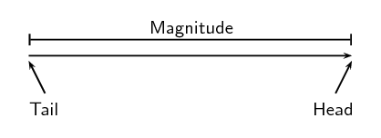

# Chapter 1: Vectors in two dimensions

## 1.1 Introduction (ESBK2)

In this chapter learners will explore vectors in two dimensions. In grade 10 learners were introduced to the
        concept of vectors and scalars and learnt techniques for calculating the resultant of several vectors in a
        straight line (or one dimension). This chapter will use force vectors as examples and serves as a sound
        introduction to the next chapter on forces, as well as much of physics.

The following topics are covered in this chapter.

- **How to sketch vectors and how to sketch vectors on the Cartesian plane.**
  In this topic learners will refresh how to sketch vectors from grade 10 and will then apply these skills to
              sketching the vectors on the Cartesian plane. They will learn about vectors that are perpendicular to an
              axis and parallel to an axis. In addition the different ways of specifying direction are given with an
              emphasis on the angle the vector makes with the positive \(x\)-axis.
- **How to determine the resultant of several vectors in two dimensions using graphical and algebraic
                techniques.**
  In grade 10 learners learnt about the resultant of vectors in one-dimension and different techniques of
              determining this. This work is now extended to finding the resultant of vectors in two dimensions. The same
              techniques from grade 10 are used and expanded on for determining the resultant.
- **Using trigonometry to determine the direction of the resultant**
  In grade 10 the direction was simply given as positive or negative. Now that learners are moving into two
              dimensions, new ways of specifying the direction are needed. We use the angle that the vector makes with the
              positive \(x\)-axis as the main way to specify direction. Learners will need to be familiar with sine,
              cosine and tangent from trigonometry and how to calculate these ratios for right-angled triangles.
- **How to break vectors up into components and carry out simple calculations using components**
  Vectors can be broken up into \(x\) and \(y\) components. This skill will be very useful for the next
              chapter on Newton's laws. In this section learners learn how to resolve vectors into components and then to
              calculate the resultant using components.

In grade 10 you learnt about vectors in one dimension. Now we will take these concepts further and learn about
      vectors in two dimensions as well as components of vectors.

As a very short recap, a vector has both a magnitude and a direction. There are many physical quantities, like
      forces, that are well described by vectors (called or known as vector quantities). We often use arrows to
      represent vectors visually because the length of the arrow can be related to the magnitude and the arrowhead can
      indicate the direction. We will talk about the head, tail and magnitude of a vector when using arrows to represent
      them. Below is a diagram showing a vector (the arrow). The magnitude is indicated by the length and the labels
      show the the tail and the head of the vector. The direction of the vector is indicated by the direction in which
      the arrow is pointing.

When we write the symbol for a physical quantity represented by a vector we draw an arrow over it to signify that
      it is a vector. If the arrow is left out then we are referring only to the magnitude of the vector quantity.

<Callout type="note" title="Note">
- Theorem of Pythagoras - Mathematics, Grade 10, Analytical geometry
- Units and unit conversions - Physical Sciences, Grade 10, Science skills
- Equations - Mathematics, Grade 10, Equations and inequalities
- Trigonometry - Mathematics, Grade 10, Trigonometry
- Graphs - Mathematics, Grade 10, Functions and graphs
</Callout>
