## 1.2 Resultant of perpendicular vectors (ESBK3)

In grade 10 you learnt about the resultant vector in one dimension, we are going to extend this to
                        two dimensions. As a reminder, if you have a number of vectors (think forces for now) acting at
                        the same time you can represent the result of all of them together with a single vector known as
                        the resultant. The resultant vector will have the **same** effect as all the
                        vectors adding together.

We will focus on examples involving forces but it is very **important** to remember that
                        this applies to all physical quantities that can be described by vectors, forces, displacements,
                        accelerations, velocities and more.

### Vectors on the Cartesian plane (ESBK4)

The first thing to make a note of is that in Grade 10 we worked with vectors all acting in a
                                line, on a single axis. We are now going to go further and start to deal with two
                                dimensions. We can represent this by using the Cartesian plane which consists of two
                                perpendicular (at a right angle) axes. The axes are a \(x\)-axis and a \(y\)-axis. We
                                normally draw the \(x\)-axis from left to right (horizontally) and the \(y\)-axis up and
                                down (vertically).

We can draw vectors on the Cartesian plane. For example, if we have a force, \(\vec{F}\), of
                                magnitude \(\text{2}\) \(\text{N}\) acting in the positive \(x\)-direction we can draw
                                it as a vector on the Cartesian plane.

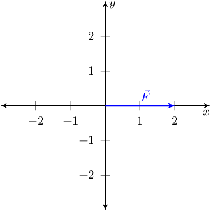

Notice that the length of the vector as measured using the axes is \(\text{2}\), the
                                magnitude specified. A vector doesn't have to start at the origin but can be placed
                                anywhere on the Cartesian plane. Where a vector starts on the plane doesn't affect the
                                physical quantity as long as the magnitude and direction remain the same. That means
                                that all of the vectors in the diagram below can represent the same force. This property
                                is know as *equality of vectors*.

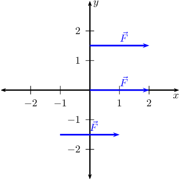

In the diagram the vectors have the same magnitude because the arrows are the same
                                **length** and they have the same **direction**. They are all
                                parallel to the \(x\)-direction and parallel to each other.

This applies equally in the \(y\)-direction. For example, if we have a force, \(\vec{F}\), of
                                magnitude \(\text{2,5}\) \(\text{N}\) acting in the positive \(y\)-direction we can draw
                                it as a vector on the Cartesian plane.

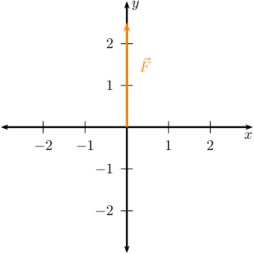

Just as in the case of the \(x\)-direction, a vector doesn't have to start at the origin but
                                can be placed anywhere on the Cartesian plane. All of the vectors in the diagram below
                                can represent the same force.

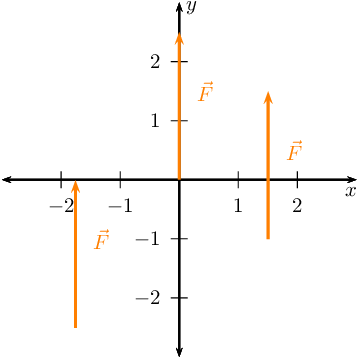

The following diagram shows an example of four force vectors, two vectors that are parallel
                                to each other and the \(y\)-axis as well as two that are parallel to each other and the
                                \(x\)-axis.

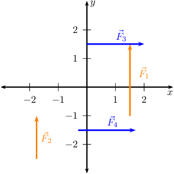

To emphasise that the vectors are perpendicular you can see in the figure below that when
                                originating from the same point the vector are at right angles.

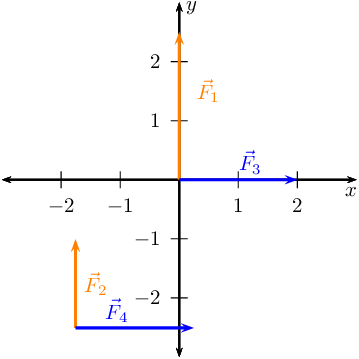

### Textbook Exercise 1.1

**Problem:**
Draw the following forces as vectors on the Cartesian plane
                                                        originating at the origin:

- \(\vec{F}_{1} = \text{1,5}\text{ N}\) in the positive
                                                                  \(x\)-direction
- \(\vec{F}_{2} = \text{2}\text{ N}\) in the positive
                                                                  \(y\)-direction

**Solution:**
We choose a scale of \(\text{1}\) \(\text{N}\):\(\text{1}\)
                                                        \(\text{cm}\). Now we sketch the vectors on the Cartesian plane
                                                        (we can place the vectors anywhere on the Cartesian plane, we
                                                        will place them starting at the origin):

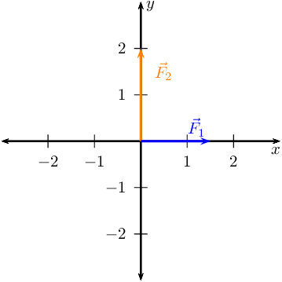

**Problem:**
Draw the following forces as vectors on the Cartesian plane:

- \(\vec{F}_{1} = \text{3}\text{ N}\) in the positive
                                                                  \(x\)-direction
- \(\vec{F}_{2} = \text{1}\text{ N}\) in the negative
                                                                  \(x\)-direction
- \(\vec{F}_{3} = \text{3}\text{ N}\) in the positive
                                                                  \(y\)-direction

**Solution:**
We choose a scale of \(\text{1}\) \(\text{N}\):\(\text{1}\)
                                                        \(\text{cm}\). Now we sketch the vectors on the Cartesian plane
                                                        (we can place the vectors anywhere on the Cartesian plane):

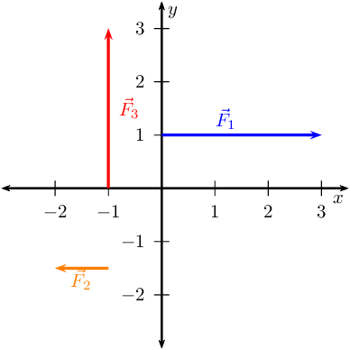

**Problem:**
Draw the following forces as vectors on the Cartesian plane:

- \(\vec{F}_{1} = \text{3}\text{ N}\) in the positive
                                                                  \(x\)-direction
- \(\vec{F}_{2} = \text{1}\text{ N}\) in the positive
                                                                  \(x\)-direction
- \(\vec{F}_{3} = \text{2}\text{ N}\) in the negative
                                                                  \(x\)-direction
- \(\vec{F}_{4} = \text{3}\text{ N}\) in the positive
                                                                  \(y\)-direction

**Solution:**
We choose a scale of \(\text{1}\) \(\text{N}\):\(\text{1}\)
                                                        \(\text{cm}\). Now we sketch the vectors on the Cartesian plane
                                                        (we can place the vectors anywhere on the Cartesian plane):

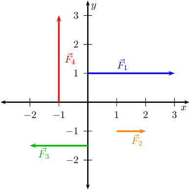

**Problem:**
Draw the following forces as vectors on the Cartesian plane:

- \(\vec{F}_{1} = \text{2}\text{ N}\) in the positive
                                                                  \(y\)-direction
- \(\vec{F}_{2} = \text{1,5}\text{ N}\) in the negative
                                                                  \(y\)-direction
- \(\vec{F}_{3} = \text{2,5}\text{ N}\) in the negative
                                                                  \(x\)-direction
- \(\vec{F}_{4} = \text{3}\text{ N}\) in the positive
                                                                  \(y\)-direction

**Solution:**
We choose a scale of \(\text{1}\) \(\text{N}\):\(\text{1}\)
                                                        \(\text{cm}\). Now we sketch the vectors on the Cartesian plane
                                                        (we can place the vectors anywhere on the Cartesian plane):

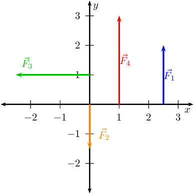

Vectors in two dimensions are not always parallel to an axis. We might know that a force acts at an
                        angle to an axis so we still know the direction of the force and if we know the magnitude we can
                        draw the force vector. For example, we can draw \(\vec{F}_{1} = \text{2}\text{ N}\) acting at
                        \(\text{45}\)\(\text{°}\) to the positive \(x\)-direction:

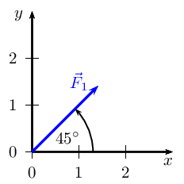

We always specify the angle as being anti-clockwise from the positive \(x\)-axis. So if we specified
                        an negative angle we would measure it clockwise from the \(x\)-axis. For example, \(\vec{F}_{1}
                        = \text{2}\text{ N}\) acting at \(-\text{45}\)\(\text{°}\) to the positive \(x\)-direction:

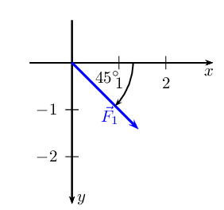

We can use many other ways of specifying the direction of a vector. The direction just needs to be
                        unambiguous. We have used the Cartesian coordinate system and an angle with the \(x\)-axis so
                        far but there are other common ways of specifying direction that you need to be aware of and
                        comfortable to handle.

### Compass directions (ESBK5)

We can use compass directions when appropriate to specify the direction of a vector. For
                                example, if we were describing the forces of tectonic plates (the sections of the
                                earth's crust that move) to talk about the forces involved in earthquakes we could talk
                                the force that the moving plates exert on each other.

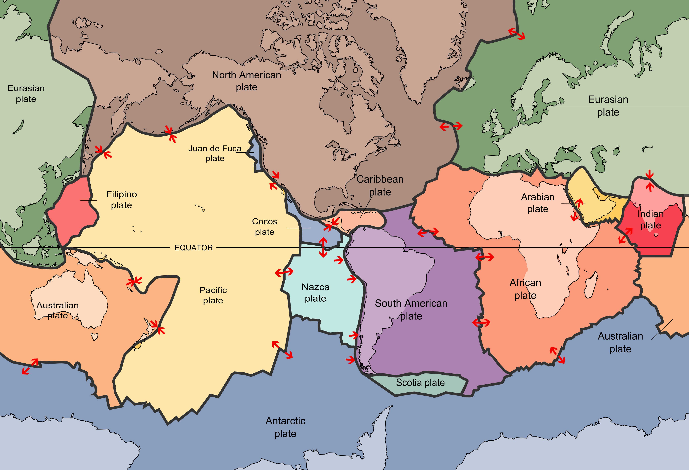

Figure 1.1: A map of the 15 major tectonic plates that make
                                        up the Earth's crust.

The four cardinal directions are North, South, East and West when using a compass. They are
                                shown in this figure:

Figure 1.2: A sketch of the compass directions.

When specifying a direction of a vector using a compass directions are given by name, North
                                or South. If the direction is directly between two directions we can combine the names,
                                for example North-East is half-way between North and East. This can only happen for
                                directions at right angles to each other, you cannot say North-South as it is ambiguous.

### Bearings (ESBK6)

Another way of using the compass to specify direction in a numerical way is to use bearings.
                                A bearing is an angle, usually measured clockwise from North. **Note** that
                                this is different to the Cartesian plane where angles are anti- or counter-clockwise
                                from the positive \(x\)-direction.

### The resultant vector (ESBK7)

In grade 10 you learnt about adding vectors together in one dimension. The same principle can
                                be applied for vectors in two dimensions. The following examples show addition of
                                vectors. Vectors that are parallel can be shifted to fall on a line. Vectors falling on
                                the same line are called *co-linear* vectors. To add co-linear vectors we use the
                                tail-to-head method you learnt in Grade 10. In the figure below we remind you of the
                                approach of adding co-linear vectors to get a resultant vector.

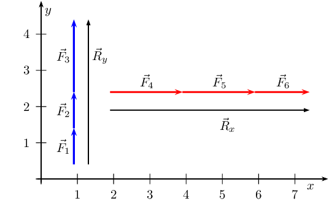

Figure 1.3: Adding co-linear vectors to get a resultant vector.

In the above figure the blue vectors are in the \(y\)-direction and the red vectors are in
                                the \(x\)-direction. The two black vectors represent the resultants of the co-linear
                                vectors graphically.

What we have done is implement the tail-to-head method of vector addition for the vertical
                                set of vectors and the horizontal set of vectors.

<Callout type="tip" title="Worked example 1: Revision: head-to-tail addition in one dimension">
**Question:**
Use the graphical head-to-tail method to determine the resultant force on a
                                                rugby player if two players on his team are pushing him forwards with
                                                forces of \(\stackrel{\to }{{F}_{1}}\) = \(\text{600}\) \(\text{N}\) and
                                                \(\stackrel{\to }{{F}_{2}}\) = \(\text{900}\) \(\text{N}\) respectively
                                                and two players from the opposing team are pushing him backwards with
                                                forces of \(\stackrel{\to }{{F}_{3}}\) = \(\text{1 000}\)
                                                \(\text{N}\) and \(\stackrel{\to }{{F}_{4}}\) = \(\text{650}\)
                                                \(\text{N}\) respectively.

**Choose a scale and a reference direction:**
Let's choose a scale of \(\text{100}\) \(\text{N}\): \(\text{0,5}\)
                                                \(\text{cm}\) and for our diagram we will define the positive direction
                                                as *to the right.*

**Choose one of the vectors and draw it as an arrow of the
                                                correct length in the correct direction:**
We will start with drawing the vector \(\stackrel{\to }{{F}_{1}}\) =
                                                \(\text{600}\) \(\text{N}\) pointing in the positive direction.
                                                Using our scale of \(\text{0,5}\) \(\text{cm}\) : \(\text{100}\)
                                                \(\text{N}\), the length of the arrow must be \(\text{3}\) \(\text{cm}\)
                                                pointing to the right.

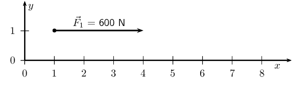

**Take the next vector and draw it starting at the arrowhead of
                                                the previous vector:**
The next vector is \(\stackrel{\to }{{F}_{2}}\) = \(\text{900}\) \(\text{N}\)
                                                in the same direction as \(\stackrel{\to }{{F}_{1}}\). Using the scale,
                                                the arrow should be \(\text{4,5}\) \(\text{cm}\) long and pointing to
                                                the right.

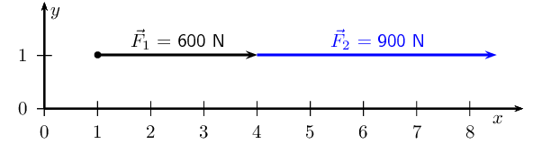

**Take the next vector and draw it starting at the arrowhead of
                                                the previous vector:**
The next vector is \(\stackrel{\to }{{F}_{3}}\) = \(\text{1 000}\)
                                                \(\text{N}\) in the *opposite* direction. Using the scale, this
                                                arrow should be \(\text{5}\) \(\text{cm}\) long and point to the
                                                *left*.

**Note:** We are working in one dimension so this arrow would be
                                                drawn on top of the first vectors to the left. This will get confusing
                                                so we'll draw it next to the actual line as well to show you what it
                                                looks like.

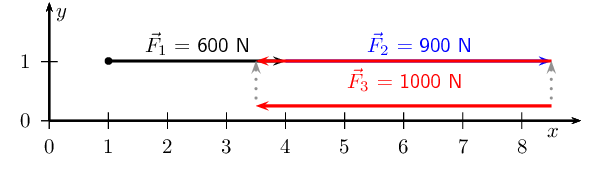

**Take the next vector and draw it starting at the arrowhead of
                                                the previous vector:**
The fourth vector is \(\stackrel{\to }{{F}_{4}}\) = \(\text{650}\)
                                                \(\text{N}\) in the opposite direction. Using the scale, this arrow must
                                                be \(\text{3,25}\) \(\text{cm}\) long and point to the left.

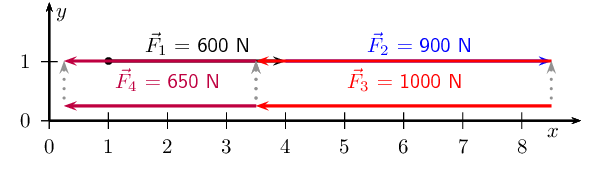

**Draw the resultant, measure its length and find its direction:**
We have now drawn all the force vectors that are being applied to the player.
                                                The resultant vector is the arrow which starts at the tail of the first
                                                vector and ends at the head of the last drawn vector.

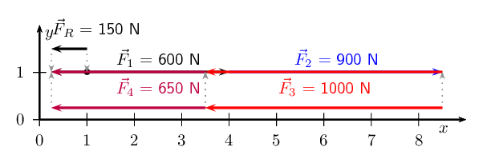

The resultant vector measures \(\text{0,75}\) \(\text{cm}\) which, using our
                                                scale is equivalent to \(\text{150}\) \(\text{N}\) and points to the
                                                left (*or* the negative direction *or* the direction the
                                                opposing team members are pushing in).
</Callout>

### Textbook Exercise 1.2

**Problem:**
Find the resultant in the \(x\)-direction, \(R_x\), and
                                                        \(y\)-direction, \(R_y\) for the following forces:

- \(\vec{F}_{1} = \text{1,5}\text{ N}\) in the positive
                                                                  \(x\)-direction
- \(\vec{F}_{2} = \text{1,5}\text{ N}\) in the positive
                                                                  \(x\)-direction
- \(\vec{F}_{3} = \text{2}\text{ N}\) in the negative
                                                                  \(x\)-direction

**Solution:**
We choose a scale of \(\text{1}\) \(\text{N}\): \(\text{1}\)
                                                        \(\text{cm}\) and for our diagram we will define the positive
                                                        direction as *to the right.*

We will start with drawing the vector \(\stackrel{\to }{{F}_{1}}\) =
                                                        \(\text{1,5}\) \(\text{N}\) pointing in the positive direction.
                                                        Using our scale of \(\text{1}\) \(\text{N}\) : \(\text{1}\)
                                                        \(\text{cm}\), the length of the arrow must be \(\text{1,5}\)
                                                        \(\text{cm}\) pointing to the right.

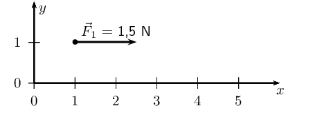

The next vector is \(\stackrel{\to }{{F}_{2}}\) = \(\text{1,5}\)
                                                        \(\text{N}\) in the same direction as \(\stackrel{\to
                                                        }{{F}_{1}}\). Using the scale, the arrow should be
                                                        \(\text{1,5}\) \(\text{cm}\) long and pointing to the right.

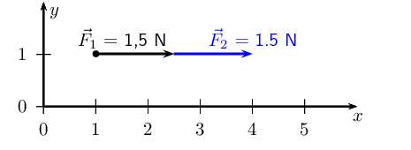

The next vector is \(\stackrel{\to }{{F}_{3}}\) = \(\text{2}\)
                                                        \(\text{N}\) in the *opposite* direction. Using the
                                                        scale, this arrow should be \(\text{2}\) \(\text{cm}\) long and
                                                        point to the *left*.

**Note:** We are working in one dimension so this arrow
                                                        would be drawn on top of the first vectors to the left. This
                                                        will get confusing so we'll draw it next to the actual line as
                                                        well to show you what it looks like.

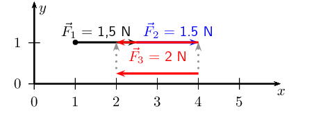

We have now drawn all the force vectors that are given. The resultant
                                                        vector is the arrow which starts at the tail of the first vector
                                                        and ends at the head of the last drawn vector.

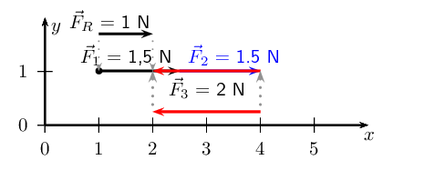

The resultant vector measures \(\text{1}\) \(\text{cm}\) which, using
                                                        our scale is equivalent to \(\text{1}\) \(\text{N}\) and points
                                                        to the right (*or* the positive direction). This is
                                                        \(\vec{R}_{x}\). For this set of vectors we have no vectors
                                                        pointing in the \(y\)-direction and so we do not need to find
                                                        \(\vec{R}_{y}\).

**Problem:**
Find the resultant in the \(x\)-direction, \(\vec{R}_x\), and
                                                        \(y\)-direction, \(\vec{R}_y\) for the following forces:

- \(\vec{F}_{1} = \text{2,3}\text{ N}\) in the positive
                                                                  \(x\)-direction
- \(\vec{F}_{2} = \text{1}\text{ N}\) in the negative
                                                                  \(x\)-direction
- \(\vec{F}_{3} = \text{2}\text{ N}\) in the positive
                                                                  \(y\)-direction
- \(\vec{F}_{4} = \text{3}\text{ N}\) in the negative
                                                                  \(y\)-direction

**Solution:**
We choose a scale of \(\text{1}\) \(\text{N}\): \(\text{1}\)
                                                        \(\text{cm}\) and for our diagram we will define the positive
                                                        direction as *to the right.*

Before we draw the vectors we note the lengths of the vectors using
                                                        our scale:

                                                \begin{align*}
                                                \vec{F}_{1} & = \text{2,3}\text{ cm} \\
                                                \vec{F}_{2} & = \text{1}\text{ cm} \\
                                                \vec{F}_{3} & = \text{2}\text{ cm} \\
                                                \vec{F}_{4} & = \text{3}\text{ cm}
                                                \end{align*}

We also note the direction the vectors are in:

                                                \begin{align*}
                                                \vec{F}_{1} & = \text{positive } x \text{-direction} \\
                                                \vec{F}_{2} & = \text{negative } x \text{-direction} \\
                                                \vec{F}_{3} & = \text{positive } y \text{-direction} \\
                                                \vec{F}_{4} & = \text{negative } y \text{-direction}
                                                \end{align*}

We now look at the two vectors in the \(x\)-direction to find
                                                        \(\vec{R}_{x}\):

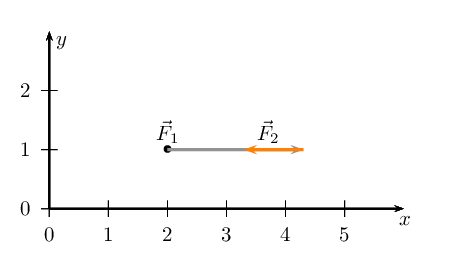

We have now drawn all the force vectors that act in the
                                                        \(x\)-direction. To find \(\vec{R}_{x}\) we note that the
                                                        resultant vector is the arrow which starts at the tail of the
                                                        first vector and ends at the head of the last drawn vector in
                                                        that direction.

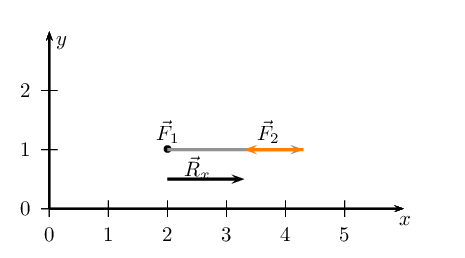

We note that \(\vec{R}_{x}\) is \(\text{1,3}\) \(\text{cm}\) or
                                                        \(\text{1,3}\) \(\text{N}\) in the positive \(x\)-direction.

We now look at the two vectors in the \(y\)-direction to find
                                                        \(\vec{R}_{y}\):

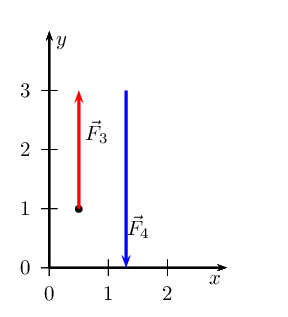

We have now drawn all the force vectors that act in the
                                                        \(y\)-direction. To find \(\vec{R}_{y}\) we note that the
                                                        resultant vector is the arrow which starts at the tail of the
                                                        first vector and ends at the head of the last drawn vector in
                                                        that direction.

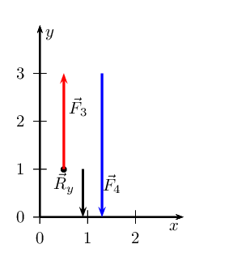

We note that \(\vec{R}_{y}\) is \(\text{1}\) \(\text{cm}\) or
                                                        \(\text{1}\) \(\text{N}\) in the negative \(y\)-direction.

\(\vec{R}_{x}\) = \(\text{1,3}\) \(\text{N}\) and points in the
                                                        positive \(x\)-direction. \(\vec{R}_{y}\) = \(\text{1}\)
                                                        \(\text{N}\) and points in the negative \(y\)-direction.

**Problem:**
Find the resultant in the \(x\)-direction, \(\vec{R}_x\), and
                                                        \(y\)-direction, \(\vec{R}_y\) for the following forces:

- \(\vec{F}_{1} = \text{3}\text{ N}\) in the positive
                                                                  \(x\)-direction
- \(\vec{F}_{2} = \text{1}\text{ N}\) in the positive
                                                                  \(x\)-direction
- \(\vec{F}_{3} = \text{2}\text{ N}\) in the negative
                                                                  \(x\)-direction
- \(\vec{F}_{4} = \text{3}\text{ N}\) in the positive
                                                                  \(y\)-direction

**Solution:**
We choose a scale of \(\text{1}\) \(\text{N}\): \(\text{1}\)
                                                        \(\text{cm}\) and for our diagram we will define the positive
                                                        direction as *to the right.*

Before we draw the vectors we note the lengths of the vectors using
                                                        our scale:

                                                \begin{align*}
                                                \vec{F}_{1} & = \text{3}\text{ cm} \\
                                                \vec{F}_{2} & = \text{1}\text{ cm} \\
                                                \vec{F}_{3} & = \text{2}\text{ cm} \\
                                                \vec{F}_{4} & = \text{3}\text{ cm}
                                                \end{align*}

We also note the direction the vectors are in:

                                                \begin{align*}
                                                \vec{F}_{1} & = \text{positive } x \text{-direction} \\
                                                \vec{F}_{2} & = \text{positive } x \text{-direction} \\
                                                \vec{F}_{3} & = \text{negative } x \text{-direction} \\
                                                \vec{F}_{4} & = \text{positive } y \text{-direction}
                                                \end{align*}

We now look at the three vectors in the \(x\)-direction to find
                                                        \(\vec{R}_{x}\):

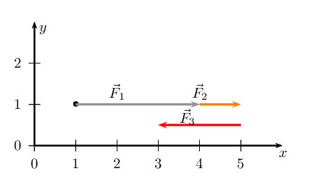

We have now drawn all the force vectors that act in the
                                                        \(x\)-direction. To find \(\vec{R}_{x}\) we note that the
                                                        resultant vector is the arrow which starts at the tail of the
                                                        first vector and ends at the head of the last drawn vector in
                                                        that direction.

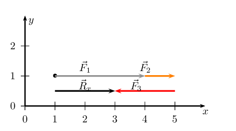

We note that \(\vec{R}_{x}\) is \(\text{2}\) \(\text{cm}\) or
                                                        \(\text{2}\) \(\text{N}\) in the positive \(x\)-direction.

We now look at the vectors in the \(y\)-direction to find
                                                        \(\vec{R}_{y}\). We notice that we only have one vector in this
                                                        direction and so that vector is the resultant.

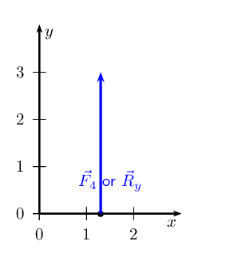

We note that \(\vec{R}_{y}\) is \(\text{3}\) \(\text{cm}\) or
                                                        \(\text{3}\) \(\text{N}\) in the positive \(y\)-direction.

\(\vec{R}_{x}\) = \(\text{2}\) \(\text{N}\) and points in the
                                                        positive \(x\)-direction. \(\vec{R}_{y}\) = \(\text{3}\)
                                                        \(\text{N}\) and points in the positive \(y\)-direction.

**Problem:**
Find the resultant in the \(x\)-direction, \(\vec{R}_x\), and
                                                        \(y\)-direction, \(\vec{R}_y\) for the following forces:

- \(\vec{F}_{1} = \text{2}\text{ N}\) in the positive
                                                                  \(y\)-direction
- \(\vec{F}_{2} = \text{1,5}\text{ N}\) in the negative
                                                                  \(y\)-direction
- \(\vec{F}_{3} = \text{2,5}\text{ N}\) in the negative
                                                                  \(x\)-direction
- \(\vec{F}_{4} = \text{3}\text{ N}\) in the positive
                                                                  \(y\)-direction

**Solution:**
We choose a scale of \(\text{1}\) \(\text{cm}\): \(\text{1}\)
                                                        \(\text{N}\) and for our diagram we will define the positive
                                                        direction as *to the right.*

Before we draw the vectors we note the lengths of the vectors using
                                                        our scale:

                                                \begin{align*}
                                                \vec{F}_{1} & = \text{2}\text{ cm} \\
                                                \vec{F}_{2} & = \text{1,5}\text{ cm} \\
                                                \vec{F}_{3} & = \text{2,5}\text{ cm} \\
                                                \vec{F}_{4} & = \text{3}\text{ cm}
                                                \end{align*}

We also note the direction the vectors are in:

                                                \begin{align*}
                                                \vec{F}_{1} & = \text{positive } y \text{-direction} \\
                                                \vec{F}_{2} & = \text{negative } y \text{-direction} \\
                                                \vec{F}_{3} & = \text{negative } x \text{-direction} \\
                                                \vec{F}_{4} & = \text{positive } y \text{-direction}
                                                \end{align*}

We look at the vectors in the \(x\)-direction to find
                                                        \(\vec{R}_{x}\). We notice that we only have one vector in this
                                                        direction and so that vector is the resultant.

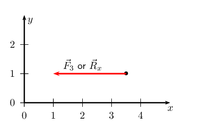

We note that \(\vec{R}_{x}\) is \(\text{2,5}\) \(\text{cm}\) or
                                                        \(\text{2,5}\) \(\text{N}\) in the negative \(x\)-direction.

We now look at the three vectors in the \(y\)-direction to find
                                                        \(\vec{R}_{y}\):

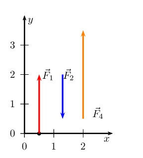

We have now drawn all the force vectors that act in the
                                                        \(y\)-direction. To find \(\vec{R}_{y}\) we note that the
                                                        resultant vector is the arrow which starts at the tail of the
                                                        first vector and ends at the head of the last drawn vector in
                                                        that direction.

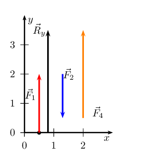

We note that \(\vec{R}_{y}\) is \(\text{3,5}\) \(\text{cm}\) or
                                                        \(\text{3,5}\) \(\text{N}\) in the positive \(y\)-direction.

\(\vec{R}_{x}\) = \(\text{2,5}\) \(\text{N}\) and points in the
                                                        negative \(x\)-direction. \(\vec{R}_{y}\) = \(\text{3,5}\)
                                                        \(\text{N}\) and points in the positive \(y\)-direction.

**Problem:**
Find a force in the \(x\)-direction, \(F_x\), and \(y\)-direction,
                                                        \(F_y\), that you can add to the following forces to make the
                                                        resultant in the \(x\)-direction, \(R_x\), and \(y\)-direction,
                                                        \(R_y\) zero:

- \(\vec{F}_{1} = \text{2,4}\text{ N}\) in the positive
                                                                  \(y\)-direction
- \(\vec{F}_{2} = \text{0,7}\text{ N}\) in the negative
                                                                  \(y\)-direction
- \(\vec{F}_{3} = \text{2,8}\text{ N}\) in the negative
                                                                  \(x\)-direction
- \(\vec{F}_{4} = \text{3,3}\text{ N}\) in the positive
                                                                  \(y\)-direction

**Solution:**
To solve this problem we will draw the vectors on the Cartesian plane
                                                        and then look at what the resultant vector is. Then we determine
                                                        what force vector to add so that the resultant vector is
                                                        \(\text{0}\).

We choose a scale of \(\text{1}\) \(\text{cm}\): \(\text{1}\)
                                                        \(\text{N}\) and for our diagram we will define the positive
                                                        direction as *to the right.*

Before we draw the vectors we note the lengths of the vectors using
                                                        our scale:

                                                \begin{align*}
                                                \vec{F}_{1} & = \text{2,4}\text{ cm} \\
                                                \vec{F}_{2} & = \text{0,7}\text{ cm} \\
                                                \vec{F}_{3} & = \text{2,8}\text{ cm} \\
                                                \vec{F}_{4} & = \text{3,3}\text{ cm}
                                                \end{align*}

We also note the direction the vectors are in:

                                                \begin{align*}
                                                \vec{F}_{1} & = \text{positive } y \text{-direction} \\
                                                \vec{F}_{2} & = \text{negative } y \text{-direction} \\
                                                \vec{F}_{3} & = \text{negative } x \text{-direction} \\
                                                \vec{F}_{4} & = \text{positive } y \text{-direction}
                                                \end{align*}

We look at the vectors in the \(x\)-direction to find
                                                        \(\vec{R}_{x}\). We notice that we only have one vector in this
                                                        direction and so that vector is the resultant.

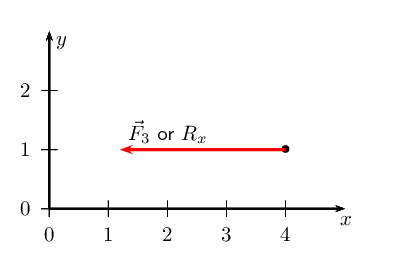

We note that \(\vec{R}_{x}\) is \(\text{2,8}\) \(\text{cm}\) or
                                                        \(\text{2,8}\) \(\text{N}\) in the negative \(x\)-direction.

So if we add a force of \(\text{2,8}\) \(\text{N}\) in the positive
                                                        \(x\)-direction the resultant will be \(\text{0}\):

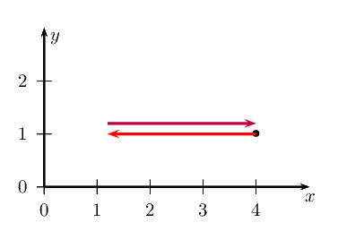

We now look at the three vectors in the \(y\)-direction to find
                                                        \(\vec{R}_{y}\):

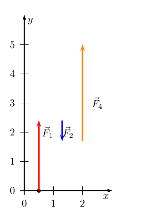

We have now drawn all the force vectors that act in the
                                                        \(y\)-direction. To find \(\vec{R}_{y}\) we note that the
                                                        resultant vector is the arrow which starts at the tail of the
                                                        first vector and ends at the head of the last drawn vector in
                                                        that direction.

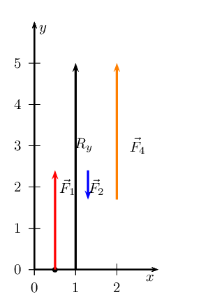

We note that \(\vec{R}_{y}\) is \(\text{5}\) \(\text{cm}\) or
                                                        \(\text{5}\) \(\text{N}\) in the positive \(y\)-direction.

So if we add a force of \(\text{5}\) \(\text{N}\) in the negative
                                                        \(y\)-direction the resultant will be \(\text{0}\):

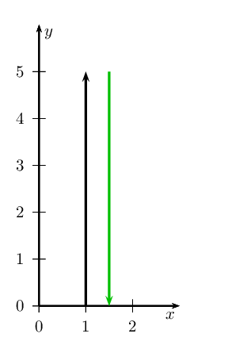

We must add a force of \(\text{2,8}\) \(\text{N}\) in the positive
                                                        \(x\)-direction and a force of \(\text{5}\) \(\text{N}\) in the
                                                        negative \(y\)-direction.

### Magnitude of the resultant of vectors at right angles (ESBK8)

We apply the same principle to vectors that are at right angles or perpendicular to each
                                other.

#### Sketching tail-to-head method

The tail of the one vector is placed at the head of the other but in two dimensions
                                        the vectors may not be co-linear. The approach is to draw all the vectors, one
                                        at a time. For the first vector begin at the origin of the Cartesian plane, for
                                        the second vector draw it from the head of the first vector. The third vector
                                        should be drawn from the head of the second and so on. Each vector is drawn from
                                        the head of the vector that preceded it. The order doesn't matter as the
                                        resultant will be the same if the order is different.

Let us apply this procedure to two vectors:

- \(\vec{F}_{1} = \text{2}\text{ N}\) in the positive \(y\)-direction
- \(\vec{F}_{2} = \text{1,5}\text{ N}\) in the positive \(x\)-direction

We first draw a Cartesian plane with the first vector originating at the origin:

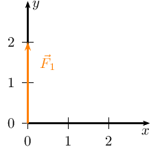

The next step is to take the second vector and draw it from the head of the first
                                        vector:

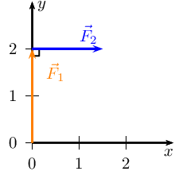

The resultant, \(\vec{R}\), is the vector connecting the tail of the first vector
                                        drawn to the head of the last vector drawn:

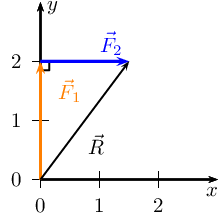

It is important to remember that the order in which we draw the vectors doesn't
                                        matter. If we had drawn them in the opposite order we would have the same
                                        resultant, \(\vec{R}\). We can repeat the process to demonstrate this:

We first draw a Cartesian plane with the second vector originating at the origin:

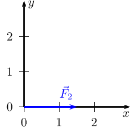

The next step is to take the other vector and draw it from the head of the vector we
                                        have already drawn:

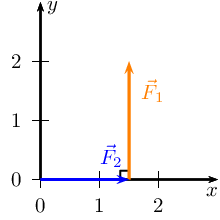

The resultant, \(\vec{R}\), is the vector connecting the tail of the first vector
                                        drawn to the head of the last vector drawn (the vector from the start point to
                                        the end point):

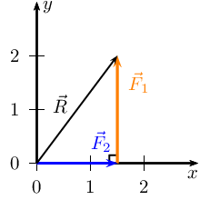

<Callout type="tip" title="Worked example 2: Sketching vectors using tail-to-head">
**Question:**
Sketch the resultant of the following force vectors using the
                                                        tail-to-head method:

- \(\vec{F}_{1} = \text{2}\text{ N}\) in the positive
                                                                  \(y\)-direction
- \(\vec{F}_{2} = \text{1,5}\text{ N}\) in the positive
                                                                  \(x\)-direction
- \(\vec{F}_{3} = \text{1,3}\text{ N}\) in the negative
                                                                  \(y\)-direction
- \(\vec{F}_{4} = \text{1}\text{ N}\) in the negative
                                                                  \(x\)-direction

**Draw the Cartesian plane and the first vector:**
First draw the Cartesian plane and force, \(\vec{F}_{1}\) starting at
                                                        the origin:

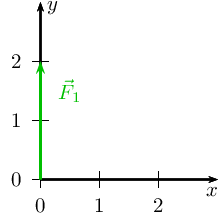

**Draw the second vector:**
Starting at the head of the first vector we draw the tail of the
                                                        second vector:

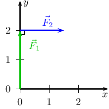

**Draw the third vector:**
Starting at the head of the second vector we draw the tail of the
                                                        third vector:

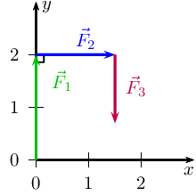

**Draw the fourth vector:**
Starting at the head of the third vector we draw the tail of the
                                                        fourth vector:

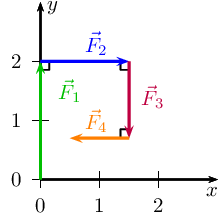

**Draw the resultant vector:**
Starting at the origin draw the resultant vector to the head of the
                                                        fourth vector:

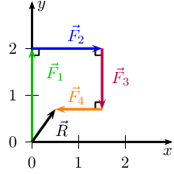
</Callout>

<Callout type="tip" title="Worked example 3: Sketching vectors using tail-to-head">
**Question:**
Sketch the resultant of the following force vectors using the
                                                        tail-to-head method by first determining the resultant in the
                                                        \(x\)- and \(y\)-directions:

- \(\vec{F}_{1} = \text{2}\text{ N}\) in the positive
                                                                  \(y\)-direction
- \(\vec{F}_{2} = \text{1,5}\text{ N}\) in the positive
                                                                  \(x\)-direction
- \(\vec{F}_{3} = \text{1,3}\text{ N}\) in the negative
                                                                  \(y\)-direction
- \(\vec{F}_{4} = \text{1}\text{ N}\) in the negative
                                                                  \(x\)-direction

**First determine \(\vec{R}_{x}\):**
First draw the Cartesian plane with the vectors in the
                                                        \(x\)-direction:

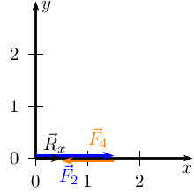

**Secondly determine \(\vec{R}_{y}\):**
Next we draw the Cartesian plane with the vectors in the
                                                        \(y\)-direction:

**Draw the resultant vectors, \(\vec{R}_{y}\) and
                                                        \(\vec{R}_{x}\) head-to-tail:**

**Comparison of results:**
To double check, we can replot all the vectors again as we did in the
                                                        previous worked example to see that the outcome is the same:

</Callout>

### Textbook Exercise 1.3

**Problem:**
Sketch the resultant of the following force vectors
                                                                        using the tail-to-head method:

- \(\vec{F}_{1} = \text{2,1}\text{ N}\) in the
                                                                                  positive \(y\)-direction
- \(\vec{F}_{2} = \text{1,5}\text{ N}\) in the
                                                                                  negative \(x\)-direction

**Solution:**
We first draw a Cartesian plane with the first vector
                                                                        originating at the origin:

The next step is to take the second vector and draw
                                                                        it from the head of the first vector:

The resultant, \(\vec{R}\), is the vector connecting
                                                                        the tail of the first vector drawn to the head
                                                                        of the last vector drawn:

**Problem:**
Sketch the resultant of the following force vectors
                                                                        using the tail-to-head method:

- \(\vec{F}_{1} = \text{12}\text{ N}\) in the
                                                                                  positive \(y\)-direction
- \(\vec{F}_{2} = \text{10}\text{ N}\) in the
                                                                                  positive \(x\)-direction
- \(\vec{F}_{3} = \text{5}\text{ N}\) in the
                                                                                  negative \(y\)-direction
- \(\vec{F}_{4} = \text{5}\text{ N}\) in the
                                                                                  negative \(x\)-direction

**Solution:**
We first sketch the vectors on the Cartesian plane.
                                                                        We choose a scale of \(\text{1}\) \(\text{cm}\)
                                                                        = \(\text{2}\) \(\text{N}\). Remember to sketch
                                                                        \(F_{2}\) starting at the head of \(F_{1}\),
                                                                        \(F_{3}\) starting at the head of \(F_{2}\) and
                                                                        \(F_{4}\) starting at the head of \(F_{3}\).

The resultant, \(\vec{R}\), is the vector connecting
                                                                        the tail of the first vector drawn to the head
                                                                        of the last vector drawn:

**Problem:**
Sketch the resultant of the following force vectors
                                                                        using the tail-to-head method by first
                                                                        determining the resultant in the \(x\)- and
                                                                        \(y\)-directions:

- \(\vec{F}_{1} = \text{2}\text{ N}\) in the
                                                                                  positive \(y\)-direction
- \(\vec{F}_{2} = \text{1,5}\text{ N}\) in the
                                                                                  negative \(y\)-direction
- \(\vec{F}_{3} = \text{1,3}\text{ N}\) in the
                                                                                  negative \(y\)-direction
- \(\vec{F}_{4} = \text{1}\text{ N}\) in the
                                                                                  negative \(x\)-direction

**Solution:**
We first determine \(\vec{R}_{x}\)

Draw the Cartesian plane with the vectors in the
                                                                        \(x\)-direction:

This is \(\vec{R}_{x}\) since it is the only vector
                                                                        in the \(x\)-direction.

Secondly determine \(\vec{R}_{y}\)

Next we draw the Cartesian plane with the vectors in
                                                                        the \(y\)-direction:

Now we draw the resultant vectors, \(\vec{R}_{y}\)
                                                                        and \(\vec{R}_{x}\) head-to-tail:

You can check this answer by using the tail-to-head
                                                                        method without first determining the resultant
                                                                        in the \(x\)-direction and the \(y\)-direction.

**Problem:**
Sketch the resultant of the following force vectors
                                                                        using the tail-to-head method by first
                                                                        determining the resultant in the \(x\)- and
                                                                        \(y\)-directions:

- \(\vec{F}_{1} = \text{6}\text{ N}\) in the
                                                                                  positive \(y\)-direction
- \(\vec{F}_{2} = \text{3,5}\text{ N}\) in the
                                                                                  negative \(x\)-direction
- \(\vec{F}_{3} = \text{8,7}\text{ N}\) in the
                                                                                  negative \(y\)-direction
- \(\vec{F}_{4} = \text{3}\text{ N}\) in the
                                                                                  negative \(y\)-direction

**Solution:**
We choose a scale of \(\text{1}\) \(\text{cm}\) :
                                                                        \(\text{2}\) \(\text{N}\).

We first determine \(\vec{R}_{x}\)

Draw the Cartesian plane with the vectors in the
                                                                        \(x\)-direction:

This is \(\vec{R}_{x}\) since it is the only vector
                                                                        in the \(x\)-direction.

Secondly determine \(\vec{R}_{y}\)

Next we draw the Cartesian plane with the vectors in
                                                                        the \(y\)-direction:

Now we draw the resultant vectors, \(\vec{R}_{y}\)
                                                                        and \(\vec{R}_{x}\) head-to-tail:

You can check this answer by using the tail-to-head
                                                                        method without first determining the resultant
                                                                        in the \(x\)-direction and the \(y\)-direction.

#### Sketching tail-to-tail method

In this method we draw the two vectors with their tails on the origin. Then we draw a
                                        line parallel to the first vector from the head of the second vector and vice
                                        versa. Where the parallel lines intersect is the head of the resultant vector
                                        that will also start at the origin. We will only deal with perpendicular vectors
                                        but this procedure works for any vectors.

<Callout type="note" title="Note">
When dealing with more than two vectors the procedure is repetitive. First
                                                find the resultant of any two of the vectors to be added. Then use the
                                                same method to add the resultant from the first two vectors with a third
                                                vector. This new resultant is then added to the fourth vector and so on,
                                                until there are no more vectors to be added.
</Callout>

Let us apply this procedure to the same two vectors we used to illustrate the
                                        head-to-tail method:

- \(\vec{F}_{1} = \text{2}\text{ N}\) in the positive \(y\)-direction
- \(\vec{F}_{2} = \text{1,5}\text{ N}\) in the positive \(x\)-direction

We first draw a Cartesian plane with the first vector originating at the origin:

Then we add the second vector but also originating from the origin so that the
                                        vectors are drawn tail-to-tail:

Now we draw a line parallel to \(\vec{F}_{1}\) from the head of \(\vec{F}_{2}\):

Next we draw a line parallel to \(\vec{F}_{2}\) from the head of \(\vec{F}_{1}\):

Where the two lines intersect is the head of the resultant vector which will
                                        originate at the origin so:

You might be asking what you would do if you had more than 2 vectors to add together.
                                        In this case all you need to do is first determine \(\vec{R}_{x}\) by adding all
                                        the vectors that are parallel to the \(x\)-direction and \(\vec{R}_{y}\) by
                                        adding all the vectors that are parallel to the \(y\)-direction. Then you use
                                        the tail-to-tail method to find the resultant of \(\vec{R}_{x}\) and
                                        \(\vec{R}_{y}\).

### Textbook Exercise 1.4

**Problem:**
Sketch the resultant of the following force vectors using the
                                                                tail-to-tail method:

- \(\vec{F}_{1} = \text{2,1}\text{ N}\) in the
                                                                          positive \(y\)-direction
- \(\vec{F}_{2} = \text{1,5}\text{ N}\) in the
                                                                          negative \(x\)-direction

**Solution:**
We first draw a Cartesian plane with the first vector
                                                                originating at the origin:

Then we add the second vector but also originating from the
                                                                origin so that the vectors are drawn tail-to-tail:

Now we draw a line parallel to \(\vec{F}_{1}\) from the head
                                                                of \(\vec{F}_{2}\):

Next we draw a line parallel to \(\vec{F}_{2}\) from the head
                                                                of \(\vec{F}_{1}\):

Where the two lines intersect is the head of the resultant
                                                                vector which will originate at the origin so:

**Problem:**
Sketch the resultant of the following force vectors using the
                                                                tail-to-tail method by first determining the resultant
                                                                in the \(x\)- and \(y\)-directions:

- \(\vec{F}_{1} = \text{2}\text{ N}\) in the positive
                                                                          \(y\)-direction
- \(\vec{F}_{2} = \text{1,5}\text{ N}\) in the
                                                                          negative \(y\)-direction
- \(\vec{F}_{3} = \text{1,3}\text{ N}\) in the
                                                                          negative \(y\)-direction
- \(\vec{F}_{4} = \text{1}\text{ N}\) in the negative
                                                                          \(x\)-direction

**Solution:**
We need to determine \(\vec{R}_{x}\) and \(\vec{R}_{y}\) and
                                                                then use these to find the resultant.

Determine \(\vec{R}_{x}\).

Draw the Cartesian plane with the vectors in the
                                                                \(x\)-direction:

This is \(\vec{R}_{x}\) since it is the only vector in the
                                                                \(x\)-direction.

Secondly determine \(\vec{R}_{y}\)

Next we draw the Cartesian plane with the vectors in the
                                                                \(y\)-direction:

Now we draw the resultant vectors, \(\vec{R}_{y}\) and
                                                                \(\vec{R}_{x}\) tail-to-tail:

Now we can draw the lines to show us where the head of the
                                                                resultant must be:

And finally we find the resultant:

**Problem:**
Sketch the resultant of the following force vectors using the
                                                                tail-to-tail method by first determining the resultant
                                                                in the \(x\)- and \(y\)-directions:

- \(\vec{F}_{1} = \text{6}\text{ N}\) in the positive
                                                                          \(y\)-direction
- \(\vec{F}_{2} = \text{3,5}\text{ N}\) in the
                                                                          negative \(x\)-direction
- \(\vec{F}_{3} = \text{8,7}\text{ N}\) in the
                                                                          negative \(y\)-direction
- \(\vec{F}_{4} = \text{3}\text{ N}\) in the negative
                                                                          \(y\)-direction

**Solution:**
We choose a scale of \(\text{1}\) \(\text{cm}\) =
                                                                \(\text{2}\) \(\text{N}\).

We first determine \(\vec{R}_{x}\)

Draw the Cartesian plane with the vectors in the
                                                                \(x\)-direction:

This is \(\vec{R}_{x}\) since it is the only vector in the
                                                                \(x\)-direction.

Secondly determine \(\vec{R}_{y}\)

Next we draw the Cartesian plane with the vectors in the
                                                                \(y\)-direction:

Now we draw the resultant vectors, \(\vec{R}_{y}\) and
                                                                \(\vec{R}_{x}\) tail-to-tail:

Now we can draw the lines to show us where the head of the
                                                                resultant must be:

And finally we find the resultant:

#### Closed vector diagrams

A closed vector diagram is a set of vectors drawn on the Cartesian using the
                                        tail-to-head method and that has a resultant with a magnitude of zero. This
                                        means that if the first vector starts at the origin the last vector drawn must
                                        end at the origin. The vectors form a closed polygon, no matter how many of them
                                        are drawn. Here are a few examples of closed vector diagrams:

In this case there were 3 force vectors. When drawn tail-to-head with the first force
                                        starting at the origin the last force drawn ends at the origin. The resultant
                                        would have a magnitude of zero. The resultant is drawn from the tail of the
                                        first vector to the head of the final vector. In the diagram below there are 4
                                        vectors that also form a closed vector diagram.

In this case with 4 vectors, the shape is a 4-sided polygon. Any polygon made up of
                                        vectors drawn tail-to-head will be a closed vector diagram because a polygon has
                                        no gaps.

#### Using Pythagoras' theorem to find magnitude

If we wanted to know the resultant of the three blue vectors and the three red
                                        vectors in Figure 1.3 we
                                        can use the resultant vectors in the \(x\)- and \(y\)-directions to determine
                                        this.

Figure 1.4: Finding the resultant.

The black arrow represents the resultant of the vectors \(\vec{R}_x\) and
                                        \(\vec{R}_y\). We can find the magnitude of this vector using the theorem of
                                        Pythagoras because the three vectors form a right angle triangle. If we had
                                        drawn the vectors to scale we would be able to measure the magnitude of the
                                        resultant as well.

What we've actually sketched out already is our approach to finding the resultant of
                                        many vectors using components so remember this example when we get there a
                                        little later.

<Callout type="tip" title="Worked example 4: Finding the magnitude of the resultant">
**Question:**
The force vectors in Figure 1.3 have the following
                                                        magnitudes: \(\text{1}\) \(\text{N}\), \(\text{1}\)
                                                        \(\text{N}\), \(\text{2}\) \(\text{N}\) for the blue ones and
                                                        \(\text{2}\) \(\text{N}\), \(\text{2}\) \(\text{N}\) and
                                                        \(\text{1,5}\) \(\text{N}\) for the red ones. Determine the
                                                        magnitude of the resultant.

**Determine the resultant of the vectors parallel to the
                                                        \(y\)-axis:**
The resultant of the vectors parallel to the \(y\)-axis is found by
                                                        adding the magnitudes (lengths) of three vectors because they
                                                        all point in the same direction. The answer is
                                                        \(\vec{R}_y\)=\(\text{1}\) \(\text{N}\) + \(\text{1}\)
                                                        \(\text{N}\) + \(\text{2}\) \(\text{N}\) = \(\text{4}\)
                                                        \(\text{N}\) in the positive \(y\)-direction.

**Determine the resultant of the vectors parallel to the
                                                        \(x\)-axis:**
The resultant of the vectors parallel to the \(x\)-axis is found by
                                                        adding the magnitudes (lengths) of three vectors because they
                                                        all point in the same direction. The answer is
                                                        \(\vec{R}_x\)=\(\text{2}\) \(\text{N}\) + \(\text{2}\)
                                                        \(\text{N}\) + \(\text{1,5}\) \(\text{N}\) = \(\text{5,5}\)
                                                        \(\text{N}\) in the positive \(x\)-direction.

**Determine the magnitude of the resultant:**
We have a right angled triangle. We also know the length of two of
                                                        the sides. Using Pythagoras we can find the length of the third
                                                        side. From what we know about resultant vectors this length will
                                                        be the magnitude of the resultant vector.

The resultant is:
                                                        \begin{align*}
                                                        R_x^{2} + R_y^{2} &= R^{2}\ \text{(Pythagoras' theorem)}\\
                                                        (\text{5,5})^{2} + (4)^{2} &= R^{2}\\
                                                        R &= \text{6,8}
                                                        \end{align*}

**Quote the final answer:**
Magnitude of the resultant: \(\text{6,8}\) \(\text{N}\)
</Callout>

**Note:** we did not determine the resultant vector in the worked
                                        example above because we only determined the magnitude. A vector needs a
                                        **magnitude** and a **direction**. We did not
                                        determine the direction of the resultant vector.

### Graphical methods (ESBK9)

#### Graphical techniques

In grade 10 you learnt how to add vectors in one dimension graphically.

We can expand these ideas to include vectors in two-dimensions. The following worked
                                        example shows this.

<Callout type="tip" title="Worked example 5: Finding the magnitude of the resultant in
                                                two dimensions graphically">
**Question:**
Given two vectors, \(\vec{R}_y\) = \(\text{4}\) \(\text{N}\) in the
                                                        positive \(y\)-direction and \(\vec{R}_x\) = \(\text{3}\)
                                                        \(\text{N}\) in the positive \(x\)-direction, use the
                                                        tail-to-head method to find the resultant of these vectors
                                                        graphically.

**Choose a scale and draw axes:**
The vectors we have do not have very big magnitudes so we can choose
                                                        simple scale, we can use \(\text{1}\) \(\text{N}\) :
                                                        \(\text{1}\) \(\text{cm}\) as our scale for the drawing.

Then we draw axes that the vector diagram should fit in. The largest
                                                        vector has length \(\text{4}\) \(\text{N}\) and both vectors are
                                                        in the positive direction so we can draw axes from the origin to
                                                        \(\text{5}\) and expect the vectors to fit.

**Draw \(\vec{R}_x\):**
The magnitude of \(\vec{R}_x\) is \(\text{3}\) \(\text{N}\) so the
                                                        arrow we need to draw must be \(\text{3}\) \(\text{cm}\) long.
                                                        The arrow must point in the positive \(x\)-direction.

**Draw \(\vec{R}_y\):**
The length of \(\vec{R}_y\) is \(\text{4}\) so the arrow we need to
                                                        draw must be \(\text{4}\) \(\text{cm}\) long. The arrow must
                                                        point in the positive \(y\)-direction. The important fact to
                                                        note is that we are implementing the head-to-tail method so the
                                                        vector must start at the end (head) of \(\vec{R}_x\).

**Draw the resultant vector, \(\vec{R}\):**
The resultant vector is the vector from the tail of the first vector
                                                        we drew directly to the head of the last vector we drew. This
                                                        means we need to draw a vector from the tail of \(\vec{R}_{x}\)
                                                        to the head of \(\vec{R}_{y}\).

**Measure the resultant, \(\vec{R}\):**
We are solving the problem graphically so we now need to measure the
                                                        magnitude of the vector and use the scale we chose to convert
                                                        our answer from the diagram to the actual result. In the last
                                                        diagram the resultant, \(\vec{R}\) is \(\text{5}\) \(\text{cm}\)
                                                        long therefore the magnitude of the vector is \(\text{5}\)
                                                        \(\text{N}\).

The direction of the resultant, \(\theta\), we need to measure from
                                                        the diagram using a protractor. The angle that the vector makes
                                                        with the \(x\)-axis is \(\text{53}\)\(\text{°}\).

**Quote the final answer:**
\(\vec{R}\) is \(\text{5}\) \(\text{N}\) at
                                                        \(\text{53}\)\(\text{°}\) from the positive
                                                        \(x\)-direction.
</Callout>

In the case where you have to find the resultant of more than two vectors first apply
                                        the tail-to-head method to all the vectors parallel to the one axis and then all
                                        the vectors parallel to the other axis. For example, you would first calculate
                                        \(\vec{R}_{y}\) from all the vectors parallel to the \(y\)-axis and then
                                        \(\vec{R}_{x}\) from all the vectors parallel to the \(x\)-axis. After that you
                                        apply the same procedure as in the previous worked example to the get the final
                                        resultant.

<Callout type="tip" title="Worked example 6: Finding the magnitude of the resultant in
                                                two dimensions graphically">
**Question:**
Given the following three force vectors, determine the resultant
                                                        force:

- \(\vec{F}_{1}\) = \(\text{3,4}\) \(\text{N}\) in the
                                                                          positive \(x\)-direction
- \(\vec{F}_{2}\) = \(\text{4}\) \(\text{N}\) in the
                                                                          positive \(x\)-direction
- \(\vec{F}_{3}\) = \(\text{3}\) \(\text{N}\) in the
                                                                          negative \(y\)-direction

**Determine \(\vec{R}_{x}\):**
First we determine the resultant of all the vectors that are parallel
                                                        to the \(x\)-axis. There are two vectors \(\vec{F}_{1}\) and
                                                        \(\vec{F}_{2}\) that we need to add. We do this using the
                                                        tail-to-head method for co-linear vectors.

The single vector, \(\vec{R}_{x}\), that would give us the same
                                                        outcome is:

**Determine \(\vec{R}_{y}\):**
There is only one vector in the \(y\)-direction, \(\vec{F}_{3}\),
                                                        therefore \(\vec{R}_{y}\) = \(\vec{F}_{3}\).

**Choose a scale and draw axes:**
The vectors we have do not have very big magnitudes so we can choose
                                                        simple scale, we can use \(\text{1}\) \(\text{N}\) :
                                                        \(\text{1}\) \(\text{cm}\) as our scale for the drawing.

Then we draw axes that the diagram should fit on. The longest vector
                                                        has length \(\text{7,4}\) \(\text{N}\). We need our axes to
                                                        extend just further than the vectors aligned with each axis. Our
                                                        axes need to start at the origin and go beyond \(\text{7,4}\)
                                                        \(\text{N}\) in the positive \(x\)-direction and further than
                                                        \(\text{3}\) \(\text{N}\) in the negative \(y\)-direction. Our
                                                        scale choice of \(\text{1}\) \(\text{N}\) : \(\text{1}\)
                                                        \(\text{cm}\) means that our axes actually need to extend
                                                        \(\text{7,4}\) \(\text{cm}\) in the positive \(x\)-direction and
                                                        further than \(\text{3}\) \(\text{cm}\) in the negative
                                                        \(y\)-direction

**Draw \(\vec{R_x}\):**
The magnitude of \(\vec{R}_x\) is \(\text{7,4}\) \(\text{N}\) so the
                                                        arrow we need to draw must be \(\text{7,4}\) \(\text{cm}\) long.
                                                        The arrow must point in the positive \(x\)-direction.

**Draw \(\vec{R_y}\):**
The magnitude of \(\vec{R}_y\) is \(\text{3}\) \(\text{N}\) so the
                                                        arrow we need to draw must be \(\text{3}\) \(\text{cm}\) long.
                                                        The arrow must point in the negative \(y\)-direction. The
                                                        important fact to note is that we are implementing the
                                                        head-to-tail method so the vector must start at the end (head)
                                                        of \(\vec{R}_{x}\).

**Draw the resultant vector, \(\vec{R}\):**
The resultant vector is the vector from the tail of the first vector
                                                        we drew directly to the head of the last vector we drew. This
                                                        means we need to draw a vector from the tail of \(\vec{R}_{x}\)
                                                        to the head of \(\vec{R}_{y}\).

**Measure the resultant, \(\vec{R}\):**
We are solving the problem graphically so we now need to measure the
                                                        magnitude of the vector and use the scale we chose to convert
                                                        our answer from the diagram to the actual result. In the last
                                                        diagram the resultant, \(\vec{R}\) is \(\text{8,0}\)
                                                        \(\text{cm}\) long therefore the magnitude of the vector is
                                                        \(\text{8,0}\) \(\text{N}\).

The direction of the resultant we need to measure from the diagram
                                                        using a protractor. The angle that the vector makes with the
                                                        \(x\)-axis is \(\text{22}\)\(\text{°}\).

**Quote the final answer:**
\(\vec{R}\) is \(\text{8,0}\) \(\text{N}\) at
                                                        \(-\text{22}\)\(\text{°}\) from the positive
                                                        \(x\)-direction.
</Callout>

<Callout type="tip" title="Worked example 7: Finding the resultant in two dimensions
                                                graphically">
**Question:**
Given the following three force vectors, determine the resultant
                                                        force:

- \(\vec{F}_{1}\) = \(\text{2,3}\) \(\text{N}\) in the
                                                                          positive \(x\)-direction
- \(\vec{F}_{2}\) = \(\text{4}\) \(\text{N}\) in the
                                                                          positive \(y\)-direction
- \(\vec{F}_{3}\) = \(\text{3,3}\) \(\text{N}\) in the
                                                                          negative \(y\)-direction
- \(\vec{F}_{4}\) = \(\text{2,1}\) \(\text{N}\) in the
                                                                          negative \(y\)-direction

**Determine \(\vec{R}_{x}\):**
There is only one vector in the \(x\)-direction, \(\vec{F}_{1}\),
                                                        therefore \(\vec{R}_{x}\) = \(\vec{F}_{1}\).

**Determine \(\vec{R}_{y}\):**
Then we determine the resultant of all the vectors that are parallel
                                                        to the \(y\)-axis. There are three vectors \(\vec{F}_{2}\),
                                                        \(\vec{F}_{3}\) and \(\vec{F}_{4}\) that we need to add. We do
                                                        this using the tail-to-head method for co-linear vectors.

The single vector, \(\vec{R}_{y}\), that would give us the same
                                                        effect is:

**Choose a scale and draw axes:**
We choose a scale \(\text{1}\) \(\text{N}\) : \(\text{1}\)
                                                        \(\text{cm}\) for the drawing.

Then we draw axes that the diagram should fit in. We need our axes to
                                                        extend just further than the vectors aligned with each axis. Our
                                                        axes need to start at the origin and go beyond \(\text{2,3}\)
                                                        \(\text{N}\) in the positive \(x\)-direction and further than
                                                        \(\text{1,4}\) \(\text{N}\) in the negative \(y\)-direction. Our
                                                        scale choice of \(\text{1}\) \(\text{N}\) = \(\text{1}\)
                                                        \(\text{cm}\) means that our axes actually need to extend
                                                        \(\text{2,3}\) \(\text{cm}\) in the positive \(x\)-direction and
                                                        further than \(\text{1,4}\) \(\text{cm}\) in the negative
                                                        \(y\)-direction

**Draw \(\vec{R}_x\):**
The magnitude of \(\vec{R}_x\) is \(\text{2,3}\) \(\text{N}\) so the
                                                        arrow we need to draw must be \(\text{2,3}\) \(\text{cm}\) long.
                                                        The arrow must point in the positive \(x\)-direction.

**Draw \(\vec{R}_y\):**
The magnitude of \(\vec{R}_y\) is \(\text{1,4}\) \(\text{N}\) so the
                                                        arrow we need to draw must be \(\text{1,4}\) \(\text{cm}\) long.
                                                        The arrow must point in the negative \(y\)-direction. The
                                                        important fact to note is that we are implementing the
                                                        head-to-tail method so the vector must start at the end (head)
                                                        of \(\vec{R}_{x}\).

**Draw the resultant vector, \(\vec{R}\):**
The resultant vector is the vector from the tail of the first vector
                                                        we drew directly to the head of the last vector we drew. This
                                                        means we need to draw a vector from the tail of \(\vec{R}_{x}\)
                                                        to the head of \(\vec{R}_{y}\).

**Measure the resultant, \(\vec{R}\):**
We are solving the problem graphically so we now need to measure the
                                                        magnitude of the vector and use the scale we chose to convert
                                                        our answer from the diagram to the magnitude of the vector. In
                                                        the last diagram the resultant, \(\vec{R}\) is \(\text{2,7}\)
                                                        \(\text{cm}\) long therefore the magnitude of the vector is
                                                        \(\text{2,7}\) \(\text{N}\).

The direction of the resultant we need to measure from the diagram
                                                        using a protractor. The angle that the vector makes with the
                                                        \(x\)-axis is \(\text{31}\) degrees.

**Quote the final answer:**
\(\vec{R}\) is \(\text{2,7}\) \(\text{N}\) at
                                                        \(-\text{31}\)\(\text{°}\) from the positive
                                                        \(x\)-direction.
</Callout>

<Callout type="tip" title="Worked example 8: Finding the resultant in two dimensions
                                                graphically">
**Question:**
A number of tugboats are trying to manoeuvre a submarine in the
                                                        harbour but they are not working as a team. Each tugboat is
                                                        exerting a different force on the submarine.

Given the following force vectors, determine the resultant force:

- \(\vec{F}_{1}\) = \(\text{3,4}\) \(\text{kN}\) in the
                                                                          positive \(x\)-direction
- \(\vec{F}_{2}\) = \(\text{4 000}\) \(\text{N}\)
                                                                          in the positive \(y\)-direction
- \(\vec{F}_{3}\) = \(\text{300}\) \(\text{N}\) in the
                                                                          negative \(y\)-direction
- \(\vec{F}_{4}\) = \(\text{7}\) \(\text{kN}\) in the
                                                                          negative \(y\)-direction

**Convert to consistent S.I. units:**
To use the graphical method of finding the resultant we need to work
                                                        in the same units. Strictly speaking in this problem all the
                                                        vectors are in newtons but they have different factors which
                                                        will affect the choice of scale. These need to taken into
                                                        account and the simplest approach is to convert them all to a
                                                        consistent unit and factor. We could use kN or N, the choice
                                                        does not matter. We will choose kN. Remember that k represents a
                                                        factor of \(\times 10^{3}\).

\(\vec{F}_{1}\) and \(\vec{F}_{4}\) do not require any adjustment
                                                        because they are both in kN. To convert N to kN we use:
                                                        \begin{align*}
                                                        \text{kN} &= \times 10^{3}\\
                                                        \frac{\text{N}}{\text{kN}} &= \frac{1}{\times 10^{3}}\\
                                                        \text{N} &= \times 10^{-3}\ \text{kN}
                                                        \end{align*}

To convert the magnitude of \(\vec{F}_{2}\) to kN:
                                                        \begin{align*}
                                                        F_2 &= \text{4 000}\text{ N}\\
                                                        F_2 &= \text{4 000} \times \text{10}^{-\text{3}}\text{
                                                        kN}\\
                                                        F_2 &= \text{4}\text{ kN}
                                                        \end{align*}
                                                        Therefore \(\vec{F}_{2}\) = \(\text{4}\) \(\text{kN}\) in the
                                                        positive \(y\)-direction.

To convert the magnitude of \(\vec{F}_{3}\) to kN:
                                                        \begin{align*}
                                                        F_3 &= \text{300}\text{ N}\\
                                                        F_3 &= \text{300} \times \text{10}^{-\text{3}}\text{ kN}\\
                                                        F_3 &= \text{0,3}\text{ kN}
                                                        \end{align*}
                                                        Therefore \(\vec{F}_{3}\) = \(\text{0,3}\) \(\text{kN}\) in the
                                                        negative \(y\)-direction. So:

- \(\vec{F}_{1}\) = \(\text{3,4}\) \(\text{kN}\) in the
                                                                          positive \(x\)-direction
- \(\vec{F}_{2}\) = \(\text{4}\) \(\text{kN}\) in the
                                                                          positive \(y\)-direction
- \(\vec{F}_{3}\) = \(\text{0,3}\) \(\text{kN}\) in the
                                                                          negative \(y\)-direction
- \(\vec{F}_{4}\) = \(\text{7}\) \(\text{kN}\) in the
                                                                          negative \(y\)-direction

**Choose a scale and draw axes:**
The vectors we have do have very big magnitudes so we need to choose
                                                        a scale that will allow us to draw them in a reasonable space,
                                                        we can use \(\text{1}\) \(\text{kN}\) : \(\text{1}\)
                                                        \(\text{cm}\) as our scale for the drawings.

**Determine \(\vec{R}_{x}\):**
There is only one vector in the \(x\)-direction, \(\vec{F}_{1}\),
                                                        therefore \(\vec{R}_{x}\) = \(\vec{F}_{1}\).

**Determine \(\vec{R}_{y}\):**
Then we determine the resultant of all the vectors that are parallel
                                                        to the \(y\)-axis. There are three vectors \(\vec{F}_{2}\),
                                                        \(\vec{F}_{3}\) and \(\vec{F}_{4}\) that we need to add. We do
                                                        this using the tail-to-head method for co-linear vectors.

The single vector, \(\vec{R}_{y}\), that would give us the same
                                                        outcome is:

**Draw axes:**
Then we draw axes that the diagram should fit on. We need our axes to
                                                        extend just further than the vectors aligned with each axis. Our
                                                        axes need to start at the origin and go beyond \(\text{3,4}\)
                                                        \(\text{kN}\) in the positive \(x\)-direction and further than
                                                        \(\text{3,3}\) \(\text{kN}\) in the negative \(y\)-direction.
                                                        Our scale choice of \(\text{1}\) \(\text{kN}\) : \(\text{1}\)
                                                        \(\text{cm}\) means that our axes actually need to extend
                                                        \(\text{3,4}\) \(\text{cm}\) in the positive \(x\)-direction and
                                                        further than \(\text{3,3}\) \(\text{cm}\) in the negative
                                                        \(y\)-direction

**Draw \(\vec{R}_x\):**
The length of \(\vec{R}_x\) is \(\text{3,4}\) \(\text{kN}\) so the
                                                        arrow we need to draw must be \(\text{3,4}\) \(\text{cm}\) long.
                                                        The arrow must point in the positive \(x\)-direction.

**Draw \(\vec{R}_y\):**
The length of \(\vec{R}_y\) is \(\text{3,3}\) \(\text{kN}\) so the
                                                        arrow we need to draw must be \(\text{3,3}\) \(\text{cm}\) long.
                                                        The arrow must point in the negative \(y\)-direction. The
                                                        important fact to note is that we are implementing the
                                                        head-to-tail method so the vector must start at the end (head)
                                                        of \(\vec{R}_{x}\).

**Draw the resultant vector, \(\vec{R}\):**
The resultant vector is the vector from the tail of the first vector
                                                        we drew directly to the head of the last vector we drew. This
                                                        means we need to draw a vector from the tail of \(\vec{R}_{x}\)
                                                        to the head of \(\vec{R}_{y}\).

**Measure the resultant, \(\vec{R}\):**
We are solving the problem graphically so we now need to measure the
                                                        magnitude of the vector and use the scale we chose to convert
                                                        our answer from the diagram to the actual result. In the last
                                                        diagram the resultant, \(\vec{R}\) is \(\text{4,7}\)
                                                        \(\text{cm}\) long therefore the magnitude of the vector is
                                                        \(\text{4,7}\) \(\text{kN}\).

The direction of the resultant we need to measure from the diagram
                                                        using a protractor. The angle that the vector makes with the
                                                        \(x\)-axis is \(\text{44}\)\(\text{°}\).

**Quote the final answer:**
\(\vec{R}\) is \(\text{4,7}\) \(\text{kN}\) at
                                                        \(-\text{44}\)\(\text{°}\) from the positive
                                                        \(x\)-direction.
</Callout>

### Algebraic methods (ESBKB)

#### Algebraic addition and subtraction of vectors

In grade 10 you learnt about addition and subtraction of vectors in one dimension.
                                        The following worked example provides a refresher of the concepts.

<Callout type="tip" title="Worked example 9: Adding vectors algebraically">
**Question:**
A force of \(\text{5}\) \(\text{N}\) to the right is applied to a
                                                        crate. A second force of \(\text{2}\) \(\text{N}\) to the left
                                                        is also applied to the crate. Calculate algebraically the
                                                        resultant of the forces applied to the crate.

**Draw a sketch:**
A simple sketch will help us understand the problem.

**Decide which method to use to calculate the resultant:**
Remember that force is a vector. Since the forces act along a
                                                        straight line (i.e. the \(x\)-direction), we
                                                        can use the algebraic technique of vector addition.

**Choose a positive direction:**
Choose the **positive** direction to be to the right.
                                                        This means that the **negative** direction is to
                                                        the left.

Rewriting the problem using the choice of a positive direction gives
                                                        us a force of \(\text{5}\) \(\text{N}\) in the positive
                                                        \(x\)-direction and force of \(\text{2}\) \(\text{N}\) in the
                                                        negative \(x\)-direction being applied to the crate.

**Now define our vectors algebraically:**
\begin{align*}
                                                \vec{F}_{1}& = \text{5}\text{ N} \\
                                                \vec{F}_{2}& = -\text{2}\text{ N}
                                                \end{align*}

**Add the vectors:**
Thus, the resultant force is:

                                                \begin{align*}
                                                \vec{F}_{1}+\vec{F}_{2}& = (5)+(-2) \\
                                                & = \text{3}\text{ N}
                                                \end{align*}

**Quote the resultant:**
Remember that in this case a positive force means to the right:
                                                        \(\text{3}\) \(\text{N}\) to the right.
</Callout>

We can now expand on this work to include vectors in two dimensions.

<Callout type="tip" title="Worked example 10: Algebraic solution in two dimensions">
**Question:**
A force of \(\text{40}\) \(\text{N}\) in the positive \(x\)-direction
                                                        acts simultaneously (at the same time) to a force of
                                                        \(\text{30}\) \(\text{N}\) in the positive \(y\)-direction.
                                                        Calculate the magnitude of the resultant force.

**Draw a rough sketch:**
As before, the rough sketch looks as follows:

**Determine the length of the resultant:**
Note that the triangle formed by the two force vectors and the
                                                        resultant vector is a right-angle triangle. We can thus use the
                                                        Theorem of Pythagoras to determine the length of the resultant.
                                                        Let \(R\) represent the length of the resultant vector. Then:

                                                        \begin{align*}
                                                        F_x^{2} + F_y^{2} &= R^{2}\ \text{Pythagoras' theorem}\\
                                                        (40)^{2} + (30)^{2} &= R^{2}\\
                                                        R &= \text{50}\text{ N}
                                                        \end{align*}

**Quote the resultant:**
The magnitude of the resultant force is then \(\text{50}\)
                                                        \(\text{N}\).
</Callout>

#### Direction

For two dimensional vectors we have only covered finding the magnitude of vectors
                                        algebraically. We also need to know the direction. For vectors in one dimension
                                        this was simple. We chose a positive direction and then the resultant was either
                                        in the positive or in the negative direction. In grade 10 you learnt about the
                                        different ways to specify direction. We will now look at using trigonometry to
                                        determine the direction of the resultant vector.

We can use simple trigonometric identities to calculate the direction. We can
                                        calculate the direction of the resultant in the previous worked example.

<Callout type="tip" title="Worked example 11: Direction of the resultant">
**Question:**
A force of \(\text{40}\) \(\text{N}\) in the positive \(x\)-direction
                                                        acts simultaneously (at the same time) to a force of
                                                        \(\text{30}\) \(\text{N}\) in the positive \(y\)-direction.
                                                        Calculate the magnitude of the resultant force.

**Magnitude:**
We determined the magnitude of the resultant vector in the previous
                                                        worked example to be \(\text{50}\) \(\text{N}\). The sketch of
                                                        the situation is:

**Determine the direction of the resultant:**
To determine the direction of the resultant force, we calculate the
                                                        angle α between the resultant force vector and the positive
                                                        \(x\)-axis, by using simple trigonometry:
                                                        \begin{align*}
                                                        \tan\alpha &= \frac{\text{opposite side}}
                                                        {\text{adjacent side}} \\
                                                        \tan\alpha &= \frac{\text{30}}{\text{40}} \\
                                                        \alpha &= \tan^{-1}(\text{0,75}) \\
                                                        \alpha &= \text{36,87}\text{°}
                                                        \end{align*}

**Quote the resultant:**
The resultant force is then \(\text{50}\) \(\text{N}\) at
                                                        \(\text{36,9}\)\(\text{°}\) to the positive \(x\)-axis.
</Callout>

## Algebraic addition of vectors

### Textbook Exercise 1.5

**Problem:**
A force of \(\text{17}\) \(\text{N}\) in the positive \(x\)-direction
                                                        acts
                                                        simultaneously (at the same
                                                        time) to a force of \(\text{23}\) \(\text{N}\) in the positive
                                                        \(y\)-direction.
                                                        Calculate the resultant
                                                        force.

**Solution:**
We draw a rough sketch:

Now we determine the length of the resultant.s

We note that the triangle formed by the two force vectors and the
                                                        resultant vector is
                                                        a right-angle
                                                        triangle. We can thus use the Theorem of Pythagoras to determine
                                                        the length of
                                                        the resultant. Let \(R\)
                                                        represent the length of the resultant vector. Then:

                                                        \begin{align*}
                                                        F_x^{2} + F_y^{2} &= R^{2}\ \text{Pythagoras' theorem}\\
                                                        (17)^{2} + (23)^{2} &= R^{2}\\
                                                        R &= \text{28,6}\text{ N}
                                                        \end{align*}

To determine the direction of the resultant force, we calculate the
                                                        angle α
                                                        between the resultant
                                                        force vector and the positive \(x\)-axis, by using simple
                                                        trigonometry:
                                                        \begin{align*}
                                                        \tan\alpha &= \frac{\text{opposite side}}
                                                        {\text{adjacent side}} \\
                                                        \tan\alpha &= \frac{\text{23}}{\text{17}} \\
                                                        \alpha &= \tan^{-1}(\text{1,353}) \\
                                                        \alpha &= \text{53,53}\text{°}
                                                        \end{align*}

The resultant force is then \(\text{28,6}\) \(\text{N}\) at
                                                        \(\text{53,53}\)\(\text{°}\) to the
                                                        positive \(x\)-axis.

**Problem:**
A force of \(\text{23,7}\) \(\text{N}\) in the negative
                                                        \(x\)-direction acts
                                                        simultaneously to a force of
                                                        \(\text{9}\) \(\text{N}\) in the positive \(y\)-direction.
                                                        Calculate the
                                                        resultant force.

**Solution:**
We draw a rough sketch:

Now we determine the length of the resultant.

We note that the triangle formed by the two force vectors and the
                                                        resultant vector is
                                                        a right-angle
                                                        triangle. We can thus use the Theorem of Pythagoras to determine
                                                        the length of
                                                        the resultant. Let \(R\)
                                                        represent the length of the resultant vector. Then:

                                                        \begin{align*}
                                                        F_x^{2} + F_y^{2} &= R^{2}\ \text{Pythagoras' theorem}\\
                                                        (\text{23,7})^{2} + (9)^{2} &= R^{2}\\
                                                        R &= \text{25,4}\text{ N}
                                                        \end{align*}

To determine the direction of the resultant force, we calculate the
                                                        angle α
                                                        between the resultant
                                                        force vector and the positive \(x\)-axis, by using simple
                                                        trigonometry:
                                                        \begin{align*}
                                                        \tan\alpha &= \frac{\text{opposite side}}
                                                        {\text{adjacent side}} \\
                                                        \tan\alpha &= \frac{\text{9}}{\text{23,7}} \\
                                                        \alpha &= \tan^{-1}(\text{0,3797}) \\
                                                        \alpha &= \text{20,79}\text{°}
                                                        \end{align*}

The resultant force is then \(\text{25,4}\) \(\text{N}\) at
                                                        \(\text{20,79}\)\(\text{°}\) to the
                                                        \(x\)-axis. However we actually give this as
                                                        \(\text{159,21}\)\(\text{°}\)
                                                        (i.e.
                                                        \(\text{180}\)\(\text{°}\) minus
                                                        \(\text{20,79}\)\(\text{°}\)) to keep
                                                        with the convention we have
                                                        defined of giving vector directions.

**Problem:**
Four forces act simultaneously at a point, find the resultant if the
                                                        forces are:

- \(\vec{F}_{1}\) = \(\text{2,3}\) \(\text{N}\) in the
                                                                          positive
                                                                          \(x\)-direction
- \(\vec{F}_{2}\) = \(\text{4}\) \(\text{N}\) in the
                                                                          positive
                                                                          \(y\)-direction
- \(\vec{F}_{3}\) = \(\text{3,3}\) \(\text{N}\) in the
                                                                          negative
                                                                          \(y\)-direction
- \(\vec{F}_{4}\) = \(\text{2,1}\) \(\text{N}\) in the
                                                                          negative
                                                                          \(y\)-direction

**Solution:**
We note that we have more than two vectors so we must first find the
                                                        resultant in the
                                                        \(x\)-direction and
                                                        the resultant in the \(y\)-direction.

In the \(x\)-direction we only have one vector and so this is the
                                                        resultant.

In the \(y\)-direction we have three vectors. We can add these
                                                        algebraically to find
                                                        \(\vec{R}_{y}\):

                                                \begin{align*}
                                                \vec{F}_{1} & = \text{+4}\text{ N} \\
                                                \vec{F}_{2} & = -\text{3,3}\text{ N} \\
                                                \vec{F}_{3} & = -\text{2,1}\text{ N}
                                                \end{align*}

Thus, the resultant force is:

                                                \begin{align*}
                                                \vec{F}_{1} + \vec{F}_{2} + \vec{F}_{3} & = (4) + (-\text{3,3}) +
                                                (-\text{2,1}) \\
                                                & = -\text{1,4}
                                                \end{align*}

Now we use \(\vec{R}_{x}\) and \(\vec{R}_{y}\) to find the resultant.

We note that the triangle formed by \(\vec{R}_{x}\), \(\vec{R}_{y}\)
                                                        and the
                                                        resultant vector is a
                                                        right-angle triangle. We can thus use the Theorem of Pythagoras
                                                        to determine the
                                                        length of the resultant.
                                                        Let \(R\) represent the length of the resultant vector. Then:
                                                        \begin{align*}
                                                        F_x^{2} + F_y^{2} &= R^{2}\ \text{Pythagoras' theorem}\\
                                                        (\text{2,3})^{2} + (-\text{1,4})^{2} &= R^{2}\\
                                                        R &= \text{2,69}\text{ N}
                                                        \end{align*}

To determine the direction of the resultant force, we calculate the
                                                        angle α
                                                        between the resultant
                                                        force vector and the positive \(x\)-axis, by using simple
                                                        trigonometry:
                                                        \begin{align*}
                                                        \tan\alpha &= \frac{\text{opposite side}}
                                                        {\text{adjacent side}} \\
                                                        \tan\alpha &= \frac{\text{1,4}}{\text{2,3}} \\
                                                        \alpha &= \tan^{-1}(\text{0,6087}) \\
                                                        \alpha &= \text{31,33}\text{°}
                                                        \end{align*}

The resultant force is then \(\text{2,69}\) \(\text{N}\) at
                                                        \(\text{31,33}\)\(\text{°}\) to the
                                                        \(x\)-axis. However we actually give this as
                                                        \(\text{328,67}\)\(\text{°}\)
                                                        to keep with the convention
                                                        we have defined of giving vector directions.

**Problem:**
The following forces act simultaneously on a pole, if the pole
                                                        suddenly snaps in
                                                        which direction will it be
                                                        pushed:

- \(\vec{F}_{1}\) = \(\text{2,3}\) \(\text{N}\) in the
                                                                          negative
                                                                          \(x\)-direction
- \(\vec{F}_{2}\) = \(\text{11,7}\) \(\text{N}\) in the
                                                                          negative
                                                                          \(y\)-direction
- \(\vec{F}_{3}\) = \(\text{6,9}\) \(\text{N}\) in the
                                                                          negative
                                                                          \(y\)-direction
- \(\vec{F}_{4}\) = \(\text{1,9}\) \(\text{N}\) in the
                                                                          negative
                                                                          \(y\)-direction

**Solution:**
To determine the answer we need to find the magnitude and direction
                                                        of the resultant.
                                                        This is then the
                                                        direction in which the pole will be pushed.

We note that we have more than two vectors so we must first find the
                                                        resultant in the
                                                        \(x\)-direction and
                                                        the resultant in the \(y\)-direction.

In the \(x\)-direction we only have one vector and so this is the
                                                        resultant.

In the \(y\)-direction we have three vectors. We can add these
                                                        algebraically to find
                                                        \(\vec{R}_{y}\):

                                                \begin{align*}
                                                \vec{F}_{1} & = -\text{11,7}\text{ N} \\
                                                \vec{F}_{2} & = -\text{6,9}\text{ N} \\
                                                \vec{F}_{3} & = -\text{1,9}\text{ N}
                                                \end{align*}

Thus, the resultant force is:

                                                \begin{align*}
                                                \vec{F}_{1} + \vec{F}_{2} + \vec{F}_{3} & = (-\text{11,7}) +
                                                (-\text{6,9}) +
                                                (-\text{1,9}) \\
                                                & = -\text{20,5}
                                                \end{align*}

Now we use \(\vec{R}_{x}\) and \(\vec{R}_{y}\) to find the resultant.

We note that the triangle formed by \(\vec{R}_{x}\), \(\vec{R}_{y}\)
                                                        and the
                                                        resultant vector is a
                                                        right-angle triangle. We can thus use the Theorem of Pythagoras
                                                        to determine the
                                                        length of the resultant.
                                                        Let \(R\) represent the length of the resultant vector. Then:
                                                        \begin{align*}
                                                        F_x^{2} + F_y^{2} &= R^{2}\ \text{Pythagoras' theorem}\\
                                                        (-\text{2,3})^{2} + (-\text{20,5})^{2} &= R^{2}\\
                                                        R &= \text{20,63}\text{ N}
                                                        \end{align*}

A rough sketch will help to determine the direction.

To determine the direction of the resultant force, we calculate the
                                                        angle α
                                                        between the resultant
                                                        force vector and the positive \(x\)-axis, by using simple
                                                        trigonometry:
                                                        \begin{align*}
                                                        \tan\alpha &= \frac{\text{opposite side}}
                                                        {\text{adjacent side}} \\
                                                        \tan\alpha &= \frac{\text{2,3}}{\text{20,5}} \\
                                                        \alpha &= \tan^{-1}(\text{0,112}) \\
                                                        \alpha &= \text{6,40}\text{°}
                                                        \end{align*}

The resultant force acts in a direction of
                                                        \(\text{6,40}\)\(\text{°}\) to the
                                                        \(x\)-axis. However we
                                                        actually give this as \(\text{186,4}\)\(\text{°}\) to keep
                                                        with the
                                                        convention we have defined of
                                                        giving vector directions.
