## 1.3 Components of vectors (ESBKC)

In the discussion of vector addition we saw that a number of vectors acting
      together can be combined to give a single vector (the resultant). In
      much the same way a single vector can be broken down into a number of vectors which when added give that original
      vector. These vectors which sum to the original are called **components** of the original vector. The
      process of breaking a vector into its components is called **resolving into components**.

In practise it is most useful to resolve a vector into components
      which are at right angles to one another, usually horizontal and vertical. Think about all the problems we've
      solved so far. If we have vectors parallel to the \(x\)- and \(y\)-axes problems are straightforward to solve.

Any vector can be resolved into a horizontal and a vertical component. If \(\stackrel{\to }{R}\) is a vector,
      then the horizontal component of \(\stackrel{\to }{R}\) is \({\stackrel{\to }{R}}_{x}\) and the vertical component
      is \({\stackrel{\to }{R}}_{y}\).

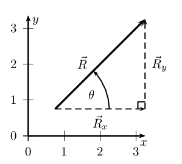

When resolving into components that are parallel to the \(x\)- and \(y\)-axes we are always dealing with a
      right-angled triangle. This means that we can use trigonometric identities to determine the magnitudes of the
      components (we know the directions because they are aligned with the axes).

From the triangle in the diagram above we know that
      \begin{align*}
      \cos(\theta) &= \frac{R_x}{R}\\
      \frac{R_x}{R} &= \cos(\theta)\\
      R_x &=R\cos(\theta)
      \end{align*} and
      \begin{align*}
      \sin\theta &= \frac{R_y}{R}\\
      \frac{R_y}{R} &= \sin(\theta)\\
      R_y &=R\sin(\theta)
      \end{align*}

\[\boxed{R_x=R\cos(\theta)}\]
      \[\boxed{R_y=R\sin(\theta)}\]

**Note** that the angle is measured counter-clockwise from the positive \(x\)-axis.

<Callout type="tip" title="Worked example 12: Resolving a vector into components">
**Question:**
A force of \(\text{250}\) \(\text{N}\) acts at an angle of \(\text{30}\)\(\text{°}\) to the positive
          \(x\)-axis. Resolve this force into components parallel to the \(x\)- and \(y\)-axes.

**Draw a rough sketch of the original vector:**
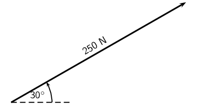

**Determine the vector components:**
Next we resolve the force into components parallel to the axes. Since these directions are perpendicular to
          one another, the components form a right-angled triangle with the original force as its hypotenuse.

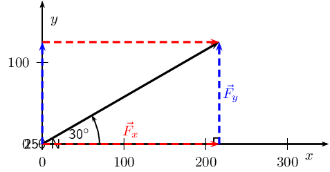

Notice how the two components acting together give the original vector as
          their resultant.

**Determine the magnitudes of the component vectors:**
Now we can use trigonometry to calculate the magnitudes of the
          components of the original displacement:

\begin{align*}
          F_y &= \text{250} \sin(30°)\\
          &=\text{125}\text{ N}
          \end{align*}

and

\begin{align*}
          F_x &= \text{250} \cos(30°)\\
          &=\text{216,5}\text{ N}
          \end{align*}

Remember \({F}_{x}\) and \({F}_{y}\) are the magnitudes of the components. \(\vec{F}_x\) is in the positive
          \(x\)-direction and \(\vec{F}_y\) is in the positive \(y\)-direction.
</Callout>

<Callout type="tip" title="Worked example 13: Resolving a vector into components">
**Question:**
A force of \(\text{12,5}\) \(\text{N}\) acts at an angle of \(\text{230}\)\(\text{°}\) to the positive
          \(x\)-axis. Resolve this force into components parallel to the \(x\)- and \(y\)-axes.

**Draw a rough sketch of the original vector:**
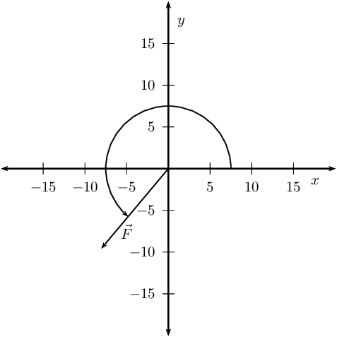

**Determine the vector components:**
Next we resolve the force into components parallel to the axes. Since these directions are perpendicular to
          one another, the components form a right-angled triangle with the original force as its hypotenuse.

Now we can use trigonometry to calculate the magnitudes of the
          components of the original force:

\begin{align*}
          F_y &= \text{12,5} \sin(\text{230}\text{°})\\
          &=-\text{9,58}\text{ N}
          \end{align*}

and

\begin{align*}
          F_x &= \text{12,5} \cos(\text{230}\text{°})\\
          &=-\text{8,03}\text{ N}
          \end{align*}

**Notice** that by using the full angle we actually get the correct signs for the components if
          we use the standard Cartesian coordinates. \(\vec{F}_x\) is in the negative \(x\)-direction and \(\vec{F}_y\)
          is in the negative \(y\)-direction.
</Callout>

### Textbook Exercise 1.6

**Problem:**
Resolve each of the following vectors into components:

- \(\vec{F}_1\)=\(\text{5}\) \(\text{N}\) at \(\text{45}\)\(\text{°}\) to the positive \(x\)-axis.
- \(\vec{F}_2\)=\(\text{15}\) \(\text{N}\) at \(\text{63}\)\(\text{°}\) to the positive \(x\)-axis.
- \(\vec{F}_3\)=\(\text{11,3}\) \(\text{N}\) at \(\text{127}\)\(\text{°}\) to the positive
                  \(x\)-axis.
- \(\vec{F}_4\)=\(\text{125}\) \(\text{N}\) at \(\text{245}\)\(\text{°}\) to the positive
                  \(x\)-axis.

**Solution:**
- Draw a rough sketch of the original vector (we use a scale of \(\text{1}\) \(\text{N}\) :
                    \(\text{1}\) \(\text{cm}\))
  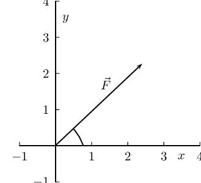
  Next we resolve the force into components parallel to the axes. Since these directions are
                    perpendicular to one another, the components form a right-angled triangle with the original force as
                    its hypotenuse.
  Now we can use trigonometry to calculate the magnitudes of the components of the original force:
  \begin{align*}
                    F_y &= 5 \sin(\text{45}\text{°})\\
                    &=\text{3,54}\text{ N}
                    \end{align*}
  and
  \begin{align*}
                    F_x &= 5 \cos(\text{45}\text{°})\\
                    &=\text{3,54}\text{ N}
                    \end{align*}
- Draw a rough sketch of the original vector (we use a scale of \(\text{5}\) \(\text{N}\) :
                    \(\text{1}\) \(\text{cm}\))
  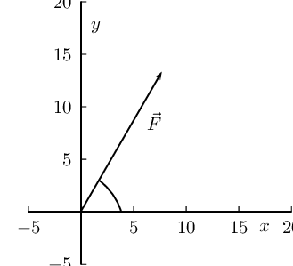
  Next we resolve the force into components parallel to the axes. Since these directions are
                    perpendicular to one another, the components form a right-angled triangle with the original force as
                    its hypotenuse.
  Now we can use trigonometry to calculate the magnitudes of the components of the original force:
  \begin{align*}
                    F_y &= 15 \sin(\text{63}\text{°})\\
                    &=\text{13,37}\text{ N}
                    \end{align*}
  and
  \begin{align*}
                    F_x &= 15 \cos(\text{63}\text{°})\\
                    &=\text{6,81}\text{ N}
                    \end{align*}
- Draw a rough sketch of the original vector (we use a scale of \(\text{4}\) \(\text{N}\) :
                    \(\text{1}\) \(\text{cm}\))
  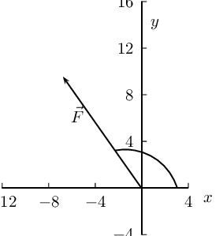
  Next we resolve the force into components parallel to the axes. Since these directions are
                    perpendicular to one another, the components form a right-angled triangle with the original force as
                    its hypotenuse.
  Now we can use trigonometry to calculate the magnitudes of the components of the original force:
  \begin{align*}
                    F_y &= \text{11,3} \sin(\text{127}\text{°})\\
                    &=\text{9,02}\text{ N}
                    \end{align*}
  and
  \begin{align*}
                    F_x &= \text{11,3} \cos(\text{127}\text{°})\\
                    &=-\text{6,80}\text{ N}
                    \end{align*}
- Draw a rough sketch of the original vector (we use a scale of \(\text{1}\) \(\text{cm}\) =
                    \(\text{50}\) \(\text{N}\))
  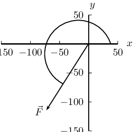
  Next we resolve the force into components parallel to the axes. Since these directions are
                    perpendicular to one another, the components form a right-angled triangle with the original force as
                    its hypotenuse.
  Now we can use trigonometry to calculate the magnitudes of the components of the original force:
  \begin{align*}
                    F_y &= \text{125} \sin(\text{245}\text{°})\\
                    &=-\text{113,29}\text{ N}
                    \end{align*}
  and
  \begin{align*}
                    F_x &= \text{125} \cos(\text{245}\text{°})\\
                    &=-\text{52,83}\text{ N}
                    \end{align*}

**Problem:**
Resolve each of the following vectors into components:

- \(\vec{F}_1\)=\(\text{11} \times \text{10}^{\text{4}}\) \(\text{N}\) at \(\text{33}\)\(\text{°}\)
                  to the positive \(x\)-axis.
- \(\vec{F}_2\)=\(\text{15}\) \(\text{GN}\) at \(\text{28}\)\(\text{°}\) to the positive
                  \(x\)-axis.
- \(\vec{F}_3\)=\(\text{11,3}\) \(\text{kN}\) at \(\text{193}\)\(\text{°}\) to the positive
                  \(x\)-axis.
- \(\vec{F}_4\)=\(\text{125} \times \text{10}^{\text{5}}\) \(\text{N}\) at
                  \(\text{317}\)\(\text{°}\) to the positive \(x\)-axis.

**Solution:**
- Draw a rough sketch of the original vector (we use a scale of \(\text{1} \times
                    \text{10}^{\text{4}}\) \(\text{N}\) : \(\text{1}\) \(\text{cm}\))
  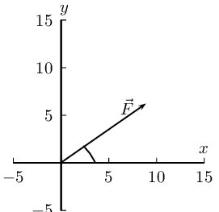
  Next we resolve the force into components parallel to the axes. Since these directions are
                    perpendicular to one another, the components form a right-angled triangle with the original force as
                    its hypotenuse. We do not need to convert to \(\text{N}\) but we must remember to keep the same units
                    throughout.
  Now we can use trigonometry to calculate the magnitudes of the components of the original force:
  \begin{align*}
                    F_y &= \text{11} \times \text{10}^{\text{4}} \sin(\text{33}\text{°})\\
                    &=\text{5,99} \times \text{10}^{\text{4}}\text{ N}
                    \end{align*}
  and
  \begin{align*}
                    F_x &= \text{11} \times \text{10}^{\text{4}} \cos(\text{33}\text{°})\\
                    &=\text{9,22} \times \text{10}^{\text{4}}\text{ N}
                    \end{align*}
- Draw a rough sketch of the original vector (we use a scale of \(\text{1}\) \(\text{GN}\) :
                    \(\text{1}\) \(\text{cm}\))
  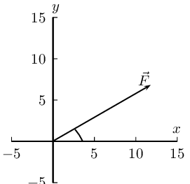
  Next we resolve the force into components parallel to the axes. Since these directions are
                    perpendicular to one another, the components form a right-angled triangle with the original force as
                    its hypotenuse. We do not need to convert to \(\text{N}\) but we must remember to keep the same units
                    throughout.
  Now we can use trigonometry to calculate the magnitudes of the components of the original force:
  \begin{align*}
                    F_y &= 15 \sin(\text{28}\text{°})\\
                    &=\text{7,04}\text{ GN}
                    \end{align*}
  and
  \begin{align*}
                    F_x &= 15 \cos(\text{28}\text{°})\\
                    &=\text{13,2}\text{ GN}
                    \end{align*}
- Draw a rough sketch of the original vector (we use a scale of \(\text{1}\) \(\text{kN}\) :
                    \(\text{1}\) \(\text{cm}\))
  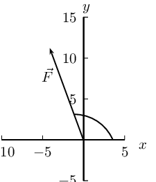
  Next we resolve the force into components parallel to the axes. Since these directions are
                    perpendicular to one another, the components form a right-angled triangle with the original force as
                    its hypotenuse.
  Now we can use trigonometry to calculate the magnitudes of the components of the original force:
  \begin{align*}
                    F_y &= \text{11,3} \sin(\text{103}\text{°})\\
                    &=\text{11,01}\text{ kN}
                    \end{align*}
  and
  \begin{align*}
                    F_x &= \text{11,3} \cos(\text{103}\text{°})\\
                    &=-\text{2,54}\text{ kN}
                    \end{align*}
- Draw a rough sketch of the original vector (we use a scale of \(\text{50} \times
                    \text{10}^{\text{5}}\) \(\text{N}\) : \(\text{1}\) \(\text{cm}\))
  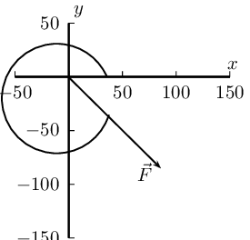
  Next we resolve the force into components parallel to the axes. Since these directions are
                    perpendicular to one another, the components form a right-angled triangle with the original force as
                    its hypotenuse.
  Now we can use trigonometry to calculate the magnitudes of the components of the original force:
  \begin{align*}
                    F_y &= \text{125} \times \text{10}^{\text{5}} \sin(\text{317}\text{°})\\
                    &=-\text{8,52} \times \text{10}^{\text{6}}\text{ N}
                    \end{align*}
  and
  \begin{align*}
                    F_x &= \text{125} \times \text{10}^{\text{5}} \cos(\text{317}\text{°})\\
                    &=\text{9,14} \times \text{10}^{\text{6}}\text{ N}
                    \end{align*}

### Vector addition using components (ESBKD)

Components can also be used to find the resultant of vectors. This technique can be applied to both graphical
        and algebraic methods of finding the resultant. The method is straightforward:

2. make a rough sketch of the problem;
4. find the horizontal and vertical components of each vector;
6. find the sum of all horizontal components, \(\vec{R}_x\);
8. find the sum of all the vertical components, \(\vec{R}_y\);
10. then use them to find the resultant, \(\vec{R}\).

Consider the two vectors, \(\vec{F}_1\) and \(\vec{F}_2\), in Figure 1.5, together with their resultant, \(\stackrel{\to }{R}\).

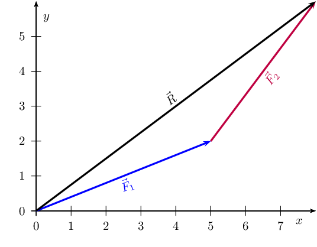

Figure 1.5:
          An example of two vectors being added to give a resultant.

Each vector in Figure 1.5 can be broken
        down into one component in the \(x\)-direction (horizontal) and one in the \(y\)-direction (vertical). These
        components are two vectors which when added give you the original vector as the resultant. This is shown in Figure 1.6 below:

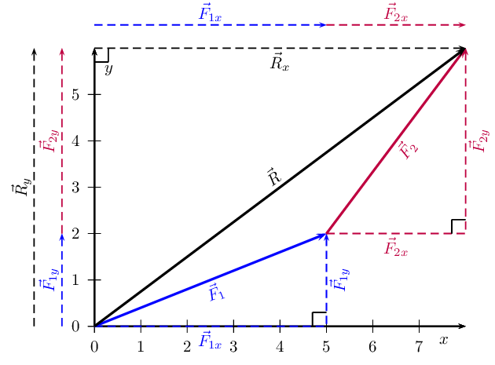

Figure 1.6:
          Adding vectors using components.

We can see that:

        \begin{align*}
        \vec{F}_1 &= \vec{F}_{1x} + \vec{F}_{1y} \\
        \vec{F}_2 &= \vec{F}_{2x} + \vec{F}_{2y} \\
        \vec{R} &= \vec{R}_x + \vec{R}_y
        \end{align*}
        \begin{align*}
        \text{But,}\ \vec{R}_x &= \vec{F}_{1x} + \vec{F}_{2x} \\
        \text{and}\ \vec{R}_y &= \vec{F}_{1y} + \vec{F}_{2y}
        \end{align*}

In summary, addition of the \(x\)-components of the two original
        vectors gives the \(x\)-component of the resultant. The same applies to
        the \(y\)-components. So if we just added all the components
        together we would get the **same answer!** This is another important
        property of vectors.

<Callout type="tip" title="Worked example 14: Adding vectors using components">
**Question:**
If in Figure 1.6,
            \(\vec{F}_1\)=\(\text{5,385}\) \(\text{N}\) at an angle of \(\text{21,8}\)\(\text{°}\) to the
            horizontal and \(\vec{F}_2\)=\(\text{5}\) \(\text{N}\) at an angle of \(\text{53,13}\)\(\text{°}\) to
            the horizontal, find the resultant force, \(\vec{R}\).

**Decide how to tackle the problem:**
The first thing we must realise is that the order that we add the vectors does not matter. Therefore, we
            can work through the vectors to be added in any order. We also draw up the following table to help us work
            through the problem:

| Vector | \(x\)-component | \(y\)-component | Total |
| --- | --- | --- | --- |
| \(\vec{F}_1\) |  |  |  |
| \(\vec{F}_2\) |  |  |  |
| Resultant |  |  |  |

**Resolve \(\vec{F}_1\) into components:**
We find the components of \(\vec{F}_1\) by using known trigonometric ratios. First we find the magnitude of
            the vertical component, \({F}_{\mathrm{1y}}\):
            \begin{align*}
            \sin(\theta) &= \frac{F_{1y}}{F_1} \\
            \sin(\text{21,8}\text{°}) &= \frac{F_{1y}}{\text{5,385}} \\
            F_{1y} &= \left(\sin(\text{21,8}\text{°})\right)\left( \text{5,385}\right) \\
            &= \text{2,00}\text{ N}
            \end{align*}

Secondly we find the magnitude of the horizontal component, \({F}_{\mathrm{1x}}\):
            \begin{align*}
            \cos(\theta) &= \frac{F_{1x}}{F_1} \\
            \cos(\text{21,8}\text{°}) &= \frac{F_{1x}}{\text{5,385}} \\
            F_{1x} &= \left(\cos(\text{21,8}\text{°})\right)\left( \text{5,385} \right) \\
            &= \text{5,00}\text{ N}
            \end{align*}

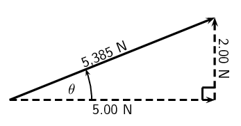

The components give the sides of the right angle triangle, for which the original vector, \(\vec{F}_1\), is
            the hypotenuse.

| Vector | \(x\)-component | \(y\)-component | Resultant |
| --- | --- | --- | --- |
| \(\vec{F}_1\) | \(\text{5,00}\) \(\text{N}\) | \(\text{2,00}\) \(\text{N}\) | \(\text{5,385}\) \(\text{N}\) |
| \(\vec{F}_2\) |  |  |  |
| Resultant |  |  |  |

**Resolve \(\vec{F}_2\) into components:**
We find the components of \(\vec{F}_2\) by using known trigonometric ratios. First we find the magnitude of
            the vertical component, \({F}_{\mathrm{2y}}\):

\begin{align*}
            \sin(\theta) &= \frac{F_{2y}}{F_2} \\
            \sin( \text{53,13}\text{°}) &= \frac{F_{2y}}{5} \\
            F_{2y} &= \left(\sin( \text{53,13}\text{°})\right)\left( 5\right) \\
            &= \text{4,00}\text{ N}
            \end{align*}

Secondly we find the magnitude of the horizontal component, \({F}_{\mathrm{2x}}\):

\begin{align*}
            \cos(\theta) &= \frac{F_{2x}}{F_2} \\
            \cos (\text{53,13}\text{°}) &= \frac{F_{2x}}{5} \\
            F_{2x} &= \left(\cos( \text{53,13}\text{°})\right)\left( 5\right) \\
            &= \text{3,00}\text{ N}
            \end{align*}

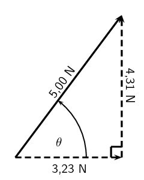

| Vector | \(x\)-component | \(y\)-component | Total |
| --- | --- | --- | --- |
| \(\vec{F}_1\) | \(\text{5,00}\) \(\text{N}\) | \(\text{2,00}\) \(\text{N}\) | \(\text{5,385}\) \(\text{N}\) |
| \(\vec{F}_2\) | \(\text{3,00}\) \(\text{N}\) | \(\text{4,00}\) \(\text{N}\) | \(\text{5}\) \(\text{N}\) |
| Resultant |  |  |  |

**Determine the components of the resultant vector:**
Now we have all the components. If we add all the horizontal components then
            we will have the \(x\)-component of the resultant vector, \({\stackrel{\to }{R}}_{x}\). Similarly, we add
            all the vertical components then we will have the \(y\)-component of the resultant vector, \({\stackrel{\to
            }{R}}_{y}\).

\begin{align*}
            R_x &= F_{1x} + F_{2x} \\
            & = \text{5,00}\text{ N} + \text{3,00}\text{ N} \\
            &= \text{8,00}\text{ N}
            \end{align*}

Therefore, \({\stackrel{\to }{R}}_{x}\) is \(\text{8}\) \(\text{N}\) to the right.

\begin{align*}
            R_y &= F_{1y} + F_{2y} \\
            & = \text{2,00}\text{ N} + \text{4,00}\text{ N} \\
            &= \text{6,00}\text{ N}
            \end{align*}

Therefore, \({\stackrel{\to }{R}}_{y}\) is \(\text{6}\) \(\text{N}\) up.

| Vector | \(x\)-component | \(y\)-component | Total |
| --- | --- | --- | --- |
| \(\vec{F}_1\) | \(\text{5,00}\) \(\text{N}\) | \(\text{2,00}\) \(\text{N}\) | \(\text{5,385}\) \(\text{N}\) |
| \(\vec{F}_2\) | \(\text{3,00}\) \(\text{N}\) | \(\text{4,00}\) \(\text{N}\) | \(\text{5}\) \(\text{N}\) |
| Resultant | \(\text{8,00}\) \(\text{N}\) | \(\text{6,00}\) \(\text{N}\) |  |

**Determine the magnitude and direction of the resultant vector:**
Now that we have the components of the resultant, we can use the Theorem of Pythagoras to determine the
            magnitude of the resultant, R.

\begin{align*}
            R^2 &= (R_y)^2 + (R_x)^2 \\
            & = (\text{6,00})^2 + (\text{8,00})^2 \\
            &= \text{100,00}\\
            R &= \text{10,00}\text{ N}
            \end{align*}

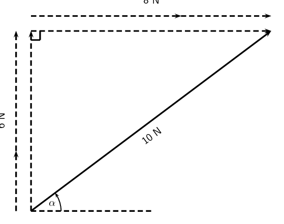

The magnitude of the resultant, R is \(\text{10,00}\) \(\text{N}\). So all we have to do is calculate its
            direction. We can specify the direction as the angle the vectors makes with a known direction. To do this
            you only need to visualise the vector as starting at the origin of a coordinate system. We have drawn this
            explicitly below and the angle we will calculate is labelled α.

Using our known trigonometric ratios we can calculate the value of \(\alpha\):

\begin{align*}
            \tan\alpha &= \frac{\text{6,00}}{\text{8,00}}\\
            \alpha &= \tan^{-1}\frac{\text{6,00}}{\text{8,00}}\\
            \alpha &= \text{36,9}\text{°}
            \end{align*}

**Quote the final answer:**
\(\stackrel{\to }{R}\) is \(\text{10}\) \(\text{N}\) at an angle of \(36,{9}^{°}\) to the positive
            \(x\)-axis.
</Callout>

<Callout type="tip" title="Worked example 15: Resultant using components">
**Question:**
Determine, by resolving into components, the resultant of the following four forces acting at a point:

- \(\vec{F}_1\)=\(\text{3,5}\) \(\text{N}\) at \(\text{45}\)\(\text{°}\) to the positive \(x\)-axis.
- \(\vec{F}_2\)=\(\text{2,7}\) \(\text{N}\) at \(\text{63}\)\(\text{°}\) to the positive \(x\)-axis.
- \(\vec{F}_3\)=\(\text{1,3}\) \(\text{N}\) at \(\text{127}\)\(\text{°}\) to the positive \(x\)-axis.
- \(\vec{F}_4\)=\(\text{2,5}\) \(\text{N}\) at \(\text{245}\)\(\text{°}\) to the positive \(x\)-axis.

**Sketch the problem:**
Draw all of the vectors on the Cartesian plane. This does not have to be precisely accurate because we are
            solving algebraically but vectors need to be drawn in the correct quadrant and with the correct relative
            positioning to each other.

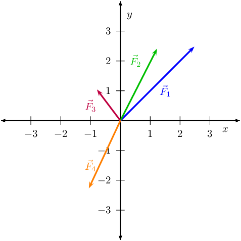

We are going to record the various components in a table to help us manage keep track of the calculation.
            For each vector we need to determine the components in the \(x\)- and \(y\)-directions.

| Vector | \(x\)-component | \(y\)-component | Total |
| --- | --- | --- | --- |
| \(\vec{F}_1\) |  |  | \(\text{3,5}\) \(\text{N}\) |
| \(\vec{F}_2\) |  |  | \(\text{2,7}\) \(\text{N}\) |
| \(\vec{F}_3\) |  |  | \(\text{1,3}\) \(\text{N}\) |
| \(\vec{F}_4\) |  |  | \(\text{2,5}\) \(\text{N}\) |
| \(\vec{R}\) |  |  |  |

**Determine components of \(\vec{F}_1\):**
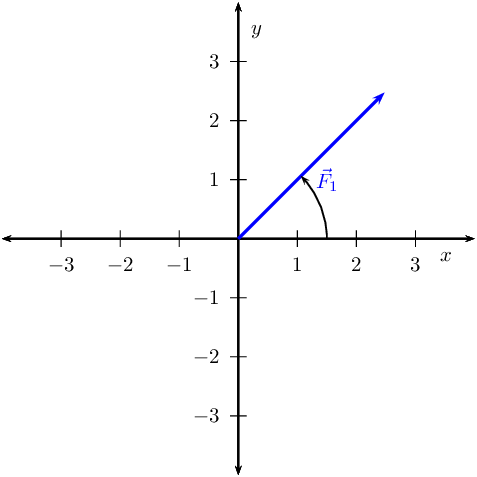

\begin{align*}
            \sin(\theta) &= \frac{F_{1y}}{F_1} \\
            \sin( \text{45}\text{°}) &= \frac{F_{1y}}{\text{3,5}} \\
            F_{1y} &= \left(\sin (\text{45}\text{°})\right)\left( \text{3,5}\right) \\
            &= \text{2,47}\text{ N}
            \end{align*}

Secondly we find the magnitude of the horizontal component, \({F}_{\mathrm{1x}}\):

\begin{align*}
            \cos(\theta) &= \frac{F_{1x}}{F_1} \\
            \cos( \text{45}\text{°}) &= \frac{F_{1x}}{\text{3,5}} \\
            F_{1x} &= \left(\cos (\text{45}\text{°})\right)\left( \text{3,5}\right) \\
            &= \text{2,47}\text{ N}
            \end{align*}

**Determine components of \(\vec{F}_2\):**
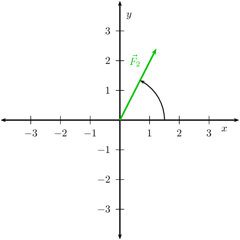

\begin{align*}
            \sin(\theta) &= \frac{F_{2y}}{F_2} \\
            \sin(\text{63}\text{°}) &= \frac{F_{2y}}{\text{2,7}} \\
            F_{2y} &= \left(\sin(\text{63}\text{°})\right)\left( \text{2,7}\right) \\
            &= \text{2,41}\text{ N}
            \end{align*}

Secondly we find the magnitude of the horizontal component, \({F}_{\mathrm{2x}}\):

\begin{align*}
            \cos\theta &= \frac{F_{2x}}{F_2} \\
            \cos( \text{63}\text{°}) &= \frac{F_{2x}}{\text{2,7}} \\
            F_{2x} &= \left(\cos(\text{63}\text{°})\right)\left( \text{2,7}\right) \\
            &= \text{1,23}\text{ N}
            \end{align*}

**Determine components of \(\vec{F}_3\):**
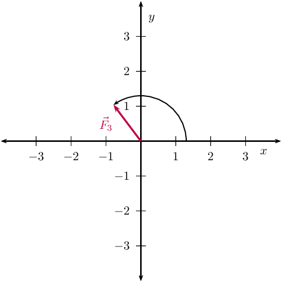

\begin{align*}
            \sin(\theta) &= \frac{F_{3y}}{F_3} \\
            \sin( \text{127}\text{°}) &= \frac{F_{3y}}{\text{1,3}} \\
            F_{3y} &= \left(\sin \text{127}\text{°}\right)\left( \text{1,3}\right) \\
            &= \text{1,04}\text{ N}
            \end{align*}

Secondly we find the magnitude of the horizontal component, \({F}_{\mathrm{3x}}\):

\begin{align*}
            \cos(\theta) &= \frac{F_{3x}}{F_3} \\
            \cos (\text{127}\text{°}) &= \frac{F_{3x}}{\text{1,3}} \\
            F_{3x} &= \left(\cos \text{127}\text{°}\right)\left( \text{1,3}\right) \\
            &= -\text{0,78}\text{ N}
            \end{align*}

**Determine components of \(\vec{F}_4\):**
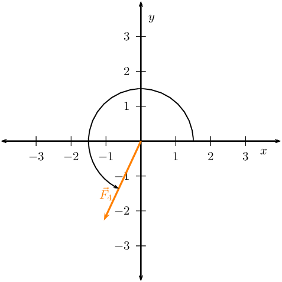

\begin{align*}
            \sin(\theta) &= \frac{F_{4y}}{F_4} \\
            \sin( \text{245}\text{°}) &= \frac{F_{4y}}{\text{2,5}} \\
            F_{4y} &= \left(\sin( \text{245}\text{°})\right)\left( \text{2,5}\right) \\
            &= -\text{2,27}\text{ N}
            \end{align*}

Secondly we find the magnitude of the horizontal component, \({F}_{\mathrm{4x}}\):

\begin{align*}
            \cos(\theta) &= \frac{F_{4x}}{F_4} \\
            \cos( \text{245}\text{°}) &= \frac{F_{4x}}{\text{2,5}} \\
            F_{4x} &= \left(\cos( \text{245}\text{°})\right)\left( \text{2,5}\right) \\
            &= -\text{1,06}\text{ N}
            \end{align*}

**Determine components of resultant:**
Sum the various component columns to determine the components of the resultant. Remember that if the
            component was negative don't leave out the negative sign in the summation.

| Vector | \(x\)-component | \(y\)-component | Total |
| --- | --- | --- | --- |
| \(\vec{F}_1\) | \(\text{2,47}\) \(\text{N}\) | \(\text{2,47}\) \(\text{N}\) | \(\text{3,5}\) \(\text{N}\) |
| \(\vec{F}_2\) | \(\text{1,23}\) \(\text{N}\) | \(\text{2,41}\) \(\text{N}\) | \(\text{2,7}\) \(\text{N}\) |
| \(\vec{F}_3\) | \(-\text{0,78}\) \(\text{N}\) | \(\text{1,04}\) \(\text{N}\) | \(\text{1,3}\) \(\text{N}\) |
| \(\vec{F}_4\) | \(-\text{1,06}\) \(\text{N}\) | \(-\text{2,27}\) \(\text{N}\) | \(\text{2,5}\) \(\text{N}\) |
| \(\vec{R}\) | \(\text{1,86}\) \(\text{N}\) | \(\text{3,65}\) \(\text{N}\) |  |

Now that we have the components of the resultant, we can use the Theorem of Pythagoras to determine the
            magnitude of the resultant, R.

\begin{align*}
            R^2 &= (R_y)^2 + (R_x)^2 \\
            & = (\text{1,86})^2 + (\text{3,65})^2 \\
            &= \text{16,78}\\
            R &= \text{4,10}\text{ N}
            \end{align*}

We can also determine the angle with the positive \(x\)-axis.

\begin{align*}
            \tan(\alpha) &= \frac{\text{1,86}}{\text{3,65}}\\
            \alpha &= \tan^{-1}(\frac{\text{3,65}}{\text{1,86}})\\
            \alpha &= \text{27,00}\text{°}
            \end{align*}

**Quote the final answer:**
The resultant has a magnitude of \(\text{4,10}\) \(\text{N}\) at and angle of
            \(\text{27,00}\)\(\text{°}\) to the positive \(x\)-direction.
</Callout>

An experiment for informal assessment on using force boards to determine the resultant of vectors is
          included. In this experiment learners will use a force board to determine the resultant of three non-linear
          vectors. You will need blank paper, force board, 4 spring balances, an assortment of weights, gut or string
          and four pulleys per group. This experiment provides learners with the opportunity for them to see an abstract
          mathematical idea in action. Learners can use graphical techniques such as the tail-to-head method to find the
          resultant of three of the four measured forces. The questions at the end of the experiment guide learners in
          thinking about the results they have obtained.

## Force board

### Aim

Determine the resultant of three non-linear forces using a force board.

### Apparatus and materials

You will need:

- blank paper
- force board
- 4 spring balances
- assortment of weights
- gut or string
- four pulleys

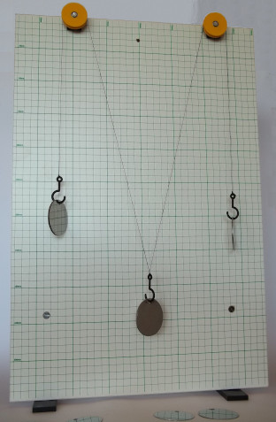

### Method

Before beginning the detailed method think about the strategy. By connecting a cord to the ring, running it
            over a pulley and hanging weights off it you can get a force exerted on the ring. The more weights or
            heavier the weight you hang the greater the force. The force is in the direction of the cord. If you run a
            number of cords over pulleys you are exerting more forces, all in different directions, on the ring. So we
            have a system where we can change the magnitude and direction of the forces acting on the ring. By putting a
            spring balance between the cord and the ring, we can measure the force. Putting a piece of paper under the
            ring allows us to draw the directions and the readings on the spring balances allows us to measure the
            magnitude.

We are going to use this information to measure the forces acting on the rings and then we can determine
            the resultants graphically.

2. Set up the forceboard and place a piece of paper under the ring.
4. Set up four different forces by connecting a spring balance to the ring on the one side and some cord
                   on the other side. Run the cord over a pulley and attach some weights to it. Work in a group to do this
                   effectively.
6. Draw a line along each cord being careful not to move any of them.
8. Make a note of the reading on each spring balance.
10. Now remove the paper.
12. Working on the paper, draw each line back towards the where the centre of the ring had been. The lines
                 should all intersect at a point. Make this point the centre of your Cartesian coordinate system.
14. Now choose an appropriate scale to relate the length of arrows to the readings on the spring balances.
                 Using the appropriate spring balance and correct line on the paper, draw an arrow to represent each of the
                 forces.

### Results

For two different choices of 3 of the force vectors we will determine the resultant. To determine the
            resultant we need to add the vectors together. The easiest way to do this is to replicate the vectors using
            a ruler and protractor and draw them tail-to-head.

### Conclusions and questions

Note the direction and the magnitudes of the resultants of the various combinations.

2. How does the calculated resultant compare to the vector that wasn't used to calculate the resultant in
                 each case?
4. What general relationship should exist between the resultant and the fourth vector and why do you think
                 this is the case?
6. Would this be the same if we had more or less forces in the problem? Justify your answer.

<Callout type="note" title="Note">
[Simulation:
          23FV](http://phet.colorado.edu/en/simulation/vector-addition)
</Callout>

<Callout type="note" title="Note">
<VideoPlayer src="https://www.youtube.com/embed/pXYlOC6u9w8" title="Video: 23FW" />
</Callout>
