### Textbook Exercise 1.7

**Problem:**
Draw the following forces as vectors on the Cartesian plane originating at
                                                the origin:

- \(\vec{F}_{1} = \text{3,7}\text{ N}\) in the positive
                                                          \(x\)-direction
- \(\vec{F}_{2} = \text{4,9}\text{ N}\) in the positive
                                                          \(y\)-direction

**Solution:**
We choose a scale of \(\text{1}\) \(\text{N}\) : \(\text{1}\) \(\text{cm}\).

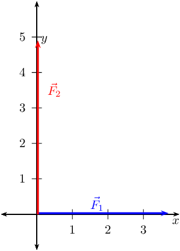

**Problem:**
Draw the following forces as vectors on the Cartesian plane:

- \(\vec{F}_{1} = \text{4,3}\text{ N}\) in the positive
                                                          \(x\)-direction
- \(\vec{F}_{2} = \text{1,7}\text{ N}\) in the negative
                                                          \(x\)-direction
- \(\vec{F}_{3} = \text{8,3}\text{ N}\) in the positive
                                                          \(y\)-direction

**Solution:**
We choose a scale of \(\text{1}\) \(\text{N}\) : \(\text{1}\) \(\text{cm}\).

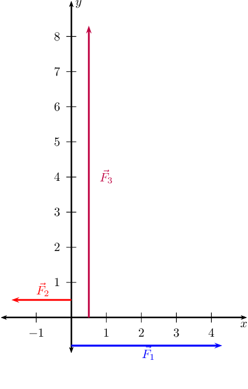

**Problem:**
Find the resultant in the \(x\)-direction, \(R_x\), and \(y\)-direction,
                                                \(R_y\) for the following forces:

- \(\vec{F}_{1} = \text{1,5}\text{ N}\) in the positive
                                                          \(x\)-direction
- \(\vec{F}_{2} = \text{1,5}\text{ N}\) in the positive
                                                          \(x\)-direction
- \(\vec{F}_{3} = \text{2}\text{ N}\) in the negative \(x\)-direction

**Solution:**
We choose a scale of \(\text{1}\) \(\text{N}\): \(\text{1}\) \(\text{cm}\)
                                                and for our diagram we will define the positive direction as *to the
                                                        right.*

We note that there are no vectors in the \(y\)-direction and so \(R_{y} =
                                                0\).

We now find \(\vec{R}_{x}\):

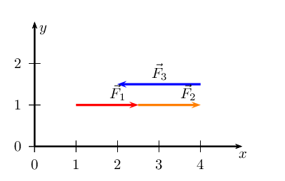

We have now drawn all the force vectors that act in the \(x\)-direction. To
                                                find \(\vec{R}_{x}\) we note that the resultant vector is the arrow
                                                which starts at the tail of the first vector and ends at the head of the
                                                last drawn vector in that direction.

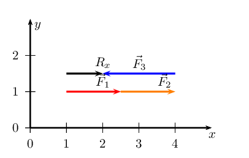

We note that \(\vec{R}_{x}\) is \(\text{1}\) \(\text{cm}\) or \(\text{1}\)
                                                \(\text{N}\) in the positive \(x\)-direction.

\(\vec{R}_{x}\) = \(\text{1}\) \(\text{N}\) and points in the positive
                                                \(x\)-direction. \(\vec{R}_{y}\) = \(\text{0}\) \(\text{N}\).

**Problem:**
Find the resultant in the \(x\)-direction, \(R_x\), and \(y\)-direction,
                                                \(R_y\) for the following forces:

- \(\vec{F}_{1} = \text{4,8}\text{ N}\) in the positive
                                                          \(x\)-direction
- \(\vec{F}_{2} = \text{3,2}\text{ N}\) in the negative
                                                          \(x\)-direction
- \(\vec{F}_{3} = \text{1,9}\text{ N}\) in the positive
                                                          \(y\)-direction
- \(\vec{F}_{4} = \text{2,1}\text{ N}\) in the negative
                                                          \(y\)-direction

**Solution:**
We choose a scale of \(\text{1}\) \(\text{N}\): \(\text{1}\) \(\text{cm}\)
                                                and for our diagram we will define the positive direction as *to the
                                                        right.*

We find \(\vec{R}_{x}\):

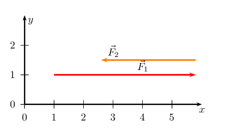

We have now drawn all the force vectors that act in the \(x\)-direction. To
                                                find \(\vec{R}_{x}\) we note that the resultant vector is the arrow
                                                which starts at the tail of the first vector and ends at the head of the
                                                last drawn vector in that direction.

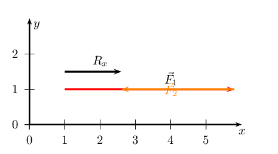

We note that \(\vec{R}_{x}\) is \(\text{1,6}\) \(\text{cm}\) or
                                                \(\text{1,6}\) \(\text{N}\) in the positive \(x\)-direction.

We now find \(\vec{R}_{y}\):

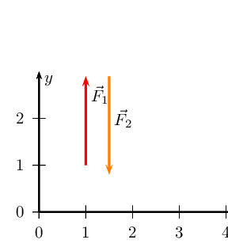

We have now drawn all the force vectors that act in the \(x\)-direction. To
                                                find \(\vec{R}_{x}\) we note that the resultant vector is the arrow
                                                which starts at the tail of the first vector and ends at the head of the
                                                last drawn vector in that direction.

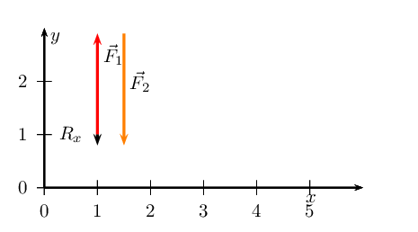

We note that \(\vec{R}_{y}\) is \(\text{0,2}\) \(\text{cm}\) or
                                                \(\text{0,2}\) \(\text{N}\) in the negative \(y\)-direction.

\(\vec{R}_{x}\) = \(\text{1,6}\) \(\text{N}\) and points in the positive
                                                \(x\)-direction. \(\vec{R}_{y}\) = \(\text{0,2}\) \(\text{N}\) and
                                                points in the negative \(y\)-direction.

**Problem:**
Find the resultant in the \(x\)-direction, \(R_x\), and \(y\)-direction,
                                                \(R_y\) for the following forces:

- \(\vec{F}_{1} = \text{2,7}\text{ N}\) in the positive
                                                          \(x\)-direction
- \(\vec{F}_{2} = \text{1,4}\text{ N}\) in the positive
                                                          \(x\)-direction
- \(\vec{F}_{3} = \text{2,7}\text{ N}\) in the negative
                                                          \(x\)-direction
- \(\vec{F}_{4} = \text{1,7}\text{ N}\) in the negative
                                                          \(y\)-direction

**Solution:**
We choose a scale of \(\text{1}\) \(\text{N}\) : \(\text{1}\) \(\text{cm}\)
                                                and for our diagram we will define the positive direction as *to the
                                                        right.*

We find \(\vec{R}_{x}\):

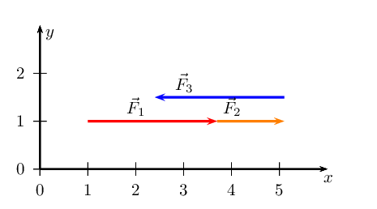

We have now drawn all the force vectors that act in the \(x\)-direction. To
                                                find \(\vec{R}_{x}\) we note that the resultant vector is the arrow
                                                which starts at the tail of the first vector and ends at the head of the
                                                last drawn vector in that direction.

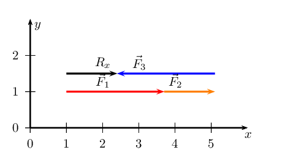

We note that \(\vec{R}_{x}\) is \(\text{1,4}\) \(\text{cm}\) or
                                                \(\text{1,4}\) \(\text{N}\) in the positive \(x\)-direction.

There is only one vector in the \(y\)-direction and so this is
                                                \(\vec{R}_{y}\).

\(\vec{R}_{x}\) = \(\text{1,4}\) \(\text{N}\) and points in the positive
                                                \(x\)-direction. \(\vec{R}_{y}\) = \(\text{1,7}\) \(\text{N}\) and
                                                points in the negative \(y\)-direction.

**Problem:**
Sketch the resultant of the following force vectors using the tail-to-head
                                                method:

- \(\vec{F}_{1} = \text{4,8}\text{ N}\) in the positive
                                                          \(y\)-direction
- \(\vec{F}_{2} = \text{3,3}\text{ N}\) in the negative
                                                          \(x\)-direction

**Solution:**
We first sketch the vectors on the Cartesian plane. We choose a scale of
                                                \(\text{1}\) \(\text{N}\) : \(\text{1}\) \(\text{cm}\). Remember to
                                                sketch \(F_{2}\) starting at the head of \(F_{1}\).

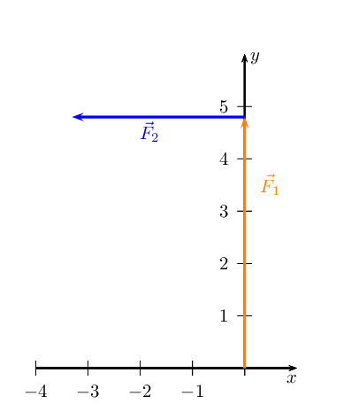

The resultant, \(\vec{R}\), is the vector connecting the tail of the first
                                                vector drawn to the head of the last vector drawn:

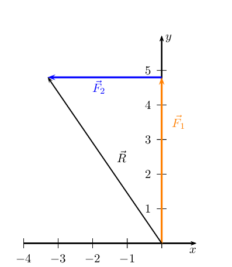

**Problem:**
Sketch the resultant of the following force vectors using the tail-to-head
                                                method:

- \(\vec{F}_{1} = \text{0,7}\text{ N}\) in the positive
                                                          \(y\)-direction
- \(\vec{F}_{2} = \text{6}\text{ N}\) in the positive \(x\)-direction
- \(\vec{F}_{3} = \text{3,8}\text{ N}\) in the negative
                                                          \(y\)-direction
- \(\vec{F}_{4} = \text{11,9}\text{ N}\) in the negative
                                                          \(x\)-direction

**Solution:**
We first sketch the vectors on the Cartesian plane. We choose a scale of
                                                \(\text{1}\) \(\text{N}\) : \(\text{1}\) \(\text{cm}\). Remember to
                                                sketch \(F_{2}\) starting at the head of \(F_{1}\).

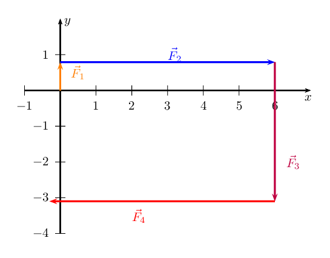

The resultant, \(\vec{R}\), is the vector connecting the tail of the first
                                                vector drawn to the head of the last vector drawn:

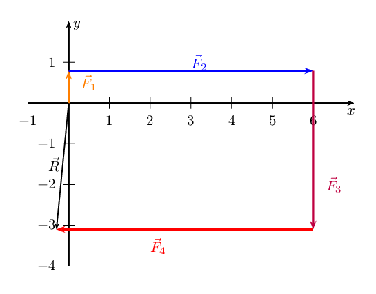

**Problem:**
Sketch the resultant of the following force vectors using the tail-to-head
                                                method by first determining the resultant in the \(x\)- and
                                                \(y\)-directions:

- \(\vec{F}_{1} = \text{5,2}\text{ N}\) in the positive
                                                          \(y\)-direction
- \(\vec{F}_{2} = \text{7,5}\text{ N}\) in the negative
                                                          \(y\)-direction
- \(\vec{F}_{3} = \text{4,8}\text{ N}\) in the positive
                                                          \(y\)-direction
- \(\vec{F}_{4} = \text{6,3}\text{ N}\) in the negative
                                                          \(x\)-direction

**Solution:**
We choose a scale of \(\text{2}\) \(\text{N}\) : \(\text{1}\) \(\text{cm}\).

We first determine \(\vec{R}_{x}\)

Draw the Cartesian plane with the vectors in the \(x\)-direction:

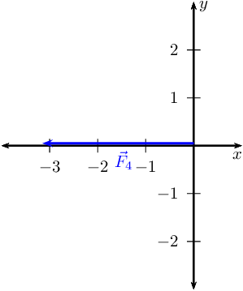

This is \(\vec{R}_{x}\) since it is the only vector in the \(x\)-direction.

Secondly determine \(\vec{R}_{y}\)

Next we draw the Cartesian plane with the vectors in the \(y\)-direction:

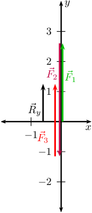

Now we draw the resultant vectors, \(\vec{R}_{y}\) and \(\vec{R}_{x}\)
                                                head-to-tail:

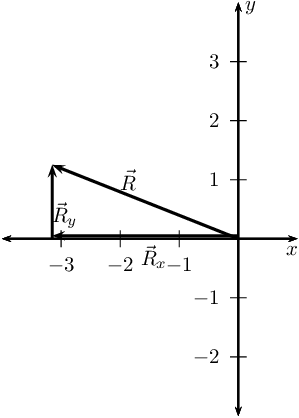

**Problem:**
Sketch the resultant of the following force vectors using the tail-to-head
                                                method by first determining the resultant in the \(x\)- and
                                                \(y\)-directions:

- \(\vec{F}_{1} = \text{6,7}\text{ N}\) in the positive
                                                          \(y\)-direction
- \(\vec{F}_{2} = \text{4,2}\text{ N}\) in the negative
                                                          \(x\)-direction
- \(\vec{F}_{3} = \text{9,9}\text{ N}\) in the negative
                                                          \(y\)-direction
- \(\vec{F}_{4} = \text{3,4}\text{ N}\) in the negative
                                                          \(y\)-direction

**Solution:**
We choose a scale of \(\text{1}\) \(\text{N}\) : \(\text{1}\) \(\text{cm}\).

We first determine \(\vec{R}_{x}\)

Draw the Cartesian plane with the vectors in the \(x\)-direction:

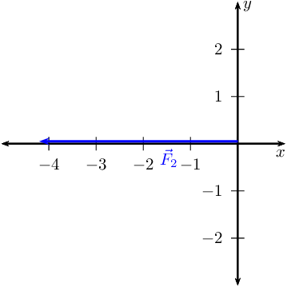

This is \(\vec{R}_{x}\) since it is the only vector in the \(x\)-direction.

Secondly determine \(\vec{R}_{y}\)

Next we draw the Cartesian plane with the vectors in the \(y\)-direction:

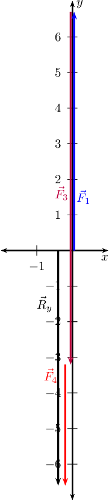

Now we draw the resultant vector, \(\vec{R}_{y}\) and \(\vec{R}_{x}\)
                                                head-to-tail:

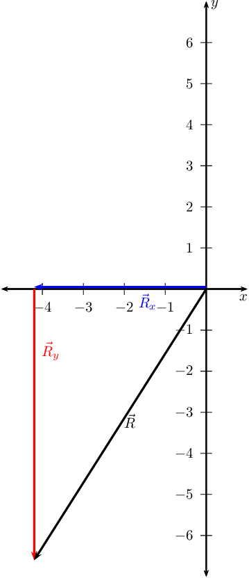

**Problem:**
Sketch the resultant of the following force vectors using the tail-to-tail
                                                method:

- \(\vec{F}_{1} = \text{6,1}\text{ N}\) in the positive
                                                          \(y\)-direction
- \(\vec{F}_{2} = \text{4,5}\text{ N}\) in the negative
                                                          \(x\)-direction

**Solution:**
We first draw a Cartesian plane with the two vectors: (we use a scale of
                                                \(\text{1}\) \(\text{N}\) : \(\text{1}\) \(\text{cm}\))

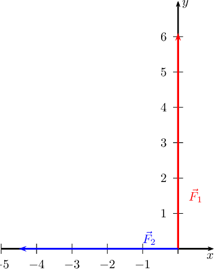

Now we draw a line parallel to \(\vec{F}_{1}\) from the head of
                                                \(\vec{F}_{2}\) and we draw a line parallel to \(\vec{F}_{2}\) from the
                                                head of \(\vec{F}_{1}\):

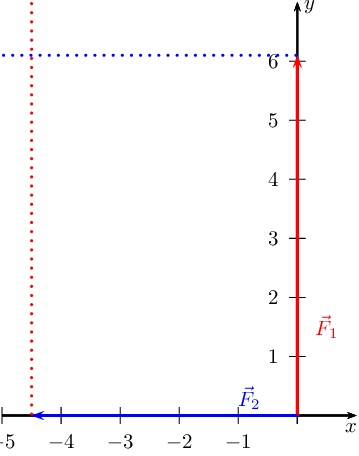

Where the two lines intersect is the head of the resultant vector which will
                                                originate at the origin so:

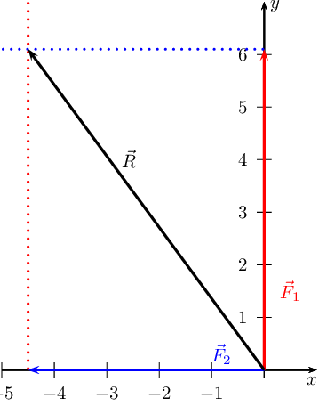

**Problem:**
Sketch the resultant of the following force vectors using the tail-to-tail
                                                method by first determining the resultant in the \(x\)- and
                                                \(y\)-directions:

- \(\vec{F}_{1} = \text{2,3}\text{ N}\) in the positive
                                                          \(y\)-direction
- \(\vec{F}_{2} = \text{11,8}\text{ N}\) in the negative
                                                          \(y\)-direction
- \(\vec{F}_{3} = \text{7,9}\text{ N}\) in the negative
                                                          \(y\)-direction
- \(\vec{F}_{4} = \text{3,2}\text{ N}\) in the negative
                                                          \(x\)-direction

**Solution:**
We need to determine \(\vec{R}_{x}\) and \(\vec{R}_{y}\) and then use these
                                                to find the resultant.

Determine \(\vec{R}_{x}\). We choose a scale of \(\text{2}\) \(\text{N}\) :
                                                \(\text{1}\) \(\text{cm}\).

Draw the Cartesian plane with the vectors in the \(x\)-direction:

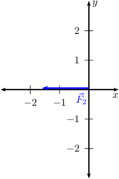

This is \(\vec{R}_{x}\) since it is the only vector in the \(x\)-direction.

Secondly determine \(\vec{R}_{y}\)

Next we draw the Cartesian plane with the vectors in the \(y\)-direction:

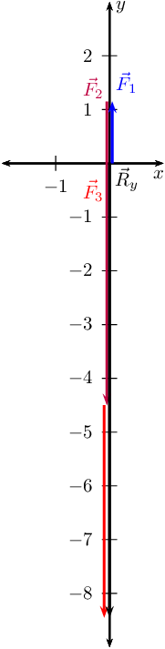

Now we draw the resultant vectors, \(\vec{R}_{y}\) and \(\vec{R}_{x}\)
                                                tail-to-tail:

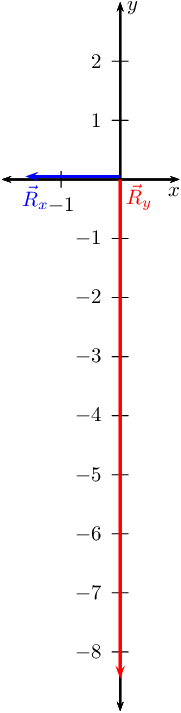

Now we can draw the lines to show us where the head of the resultant must be:

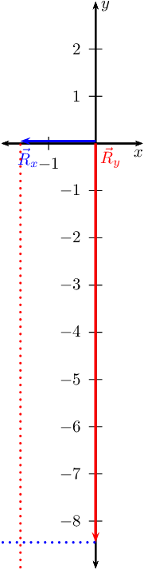

And finally we find the resultant:

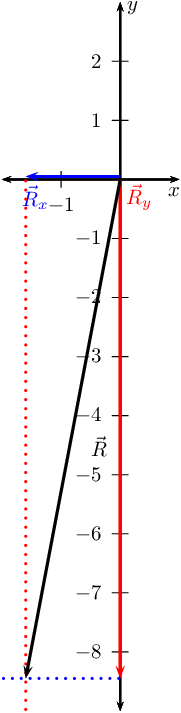

**Problem:**
Four forces act simultaneously at a point, find the resultant if the forces
                                                are:

- \(\vec{F}_{1}\) = \(\text{2,3}\) \(\text{N}\) in the positive
                                                                  \(x\)-direction
- \(\vec{F}_{2}\) = \(\text{4,9}\) \(\text{N}\) in the positive
                                                                  \(y\)-direction
- \(\vec{F}_{3}\) = \(\text{4,3}\) \(\text{N}\) in the negative
                                                                  \(y\)-direction
- \(\vec{F}_{4}\) = \(\text{3,1}\) \(\text{N}\) in the negative
                                                                  \(y\)-direction

**Solution:**
We note that we have more than two vectors so we must first find the
                                                resultant in the \(x\)-direction and the resultant in the
                                                \(y\)-direction.

In the \(x\)-direction we only have one vector and so this is the resultant.

In the \(y\)-direction we have three vectors. We can add these algebraically
                                                to find \(\vec{R}_{y}\):

                                        \begin{align*}
                                        \vec{F}_{2} & = \text{+4,9}\text{ N} \\
                                        \vec{F}_{3} & = -\text{4,3}\text{ N} \\
                                        \vec{F}_{4} & = -\text{3,1}\text{ N}
                                        \end{align*}

Thus, the resultant force is:

                                        \begin{align*}
                                        \vec{F}_{2} + \vec{F}_{3} + \vec{F}_{4} & = (\text{4,9}) + (-\text{4,3}) +
                                        (-\text{3,1}) \\
                                        & = -\text{2,3}
                                        \end{align*}

Now we use \(\vec{R}_{x}\) and \(\vec{R}_{y}\) to find the resultant.

We note that the triangle formed by \(\vec{R}_{x}\), \(\vec{R}_{y}\) and the
                                                resultant vector is a right-angle triangle. We can thus use the Theorem
                                                of Pythagoras to determine the length of the resultant. Let \(R\)
                                                represent the length of the resultant vector. Then:
                                                \begin{align*}
                                                F_x^{2} + F_y^{2} &= R^{2}\ \text{Pythagoras' theorem}\\
                                                (\text{2,3})^{2} + (-\text{2,3})^{2} &= R^{2}\\
                                                R &= \text{3,25}\text{ N}
                                                \end{align*}

To determine the direction of the resultant force, we calculate the angle
                                                α between the resultant force vector and the positive \(x\)-axis,
                                                by using simple trigonometry:
                                                \begin{align*}
                                                \tan\alpha &= \frac{\text{opposite side}}{\text{adjacent side}} \\
                                                \tan\alpha &= \frac{\text{2,3}}{\text{2,3}} \\
                                                \alpha &= \tan^{-1}(\text{1}) \\
                                                \alpha &= \text{45}\text{°}
                                                \end{align*}

The resultant force is then \(\text{3,25}\) \(\text{N}\) at
                                                \(\text{45}\)\(\text{°}\) to the \(x\)-axis.

Resolve each of the following vectors into components:

**Problem:**
\(\vec{F}_1\)=\(\text{105}\) \(\text{N}\) at
                                                        \(\text{23,5}\)\(\text{°}\) to the positive \(x\)-axis.

**Solution:**
Draw a rough sketch of the original vector (we use a scale of
                                                        \(\text{50}\) \(\text{N}\) : \(\text{1}\) \(\text{cm}\))

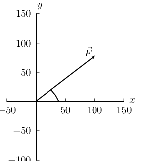

Next we resolve the force into components parallel to the axes. Since
                                                        these directions are perpendicular to one another, the
                                                        components form a right-angled triangle with the original force
                                                        as its hypotenuse.

Now we can use trigonometry to calculate the magnitudes of the
                                                        components of the original force:

\begin{align*}
                                                        F_y &= \text{105} \sin(\text{23,5}°)\\
                                                        &=\text{41,87}\text{ N}
                                                        \end{align*}

and

\begin{align*}
                                                        F_x &= \text{105} \cos(\text{23,5}°)\\
                                                        &=\text{96,29}\text{ N}
                                                        \end{align*}

\(F_{x}\) = \(\text{96,29}\) \(\text{N}\) and \(F_{y}\) =
                                                        \(\text{41,87}\) \(\text{N}\)

**Problem:**
\(\vec{F}_2\)=\(\text{27}\) \(\text{N}\) at
                                                        \(\text{58,9}\)\(\text{°}\) to the positive \(x\)-axis.

**Solution:**
Draw a rough sketch of the original vector (we use a scale of
                                                        \(\text{10}\) \(\text{N}\) : \(\text{1}\) \(\text{cm}\))

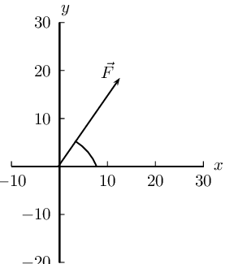

Next we resolve the force into components parallel to the axes. Since
                                                        these directions are perpendicular to one another, the
                                                        components form a right-angled triangle with the original force
                                                        as its hypotenuse.

Now we can use trigonometry to calculate the magnitudes of the
                                                        components of the original force:

\begin{align*}
                                                        F_y &= 27 \sin(\text{58,9}°)\\
                                                        &=\text{23,12}\text{ N}
                                                        \end{align*}

and

\begin{align*}
                                                        F_x &= 27 \cos(\text{58,9}°)\\
                                                        &=\text{13,95}\text{ N}
                                                        \end{align*}

\(F_{x}\) = \(\text{13,95}\) \(\text{N}\) and \(F_{y}\) =
                                                        \(\text{23,12}\) \(\text{N}\)

**Problem:**
\(\vec{F}_3\)=\(\text{11,3}\) \(\text{N}\) at
                                                        \(\text{323}\)\(\text{°}\) to the positive \(x\)-axis.

**Solution:**
Draw a rough sketch of the original vector (we use a scale of
                                                        \(\text{5}\) \(\text{N}\) : \(\text{1}\) \(\text{cm}\))

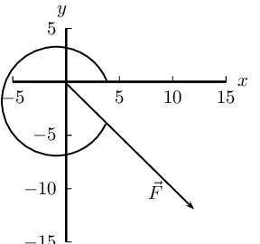

Next we resolve the force into components parallel to the axes. Since
                                                        these directions are perpendicular to one another, the
                                                        components form a right-angled triangle with the original force
                                                        as its hypotenuse.

Now we can use trigonometry to calculate the magnitudes of the
                                                        components of the original force:

\begin{align*}
                                                        F_y &= \text{11,3} \sin(\text{323}°)\\
                                                        &=-\text{6,8}\text{ N}
                                                        \end{align*}

and

\begin{align*}
                                                        F_x &= \text{11,3} \cos(\text{323}°)\\
                                                        &=\text{9,02}\text{ N}
                                                        \end{align*}

\(F_{x}\) = \(\text{9,02}\) \(\text{N}\) and \(F_{y}\) =
                                                        \(-\text{6,8}\) \(\text{N}\)

**Problem:**
\(\vec{F}_4\)=\(\text{149}\) \(\text{N}\) at
                                                        \(\text{245}\)\(\text{°}\) to the positive \(x\)-axis.

**Solution:**
Draw a rough sketch of the original vector (we use a scale of
                                                        \(\text{5}\) \(\text{N}\) : \(\text{1}\) \(\text{cm}\))

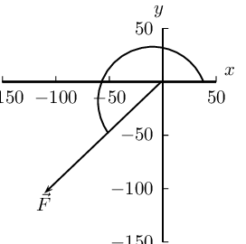

Next we resolve the force into components parallel to the axes. Since
                                                        these directions are perpendicular to one another, the
                                                        components form a right-angled triangle with the original force
                                                        as its hypotenuse.

Now we can use trigonometry to calculate the magnitudes of the
                                                        components of the original force:

\begin{align*}
                                                        F_y &= \text{149} \sin(\text{245}°)\\
                                                        &=-\text{135,04}\text{ N}
                                                        \end{align*}

and

\begin{align*}
                                                        F_x &= \text{149} \cos(\text{245}°)\\
                                                        &=-\text{62,97}\text{ N}
                                                        \end{align*}

\(F_{x}\) = \(-\text{62,97}\) \(\text{N}\) and \(F_{y}\) =
                                                        \(-\text{135,04}\) \(\text{N}\)

**Problem:**
\(\vec{F}_5\)=\(\text{15}\) \(\text{N}\) at
                                                        \(\text{375}\)\(\text{°}\) to the positive \(x\)-axis.

**Solution:**
Draw a rough sketch of the original vector (we use a scale of
                                                        \(\text{5}\) \(\text{N}\) : \(\text{1}\) \(\text{cm}\))

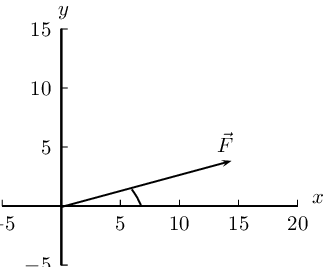

Next we resolve the force into components parallel to the axes. Since
                                                        these directions are perpendicular to one another, the
                                                        components form a right-angled triangle with the original force
                                                        as its hypotenuse.

Now we can use trigonometry to calculate the magnitudes of the
                                                        components of the original force:

\begin{align*}
                                                        F_y &= \text{15} \sin(\text{375}°)\\
                                                        &=\text{3,89}\text{ N}
                                                        \end{align*}

and

\begin{align*}
                                                        F_x &= \text{15} \cos(\text{375}°)\\
                                                        &=\text{14,49}\text{ N}
                                                        \end{align*}

Note that we would get the same result if we used \(\text{15}\)°
                                                        as \(\text{375}° - \text{360}° = \text{15}°\).

\(F_{x}\) = \(\text{3,89}\) \(\text{N}\) and \(F_{y}\) =
                                                        \(\text{14,49}\) \(\text{N}\)

**Problem:**
\(\vec{F}_6\)=\(\text{14,9}\) \(\text{N}\) at
                                                        \(\text{75,6}\)\(\text{°}\) to the positive \(x\)-axis.

**Solution:**
Draw a rough sketch of the original vector (we use a scale of
                                                        \(\text{2}\) \(\text{N}\) : \(\text{1}\) \(\text{cm}\))

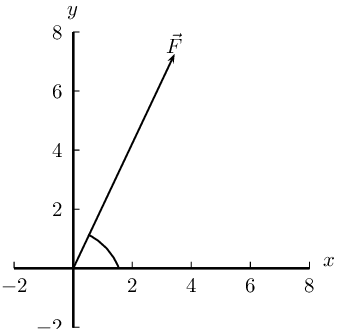

Next we resolve the force into components parallel to the axes. Since
                                                        these directions are perpendicular to one another, the
                                                        components form a right-angled triangle with the original force
                                                        as its hypotenuse.

Now we can use trigonometry to calculate the magnitudes of the
                                                        components of the original force:

\begin{align*}
                                                        F_y &= \text{14,9} \sin(\text{75,6}°)\\
                                                        &=\text{14,43}\text{ N}
                                                        \end{align*}

and

\begin{align*}
                                                        F_x &= \text{14,9} \cos(\text{75,6}°)\\
                                                        &=\text{3,71}\text{ N}
                                                        \end{align*}

\(F_{x}\) = \(\text{14,43}\) \(\text{N}\) and \(F_{y}\) =
                                                        \(\text{3,71}\) \(\text{N}\)

**Problem:**
\(\vec{F}_7\)=\(\text{11,3}\) \(\text{N}\) at
                                                        \(\text{123,4}\)\(\text{°}\) to the positive \(x\)-axis.

**Solution:**
Draw a rough sketch of the original vector (we use a scale of
                                                        \(\text{5}\) \(\text{N}\) : \(\text{1}\) \(\text{cm}\))

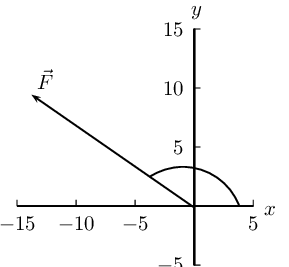

Next we resolve the force into components parallel to the axes. Since
                                                        these directions are perpendicular to one another, the
                                                        components form a right-angled triangle with the original force
                                                        as its hypotenuse.

Now we can use trigonometry to calculate the magnitudes of the
                                                        components of the original force:

\begin{align*}
                                                        F_y &= \text{11,3} \sin(\text{123,4}°)\\
                                                        &=\text{9,43}\text{ N}
                                                        \end{align*}

and

\begin{align*}
                                                        F_x &= \text{11,3} \cos(\text{123,4}°)\\
                                                        &=-\text{6,22}\text{ N}
                                                        \end{align*}

\(F_{x}\) = \(-\text{6,22}\) \(\text{N}\) and \(F_{y}\) =
                                                        \(\text{9,43}\) \(\text{N}\)

**Problem:**
\(\vec{F}_8\)=\(\text{169}\) \(\text{N}\) at
                                                        \(\text{144}\)\(\text{°}\) to the positive \(x\)-axis.

**Solution:**
Draw a rough sketch of the original vector (we use a scale of
                                                        \(\text{50}\) \(\text{N}\) : \(\text{1}\) \(\text{cm}\))

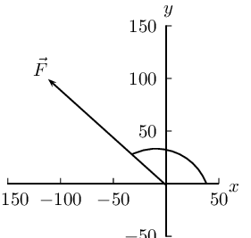

Next we resolve the force into components parallel to the axes. Since
                                                        these directions are perpendicular to one another, the
                                                        components form a right-angled triangle with the original force
                                                        as its hypotenuse.

Now we can use trigonometry to calculate the magnitudes of the
                                                        components of the original force:

\begin{align*}
                                                        F_y &= \text{169} \sin(\text{144}°)\\
                                                        &=\text{99,34}\text{ N}
                                                        \end{align*}

and

\begin{align*}
                                                        F_x &= \text{169} \cos(\text{144}°)\\
                                                        &=-\text{136,72}\text{ N}
                                                        \end{align*}

\(F_{x}\) = \(-\text{136,72}\) \(\text{N}\) and \(F_{y}\) =
                                                        \(\text{99,34}\) \(\text{N}\)

**Problem:**
A point is acted on by two forces and the resultant is zero. The forces

2. have equal magnitudes and directions.
4. have equal magnitudes but opposite directions.
6. act perpendicular to each other.
8. act in the same direction.

**Solution:**
have equal magnitudes but opposite directions.

**Problem:**
A point in equilibrium is acted on by three forces. Force \(F_{1}\) has
                                                components \(\text{15}\) \(\text{N}\) due south and \(\text{13}\)
                                                \(\text{N}\) due west. What are the components of force \(F_{2}\)?

2. \(\text{13}\) \(\text{N}\) due north and \(\text{20}\)
                                                                   \(\text{N}\) due west
4. \(\text{13}\) \(\text{N}\) due north and \(\text{13}\)
                                                                   \(\text{N}\) due west
6. \(\text{15}\) \(\text{N}\) due north and \(\text{7}\)
                                                                   \(\text{N}\) due west
8. \(\text{15}\) \(\text{N}\) due north and \(\text{13}\)
                                                                   \(\text{N}\) due east

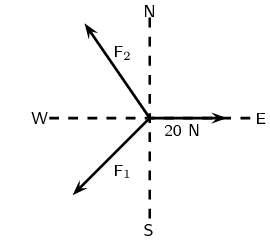

**Solution:**
\(\text{15}\) \(\text{N}\) due north and \(\text{7}\) \(\text{N}\) due west

**Problem:**
Two vectors act on the same point. What should the angle between them be so
                                                that a maximum resultant is obtained?

2. \(\text{0}\)\(\text{°}\)
4. \(\text{90}\)\(\text{°}\)
6. \(\text{180}\)\(\text{°}\)
8. cannot tell

**Solution:**
\(\text{0}\)\(\text{°}\)

**Problem:**
Two forces, \(\text{4}\) \(\text{N}\) and \(\text{11}\) \(\text{N}\), act on
                                                a point. Which one of the following cannot be the magnitude of a
                                                resultant?

2. \(\text{4}\) \(\text{N}\)
4. \(\text{7}\) \(\text{N}\)
6. \(\text{11}\) \(\text{N}\)
8. \(\text{15}\) \(\text{N}\)

**Solution:**
\(\text{4}\) \(\text{N}\)

**Problem:**
An object of weight W is supported by two cables attached to the ceiling and
                                                wall as shown. The tensions in the two cables are \(T_{1}\) and
                                                \(T_{2}\) respectively. Tension \(T_{1} = \text{1 200}\text{ N}\).
                                                Determine the tension \(T_{2}\) by accurate construction and measurement
                                                or by calculation.

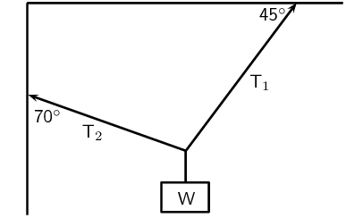

**Solution:**
We will use the \(x\)-component of \(T_{2}\) the fact that \(T_{1x} =
                                                T_{2x}\) to find \(T_{2}\):

                                        \begin{align*}
                                        T_{2x} & = T_{1x} \\
                                        T_{2} \cos(\text{20}\text{°}) & = T_{1}\cos(\text{45}\text{°})\\
                                        T_{2} \cos(\text{20}\text{°}) & =
                                        (\text{1 200})(\cos(\text{45}\text{°})) \\
                                        T_{2} \cos(\text{20}\text{°}) & = \text{848,53} \\
                                        T_{2} & = \text{902,98}\text{ N}
                                        \end{align*}

An object X is supported by two strings, A and B, attached to the ceiling as
                                                shown in the sketch. Each of these strings can withstand a maximum force
                                                of \(\text{700}\) \(\text{N}\). The weight of X is increased gradually.

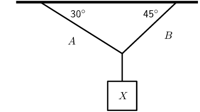

**Problem:**
Draw a rough sketch of the triangle of forces, and use it to explain
                                                        which string will break first.

**Solution:**
We draw a rough sketch:

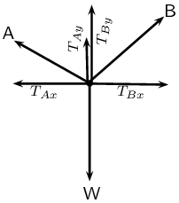

We note that \(T_{A}\cos(\text{30}\text{°}) =
                                                        T_{B}\cos(\text{45}\text{°})\). Therefore:

                                                \begin{align*}
                                                \frac{T_{A}}{T_{B}} & =
                                                \frac{\cos(\text{45}\text{°})}{\cos(\text{30}\text{°})}\\
                                                & = \frac{1}{\sqrt{2}} \times \frac{\sqrt{3}}{2}\\
                                                \therefore \frac{T_{A}}{T_{B}} & < 1 \\
                                                \therefore T_{A} & < T_{B}
                                                \end{align*}

The tension in B is greater and hence it will break first.

**Problem:**
Determine the maximum weight of X which can be supported.

**Solution:**
Since B will break first, the maximum weight that can be supported is
                                                        when B is at a tension of \(\text{700}\) \(\text{N}\).

                                                \begin{align*}
                                                \frac{T_{A}}{T_{B}} & =
                                                \frac{\cos(\text{45}\text{°})}{\cos(\text{30}\text{°})}\\
                                                \therefore T_{A} & = \text{700} \times
                                                \frac{\cos(\text{45}\text{°})}{\cos(\text{30}\text{°})}\\
                                                T_{A} & = \text{572}\text{ N} \\
                                                W & = T_{A}\sin(\text{30}\text{°}) +
                                                T_{B}\sin(\text{45}\text{°})\\
                                                & = \text{781}\text{ N}
                                                \end{align*}
