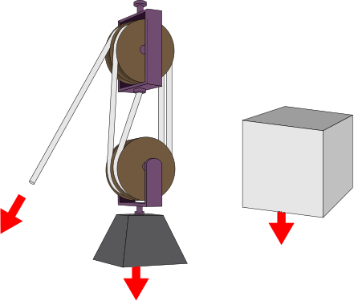

# Chapter 2: Newton's laws

## 2.1 Introduction (ESBKG)

In this chapter learners will explore Newtons three laws of motion and Newtons law of universal gravitation.
        Learners will also learn more about forces and the different kinds of forces. The following provides a summary
        of the topics covered in this chapter.

- **Different kinds of forces.**
  The types of forces covered are: normal force, frictional force, applied force and tension.
- **Force diagrams and free body diagrams.**
  In this section learners will see how to take a problem and draw diagrams to show all the forces acting on
              a body. They will learn what a force diagram is and what a free body diagram is.
- **Newton's three laws.**
  Newton's three laws of motion are discussed in this section. Each law is covered in detail and practical
              applications such as rockets, lifts and seat belts are covered.
- **Newton's law of universal gravitation.**
  This topic explores gravity and Newton's law of universal gravitation. Learners are introduced to the ideas
              of weight and mass as well as the acceleration due to gravity.

In this chapter we will learn how a net force is needed to modify the motion of an object. We will recall what a
      force is and learn about how force and motion are related. We are also introduced to Newton's three laws and we
      will learn more about the force of gravity.

<Callout type="note" title="Note">
- Ratio and proportion - Physical Sciences, Grade 10, Science skills
- Equations - Mathematics, Grade 10, Equations and inequalities
- Units and unit conversions - Physical Sciences, Grade 10, Science skills
</Callout>

<QuizCard id="s11-02-01a" title="Interactive Exercise 2.1" question="Evaluate the following, without using a calculator: \[                 \begin{array}{c}                 \dfrac{9}{8}                 \times \dfrac{11}{6}                 \end{array}             \] INSTRUCTION: Submit your answer as a simplified fraction." options=[] answer="
                    33/16
                " hint="You are expected to write a fraction here. You can write pure fractions using the division symbol: / For example, to write the fraction \(-\frac{2}{3}\) the correct input would be: -2/3 You can also write mixed numbers by first writing the integer part, then a space and                then the fraction part. For example, to write \(2 \frac{1}{8}\) the correct input                would be: 2 1/8" explanation="Cross cancel then multiply When you are multiplying fractions, the first thing you should try to do is cross cancel: \"Simplify before you multiply!\"                     Look at the numerators and denominators in the fractions: are there any common factors that you can cancel? Yes, \(\text{3}\) goes into both \(\text{9}\) and \(\text{6}\) , so we can cross cancel: NOTE: This answer can also be written as a mixed number: \(2 \; \dfrac{1}{16} \) . Submit your answer as:" />

<QuizCard id="s11-02-01a" title="Interactive Exercise 2.1" question="Calculate the following, without using a calculator: \[           \begin{array}{c}             \dfrac{6}{5} \div \dfrac{10}{9}           \end{array}         \] INSTRUCTION: Give your answer as a simplified fraction." options=[] answer="27/25" hint="You are expected to write a fraction here. You can write pure fractions using the division symbol: / For example, to write the fraction \(-\frac{2}{3}\) the correct input would be: -2/3 You can also write mixed numbers by first writing the integer part, then a space and                then the fraction part. For example, to write \(2 \frac{1}{8}\) the correct input                would be: 2 1/8" explanation="Use the reciprocal to rewrite the question with multiplication The question is a quotient (a division expression) of two fractions.  We divide fractions by changing the problem into a multiplication question! Dividing fractions follows this rule, which uses the reciprocal of the second fraction: \[           \begin{array}{c}             \dfrac{a}{b} \div \dfrac{c}{d} = \dfrac{a}{b} \times \dfrac{d}{c}           \end{array}         \] The reciprocal of \( \frac{10}{9} \) is \( \frac{9}{10} \) , so for this question, the rule gives us this: \[           \begin{array}{c}             \dfrac{6}{5} \div \dfrac{10}{9} \\             \downarrow \\             ^{\text{ rewrite with }}_{\text{multiplication}} \\             \downarrow \\             \dfrac{6}{5} \times\dfrac{9}{10}           \end{array}       \] Evaluate the multiplication expression Now we can work out the multiplication problem in the normal way! As always when multiplying fractions, try to cross cancel. The working from the beginning to the end should look like this: NOTE: This answer can also be written as a mixed number: \(1 \frac{2}{25}\) . Submit your answer as:" />

<QuizCard id="s11-02-01a" title="Interactive Exercise 2.1" question="When converting \(\text{km}\) (kilometres) to \(\text{m}\) , what power of ten must you multiply the \(\text{km}\) value by? INSTRUCTION: Write only the power (exponent) to which 10 is raised. For example, if you were converting from \(\text{nPa}\) to \(\text{Pa}\) you would multiply by \(\text{10}^{-\text{9}}\) and you would type -9 as your answer." options=[] answer="
                    3
                " hint="You should enter a number here. If you want to, you can use a space to separate thousands.                Example: 12 800,25 For scientific notation you need to use the multiply symbol                ( ∗ ) and the exponent symbol ( ^ ). For example 6,673 × 10 −11 should be written as: 6,673 ∗ 10^−11" explanation="Use the table of prefixes The following table provides a summary of the unit prefixes you should know with the correct exponent. Prefix Symbol Power of 10 Exponent giga G \(\text{10}^{\text{9}}\) \(\text{9}\) mega M \(\text{10}^{\text{6}}\) \(\text{6}\) kilo k \(\text{10}^{\text{3}}\) \(\text{3}\) hecto h \(\text{10}^{\text{2}}\) \(\text{2}\) deca da \(\text{10}^{\text{1}}\) \(\text{1}\) No prefix unit symbol on its own \(\text{10}^{\text{0}}\) \(\text{0}\) deci d \(\text{10}^{-\text{1}}\) \(-\text{1}\) centi c \(\text{10}^{-\text{2}}\) \(-\text{2}\) milli m \(\text{10}^{-\text{3}}\) \(-\text{3}\) micro \(\mu\) \(\text{10}^{-\text{6}}\) \(-\text{6}\) nano n \(\text{10}^{-\text{9}}\) \(-\text{9}\) NOTE: The table shows the power of ten you need to multiply your value by when converting from the unit with the prefix to the base unit (without a prefix). If you were converting from the base unit to a unit with a prefix you would divide by that same power of ten: \[                         \begin{array}{c}                             \dfrac{\text{1}\ \text{Pa}}{{\color{blue}{\text{10}^{-9}}}} = \text{1}\:{\color{blue}{\text{n}}}\text{Pa}                         \end{array}                     \] Work out what the prefix means These powers of ten represent the prefix part of the unit name. We are given \(\color{red}{\text{k}}\) m and we need to get to \(\text{m}\) . The prefix part is \(\text{k}\) (kilo). So we look on the table for \(\color{red}{\text{k}}\) (kilo) and see that \(\color{red}{\text{k}}\) means \(\color{red}{\text{10}^{\text{3}}}\) . Therefore, when converting from \(\text{km}\) (kilometres) to \(\text{m}\) , you must multiply the \(\text{km}\) (kilometres) value by \(\text{10}\) to the power of \(\text{3}\) . NOTE: This would normally be written \(\text{10}^{\text{3}}\) . You would have typed just the exponent, 3 , as your answer. Submit your answer as:" />

<QuizCard id="s11-02-01a" title="Interactive Exercise 2.1" question="Mike and Lisa each have some coins. The                 ratio of Mike's to Lisa's coins is \(2:3\) . If they have \(\text{20}\) coins in total,                 how many coins does Mike have?" options=[] answer="8" hint="You should enter a number here. If you want to, you can use a space to separate thousands.                Example: 12 800,25 For scientific notation you need to use the multiply symbol                ( ∗ ) and the exponent symbol ( ^ ). For example 6,673 × 10 −11 should be written as: 6,673 ∗ 10^−11" explanation="Use the ratio to find the number of equal parts We know that Mike \(\, : \,\) Lisa \(= {\color{MediumVioletRed}{2}} : {\color{teal}{3}}\) . There are \(\text{20}\) coins in total. The total is divided into \(\text{5}\) equal parts, since \({\color{MediumVioletRed}{2}} + {\color{teal}{3}} = 5\) . \[ 					\begin{array}{c} 						20 \div 5 = 4 					\end{array} 				\] Therefore there are \(\text{4}\) coins in each part. How many coins does Mike have? The diagram shows us that Mike has \({\color{MediumVioletRed}{2}} \times 4 = 8\) coins. Lisa has \({\color{teal}{3}} \times 4 = 12\) coins. Therefore, Mike has \(\text{8}\) coins. Submit your answer as:" />

<QuizCard id="s11-02-01a" title="Interactive Exercise 2.1" question="Solve simultaneously for \( x \) and \( y \) . \[                 \begin{aligned}                 2 x + 6 y & = -28 \\                 5 x + y & = -14                 \end{aligned}             \] TIP: Use the substitution method." options=[] answer="-2, -4" hint="You should enter a number here. If you want to, you can use a space to separate thousands.                Example: 12 800,25 For scientific notation you need to use the multiply symbol                ( ∗ ) and the exponent symbol ( ^ ). For example 6,673 × 10 −11 should be written as: 6,673 ∗ 10^−11" explanation="Identify which variable to isolate When we solve simultaneous equations, we are working to find values for \( y \) and \( x \) which make both equations true! We can solve these equations by substitution. Substitution requires isolating a variable. We need to look at the equations to decide which variable to isolate. We can see that the second equation looks good for this, because the \( y \) has a coefficient of one: \[                     \begin{aligned}                     5 x + & \, {\color{blue}{y}} = -14 \\                     & \uparrow \\                     & \hspace{-0.5cm} ^{\text{target for}}_{\text{ isolation}}                     \end{aligned}                 \] Make \( y \) the subject of the equation Isolate \( y \) in the second equation, which can be done in one step: \[                     \begin{aligned}                     5 x + y &= -14 \\                     y &= - 5 x - 14                     \end{aligned}                 \] Substitute the result into the other equation to find \( x \) Now we can substitute the expression \( - 5 x - 14 \) into the first equation and solve: \[                     \begin{aligned}                     2 x + 6 y &= -28 \\                     2 x + 6 \left( - 5 x - 14 \right) &= -28 \\                     2 x- 30 x - 84 &= -28 \\                     - 28 x &= 56\\ x &= -2                     \end{aligned}                 \] Use the \( x \) -value to find \( y \) Right now we have only half of the answer! To get the other half, we need to find the value of \( y \) . We can use the equation we got when we isolated \( y \) : it is the most convenient choice because \( y \) is the subject of the equation. \[                     \begin{aligned}                     y &= - 5 x - 14 \\                     y &= - 5 \left( -2 \right) - 14 \\                     y &= -4                     \end{aligned}                 \] The correct answers are \( x = -2 \) and \( y = -4 \) . Submit your answer as: and" />

<QuizCard id="s11-02-01a" title="Interactive Exercise 2.1" question="Solve for \( x \) and \( y \) using the elimination method: \[                 \begin{aligned}                     - 3 x + 2 y &= -7 \\                     2 x + 8 y &= 14                 \end{aligned}             \]" options=[] answer="3, 1" hint="You should enter a number here. If you want to, you can use a space to separate thousands.                Example: 12 800,25 For scientific notation you need to use the multiply symbol                ( ∗ ) and the exponent symbol ( ^ ). For example 6,673 × 10 −11 should be written as: 6,673 ∗ 10^−11" explanation="Start with the \( y \) -terms We need to solve the equations in this equation using elimination. (Substitution will also work, but the question says that we should use elimination.) As always for elimination, we need to use the two equations to cancel some of the terms. By comparing the coefficients of the terms, we can see that the second \( y \) -term has a coefficient which is a multiple of the first \( y \) -term. In fact, \(\text{8}\) is \(\text{4}\) times as much as \(\text{2}\) .                     We can make both coefficients of \( y \) the same by using this factor of \(\text{4}\) to multiply the entire first equation: \[                     \begin{aligned}                         - 3 x + 2 y &= -7 \\                         \left( 4 \right)\left( - 3 x \right)+\left( 4 \right)2 y  &= -7 (4)\\                    - 12 x + 8 y &= -28                     \end{aligned}                 \] Eliminate the \( y \) -variable and solve for \( x \) Now we can eliminate the \( y \) -terms by subtracting one equation from the other. Then we can solve for \( x \) . \[                     \begin{array}{rrcrcr}                         & - 12 x & + & 8 y & = & -28 \\                         ^{\text{Subtract the equations}}_{\text{to cancel the y-terms:}} & -(2 x & + & 8 y) & = & -(14) \\                         \hline                         & - 14 x & + & 0y & = & -42                     \end{array}                 \] Now we can solve for \( x \) : \[                     \begin{aligned}                         x & = \frac{-42}{-14} \\ & = 3                     \end{aligned}                 \] Substitute in for \( x\) The last step is to substitute \(y\) back into either of the equations so that we can find \( x \) . Here we will use the first equation: \[                     \begin{aligned}                         - 3 x + 2 y &= -7 \\                         - 3 \left( 3 \right) + 2 y &= -7 \\                         -9+2 y & = -7 \\                         2 y & = 2 \\ y & = 1                     \end{aligned}                 \] The answers are \( x = 3 \) and \( y = 1 \) . Submit your answer as: and" />
