## 2.2 Force (ESBKH)

### What is a force ? (ESBKJ)

A force is anything that can cause a change to objects. Forces can do things like:

- change the shape of an object,
- accelerate or stop an object, and
- change the direction of a moving object.

A force can be classified as either a *contact force* or a *non-contact force*.

A contact force must touch or *be in contact* with an object to cause a change. Examples of
                contact forces are:

- the force that is used to push or pull things, like on a door to open or close it
- the force that a sculptor uses to turn clay into a pot
- the force of the wind to turn a windmill

Figure 2.1: Contact forces

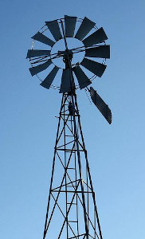

Figure 2.2: Contact forces

A non-contact force does not have to touch an object to cause a change. Examples of non-contact forces
                are the forces due to:

- gravity, like the Earth pulling the Moon towards itself;
- electricity, like a proton and an electron attracting each other; and
- magnetism, like a magnet pulling a paper clip towards itself.

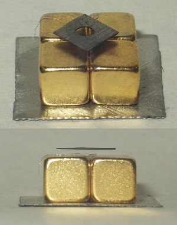

Figure 2.3: Non-contact forces

The unit of force in the international system of units (S.I. units) is the *newton* (symbol
                *N*). This unit is named after Sir Isaac Newton who first defined force. Force is a vector
                quantity and so it has a magnitude and a direction. We use the symbol \(\overrightarrow{F}\) for force.

This chapter will often refer to the *resultant force* acting on an object. The resultant force is
                simply the vector sum of all the forces acting on the object. It is very important to remember that all
                the forces must be acting on the *same* object. The resultant force is the force that has the
                same effect as all the other forces added together.

### Different types of forces in physics (ESBKK)

A lot of the physics topics you will study revolve around the impact or effect of forces. Although there
                are many different forces, will learn some fundamental principles for approaching the problems and
                applications in this book no matter which force applies

Physics is the study of the natural world and you probably know a lot more physics than you think. You
                see things happening everyday that are governed by the laws of physics but you probably aren't thinking
                about physics at the time. If you throw a stone up in the air it eventually falls to the ground. A lot
                of physics can be learnt by analysing an everyday situation.

We are going to learn about some forces in the next few sections but before we start lets describe an
                everyday situation in which they all play a role so you can visualise what is happening. You need a
                table and a three books that all have different masses. Take any book and put it on the table. Nothing
                happens, the book just rests on the table if the table is flat. If you slowly lift one side of the table
                so that the top of the table is tilted the book doesn't move immediately. As you lift the table more and
                more the book suddenly starts to slide off the table. You can repeat this with all three books and see
                how much you have to tilt the table before the books start to slide.

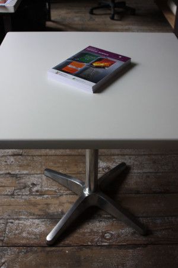

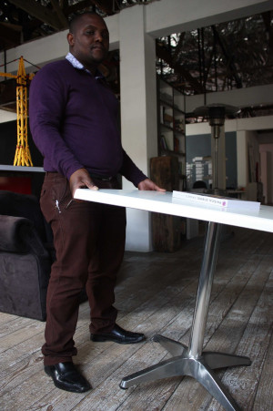

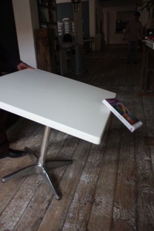

This real world situation illustrates a lot of the physics we want to learn about in this chapter.

#### The normal force

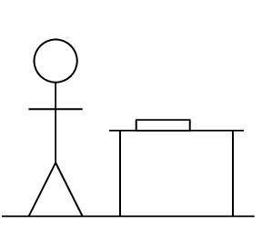

When an object is placed on a surface, for example think of the case of putting a book on a table,
                    there are a number of forces acting. Firstly, if the table were not there the book would fall to the
                    floor. The force that causes this is gravity. The table stops the book falling to the floor. The
                    only way this can happen is for the table to exert a force on the book. The force that the table
                    exerts on the book must balance out the force of gravity. This tells us a few things immediately!
                    Gravity is a force pulling the book down, it is a vector. The force that the table exerts must
                    balance this out and it can only do this if it has the same magnitude and acts in the opposite
                    direction.

This occurs often, gravity pulls a person towards the earth but when you are standing on the ground
                    something must be balancing it, if you put a heavy box on the ground the gravitational force is
                    balanced. If you put a brick on water it will sink because nothing balances the gravitational force.
                    We give the force that a surface (any surface) exerts to balance the forces on an object in contact
                    with that surface the **normal** force.

The normal force is a force that acts on the object as a result of the interaction with the surface
                    and is perpendicular to the surface. This last part might be seem unexpected (counter-intuitive)
                    because if we tilt the table slightly the direction of the gravitational force hasn't changed but
                    the direction of the normal force has a little (the normal is not always directly opposite gravity).
                    Don't panic, this will all make sense before the end of this chapter. Remember: the normal force is
                    **always perpendicular (at a right angle)** to the surface.

Normal force

                        The normal force, \(\vec{N}\), is the force exerted by a surface on an object in contact with
                        it.

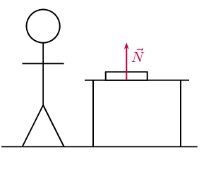

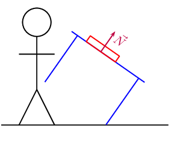

<QuizCard id="s11-02-02a" title="Interactive Exercise 2.2" question="Define the term normal force using the dropdown menus below." options=["gravitational field", "string", "magnetic field", "surface", "pulley", "not in contact", "nearby", "in contact", "at an obtuse angle to", "perpendicularly into", "at an oblique angle to", "perpendicularly out of", "parallel to", "pulley", "string", "magnetic field", "gravitational field", "surface"] answer="0, 0, 0, 0" hint="" explanation="Construct the definition of the normal force We define the normal force as follows: The normal force ( \(\vec{N}\) or \(\vec{F}_{\text{N}}\) ) is the force which a surface exerts on an object with which it is in contact , and which points perpendicularly out of the surface . Submit your answer as: surface and in contact and perpendicularly out of and surface" />

<QuizCard id="s11-02-02a" title="Interactive Exercise 2.2" question="The following free-body diagram shows five forces acting on an object that is in contact with a horizontal surface. Which one of the forces represents the normal force?" options=["A", "B", "C", "D", "E"] answer="D" hint="" explanation="Recall the definition of the normal force Recall the definition of the normal force: The normal force, \(\vec{N}\) or \(\vec{F}_{\text{N}}\) , is the force which a surface exerts on an object with which it is in contact. The normal force is perpendicular to the surface. Choose the arrow that represents the normal force In the diagram we can highlight the only force that points perpendicularly out of the surface : Therefore Force D must represent the normal force. Submit your answer as: D" />

<QuizCard id="s11-02-02a" title="Interactive Exercise 2.2" question="The following free-body diagram shows five forces acting on an object that is in contact with a wall. Which one of the forces represents the normal force?" options=["A", "B", "C", "D", "E"] answer="E" hint="" explanation="Recall the definition of the normal force Recall the definition of the normal force: The normal force, \(\vec{N}\) or \(\vec{F}_{\text{N}}\) , is the force which a surface exerts on an object with which it is in contact. The normal force is perpendicular to the surface. Choose the arrow that represents the normal force In the diagram we can highlight the only force that points perpendicularly out of the surface : Therefore Force E must represent the normal force. Submit your answer as: E" />

<QuizCard id="s11-02-02a" title="Interactive Exercise 2.2" question="The following free-body diagram shows five forces acting on an object that is in contact with a slope. Which one of the forces represents the normal force?" options=["A", "B", "C", "D", "E"] answer="A" hint="" explanation="Recall the definition of the normal force Recall the definition of the normal force: The normal force, \(\vec{N}\) or \(\vec{F}_{\text{N}}\) , is the force which a surface exerts on an object with which it is in contact. The normal force is perpendicular to the surface. Choose the arrow that represents the normal force In the diagram we can highlight the only force that points perpendicularly out of the surface : Therefore Force A must represent the normal force. Submit your answer as: A" />

#### Friction forces

Why does a box sliding on a surface eventually come to a stop? The answer is
                    **friction**. Friction arises where two surfaces are in contact and moving relative to
                    each other.

For an everyday example, press your hands together and move one backwards and forwards, we have two
                    surfaces in contact with one moving relative to the other. Your hands get warm, you will have
                    experienced this before and probably rub your hands together in winter to warm them up. The heat is
                    generated through friction.

Friction arises because the surfaces interact with each other. Think about sandpaper with lots of
                    bumps on the surface. If you rub sandpaper the bumps will slot into any groove .

When the surface of one object slides over the surface of another, each body exerts a frictional
                    force on the other. For example if a book slides across a table, the table exerts a frictional force
                    onto the book and the book exerts a frictional force onto the table. Frictional forces act
                    **parallel to surfaces**.

Frictional force
Frictional force is the force that opposes the motion of an object in contact with a surface and
                        it acts parallel to the surface the object is in contact with.

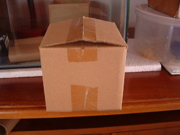

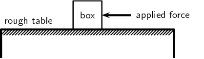

The magnitude of the frictional force depends on the surface and the magnitude of the normal force.
                    Different surfaces will give rise to different frictional forces, even if the normal force is the
                    same. Frictional forces are proportional to the magnitude of the normal force.
                    \[F_{\text{friction}} \propto N\]

For every surface we can determine a constant factor, the coefficient of friction, that allows us to
                    calculate what the frictional force would be if we know the magnitude of the normal force. We know
                    that static friction and kinetic friction have different magnitudes so we have different
                    coefficients for the two types of friction:

- \(\mu_s\) is the coefficient of **static** friction
- \(\mu_k\) is the coefficient of **kinetic** friction

A force is not always large enough to make an object move, for example a small applied force might
                    not be able to move a heavy crate. The frictional force opposing the motion of the crate is equal to
                    the applied force but acting in the opposite direction. This frictional force is called *static
                        friction*. When we increase the applied force (push harder), the frictional force will also
                    increase until it reaches a maximum value. When the applied force is larger than the maximum force
                    of static friction the object will move. The static frictional force can vary from zero (when no
                    other forces are present and the object is stationary) to a maximum that depends on the surfaces.

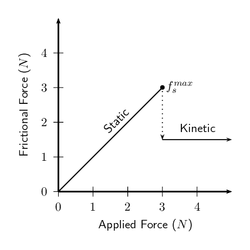

For static friction the force can vary up to some maximum value after which friction has been
                    overcome and the object starts to move. So we define a maximum value for the static friction:
                    \(f_s^{max} = \mu_sN\).

When the applied force is greater than the maximum, static frictional force, the object moves but
                    still experiences friction. This is called *kinetic friction*.
                    For kinetic friction the value remains the same regardless of the magnitude of the applied force.
                    The magnitude of the kinetic friction is: \(f_k = \mu_kN\).

Remember that static friction is present when the object is not moving and kinetic friction while the
                    object is moving. For example when you drive at constant velocity in a car on a tar road you have to
                    keep the accelerator pushed in slightly to overcome the friction between the tar road and the wheels
                    of the car. However, while moving at a constant velocity the wheels of the car are rolling, so this
                    is not a case of two surfaces “rubbing” against each other and we are in fact looking at
                    static friction. If you should break hard, causing the car to skid to a halt, we would be dealing
                    with two surfaces rubbing against each other and hence kinetic friction. The higher the value for
                    the coefficient of friction, the more 'sticky' the surface is and the lower the value, the more
                    'slippery' the surface is.

Friction is very useful. If there was no friction and you tried to prop a ladder up against a wall,
                    it would simply slide to the ground. Rock climbers use friction to maintain their grip on cliffs.
                    The brakes of cars would be useless if it wasn't for friction!

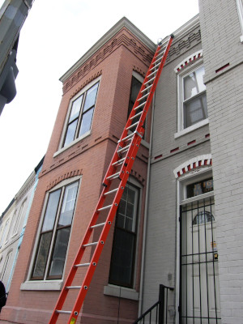

<Callout type="tip" title="Worked example 1: Static friction">
**Question:**
A box resting on a surface experiences a normal force of magnitude \(\text{30}\) \(\text{N}\)
                            and the coefficient of static friction between the surface and the box, \(\mu_s\), is
                            \(\text{0,34}\). What is the maximum static frictional force?

**Maximum static friction:**
We know that the relationship between the maximum static friction, \(f_s^{max}\), the
                            coefficient of static friction, \(\mu_s\) and the normal, \(N\), to be:\[f_s^{max} =
                            \mu_sN\]

We have been given that \(\mu_s = \text{0,34}\) and \(N=\text{30}\text{ N}\). This is all of
                            the information required to do the calculation.

**Calculate the result:**
\begin{align*}
                            f_s^{max} &= \mu_sN \\
                            &= (\text{0,34})(\text{30}) \\
                            & = \text{10,2}
                            \end{align*}

The maximum magnitude of static friction is \(\text{10,2}\) \(\text{N}\).
</Callout>

<Callout type="tip" title="Worked example 2: Static friction">
**Question:**
The forwards of your school's rugby team are trying to push their scrum machine. The normal
                            force exerted on the scrum machine is \(\text{10 000}\) \(\text{N}\). The machine isn't
                            moving at all. If the coefficient of static friction is \(\text{0,78}\) what is the minimum
                            force they need to exert to get the scrum machine to start moving?

**Minimum or maximum:**
The question asks what the minimum force required to get the scrum machine moving will be. We
                            don't know a relationship for this but we do know how to calculate the maximum force of
                            static friction. The forwards need to exert a force greater than this so the minimum amount
                            they can exert is in fact equal to the maximum force of static friction.

**Maximum static friction:**
We know that the relationship between the maximum static friction, \(f_s^{max}\), the
                            coefficient of static friction, \(\mu_s\) and the normal, \(N\), to be:\[f_s^{max} =
                            \mu_sN\]

We have been given that \(\mu_s = \text{0,78}\) and \(N=\text{10 000}\text{ N}\). This
                            is all of the information required to do the calculation.

**Calculate the result:**
\begin{align*}
                            f_s^{max} &= \mu_sN \\
                            &= (\text{0,78})(\text{10 000}) \\
                            & = \text{7 800}\text{ N}
                            \end{align*}

The maximum magnitude of static friction is \(\text{7 800}\) \(\text{N}\).
</Callout>

<Callout type="tip" title="Worked example 3: Kinetic friction">
**Question:**
The normal force exerted on a pram is \(\text{100}\) \(\text{N}\). The pram's brakes are
                            locked so that the wheels cannot turn. The owner tries to push the pram but it doesn't move.
                            The owner pushes harder and harder until it suddenly starts to move when the applied force
                            is three quarters of the normal force. After that the owner is able to keep it moving with a
                            force that is half of the force at which it started moving. What is the magnitude of the
                            applied force at which it starts moving and what are the coefficients of static and kinetic
                            friction?

**Maximum static friction:**
The owner of the pram increases the force he is applying until suddenly the pram starts to
                            move. This will be equal to the maximum static friction which we know is given by:
                            \[f_s^{max} = \mu_sN\]

We are given that the magnitude of the applied force is three quarters of the normal force
                            magnitude, so:
                            \begin{align*}
                            f_s^{max} &= \frac{\text{3}}{\text{4}}N \\
                            &= \frac{\text{3}}{\text{4}}(\text{100}) \\
                            &=\text{75}\text{ N}
                            \end{align*}

**Coefficient of static friction:**
We now know both the maximum magnitude of static friction and the magnitude of the normal
                            force so we can find the coefficient of static friction:
                            \begin{align*}
                            f_s^{max} &= \mu_sN \\
                            \text{75} &= \mu_s (\text{100}) \\
                            \mu_s &=\text{0,75}
                            \end{align*}

**Coefficient of kinetic friction:**
The magnitude of the force required to keep the pram moving is half of the magnitude of the
                            force required to get it to start moving so we can determine it from:
                            \begin{align*}
                            f_k &= \frac{\text{1}}{\text{2}}f_s^{max} \\
                            &= \frac{\text{1}}{\text{2}}(\text{75}) \\
                            & = \text{37,5}\text{ N}
                            \end{align*}

We know the relationship between the magnitude of the kinetic friction, magnitude of the
                            normal force and coefficient of kinetic friction. We can use it to solve for the coefficient
                            of kinetic friction:
                            \begin{align*}
                            f_k &= \mu_kN \\
                            \text{37,5} &= \mu_k (\text{100}) \\
                            \mu_k &=\text{0,375}
                            \end{align*}
</Callout>

<Callout type="tip" title="Worked example 4: Coefficient of static friction">
**Question:**
A block of wood experiences a normal force of \(\text{32}\) \(\text{N}\) from a rough, flat
                            surface. There is a rope tied to the block. The rope is pulled parallel to the surface and
                            the tension (force) in the rope can be increased to \(\text{8}\) \(\text{N}\) before the
                            block starts to slide. Determine the coefficient of static friction.

**Analyse the question and determine what is asked:**
The normal force is given (\(\text{32}\) \(\text{N}\)) and we know that the block does not
                            move until the applied force is \(\text{8}\) \(\text{N}\).

We are asked to find the coefficient for static friction \({\mu }_{s}\).

**Find the coefficient of static friction:**
\begin{align*}
                            F_f & = \mu_sN \\
                            \text{8} &= \mu_s(\text{32}) \\
                            \mu_s &= \text{0,25}
                            \end{align*}

Note that the coefficient of friction does not have a unit as it shows a ratio. The value for
                            the coefficient of friction friction can have any value up to a maximum of \(\text{0,25}\).
                            When a force less than \(\text{8}\) \(\text{N}\) is applied, the coefficient of friction
                            will be less than \(\text{0,25}\).
</Callout>

<Callout type="tip" title="Worked example 5: Static friction">
**Question:**
A box resting on an inclined plane experiences a normal force of magnitude \(\text{130}\)
                            \(\text{N}\) and the coefficient of static friction, \(\mu_s\), between the box and the
                            surface is \(\text{0,47}\). What is the maximum static frictional force?

**Maximum static friction:**
We know that the relationship between the maximum static friction, \(f_s^{max}\), the
                            coefficient of static friction, \(\mu_s\) and the normal, \(N\), to be:\[f_s^{max} =
                            \mu_sN.\]
                            This does not depend on whether the surface is inclined or not. Changing the inclination of
                            the surface will affect the magnitude of the normal force but the method of determining the
                            frictional force remains the same.

We have been given that \(\mu_s = \text{0,47}\) and \(N=\text{130}\text{ N}\). This is all of
                            the information required to do the calculation.

**Calculate the result:**
\begin{align*}
                            f_s^{max} &= \mu_sN \\
                            &= (\text{0,47})(\text{130}) \\
                            & = \text{61,1}\text{ N}
                            \end{align*}

The maximum magnitude of static friction is \(\text{61,1}\) \(\text{N}\).
</Callout>

A recommended practical for informal assessment on normal forces and friction is included. In
                        this experiment learners investigate the relationship between the normal force and the maximum
                        static friction. Learners should use different surfaces to see the effect of static friction. If
                        time allows learners can also investigate dynamic friction. You will need spring balances;
                        several blocks, of the same material, with hooks attached to one end; several rough and smooth
                        surfaces; and bricks or blocks to incline the surfaces.

## Normal forces and friction

### Aim

To investigate the relationship between normal force and friction.

### Apparatus

Spring balance, several blocks, of the same material, with hooks attached to one end, several
                            rough and smooth surfaces, bricks or blocks to incline the surfaces

### Method

- Attach each of the blocks to the spring balance in turn and note the reading.
- Take one block and attach it to the spring balance. Now slide the block along each of
                                      the surfaces in turn. Note the readings. Repeat for the other blocks.
- Repeat the above step but incline the surfaces at different angles.

### Results

Record your results in a table

Early humans made use of friction to create fire. Friction can create a lot of heat and the early
                    humans used this fact when they rubbed two sticks together to start a fire. When you rub your hands
                    together fast and pressing hard you will feel that they get warm. This is heat created by the
                    friction. You can use this to start a fire.

To start a fire you need two pieces of wood, one long straight, round piece approximately the same
                    thickness as your finger and about \(\text{40}\) \(\text{cm}\) long as well as a thicker flat piece
                    of wood. The flat thick piece of wood needs a hole that the long straight one can fit into. Then you
                    put the flat piece on the ground, the long straight one in the hole and rub it between your hands
                    applying downwards pressure to increase the normal force and the amount of friction. Where the two
                    pieces of wood rub against each other the friction results in many tiny pieces of wood being rubbed
                    off and getting hot.

After a while the hole will start to smoke. At this point the smoking wood bits, called the ember,
                    need to be gently tipped out of the hole into a small bed of dry grass. You cover the ember
                    completely and blow gently. The grass should start to burn. Then you use the burning grass to light
                    some dry twigs, and keep working your way up to bigger pieces of wood.

To make it even easier, a bow from wood with a string can be used to cause the wood to turn. By
                    twisting the string from the bow around the long piece of wood it can be driven without requiring a
                    person use their hands.

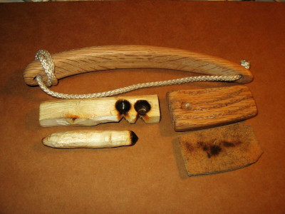

<Callout type="note" title="Note">
<VideoPlayer src="https://www.youtube.com/watch?v=i3r3APvRwSU" title="Video: 23GW" />
</Callout>

#### Tension

Tension is the magnitude of the force that exists in objects like ropes, chains and struts that are
                    providing support. For example, there are tension forces in the ropes supporting a child's swing
                    hanging from a tree.

### Textbook Exercise 2.1

**Problem:**
A box is placed on a rough surface. It has a normal force of magnitude \(\text{120}\)
                                \(\text{N}\). A force of \(\text{20}\) \(\text{N}\) applied to the right cannot move the
                                box. Calculate the magnitude and direction of the friction forces.

**Solution:**
The normal force is given (\(\text{120}\) \(\text{N}\)) and we know that the block does
                                not move when an applied force of \(\text{20}\) \(\text{N}\) is used.

We are asked to find the magnitude and direction of the friction forces.

Since the box is stationary and the applied force is insufficient to move the box, we
                                know that the kinetic friction force is \(\text{0}\) \(\text{N}\).

The frictional force is defined as the the force that opposes the motion of an object in
                                contact with a surface and it acts parallel to the surface the object is in contact
                                with. Therefore the static frictional force is \(\text{20}\) \(\text{N}\) to the left to
                                give a resultant of zero.

A block rests on a horizontal surface. The normal force is \(\text{20}\) \(\text{N}\).
                                The coefficient of static friction between the block and the surface is \(\text{0,40}\)
                                and the coefficient of dynamic friction is \(\text{0,20}\).

**Problem:**
What is the magnitude of the frictional force exerted on the block while the block is
                                    at rest?

**Solution:**
The block is not moving and so there is no kinetic frictional force acting on the
                                    block. There is also no force applied to the block and so the static frictional
                                    force is also zero.

**Problem:**
What will the magnitude of the frictional force be if a horizontal force of magnitude
                                    \(\text{5}\) \(\text{N}\) is exerted on the block?

**Solution:**
The block is not moving and so there is no kinetic frictional force acting on the
                                    block.

The frictional force is defined as the the force that opposes the motion of an object
                                    in contact with a surface and it acts parallel to the surface the object is in
                                    contact with. Therefore the static frictional force is \(\text{5}\) \(\text{N}\) in
                                    the opposite direction to the applied force.

**Problem:**
What is the minimum force required to start the block moving?

**Solution:**
To find the minimum force required to start the block moving we need to calculate the
                                    maximum static friction force:

                                \begin{align*}
                                F_{s}^{\text{max}} & = \mu_{s} N \\
                                & = (\text{0,40})(\text{20}) \\
                                & = \text{8}\text{ N}
                                \end{align*}

So we must apply a force of magnitude greater than \(\text{8}\) \(\text{N}\) to start
                                    the box moving.

**Problem:**
What is the minimum force required to keep the block in motion once it has been
                                    started?

**Solution:**
To find the minimum force required to keep the block in motion we need to calculate
                                    the magnitude of the force of kinetic friction:

                                \begin{align*}
                                F_{k} & = \mu_{k} N \\
                                & = (\text{0,20})(\text{20}) \\
                                & = \text{4}\text{ N}
                                \end{align*}

So we must apply a force of \(\text{4}\) \(\text{N}\) to keep the box in motion.

**Problem:**
If the horizontal force is \(\text{10}\) \(\text{N}\), determine the frictional
                                    force.

**Solution:**
This force is greater than the force required to start the block moving. So the
                                    static frictional force is \(\text{0}\) \(\text{N}\).

For kinetic friction the value of the frictional force remains the same regardless of
                                    the magnitude of the applied force. So the kinetic frictional force is \(\text{4}\)
                                    \(\text{N}\).

A lady injured her back when she slipped and fell in a supermarket. She holds the owner
                                of the supermarket accountable for her medical expenses. The owner claims that the floor
                                covering was not wet and meets the accepted standards. He therefore cannot accept
                                responsibility. The matter eventually ends up in court. Before passing judgement, the
                                judge approaches you, a science student, to determine whether the coefficient of static
                                friction of the floor is a minimum of \(\text{0,5}\) as required. He provides you with a
                                tile from the floor, as well as one of the shoes the lady was wearing on the day of the
                                incident.

**Problem:**
Write down an expression for the coefficient of static friction.

**Solution:**
\[F_{s} \leq \mu_{s}N\]

**Problem:**
Plan an investigation that you will perform to assist the judge in his judgement.
                                    Follow the steps outlined below to ensure that your plan meets the requirements.

2. Formulate an investigation question.
4. Apparatus: List *all* the other apparatus, except the tile and the
                                               shoe, that you will need.
6. A stepwise method: How will you perform the investigation? Include a
                                               relevant, labelled diagram.
8. Results: What will you record?
10. Conclusion: How will you interpret the results to draw a conclusion?

**Solution:**
The following provides a guideline to what learners should do. This experiment is
                                    very similar to the experiment on normal forces and friction given above.

Investigation question: What is the co-efficient of static friction for the tiles in
                                    the supermarket for different shoes and weights of people?

Apparatus: Spring balance, several blocks, of the same material, with hooks attached
                                    to one end, several rough and smooth surfaces, bricks or blocks to incline the
                                    surfaces (and the tile and shoe)

Method:

2. Measure the frictional force for a minimum mass
4. Measure the frictional force for a maximum mass
6. Measure the frictional force for an average mass
8. Repeat each of the above measurements and take the average
10. Determine the average co-efficient of friction

Results: You should record the results for each step described above

Conclusion: If the co-efficient of static friction is less than the minimum required
                                    than the supermarket owner is incorrect. If the co-efficient of static friction is
                                    greater than the minimum required than the lady is incorrect. If the co-efficient of
                                    static friction is the same as the minimum then other factors must be considered.

### Force diagrams (ESBKM)

Force diagrams are sketches of the physical situation you are dealing with, with arrows for all the
                forces acting drawn on the system. For example, if a block rests on a surface then there is a force from
                gravity pulling the block down and there is a normal force acting on the block from the surface. The
                normal force and the force of gravity have the same magnitude in this situation. The force diagram for
                this situation is:

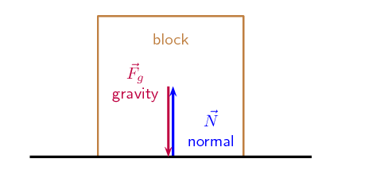

The length of the arrows are the same to indicate that the forces have the same magnitude.

Another example could be a the same block on a surface but with an applied force, \(\vec{F}_L\), to the
                left of \(\text{10}\) \(\text{N}\) and an applied force, \(\vec{F}_R\), to the right of \(\text{20}\)
                \(\text{N}\). The weight and normal also have magnitudes of \(\text{10}\) \(\text{N}\).

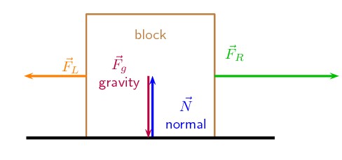

It is important to keep the following in mind when you draw force diagrams:

- Make your drawing large and clear.
- You must use arrows and the direction of the arrow will show the direction of the force.
- The length of the arrow will indicate the size of the force, in other words, the longer arrows in
                          the diagram (\({F}_{R}\) for example) indicates a bigger force than a shorter arrow
                          (\({F}_{L}\)). Arrows of the same length indicate forces of equal size (\({F}_{N}\) and
                          \({F}_{g}\)). Use “little lines” like in maths to show this.
- Draw neat lines using a ruler. The arrows must touch the system or object.
- All arrows must have labels. Use letters with a key on the side if you do not have enough space
                          on your drawing.
- The labels must indicate what is applying the force (the force of the car) on what the force is
                          applied (on the trailer) and in which direction (to the right)
- If the values of the forces are known, these values can be added to the diagram or key.

### Free body diagrams (ESBKN)

In a free-body diagram, the object of interest is drawn as a dot and all the forces acting on it are
                drawn as arrows pointing away from the dot. We can redraw the two force diagrams above as free body
                diagrams:

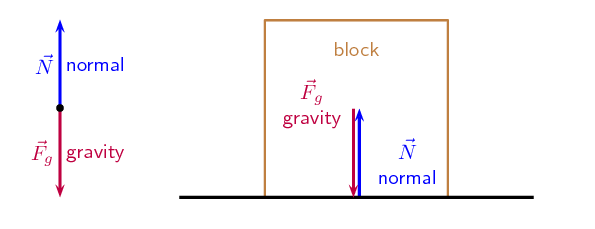

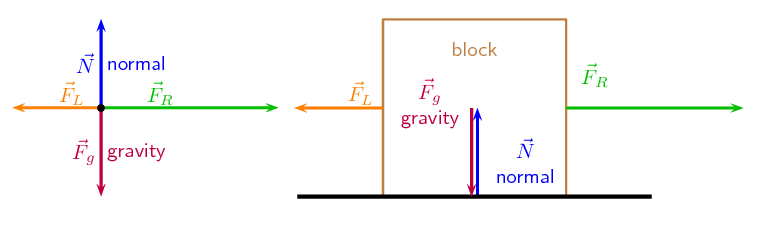

<QuizCard id="s11-02-02c" title="Interactive Exercise 2.4" question="Define a force diagram using the dropdown menus below." options=["relative sizes only", "directions only", "proportions", "vector sum", "directions and relative sizes", "arrows", "lines", "line segments", "dots", "a dot", "a vector", "a scale drawing", "an outline of the object", "a dot or box", "origin", "location on the object where the force is exerted", "point of contact", "reference point", "dot", "inwards", "in the positive direction", "in the direction of the force", "in the negative direction", "in the direction of motion"] answer="0, 0, 0, 0, 0" hint="" explanation="Construct the definition of a force diagram We define a force diagram as follows: A force diagram shows the directions and relative sizes of all forces exerted on an object using arrows to represent the force vectors. The object is represented by an outline of the object and all force vectors have their tails at the location on the object where the force is exerted and point in the direction of the force . Here is an example of a force diagram: In a free-body diagram, the object is represented by a dot and all force vectors have their tails at the dot. Here is an example of a free-body diagram which shows the same forces as the force diagram above: Submit your answer as: directions and relative sizes and arrows and an outline of the object and location on the object where the force is exerted and in the direction of the force" />

<QuizCard id="s11-02-02c" title="Interactive Exercise 2.4" question="Define a free-body diagram using the dropdown menus below." options=["components", "vector sum", "relative sizes only", "directions only", "directions and relative sizes", "line segments", "lines", "arrows", "dots", "a scale drawing", "an outline of the object", "a dot or box", "a dot", "a vector", "origin", "reference point", "dot", "point of contact", "location on the object where the force is exerted", "in the direction of motion", "inwards", "in the negative direction", "in the positive direction", "in the direction of the force"] answer="0, 0, 1, 1, 0" hint="" explanation="Construct the definition of a free-body diagram We define a free-body diagram as follows: A free-body diagram shows the directions and relative sizes of all forces exerted on an object using arrows to represent the force vectors. The object is represented by a dot and all force vectors have their tails at the dot and point in the direction of the force . Here is an example of a free-body diagram: In a force diagram, the object is represented by an outline of the object and all force vectors have their tails at the location on the object where the force is exerted. Here is an example of a force diagram which shows the same forces as the free-body diagram above: Submit your answer as: directions and relative sizes and arrows and a dot and dot and in the direction of the force" />

<QuizCard id="s11-02-02c" title="Interactive Exercise 2.4" question="A number of different forces are acting on a crate. Rethabile draws the following diagram to show all these forces. Did Rethabile draw a free-body diagram or a force diagram? Give a reason for your answer from the table below. A the object is represented by an outline of the actual shape of the object with each force acting on the object drawn as an arrow pointing away from the point on the object at which the force acts B the object is represented by a dot with each force acting on the object drawn as an arrow pointing away from the dot" options=["free-body", "force", "Reason A", "Reason B"] answer="0, 1" hint="" explanation="Recall the definitions of free-body and force diagrams We recall the definitions of free-body and force diagrams: Free-body diagram : A free-body diagram shows the directions and relative sizes of all forces exerted on an object using arrows to represent the force vectors. The object is represented by a dot and all force vectors have their tails at the dot and point in the direction of the force. Force diagram : A force diagram shows the directions and relative sizes of all forces exerted on an object using arrows to represent the force vectors. The object is represented by an outline of the object and all force vectors have their tails at the location on the object where the force is exerted and point in the direction of the force. Use the definitions to decide which diagram we have Looking at the diagram that Rethabile drew we can see the following: The object is represented by a dot . Each force acting on the object points outwards from the dot . The above are features of a free-body diagram. Therefore Rethabile drew a free-body diagram. We know this because the object is represented by a dot with each force acting on the object drawn as an arrow pointing away from the dot ( Reason B ). Submit your answer as: free-body and Reason B" />

<QuizCard id="s11-02-02c" title="Interactive Exercise 2.4" question="A number of different forces are acting on a crate. Abdoul draws the following diagram to show all these forces. Did Abdoul draw a free-body diagram or a force diagram? Give a reason for your answer from the table below. A the object is represented by an outline of the actual shape of the object with each force acting on the object drawn as an arrow pointing away from the point on the object at which the force acts B the object is represented by a dot with each force acting on the object drawn as an arrow pointing away from the dot" options=["free-body", "force", "Reason A", "Reason B"] answer="1, 0" hint="" explanation="Recall the definitions of free-body and force diagrams We recall the definitions of free-body and force diagrams: Free-body diagram : A free-body diagram shows the directions and relative sizes of all forces exerted on an object using arrows to represent the force vectors. The object is represented by a dot and all force vectors have their tails at the dot and point in the direction of the force. Force diagram : A force diagram shows the directions and relative sizes of all forces exerted on an object using arrows to represent the force vectors. The object is represented by an outline of the object and all force vectors have their tails at the location on the object where the force is exerted and point in the direction of the force. Use the definitions to decide which diagram we have Looking at the diagram that Abdoul drew we can see the following: The object is represented by an outline of the actual shape of the object . Each force acting on the object points outwards from the point on the object at which the force acts . The above are features of a force diagram. Therefore Abdoul drew a force diagram. We know this because the object is represented by an outline of the actual shape of the object with each force acting on the object drawn as an arrow pointing away from the point on the object at which the force acts ( Reason A ). Submit your answer as: force and Reason A" />

<QuizCard id="s11-02-02c" title="Interactive Exercise 2.4" question="A package is pulled up a rough slope. Lefu draws the following force diagram to show all the forces acting on the package. The diagram has the correct number of forces, but one of the forces is pointing in the wrong direction . Which force is incorrect ? A \(\vec{F}_{\text{pull}}\) B \(\vec{f}\) C \(\vec{F}_{\text{g}}\) D \(\vec{F}_{\text{N}}\)" options=["A", "B", "C", "D"] answer="C" hint="" explanation="What do we expect to see in the force diagram for the package? We expect to see the following forces acting on the package: The gravitational force \((\vec{F}_{\text{g}})\) pointing straight down . The normal force \((\vec{F}_{\text{N}})\) pointing perpendicularly out of the slope . A frictional force \((\vec{{f}})\) pointing down the slope (opposing motion). A pulling force \((\vec{F}_{\text{pull}})\) pointing up the slope . So the correct force diagram is: Compare this to the diagram Lefu drew Lefu drew the following diagram: We can compare these two diagrams to decide which force is pointing in the wrong direction. A ✘ \(\vec{F}_{\text{pull}}\) \(\vec{F}_{\text{pull}}\) is pointing up the slope as expected. B ✘ \(\vec{f}\) \(\vec{f}\) is pointing down the slope as expected. C ✔ \(\vec{F}_{\text{g}}\) \(\vec{F}_{\text{g}}\) is incorrectly pointing perpendicularly down out of the slope . It should point straight down . D ✘ \(\vec{F}_{\text{N}}\) \(\vec{F}_{\text{N}}\) is pointing perpendicularly out of the slope as expected. Therefore \(\vec{F}_{\text{g}}\) is the force pointing in the wrong direction (Option C ). Submit your answer as: C" />

<QuizCard id="s11-02-02c" title="Interactive Exercise 2.4" question="A block is pulled up a smooth slope. Joshua draws the following free-body diagram to show all the forces acting on the block. The diagram has the correct number of forces, but one of the forces is pointing in the wrong direction . Which force is incorrect ? A \(\vec{F}_{\text{N}}\) B \(\vec{F}_{\text{g}}\) C \(\vec{F}_{\text{pull}}\)" options=["A", "B", "C"] answer="A" hint="" explanation="What do we expect to see in the free-body diagram for the block? We expect to see the following forces acting on the block: The gravitational force \((\vec{F}_{\text{g}})\) pointing straight down . The normal force \((\vec{F}_{\text{N}})\) pointing perpendicularly out of the slope . A pulling force \((\vec{F}_{\text{pull}})\) pointing up the slope . So the correct free-body diagram is: Compare this to the diagram Joshua drew Joshua drew the following diagram: We can compare these two diagrams to decide which force is pointing in the wrong direction. A ✔ \(\vec{F}_{\text{N}}\) \(\vec{F}_{\text{N}}\) is incorrectly pointing straight up . It should point perpendicularly out of the slope . B ✘ \(\vec{F}_{\text{g}}\) \(\vec{F}_{\text{g}}\) is pointing straight down as expected. C ✘ \(\vec{F}_{\text{pull}}\) \(\vec{F}_{\text{pull}}\) is pointing up the slope as expected. Therefore \(\vec{F}_{\text{N}}\) is the force pointing in the wrong direction (Option A ). Submit your answer as: A" />

<QuizCard id="s11-02-02c" title="Interactive Exercise 2.4" question="Block 1 is connected to Block 2 by a light inextensible rope. The system is pulled up a smooth plane inclined at \(\alpha\) to the vertical, by means of a constant force parallel to the plane as shown in the diagram below. All forms of friction can be ignored . Draw a labelled free-body diagram showing all the forces acting on Block 1 as it moves up the plane. The free-body diagram given below contains a mistake . There is a problem with one of the forces. Compare your free-body diagram to the given diagram to work out which force is the problem and what the mistake is. Possible mistakes 1 The force is missing. 2 The force has the wrong direction. 3 The force should not be there." options=["frictional", "normal", "gravitational", "applied", "tensional", "Mistake 1", "Mistake 2", "Mistake 3"] answer="0, 1" hint="" explanation="Identify all forces and draw the free-body diagram Block 1 is being pulled up a smooth plane. There are four forces that this block experiences. The gravitational force is always straight down and the normal force must always point perpendicularly out of a surface. In this scenario there is an applied force pulling the block up the plane. Tension acts to pull the block down the plane. We were told to ignore friction (because the surface of the plane is very smooth). The following list summarises all the forces acting on Block \(\text{1}\) . the gravitational force \((\vec{F}_{\text{g}, 1})\) points straight down the normal force \((\vec{F}_{\text{N}, 1})\) points perpendicularly out of the plane the pulling force \((\vec{F})\) points up the slope the tensional force \((\vec{T})\) points down the slope The correct free-body diagram is shown below: If we compare the given diagram to the correct free-body diagram we can see that: The force with the problem is the normal force. The problem is that it has the wrong direction (Mistake 2). Submit your answer as: normal and Mistake 2" />

<QuizCard id="s11-02-02c" title="Interactive Exercise 2.4" question="Crate 1 is connected to Crate 2 by a light inextensible cable. The system is pulled up a rough plane inclined at \(\alpha\) to the vertical, by means of a constant force parallel to the plane as shown in the diagram below. The magnitude of the kinetic frictional force between the surface and Crate \(\text{1}\) is \(f_{\text{k}, 1}\) . Draw a labelled free-body diagram representing all the forces acting on Crate 1 as it moves up the plane. The free-body diagram given below contains a mistake . There is a problem with one of the forces. Compare your free-body diagram to the given diagram to work out which force is the problem and what the mistake is. Possible mistakes 1 The force is missing. 2 The force has the wrong direction. 3 The force should not be there." options=["tensional", "gravitational", "applied", "frictional", "normal", "Mistake 1", "Mistake 2", "Mistake 3"] answer="1, 1" hint="" explanation="Identify all forces and draw the free-body diagram Crate 1 is being pulled up a rough plane. There are five forces that this crate experiences. The gravitational force is always straight down and the normal force must always point perpendicularly out of a surface. In this scenario there is an applied force pulling the crate up the plane. Tension acts to pull the crate down the plane. The direction of friction always opposes the direction of motion. The following list summarises all the forces acting on Crate \(\text{1}\) . the gravitational force \((\vec{F}_{\text{g}, 1})\) points straight down the normal force \((\vec{F}_{\text{N}, 1})\) points perpendicularly out of the plane the pulling force \((\vec{F})\) points up the slope the tensional force \((\vec{T})\) points down the slope the kinetic friction \((\vec{f}_{\text{k}, 1})\) points down the slope The correct free-body diagram is shown below: If we compare the given diagram to the correct free-body diagram we can see that: The force with the problem is the frictional force. The problem is that it has the wrong direction (Mistake 2). Submit your answer as: frictional and Mistake 2" />

<QuizCard id="s11-02-02c" title="Interactive Exercise 2.4" question="Draw labelled free-body diagrams indicating all the forces acting on each block. Now compare your diagrams to the two diagrams given below and answer the questions that follow. Diagram A Diagram B Which diagram is the free-body diagram for the bottom block? Which force does Force \(\vec{P}\) represent?" options=["A", "B", "gravitational", "normal", "static frictional", "tensional", "down", "up", "bottom", "top"] answer="1, 0, 0, 1" hint="" explanation="Draw free-body diagrams The gravitational force acts down on both blocks. The tension in the cable connecting the two blocks pulls the top block down and the bottom block up. The tension in the cable connecting the top block to the ceiling supports the entire system. The top block : \(\vec{T}_{1}\) , tensional force up \(\vec{T}_{2}\) , tensional force down \(\vec{F}_{\text{g},1}\) , gravitational force down The bottom block : \(\vec{T}_{2}\) , tensional force up \(\vec{F}_{\text{g},2}\) , gravitational force down From the above lists and free-body diagrams we can see that: Diagram B is the free-body diagram for the bottom block. Force \(\vec{P}\) represents the tensional force \((\vec{T}_{2})\) acting up on the bottom block. Submit your answer as: B and tensional and up and bottom" />

<QuizCard id="s11-02-02c" title="Interactive Exercise 2.4" question="Box \(\text{1}\) is connected to Box \(\text{2}\) by a light inextensible rope. The same type of rope is attached to Box \(\text{2}\) , run over a light frictionless pulley, and connected to a motor. The motor pulls the system up a rough plane inclined at an angle \(\alpha\) to the vertical. The motor applies a constant force which causes the system to accelerate. The force applied by the motor is parallel to the plane as shown in the diagram below. Do not ignore friction. Draw labelled free-body diagrams representing all the forces acting on the both boxes. How many forces should there be in these diagrams? Remember that a free-body diagram should contain actual forces, not components of forces." options=[] answer="['4', 'four'], ['5', 'five']" hint="" explanation="Draw a free-body diagram and count forces for the top block The box at the top is connected directly to the motor. The box at the bottom is connected to the top box by a rope. The gravitational force is always straight down and the normal force must always point perpendicularly out of a surface. In this scenario the motor pulls the top box with a force that acts parallel to the plane. The bottom box is pulled up the plane by the tensional force from the rope connecting the two boxes. The top box is pulled down the plane by the tensional force in this rope. We were told to not ignore friction (because the surface of the plane is very rough). As the motor pulls the system up, the kinetic frictional force always opposes the direction of motion. The bottom box Forces on the bottom box \(\vec{F}_{\text{N}, 1}\) , normal force \(\vec{T}\) , tensional force \(\vec{F}_{\text{g}, 1}\) , gravitational force \(\vec{f}_{\text{k}, 1}\) , kinetic frictional force The top box Forces on the top box \(\vec{F}_{\text{N}, 2}\) , normal force \(\vec{T}\) , tensional force \(\vec{F}_{\text{g}, 2}\) , gravitational force \(\vec{F}_{\text{motor}}\) , force of motor \(\vec{f}_{\text{k}, 2}\) , kinetic frictional force From the above lists and free-body diagrams we can see that: There are \(\text{4}\) (four) forces in the free-body diagram for the bottom box. There are \(\text{5}\) (five) forces in the free-body diagram for the top box. Submit your answer as: and" />

<QuizCard id="s11-02-02c" title="Interactive Exercise 2.4" question="A system of two boxes is pulled to the right across a smooth surface. The string joining the two boxes is inextensible (it can't be stretched) and it is pulled tight. Nqobani draws a diagram to show all the forces acting on one of the boxes. This is the diagram that he draws: Which one of the options below best describes the diagram that Nqobani drew? A A force diagram for the box on the left. B A free-body diagram for the box on the left. C A free-body diagram for the box on the right. D A force diagram for the box on the right." options=["A", "B", "C", "D"] answer="A" hint="" explanation="Recall the definitions of free-body and force diagrams Free-body diagram : A free-body diagram shows the directions and relative sizes of all forces exerted on an object using arrows to represent the force vectors. The object is represented by a dot and all force vectors have their tails at the dot and point in the direction of the force. Force diagram : A force diagram shows the directions and relative sizes of all forces exerted on an object using arrows to represent the force vectors. The object is represented by an outline of the object and all force vectors have their tails at the location on the object where the force is exerted and point in the direction of the force. Use the definitions to decide which type of diagram we have Looking at the diagram that Nqobani drew we can see the following: The object is represented by an outline of the actual shape of the box. Each force acting on the object points outwards from the point on the box at which the force acts. The above are features of a force diagram. What do we expect to see in the force diagram of each box? The system is being pulled to the right. So we expect to see the following for the box on the right : The gravitational force \((\vec{F}_{\text{g}})\) pointing straight down. The normal force \((\vec{F}_{\text{N}})\) pointing pointing straight up. An applied pulling force \((\vec{F}_{\text{pull}})\) . This pulling force must point to the right. The string is between the two boxes so there must be a tensional force \((\vec{T})\) . This tensional force must point to the left. We expect to see the following for the box on the left : The gravitational force \((\vec{F}_{\text{g}})\) pointing straight down. The normal force \((\vec{F}_{\text{N}})\) pointing pointing straight up. The string is between the two boxes so there must be a tensional force \((\vec{T})\) . This tensional force must point to the right. NOTE: Although the entire system is being pulled to the right, the applied force is acting on the right box only. The left box is being pulled to the right by the right box. \(\vec{T}\) acting on the right box opposes motion while \(\vec{T}\) acting on the left box supports motion. Which box does the force diagram represent? Nqobani drew the following force diagram: The diagram shows the gravitational force \((\vec{F}_{\text{g}})\) as well as the normal force \((\vec{F}_{\text{N}})\) . But both boxes experience these forces so this does not help us decide which box Nqobani drew the diagram for. The diagram does not show a pulling force, but it shows a tensional force \((\vec{T})\) pointing to the right. This matches what we expect from the box on the left. Therefore the option that best describes the diagram that Nqobani drew is a force diagram for the box on the left (Option A ). Submit your answer as: A" />

<QuizCard id="s11-02-02c" title="Interactive Exercise 2.4" question="A system of two packages is pulled up a rough slope. The rope joining the two packages is inextensible (it can't be stretched) and it is pulled tight. Tshegofatso draws a diagram to show all the forces acting on one of the packages. This is the diagram that she draws: Which one of the options below best describes the diagram that Tshegofatso drew? A A force diagram for the lower package. B A free-body diagram for the higher package. C A force diagram for the higher package. D A free-body diagram for the lower package." options=["A", "B", "C", "D"] answer="D" hint="" explanation="Recall the definitions of free-body and force diagrams Free-body diagram : A free-body diagram shows the directions and relative sizes of all forces exerted on an object using arrows to represent the force vectors. The object is represented by a dot and all force vectors have their tails at the dot and point in the direction of the force. Force diagram : A force diagram shows the directions and relative sizes of all forces exerted on an object using arrows to represent the force vectors. The object is represented by an outline of the object and all force vectors have their tails at the location on the object where the force is exerted and point in the direction of the force. Use the definitions to decide which type of diagram we have Looking at the diagram that Tshegofatso drew we can see the following: The object is represented by a dot. Each force acting on the object points outwards from the dot. The above are features of a free-body diagram. What do we expect to see in the free-body diagram of each package? The system is being pulled up the slope. So we expect to see the following for the package higher on the slope : The gravitational force \((\vec{F}_{\text{g}})\) pointing straight down. The normal force \((\vec{F}_{\text{N}})\) pointing perpendicularly out of the slope. An applied pulling force \((\vec{F}_{\text{pull}})\) . This pulling force must point up the slope. The rope is between the two packages so there must be a tensional force \((\vec{T})\) . This tensional force must point down the slope. A frictional force \((\vec{f})\) pointing in the opposite direction to the direction of motion (down the slope). We expect to see the following for the package lower on the slope : The gravitational force \((\vec{F}_{\text{g}})\) pointing straight down. The normal force \((\vec{F}_{\text{N}})\) pointing perpendicularly out of the slope. The rope is between the two packages so there must be a tensional force \((\vec{T})\) . This tensional force must point up the slope. A frictional force \((\vec{f})\) pointing in the opposite direction to the direction of motion (down the slope). NOTE: Although the entire system is being pulled up the slope, the applied force is acting on the higher package only. The lower package is being pulled up the slope by the higher package. \(\vec{T}\) acting on the higher package opposes motion while \(\vec{T}\) acting on the lower package supports motion. Which package does the free-body diagram represent? Tshegofatso drew the following free-body diagram: The diagram shows the gravitational force \((\vec{F}_{\text{g}})\) as well as the normal force \((\vec{F}_{\text{N}})\) . It also shows a frictional force \((\vec{f})\) , opposing the direction of motion. But both packages experience these forces so this does not help us decide which package Tshegofatso drew the diagram for. The diagram does not show a pulling force, but it shows a tensional force \((\vec{T})\) pointing up the slope. This matches what we expect from the lower package. Therefore the option that best describes the diagram that Tshegofatso drew is a free-body diagram for the lower package (Option D ). Submit your answer as: D" />

### Resolving forces into components (ESBKP)

We have looked at resolving forces into components. There is one situation we will consider where this is
                particularly useful, problems involving an inclined plane. It is important because the normal force
                depends on the component of the gravitational force that is perpendicular to the slope.

Let us consider a block on an inclined plane. The plane is inclined at an angle \(\theta\) to the
                horizontal. It feels a gravitational force, \(\vec{F}_g\), directly downwards. This force can be broken
                into components that are perpendicular to the plane and parallel to it. This is shown here:

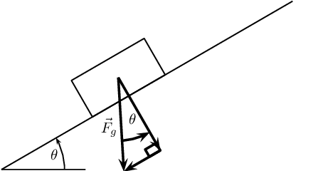

We can use any coordinate system to describe the situation and the simplest thing to do is to make the
                \(x\)-axis of the Cartesian coordinate system align with the inclined plane. Here is the same physical
                situation with the coordinate system drawn in:

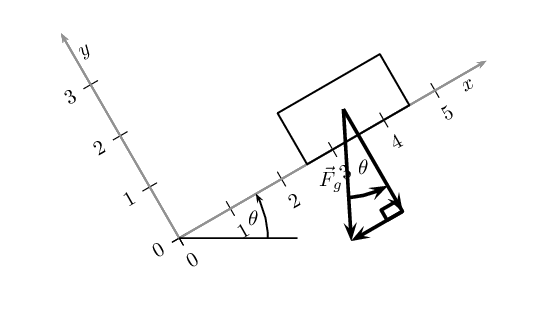

This means that the components of gravitational force are aligned (parallel) with one of the axes of the
                coordinate system. We have shown in the figures that the angle between the horizontal and the incline is
                also the angle between the gravitational force and its component perpendicular to the inclined plane
                (this is normal to the plane). Using this angle and the fact that the components form part of a
                right-angled triangle we can calculate the components using trigonometry:

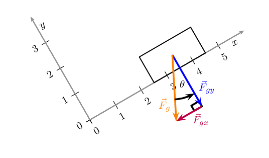

Using trigonometry the components are given by:
                \begin{align*}
                {F}_{gx} & = {F}_g\sin(\theta)\\
                {F}_{gy} & = {F}_g\cos(\theta)
                \end{align*}

<Callout type="tip" title="Worked example 6: Components of force due to gravity">
**Question:**
A block on an inclined plane experiences a force due to gravity, \(\vec{F}_g\) of \(\text{137}\)
                        \(\text{N}\) straight down. If the slope is inclined at \(\text{37}\)\(\text{°}\) to the
                        horizontal, what is the component of the force due to gravity perpendicular and parallel to the
                        slope?

**Components:**
We know that for a block on a slope we can resolve the force due to gravity, \(\vec{F}_g\) into
                        components parallel and perpendicular to the slope. \begin{align*}
                        {F}_{gx} & = {F}_g\sin(\theta)\\
                        {F}_{gy} & = {F}_g\cos(\theta)
                        \end{align*}

**Calculations:**
This problem is straightforward as we know that the slope is inclined at an angle of
                        \(\text{37}\)\(\text{°}\). This is the same angle we need to use to calculate the
                        components, therefore:
                        \begin{align*}
                        {F}_{gx} & = {F}_g\sin(\theta)\\
                        & = (\text{137})\sin(\text{37}\text{°})\\
                        & = \text{82,45}\text{ N}
                        \end{align*}
                        \begin{align*}
                        {F}_{gy} & = {F}_g\cos(\theta)\\
                        & = (\text{137})\cos(\text{37}\text{°})\\
                        & = \text{109,41}\text{ N}
                        \end{align*}

**Final answer:**
The component of \(\vec{F}_g\) that is perpendicular to the slope is
                        \(\vec{F}_{gy}\)=\(\text{109,41}\) \(\text{N}\) in the negative \(y\)-direction.

The component of \(\vec{F}_g\) that is perpendicular to the slope is
                        \(\vec{F}_{gx}\)=\(\text{82,45}\) \(\text{N}\) in the negative \(x\)-direction.
</Callout>

### Textbook Exercise 2.2

**Problem:**
A block on an inclined plane experiences a force due to gravity, \(\vec{F}_g\) of
                            \(\text{456}\) \(\text{N}\) straight down. If the slope is inclined at
                            \(\text{67,8}\)\(\text{°}\) to the horizontal, what is the component of the force due
                            to gravity perpendicular and parallel to the slope?

**Solution:**
We know that for a block on a slope we can resolve the force due to gravity, \(\vec{F}_g\)
                            into components parallel and perpendicular to the slope. \begin{align*}
                            {F}_{gx} & = {F}_g\sin(\theta)\\
                            {F}_{gy} & = {F}_g\cos(\theta)
                            \end{align*}

The slope is inclined at an angle of \(\text{67,8}\)\(\text{°}\). This is the same angle
                            we need to use to calculate the components, therefore:

                        \begin{align*}
                        {F}_{gx} & = {F}_g\sin(\theta)\\
                        & = (\text{456})\sin(\text{67,8}\text{°})\\
                        & = \text{422,20}\text{ N}
                        \end{align*}
                        \begin{align*}
                        {F}_{gy} & = {F}_g\cos(\theta)\\
                        & = (\text{456})\cos(\text{67,8}\text{°})\\
                        & = \text{172,30}\text{ N}
                        \end{align*}

The component of \(\vec{F}_g\) that is perpendicular to the slope is
                            \(\vec{F}_{gy}\)=\(\text{172,30}\) \(\text{N}\) in the negative \(y\)-direction.

The component of \(\vec{F}_g\) that is perpendicular to the slope is
                            \(\vec{F}_{gx}\)=\(\text{422,20}\) \(\text{N}\) in the negative \(x\)-direction.

**Problem:**
A block on an inclined plane is subjected to a force due to gravity, \(\vec{F}_g\) of
                            \(\text{456}\) \(\text{N}\) straight down. If the component of the gravitational force
                            parallel to the slope is \(\vec{F}_{gx}\)=\(\text{308,7}\) \(\text{N}\) in the negative
                            \(x\)-direction (down the slope), what is the incline of the slope?

**Solution:**
We know that for a block on a slope we can resolve the force due to gravity, \(\vec{F}_g\)
                            into components parallel and perpendicular to the slope. \begin{align*}
                            {F}_{gx} & = {F}_g\sin(\theta)\\
                            {F}_{gy} & = {F}_g\cos(\theta)
                            \end{align*}

We are given the horizontal component of gravity and the force due to gravity. We can use
                            these to find the incline of the slope:

                        \begin{align*}
                        {F}_{gx} & = {F}_g\sin(\theta)\\
                        \text{308,7} & = (\text{456})\sin \theta\\
                        \sin \theta & = \text{0,6769} \ldots \\
                        \theta & = \text{42,61}\text{°}
                        \end{align*}

The slope is at an incline of \(\text{42,61}\)\(\text{°}\).

### Finding the resultant force (ESBKQ)

The easiest way to determine a resultant force is to draw a free body diagram. Remember from [Chapter
                    1](/read/science/grade-11/vectors-in-two-dimensions/01-vectors-in-two-dimensions-01) that we use the length of the arrow to indicate the vector's magnitude and the direction of
                the arrow to show which direction it acts in.

After we have done this, we have a diagram of vectors and we simply find the sum of the vectors to get
                the resultant force.

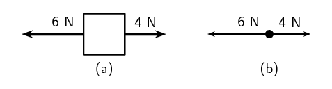

Figure 2.4:
                    (a) Force diagram of 2 forces acting on a box. (b) Free body diagram of the box.

For example, two people push on a box from opposite sides with forces of \(\text{4}\) \(\text{N}\) and
                \(\text{6}\) \(\text{N}\) respectively as shown in Figure
                    2.4 (a). The free body diagram in Figure 2.4
                (b) shows the object represented by a dot and the two forces are represented by arrows with their tails
                on the dot.

As you can see, the arrows point in opposite directions and have different lengths. The resultant force
                is \(\text{2}\) \(\text{N}\) to the left. This result can be obtained algebraically too, since the two
                forces act along the same line. First, as in motion in one direction, choose a frame of reference.
                Secondly, add the two vectors taking their directions into account.

For the example, assume that the positive direction is to the right, then:\begin{align*}
                F_R & = (\text{4}) + (-\text{6}) \\
                & = -\text{2} \\
                & = -\text{2}\text{ N}\ \text{to the left.}
                \end{align*}

Remember that a negative answer means that the force acts in the *opposite* direction to the one
                that you chose to be positive. You can *choose* the positive direction to be any way you want,
                but once you have chosen it you *must* use it consistently for that problem.

As you work with more force diagrams in which the forces exactly balance, you may notice that you get a
                zero answer (e.g. \(\text{0}\) \(\text{N}\)). This simply means that the forces are balanced and the
                resultant is zero.

Once a force diagram has been drawn the techniques of vector addition introduced in [Chapter
                    1](/read/science/grade-11/vectors-in-two-dimensions/01-vectors-in-two-dimensions-03#scESBKD) can be used. Depending on the situation you might choose to use a graphical technique such as
                the tail-to-head method or the parallelogram method, or else an algebraic approach to determine the
                resultant. Since force is a vector quantity all of these methods apply.

A good strategy is:

- resolve all forces into components parallel to the \(x\)- and \(y\)-directions;
- calculate the resultant in each direction, \(\vec{R}_x\) and \(\vec{R}_y\), using co-linear vectors;
                      and
- use \(\vec{R}_x\) and \(\vec{R}_y\) to calculate the resultant, \(\vec{R}\).

<Callout type="tip" title="Worked example 7: Finding the resultant force">
**Question:**
A car (experiencing a gravitational force of magnitude \(\text{12 000}\) \(\text{N}\) and a
                        normal force of the same magnitude) applies a force of \(\text{2 000}\) \(\text{N}\) on a
                        trailer (experiencing a gravitational force of magnitude \(\text{2 500}\) \(\text{N}\) and
                        normal force of the same magnitude). A constant frictional force of magnitude \(\text{200}\)
                        \(\text{N}\) is acting on the trailer, and a constant frictional force of magnitude
                        \(\text{300}\) \(\text{N}\) is acting on the car.

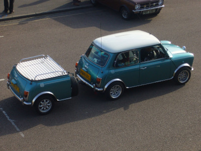

2. Draw a force diagram of all the forces acting on the car.
4. Draw a free body diagram of all the forces acting on the trailer.
6. Use the force diagram to determine the resultant force on the trailer.

**Draw the force diagram for the car.:**
The question asks us to draw all the forces on the car. This means that we must include
                        horizontal and vertical forces.

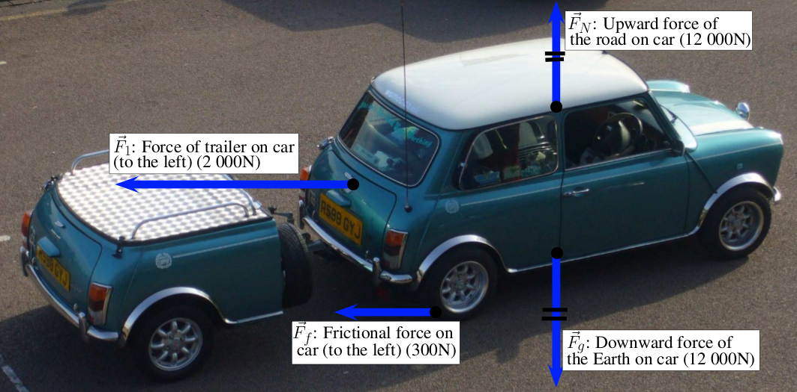

**Determine the resultant force on the trailer.:**
To find the resultant force we need to add all the horizontal forces together. We do not add
                        vertical forces as the movement of the car and trailer will be in a horizontal direction, and
                        not up or down.
                        \({F}_{R}=\text{2 000}+\left(-\text{200}\right)=\text{1 800} \text{N to the
                        right}\).
</Callout>

<Callout type="note" title="Note">
[Simulation: 23H4](http://phet.colorado.edu/en/simulation/forces-and-motion)
</Callout>

## Forces and motion

### Textbook Exercise 2.3

A boy pushes a shopping trolley (weight due to gravity of \(\text{150}\) \(\text{N}\))
                                with a constant force of \(\text{75}\) \(\text{N}\). A constant frictional force of
                                \(\text{20}\) \(\text{N}\) is present.

**Problem:**
Draw a labelled force diagram to identify all the forces acting on the shopping
                                    trolley.

**Solution:**
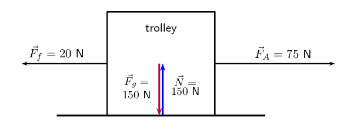

Where:

                                \begin{align*}
                                \vec{F}_{f} & \text{ frictional force} \\
                                \vec{F}_{A} & \text{ applied force} \\
                                \vec{F}_{g} & \text{ gravitational force} \\
                                \vec{N} & \text{ normal force}
                                \end{align*}

**Problem:**
Draw a free body diagram of all the forces acting on the trolley.

**Solution:**
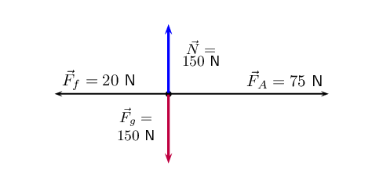

Where:

                                \begin{align*}
                                \vec{F}_{f} & \text{ frictional force} \\
                                \vec{F}_{A} & \text{ applied force} \\
                                \vec{F}_{g} & \text{ gravitational force} \\
                                \vec{N} & \text{ normal force}
                                \end{align*}

**Problem:**
Determine the resultant force on the trolley.

**Solution:**
The normal force and the gravitational force are balanced and produced no net force
                                    on the trolley.

We need to determine the resultant force using the force of friction and the applied
                                    force. We choose to the right as positive and assume that the applied force is
                                    applied to the right, while the frictional force acts to the left.

                                \begin{align*}
                                \vec{F}_{R} & = \vec{F}_{f} + \vec{F}_{A} \\
                                & = -\text{20} + \text{75} \\
                                & = \text{55}\text{ N} \text{ to the right}
                                \end{align*}

A donkey (experiencing a gravitational force of \(\text{2 500}\) \(\text{N}\)) is
                                trying to pull a cart (force due to gravity of \(\text{800}\) \(\text{N}\)) with a force
                                of \(\text{400}\) \(\text{N}\). The rope between the donkey and the cart makes an angle
                                of \(\text{30}\)\(\text{°}\) with the cart. The cart does not move.

**Problem:**
Draw a free body diagram of all the forces acting on the donkey.

**Solution:**
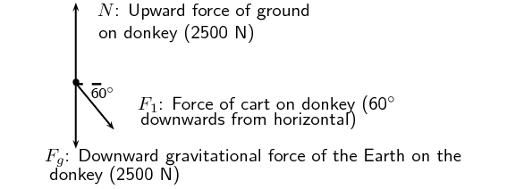

**Problem:**
Draw a force diagram of all the forces acting on the cart.

**Solution:**
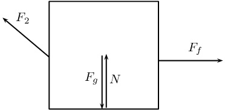

Where:

                                \begin{align*}
                                \vec{F}_{f} & \text{ frictional force} \\
                                \vec{F}_{2} & \text{ force of cart on donkey} \\
                                \vec{F}_{g} & \text{ gravitational force} \\
                                \vec{N} & \text{ normal force}
                                \end{align*}

**Problem:**
Find the magnitude and direction of the frictional force preventing the cart from
                                    moving.

**Solution:**
The cart is not moving so this is static friction only. We note that the frictional
                                    force acts in the \(x\)-direction only and will be equal to the \(x\) component of
                                    the force applied by the donkey. The direction will be in the opposite direction
                                    that the donkey is pulling. The frictional force is:

                                \begin{align*}
                                \vec{F}_{f} & = F_{A}\cos \theta \\
                                & = \text{400} \cos(\text{30}) \\
                                & = \text{346,41}\text{ N} \text{ in the opposite direction to the applied force}
                                \end{align*}
