## 2.3 Newton's laws (ESBKR)

In this section we will look at the effect of forces on objects and how we can make things move. This will
            link together what you have learnt about motion and what you have learnt about forces.

### Newton's first law (ESBKS)

Sir Isaac Newton was a scientist who lived in England (1642-1727) who was interested in the motion of
                objects under various conditions. He suggested that a stationary object will remain stationary unless a
                force acts on it and that a moving object will continue moving unless a force slows it down, speeds it
                up or changes its direction of motion. From this he formulated what is known as Newton's first law of
                motion:

Newton's first law of motion

An object continues in a state of rest or uniform motion (motion with a constant velocity) unless
                        it is acted on by an unbalanced (net or resultant) force.

This property of an object, to continue in its current state of motion unless acted upon by a net force,
                is called *inertia*.

Let us consider the following situations:

An ice skater pushes herself away from the side of the ice rink and skates across the ice. She will
                continue to move in a straight line across the ice unless something stops her. Objects are also like
                that. If we kick a soccer ball across a soccer field, according to Newton's first law, the soccer ball
                should keep on moving forever! However, in real life this does not happen. Is Newton's Law wrong? Not
                really. Newton's first law applies to situations where there aren't any external forces present. This
                means that friction is not present. In the case of the ice skater, the friction between the skates and
                the ice is very little and she will continue moving for quite a distance. In the case of the soccer
                ball, air resistance (friction between the air and the ball) and friction between the grass and the ball
                is present and this will slow the ball down.

<Callout type="note" title="Note">
<VideoPlayer src="https://www.youtube.com/embed/CQYELiTtUs8" title="Video: 23H7" />
</Callout>

#### Newton's first law in action

Let us look at the following two examples. We will start with a familiar example:

**Seat belts:**

We wear seat belts in cars. This is to protect us when the car is involved in an accident. If a car
                    is travelling at \(\text{120}\) \(\text{km·h$^{-1}$}\), the passengers in the car is also
                    travelling at \(\text{120}\) \(\text{km·h$^{-1}$}\). When the car suddenly stops a force is
                    exerted on the car (making it slow down), but not on the passengers. The passengers will carry on
                    moving forward at \(\text{120}\) \(\text{km·h$^{-1}$}\) according to Newton's first law. If
                    they are wearing seat belts, the seat belts will stop them by exerting a force on them and so
                    prevent them from getting hurt.

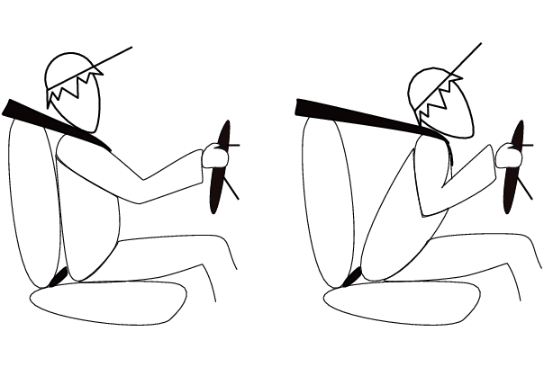

<Callout type="note" title="Note">
<VideoPlayer src="https://www.youtube.com/watch?v=8zsE3mpZ6Hw" title="Video: 23H8" />
</Callout>

**Rockets**:

A spaceship is launched into space. The force of the exploding gases pushes the rocket through the
                    air into space. Once it is in space, the engines are switched off and it will keep on moving at a
                    constant velocity. If the astronauts want to change the direction of the spaceship they need to fire
                    an engine. This will then apply a force on the rocket and it will change its direction.

<Callout type="tip" title="Worked example 8: Newton's first law in action">
**Question:**
Why do passengers get thrown to the side when the car they are driving in goes around a
                            corner?

**What happens before the car turns:**
Before the car starts turning both the passengers and the car are travelling at the same
                            velocity. (picture A)

**What happens while the car turns:**
The driver turns the wheels of the car, which then exert a force on the car and the car
                            turns. This force acts on the car but not the passengers, hence (by Newton's first law) the
                            passengers continue moving with the same original velocity. (picture B)

**Why passengers get thrown to the side?:**
If the passengers are wearing seat belts they will exert a force on the passengers until the
                            passengers' velocity is the same as that of the car (picture C). Without a seat belt the
                            passenger may hit the side of the car.

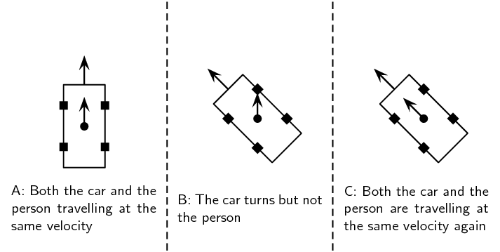
</Callout>

### Textbook Exercise 2.4

**Problem:**
If a passenger is sitting in a car and the car turns round a bend to the right, what
                                happens to the passenger? What happens if the car turns to the left?

**Solution:**
Before the car starts turning both the passenger and the car are travelling at the same
                                velocity.

As the car turns to the right a force acts on the car but not the passengers, hence (by
                                Newton's first law) the passenger continues moving with the same original velocity. (In
                                other words the car turns, but the passenger does not).

The net result of this is that the passenger is pulled to the left as the car turns
                                right.

If the car instead turned to the left the passenger would be pulled to the right.

**Problem:**
Helium is less dense than the air we breathe. Discuss why a helium balloon in a car
                                driving around a corner appears to violate Newton's first law and moves towards the
                                inside of the turn not the outside like a passenger.

**Solution:**
As the car goes around the corner all the air keeps moving forward (it acts in the same
                                way that a passenger acts). This causes the air pressure on the one side of the car to
                                increase (this will be on the opposite side to the direction the car is turning). This
                                slight increase in the air pressure pushes the helium balloon to the other side of the
                                car.

Because of this it appears that the helium balloon does not obey Newton's first law.

### Newton's second law of motion (ESBKT)

According to Newton's first law, things 'like to keep on doing what they are doing'. In other words, if
                an object is moving, it tends to continue moving (in a straight line and at the same speed) and if an
                object is stationary, it tends to remain stationary. So how do objects start moving?

Let us look at the example of a \(\text{10}\) \(\text{kg}\) box on a rough table. If we push lightly on
                the box as indicated in the diagram, the box won't move. Let's say we applied a force of \(\text{100}\)
                \(\text{N}\), yet the box remains stationary. At this point a frictional force of \(\text{100}\)
                \(\text{N}\) is acting on the box, preventing the box from moving. If we increase the force, let's say
                to \(\text{150}\) \(\text{N}\) and the box almost starts to move, the frictional force is \(\text{150}\)
                \(\text{N}\). To be able to move the box, we need to push hard enough to overcome the friction and then
                move the box. If we therefore apply a force of \(\text{200}\) \(\text{N}\) remembering that a frictional
                force
                of
                \(\text{150}\) \(\text{N}\) is present, the 'first' \(\text{150}\) \(\text{N}\) will be used to overcome
                or 'cancel' the friction and the other \(\text{50}\) \(\text{N}\) will be used to move (accelerate) the
                block. In order to accelerate an object we must have a resultant force acting on the block.

Now, what do you think will happen if we pushed harder, lets say \(\text{300}\) \(\text{N}\)? Or, what do
                you think will happen if the mass of the block was more, say \(\text{20}\) \(\text{kg}\), or what if it
                was less? Let us investigate how the motion of an object is affected by mass and force.

A recommended experiment for formal assessment on Newton's second law of motion is also included in
                    this chapter. In this experiment learners will investigate the relationship between force and
                    acceleration (Newton's second law). You will need trolleys, different masses, inclined plane, rubber
                    bands, meter ruler, ticker tape apparatus, ticker timer, graph paper.

## Newton's second law of motion

### Aim

To investigate the relation between the acceleration of objects and the application of a constant
                        resultant force.

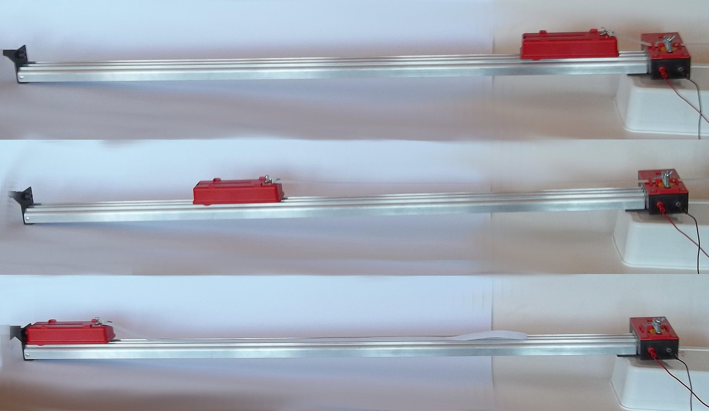

### Method

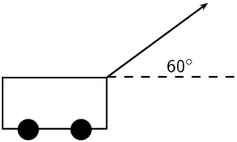

2. A constant force of \(\text{20}\) \(\text{N}\), acting at an angle of
                                   \(\text{60}\)\(\text{°}\) to the horizontal, is applied to a dynamics trolley.
4. Ticker tape attached to the trolley runs through a ticker timer of frequency
                                   \(\text{20}\) \(\text{Hz}\) as the trolley is moving on the frictionless surface.
6. The above procedure is repeated 4 times, each time using the same force, but varying the
                                   mass of the trolley as follows:
   - Case 1: \(\text{6,25}\) \(\text{kg}\)
   - Case 2: \(\text{3,57}\) \(\text{kg}\)
   - Case 3: \(\text{2,27}\) \(\text{kg}\)
   - Case 4: \(\text{1,67}\) \(\text{kg}\)
8. Shown below are sections of the four ticker tapes obtained. The tapes are marked with the
                                   letters A, B, C, D, etc. A is the first dot, B is the second dot and so on. The distance
                                   between each dot is also shown.

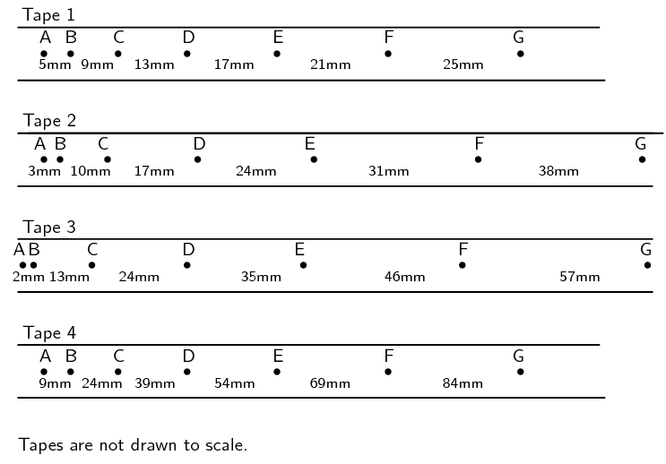

Instructions:

2. Use each tape to calculate the instantaneous velocity (in \(\text{m·s$^{-1}$}\)) of
                                   the trolley at points B and F (remember to convert the distances to m first!). Use these
                                   velocities to calculate the trolley's acceleration in each case.
4. Tabulate the mass and corresponding acceleration values as calculated in each case.
                                   Ensure that each column and row in your table is appropriately labelled.
6. Draw a graph of acceleration vs. mass, using a scale of \(\text{1}\) \(\text{cm}\) =
                                   \(\text{1}\) \(\text{m·s$^{-2}$}\) on the y-axis and \(\text{1}\) \(\text{cm}\) =
                                   \(\text{1}\) \(\text{kg}\) on the x-axis.
8. Use your graph to read off the acceleration of the trolley if its mass is \(\text{5}\)
                                   \(\text{kg}\).
10. Write down a conclusion for the experiment.

You will have noted in the investigation above that the heavier the trolley is, the slower it moved when
                the force was constant. The acceleration is *inversely* proportional to the mass. In mathematical
                terms:

            \(a\propto \frac{1}{m}\)

In a similar investigation where the mass is kept constant, but the applied force is varied, you will
                find that the bigger the force is, the faster the object will move. The acceleration of the trolley is
                therefore *directly* proportional to the resultant force. In mathematical terms:

            \(a\propto F.\)

Rearranging the above equations, we get a \(\propto\)\(\frac{F}{m}\) **or**
                \(F = ma\).

Remember that both force and acceleration are vectors quantities. The acceleration is in the same
                direction as the force that is being applied. If multiple forces are acting simultaneously then we only
                need to work with the resultant force or net force.

Newton's second law of motion

If a resultant force acts on a body, it will cause the body to accelerate in the direction of the
                        resultant force. The acceleration of the body will be directly proportional to the resultant
                        force and inversely proportional to the mass of the body. The mathematical representation
                        is:\[\vec{F}_{net} = m\vec{a}\]

**Force is a vector quantity**. Newton's second law of motion should be applied to the
                \(y\)- and \(x\)-directions separately. You can use the resulting \(y\)- and \(x\)-direction resultants
                to calculate the overall resultant as we saw in the previous chapter.

<Callout type="note" title="Note">
<VideoPlayer src="https://www.youtube.com/embed/ou9YMWlJgkE" title="Video: 23HC" />
</Callout>

<QuizCard id="s11-02-03b" title="Interactive Exercise 2.8" question="Physical constants · Physics formulas State Newton's second law of motion in words." options=["a resultant force", "an acceleration", "momentum", "mass", "power", "decrease speed", "move", "accelerate", "be displaced", "increase speed", "a speed", "an inertia", "an energy", "a velocity", "an acceleration", "less than", "greater than", "inversely proportional to", "directly proportional to", "equal to", "weight", "momentum", "power", "resultant force", "acceleration", "inversely proportional to", "equal to", "directly proportional to", "greater than", "less than"] answer="0, 0, 0, 0, 0, 0" hint="" explanation="State Newton's second law of motion When a resultant force is applied to an object, the object will accelerate in the same direction as resultant force with an acceleration directly proportional to the magnitude of the resultant force and inversely proportional to the mass of the object. Mathematically, this law can be written: \[                     \begin{array}{c}                         \vec{F}_{\text{net}} = {\color{DarkBlue}{m}}{\color{OrangeRed}{\vec{a}}}                     \end{array}                 \] NOTE: Newton's second law of motion means that: Only a net force can cause an acceleration . This will change an object's velocity (speed or direction can change). It is difficult to change the velocity of a heavy object. An object's mass resists changes in motion . Submit your answer as: a resultant force and accelerate and an acceleration and directly proportional to and resultant force and inversely proportional to" />

<QuizCard id="s11-02-03b" title="Interactive Exercise 2.8" question="What does the symbol \( m\) stand for?" options=["momentum", "mass", "metres", "net force", "acceleration", "m\u00b7s\u207b\u00b9", "m\u00b7s", "N", "kg", "m\u00b7s\u207b\u00b2"] answer="mass" hint="" explanation="What do the symbols in the equation mean? The equation we are working with is: \[                         \begin{aligned}                         F_{\text{net}} & = m a                         \end{aligned}                     \] This equation shows the relationship between net force, mass and acceleration. The symbol for: net force is \(F_{\text{net}}\) . mass is \(m\) . acceleration is \(a\) . Therefore the symbol \(m\) stands for mass . Submit your answer as: mass" />

<QuizCard id="s11-02-03b" title="Interactive Exercise 2.8" question="Adapted from DBE Feb-Mar 2017 Grade 12, P1, Q1.1 Physical constants · Physics formulas A group of learners exert different net forces on an object and cause it to accelerate. According to Newton's second law of motion, the net force experienced by the object is __________ its acceleration. A independent of B directly proportional to C always equal to D inversely proportional to" options=["A", "B", "C", "D"] answer="B" hint="" explanation="Recall Newton's second law When a net force acts on an object, the object will accelerate in the direction of the net force with an acceleration directly proportional to the magnitude of the net force and inversely proportional to the mass of the object . Mathematically, we can express this as: \[                     \begin{array}{c}                         \vec{F}_{\text{net}} = m \vec{a}                     \end{array}                 \] From this we have the following proportionality: \[                     \begin{array}{c}                         F_{\text{net}} \propto a                     \end{array}                 \] NOTE: If \(x\) is directly proportional to \(y\) , then \(y\) is also directly proportional to \(x\) : \[                         \begin{array}{c}                             x \propto y \iff y \propto x                         \end{array}                     \] And if \(x\) is inversely proportional to \(y\) , then \(y\) is also inversely proportional to \(x\) \[                         \begin{array}{c}                             x \propto \dfrac{1}{y} \iff y \propto \dfrac{1}{x}                         \end{array}                     \] In other words, two variables can be directly or inversely proportional to each other . This is how proportionality works! So if we look at the options again, we can work out the correct answer: A independent of B \({\color{red}{{\checkmark}{\checkmark}}}\) directly proportional to C always equal to D inversely proportional to So the correct choice is Option B . Submit your answer as: B" />

<QuizCard id="s11-02-03b" title="Interactive Exercise 2.8" question="Mass \((m)\) , acceleration \((a)\) , and net force \((F_{\text{net}})\) are three important quantities in mechanics. They are related to each other through Newton's second law of motion. Which one of the following equations correctly represents the relationship between these quantities? A \(m = \dfrac{F_{\text{net}}}{a}\) B \(m = a F_{\text{net}}\) C \(m = \dfrac{a}{F_{\text{net}}}\)" options=["A", "B", "C"] answer="A" hint="" explanation="Identify the relationship Mass, acceleration, and net force are related to each other by Newton's second law of motion which can be written mathematically as follows: \[                     \begin{aligned}                         F_{\text{net}} = m a                     \end{aligned}                 \] Make \(m\) the subject of the formula We need to isolate \(m\) . We can do this by dividing both sides of the equation by \({\color{blue}{a}}\) . \[                         \begin{aligned}                             F_{\text{net}} &= m a \\                             \frac{ F_{\text{net}} }{ {\color{blue}{a}} } &= \frac{ ma }{ {\color{blue}{a}} } \\                             \frac{F_{\text{net}}}{a} &= m \frac{ {\color{darkgray}{a}} }{ {\color{darkgray}{a}} } \\                             \therefore \frac{ F_{\text{net}} }{ a } &= m                         \end{aligned}                     \] Therefore the relationship with \(m\) the subject of the formula is: \[                     \begin{array}{c}                         m = \dfrac{F_{\text{net}}}{a}                     \end{array}                 \] We can compare this equation to the given options: A ✔ \(m = \dfrac{F_{\text{net}}}{a}\) B ✘ \(m = a F_{\text{net}}\) C ✘ \(m = \dfrac{a}{F_{\text{net}}}\) Therefore the correct equation is A . Submit your answer as: A" />

<QuizCard id="s11-02-03b" title="Interactive Exercise 2.8" question="Adapted from DBE Feb-Mar 2017 Grade 12, P1, Q1.1 Physical constants · Physics formulas A group of learners exert the same net force on different objects and cause them to accelerate. According to Newton's second law of motion, the acceleration of each object is __________ its mass. A inversely proportional to B directly proportional to C always greater than D independent of" options=["A", "B", "C", "D"] answer="A" hint="" explanation="Recall Newton's second law When a net force acts on an object, the object will accelerate in the direction of the net force with an acceleration directly proportional to the magnitude of the net force and inversely proportional to the mass of the object . Mathematically, we can express this as: \[                     \begin{array}{c}                         \vec{F}_{\text{net}} = m \vec{a}                     \end{array}                 \] From this we have the following proportionality: \[                     \begin{array}{c}                         a \propto \dfrac{1}{m}                     \end{array}                 \] NOTE: If \(x\) is directly proportional to \(y\) , then \(y\) is also directly proportional to \(x\) : \[                         \begin{array}{c}                             x \propto y \iff y \propto x                         \end{array}                     \] And if \(x\) is inversely proportional to \(y\) , then \(y\) is also inversely proportional to \(x\) \[                         \begin{array}{c}                             x \propto \dfrac{1}{y} \iff y \propto \dfrac{1}{x}                         \end{array}                     \] In other words, two variables can be directly or inversely proportional to each other . This is how proportionality works! So if we look at the options again, we can work out the correct answer: A \({\color{red}{{\checkmark}{\checkmark}}}\) inversely proportional to B directly proportional to C always greater than D independent of So the correct choice is Option A . Submit your answer as: A" />

#### Applying Newton's second law of motion

Newton's second law can be applied to a variety of situations. We will look at the main types of
                    examples that you need to study.

<Callout type="tip" title="Worked example 9: Newton's second law: Box on a surface">
**Question:**
A \(\text{10}\) \(\text{kg}\) box is placed on a table. A horizontal force of magnitude
                            \(\text{32}\) \(\text{N}\) is applied to the box. A frictional force of magnitude
                            \(\text{7}\) \(\text{N}\) is present between the surface and the box.

2. Draw a force diagram indicating all of the forces acting on the box.
4. Calculate the acceleration of the box.

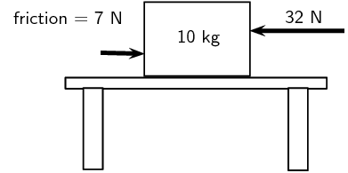

**Identify the horizontal forces and draw a force diagram:**
We only look at the forces acting in a horizontal direction (left-right) and not vertical
                            (up-down) forces. The applied force and the force of friction will be included. The force of
                            gravity, which is a vertical force, will not be included.

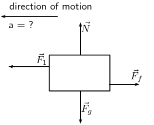

**Calculate the acceleration of the box:**
**Remember** that we consider the \(y\)- and \(x\)-directions separately. In
                            this problem we can ignore the \(y\)-direction because the box is resting on a table with
                            the gravitational force balanced by the normal force.

We have been given:

Applied force \({F}_{1}=\text{32}\text{ N}\)

Frictional force \({F}_{f}=-\text{7}\text{ N}\)

Mass \(m=\text{10}\text{ kg}\)

To calculate the acceleration of the box we will be using the equation
                            \(\vec{F}_{R}=m\vec{a}\).
                            Therefore: \begin{align*}
                            \vec{F}_R &= m\vec{a} \\
                            \vec{F}_1+\vec{F}_f &= (\text{10})\vec{a} \\
                            (\text{32}-\text{7}) &= (\text{10})\vec{a} \\
                            \text{25} &= (\text{10})\vec{a} \\
                            \vec{a} &= \text{2,5}\text{ m·s$^{-2}$}\ \text{to the left.}
                            \end{align*}
</Callout>

<Callout type="tip" title="Worked example 10: Newton's second law: box on a surface">
**Question:**
Two crates, \(\text{10}\) \(\text{kg}\) and \(\text{15}\) \(\text{kg}\) respectively, are
                            connected with a thick rope according to the diagram. A force, to the right, of
                            \(\text{500}\) \(\text{N}\) is applied. The boxes move with an acceleration of \(\text{2}\)
                            \(\text{m·s$^{-2}$}\) to the right. One third of the total frictional force is acting
                            on the \(\text{10}\) \(\text{kg}\) block and two thirds on the \(\text{15}\) \(\text{kg}\)
                            block. Calculate:

2. the magnitude and direction of the total frictional force present.
4. the magnitude of the tension in the rope at T.

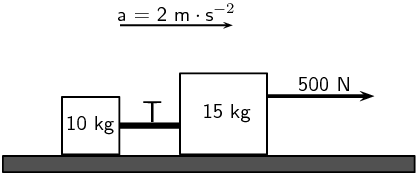

<Callout type="tip" title="Note">
**Important:** when you have tension in a rope in a problem like this you
                                need to know that both ends of the rope apply a force with the **same
                                    magnitude** but **opposite direction**. We call this force the
                                tension and you should examine the force diagrams in this problem
                                **carefully**.
</Callout>

**Evaluate what is given:**
To make things easier lets give the two crates labels, let us call the \(\text{10}\)
                            \(\text{kg}\) crate number 2 and the \(\text{15}\) \(\text{kg}\) crate number 1.

We have two crates that have overall has an acceleration that is given. The fact that the
                            crates are tied together with a rope means that they will both have the same acceleration.
                            They will also both feel the same force due to the tension in the rope.

We are told that there is friction but we are only given the relationship between the total
                            frictional force both crates experience and the fraction each one experiences. The total
                            friction, \(\vec{F}_{fT}\) will be the sum of the friction on crate 1, \(\vec{F}_{f1}\), and
                            the friction on crate 2, \(\vec{F}_{f2}\). We are told that
                            \(\vec{F}_{f1}=\frac{\text{2}}{\text{3}}\vec{F}_{fT}\) and
                            \(\vec{F}_{f2}=\frac{\text{1}}{\text{3}}\vec{F}_{fT}\). We know the blocks are accelerating
                            to the right and we know that friction will be in the direction opposite to the direction of
                            motion and parallel to the surface.

**Draw force diagrams:**
The diagram for crate 1 will be:

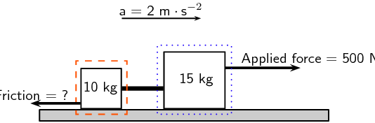

The diagram for crate 1 (indicated by blue dotted lines) will be:

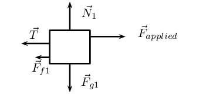

Where:

- \(\vec{F}_{g1}\) is the force due to gravity on the first crate
- \(\vec{N}_{1}\) is the normal force from the surface on the first crate
- \(\vec{T}\) is the force of tension in the rope
- \(\vec{F}_{applied}\) is the external force being applied to the crate
- \(\vec{F}_{f1}\) is the force of friction on the first crate

The diagram for crate 2 (indicated by orange dashed lines) will be:

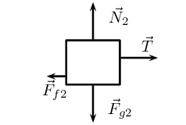

Where:

- \(\vec{F}_{g2}\) is the force due to gravity on the second crate
- \(\vec{N}_{2}\) is the normal force from the surface on the second crate
- \(\vec{T}\) is the force of tension in the rope
- \(\vec{F}_{f2}\) is the force of friction on the second crate

**Apply Newton's second law of motion:**
The problem tells us that the crates are accelerating along the \(x\)-direction which means
                            that the forces in the \(y\)-direction do not result in a net force. We can treat the
                            different directions separately so we only need to consider the \(x\)-direction.

We are working with one dimension and can choose a sign convention to indicate the direction
                            of the vectors. We choose vectors to the right (or in the positive \(x\)-direction) to be
                            positive.

We can now apply Newton's second law of motion to the first crate because we know the
                            acceleration and we know all the forces acting on the crate. Using positive to indicate a
                            force to the right we know that \({F}_{res1} = F_{applied}-{F}_{f1}-T\)
                            \begin{align*}
                            \vec{F}_{res1} &=m_1\vec{a} \\
                            F_{applied}-{F}_{f1}-T &=m_1a \\
                            F_{applied}-\frac{\text{2}}{\text{3}}{F}_{fT}-T &=m_1a \\
                            (500)-\frac{\text{2}}{\text{3}}{F}_{fT}-T &=(\text{15})(2) \\
                            -T &=(\text{15})(2) -(500)+\frac{\text{2}}{\text{3}}{F}_{fT}
                            \end{align*}

Now apply Newton's second law of motion to the second crate because we know the acceleration
                            and we know all the forces acting on the crate. We know that \({F}_{res2} = T-{F}_{f2}\).
                            **Note that tension is in the opposite direction.**
                            \begin{align*}
                            \vec{F}_{res2} &=m_2\vec{a} \\
                            T-{F}_{f2} &=m_2a \\
                            T - \frac{\text{1}}{\text{3}}{F}_{fT} &=m_2a \\
                            T &=(\text{10})(2) +\frac{\text{1}}{\text{3}}{F}_{fT}
                            \end{align*}

**Solve simultaneously:**
We have used Newton's second law of motion to create two equations with two unknowns, this
                            means we can solve simultaneously. We solved for \(T\) in the equations above but one
                            carries a negative sign so if we add the two equations we will subtract out the value of the
                            tension allowing us to solve for \({F}_{fT}\):
                            \begin{align*}
                            (T) + (-T) &= ((\text{10})(2) +\frac{\text{1}}{\text{3}}{F}_{fT}) + ((\text{15})(2)
                            -(500)+\frac{\text{2}}{\text{3}}{F}_{fT}) \\
                            0 & = \text{20} + \text{30} - \text{500} + \frac{\text{1}}{\text{3}}{F}_{fT} +
                            \frac{\text{2}}{\text{3}}{F}_{fT} \\
                            0 & = -\text{450} + {F}_{fT} \\
                            {F}_{fT} & = \text{450}\text{ N}
                            \end{align*}

We can substitute the magnitude of \({F}_{fT}\) into the equation for crate 2 to determine
                            the magnitude of the tension:
                            \begin{align*}
                            T &=(\text{10})(2) +\frac{\text{1}}{\text{3}}{F}_{fT} \\
                            T &=(\text{10})(2) +\frac{\text{1}}{\text{3}}(\text{450}) \\
                            T &= \text{20} +\text{150} \\
                            T &= \text{170}\text{ N}
                            \end{align*}

**Quote final answers:**
The total force due to friction is \(\text{450}\) \(\text{N}\) to the left. The magnitude of
                            the force of tension is \(\text{170}\) \(\text{N}\).
</Callout>

<Callout type="tip" title="Worked example 11: Newton's second law: box on a surface (Alternative Method)">
**Question:**
Two crates, \(\text{10}\) \(\text{kg}\) and \(\text{15}\) \(\text{kg}\) respectively, are
                            connected with a thick rope according to the diagram. A force, to the right, of
                            \(\text{500}\) \(\text{N}\) is applied. The boxes move with an acceleration of \(\text{2}\)
                            \(\text{m·s$^{-2}$}\) to the right. One third of the total frictional force is acting
                            on the \(\text{10}\) \(\text{kg}\) block and two thirds on the \(\text{15}\) \(\text{kg}\)
                            block. Calculate:

2. the magnitude and direction of the total frictional force present.
4. the magnitude of the tension in the rope at T.

<Callout type="tip" title="Note">
**Important:** when you have tension in a rope in a problem like this you
                                need to know that both ends of the rope apply a force with the **same
                                    magnitude** but **opposite direction**. We call this force the
                                tension and you should examine the force diagrams in this problem
                                **carefully**.
</Callout>

**Draw a force diagram:**
Always draw a force diagram although the question might not ask for it. The acceleration of
                            the whole system is given, therefore a force diagram of the whole system will be drawn.
                            Because the two crates are seen as a unit, the force diagram will look like this:

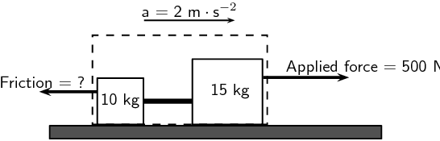

**Calculate the frictional force:**
To find the frictional force we will apply Newton's second law. We are given the mass
                            (\(\text{10}\) + \(\text{15}\) \(\text{kg}\)) and the acceleration (\(\text{2}\)
                            \(\text{m·s$^{-2}$}\)). Choose the direction of motion to be the positive direction (to
                            the right is positive).

                        \begin{align*}
                        {F}_{R} & = ma\\
                        {F}_{\text{applied}}+{F}_{f} & =ma\\
                        \text{500}+{F}_{f} & =\left(10+15\right)\left(2\right)\\
                        {F}_{f} & =50-\text{500}\\
                        {F}_{f} & =-\text{450}N
                        \end{align*}

The frictional force is \(\text{450}\) \(\text{N}\) opposite to the direction of motion (to
                            the left).

**Find the tension in the rope:**
To find the tension in the rope we need to look at one of the two crates on their own. Let's
                            choose the \(\text{10}\) \(\text{kg}\) crate. Firstly, we need to draw a force diagram:

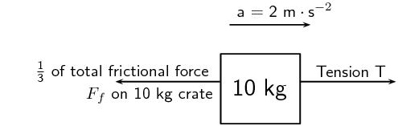

Figure 2.5:
                                Force diagram of \(\text{10}\) \(\text{kg}\) crate.

The frictional force on the \(\text{10}\) \(\text{kg}\) block is one third of the total,
                            therefore:

\({F}_{f}=\frac{\text{1}}{\text{3}}\times \text{450}\)

\({F}_{f}=\text{150} \text{N}\)

If we apply Newton's second law:

                        \begin{align*}
                        {F}_{R}& = ma \\
                        T+{F}_{f}& = \left(10\right)\left(2\right) \\
                        T+\left(-\text{150}\right)& = 20 \\
                        T& = \text{170}\text{ N}
                        \end{align*}

Note: If we had used the same principle and applied it to \(\text{15}\) \(\text{kg}\) crate,
                            our calculations would have been the following:

                        \begin{align*}
                        {F}_{R}& = ma \\
                        {F}_{\text{applied}}+T+{F}_{f}& = \left(15\right)\left(2\right) \\
                        \text{500}+T+\left(-\text{300}\right)& = 30 \\
                        T& = -\text{170}\text{ N}
                        \end{align*}

The negative answer here means that the force is in the direction opposite to the motion, in
                            other words to the left, which is correct. However, the question asks for the magnitude of
                            the force and your answer will be quoted as \(\text{170}\) \(\text{N}\).
</Callout>

<Callout type="tip" title="Worked example 12: Newton's second law: man pulling a box">
**Question:**
A man is pulling a \(\text{20}\) \(\text{kg}\) box with a rope that makes an angle of
                            \(\text{60}\)\(\text{°}\) with the horizontal. If he applies a force of magnitude
                            \(\text{150}\) \(\text{N}\) and a frictional force of magnitude \(\text{15}\) \(\text{N}\)
                            is present, calculate the acceleration of the box.

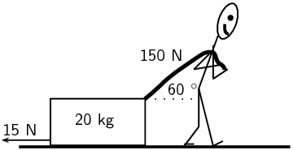

**Draw a force diagram or free body diagram:**
The motion is horizontal and therefore we will only consider the forces in a horizontal
                            direction. Remember that vertical forces do not influence horizontal motion and vice versa.

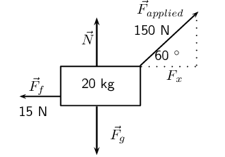

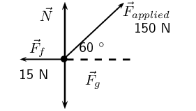

**Calculate the horizontal component of the applied force:**
We first need to choose a direction to be the positive direction in this problem. We choose
                            the positive \(x\)-direction (to the right) to be positive.

The applied force is acting at an angle of \(\text{60}\)\(\text{°}\) to the horizontal.
                            We can only consider forces that are parallel to the motion. The horizontal component of the
                            applied force needs to be calculated before we can continue:
                            \begin{align*}
                            F_x & = F_{applied}\cos(\theta) \\
                            &= \text{150}\cos(\text{60}\text{°}) \\
                            & = \text{75}\text{ N}
                            \end{align*}

**Calculate the acceleration:**
To find the acceleration we apply Newton's second law:
                            \begin{align*}
                            F_R&=ma \\
                            F_x+F_f&=(\text{20})a \\
                            (\text{75}) + (-\text{15})&= (\text{20})a\\
                            a & = \frac{\text{60}}{\text{20}} \\
                            a & = \text{3}\text{ m·s$^{-2}$}
                            \end{align*}The acceleration is \(\text{3}\) \(\text{m·s$^{-2}$}\) to the right.
</Callout>

<Callout type="tip" title="Worked example 13: Newton's second law: truck and trailer">
**Question:**
A \(\text{2 000}\) \(\text{kg}\) truck pulls a \(\text{500}\) \(\text{kg}\) trailer with
                            a constant acceleration. The engine of the truck produces a thrust of \(\text{10 000}\)
                            \(\text{N}\). Ignore the effect of friction. Calculate the:

2. acceleration of the truck; and
4. tension in the tow bar T between the truck and the trailer, if the tow bar makes an
                                       angle of \(\text{25}\)\(\text{°}\) with the horizontal.

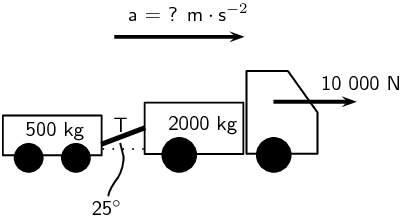

Figure 2.6:
                                Truck pulling a trailer.

**Draw a force diagram:**
Draw a force diagram indicating all the forces on the system as a whole:

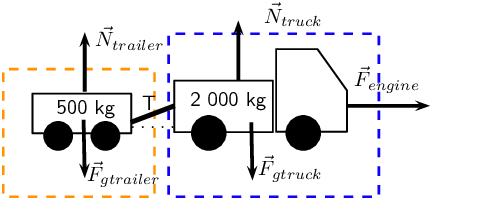

Figure 2.7:
                                Free body diagrams for truck pulling a trailer.

**Apply Newton's second law of motion:**
We choose the positive \(x\)-direction to be the positive direction. We only need to consider
                            the horizontal forces. Using only the horizontal forces means that we first need to note
                            that the tension acts at an angle to the horizontal and we need to use the horizontal
                            component of the tension in our calculations.

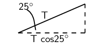

The horizontal component has a magnitude of \(T\cos(\text{25}\text{°})\).

In the absence of friction, the only force that causes the system to accelerate is the thrust
                            of the engine. If we now apply Newton's second law of motion to the truck we have:
                            \begin{align*}
                            \vec{F}_{Rtruck} &= m_{truck}\vec{a}\ \text{(we use signs to indicate direction)} \\
                            {F}_{engine} - T\cos(\text{25}\text{°}) &= (\text{2 000})a \\
                            (\text{10 000}) - T\cos(\text{25}\text{°}) &= (\text{2 000})a \\
                            a & = \frac{(\text{10 000}) - T\cos(\text{25}\text{°})}{(\text{2 000})}
                            \end{align*}

We now apply the same principle to the trailer (remember that the direction of the tension
                            will be opposite to the case of the truck):
                            \begin{align*}
                            \vec{F}_{Rtrailer} &= m_{trailer}\vec{a}\ \text{(we use signs to indicate direction)} \\
                            T\cos(\text{25}\text{°}) &= (\text{500})a \\
                            a & = \frac{T\cos(\text{25}\text{°})}{(\text{500})}
                            \end{align*}

We now have two equations and two unknowns so we can solve simultaneously. We subtract the
                            second equation from the first to get:
                            \begin{align*}
                            (a) - (a) &=(\frac{(\text{10 000}) -
                            T\cos(\text{25}\text{°})}{(\text{2 000})}) -
                            (\frac{T\cos(\text{25}\text{°})}{(\text{500})}) \\
                            0 & = (\frac{(\text{10 000}) - T\cos(\text{25}\text{°})}{(\text{2 000})})
                            - (\frac{T\cos(\text{25}\text{°})}{(\text{500})})\\
                            & \text{(multiply through by \text{2 000})} \\
                            0 & = (\text{10 000}) - T\cos(\text{25}\text{°}) -
                            4T\cos(\text{25}\text{°}) \\
                            \text{5}T\cos(\text{25}\text{°}) & = (\text{10 000}) \\
                            T & = \frac{(\text{10 000})}{\text{5}\cos(\text{25}\text{°})} \\
                            T & = \text{2 206,76}\text{ N}
                            \end{align*}

Now substitute this result back into the second equation to solve for the magnitude of \(a\)
                            \begin{align*}
                            a & = \frac{T\cos(\text{25}\text{°})}{(\text{500})}\\
                            & = \frac{(\text{2 206,76})\cos(\text{25}\text{°})}{(\text{500})}\\
                            & = \text{4,00}\text{ m·s$^{-2}$}
                            \end{align*}
</Callout>

<QuizCard id="s11-02-03c" title="Interactive Exercise 2.9" question="A tricycle has a mass of \(\text{3}\ \text{kg}\) and accelerates at \(\text{0,2}\ \text{m·s$^{-2}$}\) . Calculate the magnitude of the resultant force that is causing the acceleration. INSTRUCTION: Round your answer to one decimal place ." options=[] answer="['0.6', '6.0e-1']" hint="You should enter a number here. If you want to, you can use a space to separate thousands.                Example: 12 800,25 For scientific notation you need to use the multiply symbol                ( ∗ ) and the exponent symbol ( ^ ). For example 6,673 × 10 −11 should be written as: 6,673 ∗ 10^−11" explanation="Consider what is given and what is required We are given the mass and the acceleration of a tricycle. You are asked to calculate the net force . Recall Newton's second law and take it from there: Use Newton's second law of motion \[                     \begin{aligned}                         \vec{F}_{\text{net}} &= m \vec{a} \\ & = (\text{3})(\text{0,2}) \\ &= \text{0,6}\ \text{N}                     \end{aligned}                 \] Therefore the tricycle is accelerated with a resultant force of \(\text{0,6}\ \text{N}\) . Submit your answer as:" />

<QuizCard id="s11-02-03c" title="Interactive Exercise 2.9" question="A bicycle is accelerated at \(\text{0,6}\ \text{m·s$^{-2}$}\) by a net force of \(\text{3}\ \text{N}\) . Calculate the mass of the bicycle. INSTRUCTION: Round your answer to one decimal place ." options=[] answer="['5.0', '5.0e+0']" hint="You should enter a number here. If you want to, you can use a space to separate thousands.                Example: 12 800,25 For scientific notation you need to use the multiply symbol                ( ∗ ) and the exponent symbol ( ^ ). For example 6,673 × 10 −11 should be written as: 6,673 ∗ 10^−11" explanation="Consider what is given and what is required We are given the net force and the acceleration of a bicycle. You are asked to calculate the mass . Recall Newton's second law and take it from there: Use Newton's second law of motion \[                     \begin{aligned}                         \vec{F}_{\text{net}} &= m \vec{a} \\ \text{3} & = m(\text{0,6}) \\ m &= \text{5}\ \text{kg}                     \end{aligned}                 \] Therefore the bicycle has a mass of \(\text{5}\ \text{kg}\) . Submit your answer as:" />

<QuizCard id="s11-02-03c" title="Interactive Exercise 2.9" question="For a constant mass, what can we say about the relationship between acceleration and net force?" options=["equal to", "directly proportional to", "less than", "greater than", "inversely proportional to", "A", "B", "C", "D", "E", "4 times bigger than", "8 times bigger than", "8 times smaller than", "4 times smaller than", "the same as"] answer="equal to" hint="" explanation="Identify how acceleration and net force are related Firstly, we need to understand how net force, mass, and acceleration are related to each other. The following equation represents that relationship: \[                         \begin{aligned}                             F_{\text{net}} & = m a                         \end{aligned}                     \] The equation tells us that when a net force is exerted on an object and causes an acceleration, the product of the object's mass and the acceleration experienced is equal to the net force. Consider two objects where mass is the same for both objects . If the acceleration is a certain factor bigger in the second object compared to the first object, the equation tells us that net force will be bigger by the same factor . This has to happen in order for the equation to be satisfied. This relationship is that of direct proportion. \(a\) and \(F_{\text{net}}\) are directly proportional to each other for a constant \(m\) . Therefore \(a\) is directly proportional to \(F_{\text{net}}\) . Submit your answer as: directly proportional to" />

<QuizCard id="s11-02-03c" title="Interactive Exercise 2.9" question="Adapted from DBE Nov 2015 Grade 11, P1, Q1.3 Physical constants · Physics formulas A net force with magnitude \(F_{\text{net}}\) is exerted on an object of mass \(m\) and it causes an acceleration with a magnitude of \(a\) . The same net force is applied to a different object. If the new object's mass is triple the mass of the first object, then the magnitude of the acceleration of the new object will be ... A \(3a\) B \(a\) C \(9a\) D \(\dfrac{1}{3}a\)" options=["A", "B", "C", "D"] answer="D" hint="" explanation="Recall Newton's second law When a net (resultant) force is exerted on an object, the object will experience an acceleration in the direction of the net force. The acceleration is directly proportional to the magnitude of the net force and inversely proportional to the mass of the object. Mathematically, we can write this as: \[ 				    \begin{array}{c} 						\vec{F}_{\text{net}} = m\vec{a} 				    \end{array} 				\] Use proportional reasoning The net force exerted is constant so we can write the following proportionality statement: \[ 			        \begin{array}{c} 			    		a \propto \dfrac{1}{m} 			        \end{array} 			    \] Acceleration and mass are inversely proportional to each other. So if the mass is tripled then the acceleration is three times smaller . So the new acceleration must be ... A \(3a\) B \(a\) C \(9a\) D \({\color{red}{{\checkmark}{\checkmark}}}\) \(\dfrac{1}{3}a\) The correct option is D . Submit your answer as: D" />

<QuizCard id="s11-02-03c" title="Interactive Exercise 2.9" question="For a fixed acceleration, what can we say about the relationship between net force and mass?" options=["equal to", "inversely proportional to", "less than", "greater than", "directly proportional to", "A", "B", "C", "D", "E", "14 times bigger than", "14 times smaller than", "7 times smaller than", "7 times bigger than", "the same as"] answer="equal to" hint="" explanation="Identify how net force and mass are related Firstly, we need to understand how net force, mass, and acceleration are related to each other. The following equation represents that relationship: \[                         \begin{aligned}                             F_{\text{net}} & = m a                         \end{aligned}                     \] The equation tells us that when a net force is exerted on an object and causes an acceleration, the product of the object's mass and the acceleration experienced is equal to the net force. Consider two systems where acceleration is the same for both systems . If the net force is a certain factor bigger in the second system compared to the first system, the equation tells us that mass will be bigger by the same factor . This has to happen in order for the equation to be satisfied. This relationship is that of direct proportion. \(F_{\text{net}}\) and \(m\) are directly proportional to each other for a fixed \(a\) . Therefore \(F_{\text{net}}\) is directly proportional to \(m\) . Submit your answer as: directly proportional to" />

<QuizCard id="s11-02-03c" title="Interactive Exercise 2.9" question="Adapted from DBE Nov 2015 Grade 11, P1, Q1.3 Physical constants · Physics formulas A net force with magnitude \(F_{\text{net}}\) is exerted on an object of mass \(m\) and it causes an acceleration with a magnitude of \(a\) . A different object has a new net force exerted on it, but it experiences the same acceleration. If the new net force is three times smaller than the first net force, then the mass of the new object must be ... A \(m\) B \(\dfrac{1}{3}m\) C \(\dfrac{1}{9}m\) D \(3m\)" options=["A", "B", "C", "D"] answer="B" hint="" explanation="Recall Newton's second law When a net (resultant) force is exerted on an object, the object will experience an acceleration in the direction of the net force. The acceleration is directly proportional to the magnitude of the net force and inversely proportional to the mass of the object. Mathematically, we can write this as: \[ 				    \begin{array}{c} 						\vec{F}_{\text{net}} = m\vec{a} 				    \end{array} 				\] Use proportional reasoning The acceleration is constant so we can write the following proportionality statement: \[ 			        \begin{array}{c} 			    		F_{\text{net}} \propto m 			        \end{array} 			    \] Mass and net force are directly proportional to each other. So if the net force is three times smaller then the mass is also three times smaller . So the new mass must be ... A \(m\) B \({\color{red}{{\checkmark}{\checkmark}}}\) \(\dfrac{1}{3}m\) C \(\dfrac{1}{9}m\) D \(3m\) The correct option is B . Submit your answer as: B" />

<QuizCard id="s11-02-03c" title="Interactive Exercise 2.9" question="A tricycle has a mass of \(\text{5}\ \text{kg}\) . If a resultant force of \(\text{2}\ \text{N}\) is applied to it, what is the magnitude of its acceleration? INSTRUCTION: Round your answer to one decimal place ." options=[] answer="['0.4', '4.0e-1']" hint="You should enter a number here. If you want to, you can use a space to separate thousands.                Example: 12 800,25 For scientific notation you need to use the multiply symbol                ( ∗ ) and the exponent symbol ( ^ ). For example 6,673 × 10 −11 should be written as: 6,673 ∗ 10^−11" explanation="Consider what is given and what is required We are given the resultant force and the mass of a tricycle. You are asked to calculate the acceleration . Recall Newton's second law and take it from there: Use Newton's second law of motion \[                     \begin{aligned}                         \vec{F}_{\text{net}} &= m \vec{a} \\ \vec{a} & = \frac{\vec{F}_{\text{net}}}{m} \\ &= \frac{\text{2}}{\text{5}} \\ &= \text{0,4}\ \text{m·s$^{-2}$}                     \end{aligned}                 \] Therefore the tricycle is accelerating at \(\text{0,4}\ \text{m·s$^{-2}$}\) . Submit your answer as:" />

<QuizCard id="s11-02-03c" title="Interactive Exercise 2.9" question="Jezile is pulling a \(\text{31}\ \text{kg}\) box with a rope that makes an angle of \(\text{55}\text{°}\) with the horizontal. If she applies a force of magnitude \(\text{68}\ \text{N}\) and a frictional force of magnitude \(\text{30,4}\ \text{N}\) is present, calculate the acceleration of the box. INSTRUCTION: Round your answer to two decimal places . Use the values for any physical constants you might need, as listed here ." options=["towards the left", "upwards", "towards the right", "downwards"] answer="['0.28', '2.78e-1'], 1" hint="You should enter a number here. If you want to, you can use a space to separate thousands.                Example: 12 800,25 For scientific notation you need to use the multiply symbol                ( ∗ ) and the exponent symbol ( ^ ). For example 6,673 × 10 −11 should be written as: 6,673 ∗ 10^−11" explanation="Identify the forces using force and free-body diagrams We are interested in the acceleration of the box and we are given its mass. We are also given some of the forces acting on the box. We recall Newton's second law \(\vec{F}_{\text{net}} = m \vec{a}\) requires the resultant force on an object and its mass to determine its acceleration. Therefore we have identified our first step towards the solution: we need the resultant force! The motion of the box is horizontal and therefore we will only consider the forces in a horizontal direction. Let us draw a force (and free-body) diagram to identify the horizontal forces: The force diagram: The free-body diagram: We can identify two horizontal forces: The force of friction always acts parallel to the surface with which the box is in contact. The horizontal component of the applied force \(F_{x}=F \cos (55°)\) . Determine the resultant force Taking the direction of the applied force as positive, the resultant force in the horizontal direction is: \[             \begin{aligned}               \vec{F}_{\text{net}} & = \vec{F}_{x} + \vec{f}_{k} \\                       & = (\text{68}) \cos (55°) - \text{30,4} \\                       & = \text{8,60319...}\ \text{N} \text{ towards the right}             \end{aligned}           \] Calculate the acceleration Now we have all the information we need to calculate the acceleration the box is experiencing: \[             \begin{aligned}               \vec{F}_{\text{net}} & = m \vec{a} \\               \vec{a} & = \frac{\vec{F}_{\text{net}}}{m} \\                       & = \frac{\text{8,60319...}}{\text{31}} \\                       & = \text{0,27752...} \\ & \approx \text{0,28}\ \text{m·s$^{-2}$}             \end{aligned}           \] The box is being accelerated at \(\text{0,28}\ \text{m·s$^{-2}$}\) towards the right . Submit your answer as: and towards the right" />

<QuizCard id="s11-02-03c" title="Interactive Exercise 2.9" question="Yaseen is pulling a \(\text{20}\ \text{kg}\) crate with a rope that makes an angle of \(\text{40}\text{°}\) with the horizontal. If he applies a force of magnitude \(\text{154}\ \text{N}\) and a frictional force of magnitude \(\text{39,2}\ \text{N}\) is present, calculate the acceleration of the crate. INSTRUCTION: Round your answer to two decimal places . Use the values for any physical constants you might need, as listed here ." options=["towards the left", "towards the right", "upwards", "downwards"] answer="['3.94', '3.94e+0'], 0" hint="You should enter a number here. If you want to, you can use a space to separate thousands.                Example: 12 800,25 For scientific notation you need to use the multiply symbol                ( ∗ ) and the exponent symbol ( ^ ). For example 6,673 × 10 −11 should be written as: 6,673 ∗ 10^−11" explanation="Identify the forces using force and free-body diagrams We are interested in the acceleration of the crate and we are given its mass. We are also given some of the forces acting on the crate. We recall Newton's second law \(\vec{F}_{\text{net}} = m \vec{a}\) requires the resultant force on an object and its mass to determine its acceleration. Therefore we have identified our first step towards the solution: we need the resultant force! The motion of the crate is horizontal and therefore we will only consider the forces in a horizontal direction. Let us draw a force (and free-body) diagram to identify the horizontal forces: The force diagram: The free-body diagram: We can identify two horizontal forces: The force of friction always acts parallel to the surface with which the crate is in contact. The horizontal component of the applied force \(F_{x}=F \cos (40°)\) . Determine the resultant force Taking the direction of the applied force as positive, the resultant force in the horizontal direction is: \[             \begin{aligned}               \vec{F}_{\text{net}} & = \vec{F}_{x} + \vec{f}_{k} \\                       & = (\text{154}) \cos (40°) - \text{39,2} \\                       & = \text{78,77084...}\ \text{N} \text{ towards the left}             \end{aligned}           \] Calculate the acceleration Now we have all the information we need to calculate the acceleration the crate is experiencing: \[             \begin{aligned}               \vec{F}_{\text{net}} & = m \vec{a} \\               \vec{a} & = \frac{\vec{F}_{\text{net}}}{m} \\                       & = \frac{\text{78,77084...}}{\text{20}} \\                       & = \text{3,93854...} \\ & \approx \text{3,94}\ \text{m·s$^{-2}$}             \end{aligned}           \] The crate is being accelerated at \(\text{3,94}\ \text{m·s$^{-2}$}\) towards the left . Submit your answer as: and towards the left" />

<QuizCard id="s11-02-03c" title="Interactive Exercise 2.9" question="Adapted from DBE Feb-Mar 2017 Grade 12, P1, Q1.2 Physical constants · Physics formulas The diagram below shows two blocks, W and Z , suspended from a ceiling. The blocks are stationary and have different masses and different heights above the ground. The connecting strings are massless and inextensible. The tensions in the strings attached to blocks W and Z are \(T_{\text{W}}\) and \(T_{\text{Z}}\) respectively. In the diagram below, the size of the box represents its mass. Which one of the following statements about how the tensions compare to each other is correct ? A \(T_{W} > T_{Z}\) B \(T_{W} < T_{Z}\) C \(T_{W} = T_{Z}\) D impossible to determine" options=["A", "B", "C", "D"] answer="A" hint="" explanation="The blocks are in static equilibrium The length of the string has no effect on the tension in the string. This is just a distraction! Both blocks are stationary which means that they are in static equilibrium . This means that the vertical forces are balanced. The magnitude of the upwards force of tension on each block is equal to the magnitude of the downwards force of gravity on each block. For Block W : \[                     \begin{aligned}                         T_{W} &= F_{g,W} \\                         \therefore T_{W} &= m_{W}g                     \end{aligned}                 \] For Block Z : \[                     \begin{aligned}                         T_{Z} &= F_{g,Z} \\                         \therefore T_{Z} &= m_{Z}g                     \end{aligned}                 \] The blocks have different masses: \[                     \begin{array}{c}                         m_{W} >  m_{Z}                     \end{array}                 \] Which means the strings will have different tensions: \[                     \begin{array}{c}                         T_{W} >  T_{Z}                     \end{array}                 \] NOTE: The block with the larger mass experiences the larger force due to gravity , and so the string attached to that block will have the larger tension . A \({\color{red}{{\checkmark}{\checkmark}}}\) \(T_{W} > T_{Z}\) B \(T_{W} < T_{Z}\) C \(T_{W} = T_{Z}\) D impossible to determine So Option A is correct. Submit your answer as: A" />

<QuizCard id="s11-02-03c" title="Interactive Exercise 2.9" question="Calculate the magnitude and direction of the frictional force acting on the \(\text{20}\ \text{kg}\) crate (the crate on the right). INSTRUCTION: Round your answer to two decimal places ." options=["left", "right", "upwards", "downwards"] answer="['360.00', '3.60e+2'], 0" hint="You should enter a number here. If you want to, you can use a space to separate thousands.                Example: 12 800,25 For scientific notation you need to use the multiply symbol                ( ∗ ) and the exponent symbol ( ^ ). For example 6,673 × 10 −11 should be written as: 6,673 ∗ 10^−11" explanation="Identify what is given and what is needed Let us first examine what information we are given : Crate 1 has a mass \(m_{1} = \text{10}\ \text{kg}\) Crate 2 has a mass of \(m_{2} = \text{20}\ \text{kg}\) a force of \(\vec{F}_{\text{pulling}} = \text{600}\ \text{N}\) is applied towards the right on Crate 2 the system (the two crates connected by the rope form a system) is accelerating towards the right at \(\vec{a}  = \text{2}\ \text{m·s$^{-2}$}\) . the frictional force experienced by each crate is proportional to its mass We are looking for the frictional force acting on the crate on the right. We will need to set up simultaneous equations in order to find it. Apply Newton's second law to the crate on the left Start with a force digram for the crate on the left: \[                   \begin{aligned}                     \vec{F}_{\text{net,1}} &= m_{1}\vec{a} \\                     \vec{T} + \vec{f}_{\text{k,1}} &= m_{1}\vec{a}                   \end{aligned}               \] We'll work with \"to the right\" as positive. Splitting each force into a magnitude and direction gives us: \[                   \begin{aligned}                     T - f_{\text{k,1}} &= m_{1}a \\                     T - f_{\text{k,1}} &= (\text{10})(\text{2}) \\                     T - f_{\text{k,1}} &= \text{20} \quad \ldots (1)                   \end{aligned}               \] This is an equation with the two unknowns \(T\) and \(f_{\text{k,1}}\) . Apply Newton's second law to the crate on the right Start with a force digram for the crate on the right: \[                   \begin{aligned}                     \vec{F}_{\text{net,2}} &= m_{2}\vec{a} \\                     \vec{F}_{\text{pulling}} + \vec{f}_{\text{k,2}} + \vec{T} &= m_{2}\vec{a}                   \end{aligned}               \] We'll stay working with \"to the right\" as positive. Splitting each force into a magnitude and direction gives us: \[                   \begin{aligned}                     F_{\text{pulling}} + (-f_{\text{k,2}}) + (-T) &= m_{2}a \\                     (\text{600}) - f_{\text{k,2}} - T &= (\text{20})(\text{2}) \\                     -T - f_{\text{k,2}} &= -\text{560} \quad \ldots (2)                   \end{aligned}               \] This is an equation with the two unknowns \(T\) and \(f_{\text{k,2}}\) . Eliminate \(T\) and solve for \(f_{k,2}\) We can add Equation (1) to Equation (2) to eliminate \(T\) . \[                     \begin{array}{c}                         -f_{\text{k,1}} - f_{\text{k,2}} = -\text{540} \quad \ldots (3)                     \end{array}                 \] The frictional forces are in proportion to the masses. We can use this to get an expression for \(f_{\text{k,1}}\) in terms of \(m_{1}\) , \(m_{2}\) , and \(f_{\text{k,2}}\) : \[                     \begin{aligned}                         f_{\text{k,1}} : f_{\text{k,2}} &= m_{1} : m_{2} \\                         \therefore \dfrac{f_{\text{k,1}}}{f_{\text{k,2}}} & = \dfrac{m_{1}}{m_{2}} \\                         f_{\text{k,1}} &= \left(\dfrac{m_{1}}{m_{2}}\right) f_{\text{k,2}} \\                         &= \left(\dfrac{\text{10}}{\text{20}}\right) f_{\text{k,2}}                     \end{aligned}                 \] We can substitute this expression for \(f_{\text{k,1}}\) into Equation (3) and solve for \(f_{\text{k,2}}\) . \[                     \begin{aligned}                       -\left(\dfrac{\text{10}}{\text{20}}\right) f_{\text{k,2}} - f_{\text{k,2}} &= -\text{540} \\                       \therefore \text{10}f_{\text{k,2}} + \text{20}f_{\text{k,2}} &= \text{10 800} \\                       \text{30}f_{\text{k,2}} &= \text{10 800}                     \end{aligned}                 \] \[                     \begin{aligned}                       \therefore f_{\text{k,2}} &= \dfrac{\text{10 800}}{\text{30}} \\                       &= \text{360}\ \text{N}                     \end{aligned}                 \] Therefore the frictional force acting on the \(\text{20}\ \text{kg}\) crate is \(\text{360}\ \text{N}\) to the left . Submit your answer as: and left" />

<QuizCard id="s11-02-03c" title="Interactive Exercise 2.9" question="Draw labelled free-body diagrams indicating all the forces acting on both of the sleds as they are pulled by the dogs. Compare your diagrams to the two diagrams given below. For each of the forces labelled X , Y , and Z indicate: the type of force represented. which sled experiences the force." options=["tensional", "normal", "gravitational", "dogs' pulling", "front", "back", "tensional", "normal", "gravitational", "dogs' pulling", "front", "back", "tensional", "normal", "gravitational", "dogs' pulling", "front", "back", "kg", "N", "m\u00b7s\u207b\u00b2", "m", "m\u00b7s\u207b\u00b2", "m\u00b7s\u207b\u00b9", "m\u00b7s", "m\u00b7s\u00b2", "left", "right", "at 16\u00b0", "at 74\u00b0", "kg", "N", "m", "m\u00b7s\u207b\u00b2"] answer="0, 0, 2, 1, 1, 0" hint="" explanation="Draw a free-body diagram and label all the forces The sled at the front is connected directly to the dogs. The front sled experiences four forces. The sled at the back is connected to the front sled by a rope. The back sled experiences three forces. The gravitational force is always straight down and the normal force must always point perpendicularly out of a surface. In this scenario the dogs pull the front sled with a force that acts at an angle to the horizontal. The back sled is pulled to the left by the tensional force from the rope. The front sled is pulled backwards by the tensional force from the rope. We were told to ignore friction because the surface of the frozen pond is very smooth. The back sled \(\vec{F}_{\text{N}, 1}\) : normal force \(\vec{T}\) : tensional force \(\vec{F}_{\text{g}, 1}\) : gravitational force The front sled \(\vec{F}_{\text{N}, 2}\) : normal force \(\vec{T}\) : tensional force \(\vec{F}_{\text{g}, 2}\) : gravitational force \(\vec{F}_{\text{dogs}}\) : dogs' pulling force If we compare the given diagrams to the above tables and free-body diagrams we can see that: X represents the tensional force on the front sled. Y represents the gravitational force on the back sled. Z represents the normal force on the front sled. Submit your answer as: tensional and front and gravitational and back and normal and front" />

<QuizCard id="s11-02-03c" title="Interactive Exercise 2.9" question="A \(\text{2 800}\ \text{kg}\) truck pulls a \(\text{1 220}\ \text{kg}\) trailer with a constant acceleration. The tow bar between the truck and trailer makes an angle of \(\text{20}\text{°}\) degrees with the horizontal. The engine of the truck produces a thrust of \(\text{9 000}\ \text{N}\) . Calculate the magnitude of the tension \(T\) between the truck and the trailer, and the magnitude of the acceleration \(a\) of the truck. Ignore the effects of friction. INSTRUCTION: Round your answers to two decimal places ." options=[] answer="(2906.63; 2906.62; 2908.2), ['2.24', '2.24e+0']" hint="You should enter a number here. If you want to, you can use a space to separate thousands.                Example: 12 800,25 For scientific notation you need to use the multiply symbol                ( ∗ ) and the exponent symbol ( ^ ). For example 6,673 × 10 −11 should be written as: 6,673 ∗ 10^−11" explanation="Identify what is given and what is required First let us identify what information we are given and what we are required to calculate. Given: A truck is pulling a trailer. The truck has a mass of \(\text{2 800}\ \text{kg}\) The trailer has a mass of \(\text{1 220}\ \text{kg}\) The tow bar between the truck and the trailer makes an angle of \(\text{20}\text{°}\) with the horizontal The engine of the truck produces a thrust of \(\text{9 000}\ \text{N}\) Required: The magnitude of the tension \(T\) between the truck and the trailer The magnitude of the acceleration \(a\) of the truck (which is the same as asking for the acceleration of the trailer since they are moving together) Draw free-body diagrams Draw free-body diagrams indicating all the forces acting on each object separately: Free-body diagram for the trailer: Free-body diagram for the truck: NOTE: The above diagrams are not perfectly to scale, but the relative sizes are correct. The normal force acting on the trailer is less than the gravitational force acting on the trailer. And the normal force acting on the truck is greater than the gravitational force that it experiences. Determine the horizontal component of the tension We will choose \"to the right\" as the positive direction. We only need to consider the horizontal forces because the acceleration of the system is horizontal and all the vertical forces cancel out. The horizontal component of the tension is \(T \cos {(\text{20}\text{°})}\) . Apply Newton's second law to the trailer Working with the horizontal forces, we have: \[                 \begin{aligned}                     \vec{F}_{\text{net,1}} &= m_{1}\vec{a} \\                     \vec{T}_{x} &= m_{1}\vec{a} \\                 \end{aligned}             \] Because we are working with \"to the right\" as the positive direction, both of the vectors in the above equation are positive. So we can work with their magnitudes: \[                 \begin{aligned}                   T_{x} &= m_{1}a \\                   T_{x} &= \text{1 220} a \quad \ldots (1)                 \end{aligned}             \] This is an equation with two unknowns, \(T_{x}\) and \(a\) . Apply Newton's second law to the truck Working with the horizontal forces, we have: \[                 \begin{aligned}                     \vec{F}_{\text{net,2}} &= m_{2}\vec{a} \\                     \vec{F}_{\text{engine}} + \vec{T}_{x} &= m_{2}\vec{a} \\                 \end{aligned}             \] We are still working with \"to the right\" as the positive direction. Splitting all vectors into their magnitudes and directions we have: \[                 \begin{aligned}                   F_{\text{engine}} + (- T_{x}) &= m_{2}a \\                   \text{9 000} - T_{x} &= \text{2 800} a \quad \ldots (2)                 \end{aligned}             \] This is an equation with the same two unknowns as Equation \((1)\) , \(T_{x}\) and \(a\) . Eliminate \(T_{x}\) and solve for \(a\) We can add Equations \((1)\) and \((2)\) together. This will eliminate \(T_{x}\) and allow us to solve for \(a\) . \[                 \begin{aligned}                   \text{9 000} &= \text{1 220}a + \text{2 800}a \\                   \therefore a &= \text{2,23880...} \\ & \approx \text{2,24}\ \text{m·s$^{-2}$}                 \end{aligned}             \] Therefore the acceleration of the system is \(\text{2,24}\ \text{m·s$^{-2}$}\) . Find the magnitude of the tension We substitute \(a\) into Equation \((1)\) to find \(T_{x}\) . \[                 \begin{aligned}                   T_{x} &= (\text{1 220})(\text{2,23880...}) \\                   &= \text{2 731,34328...} \\ & \approx \text{2 731,34}\ \text{N}                 \end{aligned}             \] This is only the horizontal component of the tensional force. We still need to calculate the magnitude of the full tensional force. \[                 \begin{aligned}                     T_{x} &= T \cos{\alpha} \\                     \text{2 731,34328...} &= T \cos {(\text{20}\text{°})} \\                     \therefore T &= \text{2 906,63481...} \\ & \approx \text{2 906,63}\ \text{N}                 \end{aligned}             \] Therefore we have found that the magnitude of the tensional force in the tow bar and the magnitude of the acceleration of the truck are: \(T =  \text{2 906,63}\ \text{N}\) \(a = \text{2,24}\ \text{m·s$^{-2}$}\) Submit your answer as: and" />

<QuizCard id="s11-02-03c" title="Interactive Exercise 2.9" question="Calculate the acceleration of the sleds as well as the tension in the rope connecting the two sleds. INSTRUCTION: Round both of your final answers to two decimal places . Where appropriate, use unrounded answers from previous calculations. Use the values given here for any physical constants that you may need." options=["m\u00b7s\u207b\u00b2", "m\u00b7s\u207b\u00b9", "m\u00b7s", "m\u00b7s\u00b2", "left", "right", "at 8\u00b0", "at 82\u00b0", "kg", "N", "m", "m\u00b7s\u207b\u00b9", "back", "front", "greater", "smaller", "gravitational", "tensional", "normal", "pulling"] answer="['0.85', '8.48e-1'], 0, 1, ['101.71', '1.02e+2'], 1" hint="You should enter a number here. If you want to, you can use a space to separate thousands.                Example: 12 800,25 For scientific notation you need to use the multiply symbol                ( ∗ ) and the exponent symbol ( ^ ). For example 6,673 × 10 −11 should be written as: 6,673 ∗ 10^−11" explanation="Draw a free-body diagram and label all the forces The sled at the front is connected directly to the dogs. The front sled experiences four forces. The sled at the back is connected to the front sled by a rope. The back sled experiences three forces. The gravitational force is always straight down and the normal force must always point perpendicularly out of a surface. In this scenario the dogs pull the front sled with a force that acts at an angle to the horizontal. The back sled is pulled to the right by the tensional force from the rope. The front sled is pulled backwards by the tensional force from the rope. We were told to ignore friction because the surface of the frozen pond is very smooth. The back sled \(\vec{F}_{\text{N}, 1}\) : normal force \(\vec{T}\) : tensional force \(\vec{F}_{\text{g}, 1}\) : gravitational force The front sled \(\vec{F}_{\text{N}, 2}\) : normal force \(\vec{T}\) : tensional force \(\vec{F}_{\text{g}, 2}\) : gravitational force \(\vec{F}_{\text{dogs}}\) : dogs' pulling force Determine the components of the dogs' pulling force We need to split the dogs' pulling force experienced by the front sled into horizontal and vertical components. We need the vertical \((y)\) component in order to calculate the mass of the front sled. The horizontal component of the dogs' pulling force: \[                         \begin{aligned}                             {\color{red}{F_{\text{dogs}, x}}} &= {\color{darkgreen}{F_{\text{dogs}}}} \cos({\alpha})\\                             &= (\text{180})\cos{(\text{8}\text{°})}\\                             &= \text{178,248...}\ \text{N}                         \end{aligned}                     \] The vertical component of the dogs' pulling force: \[                         \begin{aligned}                             {\color{blue}{F_{\text{dogs}, y}}} &= {\color{darkgreen}{F_{\text{dogs}}}} \sin({\alpha})\\                             &= (\text{180})\sin{(\text{8}\text{°})}\\                             &= \text{25,0511...}\ \text{N}                         \end{aligned}                     \] Calculate the mass of the front sled Our conventions in solving this problem: We will use a subscript \(1\) to label quantities related to the back sled. We will use a subscript \(2\) to label quantities related to the front sled. When working vertically we will choose \"up\" as the positive direction. When working horizontally we will choose \"to the right\" as the positive direction. We can apply Newton's second law to the front sled using the vertical forces. The sled experiences a zero net force in the vertical direction. \[                         \begin{array}{c}                             \vec{F}_{\text{N},2} + \vec{F}_{\text{dogs},y} + \vec{F}_{\text{g},2} = 0                         \end{array}                     \] Because we have chosen \"up\" as the positive direction, \(\vec{F}_{\text{N},2}\) and \(\vec{F}_{\text{dogs},y}\) are both positive and \(\vec{F}_{\text{g},2}\) is negative. Working with the magnitudes of these forces we now have: \[                         \begin{aligned}                             F_{\text{N},2} + F_{\text{dogs},y} - F_{\text{g},2} &= 0 \\                             F_{\text{N},2} + F_{\text{dogs},y} &= m_{2} g\\                             \text{860} + \text{25,0511...} &= m_{2}(\text{9,8})                         \end{aligned}                     \] \[                         \begin{aligned}                             \therefore m_{2} &= \text{90,3113...}\ \text{kg} \\ & \approx \text{90,3}\ \text{kg}                         \end{aligned}                     \] The front sled has a mass of \(\text{90,3}\ \text{kg}\) . Apply Newton's second law to the back sled We can apply Newton's second law to each sled in the system. This will give us two simultaneous equations with the unknowns \(\vec{a}\) and \(T\) . The dogs are pulling the sled to the right and this is also the direction in which the entire system will accelerate. The dogs and both sleds will all experience the same acceleration (in both magnitude and direction). We can apply Newton's second law to the back sled. \[                         \begin{aligned}                             \vec{F}_{\text{net},1,x} &= m_{1}\vec{a} \\                             \vec{T} &= m_{1}\vec{a}                         \end{aligned}                     \] The tensional force on the back sled and the acceleration have the same direction (right). Working with magnitudes we have: \[                         \begin{array}{c}                             T = m_{1} a                         \end{array}                     \] Substituting in \(m_{1}\) we have: \[                         \begin{array}{c}                             T = \text{120} a \quad ... (1)                         \end{array}                     \] Apply Newton's second law to the front sled We can apply Newton's second law to the front sled using the horizontal forces: \[                         \begin{aligned}                             \vec{F}_{\text{net},2,x} &= m_{2}\vec{a} \\                             \vec{F}_{\text{dogs},x} + \vec{T} &= m_{2}\vec{a}                         \end{aligned}                     \] Using our direction convention and substituting in known values we have: \[                         \begin{aligned}                             F_{\text{dogs},x} - T &= m_{2} a \\                             \text{178,248...} -T &= \text{90,3113...} a \quad ... (2)                         \end{aligned}                     \] Solve for the acceleration We now have two equations with two unknowns \((a\) and \(T)\) that we must solve. We will start by eliminating the tension from the simultaneous equations by adding them together. This will give us a new equation with \(a\) as the only unknown. \[                         \begin{aligned}                             T + \text{178,248...} - T &= 120a + \text{90,3113...}a \\                              \text{178,248...} &= \text{210,311...}a                         \end{aligned}                     \] \[                         \begin{aligned}                             \therefore a &= \text{0,84754...}\ \text{m·s$^{-2}$} \\ & \approx \text{0,85}\ \text{m·s$^{-2}$}                         \end{aligned}                     \] The acceleration has a magnitude of \(\text{0,85}\ \text{m·s$^{-2}$}\) . TIP: Whenever you are asked to find the acceleration of the system \((\vec{a})\) as well as the magnitude of the tension \((T)\) , it will be most efficient to solve for \(\vec{a}\) first and then use that value to solve for \(T\) . Solve for the tension We can substitute this acceleration into Equation (1) in order to solve for \(T\) . \[                         \begin{aligned}                             T &= (\text{120})(\text{0,84754...}) \\                               &= \text{101,70535...}\ \text{N} \\ & \approx \text{101,71}\ \text{N}                         \end{aligned}                     \] We know that the dogs are pulling the sleds to the right. Therefore the acceleration of the dog sled system is \(\text{0,85}\ \text{m·s$^{-2}$}\) to the right and the magnitude of the tension in the rope connecting the two sleds is \(\text{101,71}\ \text{N}\) . Submit your answer as: and m·s⁻² and right and and N" />

#### Object on an inclined plane

In an earlier section we looked at the components of the gravitational force parallel and
                    perpendicular to the slope for objects on an inclined plane. When we look at problems on an inclined
                    plane we need to include the component of the gravitational force parallel to the slope.

Think back to the pictures of the book on a table, as one side of the table is lifted higher the book
                    starts to slide. Why? The book starts to slide because the component of the gravitational force
                    parallel to the surface of the table gets larger for the larger angle of inclination. This is like
                    the applied force and it eventually becomes larger than the frictional force and the book
                    accelerates down the table or inclined plane.

The force of gravity will also tend to push an object 'into' the slope. This is the component of the
                    force perpendicular to the slope. There is no movement in this direction as this force is balanced
                    by the slope pushing up against the object. This “pushing force” is the normal force (N)
                    which we have already learnt about and is equal in magnitude to the perpendicular component of the
                    gravitational force, but opposite in direction.

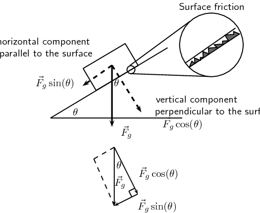

<Callout type="tip" title="Note">
Do not use the abbreviation \(W\) for weight as it is used to abbreviate 'work'. Rather use the
                        force of gravity \({F}_{g}\) for weight.
</Callout>

<Callout type="note" title="Note">
[Simulation: 23HD](http://phet.colorado.edu/en/simulation/the-ramp)
</Callout>

<Callout type="tip" title="Worked example 14: Newton's second law: box on inclined plane">
**Question:**
A body of mass \(M\) is at rest on an inclined plane due to friction.

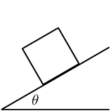

What of the following option is the magnitude of the frictional force acting on the body?

2. \(F_g\)
4. \(F_g\cos(θ)\)
6. \(F_g\sin(θ)\)
8. \(F_g\tan(θ)\)

**Analyse the situation:**
The question asks us to determine the magnitude of the frictional force. The body is said to
                            be at rest on the plane, which means that it is not moving and therefore the acceleration is
                            zero. We know that the frictional force will act parallel to the slope. If there were no
                            friction the box would slide down the slope so friction must be acting up the slope. We also
                            know that there will be a component of gravity perpendicular to the slope and parallel to
                            the slope. The free body diagram for the forces acting on the block is:

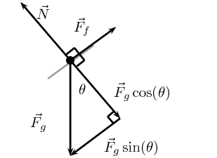

**Determine the magnitude of the frictional force:**
We can apply Newton's second law to this problem. We know that the object is not moving so
                            the resultant acceleration is zero. We choose up the slope to be the positive direction.
                            Therefore:
                            \begin{align*}
                            \vec{F}_R &= m\vec{a}\; \text{using signs for direction}\\
                            F_f - F_g\sin(\theta) &= m (0)\\
                            F_f - F_g\sin(\theta) &= m (0)\\
                            F_f & = F_g\sin(\theta)
                            \end{align*}

**Quote your final answer:**
The force of friction has the same magnitude as the component of the force of gravitation
                            parallel to the slope, \(F_g\sin(\theta)\).
</Callout>

<Callout type="tip" title="Worked example 15: Newton's second law: object on an incline">
**Question:**
A force of magnitude \(T=\text{312} \text{N}\) up an incline is required to keep a body
                            at rest on a frictionless inclined plane which makes an angle of
                            \(\text{35}\)\(\text{°}\) with the horizontal. Calculate the magnitudes of the force
                            due to gravity and the normal force, giving your answers to three significant figures.

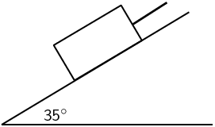

**Find the magnitude of \(\vec{F}_g\):**
We are usually asked to find the magnitude of \(\vec{T}\), but in this case \(\vec{T}\) is
                            given and we are asked to find \(\vec{F}_g\). We can use the same equation. \(T\) is the
                            force that balances the component of \(\vec{F}_g\) parallel to the plane (\({F}_{gx}\)) and
                            therefore it has the same magnitude.

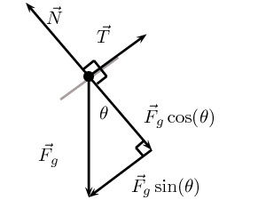

We can apply Newton's second law to this problem. We know that the object is not moving so
                            the resultant acceleration is zero. We choose up the slope to be the positive direction.
                            Therefore:
                            \begin{align*}
                            \vec{F}_R &= m\vec{a}\; \text{using signs for direction}\\
                            T - F_g\sin(\theta) &= m (0)\\
                            F_g & = \frac{T}{\sin(\theta)} \\
                            & = \frac{\text{312}}{\sin(\text{35}\text{°})} \\
                            & = \text{543,955}\text{ N}
                            \end{align*}

**Find the magnitude of \(\vec{N}\):**
We treat the forces parallel and perpendicular to the slope separately. The block is
                            stationary so the acceleration perpendicular to the slope is zero. Once again we can apply
                            Newton's second law of motion. We choose the direction of the normal force as the positive
                            direction.
                            \begin{align*}
                            \vec{F}_R &= m\vec{a}\; \text{using signs for direction}\\
                            N - F_g\cos(\theta) &= m (0)\\
                            N & = F_g\cos(\theta)
                            \end{align*}

We could substitute in the value of \(F_g\) calculated earlier. We would like to illustrate
                            that there is another approach to adopt to ensure you get the correct answer even if you
                            made a mistake calculating \(F_g\). \(F_g\cos(\theta)\) can also be determined with the use
                            of trigonometric ratios. We know from the previous part of the question that \(T =
                            F_g\sin(\theta)\). We also know that
                            \begin{align*}
                            \tan(\theta) &=\frac{F_g\sin(\theta)}{F_g\cos(\theta)}\\
                            &=\frac{T}{N}\\
                            N&=\frac{T}{\tan(\theta)}\\
                            & = \frac{\text{312}}{\tan(\text{35}\text{°})} \\
                            & = \text{445,58}\text{ N}
                            \end{align*}

Note that the question asks that the answers be given to 3 significant figures. We therefore
                            round \(\vec{N}\) from \(\text{445,58}\) \(\text{N}\) up to \(\text{446}\) \(\text{N}\)
                            perpendicular to the surface upwards and \(\vec{T}\) from \(\text{543,955}\) \(\text{N}\) up
                            to \(\text{544}\) \(\text{N}\) parallel to the plane, up the slope.
</Callout>

<QuizCard id="s11-02-03d" title="Interactive Exercise 2.10" question="A gravitational force of \(\vec{F}_{\text{g}} = \text{177}\ \text{N}\) is acting straight down on a block. The block is on an inclined plane with a slope inclined at an angle of \(\text{38}\text{°}\) with the horizontal. Calculate the components of the force due to gravity parallel and perpendicular to the slope. INSTRUCTION: Round your answers to one decimal place ." options=["perpendicular to and into the slope", "parallel to and up the slope", "parallel to and down the slope", "perpendicular to and out of the slope", "perpendicular to and out of the slope", "parallel to and up the slope", "parallel to and down the slope", "perpendicular to and into the slope"] answer="109.0, 1, 139.5, 3" hint="You should enter a number here. If you want to, you can use a space to separate thousands.                Example: 12 800,25 For scientific notation you need to use the multiply symbol                ( ∗ ) and the exponent symbol ( ^ ). For example 6,673 × 10 −11 should be written as: 6,673 ∗ 10^−11" explanation="Draw a right-angled triangle with the components First we look at what information we are given and what is required from us. We are given the gravitational force of \(\vec{F}_{\text{g}} = \text{177}\ \text{N}\) acting straight down on a block. The slope is inclined at an angle of \(\text{38}\text{°}\) with the horizontal. We can use any coordinate system to describe the situation and the simplest thing to do is to make the \(x\) -axis of the Cartesian coordinate system align with the inclined plane. Here is the same physical situation with the coordinate system drawn in: Calculate the parallel component This means that the components of gravitational force are aligned (parallel) with one of the axes of the coordinate system. We have shown in the figures that the angle between the horizontal and the incline is also the angle between the gravitational force and its component perpendicular to the inclined plane (this is normal to the plane). Using this angle and the fact that the components form part of a right-angled triangle we can calculate the components using trigonometry: \[             \begin{aligned}               F_{\text{g},\parallel} & =  F_{\text{g}} \sin \theta \\                      & = (177) \sin  (\text{38}\text{°})\\                      & = \text{108,9720...}\ \text{N} \\ & \approx \text{109,0}\ \text{N}             \end{aligned}           \] The parallel component of the gravitational force will always point down the slope. So the parallel component of the gravitational force is \(\text{109,0}\ \text{N}\) parallel to and down the slope. Calculate the perpendicular component \[             \begin{aligned}               F_{\text{g},\perp} & =  F_{\text{g}} \cos \theta \\                   & = (177) \cos  (\text{38}\text{°})\\                   & = \text{139,4779...}\ \text{N} \\ & \approx \text{139,5}\ \text{N}             \end{aligned}           \] The perpendicular component of the gravitational force will always point perpendicularly into the slope. So the perpendicular component of the gravitational force is \(\text{139,5}\ \text{N}\) perpendicular to and into the slope. Therefore the components of the gravitational force are: \(\vec{F}_{\text{g},\parallel} = \text{109,0}\ \text{N}\) parallel to and down the slope \(\vec{F}_{\text{g},\perp} = \text{139,5}\ \text{N}\) perpendicular to and into the slope Submit your answer as: and parallel to and down the slope and and perpendicular to and into the slope" />

<QuizCard id="s11-02-03d" title="Interactive Exercise 2.10" question="A box that experiences a gravitational force of \(\text{421,4}\ \text{N}\) is placed on a slope that makes an angle of \(\text{36}\text{°}\) with the horizontal. The box does not slide down the slope. Calculate the magnitude and direction of the frictional force and the normal force present in this situation. INSTRUCTION: Round your answers to two decimal places ." options=["perpendicular to the surface", "up the slope", "down the slope", "up the slope", "down the slope", "perpendicular to the surface"] answer="['247.69', '2.48e+2'], 0, ['340.92', '3.41e+2'], 2" hint="You should enter a number here. If you want to, you can use a space to separate thousands.                Example: 12 800,25 For scientific notation you need to use the multiply symbol                ( ∗ ) and the exponent symbol ( ^ ). For example 6,673 × 10 −11 should be written as: 6,673 ∗ 10^−11" explanation="Draw a force and free-body diagram We have a box on a slope with a gravitational force acting on it. What other forces are acting on the box? Since, the box is not moving there must be forces opposing gravity since the system is in equilibrium . Draw a force diagram of the situation: There is a normal force present which acts perpendicular to the surface the box is lying on. In addition we have the frictional force that acts parallel to the surface and prevents the box from slipping down the incline. If we look at the free body diagram: Split the gravitational force into components We can see the three forces balance each other out.  We can split the components of the gravitational force so that they are parallel and perpendicular to the surface. For the net force to be zero in either direction, the magnitudes of the parallel and perpendicular components of the gravitational force need to match the magnitudes of the frictional and normal forces respectively. Looking at the components: Calculate the frictional force The magnitude of the frictional force, \(f_s\) , is equal to the component of the gravitational force parallel to the slope, \(F_{g,\parallel}\) . Therefore \[             \begin{aligned}               f_{\text{s}} & = F_{\text{g},\parallel}\\                   & = F_{\text{g}} \sin {(\text{36}\text{°})}\\                   & = (\text{421,4})  \sin {(\text{36}\text{°})}\\                    & = \text{247,69270...} \\ & \approx \text{247,69}\ \text{N}             \end{aligned}           \] Therefore the magnitude of the frictional force is \(\text{247,69}\ \text{N}\) up the slope . Calculate the normal force The magnitude of the normal force, \(F_{\text{N}}\) , is equal to magnitude of the component of the gravitational force perpendicular to the slope, \(F_{\text{g},\perp}\) . Therefore \[             \begin{aligned}               F_{\text{N}} & = F_{\text{g},\perp}\\                 & = F_{\text{g}} \cos {(\text{36}\text{°})}\\                 & = (\text{421,4})  \cos {(\text{36}\text{°})}\\                 & = \text{340,91976...} \\ & \approx \text{340,92}\ \text{N}             \end{aligned}           \] Therefore the magnitude of the normal force is \(\text{340,92}\ \text{N}\) perpendicular to the slope . Submit your answer as: and up the slope and and perpendicular to the surface" />

<QuizCard id="s11-02-03d" title="Interactive Exercise 2.10" question="Calculate the magnitude of the kinetic frictional force between the \(\text{9}\ \text{kg}\) crate and the surface of the plane. INSTRUCTION: Round your answer to two decimal places . Use the values given here for any physical constants that you may need." options=["N\u00b7s", "kg", "N", "m", "kg", "N\u00b7s", "N", "m"] answer="['18.70', '1.87e+1'], 0" hint="You should enter a number here. If you want to, you can use a space to separate thousands.                Example: 12 800,25 For scientific notation you need to use the multiply symbol                ( ∗ ) and the exponent symbol ( ^ ). For example 6,673 × 10 −11 should be written as: 6,673 ∗ 10^−11" explanation="Draw the free-body diagram for the \(\text{9}\ \text{kg}\) crate The \(\text{9}\ \text{kg}\) crate is being pulled up a rough slope. There are five forces that this crate experiences. The gravitational force is always straight down and the normal force must always point perpendicularly out of a surface. In this scenario there is an applied force pulling the crate up the plane. Tension acts to pull the crate down the plane. The direction of friction always opposes the direction of motion. Determine the components of the gravitational force experienced by the \(\text{9}\ \text{kg}\) crate In order to apply Newton's second law,  we need to split the gravitational force experienced by the \(\text{9}\ \text{kg}\) block into parallel and perpendicular components. TIP: Be careful about whether the angle you are given is from the vertical or from the horizontal. The perpendicular component of the gravitational force: \[                         \begin{aligned}                             {\color{red}{F_{\text{g},1,\perp}}} &= {\color{darkgreen}{F_{\text{g}, 1}}} \cos\alpha\\                             &= m_{1} g \cos{\alpha}\\                             &= (\text{9})(\text{9,8})\cos{(\text{32}\text{°})}\\                             &= \text{74,7978...}\ \text{N}                         \end{aligned}                     \] The parallel component of the gravitational force: \[                         \begin{aligned}                             {\color{blue}{F_{\text{g},1,\parallel}}} &= {\color{darkgreen}{F_{\text{g}, 1}}} \sin{\alpha}\\                             &= m_{1} g \sin{\alpha}\\                             &= (\text{9})(\text{9,8})\sin{(\text{32}\text{°})}\\                             &= \text{46,7388...}\ \text{N}                         \end{aligned}                     \] Calculate the magnitude of the normal force experienced by the \(\text{9}\ \text{kg}\) crate We can apply Newton's second law to the \(\text{9}\ \text{kg}\) crate using forces perpendicular to the plane. The crate experiences a zero net force perpendicular to the plane. \[                         \begin{aligned}                             \vec{F}_{\text{N},1} + \vec{F}_{\text{g},1,\perp} = 0                         \end{aligned}                     \] We will choose \"out the slope\" as the positive direction. This means that \(\vec{F}_{\text{N},1}\) is positive and \(\vec{F}_{\text{g},1,\perp}\) is negative . Separating each force vector into its direction and magnitude we have: \[                         \begin{array}{c}                             +F_{\text{N},1} - F_{\text{g},1,\perp} = 0                         \end{array}                     \] \[                         \begin{aligned}                             \therefore F_{\text{N},1} &= F_{\text{g},1,\perp}\\                                     &= \text{74,7978...}\ \text{N}\\                         \end{aligned}                     \] Calculate the magnitude of the kinetic frictional force experienced by the \(\text{9}\ \text{kg}\) crate From the definition of the coefficient of kinetic friction we have the following relationship: \[                         \begin{aligned}                             \mu_{\text{k}} &= \frac{f_{\text{k}}}{F_{\text{N}}}                         \end{aligned}                     \] Rearranging the above relationship and applying it to the \(\text{9}\ \text{kg}\) block we have: \[                         \begin{aligned}                             f_{\text{k},1} &= \mu_{\text{k},1} F_{\text{N},1}\\                             &= (\text{0,25})(\text{74,7978...})\\                             &= \text{18,6994...}\ \text{N} \\ & \approx \text{18,70}\ \text{N}                         \end{aligned}                     \] Therefore the magnitude of the kinetic frictional force experienced by the \(\text{9}\ \text{kg}\) crate is \(\text{18,70}\ \text{N}\) . Submit your answer as: and N" />

<QuizCard id="s11-02-03d" title="Interactive Exercise 2.10" question="Calculate the magnitude of the kinetic frictional force between the \(\text{6}\ \text{kg}\) crate and the surface of the slope. INSTRUCTION: Round your answer to two decimal places . Use the values given here for any physical constants that you may need." options=["kg\u00b7m\u00b7s\u207b\u00b9", "kg", "N", "m", "kg", "kg\u00b7m\u00b7s\u207b\u00b9", "N", "m"] answer="['21.99', '2.20e+1'], 0" hint="You should enter a number here. If you want to, you can use a space to separate thousands.                Example: 12 800,25 For scientific notation you need to use the multiply symbol                ( ∗ ) and the exponent symbol ( ^ ). For example 6,673 × 10 −11 should be written as: 6,673 ∗ 10^−11" explanation="Draw the free-body diagram for the \(\text{6}\ \text{kg}\) crate The \(\text{6}\ \text{kg}\) crate is being pulled up a rough slope. There are five forces that this crate experiences. The gravitational force is always straight down and the normal force must always point perpendicularly out of a surface. In this scenario there is an applied force pulling the crate up the slope. Tension acts to pull the crate down the slope. The direction of friction always opposes the direction of motion. Determine the components of the gravitational force experienced by the \(\text{6}\ \text{kg}\) crate In order to apply Newton's second law,  we need to split the gravitational force experienced by the \(\text{6}\ \text{kg}\) block into parallel and perpendicular components. TIP: Be careful about whether the angle you are given is from the vertical or from the horizontal. The perpendicular component of the gravitational force: \[                         \begin{aligned}                             {\color{red}{F_{\text{g},1,\perp}}} &= {\color{darkgreen}{F_{\text{g}, 1}}} \cos\alpha\\                             &= m_{1} g \cos{\alpha}\\                             &= (\text{6})(\text{9,8})\cos{(\text{49}\text{°})}\\                             &= \text{38,5762...}\ \text{N}                         \end{aligned}                     \] The parallel component of the gravitational force: \[                         \begin{aligned}                             {\color{blue}{F_{\text{g},1,\parallel}}} &= {\color{darkgreen}{F_{\text{g}, 1}}} \sin{\alpha}\\                             &= m_{1} g \sin{\alpha}\\                             &= (\text{6})(\text{9,8})\sin{(\text{49}\text{°})}\\                             &= \text{44,3769...}\ \text{N}                         \end{aligned}                     \] Calculate the magnitude of the normal force experienced by the \(\text{6}\ \text{kg}\) crate We can apply Newton's second law to the \(\text{6}\ \text{kg}\) crate using forces perpendicular to the slope. The crate experiences a zero net force perpendicular to the slope. \[                         \begin{aligned}                             \vec{F}_{\text{N},1} + \vec{F}_{\text{g},1,\perp} = 0                         \end{aligned}                     \] We will choose \"out the slope\" as the positive direction. This means that \(\vec{F}_{\text{N},1}\) is positive and \(\vec{F}_{\text{g},1,\perp}\) is negative . Separating each force vector into its direction and magnitude we have: \[                         \begin{array}{c}                             +F_{\text{N},1} - F_{\text{g},1,\perp} = 0                         \end{array}                     \] \[                         \begin{aligned}                             \therefore F_{\text{N},1} &= F_{\text{g},1,\perp}\\                                     &= \text{38,5762...}\ \text{N}\\                         \end{aligned}                     \] Calculate the magnitude of the kinetic frictional force experienced by the \(\text{6}\ \text{kg}\) crate From the definition of the coefficient of kinetic friction we have the following relationship: \[                         \begin{aligned}                             \mu_{\text{k}} &= \frac{f_{\text{k}}}{F_{\text{N}}}                         \end{aligned}                     \] Rearranging the above relationship and applying it to the \(\text{6}\ \text{kg}\) block we have: \[                         \begin{aligned}                             f_{\text{k},1} &= \mu_{\text{k},1} F_{\text{N},1}\\                             &= (\text{0,57})(\text{38,5762...})\\                             &= \text{21,9884...}\ \text{N} \\ & \approx \text{21,99}\ \text{N}                         \end{aligned}                     \] Therefore the magnitude of the kinetic frictional force experienced by the \(\text{6}\ \text{kg}\) crate is \(\text{21,99}\ \text{N}\) . Submit your answer as: and N" />

<QuizCard id="s11-02-03d" title="Interactive Exercise 2.10" question="Draw a labelled free-body diagram indicating all the forces acting on the \(\text{8}\ \text{kg}\) block as it moves up the ramp. Compare your diagram to the diagram given below. Is the given diagram correct? Choose a reason for your answer from the options provided. 1 all forces are included and point in the correct direction 2 there is a tensional force in the diagram 3 there is a kinetic frictional force in the diagram 4 the gravitational force in the diagram points perpendicularly into the ramp" options=["contains a mistake", "is perfectly correct", "Reason 1", "Reason 2", "Reason 3", "Reason 4", "m", "m\u00b7s\u207b\u00b9", "kg", "N", "kg", "N", "m\u00b7s\u207b\u00b9", "m"] answer="1, 3" hint="" explanation="Identify all forces and draw the free-body diagram The \(\text{8}\ \text{kg}\) block is being pulled up a rough slope. There are five forces that this block experiences. The gravitational force is always straight down and the normal force must always point perpendicularly out of a surface. In this scenario there is an applied force pulling the block up the ramp. Tension acts to pull the block down the ramp. The direction of friction always opposes the direction of motion. Our conventions in solving this problem: We will use a subscript \(\text{1}\) to label quantities related to the \(\text{8}\ \text{kg}\) block. We will use a subscript \(\text{2}\) to label quantities related to the \(\text{5}\ \text{kg}\) block. the gravitational force \((\vec{F}_{\text{g}, 1})\) points straight down the normal force \((\vec{F}_{\text{N}, 1})\) points perpendicularly out of the ramp the pulling force \((\vec{F})\) points up the slope the kinetic friction \((\vec{f}_{\text{k}, 1})\) points down the slope the tensional force \((\vec{T})\) points down the slope If we compare the given diagram to the above list we can see that the given free-body diagram contains a mistake because the gravitational force in the diagram points perpendicularly into the ramp (Reason 4). Submit your answer as: contains a mistake and Reason 4" />

#### Lifts and rockets

So far we have looked at objects being pulled or pushed across a surface, in other words motion
                    parallel to the surface the object rests on. Here we only considered forces parallel to the surface,
                    but we can also lift objects up or let them fall. This is vertical motion where only vertical forces
                    are being considered.

Let us consider a \(\text{500}\) \(\text{kg}\) lift, with no passengers, hanging on a cable. The
                    purpose of the cable is to pull the lift upwards so that it can reach the next floor or lower the
                    lift so that it can move downwards to the floor below. We will look at five possible stages during
                    the motion of the lift and apply our knowledge of Newton's second law of motion to the situation.
                    The 5 stages are:

2. A stationary lift suspended above the ground.
4. A lift accelerating upwards.
6. A lift moving at a constant velocity.
8. A lift decelerating (slowing down).
10. A lift accelerating downwards (the cable snaps!).

We choose the upwards direction to be the positive direction for this discussion.

**Stage 1:**

The \(\text{500}\) \(\text{kg}\) lift is stationary at the second floor of a tall building.

The lift is not accelerating. There must be a tension \(\vec{T}\) from the cable acting on the lift
                    and there must be a force due to gravity, \(\vec{F}_g\). There are no other forces present and we
                    can draw the free body diagram:

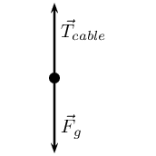

We apply Newton's second law to the vertical direction:
                    \begin{align*}
                    \vec{F}_R & = m_{\text{lift}} \vec{a}\ \text{(we use signs to indicate direction)} \\
                    T - F_g & = m_{\text{lift}} (0) \\
                    T & = F_g
                    \end{align*}

The forces are equal in magnitude and opposite in direction.

**Stage 2:**

The lift moves upwards at an acceleration of \(\text{1}\) \(\text{m·s$^{-2}$}\).

If the lift is accelerating, it means that there is a resultant force in the direction of the motion.
                    This means that the force acting upwards is now greater than the force due to gravity \(\vec{F}_g\)
                    (down). To find the magnitude of the \(\vec{T}\) applied by the cable we can do the following
                    calculation: (Remember we have chosen upwards as positive.)

We apply Newton's second law to the vertical direction:
                    \begin{align*}
                    \vec{F}_R & = m_{\text{lift}} \vec{a}\ \text{(we use signs to indicate direction)} \\
                    T - F_g & = m_{\text{lift}} (\text{1}) \\
                    T & = F_g + m_{\text{lift}} (\text{1})
                    \end{align*}

The answer makes sense as we need a bigger force upwards to cancel the effect of gravity as well as
                    have a positive resultant force.

**Stage 3:**

The lift moves at a constant velocity.

When the lift moves at a constant velocity, the acceleration is zero,
                    \begin{align*}
                    \vec{F}_R & = m_{\text{lift}} \vec{a}\ \text{(we use signs to indicate direction)} \\
                    T - F_g & = m_{\text{lift}} (0) \\
                    T & = F_g
                    \end{align*}

The forces are equal in magnitude and opposite in direction. It is common **mistake** to
                    think that because the lift is moving there is a net force acting on it. It is only if it is
                    **accelerating** that there is a net force acting.

**Stage 4:**

The lift slows down at a rate of \(\text{2}\) \(\text{m·s$^{-2}$}\). The lift was moving upwards
                    so this means that it is decelerating or accelerating in the direction opposite to the direction of
                    motion. This means that the acceleration is in the negative direction.
                    \begin{align*}
                    \vec{F}_R & = m_{\text{lift}} \vec{a}\ \text{(we use signs to indicate direction)} \\
                    T - F_g & = m_{\text{lift}} (-\text{2}) \\
                    T & = F_g -\text{2}m_{\text{lift}}
                    \end{align*}

As the lift is now slowing down there is a resultant force downwards. This means that the force
                    acting downwards is greater than the force acting upwards.

This makes sense as we need a smaller force upwards to ensure that the resultant force is downward.
                    The force of gravity is now greater than the upward pull of the cable and the lift will slow down.

**Stage 5:**

The cable snaps.

When the cable snaps, the force that used to be acting upwards is no longer present. The only force
                    that is present would be the force of gravity. The lift will fall freely and its acceleration.

#### Apparent weight

Your weight is the magnitude of the gravitational force acting on your body. When you stand in a lift
                    that is stationery and then starts to accelerate upwards you feel you are pressed into the floor
                    while the lift accelerates. You feel like you are heavier and your weight is more. When you are in a
                    stationery lift that starts to accelerate downwards you feel lighter on your feet. You feel like
                    your weight is less.

Weight is measured through normal forces. When the lift accelerates upwards you feel a greater normal
                    force acting on you as the force required to accelerate you upwards in addition to balancing out the
                    gravitational force.

When the lift accelerates downwards you feel a smaller normal force acting on you. This is because a
                    net force downwards is required to accelerate you downwards. This phenomenon is called
                    **apparent weight** because your weight didn't actually change.

<QuizCard id="s11-02-03e" title="Interactive Exercise 2.11" question="Adapted from DBE Nov 2015 Grade 11, P1, Q1.4 Physical constants · Physics formulas Vaishna has a weight of \(\text{770}\ \text{N}\) . She is in an elevator (a lift) with a bathroom scale that gives a reading in newtons. At some point, she looks at the scale and sees a reading of \(\text{770}\ \text{N}\) . Which one of the following combinations correctly indicates what we can determine about the velocity of the elevator and the acceleration of the elevator? Velocity Acceleration A impossible to determine impossible to determine B zero zero C zero impossible to determine D impossible to determine zero" options=["A", "B", "C", "D"] answer="D" hint="" explanation="Work out the acceleration Vaishna experiences two vertical forces while in the elevator. The downwards force due to gravity \((\vec{F}_{\text{g}})\) . This is Vaishna's weight . The upwards normal force \((\vec{F}_{\text{N}})\) of the scale. This is the reading on the scale. We can draw a free-body diagram of these two forces and determine the direction of the net force. From this we can determine the direction of the elevator's acceleration. \[ 			        \begin{array}{c} 			    		F_{\text{N}} = F_{\text{g}} \\ 			    		\therefore \vec{F}_{\text{net}} = 0 \\ 			    		\therefore \vec{a} = 0 			        \end{array} 			    \] What can we work out about velocity? We now know that the elevator has zero acceleration . But this tells us nothing about the velocity of the elevator. The elevator could be stationary (zero velocity) but it could also be moving at a constant velocity (up or down). So it is impossible to determine anything more about the velocity of         the elevator. (We only know that the velocity must be constant .) Velocity Acceleration A impossible to determine impossible to determine B zero zero C zero impossible to determine D \({\color{red}{{\checkmark}{\checkmark}}}\) impossible to determine zero The correct option is D . Submit your answer as: D" />

<QuizCard id="s11-02-03e" title="Interactive Exercise 2.11" question="A person with a mass of \(\text{100}\ \text{kg}\) and a weight of \(\text{980}\ \text{N}\) stands on a scale ( which gives a reading in newtons ) inside a lift that is accelerating upwards at \(\text{4,5}\ \text{m·s$^{-2}$}\) . What is the reading on the scale? INSTRUCTION: Round your answer to the nearest \(\text{newton}\) ." options=[] answer="1430" hint="You should enter a number here. If you want to, you can use a space to separate thousands.                Example: 12 800,25 For scientific notation you need to use the multiply symbol                ( ∗ ) and the exponent symbol ( ^ ). For example 6,673 × 10 −11 should be written as: 6,673 ∗ 10^−11" explanation="Identify the given information and what is needed We are given the mass and weight of the person and the resultant acceleration - this is just the acceleration of the lift. The reading on the scale, which we are looking for, is of the normal force , the force of the scale (floor of lift) upwards on the person. The sum of all the forces must equal the resultant force, \(\vec{F}_{\text{net}}\) . The resultant force may also be calculated using Newton's second law. All of the acting forces are on the vertical axis. Determine the gravitational force Using the definition of the net force as the sum of all forces exerted on an object we have \[                 \begin{aligned}                   \vec{F}_{\text{net}} = \vec{F}_{\text{g}} + \vec{F}_{\text{N}}                 \end{aligned}             \] We can also use Newton's second law to work with the net force \[               \begin{array}{c}                 \vec{F}_{\text{net}} =  m\vec{a}               \end{array}           \] Calculate the normal force We cam substitute and solve for \(\vec{F}_{\text{N}}\) . For this calculation let us choose upwards as positive . \[             \begin{aligned}                           \vec{F}_{\text{net}} & =  m\vec{a} \\               \vec{F}_{\text{N}} + \vec{F}_{\text{g}} & =  m\vec{a} \\               \vec{F}_{\text{N}} + (- \text{980}) & = (\text{100})(\text{4,5}) \\               \vec{F}_{\text{N}} - \text{980} & = \text{450} \\               \therefore \vec{F}_{\text{N}}& = \text{1 430}\ \text{N} \text{ upwards}             \end{aligned}           \] The scale therefore reads \(\text{1 430}\ \text{N}\) . Submit your answer as:" />

<QuizCard id="s11-02-03e" title="Interactive Exercise 2.11" question="Is the acceleration of the lift upward or downward in Stage 1? TIP: In a test or exam you will be required to give reasons for your answer." options=["upward", "downward", "upward", "not defined", "downward"] answer="downward" hint="" explanation="We need to understand what the scale measures. The student is standing on the scale, and the reading on the scale is equal to the normal force exerted on the student by the scale. The scale will read the gravitational force the student experience when the lift is not accelerating - when the gravitational force and the normal force are equal. When the lift is accelerating upwards, the floor pushes upwards with a force greater than the gravitational force. This means that the normal force exerted on the student increases. Because the apparent weight is equal to the normal force, the student only appears to weigh more. On the other hand, when the lift is accelerating downwards, the floor pushes upwards with a force less than the force of gravity. This means that the normal force exerted on the student decreases. In this case, the student will only appear to weigh less. Take a moment to think about in which direction the lift is accelerating.  How will this affect the sequence of the readings? NOTE: If you have ridden in a lift before, you may have felt a strange sensation (some people don't like it), like you were falling or being lifted. The acceleration of the lift is what causes this sensation and this usually occurs just as the lift starts moving and just before it stops. We observe that during Stage 1 the acceleration of the lift is causing the scale to measure a normal force greater than the gravitational force the student experiences. Therefore we can conclude that the lift is accelerating upwards . Submit your answer as: upward" />

<QuizCard id="s11-02-03e" title="Interactive Exercise 2.11" question="A person with a mass of \(\text{90}\ \text{kg}\) and a weight of \(\text{882}\ \text{N}\) stands on a scale ( which gives a reading in newtons ) inside a lift that is accelerating downwards at \(\text{3,4}\ \text{m·s$^{-2}$}\) . What is the reading on the scale? INSTRUCTION: Round your answer to the nearest \(\text{newton}\) ." options=[] answer="576" hint="You should enter a number here. If you want to, you can use a space to separate thousands.                Example: 12 800,25 For scientific notation you need to use the multiply symbol                ( ∗ ) and the exponent symbol ( ^ ). For example 6,673 × 10 −11 should be written as: 6,673 ∗ 10^−11" explanation="Identify the given information and what is needed We are given the mass and weight of the person and the resultant acceleration - this is just the acceleration of the lift. The reading on the scale, which we are looking for, is of the normal force , the force of the scale (floor of lift) upwards on the person. The sum of all the forces must equal the resultant force, \(\vec{F}_{\text{net}}\) . The resultant force may also be calculated using Newton's second law. All of the acting forces are on the vertical axis. Determine the gravitational force Using the definition of the net force as the sum of all forces exerted on an object we have \[                 \begin{aligned}                   \vec{F}_{\text{net}} = \vec{F}_{\text{g}} + \vec{F}_{\text{N}}                 \end{aligned}             \] We can also use Newton's second law to work with the net force \[               \begin{array}{c}                 \vec{F}_{\text{net}} =  m\vec{a}               \end{array}           \] Calculate the normal force We cam substitute and solve for \(\vec{F}_{\text{N}}\) . For this calculation let us choose upwards as positive . \[             \begin{aligned}                           \vec{F}_{\text{net}} & =  m\vec{a} \\               \vec{F}_{\text{N}} + \vec{F}_{\text{g}} & =  m\vec{a} \\               \vec{F}_{\text{N}} + (- \text{882}) & = (\text{90})(-\text{3,4}) \\               \vec{F}_{\text{N}} - \text{882} & = -\text{306} \\               \therefore \vec{F}_{\text{N}}& = \text{576}\ \text{N} \text{ upwards}             \end{aligned}           \] The scale therefore reads \(\text{576}\ \text{N}\) . Submit your answer as:" />

<QuizCard id="s11-02-03e" title="Interactive Exercise 2.11" question="Adapted from DBE Nov 2015 Grade 11, P1, Q1.4 Physical constants · Physics formulas Moselantja has a weight of \(\text{570}\ \text{N}\) . She is in an elevator (a lift) with a bathroom scale that gives a reading in newtons. At some point while the elevator is getting faster, she looks at the scale and sees a reading of \(\text{600}\ \text{N}\) . Which one of the following combinations correctly indicates the direction of motion of the elevator and the direction of the acceleration while the elevator is in motion? Direction of motion Direction of acceleration A up up B down down C up down D down up" options=["A", "B", "C", "D"] answer="A" hint="" explanation="Work out the acceleration Moselantja experiences two vertical forces while in the elevator. The downwards force due to gravity \((\vec{F}_{\text{g}})\) . This is Moselantja's weight . The upwards normal force \((\vec{F}_{\text{N}})\) of the scale. This is the reading on the scale. We can draw a free-body diagram of these two forces and determine the direction of the net force. From this we can determine the direction of the elevator's acceleration. \[ 			        \begin{array}{c} 			    		F_{\text{N}} > F_{\text{g}} \\ 			    		\therefore \vec{F}_{\text{net}} \text{ is up} \\ 			    		\therefore \vec{a} \text{ is up} 			        \end{array} 			    \] What can we work out about velocity? The elevator is getting faster . This means that it must be moving in the same direction as the         acceleration. The acceleration points up , so the velocity must point up . Direction of motion Direction of acceleration A \({\color{red}{{\checkmark}{\checkmark}}}\) up up B down down C up down D down up The correct option is A . Submit your answer as: A" />

<QuizCard id="s11-02-03e" title="Interactive Exercise 2.11" question="Is the acceleration of the lift upward or downward in Stage 1? TIP: In a test or exam you will be required to give reasons for your answer." options=["downward", "upward", "downward", "not defined", "upward"] answer="downward" hint="" explanation="We need to understand what the scale measures. The student is standing on the scale, and the reading on the scale is equal to the normal force exerted on the student by the scale. The scale will read the gravitational force the student experience when the lift is not accelerating - when the gravitational force and the normal force are equal. When the lift is accelerating upwards, the floor pushes upwards with a force greater than the gravitational force. This means that the normal force exerted on the student increases. Because the apparent weight is equal to the normal force, the student only appears to weigh more. On the other hand, when the lift is accelerating downwards, the floor pushes upwards with a force less than the force of gravity. This means that the normal force exerted on the student decreases. In this case, the student will only appear to weigh less. Take a moment to think about in which direction the lift is accelerating.  How will this affect the sequence of the readings? NOTE: If you have ridden in a lift before, you may have felt a strange sensation (some people don't like it), like you were falling or being lifted. The acceleration of the lift is what causes this sensation and this usually occurs just as the lift starts moving and just before it stops. We observe that during Stage 1 the acceleration of the lift is causing the scale to measure a normal force less than the gravitational force the student experiences. Therefore we can conclude that the lift is accelerating downwards . Submit your answer as: downward" />

#### Rockets

As with lifts, rockets are also examples of objects in vertical motion. The force of gravity pulls
                    the rocket down while the thrust of the engine pushes the rocket upwards. The force that the engine
                    exerts must overcome the force of gravity so that the rocket can accelerate upwards. The worked
                    example below looks at the application of Newton's second law in launching a rocket.

<Callout type="tip" title="Worked example 16: Newton's second law: rocket">
**Question:**
A rocket (of mass \(\text{5 000}\) \(\text{kg}\)) is launched vertically upwards into
                            the sky at an acceleration of \(\text{20}\) \(\text{m·s$^{-2}$}\). If the magnitude of
                            the force due to gravity on the rocket is \(\text{49 000}\) \(\text{N}\), calculate the
                            magnitude and direction of the thrust of the rocket's engines.

**Analyse what is given and what is asked:**
We have the following:

\(m=\text{5 000} \text{kg}\)

\(\vec{a}\)=\(\text{20}\) \(\text{m·s$^{-2}$}\) upwards.

\(\vec{F}_g\)=\(\text{49 000}\) \(\text{N}\) downwards.

We are asked to find the thrust of the rocket engine \(\vec{F}\).

**Find the thrust of the engine:**
We will apply Newton's second law:
                            \begin{align*}
                            \vec{F}_R & = m\vec{a}\ \text{(using signs to indicate direction)} \\
                            F - F_g & = (\text{5 000})(\text{20}) \\
                            F - (\text{49 000}) & = (\text{5 000})(\text{20}) \\
                            F &= \text{149 000}\text{ N}
                            \end{align*}

**Quote your final answer:**
The force due to the thrust is \(\text{149 000}\) \(\text{N}\) upwards.
</Callout>

<Callout type="tip" title="Worked example 17: Rockets">
**Question:**
How do rockets accelerate in space?

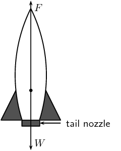

**:**
- Gas explodes inside the rocket.
- This exploding gas exerts a force on each side of the rocket
                                      (as shown in the picture below of the explosion chamber inside the
                                      rocket).
  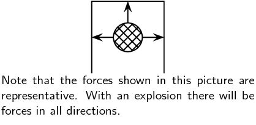
- Due to the symmetry of the situation, all the forces exerted
                                      on the rocket are balanced by forces on the opposite side, except for the force
                                      opposite the open side. This force on the upper surface is unbalanced.
- This is therefore the resultant force acting on the rocket and it
                                      makes the rocket accelerate forwards.
</Callout>

### Textbook Exercise 2.5

**Problem:**
A tug is capable of pulling a ship with a force of \(\text{100}\) \(\text{kN}\). If
                                    two such tugs are pulling on one ship, they can produce any force ranging from a
                                    minimum of \(\text{0}\) \(\text{kN}\) to a maximum of \(\text{200}\) \(\text{kN}\).
                                    Give a detailed explanation of how this is possible. Use diagrams to support your
                                    result.

**Solution:**
We start off with the two tug boats pulling in opposite directions:

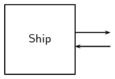

The resultant force is \(\text{0}\) \(\text{kN}\) since the tug boats are pulling
                                    with equal forces in opposite directions.

If the two tugboats pull in the same direction then we get:

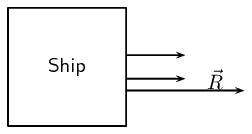

The resultant force is \(\text{200}\) \(\text{kN}\) since the tug boats are pulling
                                    with equal forces in the same direction.

To get any force between these two extremes, one tugboat will have to be pulling on
                                    the ship at a different angle to the second tugboat, for example:

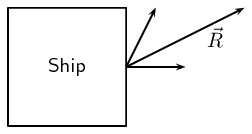

Note that the resultant force in this situation is less than \(\text{200}\)
                                    \(\text{kN}\) (You can check this by using any of the vector addition techniques).

**Problem:**
A car of mass \(\text{850}\) \(\text{kg}\) accelerates at \(\text{2}\)
                                    \(\text{m·s$^{-2}$}\). Calculate the magnitude of the resultant force that is
                                    causing the acceleration.

**Solution:**
\begin{align*}
                                F & = ma \\
                                & = (\text{850})(\text{2}) \\
                                & = \text{1 700}\text{ N}
                                \end{align*}

**Problem:**
Find the force needed to accelerate a \(\text{3}\) \(\text{kg}\) object at
                                    \(\text{4}\) \(\text{m·s$^{-2}$}\).

**Solution:**
\begin{align*}
                                F & = ma \\
                                & = (\text{3})(\text{4}) \\
                                & = \text{12}\text{ N}
                                \end{align*}

**Problem:**
Calculate the acceleration of an object of mass \(\text{1 000}\) \(\text{kg}\)
                                    accelerated by a force of magnitude \(\text{100}\) \(\text{N}\).

**Solution:**
\begin{align*}
                                F & = ma \\
                                a & = \frac{F}{m} \\
                                & = \frac{\text{100}}{\text{1 000}} \\
                                & = \text{0,1}\text{ m·s$^{-2}$}
                                \end{align*}

**Problem:**
An object of mass \(\text{7}\) \(\text{kg}\) is accelerating at \(\text{2,5}\)
                                    \(\text{m·s$^{-2}$}\). What resultant force acts on it?

**Solution:**
\begin{align*}
                                F & = ma \\
                                & = (\text{7})(\text{2,5}) \\
                                & = \text{17,5}\text{ N}
                                \end{align*}

**Problem:**
Find the mass of an object if a force of \(\text{40}\) \(\text{N}\) gives it an
                                    acceleration of \(\text{2}\) \(\text{m·s$^{-2}$}\).

**Solution:**
\begin{align*}
                                F & = ma \\
                                m & = \frac{F}{a} \\
                                & = \frac{\text{40}}{\text{2}} \\
                                & = \text{20}\text{ kg}
                                \end{align*}

**Problem:**
Find the acceleration of a body of mass \(\text{1 000}\) \(\text{kg}\) that has
                                    a force with a magnitude of \(\text{150}\) \(\text{N}\) acting on it.

**Solution:**
\begin{align*}
                                F & = ma \\
                                a & = \frac{F}{m} \\
                                & = \frac{\text{150}}{\text{1 000}} \\
                                & = \text{0,15}\text{ m·s$^{-2}$}
                                \end{align*}

**Problem:**
Find the mass of an object which is accelerated at \(\text{3}\)
                                    \(\text{m·s$^{-2}$}\) by a force of magnitude \(\text{25}\) \(\text{N}\).

**Solution:**
\begin{align*}
                                F & = ma \\
                                m & = \frac{F}{a} \\
                                & = \frac{\text{25}}{\text{3}} \\
                                & = \text{8,33}\text{ kg}
                                \end{align*}

**Problem:**
Determine the acceleration of a mass of \(\text{24}\) \(\text{kg}\) when a force of
                                    magnitude \(\text{6}\) \(\text{N}\) acts on it. What is the acceleration if the
                                    force were doubled and the mass was halved?

**Solution:**
We first find the acceleration:

                                \begin{align*}
                                F & = ma \\
                                a & = \frac{F}{m} \\
                                & = \frac{\text{6}}{\text{24}} \\
                                & = \text{0,25}\text{ m·s$^{-2}$}
                                \end{align*}

If the force is doubled and the mass is halved then the acceleration will be four
                                    times this amount: \(\text{1}\) \(\text{m·s$^{-2}$}\).

You can check this by doubling the force and halving the mass.

A mass of \(\text{8}\) \(\text{kg}\) is accelerating at \(\text{5}\)
                                    \(\text{m·s$^{-2}$}\).

**Problem:**
Determine the resultant force that is causing the acceleration.

**Solution:**
\begin{align*}
                                    F & = ma \\
                                    & = (\text{8})(\text{5}) \\
                                    & = \text{40}\text{ N}
                                    \end{align*}

**Problem:**
What acceleration would be produced if we doubled the force and reduced the mass
                                        by half?

**Solution:**
If we doubled the force and halved the mass we would get four times the
                                        acceleration or \(\text{20}\) \(\text{m·s$^{-2}$}\). You can check this by
                                        carrying out the calculation using double the force and half the mass.

A motorcycle of mass \(\text{100}\) \(\text{kg}\) is accelerated by a resultant force
                                    of \(\text{500}\) \(\text{N}\). If the motorcycle starts from rest:

**Problem:**
What is its acceleration?

**Solution:**
\begin{align*}
                                    F & = ma \\
                                    a & = \frac{F}{m} \\
                                    & = \frac{\text{500}}{\text{100}} \\
                                    & = \text{5}\text{ m·s$^{-2}$}
                                    \end{align*}

**Problem:**
How fast will it be travelling after \(\text{20}\) \(\text{s}\)?

**Solution:**
We can use the equations of motion (recall from grade 10: motion in one
                                        dimension) to determine how fast it will be travelling:

                                    \begin{align*}
                                    v_{f} & = v_{i} + at \\
                                    & = 0 + (5)(20) \\
                                    & = \text{100}\text{ m·s$^{-1}$}
                                    \end{align*}

**Problem:**
How long will it take to reach a speed of \(\text{35}\)
                                        \(\text{m·s$^{-1}$}\)?

**Solution:**
Again, we can use the equations of motion (recall from grade 10: motion in one
                                        dimension) to determine how long it takes to reach the given speed:

                                    \begin{align*}
                                    v_{f} & = v_{i} + at \\
                                    35 & = 0 + (5)t \\
                                    t & = \frac{\text{35}}{\text{5}}\\
                                    & = \text{7}\text{ s}
                                    \end{align*}

**Problem:**
How far will it travel from its starting point in \(\text{15}\) \(\text{s}\)?

**Solution:**
Again, we can use the equations of motion (recall from grade 10: motion in one
                                        dimension) to determine how far it travels:

                                    \begin{align*}
                                    \Delta x & = v_{i}t + \frac{\text{1}}{\text{2}}at^{2} \\
                                    35 & = (0)(15) + \frac{\text{1}}{\text{2}}(5)(15)^{2} \\
                                    & = \text{562,5}\text{ m}
                                    \end{align*}

A force of \(\text{200}\) \(\text{N}\), acting at \(\text{60}\)\(\text{°}\) to
                                    the horizontal, accelerates a block of mass \(\text{50}\) \(\text{kg}\) along a
                                    horizontal plane as shown.

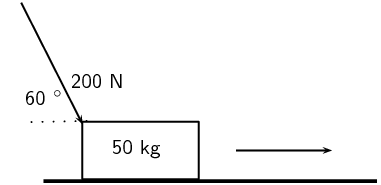

**Problem:**
Calculate the component of the \(\text{200}\) \(\text{N}\) force that accelerates
                                        the block horizontally.

**Solution:**
\begin{align*}
                                    F_{x} & = F \cos \theta \\
                                    & = (\text{200}) \cos(60) \\
                                    & = \text{100}\text{ N}
                                    \end{align*}

**Problem:**
If the acceleration of the block is \(\text{1,5}\) \(\text{m·s$^{-2}$}\),
                                        calculate the magnitude of the frictional force on the block.

**Solution:**
\begin{align*}
                                    F_{R} & = ma \\
                                    F_{x} + F_{f} & = ma \\
                                    \text{100} + F_{f} & = (50)(\text{1,5}) \\
                                    F_{f} & = \text{75} - \text{100} \\
                                    & = -\text{25}\text{ N}
                                    \end{align*}

**Problem:**
Calculate the vertical force exerted by the block on the plane.

**Solution:**
\begin{align*}
                                    F_{y} & = F \sin \theta \\
                                    & = (\text{200}) \sin(60) \\
                                    & = \text{173,2}\text{ N}
                                    \end{align*}

**Problem:**
A toy rocket experiences a force due to gravity of magnitude \(\text{4,5}\)
                                    \(\text{N}\) is supported vertically by placing it in a bottle. The rocket is then
                                    ignited. Calculate the force that is required to accelerate the rocket vertically
                                    upwards at \(\text{8}\) \(\text{m·s$^{-2}$}\).

**Solution:**
Taking the upwards direction as positive:

                                \begin{align*}
                                F_{R} & = ma \\
                                F_{1} + F_{g} & = ma \\
                                F_{1} - \text{4,5} & = (\text{0,5})(\text{8}) \\
                                F_{1} & = \text{4} + \text{4,5} \\
                                & = \text{8,5}\text{ N}
                                \end{align*}

**Problem:**
A constant force of magnitude \(\text{70}\) \(\text{N}\) is applied vertically to a
                                    block as shown. The block experiences a force due to gravity of \(\text{49}\)
                                    \(\text{N}\). Calculate the acceleration of the block.

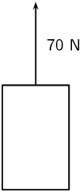

**Solution:**
Taking the upwards direction as positive:

                                \begin{align*}
                                F_{R} & = ma \\
                                F_{1} + F_{g} & = ma \\
                                \text{70} - \text{49} & = \text{5}a \\
                                \text{21} & = \text{5}a \\
                                a & = \text{4,2}\text{ m·s$^{-2}$}
                                \end{align*}

A student experiences a gravitational force of magnitude \(\text{686}\) \(\text{N}\)
                                    investigates the motion of a lift. While he stands in the lift on a bathroom scale
                                    (calibrated in newton), he notes three stages of his journey.

2. For \(\text{2}\) \(\text{s}\) immediately after the lift starts, the scale
                                               reads \(\text{574}\) \(\text{N}\).
4. For a further \(\text{6}\) \(\text{s}\) it reads \(\text{686}\) \(\text{N}\).
6. For the final \(\text{2}\) \(\text{s}\) it reads \(\text{854}\) \(\text{N}\).

Answer the following questions:

**Problem:**
Is the motion of the lift upward or downward? Give a reason for your answer.

**Solution:**
Stage 1: Downwards. The scale reads less than the gravitational force that he
                                        experiences.

Stage 2: Stationary. The scale reads the same as the gravitational force that he
                                        experiences.

Stage 3: Upwards. The scale reads more than the gravitational force that he
                                        experiences.

**Problem:**
Write down the magnitude and the direction of the resultant force acting on the
                                        student for each of the stages 1, 2 and 3.

**Solution:**
Stage 1: \(\text{574}\) \(\text{N}\) downwards

Stage 2: The resultant force on the student is zero.

Stage 3: \(\text{854}\) \(\text{N}\) upwards

**Problem:**
A car of mass \(\text{800}\) \(\text{kg}\) accelerates along a level road at
                                    \(\text{4}\) \(\text{m·s$^{-2}$}\). A frictional force of \(\text{700}\)
                                    \(\text{N}\) opposes its motion. What force is produced by the car's engine?

**Solution:**
\begin{align*}
                                \vec{F}_{R} & = m\vec{a} \\
                                \vec{F}_{f} + \vec{F}_{E} & = m\vec{a} \\
                                -\text{700} + F_{E} & = (\text{800})(4) \\
                                F_{E} & = \text{3 200} + \text{700} \\
                                & = \text{3 900}\text{ N}
                                \end{align*}

**Problem:**
Two objects, with masses of \(\text{1}\) \(\text{kg}\) and \(\text{2}\) \(\text{kg}\)
                                    respectively, are placed on a smooth surface and connected with a piece of string. A
                                    horizontal force of \(\text{6}\) \(\text{N}\) is applied with the help of a spring
                                    balance to the \(\text{1}\) \(\text{kg}\) object. Ignoring friction, what will the
                                    force acting on the \(\text{2}\) \(\text{kg}\) mass, as measured by a second spring
                                    balance, be?

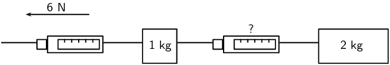

**Solution:**
The force acting on the \(\text{2}\) \(\text{kg}\) block is \(\text{6}\)
                                    \(\text{N}\). Since the surface is assumed to be frictionless, the applied force on
                                    the \(\text{1}\) \(\text{kg}\) block is equal to the force experienced by the
                                    \(\text{2}\) \(\text{kg}\) block.

A rocket of mass \(\text{200}\) \(\text{kg}\) has a resultant force of
                                    \(\text{4 000}\) \(\text{N}\) upwards on it.

**Problem:**
What is its acceleration on the Earth, where it experiences a gravitational force
                                        of \(\text{1 960}\) \(\text{N}\)?

**Solution:**
The force on the rocket is in the upwards direction, while the force due to
                                        gravity is in the downwards direction. Taking upwards as positive:

                                    \begin{align*}
                                    F_{R} & = ma \\
                                    F_{g} + F_{\text{rocket}} & = ma \\
                                    -\text{1 960} + \text{4 000} & = ma \\
                                    a & = \frac{\text{2 040}}{\text{200}} \\
                                    & = \text{10,2}\text{ m·s$^{-2}$}
                                    \end{align*}

**Problem:**
What driving force does the rocket engine need to exert on the back of the rocket
                                        on the Earth?

**Solution:**
On Earth the rocket engines need to overcome the gravitational force and so need
                                        to exert a force of \(\text{1 960}\) \(\text{N}\) or greater.

A car going at \(\text{20}\) \(\text{m·s$^{-1}$}\) accelerates uniformly and
                                    comes to a stop in a distance of \(\text{20}\) \(\text{m}\).

**Problem:**
What is its acceleration?

**Solution:**
We can use the equations of motion to find the acceleration:

                                    \begin{align*}
                                    v_{f}^{2} & = v_{i}^{2} + 2a \Delta x \\
                                    0 & = (20)^{2} + 2(20)a \\
                                    40a & = -\text{400} \\
                                    a & = -\text{10}\text{ m·s$^{-2}$}
                                    \end{align*}

**Problem:**
If the car is \(\text{1 000}\) \(\text{kg}\) how much force do the brakes
                                        exert?

**Solution:**
\begin{align*}
                                    F & = ma \\
                                    & = (\text{1 000})(\text{10}) \\
                                    & = \text{10 000}\text{ N}
                                    \end{align*}

**Problem:**
A block on an inclined plane experiences a force due to gravity, \(\vec{F}_g\) of
                                    \(\text{300}\) \(\text{N}\) straight down. If the slope is inclined at
                                    \(\text{67,8}\)\(\text{°}\) to the horizontal, what is the component of the
                                    force due to gravity perpendicular and parallel to the slope? At what angle would
                                    the perpendicular and parallel components of the force due to gravity be equal?

**Solution:**
The component parallel to the slope is:

                                \begin{align*}
                                F_{gx} & = F \sin \theta \\
                                & = (\text{300})\sin(\text{67,8}) \\
                                & = \text{277,76}\text{ N}
                                \end{align*}

The component perpendicular to the slope is:

                                \begin{align*}
                                F_{gy} & = F \cos \theta \\
                                & = (\text{300})\cos(\text{67,8}) \\
                                & = \text{113,35}\text{ N}
                                \end{align*}

For the two components to be equal the angle must be \(\text{45}\)\(\text{°}\).
                                    (\(\sin (45) = \cos(45)\)).

**Problem:**
A block on an inclined plane is subjected to a force due to gravity, \(\vec{F}_g\) of
                                    \(\text{287}\) \(\text{N}\) straight down. If the component of the gravitational
                                    force parallel to the slope is \(\vec{F}_{gx}\)=\(\text{123,7}\) \(\text{N}\) in the
                                    negative \(x\)-direction (down the slope), what is the incline of the slope?

**Solution:**
\begin{align*}
                                F_{gx} & = F \sin \theta \\
                                \text{123,7} & = (\text{287})\sin \theta \\
                                \sin \theta & = \text{0,431}\ldots \\
                                \theta & = \text{25,53}\text{°}
                                \end{align*}

**Problem:**
A block on an inclined plane experiences a force due to gravity, \(\vec{F}_g\) of
                                    \(\text{98}\) \(\text{N}\) straight down. If the slope is inclined at an unknown
                                    angle to the horizontal but we are told that the ratio of the components of the
                                    force due to gravity perpendicular and parallel to the slope is 7:4. What is the
                                    angle the incline makes with the horizontal?

**Solution:**
We first write down the equations for the parallel and perpendicular components:

                                \begin{align*}
                                F_{gx} & = F \sin \theta \\
                                & = (98)\sin \theta
                                \end{align*}
                                \begin{align*}
                                F_{gy} & = F \cos \theta \\
                                & = (98)\cos \theta
                                \end{align*}

Now we note the following:

                                \begin{align*}
                                7F_{gx} & = 4F_{gy} \\
                                \therefore 7(98)\sin \theta & = 4(98)\cos \theta
                                \end{align*}

Now we need to solve for theta:

                                \begin{align*}
                                \sin \theta & = \frac{\text{392}}{\text{686}} \cos \theta \\
                                & = \text{0,5714} \cos \theta \\
                                \frac{\sin \theta}{\cos \theta} & = \text{0,5714} \\
                                \tan \theta & = \text{0,5714} \\
                                \theta & = \text{25,53}\text{°}
                                \end{align*}

Recall from trigonometry that \(\frac{\sin \theta}{\cos \theta} = \tan \theta\).

Two crates, \(\text{30}\) \(\text{kg}\) and \(\text{50}\) \(\text{kg}\) respectively,
                                    are connected with a thick rope according to the diagram. A force, to the right, of
                                    \(\text{1 500}\) \(\text{N}\) is applied. The boxes move with an acceleration
                                    of \(\text{2}\) \(\text{m·s$^{-2}$}\) to the right. The ratio of the frictional
                                    forces on the two crates is the same as the ratio of their masses. Calculate:

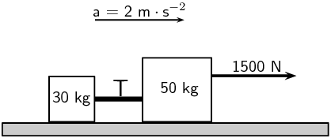

**Problem:**
the magnitude and direction of the total frictional force present.

**Solution:**
Let the \(\text{50}\) \(\text{kg}\) crate be crate 1 and the \(\text{30}\)
                                        \(\text{kg}\) crate be crate 2.

To find the frictional force we will apply Newton's second law. We are given the
                                        mass (\(\text{30}\) + \(\text{50}\) \(\text{kg}\)) and the acceleration
                                        (\(\text{2}\) \(\text{m·s$^{-2}$}\)). Choose the direction of motion to be
                                        the positive direction (to the right is positive).

                                    \begin{align*}
                                    F_{R} & = ma\\
                                    F_{\text{applied}} + F_{f} & =ma\\
                                    \text{1 500} + {F}_{f} & = (30+50)(2)\\
                                    F_{f} & = \text{160} - \text{1 500}\\
                                    F_{f} & = -\text{1 340}\text{ N}
                                    \end{align*}

**Problem:**
the magnitude of the tension in the rope at T.

**Solution:**
We note that \(m_{1} = \frac{\text{5}}{\text{3}} m_{2}\), therefore \(F_{f1} =
                                        \frac{\text{5}}{\text{3}} F_{f2}\).

To find the tension in the rope we need to look at one of the two crates on their
                                        own. Let's choose the \(\text{30}\) \(\text{kg}\) crate.

The frictional force on the \(\text{30}\) \(\text{kg}\) block is noted above. We
                                        can calculate \(F_{f2}\):

                                    \begin{align*}
                                    F_{f} & = F_{f1} + F_{f2} \\
                                    \text{1 340} & = F_{f2} + \frac{\text{5}}{\text{3}} F_{f2} \\
                                    \text{1 340} & = \frac{\text{8}}{\text{3}} F_{f2} \\
                                    F_{f2} & = \text{502,5}\text{ N}
                                    \end{align*}

If we apply Newton's second law:

                                    \begin{align*}
                                    F_{R} & = ma \\
                                    T + F_{f} & = (30)(2) \\
                                    T + -\text{502,5} & = 60 \\
                                    T & = \text{562,5}\text{ N}
                                    \end{align*}

Two crates, \(\text{30}\) \(\text{kg}\) and \(\text{50}\) \(\text{kg}\) respectively,
                                    are connected with a thick rope according to the diagram. If they are dragged up an
                                    incline such that the ratio of the parallel and perpendicular components of the
                                    gravitational force on each block are 3 : 5. The boxes move with an acceleration of
                                    \(\text{7}\) \(\text{m·s$^{-2}$}\) up the slope. The ratio of the frictional
                                    forces on the two crates is the same as the ratio of their masses. The magnitude of
                                    the force due to gravity on the \(\text{30}\) \(\text{kg}\) crate is \(\text{294}\)
                                    \(\text{N}\) and on the \(\text{50}\) \(\text{kg}\) crate is \(\text{490}\)
                                    \(\text{N}\). Calculate:

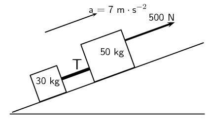

**Problem:**
the magnitude and direction of the total frictional force present.

**Solution:**
Let crate 1 be the \(\text{50}\) \(\text{kg}\) crate and crate 2 be the
                                        \(\text{30}\) \(\text{kg}\) crate. We will choose up the slope as positive.

We need to find all the forces that act parallel to the slope on each box in turn
                                        and use this to solve simultaneously for the frictional force.

We draw free body diagrams for each crate:

First we find the gravitational force parallel to the slope for each box:

                                    \begin{align*}
                                    F_{gx1} & = \frac{\text{3}}{\text{5}}F_{gy1} \\
                                    F_{g1}^{2} & = F_{gx1}^{2} + F_{gy1}^{2} \\
                                    & = F_{gx1}^{2} + \frac{\text{9}}{\text{25}}F_{gx1}^{2} \\
                                    & = \frac{\text{34}}{\text{25}}F_{gx1}^{2} \\
                                    (\text{490})^{2} & = \frac{\text{34}}{\text{25}}F_{gx1}^{2} \\
                                    F_{gx1}^{2} & = \text{176 533,1176} \\
                                    F_{gx1} & = \text{420,17}\text{ N}
                                    \end{align*}
                                    \begin{align*}
                                    F_{gx2} & = \frac{\text{3}}{\text{5}}F_{gy2} \\
                                    F_{g2}^{2} & = F_{gx2}^{2} + F_{gy2}^{2} \\
                                    & = F_{gx2}^{2} + \frac{\text{9}}{\text{25}}F_{gx2}^{2} \\
                                    & = \frac{\text{34}}{\text{25}}F_{gx2}^{2} \\
                                    (\text{294})^{2} & = \frac{\text{34}}{\text{25}}F_{gx2}^{2} \\
                                    F_{gx2}^{2} & = \text{63 555,88} \\
                                    F_{gx1} & = \text{252,10}\text{ N}
                                    \end{align*}

Now we can write an expression for the resultant force on each crate:

                                    \begin{align*}
                                    \vec{F}_{R} & = ma \\
                                    F_{A} - F_{gx1} - F_{f} - T & = ma \\
                                    \text{500} - \text{420,17} - F_{f1} - T & = (\text{50})(\text{7})\\
                                    -T & = \text{420,17} + F_{f}
                                    \end{align*}
                                    \begin{align*}
                                    \vec{F}_{R} & = ma \\
                                    T - F_{gx2} - F_{f} & = ma \\
                                    T - \text{252,10} - F_{f} & = (\text{30})(\text{7})\\
                                    T & = \text{462,1} + F_{f}
                                    \end{align*}

And solve simultaneously for the frictional force:

                                    \begin{align*}
                                    -T + T & = \text{420,17} + F_{f} + \text{462,1} + F_{f} \\
                                    0 & = \text{882,27} + 2F_{f} \\
                                    F_{f} & = -\text{441,14}\text{ N}
                                    \end{align*}

**Problem:**
the magnitude of the tension in the rope at T.

**Solution:**
We can use either of the two expressions above to find the tension. We will use
                                        the expression for crate 1:

                                    \begin{align*}
                                    -T & = \text{420,17} + F_{f} \\
                                    & = \text{420,17} + -\text{441,14} \\
                                    T & = \text{20,97}\text{ N}
                                    \end{align*}

### Newton's third law of motion (ESBKV)

Newton's third law of Motion deals with the interaction between pairs of objects. For example, if you
                hold a book up against a wall you are exerting a force on the book (to keep it there) and the book is
                exerting a force back at you (to keep you from falling through the book). This may sound strange, but if
                the book was not pushing back at you, your hand would push through the book! These two forces (the force
                of the hand on the book (\({F}_{1}\)) and the force of the book on the hand (\({F}_{2}\))) are called an
                action-reaction pair of forces. They have the same magnitude, but act in opposite directions and act on
                different objects (the one force is onto the book and the other is onto your hand).

There is another action-reaction pair of forces present in this situation. The book is pushing against
                the wall (action force) and the wall is pushing back at the book (reaction). The force of the book on
                the wall (\({F}_{3}\)) and the force of the wall on the book ( \({F}_{4}\)) are shown in the diagram.

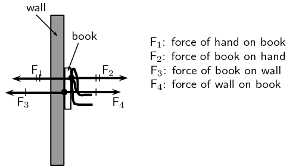

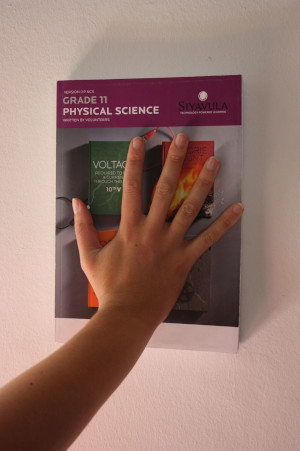

Figure 2.8:
                    Newton's action-reaction pairs.

Newton's third law of motion

If body A exerts a force on body B, then body B exerts a force of equal magnitude on body A, but
                        in the opposite direction.

<Callout type="note" title="Note">
<VideoPlayer src="https://www.youtube.com/embed/By-ggTfeuJU" title="Video: 23J9" />
</Callout>

These action-reaction pairs have several properties:

- the same type of force acts on the objects,
- the forces have the same magnitude but opposite direction, and
- the forces act on different objects.

Newton's action-reaction pairs can be found everywhere in life where two objects interact with one
                another. The following worked examples will illustrate this:

<Callout type="tip" title="Worked example 18: Newton's third law - seat belt">
**Question:**
Dineo is seated in the passenger seat of a car with the seat belt on. The car suddenly stops and
                        he moves forwards (Newton's first law - he continues in his state of motion) until the seat belt
                        stops him. Draw a labelled force diagram identifying two action-reaction pairs in this
                        situation.

**Draw a force diagram:**
Start by drawing the picture. You will be using arrows to indicate the forces so make your
                        picture large enough so that detailed labels can also be added. The picture needs to be
                        accurate, but not artistic! Use stick-men if you have to.

**Label the diagram:**
Take one pair at a time and label them carefully. If there is not enough space on the drawing,
                        then use a key on the side.

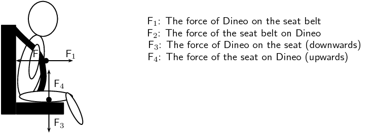
</Callout>

<Callout type="tip" title="Worked example 19: Newton's third law: forces in a lift">
**Question:**
Tammy travels from the ground floor to the fifth floor of a hotel in a lift moving at constant
                        velocity. Which ONE of the following statements is TRUE about the magnitude of the force exerted
                        by the floor of the lift on Tammy's feet? Use Newton's third law to justify your answer.

2. It is greater than the magnitude of Tammy's weight.
4. It is equal in magnitude to the force Tammy's feet exert on the floor of the lift.
6. It is equal to what it would be in a stationary lift.
8. It is greater than what it would be in a stationary lift.

**Analyse the situation:**
This is a Newton's third law question and not Newton's second law. We need to focus on the
                        action-reaction pairs of forces and not the motion of the lift. The following diagram will show
                        the action-reaction pairs that are present when a person is standing on a scale in a lift.

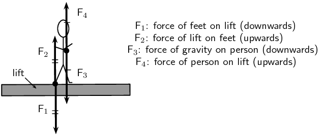

Figure 2.9:
                            Newton's action-reaction pairs in a lift.

In this question statements are made about the force of the floor (lift) on Tammy's feet. This
                        force corresponds to \({F}_{2}\) in our diagram. The reaction force that pairs up with this one
                        is \({F}_{1}\), which is the force that Tammy's feet exerts on the floor of the lift. The
                        magnitude of these two forces are the same, but they act in opposite directions.

**Choose the correct answer:**
It is important to analyse the question first, before looking at the answers. The answers might
                        confuse you if you look at them first. Make sure that you understand the situation and know what
                        is asked before you look at the options.

The correct answer is number \(\text{2}\).
</Callout>

<Callout type="tip" title="Worked example 20: Newton's third law: book and wall">
**Question:**
Bridget presses a book against a vertical wall as shown in the photograph.

2. Draw a labelled force diagram indicating all the forces acting on the book.
4. State, in words, Newton's third law of Motion.
6. Name the action-reaction pairs of forces acting in the horizontal plane.

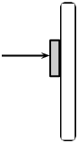

**Draw a force diagram:**
A force diagram will look like this:

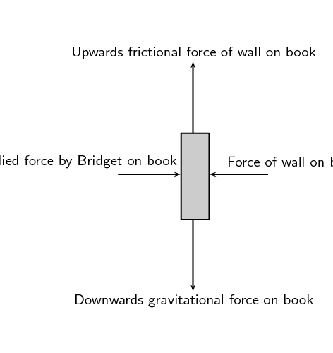

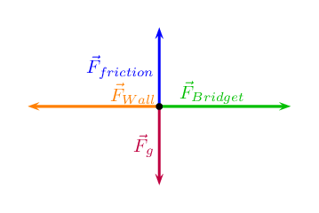

Note that we had to draw all the forces acting on the book and not the action-reaction pairs.
                        None of the forces drawn are action-reaction pairs, because they all act on the same object (the
                        book). When you label forces, be as specific as possible, including the direction of the force
                        and both objects involved, for example, do not say gravity (which is an incomplete answer) but
                        rather say 'Downward (direction) gravitational force of the Earth (object) on the book
                        (object)'.

**State Newton's third law:**
If body A exerts a force onto body B, then body B will exert a force equal in magnitude, but
                        opposite in direction, onto body A.

**Name the action-reaction pairs:**
The question only asks for action-reaction forces in the horizontal plane. Therefore:

Pair 1: Action: Applied force of Bridget on the book; Reaction: The force of the book on the
                        girl.

Pair 2: Action: Force of the book on the wall; Reaction: Force of the wall on the book.

Note that a Newton's third law pair will always involve the same combination of words, like 'book
                        on wall' and 'wall on book'. The objects are 'swapped around' in naming the pairs.
</Callout>

<QuizCard id="s11-02-03g" title="Interactive Exercise 2.13" question="Use the drop-down menus below to state Newton's third law of motion in words." options=["takes energy from", "accelerates", "displaces", "exerts a force on", "simultaneously", "never", "eventually", "sometimes", "a non-uniform", "an identically directed", "an opposing", "an oppositely directed", "force", "acceleration", "displacement", "velocity", "different", "equal", "greater", "lesser"] answer="0, 0, 0, 0, 0" hint="" explanation="State Newton's third law of motion We state Newton's third law of motion as follows: When Body A exerts a force on Body B, Body B simultaneously exerts an oppositely directed force of equal magnitude on Body A. Submit your answer as: exerts a force on and simultaneously and an oppositely directed and force and equal" />

<QuizCard id="s11-02-03g" title="Interactive Exercise 2.13" question="Newton's third law talks about action-reaction pairs. Four statements about action-reaction pairs are given to you below. For each of these statements, indicate if they are true or false. 1 Forces only sometimes occur in action-reaction pairs. 2 Action-reaction pairs occur at different times; the reaction follows the action. 3 Action-reaction pairs cancel each other out 4 Action-reaction pairs arise as an interaction between two objects." options=["true", "false", "true", "false", "true", "false", "true", "false"] answer="
                    1
                ,
                    1
                ,
                    1
                ,
                    0
                " hint="" explanation="Evaluate the statements We need to examine each statement and decide if it is true or false based on what we know about action-reaction pairs: 1 Forces only sometimes occur in action-reaction pairs. false Because all forces occur in action-reaction pairs. 2 Action-reaction pairs occur at different times; the reaction follows the action. false Because action-reaction pairs occur simultaneously . 3 Action-reaction pairs cancel each other out false Because action-reaction pairs cannot cancel each other out. 4 Action-reaction pairs arise as an interaction between two objects. true Action-reaction pairs arise as an interaction between two objects . Submit your answer as: false and false and false and true" />

<QuizCard id="s11-02-03g" title="Interactive Exercise 2.13" question="Adapted from DBE Nov 2016 Grade 11, P1, Q1.3 Physical constants · Physics formulas A crate is at rest on a table. One of the forces experienced by the crate is the                 gravitational force, \(\vec{F}_{\text{g}}\) . The force that forms an action-reaction pair with the gravitational force                 experienced by the crate is the force of the ... A table on the crate. B Earth on the table. C crate on the table. D crate on the Earth." options=["A", "B", "C", "D"] answer="
					3
				" hint="" explanation="Recall the statement of Newton's third law Newton's third law of motion describes action-reaction pairs of forces that are present as the result of an interaction between two objects. When Object A exerts a force on Object B , Object B simultaneously exerts an oppositely                     directed force of equal magnitude on Object A . So the one force in the action-reaction pair is the force that is exerted on Object B by Object A . The other force in the action-reaction pair points in the opposite                 	direction to the first one with the objects the other way around. It is the force exerted on Object A by Object B . NOTE: We often talk about the \"action\" and the \"reaction\" but it's really important to note that these forces occur simultaneously (at the same time). Sometimes using this terminology is helpful (for example, when a soccer player kicks a ball), but sometimes it is not useful because                     there is no force that is clearly the action. To be an action-reaction pair, the two forces must: be the same type of force, act between the same two objects (with one force acting on one object and the second force acting on the other object), and act in opposite directions . Identify the objects involved and then swap them around The force in the action-reaction pair that we are given is \(\vec{F}_{\text{g}}\) . This is the 					gravitational force exerted on the crate by the Earth . It points downwards. The other force in this pair must involve the same two objects and point in the opposite direction. It has the Earth 					experiencing the force and the crate exerting the force. TIP: Identify the two objects involved in one force (the object experiencing the force and the object exerting the force). To identify the other force just swap                     	the objects around. The following forces are an action reaction pair: \(\vec{F}_{\text{on }{\color{red}{\text{B}}}\text{ by }{\color{blue}{\text{A}}}}\) \(\vec{F}_{\text{on }{\color{blue}{\text{A}}}\text{ by }{\color{red}{\text{B}}}}\) So the force that forms the action-reaction pair with \(\vec{F}_{\text{g}}\) is the force on the                     Earth by the crate. This is just another way of saying the force of the crate on the Earth . The correct option is D . Submit your answer as: D" />

<QuizCard id="s11-02-03g" title="Interactive Exercise 2.13" question="Adapted from DBE Nov 2016 Grade 11, P1, Q1.3 Physical constants · Physics formulas A box is at rest on a table. One of the forces experienced by the box is the                 normal force, \(\vec{F}_{\text{N}}\) . The force that forms an action-reaction pair with the normal force                 experienced by the box is the force of the ... A box on the Earth. B box on the table. C table on the Earth. D Earth on the box." options=["A", "B", "C", "D"] answer="
					1
				" hint="" explanation="Recall the statement of Newton's third law Newton's third law of motion describes action-reaction pairs of forces that are present as the result of an interaction between two objects. When Object A exerts a force on Object B , Object B simultaneously exerts an oppositely                     directed force of equal magnitude on Object A . So the one force in the action-reaction pair is the force that is exerted on Object B by Object A . The other force in the action-reaction pair points in the opposite                 	direction to the first one with the objects the other way around. It is the force exerted on Object A by Object B . NOTE: We often talk about the \"action\" and the \"reaction\" but it's really important to note that these forces occur simultaneously (at the same time). Sometimes using this terminology is helpful (for example, when a soccer player kicks a ball), but sometimes it is not useful because                     there is no force that is clearly the action. To be an action-reaction pair, the two forces must: be the same type of force, act between the same two objects (with one force acting on one object and the second force acting on the other object), and act in opposite directions . Identify the objects involved and then swap them around The force in the action-reaction pair that we are given is \(\vec{F}_{\text{N}}\) . This is the 					normal force exerted on the box by the table . It points upwards. The other force in this pair must involve the same two objects and point in the opposite direction. It has the table 					experiencing the force and the box exerting the force. TIP: Identify the two objects involved in one force (the object experiencing the force and the object exerting the force). To identify the other force just swap                     	the objects around. The following forces are an action reaction pair: \(\vec{F}_{\text{on }{\color{red}{\text{B}}}\text{ by }{\color{blue}{\text{A}}}}\) \(\vec{F}_{\text{on }{\color{blue}{\text{A}}}\text{ by }{\color{red}{\text{B}}}}\) So the force that forms the action-reaction pair with \(\vec{F}_{\text{N}}\) is the force on the                     table by the box. This is just another way of saying the force of the box on the table . The correct option is B . Submit your answer as: B" />

<QuizCard id="s11-02-03g" title="Interactive Exercise 2.13" question="A grasshopper hits the front windscreen of a moving bus. How does the magnitude of the force the grasshopper exerts on the windscreen compare to the magnitude of the force the windscreen exerts on the grasshopper ?" options=["the same", "smaller, but not zero", "zero", "bigger"] answer="the same" hint="" explanation="Recall the statement of Newton's third law When Object A exerts a force on Object B, Object B simultaneously exerts an oppositely directed force of equal magnitude on Object A. Apply Newton's third law to this situation The correct answer is that the magnitude of the force the windscreen and the grasshopper exert on each other is the same . Submit your answer as: the same" />

<QuizCard id="s11-02-03g" title="Interactive Exercise 2.13" question="A body with mass \(4m\) exerts a force of magnitude \(F\) on a second body with mass \(m\) . This is a net force which causes the second body to have an acceleration of magnitude \(a\) . Which one of the following statements is true regarding the force that the second object exerts on the first object and the acceleration experienced by the first object? A The force has magnitude \(F\) and the acceleration has magnitude \(\frac14a\) . B The force has magnitude \(\frac14F\) and the acceleration has magnitude \(\frac14a\) . C The force has magnitude \(F\) and the acceleration has magnitude \(a\) . D The force has magnitude \(\frac14 F\) and the acceleration has magnitude \(a\) ." options=["A", "B", "C", "D"] answer="A" hint="" explanation="Apply Newton's third law Recall that Newton's third law states: When one body exerts a force on a second body, the second body simultaneously exerts a force of equal magnitude in the opposite direction on the first body . This means that even though the two bodies have different masses they each exert a force of the same magnitude on each other. So the magnitude of the force that the second body exerts on the first body is \(F\) . This means that options B  and D cannot be correct. We are left with C and A as possible correct answers. Apply Newton's second law Recall that Newton's second law states: When a net force is exerted on a body, the body will accelerate in the direction of the net force with an acceleration directly proportional to the magnitude of the net force and inversely proportional to the mass of the body . This can be written mathematically as: \[                     \begin{aligned}                         \vec{F}_{\text{net}} = m\vec{a}                     \end{aligned}                 \] We are interested in the magnitude of the acceleration of the first body compared to the magnitude of the acceleration of the second body. \[                     \begin{aligned}                         a = \frac{F}{m}                     \end{aligned}                 \] Because each body experiences a net force of the same magnitude we can say: \[                     \begin{aligned}                         a \propto \frac{1}{m}                     \end{aligned}                 \] Because the mass of the first body is 4 times bigger than the mass of the second body it must have an acceleration that is 4 times smaller than that of the second body. This is what inverse proportion means. This means that the first body will have an acceleration that is 4 times smaller than that of the second body. Because the two bodies do not have the same acceleration option C cannot be correct. The force has magnitude \(F\) and the acceleration has magnitude \(\frac14a\) . Therefore the correct option is A . Submit your answer as: A" />

<QuizCard id="s11-02-03g" title="Interactive Exercise 2.13" question="This question is about two positive numbers. Here are facts about these numbers: The numbers are consecutive even integers . The sum of the numbers is \(\text{18}\) . What is the value of the larger number?" options=[] answer="10" hint="You should enter a number here. If you want to, you can use a space to separate thousands.                Example: 12 800,25 For scientific notation you need to use the multiply symbol                ( ∗ ) and the exponent symbol ( ^ ). For example 6,673 × 10 −11 should be written as: 6,673 ∗ 10^−11" explanation="Pick variables This question is about two unknown numbers. And we need to find one of them (the larger one). We know certain things about these numbers: they are positive, they are consecutive even integers, and they have a sum of \(\text{18}\) . We can solve this question using simultaneous equations. The first thing to do is pick variables to represent the two numbers. Then we can write equations using those variables. It is usually helpful to pick variables which represent things we want to find. In this case, we are looking for two numbers, so these are good choices: \[                     \begin{aligned}                          n_{1} &= \text{the smaller number} \\                         ^{\text{this is the number}}_{\text{we need to find}} \quad \rightarrow \quad n_{2} &= \text{the larger number}                     \end{aligned}                 \] Write two equations The first fact given in the question says that the numbers are \"consecutive even integers\". So both of the numbers are even, and they come one after another. For example, \(\text{10}\) and \(\text{12}\) are consecutive even numbers. Since we defined \(n_{1}\) as the smaller number, \(n_{2}\) must be \(\text{2}\) more than \(n_{1}\) . \[\begin{array}{c}n_{2} = n_{1} + 2\end{array}\] The \" \(\text{+2}\) \" skips the odd integer which sits between \(n_{1}\) and \(n_{2}\) . The second fact about the numbers tells us that \"the sum of the numbers is \(\text{18}\) \". Remember that sum means addition. So: \[\begin{array}{c}n_{1} + n_{2} = 18\end{array}\] Solve the equations for \(n_{2}\) We can now use these two equations to find the answer to the question. But remember that we only need to find the larger number (we do not need both of them). That means we need to find the value of \(n_{2}\) . We can solve this using substitution. However, remember that we want the value of \(n_2\) (the larger number). We can start by rearranging the first equation to make \(n_1\) the subject. Then the substitution step will remove \(n_1\) from the second equation and we can solve for \(n_2\) . (This is not required - it just makes the solution faster.) \[ \begin{aligned} n_2 &= n_1 + 2 \\ n_2 - 2 &= n_1 \end{aligned} \] Now substitute \(n_2 - 2\) into the other equation and solve for \(n_2\) . \[                     \begin{aligned}                         \left(n_2 - 2\right) + n_2 &= 18 \\                         2n_2 - 2 &= 18 \\                         2n_2 &= 20 \\                         n_2 &= 10                     \end{aligned}                 \] The result is \(n_{2} = 10\) . Notice that this means that the other number, \(n_{1}\) , must be \(\text{8}\) , because \(n_{2} = n_{1} + 2\) . This is perfect, because we know that the sum of the numbers is \(\text{18}\) , and \(10 + 8 = 18\) . The larger number is \(\text{10}\) . Submit your answer as:" />

<QuizCard id="s11-02-03g" title="Interactive Exercise 2.13" question="A magnet is stuck to a fridge. The following diagram shows some of the forces involved in this scenario. KEY: \(\vec{F}_{1}\) : normal force of the fridge on the magnet \(\vec{F}_{2}\) : magnetic force of the fridge on the magnet \(\vec{F}_{3}\) : magnetic force of the magnet on the fridge \(\vec{F}_{4}\) : normal force of the magnet on the fridge Consider the following two pairs of forces: (i) \(\vec{F}_{3}\) and \(\vec{F}_{4}\) (ii) \(\vec{F}_{2}\) and \(\vec{F}_{3}\) Which of the above pairs of forces are Newton's third law action-reaction pairs? A (i) only B (ii) only C Both (i) and (ii) D Neither (i) nor (ii)" options=["A", "B", "C", "D"] answer="B" hint="" explanation="Recall the statement of Newton's third law Newton's third law of motion describes action-reaction pairs of forces that are present as the result of an interaction between two objects. When Object A exerts a force on Object B , Object B simultaneously exerts an oppositely directed force of equal magnitude on Object A . So the one force in the action-reaction pair is the force that is exerted on Object B by Object A . The other force in the action-reaction pair points in the opposite direction to the first one with the objects the other way around. It is the force exerted on Object A by Object B . NOTE: We often talk about the \"action\" and the \"reaction\" but it's really important to note that these forces occur simultaneously (at the same time). Sometimes using this terminology is helpful (for example, when a soccer player kicks a ball), but sometimes it is not useful because there is no force that is clearly the action. To be an action-reaction pair, the two forces must: be the same type of force, act between the same two objects (with one force acting on one object and the second force acting on the other object), and act in opposite directions . Analyse Pair (i) \(\vec{F}_{3}\) is the magnetic force exerted on the fridge by the magnet. It acts to the left. \(\vec{F}_{4}\) is the normal force exerted on the fridge by the magnet. It acts to the right. Action-reaction pairs must both be the same type of force. So although the same objects are involved here, and the forces act in opposite directions, \(\vec{F}_{3}\) and \(\vec{F}_{4}\) are not an action-reaction pair. So Pair (i) is not a Newton's third law action-reaction pair! Analyse Pair (ii) \(\vec{F}_{2}\) is the magnetic force exerted on the magnet by the fridge . It acts to the right. \(\vec{F}_{3}\) is the magnetic force exerted on the fridge by the magnet . It acts to the left. The same two objects are involved in both forces. The object that experiences the force and the object that exerts the force are simply swapped in \(\vec{F}_{2}\) and \(\vec{F}_{3}\) . These two forces are also of the same type and act in opposite directions. So Pair (ii) is a Newton's third law action-reaction pair! Answer the question We have done enough work to answer the question about which of the pairs of forces form an action-reaction pair. A ✘ (i) only B ✔ (ii) only C ✘ Both (i) and (ii) D ✘ Neither (i) nor (ii) Submit your answer as: B" />

<QuizCard id="s11-02-03g" title="Interactive Exercise 2.13" question="A donkey is trying to pull a trailer with no wheels across a rough dirt path, but the trailer will not move. One of the forces experienced by the trailer is the gravitational force \((\vec{F}_{\text{g}})\) . Describe the force that forms an action-reaction pair with \(\vec{F}_{\text{g}}\) . Say which object experiences the force, which object exerts the force, and the direction of the force." options=["whole Earth", "path", "trailer", "whole Earth", "path", "trailer", "up", "down", "to the left", "to the right"] answer="
                    0
                ,
                    2
                ,
                    0
                " hint="" explanation="Recall the statement of Newton's third law Newton's third law of motion describes action-reaction pairs of forces that are present as the result of an interaction between two objects. When Object A exerts a force on Object B , Object B simultaneously exerts an oppositely                     directed force of equal magnitude on Object A . So the one force in the action-reaction pair is the force that is exerted on Object B by Object A . The other force in the action-reaction pair points in the opposite direction to the first one with the objects the other way around. It is the force exerted on Object A by Object B . NOTE: We often talk about the \"action\" and the \"reaction\" but it's really important to note that these forces occur simultaneously (at the same time). Sometimes using this terminology is helpful (for example, when a soccer player kicks a ball), but sometimes it is not useful because there is no force that is clearly the action. To be an action-reaction pair, the two forces must: be the same type of force, act between the same two objects (with one force acting on one object and the second force acting on the other object), and act in opposite directions . Identify the objects involved The force in the action-reaction pair that we are given is \(\vec{F}_{\text{g}}\) . This is the gravitational force exerted on the trailer by the whole Earth . It points down. Swap the two objects around! The other force in this pair must involve the same two objects and point in the opposite direction. It has the whole Earth experiencing the force and the trailer exerting the force. TIP: Identify the two objects involved in one force (the object experiencing the force and the object exerting the force). To identify the other force just swap the objects around. The following forces are an action reaction pair: \(\vec{F}_{\text{on }{\color{red}{\text{B}}}\text{ by }{\color{blue}{\text{A}}}}\) \(\vec{F}_{\text{on }{\color{blue}{\text{A}}}\text{ by }{\color{red}{\text{B}}}}\) So the force that forms the action-reaction pair with \({\color{OrangeRed}{\vec{F}_{\text{g}}}}\) is the                     force exerted on the whole Earth by the trailer , which points up . Submit your answer as: whole Earth and trailer and up" />

<QuizCard id="s11-02-03g" title="Interactive Exercise 2.13" question="Amy says that \(\vec{F}_{2}\) and \(\vec{F}_{4}\) can cancel each other out.                 	This is Amy's explanation of why she thinks that \(\vec{F}_{2}\) and \(\vec{F}_{4}\) can cancel each other out: \(\vec{F}_{2}\) and \(\vec{F}_{4}\) form an action-reaction pair of forces. Forces in                     action-reaction pairs are always equal in magnitude and opposite in direction. So they will cancel each other out because their vector sum is zero.                     Which means that the net vertical force experienced by the ball will be zero. Wow! That sounds pretty convincing, but Nthabiseng disagrees and says that \(\vec{F}_{2}\) and \(\vec{F}_{4}\) cannot cancel each other out. Determine whether Amy is correct or incorrect and give a reason from the table below. \(\vec{F}_{2}\) and \(\vec{F}_{4}\) ... A are not equal in magnitude B are not opposite in direction C act on different objects D are not an action-reaction pair" options=["correct", "incorrect", "A", "B", "C", "D", "Force 1", "Force 2", "Force 3", "Force 4", "Force 1", "Force 2", "Force 3", "Force 4"] answer="1, 2" hint="" explanation="Recall the statement of Newton's third law Amy refers to action-reaction pairs in her explanation. Recall that Newton's third law of                     	motion describes action-reaction pairs of forces that are present as the result of an interaction between two objects. When Object A exerts a force on Object B , Object B simultaneously exerts an                         oppositely directed force of equal magnitude on Object A . So the one force in the action-reaction pair is the force that is exerted on Object B by Object A . The other force in the action-reaction pair points in the opposite direction                     	to the first one with the objects the other way around. It is the force exerted on Object A by Object B . NOTE: We often talk about the \"action\" and the \"reaction\" but it's really important to note that these forces occur simultaneously (at the same time). Sometimes using this terminology is helpful (for example, when a soccer player kicks a ball), but sometimes it is not useful                         because there is no force that is clearly the action. To be an action-reaction pair, the two forces must: be the same type of force, act between the same two objects (with one force acting on one object and the second force acting on the other object), and act in opposite directions . Analyse the pair of forces From the diagram and key we can see that: \(\vec{F}_{2}\) is the tensional force exerted on the rope by the ball. It acts                         	downwards. \(\vec{F}_{4}\) is the tensional force exerted on the ball by the rope. It acts                         	upwards. The same two objects are involved in both forces. The object that experiences the                     	force and the object that exerts the force are simply swapped in \(\vec{F}_{2}\) and \(\vec{F}_{4}\) . These two forces are also of the same type, have the same magnitude, and act in opposite directions. So from the diagram and the statement of Newton's third law we can see that \(\vec{F}_{2}\) and \(\vec{F}_{4}\) : are a Newton's third law action-reaction pair. have the same magnitude. point in opposite directions. Work out the correct option and identify who is correct We have eliminated Options A , B ,                     	and D . So the correct option must be C , but why? In order to cancel out, forces must be exerted on the same object . Newton's third law-action reaction pairs will always be                     	exerted on two different objects. In this case, \(\vec{F}_{2}\) acts on the rope and \(\vec{F}_{4}\) acts on the ball. The                     	tensional force exerted on the ball cannot                     	possibly be cancelled out by a force experienced by some other object! \(\vec{F}_{2}\) and \(\vec{F}_{4}\) ... A ✘ are not equal in magnitude B ✘ are not opposite in direction C ✔ act on different objects D ✘ are not an action-reaction pair Therefore Amy is incorrect because \(\vec{F}_{2}\) and \(\vec{F}_{4}\) act on different objects ( Option C ). Answer the next question to find out which forces do cancel each other out! Submit your answer as: incorrect and C" />

<QuizCard id="s11-02-03g" title="Interactive Exercise 2.13" question="A ball is falling down through the air at a constant velocity. As it falls it experiences air resistance. The following diagram shows some of the forces involved in this scenario. KEY: \(\vec{F}_{1}\) : air resistance of the air molecules on the ball \(\vec{F}_{2}\) : gravitational force of the Earth on the ball \(\vec{F}_{3}\) : gravitational force of the ball on the Earth \(\vec{F}_{4}\) : air resistance of the ball on the air molecules Consider the following two pairs of forces: (i) \(\vec{F}_{2}\) and \(\vec{F}_{3}\) (ii) \(\vec{F}_{1}\) and \(\vec{F}_{4}\) Which of the above pairs of forces are Newton's third law action-reaction pairs? A (i) only B (ii) only C Both (i) and (ii) D Neither (i) nor (ii)" options=["A", "B", "C", "D"] answer="C" hint="" explanation="Recall the statement of Newton's third law Newton's third law of motion describes action-reaction pairs of forces that are present as the result of an interaction between two objects. When Object A exerts a force on Object B , Object B simultaneously exerts an oppositely directed force of equal magnitude on Object A . So the one force in the action-reaction pair is the force that is exerted on Object B by Object A . The other force in the action-reaction pair points in the opposite direction to the first one with the objects the other way around. It is the force exerted on Object A by Object B . NOTE: We often talk about the \"action\" and the \"reaction\" but it's really important to note that these forces occur simultaneously (at the same time). Sometimes using this terminology is helpful (for example, when a soccer player kicks a ball), but sometimes it is not useful because there is no force that is clearly the action. To be an action-reaction pair, the two forces must: be the same type of force, act between the same two objects (with one force acting on one object and the second force acting on the other object), and act in opposite directions . Analyse Pair (i) \(\vec{F}_{2}\) is the gravitational force exerted on the ball by the Earth . It acts downwards. \(\vec{F}_{3}\) is the gravitational force exerted on the Earth by the ball . It acts upwards. The same two objects are involved in both forces. The object that experiences the force and the object that exerts the force are simply swapped in \(\vec{F}_{2}\) and \(\vec{F}_{3}\) . These two forces are also of the same type and act in opposite directions. So Pair (i) is a Newton's third law action-reaction pair! Analyse Pair (ii) \(\vec{F}_{1}\) is the air resistance exerted on the ball by the air molecules . It acts upwards. \(\vec{F}_{4}\) is the air resistance exerted on the air molecules by the ball . It acts downwards. The same two objects are involved in both forces. The object that experiences the force and the object that exerts the force are simply swapped in \(\vec{F}_{1}\) and \(\vec{F}_{4}\) . These two forces are also of the same type and act in opposite directions. So Pair (ii) is a Newton's third law action-reaction pair! Answer the question We have done enough work to answer the question about which of the pairs of forces form an action-reaction pair. A ✘ (i) only B ✘ (ii) only C ✔ Both (i) and (ii) D ✘ Neither (i) nor (ii) Submit your answer as: C" />

## Balloon rocket

### Aim

In this experiment for the entire class, you will use a balloon rocket to investigate Newton's
                        third law. A fishing line will be used as a track and a plastic straw taped to the balloon will
                        help attach the balloon to the track.

### Apparatus

You will need the following items for this experiment:

2. balloons (one for each team)
4. plastic straws (one for each team)
6. tape (cellophane or masking)
8. fishing line, \(\text{10}\) metres in length
10. a stopwatch - optional (a cell phone can also be used)
12. a measuring tape - optional

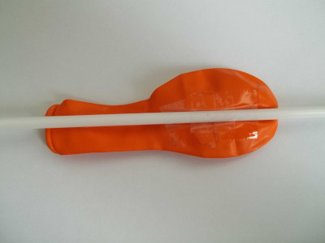

### Method

2. Divide into groups of at least five.
4. Attach one end of the fishing line to the blackboard with tape. Have one teammate hold
                                   the other end of the fishing line so that it is taut and roughly horizontal. The line
                                   must be held steady and **must not** be moved up or down during the
                                   experiment.
6. Have one teammate blow up a balloon and hold it shut with his or her fingers. Have
                                   another teammate tape the straw along the side of the balloon. Thread the fishing line
                                   through the straw and hold the balloon at the far end of the line.
8. Let go of the rocket and observe how the rocket moves forward.
10. Optionally, the rockets of each group can be timed to determine a winner of the fastest
                                   rocket.
   2. Assign one teammate to time the event. The balloon should be let go when the time
                                              keeper yells “Go!” Observe how your rocket moves toward the
                                              blackboard.
   4. Have another teammate stand right next to the blackboard and yell
                                              “Stop!” when the rocket hits its target. If the balloon does not
                                              make it all the way to the blackboard, “Stop!” should be called when
                                              the balloon stops moving. The timekeeper should record the flight time.
   6. Measure the exact distance the rocket travelled. Calculate the average speed at
                                              which the balloon travelled. To do this, divide the distance travelled by the
                                              time the balloon was “in flight.” Fill in your results for Trial 1
                                              in the Table below.
   8. Each team should conduct two more races and complete the sections in the Table
                                              for Trials 2 and 3. Then calculate the average speed for the three trials to
                                              determine your team's race entry time.

### Results

|  | Distance (m) | Time (s) | Speed (\(\text{m·s$^{-1}$}\)) |
| --- | --- | --- | --- |
| Trial 1 |  |  |  |
| Trial 2 |  |  |  |
| Trial 3 |  |  |  |
|  |  | Average: |  |

### Conclusions

The winner of this race is the team with the fastest average balloon speed.

<Callout type="note" title="Note">
<VideoPlayer src="https://youtu.be/UKiyVhnfb0c" title="Video: 23JB" />
</Callout>

While doing the experiment, you should think about,

2. What made your rocket move?
4. How is Newton's third law of Motion demonstrated by this activity?
6. Draw pictures using labelled arrows to show the forces acting on the inside of the balloon before
                           it was released and after it was released.

<Callout type="note" title="Note">
<VideoPlayer src="https://www.youtube.com/watch?v=FzCsDVfPQqk" title="Video: 23JC" />
</Callout>

<Callout type="note" title="Note">
<VideoPlayer src="https://www.youtube.com/watch?v=L0AMQ6kRNMA" title="Video: 23JD" />
</Callout>

The Saturn V (pronounced “Saturn Five”) was an American human-rated expendable rocket used by
                NASA's Apollo and Skylab programs from 1967 until 1973. A multistage liquid-fuelled launch vehicle, NASA
                launched 13 Saturn Vs from the Kennedy Space Center, Florida with no loss of crew or payload. It remains
                the tallest, heaviest, and most powerful rocket ever brought to operational status and still holds the
                record for the heaviest launch vehicle payload.

### Textbook Exercise 2.6

**Problem:**
A fly hits the front windscreen of a moving car. Compared to the magnitude of the force
                                the fly exerts on the windscreen, the magnitude of the force the windscreen exerts on
                                the fly during the collision, is:

2. zero.
4. smaller, but not zero.
6. bigger.
8. the same.

**Solution:**
the same

**Problem:**
Which of the following pairs of forces correctly illustrates Newton's third law?

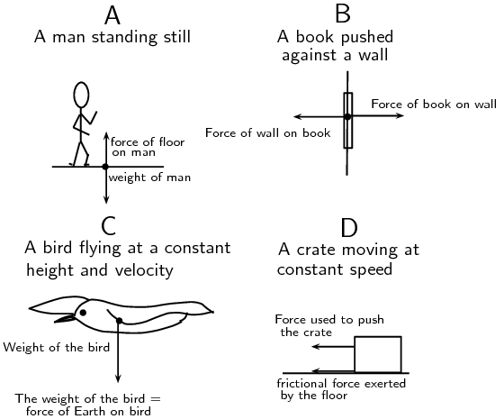

**Solution:**
A or B

### Forces in equilibrium (ESBKW)

At the beginning of this chapter it was mentioned that resultant forces cause objects to accelerate in a
                straight line. If an object is stationary or moving at constant velocity then either,

- no forces are acting on the object, or
- the forces acting on that object are exactly balanced.

In other words, for stationary objects or objects moving with constant velocity, the resultant force
                acting on the object is zero.

Equilibrium

An object in equilibrium has both the sum of the forces acting on it equal to zero.

<QuizCard id="s11-02-03h" title="Interactive Exercise 2.14" question="Is the object in equilibrium? Give a reason for your answer." options=["is", "is not", "zero", "non-zero"] answer="
                        0
                    ,
                        0
                    " hint="" explanation="What does it mean to be in equilibrium? If an object experiences a zero net force all the forces exerted on the object are in balance. We say that the object is in equilibrium. If it is moving at constant velocity we say the object is in dynamic equilibrium and if it is stationary we say that the object is in static equilibrium . If an object experiences a non-zero net force , the forces are not balanced and so it is not in equilibrium . Look at the diagram and work out if the object is in equilibrium For an object to be in equilibrium, the net force must be zero. This means that along any axis, the total length of all force vectors in one direction must be equal to the total length of all force vectors opposite to that direction. From the free-body diagram we can see that the forces aligned with the vertical axis are balanced. The vertical forces are balanced. There is no net force and so the object must be in equilibrium. Therefore the object is in equilibrium. We know this because the net force exerted on the object is zero . Submit your answer as: is and zero" />

<QuizCard id="s11-02-03h" title="Interactive Exercise 2.14" question="Is the object in equilibrium? Give a reason for your answer." options=["is", "is not", "zero", "non-zero", "A", "B", "C", "D"] answer="
                        1
                    ,
                        1
                    " hint="" explanation="What does it mean to be in equilibrium? If an object experiences a zero net force all the forces exerted on the object are in balance. We say that the object is in equilibrium. If it is moving at constant velocity we say the object is in dynamic equilibrium and if it is stationary we say that the object is in static equilibrium . If an object experiences a non-zero net force , the forces are not balanced and so it is not in equilibrium . Look at the diagram and work out if the object is in equilibrium For an object to be in equilibrium, the net force must be zero. This means that along any axis, the total length of all force vectors in one direction must be equal to the total length of all force vectors opposite to that direction. From the free-body diagram we can see that the forces aligned with the vertical axis are not balanced. The vertical forces are not balanced. There is a net force and so the object is not in equilibrium. Therefore the object is not in equilibrium. We know this because the net force exerted on the object is non-zero . Submit your answer as: is not and non-zero" />

<QuizCard id="s11-02-03h" title="Interactive Exercise 2.14" question="Is the object in equilibrium? Give a reason for your answer." options=["is", "is not", "zero", "non-zero"] answer="
                        1
                    ,
                        1
                    " hint="" explanation="What does it mean to be in equilibrium? If an object experiences a zero net force all the forces exerted on the object are in balance. We say that the object is in equilibrium. If it is moving at constant velocity we say the object is in dynamic equilibrium and if it is stationary we say that the object is in static equilibrium . If an object experiences a non-zero net force , the forces are not balanced and so it is not in equilibrium . Look at the diagram and work out if the object is in equilibrium For an object to be in equilibrium, the net force must be zero. This means that along any axis, the total length of all force vectors in one direction must be equal to the total length of all force vectors opposite to that direction. From the free-body diagram we can see that the forces aligned with the vertical axis are not balanced. The vertical forces are not balanced. There is a net force and so the object is not in equilibrium. Therefore the object is not in equilibrium. We know this because the net force exerted on the object is non-zero . Submit your answer as: is not and non-zero" />

<QuizCard id="s11-02-03h" title="Interactive Exercise 2.14" question="Is the object in equilibrium? Give a reason for your answer." options=["is", "is not", "zero", "non-zero", "A", "B", "C", "D"] answer="
                        1
                    ,
                        1
                    " hint="" explanation="What does it mean to be in equilibrium? If an object experiences a zero net force all the forces exerted on the object are in balance. We say that the object is in equilibrium. If it is moving at constant velocity we say the object is in dynamic equilibrium and if it is stationary we say that the object is in static equilibrium . If an object experiences a non-zero net force , the forces are not balanced and so it is not in equilibrium . Look at the diagram and work out if the object is in equilibrium For an object to be in equilibrium, the net force must be zero. This means that along any axis, the total length of all force vectors in one direction must be equal to the total length of all force vectors opposite to that direction. From the free-body diagram we can see that the forces aligned with the vertical axis are not balanced. The vertical forces are not balanced. There is a net force and so the object is not in equilibrium. Therefore the object is not in equilibrium. We know this because the net force exerted on the object is non-zero . Submit your answer as: is not and non-zero" />

<QuizCard id="s11-02-03h" title="Interactive Exercise 2.14" question="Is the object in equilibrium? Give a reason for your answer." options=["is", "is not", "zero", "non-zero"] answer="
                        1
                    ,
                        1
                    " hint="" explanation="What does it mean to be in equilibrium? If an object experiences a zero net force all the forces exerted on the object are in balance. We say that the object is in equilibrium. If it is moving at constant velocity we say the object is in dynamic equilibrium and if it is stationary we say that the object is in static equilibrium . If an object experiences a non-zero net force , the forces are not balanced and so it is not in equilibrium . Look at the diagram and work out if the object is in equilibrium For an object to be in equilibrium, the net force must be zero. This means that along any axis, the total length of all force vectors in one direction must be equal to the total length of all force vectors opposite to that direction. From the free-body diagram we can see that the forces aligned with the vertical axis are balanced. The horizontal forces are not balanced. The vertical forces are balanced, but the horizontal forces are not balanced. There is a net force and so the object is not in equilibrium. Therefore the object is not in equilibrium. We know this because the net force exerted on the object is non-zero . Submit your answer as: is not and non-zero" />

<QuizCard id="s11-02-03h" title="Interactive Exercise 2.14" question="Consider the following scenario and answer the questions that follow. Cokisa exerts a pushing force on a package up a rough inclined plane, but the package remains at rest. TIP: The surface is rough. This is a clue that friction cannot be ignored in this problem! Is the package in equilibrium? If it is in equilibrium, what type of equilibrium? Give a reason for your answer." options=["in dynamic", "in static", "not in", "is at rest", "has a constant velocity", "is accelerating", "zero", "non-zero"] answer="
                    1
                ,
                    0
                ,
                    0
                " hint="" explanation="How is the object moving? Let's reread the scenario carefully: Cokisa exerts a pushing force on a package up a rough inclined plane, but the package remains at rest . Aha! The package  is at rest and stays at rest. Apply Newton's first law of motion Recall Newton's first law: An object will remain in a state of rest or moving with constant velocity unless a non-zero net force is exerted on it. From Newton's first law of motion, we know that if an object stays at rest it must be experiencing a zero net force. What does it mean to be in equilibrium? If an object experiences a zero net force all the forces exerted on the object are in balance. We say that the object is in equilibrium. If it is moving we say the object is in dynamic equilibrium and if it is stationary we say that the object is in static equilibrium . If an object experiences a non-zero net force , the forces are not balanced and so it is not in equilibrium . In this question, the package experiences a zero net force and is not moving. Therefore the package is in static equilibrium. We know this because it is at rest so the net force exerted on the package must be zero . Submit your answer as: in static and is at rest and zero" />

<QuizCard id="s11-02-03h" title="Interactive Exercise 2.14" question="Consider the following scenario and answer the questions that follow. Thandolwethu places a box in a lift which accelerates down. Is the box in equilibrium? If it is in equilibrium, what type of equilibrium? Give a reason for your answer." options=["in dynamic", "in static", "not in", "is at rest", "has a constant velocity", "is accelerating", "zero", "non-zero"] answer="
                    2
                ,
                    2
                ,
                    1
                " hint="" explanation="How is the object moving? Let's reread the scenario carefully: Thandolwethu places a box in a lift which accelerates down. Aha! The lift is accelerating which means that the box is also accelerating. Apply Newton's second law of motion Recall Newton's second law: When a net force is exerted on an object, the object will accelerate in the direction of the net force with an acceleration directly proportional to the magnitude of the net force and inversely proportional to the mass of the object. From Newton's second law of motion, we know that if an object is accelerating it must be experiencing a non-zero net force. What does it mean to be in equilibrium? If an object experiences a zero net force all the forces exerted on the object are in balance. We say that the object is in equilibrium. If it is moving we say the object is in dynamic equilibrium and if it is stationary we say that the object is in static equilibrium . If an object experiences a non-zero net force , the forces are not balanced and so it is not in equilibrium . In this question, the box experiences a non-zero net force. Therefore the box is not in equilibrium. We know this because it is accelerating so the net force exerted on the box must be non-zero . Submit your answer as: not in and is accelerating and non-zero" />

<QuizCard id="s11-02-03h" title="Interactive Exercise 2.14" question="The hanging system of blocks is in static equilibrium. What does this mean? A The system moves up and down around an equilibrium point. B The system only experiences electrostatic forces. C The forces acting on the system are balanced and the system does not move. D The system is stationary because it experiences the static frictional force." options=["A", "B", "C", "D"] answer="C" hint="" explanation="Eliminate the False statements and identify the True statement A ✘ The system moves up and down around an equilibrium point. Static equilibrium means the system is stationary . B ✘ The system only experiences electrostatic forces. The word \"static\" in static equilibrium means stationary , so the system is not moving. It does not refer to the electrostatic force. Both blocks will experience the gravitational force in addition to the tensional force. C ✔ The forces acting on the system are balanced and the system does not move. The word \"equilibrium\" in static equilibrium refers to the forces exerted on the masses being balanced and so the net force is zero . From Newton's second law this means that the system experiences zero acceleration. The word \"static\" in static equilibrium means stationary , so the system is not moving. D ✘ The system is stationary because it experiences the static frictional force. The word \"static\" in static equilibrium does mean stationary and it is the same meaning in static friction. But a system in static equilibrium is not necessarily stationary because of the static frictional force. In this case, our system in hanging and there is no relative motion between surfaces so there is no frictional force. Therefore the correct option is C . Submit your answer as: C" />

<QuizCard id="s11-02-03h" title="Interactive Exercise 2.14" question="Is the ball in equilibrium? If it is in equilibrium, what type of equilibrium? Give a reason for your answer." options=["in dynamic", "in static", "not in", "is at rest", "has a constant velocity", "is accelerating", "zero", "non-zero", "A", "B", "C"] answer="
                        0
                    ,
                        1
                    ,
                        0
                    " hint="" explanation="How is the object moving? Let's reread the scenario carefully: Ben drops a ball from rest from the roof of a tall building. The ball experiences significant air resistance and reaches a constant velocity . It falls the rest of the way to the ground at this constant velocity . Aha! The ball  has a constant velocity. Apply Newton's first law of motion Recall Newton's first law: An object will remain in a state of rest or moving with constant velocity unless a non-zero resultant force is exerted on it. From Newton's first law of motion, we know that if an object has a constant velocity it must be experiencing a zero net force. What does it mean to be in equilibrium? If an object experiences a zero net force all the forces exerted on the object are in balance. We say that the object is in equilibrium. If it is moving we say the object is in dynamic equilibrium and if it is stationary we say that the object is in static equilibrium . If an object experiences a non-zero net force , the forces are not balanced and so it is not in equilibrium . In this question, the ball experiences a zero net force and is moving. Therefore the ball is in dynamic equilibrium. We know this because it has a constant velocity so the net force exerted on the ball must be zero . NOTE: This constant velocity is called terminal velocity . Terminal velocity is reached when the downwards gravitational force is balanced by the upwards force of air resistance. This is why the net force is zero. Submit your answer as: in dynamic and has a constant velocity and zero" />

<QuizCard id="s11-02-03h" title="Interactive Exercise 2.14" question="Nthofeela is driving a taxi along a straight horizontal street to the left. The taxi is travelling at a constant speed of \(\text{50}\ \text{km·h$^{-1}$}\) . Which one of the following free-body diagrams best represents all the forces acting on Nthofeela and the taxi? A B C D" options=["A", "B", "C", "D"] answer="B" hint="" explanation="Recall the statement of Newton's first law An object will remain in a state of rest or moving with constant velocity unless a non-zero net force is exerted on it. This is because objects with mass have a property called inertia . The inertia of an object causes it to resist any changes to its motion. Choose the correct option Nthofeela is moving along a straight horizontal street . This means his direction is not changing. He is also travelling at a constant speed . Because the direction and speed are both constant, the velocity is constant . So from Newton's first law of motion, the taxi must be experiencing a zero net force . The taxi is in dynamic equilibrium . Free-body diagrams show the relative sizes of the forces acting on an object. We need to choose the diagram that correctly shows the forces balancing each other. A ✘ The horizontal forces must be balanced. There should be no net horizontal force. There does not need to be a net force in the direction of motion! B ✔ Vertical and horizontal forces are all balanced, so the net force is zero. C ✘ This diagram does not show balanced forces and many forces (e.g. normal and gravitational) have been forgotten. D ✘ The horizontal forces must be balanced. There should be no net horizontal force. There does not need to be a net force in the direction of motion! The correct diagram is Diagram B . Submit your answer as: B" />

<QuizCard id="s11-02-03h" title="Interactive Exercise 2.14" question="An object is on a horizontal surface. Jabulile pulls the object at an angle out of the surface with a force \(\vec{F}\) . The object remains in contact with the surface. How does the magnitude of the normal force \((F_{\text{N}})\) compare to the magnitude of the gravitational force \((F_{\text{g}})\) ?" options=["greater than", "less than", "equal to"] answer="
                    1
                " hint="" explanation="How do other forces affect the normal force? The normal force is a constraint force. It balances out all other forces that are perpendicular to the surface. In other words, it has a size that will make the perpendicular net force zero. NOTE: The above is true if the object is not accelerating in the perpendicular direction. If there is acceleration in the perpendicular direction, then the net force will not be zero. In such a case (e.g. an object in an accelerating lift), the normal force has a size that will give the correct net force for the acceleration. If you push an object into the surface, then the normal force will increase in size. This is because it needs to balance out both gravity and the downwards pushing force. Imagine pulling up on an object, but with a force small enough that it remains in contact with the surface. In this case, the normal force will decrease in size. This is because you are balancing out part of the gravitational force. The surface does not need to support the entire weight of the box because you are supporting some of the weight yourself. How does \(F_{\text{N}}\) compare to \(F_{\text{g}}\) ? The magnitude of the normal force is only sometimes equal to the magnitude of the gravitational force. The most common scenario in which \(F_{\text{N}}\) and \(F_{\text{g}}\) are equal is as follows: The object is on a horizontal surface. The object has zero acceleration in the vertical direction. The only forces that are vertical (or have vertical components) are the normal force and the gravitational force. In all other cases then, \(F_{\text{N}}\) is usually not equal to \(F_{\text{g}}\) . It is still possible that they might be equal to each other in these examples, but these would be special cases. This is what the free-body diagram (to scale) would look like if Jabulile was not pulling on the object. \[                     \begin{array}{c}                         F_{\text{N}} = F_{\text{g}}                     \end{array}                 \] If there are any other forces with vertical components, the magnitude of the normal force will not be equal to the magnitude of the force due to gravity. In this case, Jabulile pulls the object at an angle out of the surface with a force \(\vec{F}\) . So a component of this force points perpendicularly out of the surface, and the size of the force pointing perpendicularly into the surface will decrease. Remember, the normal force balances out the other perpendicular forces. This means that the size of the normal force will decrease too. We can add all the vertical vectors using the head-to-tail method of vector addition. This diagram shows that the vertical forces are balanced and that the net vertical force is zero. \[                     \begin{array}{c}                         F_{\text{N}} < F_{\text{g}}                     \end{array}                 \] Therefore, the magnitude of the normal force is less than the magnitude of the gravitational force \((F_{\text{N}} < F_{\text{g}})\) . TIP: If you ever need to work out the actual value for the normal force, apply Newton's second law in the perpendicular direction to work out the size of the normal force: \[                         \begin{aligned}                             \vec{F}_{\text{net}} &= m \vec{a} \\                             \vec{F}_{\text{N}} + \vec{F}_{\text{g}} + \vec{F}_{\perp\text{,other}} &= m\vec{a}                         \end{aligned}                     \] If the object experiences no acceleration in a direction perpendicular to the surface, then this becomes: \[\begin{array}{c}\vec{F}_{\text{N}} + \vec{F}_{\text{g}} + \vec{F}_{\perp\text{,other}} = 0\end{array}\] Submit your answer as: less than" />

<QuizCard id="s11-02-03h" title="Interactive Exercise 2.14" question="Adapted from DBE Nov 2016 Grade 11, P1, Q1.2 Physical constants · Physics formulas Lisa pulls a lawnmower across the ground 				with a force \(\vec{F}\) at an angle of \(\theta\) from the vertical. The magnitude 				of the weight of the lawnmower is \(w\) and the magnitudes of the horizontal and vertical components 				of the applied pulling force are \(F_{x}\) and \(F_{y}\) respectively. The magnitude of the normal force experienced by the object is ... A \(w\) B \(w + F_{x}\) C \(w + F_{y}\) D \(w - F_{y}\)" options=["A", "B", "C", "D"] answer="
					3
				" hint="" explanation="Balance the vertical forces Lisa is pulling the lawnmower out of the 					ground. This means the vertical component of Lisa's pulling force must point up. The lawnmower stays in contact with the horizontal surface so the net vertical force is zero . So the vertical forces must all balance . The following diagram shows how the vertical forces balance. The normal force is different when there is no applied force compared to when Lisa pulls on the lawnmower. So the magnitude of the normal force is equal to weight of the lawnmower minus the vertical component of the applied pulling force. Choose the correct option The magnitude of the normal force is ... A \(w\) B \(w + F_{x}\) C \(w + F_{y}\) D \({\color{red}{{\checkmark}{\checkmark}}}\) \(w - F_{y}\) The correct option is D . NOTE: You did not need to determine any components here. So it didn't matter that the angle \(\theta\) was 					given from the vertical. But if you ever do need to do calculations you must use the correct trig ratios when calculating components. And the 					correct trig ratios to use depend on which angle you're given. Submit your answer as: D" />

<QuizCard id="s11-02-03h" title="Interactive Exercise 2.14" question="How does the magnitude of the normal force \((F_{\text{N}})\) compare to the magnitude of the perpendicular component of the gravitational force \((F_{\text{g,}\perp})\) ? The magnitudes of the normal force \((F_{\text{N}})\) and the full gravitational force \((F_{\text{g}})\) have the following relationship: A \(F_{\text{N}} > F_{\text{g}}\) B \(F_{\text{N}} < F_{\text{g}}\) C \(F_{\text{N}} = F_{\text{g}}\) D Impossible to determine." options=["greater than", "less than", "equal to", "A", "B", "C", "D", "A", "B", "C", "D", "E", "F"] answer="
                        0
                    ,
                        3
                    " hint="" explanation="How do other forces affect the normal force? The normal force is a constraint force. It balances out all other forces that are perpendicular to the surface. In other words, it has a size that will make the perpendicular net force zero. NOTE: The above is true if the object is not accelerating in the perpendicular direction. If there is acceleration in the perpendicular direction, then the net force will not be zero. In such a case (e.g. an object in an accelerating lift), the normal force has a size that will give the correct net force for the acceleration. If you push an object into the surface, then the normal force will increase in size. This is because it needs to balance out both gravity and the downwards pushing force. Imagine pulling up on an object, but with a force small enough that it remains in contact with the surface. In this case, the normal force will decrease in size. This is because you are balancing out part of the gravitational force. The surface will not need to push up as hard as it used to. How does \(F_{\text{N}}\) compare to \(F_{\text{g},\perp}\) ? The magnitude of the normal force is only sometimes equal to the magnitude of the gravitational force. The most common scenario in which \(F_{\text{N}}\) and \(F_{\text{g}}\) are equal is as follows: The object is on a horizontal surface. The object has zero acceleration in the vertical direction. The only forces that are vertical (or have vertical components) are the normal force and the gravitational force. In all other cases then, \(F_{\text{N}}\) is usually not equal to \(F_{\text{g}}\) . It is still possible that they might be equal to each other in these examples, but these would be special cases. This is what the free-body diagram (to scale) would look like if Bonani was not pushing on the box. The box is not on a horizontal surface, so even though there is no applied force, the normal force is not equal to the gravitational force. If there were no other perpendicular forces, it would be equal to the perpendicular component of the gravitational force. We can use trigonometry to work out this component. \[                         \begin{array}{c}                             F_{\text{g},\perp} = F_{\text{g}}\cos(\alpha)                         \end{array}                     \] If there are no applied forces perpendicular to the slope, then the normal force and the perpendicular component of the gravitational force will balance each other out. \[                         \begin{array}{c}                             F_{\text{N}} = F_{\text{g},\perp}                         \end{array}                     \] If any forces have components perpendicular to the slope, the magnitude of the normal force will not be equal to \(F_{\text{g,}\perp}\) . In this case, Bonani pushes the box perpendicularly into the slope with a force \(\vec{F}\) . This force points perpendicularly into the surface, and the size of the force pointing perpendicularly into the surface will increase. Remember, the normal force balances out the other perpendicular forces. This means that the size of the normal force will increase too. We can add all the perpendicular vectors using the head-to-tail method of vector addition. This diagram shows that the perpendicular forces are balanced and that the net perpendicular force is zero. \[                         \begin{array}{c}                             F_{\text{N}} > F_{\text{g},\perp}                         \end{array}                     \] Therefore, the magnitude of the normal force is greater than the magnitude of the perpendicular component of the gravitational force \((F_{\text{N}} > F_{\text{g},\perp})\) . TIP: If you ever need to work out the actual value for the normal force, apply Newton's second law in the perpendicular direction: \[                             \begin{aligned}                                 \vec{F}_{\text{net}} &= m \vec{a} \\                                 \vec{F}_{\text{N}} + \vec{F}_{\text{g}} + \vec{F}_{\perp\text{,other}} &= m\vec{a}                             \end{aligned}                         \] If the object experiences no acceleration in a direction perpendicular to the surface, then this becomes: \[\begin{array}{c}\vec{F}_{\text{N}} + \vec{F}_{\text{g}} + \vec{F}_{\perp\text{,other}} = 0\end{array}\] How does \(F_{\text{N}}\) compare to \(F_{\text{g}}\) ? We now know that the magnitude of the normal force \((F_{\text{N}})\) is greater than the perpendicular component of the gravitational force \((F_{\text{g},\perp})\) . But we have no way of comparing the normal force to the full gravitational force. It is possible that it could be smaller than, equal to (a very special case), or greater than \(F_{\text{g}}\) . It all depends on how much larger \(F_{\text{N}}\) is compared to \(F_{\text{g},\perp}\) . Therefore it is impossible to know how \(F_{\text{N}}\) compares to \(F_{\text{g}}\) ( Option D ). Submit your answer as: greater than and D" />

<QuizCard id="s11-02-03h" title="Interactive Exercise 2.14" question="A mule is trying to pull a cart with a constant force of \(\text{257}\ \text{N}\) . The cart experiences a force due to gravity of \(\text{2 876}\ \text{N}\) . The rope between the cart and the mule makes an angle of \(\text{11}\text{°}\) to the horizontal. The cart does not move. Find the magnitude and direction of the frictional force preventing the cart from moving. INSTRUCTION: Round your answer to two decimal places ." options=["upwards", "to the right", "downwards", "to the left"] answer="['252.28', '2.52e+2'], 1" hint="You should enter a number here. If you want to, you can use a space to separate thousands.                Example: 12 800,25 For scientific notation you need to use the multiply symbol                ( ∗ ) and the exponent symbol ( ^ ). For example 6,673 × 10 −11 should be written as: 6,673 ∗ 10^−11" explanation="The frictional force of a system acts parallel to the surface upon which it rests. You are given the force which is applied by the mule at an angle of \(\text{11}\text{°}\) . Let us visualise this by drawing the free-body diagram: The cart is not moving, thus the resultant of the horizontal forces acting on the cart must be zero: \[               \begin{aligned}                 \vec{F}_{\text{net,horizontal}} = \text{0}\ \text{N}               \end{aligned}           \] For the resultant force to be zero the magnitudes of the frictional force and the horizontal component of the force applied by the mule need to be equal \[               \begin{aligned}                 \therefore F_{\text{mule, horizontal}} = F_{\text{friction}}               \end{aligned}           \] We can use the fact that the components of the force applied by the mule form a right-angled triangle to calculate the magnitude of the horizontal components of the mule's pulling force: \[             \begin{aligned}               F_{\text{mule, horizontal}} & = F_{\text{mule}} \cos (\text{11}\text{°}) \\                  F_{\text{friction}} & = (\text{257}) \cos (\text{11}\text{°}) \\                       & = \text{252,27818...} \\ & \approx \text{252,28}\ \text{N}             \end{aligned}           \] The frictional force preventing the cart from moving is \(\text{252,28}\ \text{N}\) to the left . Submit your answer as: and to the left" />

<QuizCard id="s11-02-03h" title="Interactive Exercise 2.14" question="A suitcase that experiences a gravitational force of \(\text{695,8}\ \text{N}\) is placed on a slope that makes an angle of \(\text{45}\text{°}\) with the horizontal. The suitcase does not slide down the slope. Calculate the magnitude and direction of the frictional force and the normal force present in this situation. INSTRUCTION: Round your answers to two decimal places ." options=["perpendicular to the surface", "up the slope", "down the slope", "down the slope", "perpendicular to the surface", "up the slope"] answer="['492.00', '4.92e+2'], 0, ['492.00', '4.92e+2'], 2" hint="You should enter a number here. If you want to, you can use a space to separate thousands.                Example: 12 800,25 For scientific notation you need to use the multiply symbol                ( ∗ ) and the exponent symbol ( ^ ). For example 6,673 × 10 −11 should be written as: 6,673 ∗ 10^−11" explanation="Draw a force and free-body diagram We have a suitcase on a slope with a gravitational force acting on it. What other forces are acting on the box? Since, the suitcase is not moving there must be forces opposing gravity since the system is in equilibrium . Draw a force diagram of the situation: There is a normal force present which acts perpendicular to the surface the suitcase is lying on. In addition we have the frictional force that acts parallel to the surface and prevents the suitcase from slipping down the incline. If we look at the free body diagram: Split the gravitational force into components We can see the three forces balance each other out.  We can split the components of the gravitational force so that they are parallel and perpendicular to the surface. For the net force to be zero in either direction, the magnitudes of the parallel and perpendicular components of the gravitational force need to match the magnitudes of the frictional and normal forces respectively. Looking at the components: Calculate the frictional force The magnitude of the frictional force, \(f_s\) , is equal to the component of the gravitational force parallel to the slope, \(F_{g,\parallel}\) . Therefore \[             \begin{aligned}               f_{\text{s}} & = F_{\text{g},\parallel}\\                   & = F_{\text{g}} \sin {(\text{45}\text{°})}\\                   & = (\text{695,8})  \sin {(\text{45}\text{°})}\\                    & = \text{492,00489...} \\ & \approx \text{492,00}\ \text{N}             \end{aligned}           \] Therefore the magnitude of the frictional force is \(\text{492,00}\ \text{N}\) up the slope . Calculate the normal force The magnitude of the normal force, \(F_{\text{N}}\) , is equal to magnitude of the component of the gravitational force perpendicular to the slope, \(F_{\text{g},\perp}\) . Therefore \[             \begin{aligned}               F_{\text{N}} & = F_{\text{g},\perp}\\                 & = F_{\text{g}} \cos {(\text{45}\text{°})}\\                 & = (\text{695,8})  \cos {(\text{45}\text{°})}\\                 & = \text{492,00489...} \\ & \approx \text{492,00}\ \text{N}             \end{aligned}           \] Therefore the magnitude of the normal force is \(\text{492,00}\ \text{N}\) perpendicular to the slope . Submit your answer as: and up the slope and and perpendicular to the surface" />

<QuizCard id="s11-02-03h" title="Interactive Exercise 2.14" question="How does the magnitude of the normal force \((F_{\text{N}})\) compare to the magnitude of the perpendicular component of the gravitational force \((F_{\text{g,}\perp})\) ? The magnitudes of the normal force \((F_{\text{N}})\) and the full gravitational force \((F_{\text{g}})\) have the following relationship: A \(F_{\text{N}} = F_{\text{g}}\) B \(F_{\text{N}} > F_{\text{g}}\) C \(F_{\text{N}} < F_{\text{g}}\) D Impossible to determine." options=["greater than", "less than", "equal to", "A", "B", "C", "D", "A", "B", "C", "D", "E", "F"] answer="
                        2
                    ,
                        2
                    " hint="" explanation="How do other forces affect the normal force? The normal force is a constraint force. It balances out all other forces that are perpendicular to the surface. In other words, it has a size that will make the perpendicular net force zero. NOTE: The above is true if the object is not accelerating in the perpendicular direction. If there is acceleration in the perpendicular direction, then the net force will not be zero. In such a case (e.g. an object in an accelerating lift), the normal force has a size that will give the correct net force for the acceleration. If you push an object into the surface, then the normal force will increase in size. This is because it needs to balance out both gravity and the downwards pushing force. Imagine pulling up on an object, but with a force small enough that it remains in contact with the surface. In this case, the normal force will decrease in size. This is because you are balancing out part of the gravitational force. The surface will not need to push up as hard as it used to. How does \(F_{\text{N}}\) compare to \(F_{\text{g},\perp}\) ? The magnitude of the normal force is only sometimes equal to the magnitude of the gravitational force. The most common scenario in which \(F_{\text{N}}\) and \(F_{\text{g}}\) are equal is as follows: The object is on a horizontal surface. The object has zero acceleration in the vertical direction. The only forces that are vertical (or have vertical components) are the normal force and the gravitational force. In all other cases then, \(F_{\text{N}}\) is usually not equal to \(F_{\text{g}}\) . It is still possible that they might be equal to each other in these examples, but these would be special cases. This is what the free-body diagram (to scale) would look like if Khayone was not pulling on the box. The box is not on a horizontal surface, so even though there is no applied force, the normal force is not equal to the gravitational force. If there were no other perpendicular forces, it would be equal to the perpendicular component of the gravitational force. We can use trigonometry to work out this component. \[                         \begin{array}{c}                             F_{\text{g},\perp} = F_{\text{g}}\cos(\alpha)                         \end{array}                     \] If there are no applied forces perpendicular to the slope, then the normal force and the perpendicular component of the gravitational force will balance each other out. \[                         \begin{array}{c}                             F_{\text{N}} = F_{\text{g},\perp}                         \end{array}                     \] If any forces have components perpendicular to the slope, the magnitude of the normal force will not be equal to \(F_{\text{g,}\perp}\) . In this case, Khayone pulls the box up the slope with a force \(\vec{F}\) . This force is parallel to the surface, and the size of the force pointing perpendicularly into the surface will not change. Remember, the normal force balances out the other perpendicular forces. This means that the size of the normal force will not change either. \[                         \begin{array}{c}                             F_{\text{N}} = F_{\text{g},\perp}                         \end{array}                     \] Therefore, the magnitude of the normal force is equal to the magnitude of the perpendicular component of the gravitational force \((F_{\text{N}} = F_{\text{g},\perp})\) . TIP: If you ever need to work out the actual value for the normal force, apply Newton's second law in the perpendicular direction: \[                             \begin{aligned}                                 \vec{F}_{\text{net}} &= m \vec{a} \\                                 \vec{F}_{\text{N}} + \vec{F}_{\text{g}} + \vec{F}_{\perp\text{,other}} &= m\vec{a}                             \end{aligned}                         \] If the object experiences no acceleration in a direction perpendicular to the surface, then this becomes: \[\begin{array}{c}\vec{F}_{\text{N}} + \vec{F}_{\text{g}} + \vec{F}_{\perp\text{,other}} = 0\end{array}\] How does \(F_{\text{N}}\) compare to \(F_{\text{g}}\) ? We now know that the magnitude of the normal force \((F_{\text{N}})\) is equal to the perpendicular component of the gravitational force \((F_{\text{g},\perp})\) . Recall that one of the components of a force is always less than the force itself. So \[\begin{array}{c}F_{\text{g},\perp} < F_{\text{g}}\end{array}\] but if \[\begin{array}{c}F_{\text{N}} = F_{\text{g},\perp}\end{array}\] then we must have \[\begin{array}{c}F_{\text{N}} < F_{\text{g}}\end{array}\] In other words, the magnitude of the normal force \((F_{\text{N}})\) must be less than the magnitude of the gravitational force \((F_{\text{g}})\) . This matches Option C . Submit your answer as: equal to and C" />

<QuizCard id="s11-02-03h" title="Interactive Exercise 2.14" question="How does the magnitude of the normal force \((F_{\text{N}})\) compare to the magnitude of the perpendicular component of the gravitational force \((F_{\text{g,}\perp})\) ? The magnitudes of the normal force \((F_{\text{N}})\) and the full gravitational force \((F_{\text{g}})\) have the following relationship: A \(F_{\text{N}} < F_{\text{g}}\) B \(F_{\text{N}} = F_{\text{g}}\) C \(F_{\text{N}} > F_{\text{g}}\) D Impossible to determine." options=["greater than", "less than", "equal to", "A", "B", "C", "D", "A", "B", "C", "D", "E", "F"] answer="
                        1
                    ,
                        0
                    " hint="" explanation="How do other forces affect the normal force? The normal force is a constraint force. It balances out all other forces that are perpendicular to the surface. In other words, it has a size that will make the perpendicular net force zero. NOTE: The above is true if the object is not accelerating in the perpendicular direction. If there is acceleration in the perpendicular direction, then the net force will not be zero. In such a case (e.g. an object in an accelerating lift), the normal force has a size that will give the correct net force for the acceleration. If you push an object into the surface, then the normal force will increase in size. This is because it needs to balance out both gravity and the downwards pushing force. Imagine pulling up on an object, but with a force small enough that it remains in contact with the surface. In this case, the normal force will decrease in size. This is because you are balancing out part of the gravitational force. The surface will not need to push up as hard as it used to. How does \(F_{\text{N}}\) compare to \(F_{\text{g},\perp}\) ? The magnitude of the normal force is only sometimes equal to the magnitude of the gravitational force. The most common scenario in which \(F_{\text{N}}\) and \(F_{\text{g}}\) are equal is as follows: The object is on a horizontal surface. The object has zero acceleration in the vertical direction. The only forces that are vertical (or have vertical components) are the normal force and the gravitational force. In all other cases then, \(F_{\text{N}}\) is usually not equal to \(F_{\text{g}}\) . It is still possible that they might be equal to each other in these examples, but these would be special cases. This is what the free-body diagram (to scale) would look like if Moselantja was not pulling on the box. The box is not on a horizontal surface, so even though there is no applied force, the normal force is not equal to the gravitational force. If there were no other perpendicular forces, it would be equal to the perpendicular component of the gravitational force. We can use trigonometry to work out this component. \[                         \begin{array}{c}                             F_{\text{g},\perp} = F_{\text{g}}\cos(\alpha)                         \end{array}                     \] If there are no applied forces perpendicular to the slope, then the normal force and the perpendicular component of the gravitational force will balance each other out. \[                         \begin{array}{c}                             F_{\text{N}} = F_{\text{g},\perp}                         \end{array}                     \] If any forces have components perpendicular to the slope, the magnitude of the normal force will not be equal to \(F_{\text{g,}\perp}\) . In this case, Moselantja pulls the box at an angle out of the slope with a force \(\vec{F}\) . So a component of this force points perpendicularly out of the surface, and the size of the force pointing perpendicularly into the surface will decrease. Remember, the normal force balances out the other perpendicular forces. This means that the size of the normal force will decrease too. We can add all the perpendicular vectors using the head-to-tail method of vector addition. This diagram shows that the perpendicular forces are balanced and that the net perpendicular force is zero. \[                         \begin{array}{c}                             F_{\text{N}} < F_{\text{g},\perp}                         \end{array}                     \] Therefore, the magnitude of the normal force is less than the magnitude of the perpendicular component of the gravitational force \((F_{\text{N}} < F_{\text{g},\perp})\) . TIP: If you ever need to work out the actual value for the normal force, apply Newton's second law in the perpendicular direction: \[                             \begin{aligned}                                 \vec{F}_{\text{net}} &= m \vec{a} \\                                 \vec{F}_{\text{N}} + \vec{F}_{\text{g}} + \vec{F}_{\perp\text{,other}} &= m\vec{a}                             \end{aligned}                         \] If the object experiences no acceleration in a direction perpendicular to the surface, then this becomes: \[\begin{array}{c}\vec{F}_{\text{N}} + \vec{F}_{\text{g}} + \vec{F}_{\perp\text{,other}} = 0\end{array}\] How does \(F_{\text{N}}\) compare to \(F_{\text{g}}\) ? We now know that the magnitude of the normal force \((F_{\text{N}})\) is less than the perpendicular component of the gravitational force \((F_{\text{g},\perp})\) . Recall that one of the components of a force is always less than the force itself. So \[\begin{array}{c}F_{\text{g},\perp} < F_{\text{g}}\end{array}\] but if \[\begin{array}{c}F_{\text{N}} < F_{\text{g},\perp}\end{array}\] then we must have \[\begin{array}{c}F_{\text{N}} < F_{\text{g}}\end{array}\] In other words, the magnitude of the normal force \((F_{\text{N}})\) must be less than the magnitude of the gravitational force \((F_{\text{g}})\) . This matches Option A . Submit your answer as: less than and A" />

<QuizCard id="s11-02-03h" title="Interactive Exercise 2.14" question="How does the magnitude of the normal force \((F_{\text{N}})\) compare to the magnitude of the perpendicular component of the gravitational force \((F_{\text{g,}\perp})\) ? The magnitudes of the normal force \((F_{\text{N}})\) and the full gravitational force \((F_{\text{g}})\) have the following relationship: A \(F_{\text{N}} < F_{\text{g}}\) B \(F_{\text{N}} > F_{\text{g}}\) C \(F_{\text{N}} = F_{\text{g}}\) D Impossible to determine." options=["greater than", "less than", "equal to", "A", "B", "C", "D", "A", "B", "C", "D", "E", "F"] answer="
                        0
                    ,
                        3
                    " hint="" explanation="How do other forces affect the normal force? The normal force is a constraint force. It balances out all other forces that are perpendicular to the surface. In other words, it has a size that will make the perpendicular net force zero. NOTE: The above is true if the object is not accelerating in the perpendicular direction. If there is acceleration in the perpendicular direction, then the net force will not be zero. In such a case (e.g. an object in an accelerating lift), the normal force has a size that will give the correct net force for the acceleration. If you push an object into the surface, then the normal force will increase in size. This is because it needs to balance out both gravity and the downwards pushing force. Imagine pulling up on an object, but with a force small enough that it remains in contact with the surface. In this case, the normal force will decrease in size. This is because you are balancing out part of the gravitational force. The surface will not need to push up as hard as it used to. How does \(F_{\text{N}}\) compare to \(F_{\text{g},\perp}\) ? The magnitude of the normal force is only sometimes equal to the magnitude of the gravitational force. The most common scenario in which \(F_{\text{N}}\) and \(F_{\text{g}}\) are equal is as follows: The object is on a horizontal surface. The object has zero acceleration in the vertical direction. The only forces that are vertical (or have vertical components) are the normal force and the gravitational force. In all other cases then, \(F_{\text{N}}\) is usually not equal to \(F_{\text{g}}\) . It is still possible that they might be equal to each other in these examples, but these would be special cases. This is what the free-body diagram (to scale) would look like if Bokamoso was not pushing on the object. The object is not on a horizontal surface, so even though there is no applied force, the normal force is not equal to the gravitational force. If there were no other perpendicular forces, it would be equal to the perpendicular component of the gravitational force. We can use trigonometry to work out this component. \[                         \begin{array}{c}                             F_{\text{g},\perp} = F_{\text{g}}\cos(\alpha)                         \end{array}                     \] If there are no applied forces perpendicular to the slope, then the normal force and the perpendicular component of the gravitational force will balance each other out. \[                         \begin{array}{c}                             F_{\text{N}} = F_{\text{g},\perp}                         \end{array}                     \] If any forces have components perpendicular to the slope, the magnitude of the normal force will not be equal to \(F_{\text{g,}\perp}\) . In this case, Bokamoso pushes the object at an angle into the slope with a force \(\vec{F}\) . So a component of this force points perpendicularly into the surface, and the size of the force pointing perpendicularly into the surface will increase. Remember, the normal force balances out the other perpendicular forces. This means that the size of the normal force will increase too. We can add all the perpendicular vectors using the head-to-tail method of vector addition. This diagram shows that the perpendicular forces are balanced and that the net perpendicular force is zero. \[                         \begin{array}{c}                             F_{\text{N}} > F_{\text{g},\perp}                         \end{array}                     \] Therefore, the magnitude of the normal force is greater than the magnitude of the perpendicular component of the gravitational force \((F_{\text{N}} > F_{\text{g},\perp})\) . TIP: If you ever need to work out the actual value for the normal force, apply Newton's second law in the perpendicular direction: \[                             \begin{aligned}                                 \vec{F}_{\text{net}} &= m \vec{a} \\                                 \vec{F}_{\text{N}} + \vec{F}_{\text{g}} + \vec{F}_{\perp\text{,other}} &= m\vec{a}                             \end{aligned}                         \] If the object experiences no acceleration in a direction perpendicular to the surface, then this becomes: \[\begin{array}{c}\vec{F}_{\text{N}} + \vec{F}_{\text{g}} + \vec{F}_{\perp\text{,other}} = 0\end{array}\] How does \(F_{\text{N}}\) compare to \(F_{\text{g}}\) ? We now know that the magnitude of the normal force \((F_{\text{N}})\) is greater than the perpendicular component of the gravitational force \((F_{\text{g},\perp})\) . But we have no way of comparing the normal force to the full gravitational force. It is possible that it could be smaller than, equal to (a very special case), or greater than \(F_{\text{g}}\) . It all depends on how much larger \(F_{\text{N}}\) is compared to \(F_{\text{g},\perp}\) . Therefore it is impossible to know how \(F_{\text{N}}\) compares to \(F_{\text{g}}\) ( Option D ). Submit your answer as: greater than and D" />
