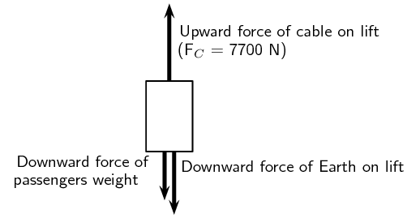
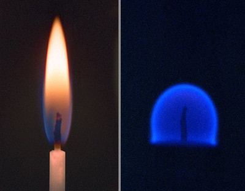

## 2.4 Forces between masses (ESBKX)

Gravity is arguably the first force that people really learn about. People don't really think of it as learning
      about gravity because it is such a big part of our everyday lives. Babies learning to crawl or walk are struggling
      against gravity, games involving jumping, climbing or balls all give people a sense of the effect of gravity. The
      saying “everything that goes up, must come down” is all about gravity. Rain falls from the sky because
      of gravity and so much more. We all know that these things happen but we don't often stop to ask what is gravity,
      what causes it and how can we describe it more accurately than “everything that goes up, must come
      down”?

All of the examples mentioned involve objects with mass falling to the ground, they are being attracted to the
      Earth. Gravity is the name we give to the force that arises between objects because of their mass. It is always an
      attractive force. It is a non-contact force, therefore it acts at a distance. The Earth is responsible for a
      gravitational force on the moon which keeps it in its orbit around the Earth and the gravitational force the moon
      exerts on the Earth is the dominant cause of ocean tides.

Sir Isaac Newton was the first scientist to precisely define the gravitational force, and to show that it could
      explain both falling bodies and astronomical motions. The gravitational force is relatively simple. It is
      **always attractive**, and it **depends only on the masses** involved and the
      **distance between them**. Stated in modern language, Newton’s universal law of gravitation
      states that every particle in the universe attracts every other particle with a force along a line joining them.
      The force is directly proportional to the product of their masses and inversely proportional to the square of the
      distance between them.

### Newton's law of universal gravitation (ESBKY)

Newton's law of universal gravitation

Every point mass attracts every other point mass by a force directed along the line connecting the two.
            This force is proportional to the product of the masses and inversely proportional to the square of the
            distance between them.

The magnitude of the attractive gravitational force between the two point masses, F is given by:
        \[F=G\frac{m_1m_2}{d^2}\]

where:
        \(F\) is in newtons (N), \(G\) is the gravitational constant \(\text{6,67} \times \text{10}^{-\text{11}}\)
        \(\text{N·m$^{2}$·kg$^{-2}$}\), \({m}_{1}\) is the mass of the first point mass in kilograms (kg),
        \({m}_{2}\) is the mass of the second point mass in kilograms (kg) and \(d\) is the distance between the two
        point masses in metres (m). For any large objects (not point masses) we use the distance from the **centre
          of the object(s)** to do the calculation. This is very important when dealing with very large objects
        like planets. The distance from the centre of the planet and from the surface of the planet differ by a large
        amount. **Remember** that this is a force of attraction and should be described by a vector. We use
        Newton's law of universal gravitation to determine the magnitude of the force and then analyse the problem to
        determine the
        direction.

For example, consider a man of mass \(\text{80}\) \(\text{kg}\) standing \(\text{10}\) \(\text{m}\) from a
        woman with a mass of \(\text{65}\) \(\text{kg}\). The attractive gravitational force between them would be:
        \begin{align*}
        F&=G\frac{m_1m_2}{d^2} \\
        &= \left(\text{6,67} \times \text{10}^{-\text{11}}\right)\left( \frac{(\text{80})(\text{65})}{(\text{10})^2}
        \right) \\
        &= \text{3,47} \times \text{10}^{-\text{9}}\text{ N}
        \end{align*}

If the man and woman move to \(\text{1}\) \(\text{m}\) apart, then the force is:
        \begin{align*}
        F&=G\frac{m_1m_2}{d^2} \\
        &= \left(\text{6,67} \times \text{10}^{-\text{11}}\right)\left( \frac{(\text{80})(\text{65})}{(\text{1})^2}
        \right) \\
        &= \text{3,47} \times \text{10}^{-\text{7}}\text{ N}
        \end{align*}

As you can see, these forces are very small.

Now consider the gravitational force between the Earth and the Moon. The mass of the Earth is \(\text{5,98}
        \times \text{10}^{\text{24}}\) \(\text{kg}\), the mass of the Moon is \(\text{7,35} \times
        \text{10}^{\text{22}}\) \(\text{kg}\) and the Earth and Moon are \(\text{3,8} \times \text{10}^{\text{8}}\)
        \(\text{m}\) apart. The gravitational force between the Earth and Moon is:
        \begin{align*}
        F&=G\frac{m_1m_2}{d^2} \\
        &= \left(\text{6,67} \times \text{10}^{-\text{11}}\right)\left( \frac{(\text{5,98} \times
        \text{10}^{\text{24}})(\text{7,35} \times \text{10}^{\text{22}})}{(\text{0,38} \times \text{10}^{\text{9}})^2}
        \right) \\
        &= \text{2,03} \times \text{10}^{\text{20}}\text{ N}
        \end{align*}

From this example you can see that the force is very large.

These two examples demonstrate that the greater the masses, the greater the force between them. The
        \(1/{d}^{2}\) factor tells us that the distance between the two bodies plays a role as well. The closer two
        bodies are, the
        stronger the gravitational force between them is. We feel the gravitational attraction of the Earth most at the
        surface since that is the closest we can get to it, but if we were in outer-space, we would barely feel the
        effect of the Earth's gravity!

Remember that \(\vec{F}=m\vec{a}\) which means that every object on Earth feels the same gravitational
        acceleration! That means whether you drop a pen or a book (from the same height), they will both take the same
        length of time to hit the ground... in fact they will be head to head for the entire fall if you drop them at
        the
        same time. We can show this easily by using Newton's second law and the equation for the gravitational force.
        The force between the Earth (which has the mass \({M}_{\text{Earth}}\)) and an object of mass \({m}_{o}\) is

      \(F=\dfrac{G{m}_{o}{M}_{\text{Earth}}}{{d}^{2}}\)

and the acceleration of an object of mass \({m}_{o}\) (in terms of the force acting on it) is

      \({a}_{o}=\dfrac{F}{{m}_{o}}\)

So we equate them and we find that
        \[a_o = G\frac{M_{Earth}}{d_{Earth}^2}\]

Since it doesn't depend on the mass of the object, \({m}_{o}\), the acceleration on a body (due to the Earth's
        gravity) does not depend on the mass of the body. Thus all objects experience the same gravitational
        acceleration. The force on different bodies will be different but the acceleration will be the same. Due to the
        fact that this acceleration caused by gravity is the same on all objects we label it differently, instead of
        using \(a\) we use \(g_{Earth}\) which we call the gravitational acceleration and it has a magnitude of
        approximately \(\text{9,8}\) \(\text{m·s$^{-2}$}\).

The fact that gravitational acceleration is independent of the mass of the object holds for any planet, not
        just Earth, but each planet will have a different magnitude of gravitational acceleration.

### Textbook Exercise 2.7

**Problem:**
When the planet Jupiter is closest to Earth it is \(\text{6,28} \times \text{10}^{\text{8}}\)
              \(\text{km}\) away. If Jupiter has a mass of \(\text{1,9} \times \text{10}^{\text{27}}\) \(\text{kg}\),
              what is the magnitude of the gravitational force between Jupiter and the Earth?

**Solution:**
The mass of the Earth is: \(\text{5,98} \times \text{10}^{\text{24}}\) \(\text{kg}\). The magnitude of
              the gravitational force is:

            \begin{align*}
            F&=G\frac{m_1m_2}{d^2} \\
            &= \left(\text{6,67} \times \text{10}^{-\text{11}}\right)\left( \frac{(\text{5,98} \times
            \text{10}^{\text{24}})(\text{1,9} \times \text{10}^{\text{27}})}{(\text{6,28} \times
            \text{10}^{\text{11}})^2} \right) \\
            &= \text{1,92} \times \text{10}^{\text{18}}\text{ N}
            \end{align*}

**Problem:**
When the planet Jupiter is furthest from the Earth it is \(\text{9,28} \times \text{10}^{\text{8}}\)
              \(\text{km}\) away. If Jupiter has a mass of \(\text{1,9} \times \text{10}^{\text{27}}\) \(\text{kg}\),
              what is the magnitude of the gravitational force between Jupiter and the Earth?

**Solution:**
The mass of the Earth is: \(\text{5,98} \times \text{10}^{\text{24}}\) \(\text{kg}\). The magnitude of
              the gravitational force is:

            \begin{align*}
            F&=G\frac{m_1m_2}{d^2} \\
            &= \left(\text{6,67} \times \text{10}^{-\text{11}}\right)\left( \frac{(\text{5,98} \times
            \text{10}^{\text{24}})(\text{1,9} \times \text{10}^{\text{27}})}{(\text{9,28} \times
            \text{10}^{\text{11}})^2} \right) \\
            &= \text{8,80} \times \text{10}^{\text{17}}\text{ N}
            \end{align*}

**Problem:**
What distance must a satellite with a mass of \(\text{80}\) \(\text{kg}\) be away from the Earth to feel
              a force of \(\text{1 000}\) \(\text{N}\)? How far from Jupiter to feel the same force?

**Solution:**
The mass of the Earth is: \(\text{5,98} \times \text{10}^{\text{24}}\) \(\text{kg}\) and the mass of
              Jupiter is \(\text{1,9} \times \text{10}^{\text{27}}\) \(\text{kg}\). We first find how far the satellite
              must be from Earth:

            \begin{align*}
            F&=G\frac{m_1m_2}{d^2} \\
            \text{1 000} & = \left(\text{6,67} \times \text{10}^{-\text{11}}\right)\left( \frac{(\text{5,98}
            \times \text{10}^{\text{24}})(\text{80})}{(d)^2} \right) \\
            \text{1 000} & = \frac{\text{3,19} \times \text{10}^{\text{16}}}{(d)^2} \\
            d^{2} & = \text{3,19} \times \text{10}^{\text{13}}\\
            d & = \text{5,65} \times \text{10}^{\text{6}}\text{ m}
            \end{align*}

Next we find how far the satellite must be from Jupiter:

            \begin{align*}
            F&=G\frac{m_1m_2}{d^2} \\
            \text{1 000} & = \left(\text{6,67} \times \text{10}^{-\text{11}}\right)\left( \frac{(\text{1,9}
            \times \text{10}^{\text{27}})(\text{80})}{(d)^2} \right) \\
            \text{1 000} & = \frac{\text{1,01} \times \text{10}^{\text{19}}}{(d)^2} \\
            d^{2} & = \text{1,01} \times \text{10}^{\text{16}}\\
            d & = \text{1,00} \times \text{10}^{\text{8}}\text{ m}
            \end{align*}

**Problem:**
The radius of Jupiter is \(\text{71,5} \times \text{10}^{\text{3}}\) \(\text{km}\) and the radius of the
              moon is \(\text{1,7} \times \text{10}^{\text{3}}\) \(\text{km}\), if the moon has a mass of \(\text{7,35}
              \times \text{10}^{\text{22}}\) \(\text{kg}\) work out the gravitational acceleration on Jupiter and on the
              moon.

**Solution:**
We work out the gravitational acceleration on Jupiter (remember to convert the distance to \(\text{m}\)):

            \begin{align*}
            a_o & = G\frac{M_{\text{Jupiter}}}{d_{\text{Jupiter}}^2} \\
            & = \left( \text{6,67} \times \text{10}^{-\text{11}} \right) \left( \frac{\text{1,9} \times
            \text{10}^{\text{27}}}{(\text{71,5} \times \text{10}^{\text{6}})^{2}} \right)\\
            & = \text{24,8}\text{ m·s$^{-2}$}
            \end{align*}

We work out the gravitational acceleration on the moon (remember to convert the distance to
              \(\text{m}\)):

            \begin{align*}
            a_o & = G\frac{M_{\text{Moon}}}{d_{\text{Moon}}^2} \\
            & = \left( \text{6,67} \times \text{10}^{-\text{11}} \right) \left( \frac{\text{7,35} \times
            \text{10}^{\text{22}}}{(\text{1,7} \times \text{10}^{\text{6}})^{2}} \right)\\
            & = \text{1,7}\text{ m·s$^{-2}$}
            \end{align*}

Astrology, NOT astronomy, makes much of the position of the planets at the moment of one’s birth.
              The only known force a planet exerts on Earth is gravitational. Calculate:

**Problem:**
the gravitational force exerted on a \(\text{4,20}\) \(\text{kg}\) baby by a \(\text{100}\)
                \(\text{kg}\) father \(\text{0,200}\) \(\text{m}\) away at birth

**Solution:**
\begin{align*}
              F&=G\frac{m_1 m_2}{d^2} \\
              &= \left(\text{6,67} \times \text{10}^{-\text{11}}\right)\left(
              \frac{(\text{4,20})(\text{100})}{(\text{0,200})^2} \right) \\
              &= \text{7} \times \text{10}^{-\text{7}}\text{ N}
              \end{align*}

**Problem:**
the force on the baby due to Jupiter if it is at its closest distance to Earth, some \(\text{6,29}
                \times \text{10}^{\text{11}}\) \(\text{m}\) away.

**Solution:**
\begin{align*}
              F&=G\frac{m_1m_2}{d^2} \\
              &= \left(\text{6,67} \times \text{10}^{-\text{11}}\right)\left( \frac{(\text{1,9} \times
              \text{10}^{\text{27}})(\text{4,2})}{(\text{6,29} \times \text{10}^{\text{11}})^2} \right) \\
              &= \text{1,35} \times \text{10}^{-\text{6}}\text{ N}
              \end{align*}

**Problem:**
How does the force of Jupiter on the baby compare to the force of the father on the baby?

**Solution:**
The force of the father on the baby is \(\text{0,52}\) times the force of Jupiter on the baby. (We
                calculate this using: \(\frac{F_{\text{father}}}{F_{\text{Jupiter}}}\))

The existence of the dwarf planet Pluto was proposed based on irregularities in Neptune’s orbit.
              Pluto was subsequently discovered near its predicted position. But it now appears that the discovery was
              fortuitous, because Pluto is small and the irregularities in Neptune’s orbit were not well known. To
              illustrate that Pluto has a minor effect on the orbit of Neptune compared with the closest planet to
              Neptune:

**Problem:**
Calculate the acceleration due to gravity at Neptune due to Pluto when they are \(\text{4,50} \times
                \text{10}^{\text{12}}\) \(\text{m}\) apart, as they are at present. The mass of Pluto is \(\text{1,4}
                \times \text{10}^{\text{22}}\) \(\text{kg}\) and the mass of Neptune is: \(\text{1,02} \times
                \text{10}^{\text{26}}\) \(\text{kg}\).

**Solution:**
\begin{align*}
              F&=G\frac{m_1m_2}{d^2} \\
              &= \left(\text{6,67} \times \text{10}^{-\text{11}}\right)\left( \frac{(\text{1,4} \times
              \text{10}^{\text{22}})(\text{1,02} \times \text{10}^{\text{26}})}{(\text{4,50} \times
              \text{10}^{\text{12}})^2} \right) \\
              &= \text{4,7} \times \text{10}^{\text{12}}\text{ N}
              \end{align*}

**Problem:**
Calculate the acceleration due to gravity at Neptune due to Uranus, presently about \(\text{2,50}
                \times \text{10}^{\text{12}}\) \(\text{m}\) apart, and compare it with that due to Pluto. The mass of
                Uranus is \(\text{8,62} \times \text{10}^{\text{25}}\) \(\text{kg}\).

**Solution:**
\begin{align*}
              F&=G\frac{m_1m_2}{d^2} \\
              &= \left(\text{6,67} \times \text{10}^{-\text{11}}\right)\left( \frac{(\text{8,62} \times
              \text{10}^{\text{25}})(\text{1,02} \times \text{10}^{\text{26}})}{(\text{2,50} \times
              \text{10}^{\text{12}})^2} \right) \\
              &= \text{9,4} \times \text{10}^{\text{16}}\text{ N}
              \end{align*}

### Weight and mass (ESBKZ)

In everyday discussion many people use weight and mass to mean the same thing which is not true.

**Mass** is a scalar and weight is a vector. Mass is a measurement of how much matter is in an
        object; weight is a measurement of how hard gravity is pulling on that object. Your mass is the same wherever
        you are, on Earth; on the moon; floating in space, because the amount of stuff you're made of doesn't change.
        Your **weight** depends on how strong a gravitational force is acting on you at the moment; you'd
        weigh less on the moon than on Earth, and in space you'd weigh almost nothing at all. Mass is measured in
        kilograms, kg, and weight is a force and measured in newtons, N.

When you stand on a scale you are trying measure how much of you there is. People who are trying to reduce
        their mass hope to see the reading on the scale get smaller but they talk about losing weight. Their weight will
        decrease but it is because their mass is decreasing. A scale uses the persons weight to determine their mass.

You can use \(\vec{F}_g = m\vec{g}\) to calculate weight.

<Callout type="tip" title="Worked example 21: Newton's second law: lifts and \(g\)">
**Question:**
A lift, with a mass of \(\text{250}\) \(\text{kg}\), is initially at rest on the ground floor of a tall
            building. Passengers with an unknown total mass, \(m\), climb into the lift. The lift accelerates upwards at
            \(\text{1,6}\) \(\text{m·s$^{-2}$}\). The cable supporting the lift exerts a constant upward force of
            \(\text{7 700}\) \(\text{N}\).

2. Draw a labelled force diagram indicating all the forces acting on the lift while it accelerates
                   upwards.
4. What is the maximum mass, m, of the passengers the lift can carry in order to achieve a constant upward
                   acceleration of \(\text{1,6}\) \(\text{m·s$^{-2}$}\).

**Draw a force diagram.:**
We choose upwards as the positive direction.

**Gravitational force:**
We know that the gravitational acceleration on any object on Earth, due to the Earth, is
            \(\vec{g}=\text{9,8}\text{ m·s$^{-2}$}\) towards the centre of the Earth (downwards). We know that the
            force due to gravity on a lift or the passengers in the lift will be \(\vec{F}_g=m\vec{g}\).

**Find the mass, m.:**
Let us look at the lift with its passengers as a unit. The mass of this unit will be \((\text{250}\text{
            kg} + m)\) and the force of the Earth pulling downwards (\({F}_{g}\)) will be
            \(\left(\text{250}+ \text{m}\right)\times \text{9,8}\text{ m·s$^{-2}$}\). If we apply Newton's
            second law to the situation we get:

          \begin{align*}
          {F}_{net}& = ma \\
          {F}_{C}-{F}_{g}& = ma \\
          \text{7 700}-\left(\text{250}+m\right)\left(\text{9,8}\right)& =
          \left(\text{250}+m\right)\left(\text{1,6}\right) \\
          \text{7 700}-\text{2 450}-\text{9,8} m& = \text{400}\text{+1,6} m \\
          \text{4 850}& = \text{11,4} m \\
          m& = \text{425,44}\text{ kg}
          \end{align*}

**Quote your final answer:**
The mass of the passengers is \(\text{425,44}\) \(\text{kg}\). If the mass were larger then the total
            downward force would be greater and the cable would need to exert a larger force in the positive direction
            to maintain the same acceleration.
</Callout>

<Callout type="tip" title="Note">
In everyday use we often talk about weighing things. We also refer to how much something weighs. It is
          important to remember that when someone asks how much you weigh or how much an apple weighs they are actually
          wanting to know your mass or the apples mass, not the force due to gravity acting on you or the apple.

Weightlessness is not because there is no gravitational force or that there is no weight anymore. Weightless
          is an extreme case of apparent weight. Think about the lift accelerating downwards when you feel a little
          lighter. If the lift accelerated downwards with the same magnitude as gravitational acceleration there would
          be no normal force acting on you, the lift and you would be falling with exactly the same acceleration and you
          would feel weightless. Eventually the lift has to come to a stop.

In a space shuttle in space it is almost exactly the same case. The astronauts and space shuttle feel exactly
          the same gravitational acceleration so their apparent weight is zero. The one difference is that they are not
          falling downwards, they have a very large velocity perpendicular to the direction of the gravitational force
          that is pulling them towards the earth. They are falling but in a circle around the earth. The gravitational
          force and their velocity are perfectly balanced that they orbit the earth.

In a weightless environment, defining up and down doesn't make as much sense as in our every day life. In
          space this affects all sorts of things, for example, when a candle burns the hot gas can't go up because the
          usual up is defined by which way gravity acts. This has actually been tested.

Figure 2.10: A candle burning on earth (left) and one burning in space (right).
</Callout>

### Textbook Exercise 2.8

Jojo has a mass of \(\text{87,5}\) \(\text{kg}\), what is his weight on the following planets:

**Problem:**
Mercury (radius of \(\text{2,440} \times \text{10}^{\text{3}}\) \(\text{km}\) and mass of \(\text{3,3}
                \times \text{10}^{\text{23}}\) \(\text{kg}\))

**Solution:**
We first find the gravitational acceleration:

              \begin{align*}
              a_o & = G\frac{M_{\text{Mercury}}}{d_{\text{Mercury}}^2} \\
              & = \left( \text{6,67} \times \text{10}^{-\text{11}} \right) \left( \frac{\text{3,3} \times
              \text{10}^{\text{23}}}{(\text{2,440} \times \text{10}^{\text{6}})^{2}} \right)\\
              & = \text{3,70}\text{ m·s$^{-2}$}
              \end{align*}

Now we can calculate Jojo's weight:

              \begin{align*}
              \vec{F}_g & = m\vec{a_{o}} \\
              & = (\text{87,5})(\text{3,70}) \\
              & = \text{323,75}\text{ N}
              \end{align*}

**Problem:**
Mars (radius of \(\text{3,39} \times \text{10}^{\text{3}}\) \(\text{km}\) and mass of \(\text{6,42}
                \times \text{10}^{\text{23}}\) \(\text{kg}\))

**Solution:**
We first find the gravitational acceleration:

              \begin{align*}
              a_o & = G\frac{M_{\text{Mars}}}{d_{\text{Mars}}^2} \\
              & = \left( \text{6,67} \times \text{10}^{-\text{11}} \right) \left( \frac{\text{6,42} \times
              \text{10}^{\text{23}}}{(\text{3,39} \times \text{10}^{\text{6}})^{2}} \right)\\
              & = \text{3,73}\text{ m·s$^{-2}$}
              \end{align*}

Now we can calculate Jojo's weight:

              \begin{align*}
              \vec{F}_g & = m\vec{a_{o}} \\
              & = (\text{87,5})(\text{3,73}) \\
              & = \text{326,04}\text{ N}
              \end{align*}

**Problem:**
Neptune (radius of \(\text{24,76} \times \text{10}^{\text{3}}\) \(\text{km}\) and mass of \(\text{1,03}
                \times \text{10}^{\text{26}}\) \(\text{kg}\))?

**Solution:**
We first find the gravitational acceleration:

              \begin{align*}
              a_o & = G\frac{M_{\text{Neptune}}}{d_{\text{Neptune}}^2} \\
              & = \left( \text{6,67} \times \text{10}^{-\text{11}} \right) \left( \frac{\text{1,03} \times
              \text{10}^{\text{26}}}{(\text{24,76} \times \text{10}^{\text{6}})^{2}} \right)\\
              & = \text{11,21}\text{ m·s$^{-2}$}
              \end{align*}

Now we can calculate Jojo's weight:

              \begin{align*}
              \vec{F}_g & = m\vec{a_{o}} \\
              & = (\text{87,5})(\text{11,21}) \\
              & = \text{980,88}\text{ N}
              \end{align*}

**Problem:**
If object 1 has a weight of \(\text{1,78} \times \text{10}^{\text{3}}\) \(\text{N}\) on Neptune and
              object 2 has a weight of \(\text{3,63} \times \text{10}^{\text{5}}\) \(\text{N}\) on Mars, which has the
              greater mass?

**Solution:**
We begin by calculating the gravitational acceleration for each planet:

            \begin{align*}
            a_o & = G\frac{M_{\text{Neptune}}}{d_{\text{Neptune}}^2} \\
            & = \left( \text{6,67} \times \text{10}^{-\text{11}} \right) \left( \frac{\text{1,03} \times
            \text{10}^{\text{26}}}{(\text{24,76} \times \text{10}^{\text{6}})^{2}} \right)\\
            & = \text{11,21}\text{ m·s$^{-2}$}
            \end{align*}
            \begin{align*}
            a_o & = G\frac{M_{\text{Mars}}}{d_{\text{Mars}}^2} \\
            & = \left( \text{6,67} \times \text{10}^{-\text{11}} \right) \left( \frac{\text{6,42} \times
            \text{10}^{\text{23}}}{(\text{3,39} \times \text{10}^{\text{6}})^{2}} \right)\\
            & = \text{3,73}\text{ m·s$^{-2}$}
            \end{align*}

Now we can calculate each objects mass:

            \begin{align*}
            \vec{F}_g & = m_{1}\vec{a_{o}} \\
            \text{1,78} \times \text{10}^{\text{3}} & = \text{11,21}m_{1} \\
            m_{1} & = \text{158,79}\text{ kg}
            \end{align*}
            \begin{align*}
            \vec{F}_g & = m_{1}\vec{a_{o}} \\
            \text{3,63} \times \text{10}^{\text{5}} & = \text{3,73}m_{2} \\
            m_{2} & = \text{9,73} \times \text{10}^{\text{4}}\text{ kg}
            \end{align*}

Object 2 has the greater mass.

### Comparative problems (ESBM2)

Comparative problems involve calculation of something in terms of something else that we know. For example, if
        you weigh \(\text{490}\) \(\text{N}\) on Earth and the gravitational acceleration on Venus is \(\text{0,903}\)
        that of the gravitational acceleration on the Earth, then you would weigh \(0,903\times
        \text{490} \text{N}=\text{442,5} \text{N}\) on Venus.

#### Method for answering comparative problems

- Write out equations and calculate all quantities for the given situation
- Write out all relationships between variable from first and
                second case
- Write out second case
- Substitute all first case variables into second case
- Write second case in terms of first case

<Callout type="tip" title="Worked example 22: Comparative problem">
**Question:**
A man has a mass of \(\text{70}\) \(\text{kg}\). The planet Zirgon is the same size as the Earth but has
              twice the mass of the Earth. What would the man weigh on Zirgon, if the gravitational acceleration on
              Earth is \(\text{9,8}\) \(\text{m·s$^{-2}$}\)?

**Determine what information has been given:**
The following has been provided:

- the mass of the man, \(m\)
- the mass of the planet Zirgon (\({m}_{Z}\)) in terms of the mass of the Earth
                    (\({M}_{\text{Earth}}\)), \({m}_{Z}=2{M}_{\text{Earth}}\)
- the radius of the planet Zirgon (\({r}_{Z}\)) in terms of the radius of the Earth (\({r}_{E}\)),
                    \({r}_{Z}={r}_{\text{Earth}}\)

**Determine how to approach the problem:**
We are required to determine the man's weight on Zirgon (\({w}_{Z}\)). We can do this by using:

            \[{F}_{g}=mg=G\frac{{m}_{1}·{m}_{2}}{{r}^{2}}\]

to calculate the weight of the man on Earth and then use this value to determine the weight of the man on
              Zirgon.

**Situation on Earth:**
\begin{align*}
            {F}_{\text{Earth}}& = m{g}_{E}=G\frac{{M}_{\text{Earth}}·m}{{r}_{E}^{2}} \\
            & = \left(\text{70}\text{ kg}\right)\left(\text{9,8}\text{ m·s$^{-2}$}\right) \\
            & = \text{686}\text{ N}
            \end{align*}

**Situation on Zirgon in terms of situation on Earth:**
Write the equation for the gravitational force on Zirgon and then substitute the values for \({m}_{Z}\)
              and \({r}_{Z}\), in terms of the values for the Earth.

            \begin{align*}
            {w}_{Z}=m{g}_{Z}& = G\frac{{m}_{Z}·m}{{r}_{Z}^{2}} \\
            & = G\frac{2{M}_{\text{Earth}}·m}{{r}_{\text{Earth}}^{2}} \\
            & = 2\left(G\frac{{M}_{\text{Earth}}·m}{{r}_{E}^{2}}\right) \\
            & = 2{F}_{\text{Earth}} \\
            & = 2\left(\text{686} \text{N}\right) \\
            & = 1372 \text{N}
            \end{align*}

**Quote the final answer:**
The man weighs \(\text{1 372}\) \(\text{N}\) on Zirgon.
</Callout>

<Callout type="tip" title="Worked example 23: Comparative problem">
**Question:**
A man has a mass of \(\text{70}\) \(\text{kg}\). On the planet Beeble how much will he weigh if Beeble
              has a mass half of that of the Earth and a radius one quarter that of the Earth. Gravitational
              acceleration on Earth is \(\text{9,8}\) \(\text{m·s$^{-2}$}\).

**Determine what information has been given:**
The following has been provided:

- the mass of the man on Earth, \(m\)
- the mass of the planet Beeble (\({m}_{B}\)) in terms of the mass of the Earth
                    (\(M_{Earth}\)), \(m_B=\frac{\text{1}}{\text{2}}M_{Earth}\)
- the radius of the planet Beeble (\({r}_{B}\)) in terms of the radius of the Earth (\({r}_{E}\)),
                    \({r}_{B}=\frac{\text{1}}{\text{4}}{r}_{E}\)

**Determine how to approach the problem:**
We are required to determine the man's weight on Beeble (\({w}_{B}\)). We can do this by using:

              \begin{align*}
              F_g=mg=G\frac{m_1m_2}{r^2}
              \end{align*}

to calculate the weight of the man on Earth and then use this value to determine the weight of the man on
              Beeble.

**Situation on Earth:**
\begin{align*}
              F_{Earth}&= mg_{Earth} = G \frac{M_{Earth} \cdot m}{r_E^2} \\
              &= (\text{70})(\text{9,8}) \\
              &=\text{686}\text{ N}
              \end{align*}

**Situation on Beeble in terms of situation on Earth:**
Write the equation for the gravitational force on Beeble and then substitute the values for \({m}_{B}\)
              and \({r}_{B}\), in terms of the values for the Earth.

\begin{align*}
              F_{Beeble}&= mg_{Beeble} = G \frac{M_{Beeble}\cdot m}{r_B^2} \\
              &= G \frac{\frac{\text{1}}{\text{2}}M_{Earth}\cdot m}{\frac{\text{1}}{\text{4}}r_E^2} \\
              & = \text{8}\left(G \frac{M_{Earth}\cdot m}{r_E^2} \right) \\
              &= 8 (\text{686}) \\
              &=\text{5 488}\text{ N}
              \end{align*}

**Quote the final answer:**
The man weighs \(\text{5 488}\) \(\text{N}\) on Beeble.
</Callout>

### Textbook Exercise 2.9

**Problem:**
Two objects of mass \(\text{2}X\) and \(\text{3}X\) respectively, where \(X\) is an unknown quantity,
                  exert a force F on each other
                  when they are a certain distance apart. What will be the force between two objects situated the same
                  distance apart but having a mass of \(\text{5}X\) and \(\text{6}X\) respectively?

2. \(\text{0,2}\) \(\text{F}\)
4. \(\text{1,2}\) \(\text{F}\)
6. \(\text{2,2}\) \(\text{F}\)
8. \(\text{5}\) \(\text{F}\)

**Solution:**
\(\text{5}\) \(\text{F}\).

We can write an expression for the force in each case in terms of the distance:

                \begin{align*}
                F_{1} & =G\frac{m_1m_2}{d^2} \\
                d^{2} & = \frac{G (2X)(3X)}{F_{1}} \\
                F_{2} & =G\frac{m_1m_2}{d^2} \\
                d^{2} & = \frac{G (6X)(5X)}{F_{2}}
                \end{align*}

Since the distance is equal, the square of the distance is also equal and so we can equate these two
                  and find the force.

                \begin{align*}
                \frac{G (2X)(3X)}{F_{1}} & = \frac{G (6X)(5X)}{F_{2}} \\
                \frac{6X^{2}}{F_{1}} & = \frac{30X^{2}}{F_{2}} \\
                F_{2} & = 5F_{1}
                \end{align*}

**Problem:**
As the distance of an object above the surface of the Earth is greatly increased, the weight of the
                  object would

2. increase
4. decrease
6. increase and then suddenly decrease
8. remain the same

**Solution:**
decrease

The distance is inversely proportional to the weight (or force of gravity) and so as the distance
                  increases the weight decreases.

**Problem:**
A satellite circles around the Earth at a height where the gravitational force is a factor 4 less
                  than at the surface of the Earth. If the Earth's radius is R, then the height of the satellite above
                  the surface is:

2. R
4. 2 R
6. 4 R
8. 16 R

**Solution:**
The gravitational force on the satellite on the Earth's surface is:

                \begin{align*}
                F_{surface}&= G \frac{M_{Earth}m}{R^2}
                \end{align*}

The gravitational force on the satellite in orbit is:

                \begin{align*}
                F_{orbit}&= G \frac{M_{Earth}m}{r^2}
                \end{align*}

We know that the force from the Earth when the satellite is in orbit is a factor 4 less, therefore:

                \begin{align*}
                F_{orbit}&= \frac{\text{1}}{\text{4}} F_{surface} \\
                G \frac{M_{Earth}m}{r^2}&= \frac{\text{1}}{\text{4}}G \frac{M_{Earth}m}{R^2} \\
                r&= \text{2}R
                \end{align*}

The question asks for the distance above the Earth's surface so the answer is \(r-R=2R-R=R\).

**Problem:**
A satellite experiences a force F when at the surface of the Earth. What will be the force on the
                  satellite if it orbits at a height equal to the diameter of the Earth:

2. \(\frac{1}{F}\)
4. \(\frac{\text{1}}{\text{2}}\) F
6. \(\frac{\text{1}}{\text{3}}\) F
8. \(\frac{\text{1}}{\text{9}}\) F

**Solution:**
The diameter of the Earth is twice the radius. This means that the distance to the satellite would be
                  the radius of the Earth plus twice the radius of the Earth, a factor 3 increase so
                  \(\frac{\text{1}}{\text{9}}\).

**Problem:**
The weight of a rock lying on surface of the Moon is W. The radius of the Moon is R. On planet Alpha,
                  the same rock has weight 8W. If the radius of planet Alpha is half that of the Moon, and the mass of
                  the Moon is M, then the mass, in kg, of planet Alpha is:

2. \(\frac{M}{2}\)
4. \(\frac{M}{4}\)
6. 2 M
8. 4 M

**Solution:**
2 M

Consider the symbols of the two physical quantities \(g\) and \(G\) used in Physics.

**Problem:**
Name the physical quantities represented by \(g\) and \(G\).

**Solution:**
\(g\) is the acceleration due to gravity on the Earth and \(G\) is the universal gravitational
                    constant.

**Problem:**
Derive a formula for calculating \(g\) near the Earth's surface using Newton's law of universal
                    gravitation. M and R represent the mass and radius of the Earth respectively.

**Solution:**
We note the following two formulae:

                  \begin{align*}
                  F_{1} & =G\frac{m_1m_2}{d^2} \\
                  F & =G \frac{m_o M}{R^{2}}
                  \end{align*}
                  \[a_{o} = \frac{F}{m_{o}}\]

Rearranging the second equation to get \(m_{o}\) gives:

                  \[m_{o} = \frac{F}{a_{o}}\]

Now we substitute this into the first equation and solve for \(a_{o}\):

                  \begin{align*}
                  F & =G \dfrac{\frac{F}{a_{o}} M}{R^{2}} \\
                  F R^{2} & = G \frac{F}{a_{o}} M \\
                  a_{o} F R^{2} & = F G M \\
                  a_{o} & = \frac{GM}{R^{2}}
                  \end{align*}

Which has been mentioned earlier in this chapter.

**Problem:**
Two spheres of mass \(\text{800}\) \(\text{g}\) and \(\text{500}\) \(\text{g}\) respectively are
                  situated so that their centres are \(\text{200}\) \(\text{cm}\) apart. Calculate the gravitational
                  force between them.

**Solution:**
\begin{align*}
                F & =G\frac{m_1m_2}{d^2} \\
                & = \left(\text{6,67} \times \text{10}^{-\text{11}}\right)\left(\frac{(\text{800} \times
                \text{10}^{-\text{3}})(\text{500} \times \text{10}^{-\text{3}})}{(\text{200} \times
                \text{10}^{-\text{2}})^{2}}\right) \\
                & = \text{6,67} \times \text{10}^{-\text{12}}\text{ N}
                \end{align*}

**Problem:**
Two spheres of mass \(\text{2}\) \(\text{kg}\) and \(\text{3}\) \(\text{kg}\) respectively are
                  situated so that the gravitational force between them is \(\text{2,5} \times \text{10}^{-\text{8}}\)
                  \(\text{N}\). Calculate the distance between them.

**Solution:**
\begin{align*}
                F & =G\frac{m_1m_2}{d^2} \\
                \text{2,5} \times \text{10}^{-\text{8}} & = \left(\text{6,67} \times
                \text{10}^{-\text{11}}\right)\left(\frac{(\text{2})(\text{3})}{d^{2}}\right) \\
                d^{2} & = \frac{\text{4,002} \times \text{10}^{-\text{10}}}{\text{2,5} \times \text{10}^{-\text{8}}}
                \\
                & = \text{1,6} \times \text{10}^{-\text{2}}\\
                d & = \text{0,13}\text{ m}
                \end{align*}

**Problem:**
Two identical spheres are placed \(\text{10}\) \(\text{cm}\) apart. A force of \(\text{1,6675} \times
                  \text{10}^{-\text{9}}\) \(\text{N}\) exists between them. Find the masses of the spheres.

**Solution:**
\begin{align*}
                F & =G\frac{m_1m_2}{d^2} \\
                \text{1,6675} \times \text{10}^{-\text{9}} & = \left(\text{6,67} \times
                \text{10}^{-\text{11}}\right)\left(\frac{m^{2}}{(\text{10} \times \text{10}^{-\text{2}})^{2}}\right) \\
                \text{1,6675} \times \text{10}^{-\text{9}} & = \text{6} \times \text{10}^{-\text{9}}m^{2} \\
                m^{2} & = \text{0,25}\\
                m & = \text{0,5}\text{ kg}
                \end{align*}

Halley's comet, of approximate mass \(\text{1} \times \text{10}^{\text{15}}\) \(\text{kg}\) was
                  \(\text{1,3} \times \text{10}^{\text{8}}\) \(\text{km}\) from the Earth, at its point of closest
                  approach during its last sighting in 1986.

**Problem:**
Name the force through which the Earth and the comet interact.

**Solution:**
Newton's law of universal gravitation

**Problem:**
Is the magnitude of the force experienced by the comet the same, greater than or less than the
                    force experienced by the Earth? Explain.

**Solution:**
It is the same, Newton's third law.

**Problem:**
Does the acceleration of the comet increase, decrease or remain the same as it moves closer to the
                    Earth? Explain.

**Solution:**
The force the comet experiences increases because it is inversely proportional to the square of the
                    distance. The mass of the comet remains constant and we know that \(F = ma; a=\dfrac{F}{m}\) so the
                    acceleration increases.

**Problem:**
If the mass of the Earth is \(\text{6} \times \text{10}^{\text{24}}\) \(\text{kg}\), calculate the
                    magnitude of the force exerted by the Earth on Halley's comet at its point of closest approach.

**Solution:**
\begin{align*}
                  F & =G\frac{m_1m_2}{d^2} \\
                  & = \left(\text{6,67} \times \text{10}^{-\text{11}}\right)\left(\frac{(\text{6} \times
                  \text{10}^{\text{24}})(\text{1} \times \text{10}^{\text{15}})}{(\text{1,3} \times
                  \text{10}^{\text{11}})^{2}}\right) \\
                  & = \text{2,37} \times \text{10}^{\text{7}}\text{ N}
                  \end{align*}
