## Forces and Newton's Laws

### Textbook Exercise 2.10

**Problem:**
A force acts on an object. Name three effects that the force can have on the object.

**Solution:**
A force can change the shape of the object. A force can change the direction in which the object
                        is moving. A force can accelerate or stop a body.

Identify each of the following forces as contact or non-contact forces.

**Problem:**
The force between the north pole of a magnet and a paper clip.

**Solution:**
non-contact

**Problem:**
The force required to open the door of a taxi.

**Solution:**
contact

**Problem:**
The force required to stop a soccer ball.

**Solution:**
contact

**Problem:**
The force causing a ball, dropped from a height of \(\text{2}\) \(\text{m}\), to fall to the
                            floor.

**Solution:**
non-contact

**Problem:**
A book of mass \(\text{2}\) \(\text{kg}\) is lying on a table. Draw a labelled force diagram
                        indicating all the forces on the book.

**Solution:**
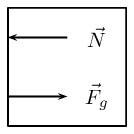

Where \(\vec{F}_{g}\) is the force due to gravity and \(\vec{N}\) is the normal force.

**Problem:**
A constant, resultant force acts on a body which can move freely in a straight line. Which
                        physical quantity will remain constant?

2. acceleration
4. velocity
6. momentum
8. kinetic energy

[SC 2003/11]

**Solution:**
acceleration

**Problem:**
Two forces, \(\text{10}\) \(\text{N}\) and \(\text{15}\) \(\text{N}\), act at an angle at the
                        same point.

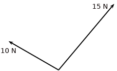

Which of the following **cannot** be the resultant of these two forces?

2. \(\text{2}\) \(\text{N}\)
4. \(\text{5}\) \(\text{N}\)
6. \(\text{8}\) \(\text{N}\)
8. \(\text{20}\) \(\text{N}\)

[SC 2005/11 SG1]

**Solution:**
\(\text{2}\) \(\text{N}\)

**Problem:**
A concrete block weighing \(\text{250}\) \(\text{N}\) is at rest on an inclined surface at an
                        angle of \(\text{20}\)\(\text{°}\). The magnitude of the normal force, in newtons, is

2. \(\text{250}\)
4. \(250\cos\text{20}\text{°}\)
6. \(\text{250}\sin\text{20}\text{°}\)
8. \(\text{2 500}\cos\text{20}\text{°}\)

**Solution:**
\(\text{250}\cos\text{20}\text{°}\)

**Problem:**
A \(\text{30}\) \(\text{kg}\) box sits on a flat frictionless surface. Two forces of
                        \(\text{200}\) \(\text{N}\) each are applied to the box as shown in the diagram. Which statement
                        best describes the motion of the box?

2. The box is lifted off the surface.
4. The box moves to the right.
6. The box does not move.
8. The box moves to the left.

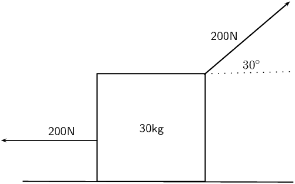

**Solution:**
The box moves to the left.

**Problem:**
A concrete block weighing \(\text{200}\) \(\text{N}\) is at rest on an inclined surface at an
                        angle of \(\text{20}\)\(\text{°}\). The normal force, in newtons, is

2. \(\text{200}\)
4. \(\text{200}\cos\text{20}\text{°}\)
6. \(\text{200}\sin\text{20}\text{°}\)
8. \(\text{2 000}\cos\text{20}\text{°}\)

**Solution:**
\(\text{200}\cos\text{20}\text{°}\)

**Problem:**
A box, mass \(m\), is at rest on a rough horizontal surface. A force of constant magnitude \(F\)
                        is then applied on the box at an angle of \(\text{60}\)\(\text{°}\) to the horizontal, as
                        shown.

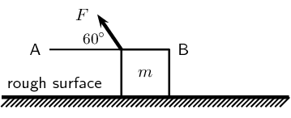

If the box has a uniform horizontal acceleration of magnitude, \(a\), the frictional force acting
                        on the box is...

2. \(F\cos\text{60}\text{°}-ma\) in the direction of A
4. \(F\cos\text{60}\text{°}-ma\) in the direction of B
6. \(F\sin\text{60}\text{°}-ma\) in the direction of A
8. \(F\sin\text{60}\text{°}-ma\) in the direction of B

[SC 2003/11]

**Solution:**
\(F\cos\text{60}\text{°}-ma\) in the direction of A

**Problem:**
Thabo stands in a train carriage which is moving eastwards. The train suddenly brakes. Thabo
                        continues to move eastwards due to the effect of:

2. his inertia.
4. the inertia of the train.
6. the braking force on him.
8. a resultant force acting on him.

[SC 2002/11 SG]

**Solution:**
his inertia

**Problem:**
A \(\text{100}\) \(\text{kg}\) crate is placed on a slope that makes an angle of
                        \(\text{45}\)\(\text{°}\) with the horizontal. The gravitational force on the box is
                        \(\text{98}\) \(\text{N}\). The box does not slide down the slope. Calculate the magnitude and
                        direction of the frictional force and the normal force present in this situation.

**Solution:**
Since the box does not move the frictional force acting on the box is equal to the component of
                        the gravitational force parallel to the plane.

                    \begin{align*}
                    F_{f} & = F_{gx} \\
                    & = F \cos \theta \\
                    & = (98) \cos(45) \\
                    & = \text{69,3}\text{ N}
                    \end{align*}

This force acts at an an angle of \(\text{45}\)\(\text{°}\) with the horizontal.

The normal force acts in the opposite direction to the gravitational force and has a magnitude of
                        \(\text{98}\) \(\text{N}\) at an angle of \(\text{45}\)\(\text{°}\) with the horizontal.

**Problem:**
A body moving at a *CONSTANT VELOCITY* on a horizontal plane, has a number of unequal
                        forces acting on it. Which one of the following statements is TRUE?

2. At least two of the forces must be acting in the same direction.
4. The resultant of the forces is zero.
6. Friction between the body and the plane causes a resultant force.
8. The vector sum of the forces causes a resultant force which acts in the direction of
                                   motion.

[SC 2002/11 HG1]

**Solution:**
The resultant of the forces is zero.

**Problem:**
Two masses of \(m\) and \(2m\) respectively are connected by an elastic band on a frictionless
                        surface. The masses are pulled in opposite directions by two forces each of magnitude \(F\),
                        stretching the elastic band and holding the masses stationary.

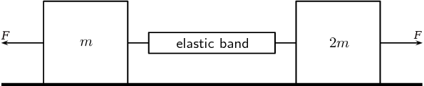

Which of the following gives the magnitude of the tension in the elastic band?

2. zero
4. \(\frac{\text{1}}{\text{2}}F\)
6. \(F\)
8. \(2F\)

[IEB 2005/11 HG]

**Solution:**
\(F\)

**Problem:**
A rocket takes off from its launching pad, accelerating up into the air.

The rocket accelerates because the magnitude of the upward force, F is greater than the magnitude
                        of the rocket's weight, W. Which of the following statements **best** describes how
                        force F arises?

2. F is the force of the air acting on the base of the rocket.
4. F is the force of the rocket's gas jet *pushing down* on the air.
6. F is the force of the rocket's gas jet *pushing down* on the ground.
8. F is the reaction to the force that the rocket exerts on the gases which escape out
                                   through the tail nozzle.

[IEB 2005/11 HG]

**Solution:**
F is the reaction to the force that the rocket exerts on the gases which escape out through the
                        tail nozzle.

**Problem:**
A box of mass \(\text{20}\) \(\text{kg}\) rests on a smooth horizontal surface. What will happen
                        to the box if two forces each of magnitude \(\text{200}\) \(\text{N}\) are applied
                        simultaneously to the box as shown in the diagram.

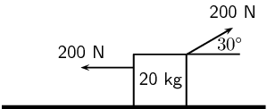

The box will:

2. be lifted off the surface.
4. move to the left.
6. move to the right.
8. remain at rest.

[SC 2001/11 HG1]

**Solution:**
move to the left

**Problem:**
A \(\text{2}\) \(\text{kg}\) mass is suspended from spring balance X, while a \(\text{3}\)
                        \(\text{kg}\) mass is suspended from spring balance Y. Balance X is in turn suspended from the
                        \(\text{3}\) \(\text{kg}\) mass. Ignore the weights of the two spring balances.

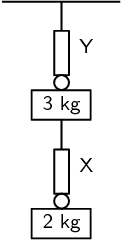

The readings (in N) on balances X and Y are as follows:

|  | X | Y |
| --- | --- | --- |
| a) | \(\text{19,6}\) | \(\text{29,4}\) |
| b) | \(\text{19,6}\) | 49 |
| c) | \(\text{24,5}\) | \(\text{24,5}\) |
| d) | 49 | 49 |

[SC 2001/11 HG1]

**Solution:**
b) \(\text{19,6}\), 49

**Problem:**
P and Q are two forces of equal magnitude applied simultaneously to a body at X.

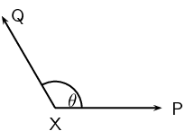

As the angle θ between the forces is **decreased** from
                        \(\text{180}\)\(\text{°}\) to \(\text{0}\)\(\text{°}\), the magnitude of the resultant
                        of the two forces will

2. initially increase and then decrease.
4. initially decrease and then increase.
6. increase only.
8. decrease only.

[SC 2002/03 HG1]

**Solution:**
increase only

**Problem:**
The graph below shows the velocity-time graph for a moving object:

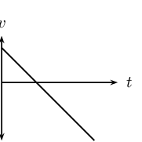

Which of the following graphs could best represent the relationship between the resultant force
                        applied to the object and time?

| (a) | (b) | (c) | (d) |

[SC 2002/03 HG1]

**Solution:**
graph (b)

**Problem:**
Two blocks each of mass \(\text{8}\) \(\text{kg}\) are in contact with each other and are
                        accelerated along a frictionless surface by a force of \(\text{80}\) \(\text{N}\) as shown in
                        the diagram. The force which block Q will exert on block P is equal to ...

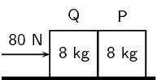

2. \(\text{0}\) \(\text{N}\)
4. \(\text{40}\) \(\text{N}\)
6. \(\text{60}\) \(\text{N}\)
8. \(\text{80}\) \(\text{N}\)

[SC 2002/03 HG1]

**Solution:**
\(\text{40}\) \(\text{N}\)

**Problem:**
A \(\text{12}\) \(\text{kg}\) box is placed on a rough surface. A force of \(\text{20}\)
                        \(\text{N}\) applied at an angle of \(\text{30}\)\(\text{°}\) to the horizontal cannot move
                        the box. Calculate the magnitude and direction of the normal and friction forces.

**Solution:**
The normal force is:

                    \begin{align*}
                    N & = mg \\
                    & = (\text{12})(\text{9,8}) \\
                    & = \text{117,6}\text{ N}
                    \end{align*}

This force points straight up from the surface.

The friction force is:

                    \begin{align*}
                    F_{f} & = F_{\text{app}} \cos 30° \\
                    & = (\text{20})\cos(\text{30}°) \\
                    & = \text{17,3}\text{ N}
                    \end{align*}

The frictional force points in the opposite direction to the applied force.

**Problem:**
Three \(\text{1}\) \(\text{kg}\) mass pieces are placed on top of a \(\text{2}\) \(\text{kg}\)
                        trolley. When a force of magnitude F is applied to the trolley, it experiences an acceleration
                        a.

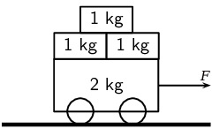

If one of the \(\text{1}\) \(\text{kg}\) mass pieces falls off while F is still being applied,
                        the trolley will accelerate at ...

2. \(\frac{\text{1}}{\text{5}}a\)
4. \(\frac{\text{4}}{\text{5}}a\)
6. \(\frac{\text{5}}{\text{4}}a\)
8. \(5a\)

[SC 2002/03 HG1]

**Solution:**
\(\frac{\text{5}}{\text{4}}a\)

**Problem:**
A car moves along a horizontal road at constant velocity. Which of the following statements is
                        true?

2. The car is not in equilibrium.
4. There are no forces acting on the car.
6. There is zero resultant force.
8. There is no frictional force.

[IEB 2004/11 HG1]

**Solution:**
There is zero resultant force.

**Problem:**
A crane lifts a load vertically upwards at constant speed. The upward force exerted on the load
                        is F. Which of the following statements is correct?

2. The acceleration of the load is \(\text{9,8}\) \(\text{m·s$^{-1}$}\) downwards.
4. The resultant force on the load is F.
6. The load has a weight equal in magnitude to F.
8. The forces of the crane on the load, and the weight of the load, are an example of a
                                   Newton's third law 'action-reaction' pair.

[IEB 2004/11 HG1]

**Solution:**
The load has a weight equal in magnitude to F.

**Problem:**
A body of mass \(M\) is at rest on a smooth horizontal surface with two forces applied to it as
                        in the diagram below. Force \({F}_{1}\) is equal to \(Mg\). The force \({F}_{1}\) is applied to
                        the right at an angle θ to the horizontal, and a force of \({F}_{2}\) is applied
                        horizontally to the left.

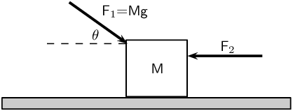

How is the body affected when the angle θ is increased?

2. It remains at rest.
4. It lifts up off the surface, and accelerates towards the right.
6. It lifts up off the surface, and accelerates towards the left.
8. It accelerates to the left, moving along the smooth horizontal surface.

[IEB 2004/11 HG1]

**Solution:**
It accelerates to the left, moving along the smooth horizontal surface.

**Problem:**
Which of the following statements correctly explains why a passenger in a car, who is not
                        restrained by the seat belt, continues to move forward when the brakes are applied suddenly?

2. The braking force applied to the car exerts an equal and opposite force on the passenger.
4. A forward force (called inertia) acts on the passenger.
6. A resultant forward force acts on the passenger.
8. A zero resultant force acts on the passenger.

[IEB 2003/11 HG1]

**Solution:**
A zero resultant force acts on the passenger.

A rocket (mass \(\text{20 000}\) \(\text{kg}\)) accelerates from rest to \(\text{40}\)
                        \(\text{m·s$^{-1}$}\) in the first \(\text{1,6}\) seconds of its journey upwards into
                        space.

The rocket's propulsion system consists of exhaust gases, which are pushed out of an outlet at
                        its base.

**Problem:**
Explain, with reference to the appropriate law of Newton, how the escaping exhaust gases
                            exert an upwards force (thrust) on the rocket.

**Solution:**
Newton's third law states that if body A exerts a force on body B, then body B exerts a force
                            of equal magnitude on body A, but in the opposite direction.

The exhaust gases exert a force on the rocket. This means that the rocket also exerts a force
                            on the exhaust gases. Since the direction of the force from the exhaust is downwards the
                            direction of the force from the rocket must be upwards. This is what propels the rocket
                            upwards.

**Problem:**
What is the magnitude of the total thrust exerted on the rocket during the first
                            \(\text{1,6}\) \(\text{s}\)?

**Solution:**
We first need to find the acceleration. We can do this by using the equations of motion:

                        \begin{align*}
                        v_{f} & = v_{i} + at \\
                        40 & = 0 + (\text{1,6})a \\
                        a & = \text{25}\text{ m·s$^{-2}$}
                        \end{align*}

Now we can find the magnitude of the total thrust, T:

                        \begin{align*}
                        T & = W + ma \\
                        & = (\text{20 000})(\text{9,8}) + (\text{20 000})(\text{25}) \\
                        & = \text{696 000}\text{ N}
                        \end{align*}

**Problem:**
An astronaut of mass \(\text{80}\) \(\text{kg}\) is carried in the space capsule. Determine
                            the resultant force acting on him during the first \(\text{1,6}\) \(\text{s}\).

**Solution:**
\begin{align*}
                        T & = W + ma \\
                        & = (\text{80})(\text{9,8}) + (\text{80})(\text{25}) \\
                        & = \text{2 784}\text{ N}
                        \end{align*}

**Problem:**
Explain why the astronaut, seated in his chair, feels “heavier” while the rocket
                            is launched.

**Solution:**
Weight is measured through normal forces. When the rocket accelerates upwards he feels a
                            greater normal force acting on him as the force required to accelerate him upwards in
                            addition to balancing out the gravitational force.

**Problem:**
State Newton's second law of Motion.

**Solution:**
If a resultant force acts on a body, it will cause the body to accelerate in the
                            direction of
                            the resultant force. The acceleration of the body will be directly proportional to the
                            resultant force and inversely proportional to the mass of the body. The mathematical
                            representation is:
                            \[\vec{F}_{net} = m\vec{a}\]

A sports car (mass \(\text{1 000}\) \(\text{kg}\)) is able to accelerate uniformly
                            from
                            rest to \(\text{30}\) \(\text{m·s$^{-1}$}\) in a minimum time of \(\text{6}\)
                            \(\text{s}\).

**Problem:**
Calculate the magnitude of the acceleration of the car.

**Solution:**
\begin{align*}
                            a & = \frac{\Delta v}{\Delta t} \\
                            & = \frac{30}{6} \\
                            & = \text{5}\text{ m·s$^{-2}$}
                            \end{align*}

**Problem:**
What is the magnitude of the resultant force acting on the car during these
                                \(\text{6}\)
                                \(\text{s}\)?

**Solution:**
\begin{align*}
                            F & = ma \\
                            & = (\text{1 000})(5) \\
                            & = \text{5 000}\text{ N}
                            \end{align*}

**Problem:**
The magnitude of the force that the wheels of the vehicle exert on the road surface as it
                            accelerates is \(\text{7 500}\) \(\text{N}\). What is the magnitude of the
                            retarding
                            forces acting on this car?

**Solution:**
The retarding force is the force that the cars wheels exert minus the resultant force:

                        \begin{align*}
                        F & = F_{\text{app}} - F_{\text{res}} \\
                        & = \text{7 500} - \text{5 000} \\
                        & = \text{2 500}\text{ N}
                        \end{align*}

**Problem:**
By reference to a suitable Law of Motion, explain why a headrest is important in a car
                            with
                            such a rapid acceleration.

**Solution:**
Newton's first law states that an object continues in a state of rest or uniform motion
                            (motion with a constant velocity) unless it is acted on by an unbalanced (net or
                            resultant)
                            force.

There is a resultant force on the person's head and as the car accelerates their head is
                            pulled back. The headrest stops the person's head from being pulled to far back and
                            prevents
                            whiplash.

A child (mass \(\text{18}\) \(\text{kg}\)) is strapped in his car seat as the car moves to
                        the
                        right at constant velocity along a straight level road. A tool box rests on the seat beside
                        him.

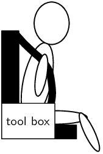

The driver brakes suddenly, bringing the car rapidly to a halt. There is negligible friction
                        between the car seat and the box.

**Problem:**
Draw a labelled free-body diagram of **the forces acting on the child**
                            during
                            the time that the car is being braked.

**Solution:**
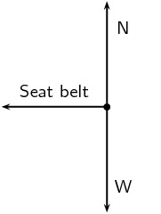

**Problem:**
Draw a labelled free-body diagram of **the forces acting on the box** during
                            the
                            time that the car is being braked.

**Solution:**
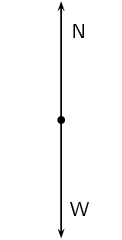

**Problem:**
*Modern cars are designed with safety features (besides seat belts) to protect drivers
                                and
                                passengers during collisions e.g. the crumple zones on the car's body. Rather than
                                remaining rigid during a collision, the crumple zones allow the car's body to
                                collapse
                                steadily.*

State Newton's second law of motion.

**Solution:**
If a resultant force acts on a body, it will cause the body to accelerate in the
                            direction of
                            the resultant force. The acceleration of the body will be directly proportional to the
                            resultant force and inversely proportional to the mass of the body. The mathematical
                            representation is:\[\vec{F}_{net} = m\vec{a}\]

The total mass of a lift together with its load is \(\text{1 200}\) \(\text{kg}\). It is
                        moving downwards at a constant velocity of \(\text{9}\) \(\text{m·s$^{-1}$}\).

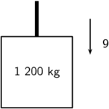

**Problem:**
What will be the magnitude of the force exerted by the cable on the lift while it is
                            moving
                            downwards at constant velocity? Give an explanation for your answer.

**Solution:**
We take upwards as the positive direction.

The acceleration is \(\text{0}\) since the lift is moving at constant velocity.

                        \begin{align*}
                        \Sigma F & = T - W \\
                        (0)(m) & = T - W \\
                        \therefore T & = W \\
                        & = (\text{9,8})(\text{1 200}) \\
                        & = \text{11 760}\text{ N}
                        \end{align*}

**Problem:**
*The lift is now uniformly brought to rest over a distance of \(\text{18}\)
                                \(\text{m}\).*

Calculate the magnitude of the acceleration of the lift.

**Solution:**
\begin{align*}
                        v_{f}^{2} & = v_{i}^{2} + 2a \Delta x \\
                        0 & = (9)^{2} + 2a(18) \\
                        36a & = -81 \\
                        a & = \frac{-\text{81}}{\text{36}} \\
                        & = -\text{2,25}\text{ m·s$^{-2}$}
                        \end{align*}

**Problem:**
Calculate the magnitude of the force exerted by the cable while the lift is being brought
                            to
                            rest.

**Solution:**
\begin{align*}
                        T - W & = ma \\
                        T & = ma + mg \\
                        & = (\text{1 200})(-\text{2,25}) + (\text{9,8})(\text{1 200}) \\
                        & = \text{9 060}\text{ N}
                        \end{align*}

A driving force of \(\text{800}\) \(\text{N}\) acts on a car of mass \(\text{600}\)
                        \(\text{kg}\).

**Problem:**
Calculate the car's acceleration.

**Solution:**
\begin{align*}
                        F & = ma \\
                        a & = \frac{F}{m} \\
                        & = \frac{\text{800}}{\text{600}} \\
                        & = \text{1,33}\text{ m·s$^{-2}$}
                        \end{align*}

**Problem:**
Calculate the car's speed after \(\text{20}\) \(\text{s}\).

**Solution:**
\begin{align*}
                        v_{f} & = v_{i} + at \\
                        v_{f} & = 0 + (20)(\text{1,33}) \\
                        & = \text{26,7}\text{ m·s$^{-1}$}
                        \end{align*}

**Problem:**
Calculate the new acceleration if a frictional force of \(\text{50}\) \(\text{N}\) starts
                            to
                            act on the car after \(\text{20}\) \(\text{s}\).

**Solution:**
\begin{align*}
                        a_{2} & = a_{1} - \frac{F_{f}}{m} \\
                        & = \text{1,33} - \frac{\text{50}}{\text{600}} \\
                        & = \text{1,25}\text{ m·s$^{-2}$}
                        \end{align*}

**Problem:**
Calculate the speed of the car after another \(\text{20}\) \(\text{s}\) (i.e. a total of
                            \(\text{40}\) \(\text{s}\) after the start).

**Solution:**
\begin{align*}
                        v_{f2} & = a_{1}t + a_{2}t \\
                        v_{f2} & = (20)(\text{1,33}) + (20)(\text{1,25}) \\
                        & = \text{51,6}\text{ m·s$^{-1}$}
                        \end{align*}

A stationary block of mass \(\text{3}\) \(\text{kg}\) is on top of a plane inclined at
                        \(\text{35}\)\(\text{°}\) to the horizontal.

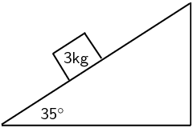

**Problem:**
Draw a force diagram (not to scale). Include the weight of the block as well as the
                            components of the weight that are perpendicular and parallel to the inclined plane.

**Solution:**
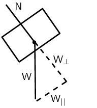

**Problem:**
Determine the values of the weight's perpendicular and parallel components.

**Solution:**
The perpendicular component is:

                        \begin{align*}
                        W_{\perp} & = F \sin(\theta) \\
                        & = mg \sin (\theta) \\
                        & = (3)(9.8) \sin(35) \\
                        & = \text{16,86}\text{ N}
                        \end{align*}

The parallel component is:

                        \begin{align*}
                        W_{||} & = F \cos(\theta) \\
                        & = mg \cos (\theta) \\
                        & = (3)(9.8) \cos(35) \\
                        & = \text{24,01}\text{ N}
                        \end{align*}

**A crate on an inclined plane**

Elephants are being moved from the Kruger National Park to the Eastern Cape. They are loaded
                        into
                        crates that are pulled up a ramp (an inclined plane) on frictionless rollers.

The diagram shows a crate being held stationary on the ramp by means of a rope parallel to
                        the
                        ramp. The tension in the rope is \(\text{5 000}\) \(\text{N}\).

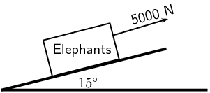

**Problem:**
Explain how one can deduce the following: “The forces acting on the crate are in
                            equilibrium”.

**Solution:**
The sum of the forces is equal to the mass times the acceleration. Since the acceleration
                            is
                            \(\text{0}\), the sum of the forces is \(\text{0}\). This means that the forces acting
                            on
                            the crate are in equilibrium.

**Problem:**
Draw a labelled free-body diagram of the forces acting on the elephant. (Regard the crate
                            and
                            elephant as one object, and represent them as a dot. Also show the relevant angles
                            between
                            the forces.)

**Solution:**
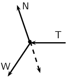

**Problem:**
The crate has a mass of \(\text{800}\) \(\text{kg}\). Determine the mass of the elephant.

**Solution:**
\begin{align*}
                        W_{E ||} & = W \sin \theta \\
                        \text{5 000} & = W \sin(15) \\
                        W & = \frac{\text{5 000}}{\sin (15)} \\
                        & = \text{19 318,52}\text{ N}
                        \end{align*}
                        \begin{align*}
                        m_{E} & = \frac{W}{g} - m_{\text{crate}} \\
                        & = \frac{\text{19 318,52}}{\text{9,8}} - \text{800} \\
                        & = \text{1 171,28}\text{ kg}
                        \end{align*}

**Problem:**
The crate is now pulled up the ramp at a constant speed. How does the crate being pulled
                            up
                            the ramp at a constant speed affect the forces acting on the crate and elephant? Justify
                            your answer, mentioning any law or principle that applies to this situation.

**Solution:**
There will be no changes to the forces since the acceleration is \(\text{0}\).

**Car in Tow**

Car A is towing Car B with a light tow rope. The cars move along a straight, horizontal road.

**Problem:**
Write down a statement of Newton's second law of Motion (in words).

**Solution:**
If a resultant force acts on a body, it will cause the body to accelerate in the
                            direction of
                            the resultant force. The acceleration of the body will be directly proportional to the
                            resultant force and inversely proportional to the mass of the body.

**Problem:**
As they start off, Car A exerts a forwards force of \(\text{600}\) \(\text{N}\) at its
                            end of
                            the tow rope. The force of friction on Car B when it starts to move is \(\text{200}\)
                            \(\text{N}\). The mass of Car B is \(\text{1 200}\) \(\text{kg}\). Calculate the
                            acceleration of Car B.

**Solution:**
The total force on car B is \(\text{600}\text{ N} - \text{200}\text{ N} =
                            \text{400}\text{
                            N}\).

                        \begin{align*}
                        F & = ma \\
                        a & = \frac{\text{400}}{\text{1 200}} \\
                        & = \text{0,33}\text{ m·s$^{-2}$}
                        \end{align*}

**Problem:**
After a while, the cars travel at constant velocity. The force exerted on the tow rope is
                            now
                            \(\text{300}\) \(\text{N}\) while the force of friction on Car B increases. What is the
                            magnitude and direction of the force of friction on Car B now?

**Solution:**
The frictional force is equal to the force exerted on the tow rope but in the opposite
                            direction. \(F_{f} = \text{300}\text{ N}\).

**Problem:**
Towing with a rope is very dangerous. A solid bar should be used in preference to a tow
                            rope.
                            This is especially true should Car A suddenly apply brakes. What would be the advantage
                            of
                            the solid bar over the tow rope in such a situation?

**Solution:**
Newton's first law states that an object will keep on moving in a straight line unless
                            acted
                            on by a force. A solid bar will stop car B from moving if car A breaks while a rope will
                            not.

**Problem:**
The mass of Car A is also \(\text{1 200}\) \(\text{kg}\). Car A and Car B are now
                            joined
                            by a solid tow bar and the total braking force is \(\text{9 600}\) \(\text{N}\).
                            Over
                            what distance could the cars stop from a velocity of \(\text{20}\)
                            \(\text{m·s$^{-1}$}\)?

**Solution:**
The acceleration is:

                        \begin{align*}
                        F & = ma \\
                        a & = \frac{\text{9 600}}{2(\text{1 200})} \\
                        & = \text{4}
                        \end{align*}

So the stopping distance is:

                        \begin{align*}
                        v_{f}^{2} & = v_{i}^{2} + 2a \Delta x \\
                        0 & = (\text{20})^{2} + 2(-4)\Delta x \\
                        8 \Delta x & = 400 \\
                        \Delta x & = \text{50}\text{ m}
                        \end{align*}

**Testing the Brakes of a Car**

A braking test is carried out on a car travelling at \(\text{20}\)
                        \(\text{m·s$^{-1}$}\). A
                        braking distance of \(\text{30}\) \(\text{m}\) is measured when a braking force of
                        \(\text{6 000}\) \(\text{N}\) is applied to stop the car.

**Problem:**
Calculate the acceleration of the car when a braking force of \(\text{6 000}\)
                            \(\text{N}\) is applied.

**Solution:**
\begin{align*}
                        v_{f}^{2} & = v_{i}^{2} + 2a \Delta x \\
                        0 & = (\text{20})^{2} + 2(30)a \\
                        60a & = -400 \\
                        a & = -\text{6,67}\text{ m·s$^{-2}$}
                        \end{align*}

**Problem:**
**Show** that the mass of this car is \(\text{900}\) \(\text{kg}\).

**Solution:**
\begin{align*}
                        F & = ma \\
                        \text{6 000} & = (\text{6,67})m \\
                        m & = \text{900}\text{ kg}
                        \end{align*}

**Problem:**
How long (in s) does it take for this car to stop from \(\text{20}\)
                            \(\text{m·s$^{-1}$}\) under the braking action described above?

**Solution:**
\begin{align*}
                        v_{f} & = v_{i} + at \\
                        0 & = \text{20} + (-\text{6,67})t \\
                        \text{6,67}t & = 20 \\
                        t & = \text{3,0}\text{ s}
                        \end{align*}

**Problem:**
A trailer of mass \(\text{600}\) \(\text{kg}\) is attached to the car and the braking
                            test is
                            repeated from \(\text{20}\) \(\text{m·s$^{-1}$}\) using the same braking force of
                            \(\text{6 000}\) \(\text{N}\). How much longer will it take to stop the car with
                            the
                            trailer in tow?

**Solution:**
\begin{align*}
                        F & = ma \\
                        \text{6 000} & = (900 + 600)a \\
                        a & = \text{4}
                        \end{align*}
                        \begin{align*}
                        t & = \frac{-\text{20}}{\text{4}} \\
                        t & = \text{5}\text{ s}
                        \end{align*}

It will take \(\text{2}\) \(\text{s}\) longer.

**Problem:**
A box is held stationary on a smooth plane that is inclined at angle θ to the
                        horizontal.

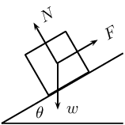

\(F\) is the force exerted by a rope on the box. \(w\) is the weight of the box and \(N\) is
                        the
                        normal force of the plane on the box. Which of the following statements is correct?

2. \(\tan\theta =\frac{F}{w}\)
4. \(\tan\theta =\frac{F}{N}\)
6. \(\cos\theta =\frac{F}{w}\)
8. \(\sin\theta =\frac{N}{w}\)

[IEB 2005/11 HG]

**Solution:**
\(\sin\theta =\frac{N}{w}\)

**Problem:**
As a result of three forces \({F}_{1}\), \({F}_{2}\) and \({F}_{3}\) acting on it, an object
                        at
                        point P is in equilibrium.

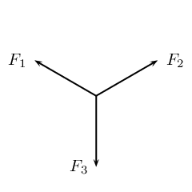

Which of the following statements is **not true** with reference to the three
                        forces?

2. The resultant of forces \({F}_{1}\), \({F}_{2}\) and \({F}_{3}\) is zero.
4. Force \({F}_{1}\), \({F}_{2}\) and \({F}_{3}\) lie in the same plane.
6. Force \({F}_{3}\) is the resultant of forces \({F}_{1}\) and \({F}_{2}\).
8. The sum of the components of all the forces in any chosen direction is zero.

[SC 2001/11 HG1]

**Solution:**
Force \({F}_{3}\) is the resultant of forces \({F}_{1}\) and \({F}_{2}\).

A block of mass M is held stationary by a rope of negligible mass. The block rests on a
                        frictionless plane which is inclined at \(\text{30}\)\(\text{°}\) to the horizontal.

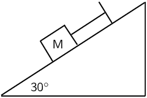

**Problem:**
Draw a labelled force diagram which shows all the forces acting on the block.

**Solution:**
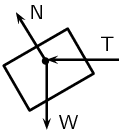

**Problem:**
Resolve the force due to gravity into components that are parallel and perpendicular to
                            the
                            plane.

**Solution:**
\begin{align*}
                        W & = Mg \\
                        W_{||} & = Mg \sin \theta \\
                        W_{\perp} & = Mg \cos \theta
                        \end{align*}

**Problem:**
Calculate the weight of the block when the force in the rope is \(\text{8}\)
                            \(\text{N}\).

**Solution:**
\begin{align*}
                        W_{||} & = Mg \sin \theta \\
                        8 & = M(\text{9,8}) \sin (\text{30}) \\
                        M & = \text{1,63}\text{ N}
                        \end{align*}

A heavy box, mass m, is lifted by means of a rope R which passes over a pulley fixed to a
                        pole. A
                        second rope S, tied to rope R at point P, exerts a horizontal force and pulls the box to the
                        right. After lifting the box to a certain height, the box is held stationary as shown in the
                        sketch below. Ignore the masses of the ropes. The tension in rope R is \(\text{5 850}\)
                        \(\text{N}\).

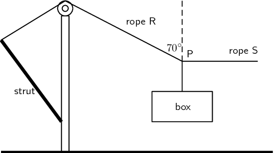

**Problem:**
Draw a diagram (with labels) of all the forces acting at the point P, when P is in
                            equilibrium.

**Solution:**
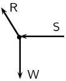

By resolving the force exerted by rope R into components, calculate the...

**Problem:**
magnitude of the force exerted by rope S.

**Solution:**
\begin{align*}
                            S & = R \cos \theta \\
                            & = (\text{5 850}) \cos (\text{20}) \\
                            & = \text{5 497,2}\text{ N}
                            \end{align*}

**Problem:**
mass, m, of the box.

**Solution:**
\begin{align*}
                            mg & = R \sin \theta \\
                            \text{9,8}m& = (\text{5 850}) \sin (\text{20}) \\
                            m & = \text{204,17}\text{ kg}
                            \end{align*}

A tow truck attempts to tow a broken down car of mass \(\text{400}\) \(\text{kg}\). The
                        coefficient of static friction is \(\text{0,60}\) and the coefficient of kinetic (dynamic)
                        friction is \(\text{0,4}\). A rope connects the tow truck to the car. Calculate the force
                        required:

**Problem:**
to just move the car if the rope is parallel to the road.

**Solution:**
\begin{align*}
                        F_{s} & = \mu_{s}F \\
                        F_{s} & = \mu_{s} mg \\
                        & = (\text{0,6})(\text{400})(\text{9,8}) \\
                        F_{s} & = \text{2 352}\text{ N}
                        \end{align*}

**Problem:**
to keep the car moving at constant speed if the rope is parallel to the road.

**Solution:**
\begin{align*}
                        F_{f} & = \mu_{k}F \\
                        & = \mu_{k} mg \\
                        & = (\text{0,4})(\text{400})(\text{9,8}) \\
                        & = \text{1 568}\text{ N}
                        \end{align*}

**Problem:**
to just move the car if the rope makes an angle of \(\text{30}\)\(\text{°}\) to the
                            road.

**Solution:**
\begin{align*}
                        F_{s} \cos \theta & = \mu_{s}F \\
                        F_{s} & = \frac{\text{2 352}}{\cos\text{30}} \\
                        & = \text{2 715,9}\text{ N}
                        \end{align*}

**Problem:**
to keep the car moving at constant speed if the rope makes an angle of
                            \(\text{30}\)\(\text{°}\) to the road.

**Solution:**
\begin{align*}
                        F_{f} \cos \theta & = \mu_{f}F \\
                        F_{f} & = \frac{\text{1 568}}{\cos\text{30}} \\
                        & = \text{1 810,6}\text{ N}
                        \end{align*}
