# Chapter 3: Atomic combinations

In this chapter learners will explore the concept of a covalent bond in greater detail. In grade ten
                        learners learnt about the three types of chemical bond (ionic, covalent and metallic). A great
                        video to introduce this topic is: [Veritasium chemical
                                bonding song](https://www.youtube.com/watch?v=ljvX-RMv_lw&feature=plcp). In this chapter the focus is on the covalent bond. A short breakdown
                        of the topics in this chapter follows.

- **Electron structure and Lewis diagrams (from grade \(\text{10}\))**
  As revision you can ask learners to draw Lewis diagrams for the first \(\text{20}\)
                                          elements and give the electronic structure (this was covered in grade
                                          \(\text{10}\)). This then leads into thinking how the elements can share
                                          electrons in a bond. Learners should recognise that there are unpaired electrons
                                          in atoms that can be shared to form the bonds.
  It is important to note that when drawing Lewis diagrams, we first place single
                                          electrons around the central atom and only once four electrons have been placed,
                                          do we pair electrons up. This will avoid the need to explain hybridisation. It
                                          is also important for learners to realise that the placement of electrons is
                                          arbitrary and the electrons can be placed anywhere around the atom.
- **Why hydrogen is a diatomic molecule but helium is a monatomic
                                                  molecule**
  This part of the chapter is interleaved with electron structure and Lewis diagrams as
                                          these two concepts play a key role in understanding why hydrogen is diatomic and
                                          helium is monatomic. In this part learners are introduced to the idea that when
                                          two atoms come close together there is a change in the potential energy. This
                                          forms a strong foundation for explaining the energy changes that occur in
                                          chemical reactions and will be seen again in chapter \(\text{12}\) (energy
                                          changes in chemical reactions).
- **Deducing simple rules about bond formation (and drawing Lewis diagrams for
                                                  these molecules)**
  Four cases are looked at to try to understand why bonds form. This is all about the
                                          covalent bond, so all the examples you use must be of covalent molecules (and
                                          you must also only pick examples of covalent molecular structures as covalent
                                          network structures are more like ionic networks and do not form simple molecular
                                          units). It is also important to help learners realise that a lone pair of
                                          electrons is very much dependant on the molecule that they are looking at. Lone
                                          pairs of electrons can be used under special circumstances to form dative (or
                                          coordinate) covalent bonds.
- **The basic principles of VSEPR and predicting molecular shape**
  You can build the different molecular shapes before starting to teach VSEPR from
                                          large polystyrene balls and kebab sticks or you can give your learners jellytots
                                          or marshmallows and toothpicks and get them to build the molecular shapes.
                                          Remember that the shapes with lone pairs need more space for the lone pairs and
                                          so it is not as simple as just removing the toothpick for the lone pair.
  This topic covers the shapes that molecules have. This is only the shapes of covalent
                                          molecular compounds, covalent network structures, ionic compounds and metals
                                          have very different three dimensional forms. This topic is important to help
                                          learners determine polarity of molecules. Two approaches are used to determine
                                          the shape of a molecule. The first one looks at molecules matching up to a
                                          general formula while the second one considers how many electron pairs are
                                          around a central atom. These two approaches can be used together to help
                                          learners fully understand this topic.
- **Electronegativity and polarity of bonds**
  It is important to note that CAPs does not give a definitive source for
                                          electronegativity values. You should use the ones found on the periodic table in
                                          the matric exams (these are the same values as the ones on the periodic table at
                                          the front of this book). Learners should be aware that they may see different
                                          values on other periodic tables. Learners must not think of the different types
                                          of bonding as being exactly defined. Also, the values for where the types of
                                          bonding transition are not exact and different sources quote different cut-off
                                          points.
  The simplest examples of polarity are the ideal shapes with all the end atoms the
                                          same and so you should stick to this in your explanation. You can explain this
                                          for trigonal planar molecules by using your learners. Get three girls or three
                                          boys to link hands (they all put their right hand into the centre and hold the
                                          other two learners right hands). Then they try to pull away (all learners pull
                                          equally). This is the even sharing of electrons. Now replace a girl with a boy
                                          (or vice versa) and tell the new learner to pull a bit less. This shows the
                                          uneven sharing of electrons.
- **Bond length and bond energy**
  In this final part of the chapter we return to our energy diagram and add two pieces
                                          of information: bond energy and bond length. The bond length is the distance
                                          between the two atoms when they are at their minimum energy, while the bond
                                          energy is this minimum energy. The bond energy comes up again in chapter
                                          \(\text{12}\) (energy and chemical change) when the topic of exothermic and
                                          endothermic reactions is covered.

Coloured text has been used as a tool to highlight different parts of Lewis diagrams. Ensure that
                        learners understand that the coloured text does not mean there is anything special about that
                        part of the diagram, this is simply a teaching tool to help them identify the important aspects
                        of the diagram, in particular the unpaired electrons.

We live in a world that is made up of many complex compounds. All around us we see evidence of chemical
                bonding from the chair you are sitting on, to the book you are holding, to the air you are breathing.
                Imagine if all the elements on the periodic table did not form bonds but rather remained on their own.
                Our world would be pretty boring with only \(\text{100}\) or so elements to use.

Imagine you were painting a picture and wanted to show the colours around you. The only paints you have are
                red, green, yellow, blue, white and black. Yet you are able to make pink, purple, orange and many other
                colours by mixing these paints. In the same way, the elements can be thought of as natures paint box.
                The elements can be joined together in many different ways to make new compounds and so create the world
                around you.

In Grade \(\text{10}\) we started exploring chemical bonding. In this chapter we will go on to explain more
                about chemical bonding and why chemical bonding occurs. We looked at the three types of bonding:
                covalent, ionic and metallic. In this chapter we will focus mainly on covalent bonding and on the
                molecules that form as a result of covalent bonding.

<Callout type="tip" title="Note">
In this chapter we will use the term molecule to mean a covalent molecular structure. This is a
                        covalent compound that interacts and exists as a single entity.
</Callout>

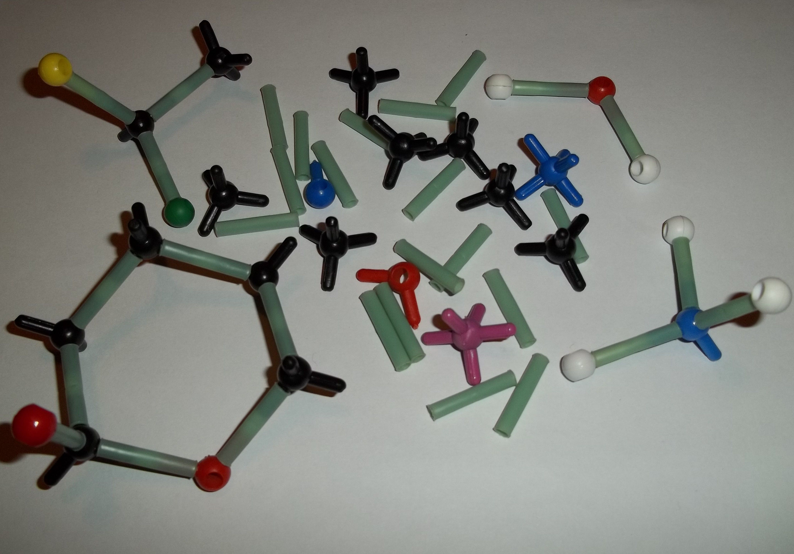

## 3.1 Chemical bonds (ESBM4)

### Why do atoms bond? (ESBM5)

As we begin this section, it's important to remember that what we will go on to discuss is a
                                *model* of bonding, that is based on a particular *model* of the atom. You
                                will remember from the discussion on atoms (in Grade \(\text{10}\)) that a model is a
                                *representation* of what is happening in reality. In the model of the atom that
                                you are learnt in Grade \(\text{10}\), the atom is made up of a central nucleus,
                                surrounded by electrons that are arranged in fixed energy levels (sometimes called
                                *shells*). Within each energy level, electrons move in *orbitals* of
                                different shapes. The electrons in the outermost energy level of an atom are called the
                                **valence electrons**. This model of the atom is useful in trying to
                                understand how different types of bonding take place between atoms.

<Callout type="tip" title="Note">
A model takes what we see in the world around us and uses that to make certain
                                        predictions about what we cannot see.
</Callout>

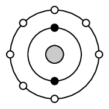

Figure 3.1:
                                        Electron arrangement of a fluorine atom. The black electrons (small circles on
                                        the inner ring) are the core electrons and the white electrons (small circles on
                                        the outer ring) are the valence electrons.

The following points were made in these earlier discussions on electrons and energy levels:

- Electrons always try to occupy the lowest possible energy level.
- The noble gases have a full valence electron orbital. For example neon has the
                                          following electronic configuration: \(1\text{s}^{2}2\text{s}^{2}2\text{p}^{6}\).
                                          The second energy level is the outermost (valence) shell and is full.
- Atoms form bonds to try to achieve the same electron configuration as the noble
                                          gases.
- Atoms with a full valence electron orbital are less reactive.

<QuizCard id="s11-03-01a" title="Interactive Exercise 3.1" question="Give the group number and the number of valence electrons for oxygen . Also state how many electrons the element would need to gain to have a full outer shell." options=[] answer="
                    ['16', '6', 'VI', 'VIA']
                ,
                    6
                ,
                    2
                " hint="" explanation="Use the periodic table to determine the group number The group number is obtained from the column in the periodic table in which the element appears. For oxygen, the group number (column) is \(\text{16}\) . NOTE: We use the numbers \(\text{1}\) to \(\text{18}\) to number the groups on the periodic table. We used the roman numerals \(\text{I}\) to \(\text{VIII}\) in the past, and we did not include the transition metals. Use the group number to determine the number of valence electrons The number of valence electrons is determined by the group number. Elements in groups \(\text{1}\) and \(\text{2}\) have the same number of valence electrons as the group number. Elements in groups \(\text{13}\) – \(\text{18}\) have the group number minus \(\text{10}\) valence electrons (group number \( -\,10\) ). The number of valence electrons for oxygen is \(\text{6}\) . Determine the number of electrons gained Elements in group \(\text{18}\) (noble gases) have \(\text{8}\) valence electrons and a full outer shell. Elements in groups \(\text{14}\) to \(\text{17}\) will gain electrons to have a full outer shell. The number of electrons gained for elements in groups \(\text{14}\) to \(\text{17}\) will be \(\text{8}\) minus the number of valence electrons for that element. \[\begin{array}{c}\text{8} - \text{6} = \text{2}\end{array}\] So the correct answer for oxygen is \(\text{2}\) . So the answers for oxygen are: Group number: 16 Valence electrons: 6 Number of electrons gained: 2 Submit your answer as: and and" />

<QuizCard id="s11-03-01a" title="Interactive Exercise 3.1" question="Below is the Lewis diagram for an element which has valence electrons in the second energy level. Which element does this Lewis diagram represent? Write only the symbol of the element." options=[] answer="
                    Ne
                " hint="You need to write a chemical compound here. A chemical compound can be any of the                following: Element: simply type in the element symbol as it appears on the periodic table. Chemical formula: just write the numbers showing the ratios of atoms normally. For example, water (H 2 O) is written as: H2O Ion: Use the exponent symbol ( ^ ) to represent a superscript. For example, the sodium ion (Na + ) is written as: Na^+ and the sulfate ion (SO 4 2− ) is written as: SO4^2− Electron: An electron is represented using e^- Compound formula: use round brackets around a compound ion in a formula. For example, calcium permanganate (Ca(MnO 4 ) 2 ) is written as: Ca(MnO4)2" explanation="Use the given information to determine the element Lewis diagrams show us an element's number of valence electrons. To work out the element from the valence electrons we need to know what group it is in and what period it is in. We are told that this element has valence electrons in the second energy level. The period number in the periodic table tells us in which energy level we will find the valence electrons for that element. So the element must be in period 2 (highlighted in yellow in the periodic table below). Looking at the Lewis diagram we see that there are \(\text{8}\) dots. Each dot represents one valence electron and so this element has \(\text{8}\) valence electrons. So the element must be in group \(\text{18}\) (highlighted in blue in the periodic table below). We note that for elements in groups \(\text{1}\) and \(\text{2}\) the number of valence electrons is the same as the group number. For elements in groups \(\text{13}\) to \(\text{18}\) , the number of valence electrons is the group number minus \(\text{10}\) . Helium is an exception to this rule as it has \(\text{2}\) valence electrons, but is placed in group \(\text{18}\) with the other noble gases. The element that is in period \(\text{2}\) and group \(\text{18}\) is neon (highlighted in green in the periodic table below). Therefore this Lewis diagram represents Ne . Submit your answer as:" />

### Energy and bonding (ESBM6)

There are two cases that we need to consider when two atoms come close together. The first
                                case is where the two atoms come close together and form a bond. The second case is
                                where the two atoms come close together but do not form a bond. We will use hydrogen as
                                an example of the first case and helium as an example of the second case.

#### Case 1: A bond forms

Let's start by imagining that there are two hydrogen atoms approaching one another.
                                        As they move closer together, there are three forces that act on the atoms at
                                        the same time. These forces are described below:

2. **repulsive force** between the electrons of the atoms,
                                                           since like charges repel
   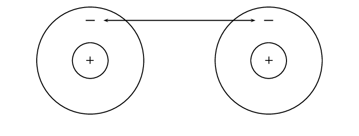
   Figure 3.2: Repulsion between
                                                                   electrons
4. **attractive force** between the nucleus of one atom and
                                                           the electrons of another
   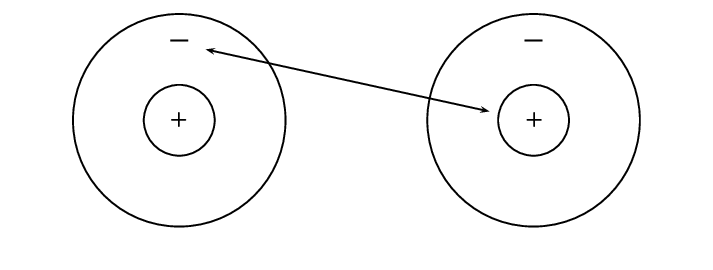
   Figure 3.3: Attraction between
                                                                   electrons and protons.
6. **repulsive force** between the two positively-charged
                                                           nuclei
   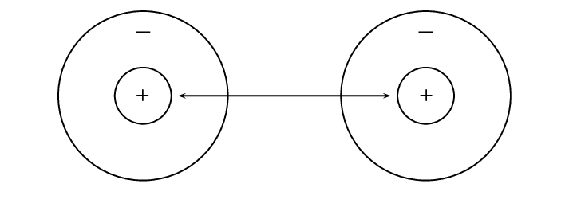
   Figure 3.4: Repulsion between
                                                                   protons

These three forces work together when two atoms come close together. As the total
                                        force experienced by the atoms changes, the amount of energy in the system also
                                        changes.

Now look at Figure 3.5 to
                                        understand the energy changes that take place when the two atoms move towards
                                        each other.

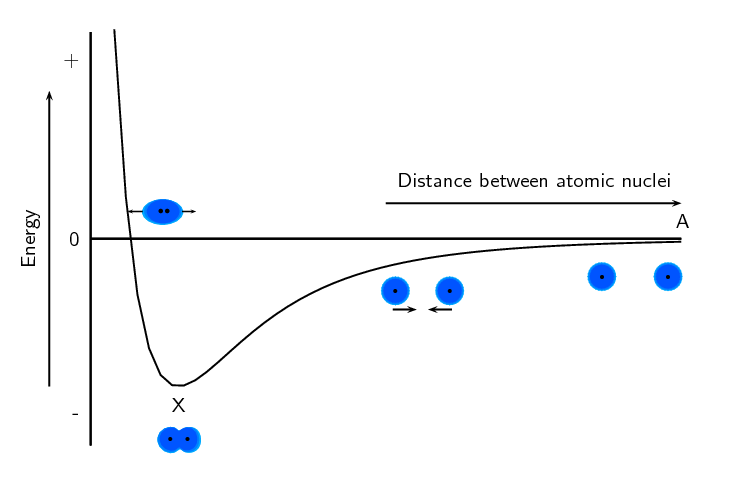

Figure 3.5:
                                                Graph showing the change in energy that takes place as two hydrogen
                                                atoms move closer together.

Let us imagine that we have fixed the one atom and we will move the other atom closer
                                        to the first atom. As we move the second hydrogen atom closer to the first (from
                                        point A to point X) the energy of the system decreases. Attractive forces
                                        dominate this part of the interaction. As the second atom approaches the first
                                        one and gets closer to point X, more energy is needed to pull the atoms apart.
                                        This gives a negative potential energy.

At point X, the attractive and repulsive forces acting on the two hydrogen atoms are
                                        balanced. The energy of the system is at a minimum.

Further to the left of point X, the repulsive forces are stronger than the attractive
                                        forces and the energy of the system increases.

For hydrogen the energy at point X is low enough that the two atoms stay together and
                                        do not break apart again. This is why when we draw the Lewis diagram for a
                                        hydrogen molecule we draw two hydrogen atoms next to each other with an electron
                                        pair between them.

We also note that this arrangement gives both hydrogen atoms a full outermost energy
                                        level (through the sharing of electrons or covalent bonding).

#### Case 2: A bond does not form

Now if we look at helium we see that each helium atom has a filled outer energy
                                        level. Looking at Figure
                                                3.6 we find that the energy minimum for two helium atoms is very
                                        close to zero. This means that the two atoms can come together and move apart
                                        very easily and never actually stick together.

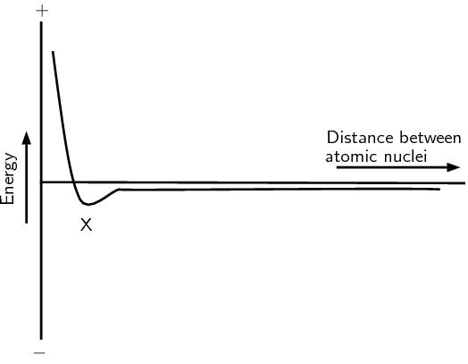

Figure 3.6:
                                                Graph showing the change in energy that takes place as two helium atoms
                                                move closer together.

For helium the energy minimum at point X is not low enough that the two atoms stay
                                        together and so they move apart again. This is why when we draw the Lewis
                                        diagram for helium we draw one helium atom on its own. There is no bond.

We also see that helium already has a full outermost energy level and so no compound
                                        forms.

<Callout type="note" title="Note">
[Simulation:
                                                        23NF](http://phet.colorado.edu/en/simulation/atomic-interactions)
</Callout>

### Valence electrons and Lewis diagrams (ESBM7)

Now that we understand a bit more about bonding we need to refresh the concept of Lewis
                                diagrams that you learnt about in Grade \(\text{10}\). With the knowledge of why atoms
                                bond and the knowledge of how to draw Lewis diagrams we will have all the tools that we
                                need to try to predict which atoms will bond and what shape the molecule will be.

In grade \(\text{10}\) we learnt how to write the electronic structure for any element. For
                                drawing Lewis diagrams the one that you should be familiar with is the spectroscopic
                                notation. For example the electron configuration of chlorine in spectroscopic notation
                                is: \(1\text{s}^{2}2\text{s}^{2}2\text{p}^{5}\). Or if we use the condensed form:
                                \([\text{He}]2\text{s}^{2}2\text{p}^{5}\). The condensed spectroscopic notation quickly
                                shows you the valence electrons for the element.

Using the number of valence electrons we can easily draw Lewis diagrams for any element. In
                                Grade \(\text{10}\) you learnt how to draw Lewis diagrams. We will refresh the concepts
                                here as they will aid us in our discussion of bonding.

<Callout type="tip" title="Note">
A **Lewis diagram** uses dots or crosses to represent the
                                        **valence electrons** on different atoms. The chemical symbol of
                                        the element is used to represent the nucleus and the core electrons of the atom.
</Callout>

Lewis diagrams for the elements in period \(\text{2}\) are shown below:

| Element | Group number | Valence electrons | Spectroscopic notation | Lewis diagram |
| --- | --- | --- | --- | --- |
| Lithium | \(\text{1}\) | \(\text{1}\) | \([\text{He}]2\text{s}^{1}\) |  |
| Beryllium | \(\text{2}\) | \(\text{2}\) | \([\text{He}]2\text{s}^{2}\) |  |
| Boron | \(\text{13}\) | \(\text{3}\) | \([\text{He}]2\text{s}^{2}2\text{p}^{1}\) |  |
| Carbon | \(\text{14}\) | \(\text{4}\) | \([\text{He}]2\text{s}^{2}2\text{p}^{2}\) |  |
| Nitrogen | \(\text{15}\) | \(\text{5}\) | \([\text{He}]2\text{s}^{2}2\text{p}^{3}\) |  |
| Oxygen | \(\text{16}\) | \(\text{6}\) | \([\text{He}]2\text{s}^{2}2\text{p}^{4}\) |  |
| Fluorine | \(\text{17}\) | \(\text{7}\) | \([\text{He}]2\text{s}^{2}2\text{p}^{5}\) |  |
| Neon | \(\text{18}\) | \(\text{8}\) | \([\text{He}]2\text{s}^{2}2\text{p}^{6}\) |  |

<Callout type="tip" title="Note">
You can place the unpaired electrons anywhere (top, bottom, left or right). The exact
                                        ordering in a Lewis diagram does not matter.
</Callout>

## Lewis diagrams

### Textbook Exercise 3.1

Give the spectroscopic notation and draw the Lewis diagram for:

**Problem:**
magnesium

**Solution:**
\([\text{Ne}]3\text{s}^{2}\)

**Problem:**
sodium

**Solution:**
\([\text{Ne}]3\text{s}^{1}\)

**Problem:**
chlorine

**Solution:**
\([\text{Ne}]3\text{s}^{2}3\text{p}^{5}\)

**Problem:**
aluminium

**Solution:**
\([\text{Ne}]3\text{s}^{2}3\text{p}^{1}\)

**Problem:**
argon

**Solution:**
\([\text{Ne}]3\text{s}^{2}3\text{p}^{6}\)

### Covalent bonds and bond formation (ESBM8)

Covalent bonding involves the sharing of electrons to form a chemical bond. The outermost
                                orbitals of the atoms overlap so that unpaired electrons in each of the bonding atoms
                                can be shared. By overlapping orbitals, the outer energy shells of all the bonding atoms
                                are filled. The shared electrons move in the orbitals around *both* atoms. As
                                they move, there is an attraction between these negatively charged electrons and the
                                positively charged nuclei. This attractive force holds the atoms together in a covalent
                                bond.

Covalent bond
A form of chemical bond where pairs of electrons are shared between atoms.

<Callout type="tip" title="Note">
Covalent bonds are examples of interatomic forces.
</Callout>

We will look at a few simple cases to deduce some rules about covalent bonds.

<Callout type="tip" title="Note">
Remember that it is only the *valence electrons* that are involved in bonding,
                                        and so when diagrams are drawn to show what is happening during bonding, it is
                                        only these electrons that are shown. Dots or crosses represent electrons in
                                        different atoms.
</Callout>

#### Case 1: Two atoms that each have an unpaired electron

For this case we will look at hydrogen chloride and methane.

<Callout type="tip" title="Worked example 1: Lewis diagrams: Simple molecules">
**Question:**
Represent hydrogen chloride (\(\text{HCl}\)) using a Lewis diagram.

**For each atom, determine the number of valence
                                                        electrons in the atom, and represent these using dots and
                                                        crosses.:**
The electron configuration of hydrogen is \(1\text{s}^{1}\) and the
                                                        electron configuration for chlorine is
                                                        \([\text{He}]2\text{s}^{2}2\text{p}^{5}\).
                                                        The hydrogen atom has \(\text{1}\) valence electron and the
                                                        chlorine atom has \(\text{7}\) valence electrons.

The Lewis diagrams for hydrogen and chlorine are:

Notice the single unpaired electron (highlighted in blue) on each
                                                        atom. This does not mean this electron is different, we use
                                                        highlighting here to help you see the unpaired electron.

**Arrange the electrons so that the outermost energy
                                                        level of each atom is full.:**
Hydrogen chloride is represented below.

Notice how the two unpaired electrons (one from each atom) form the
                                                        covalent bond.
</Callout>

The dot and cross in between the two atoms, represent the pair of electrons that are
                                        shared in the covalent bond. We can also show this bond using a single line:

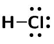

Note how we still show the other electron pairs around chlorine.

From this we can conclude that any electron on its own will try to pair up with
                                        another electron. So in practise atoms that have at least one unpaired electron
                                        can form bonds with any other atom that also has an unpaired electron. This is
                                        not restricted to just two atoms.

<Callout type="tip" title="Worked example 2: Lewis diagrams: Simple molecules">
**Question:**
Represent methane (\(\text{CH}_{4}\)) using a Lewis diagram

**For each atom, determine the number of valence
                                                        electrons in the atom, and represent these using dots and
                                                        crosses.:**
The electron configuration of hydrogen is \(1\text{s}^{1}\) and the
                                                        electron configuration for carbon is
                                                        \([\text{He}]2\text{s}^{2}2\text{p}^{2}\).
                                                        Each hydrogen atom has \(\text{1}\) valence electron and the
                                                        carbon atom has \(\text{4}\) valence electrons.

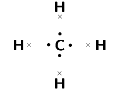

Remember that we said we can place unpaired electrons at any position
                                                        (top, bottom, left, right) around the elements symbol.

**Arrange the electrons so that the outermost energy
                                                        level of each atom is full.:**
The methane molecule is represented below.

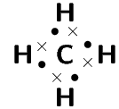

Or:

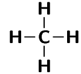
</Callout>

### Textbook Exercise 3.2

Represent the following molecules using Lewis diagram:

**Problem:**
chlorine (\(\text{Cl}_{2}\))

**Solution:**
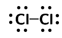

**Problem:**
boron trifluoride (\(\text{BF}_{3}\))

**Solution:**
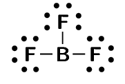

<QuizCard id="s11-03-01c" title="Interactive Exercise 3.3" question="How many bonding electron pairs are in the compound?" options=[] answer="
                        ['1', 'one']
                    " hint="" explanation="Bonding electron pairs are shown as a dot and cross pair. So we count the number of dot and cross pairs (highlighted in yellow below) for the compound. The number of bonding electron pairs is 1 . Submit your answer as:" />

<QuizCard id="s11-03-01c" title="Interactive Exercise 3.3" question="How many bonding electron pairs are in the compound?" options=[] answer="
                        ['4', 'four']
                    " hint="" explanation="Bonding electron pairs are shown as a dot and cross pair. So we count the number of dot and cross pairs (highlighted in yellow below) for the compound. The number of bonding electron pairs is 4 . Submit your answer as:" />

#### Case 2: Atoms with lone pairs

We will use water as an example. Water is made up of one oxygen and two hydrogen
                                        atoms. Hydrogen has one unpaired electron. Oxygen has two unpaired electrons and
                                        two electron pairs. From what we learnt in the first examples we see that the
                                        unpaired electrons can pair up. But what happens to the two pairs? Can these
                                        form bonds?

<Callout type="tip" title="Worked example 3: Lewis diagrams: Simple molecules">
**Question:**
Represent water (\(\text{H}_{2}\text{O}\)) using a Lewis diagram

**For each atom, determine the number of valence
                                                        electrons in the atom, and represent these using dots and
                                                        crosses.:**
The electron configuration of hydrogen is \(1\text{s}^{1}\) and the
                                                        electron configuration for oxygen is
                                                        \([\text{He}]2\text{s}^{2}2\text{p}^{4}\).
                                                        Each hydrogen atom has \(\text{1}\) valence electron and the
                                                        oxygen atom has \(\text{6}\) valence electrons.

**Arrange the electrons so that the outermost energy
                                                        level of each atom is full.:**
The water molecule is represented below.

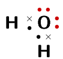

or

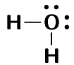
</Callout>

<Callout type="tip" title="Note">
Notice how in this example we wrote a \(\text{2}\) in front of the hydrogen?
                                                Instead of writing the Lewis diagram for hydrogen twice, we simply write
                                                it once and use the \(\text{2}\) in front of it to indicate that two
                                                hydrogens are needed for each oxygen.
</Callout>

And now we can answer the questions that we asked before the worked example. We see
                                        that oxygen forms two bonds, one with each hydrogen atom. Oxygen however keeps
                                        its electron pairs and does not share them. We can generalise this to any atom.
                                        If an atom has an electron pair it will normally not share that electron pair.

A **lone pair** is an unshared electron pair. A lone pair stays on the
                                        atom that it belongs to.

<Callout type="tip" title="Note">
A lone pair can be used to form a dative covalent bond.
</Callout>

In the example above the lone pairs on oxygen are highlighted in red. When we draw
                                        the bonding pairs using lines it is much easier to see the lone pairs on oxygen.

### Textbook Exercise 3.3

Represent the following molecules using Lewis diagrams:

**Problem:**
ammonia (\(\text{NH}_{3}\))

**Solution:**
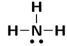

**Problem:**
oxygen difluoride (\(\text{OF}_{2}\))

**Solution:**

<QuizCard id="s11-03-01d" title="Interactive Exercise 3.4" question="How many bonding electron pairs are in the compound?" options=[] answer="
                        ['2', 'two']
                    " hint="" explanation="Bonding electron pairs are shown as a dot and cross pair. So we count the number of dot and cross pairs (highlighted in yellow below) for the compound. The number of bonding electron pairs is 2 . Submit your answer as:" />

<QuizCard id="s11-03-01d" title="Interactive Exercise 3.4" question="How many bonding electron pairs are in the compound?" options=[] answer="
                        ['3', 'three']
                    " hint="" explanation="Bonding electron pairs are shown as a dot and cross pair. So we count the number of dot and cross pairs (highlighted in yellow below) for the compound. The number of bonding electron pairs is 3 . Submit your answer as:" />

#### Case 3: Atoms with multiple bonds

We will use oxygen and hydrogen cyanide as examples.

<Callout type="tip" title="Worked example 4: Lewis diagrams: Molecules with multiple
                                                bonds">
**Question:**
Represent oxygen (\(\text{O}_{2}\)) using a Lewis diagram

**For each atom, determine the number of valence
                                                        electrons that the atom has from its electron configuration.:**
The electron configuration of oxygen is
                                                        \([\text{He}]2\text{s}^{2}2\text{p}^{4}\). Oxygen has
                                                        \(\text{6}\) valence electrons.

**Arrange the electrons in the \(\text{O}_{2}\) molecule
                                                        so that the outermost energy level in each atom is full.:**
The \(\text{O}_{2}\) molecule is represented below. Notice the two
                                                        electron pairs between the two oxygen atoms (highlighted in
                                                        blue). Because these two covalent bonds are between the same two
                                                        atoms, this is a *double* bond.

or

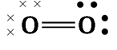
</Callout>

Each oxygen atom uses its two unpaired electrons to form two bonds. This forms a
                                        double covalent bond (which is shown by a double line between the two oxygen
                                        atoms).

<Callout type="tip" title="Worked example 5: Lewis diagrams: Molecules with multiple
                                                bonds">
**Question:**
Represent hydrogen cyanide (\(\text{HCN}\)) using a Lewis diagram

**For each atom, determine the number of valence
                                                        electrons that the atom has from its electron configuration.:**
The electron configuration of hydrogen is \(1\text{s}^{1}\), the
                                                        electron configuration of nitrogen is
                                                        \([\text{He}]2\text{s}^{2}2\text{p}^{3}\) and for carbon is
                                                        \([\text{He}]2\text{s}^{2}2\text{p}^{2}\). Hydrogen has
                                                        \(\text{1}\) valence electron, carbon has \(\text{4}\) valence
                                                        electrons and nitrogen has \(\text{5}\) valence electrons.

**Arrange the electrons in the \(\text{HCN}\) molecule
                                                        so that the outermost energy level in each atom is full.:**
The \(\text{HCN}\) molecule is represented below. Notice the three
                                                        electron pairs (highlighted in red) between the nitrogen and
                                                        carbon atom. Because these three covalent bonds are between the
                                                        same two atoms, this is a *triple* bond.

or

</Callout>

As we have just seen carbon shares one electron with hydrogen and three with
                                        nitrogen. Nitrogen keeps its electron pair and shares its three unpaired
                                        electrons with carbon.

### Textbook Exercise 3.4

Represent the following molecules using Lewis diagrams:

**Problem:**
acetylene (\(\text{C}_{2}\text{H}_{2}\))

**Solution:**

**Problem:**
formaldehyde (\(\text{CH}_{2}\text{O}\))

**Solution:**
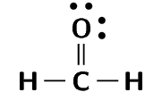

<QuizCard id="s11-03-01e" title="Interactive Exercise 3.5" question="Draw a Lewis diagram for carbon dioxide ( CO 2 ) and then answer the questions that follow. How many bonding electron pairs are there in a molecule of CO 2 ? How many non-bonding electron pairs (lone pairs) are there around the central atom in CO 2 ? Does CO 2 contain single, double or triple bonds?" options=[] answer="
                    4
                ,
                    0
                ,
                    1
                " hint="You should enter a number here. If you want to, you can use a space to separate thousands.                Example: 12 800,25 For scientific notation you need to use the multiply symbol                ( ∗ ) and the exponent symbol ( ^ ). For example 6,673 × 10 −11 should be written as: 6,673 ∗ 10^−11" explanation="Use a Lewis diagram to determine the number of bonding and non-bonding electron pairs The Lewis structure of CO 2 is: We can see from the Lewis diagram that a molecule of CO 2 contains 4 bonding electron pairs , and that there                     are 0 non-bonding (lone) pairs around the central atom. Determine the number of bonds between atoms Look at the number of electron pairs between two adjacent atoms. Remember that adjacent atoms are two atoms next to each other. If there is one electron pair, it is a single bond. If there are two electron pairs it is a double bond. If there are three electron pairs it is a triple bond. All the atoms have two electron pairs between them. So the correct answer is CO 2 contains double bonds only . Submit your answer as: and and double bonds only." />

<QuizCard id="s11-03-01e" title="Interactive Exercise 3.5" question="Draw a Lewis diagram for methanal ( COH 2 ) and then answer the questions that follow. How many bonding electron pairs are there in a molecule of COH 2 ? How many non-bonding electron pairs (lone pairs) are there around the central atom in COH 2 ? Does COH 2 contain single, double or triple bonds?" options=[] answer="
                    4
                ,
                    0
                ,
                    3
                " hint="You should enter a number here. If you want to, you can use a space to separate thousands.                Example: 12 800,25 For scientific notation you need to use the multiply symbol                ( ∗ ) and the exponent symbol ( ^ ). For example 6,673 × 10 −11 should be written as: 6,673 ∗ 10^−11" explanation="Use a Lewis diagram to determine the number of bonding and non-bonding electron pairs The Lewis structure of COH 2 is: We can see from the Lewis diagram that a molecule of COH 2 contains 4 bonding electron pairs , and that there                     are 0 non-bonding (lone) pairs around the central atom. Determine the number of bonds between atoms Look at the number of electron pairs between two adjacent atoms. Remember that adjacent atoms are two atoms next to each other. If there is one electron pair, it is a single bond. If there are two electron pairs it is a double bond. If there are three electron pairs it is a triple bond. The hydrogen atoms and the carbon atom have one electron pair between them. The oxygen atom and the carbon atom have two electron pairs between them. So the correct answer is COH 2 contains double and single bonds . Submit your answer as: and and double and single bonds." />

<QuizCard id="s11-03-01e" title="Interactive Exercise 3.5" question="Draw a Lewis diagram for hydrogen cyanide ( HCN ) and then answer the questions that follow. How many bonding electron pairs are there in a molecule of HCN ? How many non-bonding electron pairs (lone pairs) are there around the central atom in HCN ? Does HCN contain single, double or triple bonds?" options=[] answer="
                    4
                ,
                    0
                ,
                    4
                " hint="You should enter a number here. If you want to, you can use a space to separate thousands.                Example: 12 800,25 For scientific notation you need to use the multiply symbol                ( ∗ ) and the exponent symbol ( ^ ). For example 6,673 × 10 −11 should be written as: 6,673 ∗ 10^−11" explanation="Use a Lewis diagram to determine the number of bonding and non-bonding electron pairs The Lewis structure of HCN is: We can see from the Lewis diagram that a molecule of HCN contains 4 bonding electron pairs , and that there                     are 0 non-bonding (lone) pairs around the central atom. Determine the number of bonds between atoms Look at the number of electron pairs between two adjacent atoms. Remember that adjacent atoms are two atoms next to each other. If there is one electron pair, it is a single bond. If there are two electron pairs it is a double bond. If there are three electron pairs it is a triple bond. The hydrogen atom and the carbon atom have one electron pair between them. The nitrogen atom and the carbon atom have three electron pairs between them. So the correct answer is HCN contains triple and single bonds . Submit your answer as: and and triple and single bonds." />

#### Case 4: Co-ordinate or dative covalent bonds

Dative covalent bond
This type of bond is a description of covalent bonding that occurs between
                                                two atoms in which both electrons shared in the bond come from the same
                                                atom.

A dative covalent bond is also known as a coordinate covalent bond. Earlier we said
                                        that atoms with a pair of electrons will normally not share that pair to form a
                                        bond. But now we will see how an electron pair can be used by atoms to form a
                                        covalent bond.

One example of a molecule that contains a dative covalent bond is the ammonium ion
                                        (\(\text{NH}_{4}^{+}\)) shown in the figure below. The hydrogen ion
                                        \(\text{H}^{+}\) does not contain any electrons, and therefore the electrons
                                        that are in the bond that forms between this ion and the nitrogen atom, come
                                        only from the nitrogen.

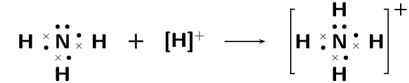

Notice that the hydrogen ion is charged and that this charge is shown on the ammonium
                                        ion using square brackets and a plus sign outside the square brackets.

We can also show this as:

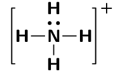

Note that we do not use a line for the dative covalent bond.

Another example of this is the hydronium ion (\(\text{H}_{3}\text{O}^{+}\)).

<Callout type="note" title="Note">
[Simulation:
                                                23NV](http://phet.colorado.edu/en/simulation/build-a-molecule)
</Callout>

To summarise what we have learnt:

- Any electron on its own will try to pair up with another electron. So in
                                                  theory atoms that have at least one unpaired electron can form bonds
                                                  with any other atom that also has an unpaired electron. This is not
                                                  restricted to just two atoms.
- If an atom has an electron pair it will normally not share that pair to form
                                                  a bond. This electron pair is known as a lone pair.
- If an atom has more than one unpaired electron it can form multiple bonds to
                                                  another atom. In this way double and triple bonds are formed.
- A dative covalent bond can be formed between an atom with no electrons and an
                                                  atom with a lone pair.

## Atomic bonding and Lewis diagrams

### Textbook Exercise 3.5

Represent each of the following *atoms* using Lewis
                                                                diagrams:

**Problem:**
calcium

**Solution:**
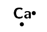

**Problem:**
lithium

**Solution:**

**Problem:**
phosphorous

**Solution:**
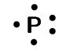

**Problem:**
potassium

**Solution:**

**Problem:**
silicon

**Solution:**

**Problem:**
sulfur

**Solution:**

Represent each of the following *molecules* using
                                                                Lewis diagrams:

**Problem:**
bromine (\(\text{Br}_{2}\))

**Solution:**
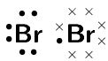

**Problem:**
carbon dioxide (\(\text{CO}_{2}\))

**Solution:**

**Problem:**
nitrogen (\(\text{N}_{2}\))

**Solution:**

**Problem:**
hydronium ion (\(\text{H}_{3}\text{O}^{+}\))

**Solution:**
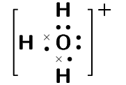

**Problem:**
sulfur dioxide (\(\text{SO}_{2}\))

**Solution:**

Two chemical reactions are described below.

- nitrogen and hydrogen react to form
                                                                          \(\text{NH}_{3}\)
- carbon and hydrogen bond to form
                                                                          \(\text{CH}_{4}\)

For each reaction, give:

**Problem:**
the number of valence electrons for each of the atoms
                                                                        involved in the reaction

**Solution:**
Nitrogen: \(\text{5}\), hydrogen: \(\text{1}\)

                                                                Carbon: \(\text{4}\), hydrogen: \(\text{1}\)

**Problem:**
the Lewis diagram of the product that is formed

**Solution:**
\(\text{NH}_{3}\)

\(\text{CH}_{4}\)

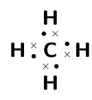

**Problem:**
the name of the product

**Solution:**
\(\text{NH}_{3}\): ammonia

\(\text{CH}_{4}\): methane

A chemical compound has the following Lewis diagram:

**Problem:**
How many valence electrons does element Y have?

**Solution:**
\(\text{6}\). There are \(\text{6}\) dots around
                                                                        element Y and from our knowledge of Lewis
                                                                        diagrams we know that these represent the
                                                                        valence electrons.

**Problem:**
How many valence electrons does element X have?

**Solution:**
\(\text{1}\). X contributes one electron (represented
                                                                        by a cross) to the bond and X has no other
                                                                        electrons.

**Problem:**
How many covalent bonds are in the molecule?

**Solution:**
\(\text{2}\) single bonds. From our knowledge of
                                                                        Lewis diagrams we look at how many cross and dot
                                                                        pairs there are in the molecule and that gives
                                                                        us the number of covalent bonds.

These are single bonds since there is only one dot
                                                                        and cross pair between adjacent atoms.

**Problem:**
Suggest a name for the elements X and Y.

**Solution:**
The most likely atoms are: Y: oxygen and X: hydrogen.

Note that Y could also be sulfur and X hydrogen and
                                                                        the molecule would then be hydrogen sulfide
                                                                        (sulfur dihydride).

**Problem:**
Complete the following table:

| Compound | \(\text{CO}_{2}\) | \(\text{CF}_{4}\) | \(\text{HI}\) | \(\text{C}_{2}\text{H}_{2}\) |
| --- | --- | --- | --- | --- |
| Lewis diagram |  |  |  |  |
| Total number of bonding
                                                                                                pairs |  |  |  |  |
| Total number of non-bonding
                                                                                                pairs |  |  |  |  |
| Single, double or triple
                                                                                                bonds |  |  |  |  |

**Solution:**
| Compound | \(\text{CO}_{2}\) | \(\text{CF}_{4}\) | \(\text{HI}\) | \(\text{C}_{2}\text{H}_{2}\) |
| --- | --- | --- | --- | --- |
| Lewis diagram |  |  |  |  |
| Total number of bonding
                                                                                                pairs | \(\text{4}\) | \(\text{4}\) | \(\text{1}\) | \(\text{5}\) |
| Total number of non-bonding
                                                                                                pairs | \(\text{4}\) | \(\text{12}\) | \(\text{3}\) | \(\text{0}\) |
| Single, double or triple
                                                                                                bonds | Two double bonds | Four single bonds | One single bond | One triple bond and two single bonds |
