## 3.2 Molecular shape (ESBM9)

Molecular shape (the shape that a single molecule has) is important in determining how the molecule
                        interacts and reacts with other molecules. Molecular shape also influences the boiling point and
                        melting point of molecules. If all molecules were linear then life as we know it would not
                        exist. Many of the properties of molecules come from the particular shape that a molecule has.
                        For example if the water molecule was linear, it would be non-polar and so would not have all
                        the special properties it has.

### Valence shell electron pair repulsion (VSEPR) theory (ESBMB)

The shape of a covalent molecule can be predicted using the Valence Shell Electron Pair
                                Repulsion (VSEPR) theory. Very simply, VSEPR theory says that the valence electron pairs
                                in a molecule will arrange themselves around the central atom(s) of the molecule so that
                                the repulsion between their negative charges is as small as possible.

In other words, the valence electron pairs arrange themselves so that they are as **far
                                        apart** as they can be.

Valence Shell Electron Pair Repulsion Theory

Valence shell electron pair repulsion (VSEPR) theory is a model in chemistry,
                                                which is used to predict the shape of individual molecules. VSEPR is
                                                based upon minimising the extent of the electron-pair repulsion around
                                                the central atom being considered.

VSEPR theory is based on the idea that the geometry (shape) of a molecule is mostly
                                determined by repulsion among the pairs of electrons around a central atom. The pairs of
                                electrons may be bonding or non-bonding (also called lone pairs). Only valence electrons
                                of the central atom influence the molecular shape in a meaningful way.

### Determining molecular shape (ESBMC)

To predict the shape of a covalent molecule, follow these steps:

2. Draw the molecule using a Lewis diagram. Make sure that you draw *all* the
                                           valence electrons around the molecule's central atom.
4. Count the number of electron pairs around the central atom.
6. Determine the basic geometry of the molecule using the table below. For example, a
                                           molecule with two electron pairs (and no lone pairs) around
                                           the central atom has a *linear* shape, and one with four electron pairs
                                           (and no lone pairs) around the central atom would have a
                                           *tetrahedral* shape.

<Callout type="tip" title="Note">
The central atom is the atom around which the other atoms are arranged. So in a
                                        molecule of water, the central atom is oxygen. In a molecule of ammonia, the
                                        central atom is nitrogen.
</Callout>

The table below gives the common molecular shapes. In this table we use **A** to
                                represent the central atom, **X** to represent the terminal atoms (i.e. the
                                atoms around the central atom) and **E** to represent any lone pairs.

| Number of bonding electron pairs | Number of lone pairs | Geometry | General formula |
| --- | --- | --- | --- |
| \(\text{1}\) or \(\text{2}\) | \(\text{0}\) | linear | \(\text{AX}\) or \(\text{AX}_{2}\) |
| \(\text{2}\) | \(\text{2}\) | bent or angular | \(\text{AX}_{2}\text{E}_{2}\) |
| \(\text{3}\) | \(\text{0}\) | trigonal planar | \(\text{AX}_{3}\) |
| \(\text{3}\) | \(\text{1}\) | trigonal pyramidal | \(\text{AX}_{3}\text{E}\) |
| \(\text{4}\) | \(\text{0}\) | tetrahedral | \(\text{AX}_{4}\) |
| \(\text{5}\) | \(\text{0}\) | trigonal bipyramidal | \(\text{AX}_{5}\) |
| \(\text{6}\) | \(\text{0}\) | octahedral | \(\text{AX}_{6}\) |

Table 3.1:
                                        The effect of electron pairs in determining the shape of molecules. Note that in
                                        the general example \(\text{A}\) is the central atom and \(\text{X}\) represents
                                        the terminal atoms.

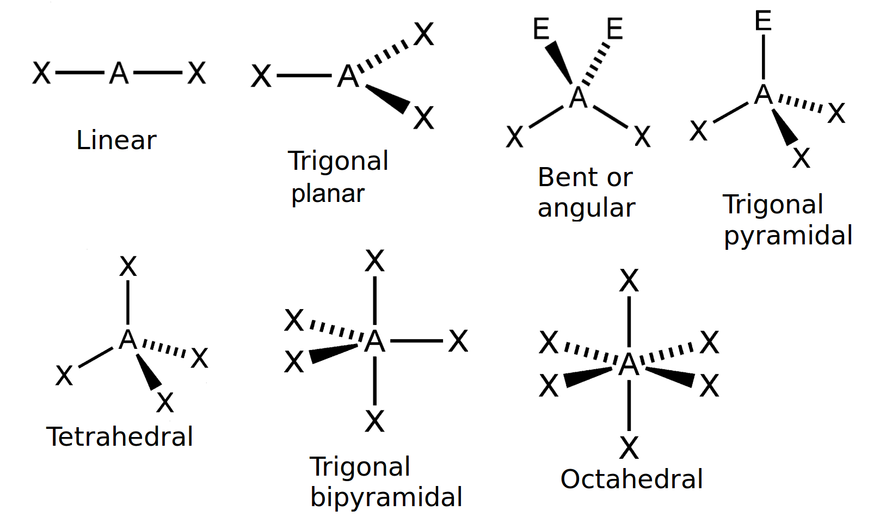

Figure 3.7: The common molecular shapes.

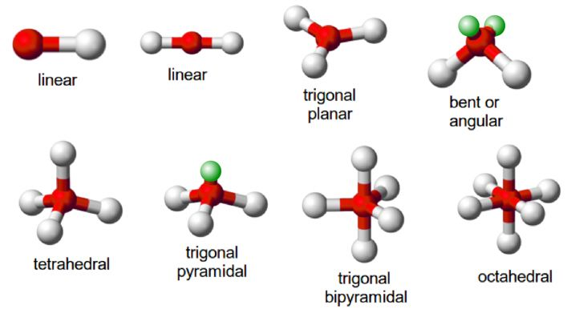

Figure 3.8: The common molecular shapes in 3-D.

In Figure 3.7 the green balls represent the
                                lone pairs (E), the white balls (X) are the terminal atoms and the red balls (A) are the
                                center atoms.

Of these shapes, the ones with no lone pairs are called the **ideal shapes**.
                                The five ideal shapes are: linear, trigonal planar, tetrahedral, trigonal bipyramidal
                                and
                                octahedral.

One important point to note about molecular shape is that all diatomic (compounds with two
                                atoms) compounds are **linear**. So \(\text{H}_{2}\), \(\text{HCl}\) and
                                \(\text{Cl}_{2}\) are all linear.

<Callout type="note" title="Note">
[Simulation:
                                                23PD](http://phet.colorado.edu/en/simulation/molecule-shapes-basics)
</Callout>

<Callout type="tip" title="Worked example 6: Molecular shape">
**Question:**
Determine the shape of a molecule of \(\text{BeCl}_{2}\)

**Draw the molecule using a Lewis diagram:**

The central atom is beryllium.

**Count the number of electron pairs around the central atom:**
There are two electron pairs.

**Determine the basic geometry of the molecule:**
There are two electron pairs and no lone pairs around the central atom.
                                                \(\text{BeCl}_{2}\) has the general formula: \(\text{AX}_{2}\). Using
                                                this information and Table 3.1 we find that the molecular
                                                shape is linear.

**Write the final answer:**
The molecular shape of \(\text{BeCl}_{2}\) is linear.
</Callout>

<Callout type="tip" title="Worked example 7: Molecular shape">
**Question:**
Determine the shape of a molecule of \(\text{BF}_{3}\)

**Draw the molecule using a Lewis diagram:**
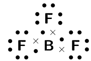

The central atom is boron.

**Count the number of electron pairs around the central atom:**
There are three electron pairs.

**Determine the basic geometry of the molecule:**
There are three electron pairs and no lone pairs around the central atom. The
                                                molecule has the general formula \(\text{AX}_{3}\). Using this
                                                information and Table 3.1 we find that the molecular
                                                shape is trigonal planar.

**Write the final answer:**
The molecular shape of \(\text{BF}_{3}\) is trigonal planar.
</Callout>

<Callout type="tip" title="Worked example 8: Molecular shape">
**Question:**
Determine the shape of a molecule of \(\text{NH}_{3}\)

**Draw the molecule using a Lewis diagram:**
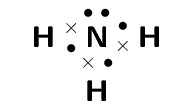

The central atom is nitrogen.

**Count the number of electron pairs around the central atom:**
There are four electron pairs.

**Determine the basic geometry of the molecule:**
There are three bonding electron pairs and one lone pair. The molecule has
                                                the general formula \(\text{AX}_{3}\text{E}\). Using this information
                                                and Table 3.1
                                                we find that the molecular shape is trigonal pyramidal.

**Write the final answer:**
The molecular shape of \(\text{NH}_{3}\) is trigonal pyramidal.
</Callout>

<Callout type="tip" title="Note">
We can also work out the shape of a molecule with double or triple bonds. To do this,
                                        we count the double or triple bond as one pair of electrons.
</Callout>

<QuizCard id="s11-03-02a" title="Interactive Exercise 3.7" question="Determine the shape of the following molecule: iodine ( I 2 )" options=["linear", "trigonal planar", "bent or angular", "tetrahedral", "trigonal pyramidal", "trigonal bipyramidal", "octahedral"] answer="linear" hint="" explanation="Draw the molecules Lewis diagram. The molecule is diatomic . The molecule has the general formula AX . Putting all the information together we can state that the molecular shape is linear . Submit your answer as: linear" />

<QuizCard id="s11-03-02a" title="Interactive Exercise 3.7" question="Adapted from DBE Nov 2016 Grade 11, P2, Q1.2 Physical constants \(·\) Chemistry formulas \(·\) Periodic table \(·\) Standard reduction potentials What is the shape of a molecule in which the central atom     			has no lone pairs, and two atoms bonded to it? A linear B tetrahedral C trigonal pyramidal D trigonal bipyramidal" options=["A", "B", "C", "D"] answer="
                	0
                " hint="" explanation="Recall the VSEPR theory The number of electron regions around the central atom will give us the electron geometry and the molecular shape . TIP: We can count these electron regions using AXE notation. This is used                 	to show the number of atoms bonded ( X ) to the                 	central atom ( A ), as well as the number of lone pairs ( E ) around the central atom. AXE Electron geometry Molecular shape AX 2 linear linear AX 3 trigonal planar trigonal planar AX 2 E trigonal planar bent AX 4 tetrahedral tetrahedral AX 3 E tetrahedral trigonal pyramidal AX 2 E 2 tetrahedral bent AX 5 trigonal bipyramidal trigonal bipyramidal AX 6 octahedral octahedral Choose the correct option The central atom described in the question has no lone pairs, and two atoms bonded to it. So the electrons around     				the central atom can be written as AX 2 .     				From the table above, this means the molecule has both linear electron geometry and linear molecular shape: Diagram from PhET Interactive Simulations, University of Colorado Boulder ( CC-BY ). NOTE: When there are no lone pairs on the central atom the molecular shape and the electron geometry are the same. That is, the substance has ideal geometry . A \({\color{red}{{\checkmark}{\checkmark}}}\) linear B tetrahedral C trigonal pyramidal D trigonal bipyramidal The correct choice is Option A . Submit your answer as: A" />

<QuizCard id="s11-03-02a" title="Interactive Exercise 3.7" question="Which one of the following molecules has an AX 4 molecule type? A SCl 4 B ClF 4 − C PCl 5 D SiBr 4" options=["A", "B", "C", "D"] answer="D" hint="" explanation="Draw the Lewis diagrams for each of the molecules We were asked for the molecule that has AX 4 molecule type. First we need to draw the Lewis diagram for each of the molecules. The lewis diagram for SCl 4 is: The lewis diagram for ClF 4 − is: The lewis diagram for PCl 5 is: The lewis diagram for SiBr 4 is: Determine the molecule type of each of the molecules Now that we have the Lewis diagrams for each of the molecules we can identify their molecule type using the AXE notation. In AXE notation A , X and E have the following meanings: A represents the central atom. X represents any atoms bonded to the central atom. E represents any lone pairs on the central atom. We are asked which of the molecules has the type AX 4 . So we are looking for the molecule that has \(\text{4}\) atoms bonded to the central atom and no lone pairs on the central atom. Looking at each of the molecules we see: SCl 4 has \(\text{4}\) atoms (chlorine) bonded to the central atom (sulfur) and \(\text{1}\) lone pair on the central atom. So SCl 4 has an AX 4 E molecule type. ClF 4 − has \(\text{4}\) atoms (fluorine) bonded to the central atom (chlorine) and \(\text{2}\) lone pairs on the central atom. So ClF 4 − has an AX 4 E 2 molecule type. PCl 5 has \(\text{5}\) atoms (chlorine) bonded to the central atom (phosphorus) and no lone pairs on the central atom. So PCl 5 has an AX 5 molecule type. SiBr 4 has \(\text{4}\) atoms (bromine) bonded to the central atom (silicon) and no lone pairs on the central atom. So SiBr 4 has an AX 4 molecule type. Eliminate the incorrect options and choose the correct option Finally we can identify the option that has an AX 4 molecule type. A ✘ SCl 4 does not have AX 4 molecule type SCl 4 has \(\text{5}\) electron regions: \(\text{4}\) atoms bonded to the central atom and \(\text{1}\) lone pair on the central atom. So it has an AX 4 E molecule type. B ✘ ClF 4 − does not have AX 4 molecule type ClF 4 − has \(\text{6}\) electron regions: \(\text{4}\) atoms bonded to the central atom and \(\text{2}\) lone pairs on the central atom. So it has an AX 4 E 2 molecule type. C ✘ PCl 5 does not have AX 4 molecule type PCl 5 has \(\text{5}\) electron regions: \(\text{5}\) atoms bonded to the central atom and no lone pairs on the central atom. So it has an AX 5 molecule type. D ✔ SiBr 4 has AX 4 molecule type SiBr 4 has \(\text{4}\) electron regions: \(\text{4}\) atoms bonded to the central atom and no lone pairs on the central atom. So it has an AX 4 molecule type. Therefore the correct option is D : SiBr 4 . Submit your answer as: D" />

<QuizCard id="s11-03-02a" title="Interactive Exercise 3.7" question="Determine the shape of the following molecule: ammonia ( NH 3 )" options=["linear", "trigonal planar", "bent or angular", "tetrahedral", "trigonal pyramidal", "trigonal bipyramidal", "octahedral"] answer="trigonal pyramidal" hint="" explanation="Draw the molecules Lewis diagram. The central atom is nitrogen . There are 3 electron pairs around the central atom. (If there is a double or triple bond then this is counted as 1 electron pair.) There is also 1 lone pair around the central atom. The molecule has the general formula AX 3 E . Putting all the information together we can state that the molecular shape is trigonal pyramidal . Submit your answer as: trigonal pyramidal" />

<QuizCard id="s11-03-02a" title="Interactive Exercise 3.7" question="Adapted from DBE Nov 2016 Grade 11, P2, Q1.2 Physical constants \(·\) Chemistry formulas \(·\) Periodic table \(·\) Standard reduction potentials What is the shape of a molecule in which the central atom     			has no lone pairs, and five atoms bonded to it? A trigonal bipyramidal B bent C linear D trigonal planar" options=["A", "B", "C", "D"] answer="
                	0
                " hint="" explanation="Recall the VSEPR theory The number of electron regions around the central atom will give us the electron geometry and the molecular shape . TIP: We can count these electron regions using AXE notation. This is used                 	to show the number of atoms bonded ( X ) to the                 	central atom ( A ), as well as the number of lone pairs ( E ) around the central atom. AXE Electron geometry Molecular shape AX 2 linear linear AX 3 trigonal planar trigonal planar AX 2 E trigonal planar bent AX 4 tetrahedral tetrahedral AX 3 E tetrahedral trigonal pyramidal AX 2 E 2 tetrahedral bent AX 5 trigonal bipyramidal trigonal bipyramidal AX 6 octahedral octahedral Choose the correct option The central atom described in the question has no lone pairs, and five atoms bonded to it. So the electrons around     				the central atom can be written as AX 5 .     				From the table above, this means the molecule has both trigonal bipyramidal electron geometry and trigonal bipyramidal molecular shape: Diagram from PhET Interactive Simulations, University of Colorado Boulder ( CC-BY ). NOTE: When there are no lone pairs on the central atom the molecular shape and the electron geometry are the same. That is, the substance has ideal geometry . A \({\color{red}{{\checkmark}{\checkmark}}}\) trigonal bipyramidal B bent C linear D trigonal planar The correct choice is Option A . Submit your answer as: A" />

<QuizCard id="s11-03-02a" title="Interactive Exercise 3.7" question="Which one of the following molecules does not have an AX 5 E molecule type? A AsBr 5 B IBr 5 C IF 5 D ClF 5" options=["A", "B", "C", "D"] answer="A" hint="" explanation="Draw the Lewis diagrams for each of the molecules We were asked for the molecule that does not have AX 5 E molecule type. First we need to draw the Lewis diagram for each of the molecules. The lewis diagram for AsBr 5 is: The lewis diagram for IBr 5 is: The lewis diagram for IF 5 is: The lewis diagram for ClF 5 is: Determine the molecule type of each of the molecules Now that we have the Lewis diagrams for each of the molecules we can identify their molecule type using the AXE notation. In AXE notation A , X and E have the following meanings: A represents the central atom. X represents any atoms bonded to the central atom. E represents any lone pairs on the central atom. We are asked which of the molecules does not have the type AX 5 E . So we are looking for the molecule that does not have \(\text{5}\) atoms bonded to the central atom and \(\text{1}\) lone pair on the central atom. Looking at each of the molecules we see: AsBr 5 has \(\text{5}\) atoms (bromine) bonded to the central atom (arsenic) and no lone pairs on the central atom. So AsBr 5 has an AX 5 molecule type. IBr 5 has \(\text{5}\) atoms (bromine) bonded to the central atom (iodine) and \(\text{1}\) lone pair on the central atom. So IBr 5 has an AX 5 E molecule type. IF 5 has \(\text{5}\) atoms (fluorine) bonded to the central atom (iodine) and \(\text{1}\) lone pair on the central atom. So IF 5 has an AX 5 E molecule type. ClF 5 has \(\text{5}\) atoms (fluorine) bonded to the central atom (chlorine) and \(\text{1}\) lone pair on the central atom. So ClF 5 has an AX 5 E molecule type. Eliminate the incorrect options and choose the correct option Finally we can identify the option that does not have an AX 5 E molecule type. A ✔ AsBr 5 does not have AX 5 E molecule type AsBr 5 has \(\text{5}\) electron regions: \(\text{5}\) atoms bonded to the central atom and no lone pairs on the central atom. So it has an AX 5 molecule type. B ✘ IBr 5 has AX 5 E molecule type IBr 5 has \(\text{6}\) electron regions: \(\text{5}\) atoms bonded to the central atom and \(\text{1}\) lone pair on the central atom. So it has an AX 5 E molecule type. C ✘ IF 5 has AX 5 E molecule type IF 5 has \(\text{6}\) electron regions: \(\text{5}\) atoms bonded to the central atom and \(\text{1}\) lone pair on the central atom. So it has an AX 5 E molecule type. D ✘ ClF 5 has AX 5 E molecule type ClF 5 has \(\text{6}\) electron regions: \(\text{5}\) atoms bonded to the central atom and \(\text{1}\) lone pair on the central atom. So it has an AX 5 E molecule type. Therefore the correct option is A : AsBr 5 . Submit your answer as: A" />

<QuizCard id="s11-03-02a" title="Interactive Exercise 3.7" question="Adapted from DBE Nov 2016 Grade 11, P2, Q1.2 Physical constants \(·\) Chemistry formulas \(·\) Periodic table \(·\) Standard reduction potentials What is the shape of a molecule in which the central atom     			has three atoms bonded to it, and one lone pair? A tetrahedral B octahedral C trigonal planar D trigonal pyramidal" options=["A", "B", "C", "D"] answer="
                	3
                " hint="" explanation="Recall the VSEPR theory The number of electron regions around the central atom will give us the electron geometry and the molecular shape . TIP: We can count these electron regions using AXE notation. This is used                 	to show the number of atoms bonded ( X ) to the                 	central atom ( A ), as well as the number of lone pairs ( E ) around the central atom. AXE Electron geometry Molecular shape AX 2 linear linear AX 3 trigonal planar trigonal planar AX 2 E trigonal planar bent AX 4 tetrahedral tetrahedral AX 3 E tetrahedral trigonal pyramidal AX 2 E 2 tetrahedral bent AX 5 trigonal bipyramidal trigonal bipyramidal AX 6 octahedral octahedral Choose the correct option The central atom described in the question has three atoms bonded to it, and one lone pair. So the electrons around     				the central atom can be written as AX 3 E .     				From the table above, this means the molecule has tetrahedral electron geometry: And trigonal pyramidal molecular shape: Diagrams from PhET Interactive Simulations, University of Colorado Boulder ( CC-BY ). The question asked for the shape : A tetrahedral B octahedral C trigonal planar D \({\color{red}{{\checkmark}{\checkmark}}}\) trigonal pyramidal The correct choice is Option D . Submit your answer as: D" />

<QuizCard id="s11-03-02a" title="Interactive Exercise 3.7" question="Which one of the following substances does not have both a linear electron (ideal) geometry and a linear molecular (actual) geometry? A H 2 O B CO 2 C N 3 − D BeF 2" options=["A", "B", "C", "D"] answer="A" hint="" explanation="Draw the Lewis diagrams for each of the substances We were asked for the substance that does not have both a linear electron geometry and a linear molecular geometry. In other words it could have either a linear electron geometry or a linear molecular geometry, but not both. TIP: We are interested in the electron (ideal) geometry and the molecular (actual) geometry of the substance. The electron geometry and the molecular geometry are not the same thing, so we need to look at both to get the correct answer. First we need to draw the Lewis diagram for each of the substances. The central atom in H 2 O is oxgyen . The central atom in CO 2 is carbon . The central atom in N 3 − is nitrogen . The central atom in BeF 2 is beryllium . NOTE: In order to determine electron geometry and molecular geometry we are interested in the electrons around the central atom. Determine the electron geometry of each of the substances Now that we have the Lewis diagram of all four substances the next step is to identify the electron geometry for each of the substances. We do this by looking at the number of electron regions around the central atom. Electron regions Electron geometry \(\text{2}\) linear \(\text{3}\) trigonal planar \(\text{4}\) tetrahedral \(\text{5}\) trigonal bipyramidal \(\text{6}\) octaheral By adding the number of atoms bonded to the central atom and the number of lone pairs we can determine the number of electron regions around the central atom. From that we can determine the electron geometry of each of the substances. In H 2 O there are \(\text{2}\) lone pairs and \(\text{2}\) atoms bonded to the central atom. So H 2 O has \(\text{4}\) electron regions. This means that it must have a tetrahedral electron geometry. In CO 2 there are no lone pairs and \(\text{2}\) atoms bonded to the central atom. So CO 2 has \(\text{2}\) electron regions. This means that it must have a linear electron geometry. In N 3 − there are no lone pairs and \(\text{2}\) atoms bonded to the central atom. So N 3 − has \(\text{2}\) electron regions. This means that it must have a linear electron geometry. In BeF 2 there are no lone pairs and \(\text{2}\) atoms bonded to the central atom. So BeF 2 has \(\text{2}\) electron regions. This means that it must have a linear electron geometry. Determine the shape of each of the substances We can now identify the shape of each of the substances. The number of lone pairs bonded to the central atom and the electron geometry give us information about the shape of a substance. Electron geometry Lone pairs Molecule shape linear \(\text{0}\) linear trigonal planar \(\text{0}\) trigonal planar \(\text{1}\) bent tetrahedral \(\text{0}\) tetrahedral \(\text{1}\) trigonal pyramidal \(\text{2}\) bent trigonal bipyramidal \(\text{0}\) trigonal bipyramidal \(\text{1}\) seesaw octahedral \(\text{0}\) octahedral \(\text{1}\) square pyramidal \(\text{2}\) square planar NOTE: When there are no lone pairs on the central atom the molecular geometry and the electron geometry are the same. That is, the substance has ideal geometry. So we can say the following about the four substances we are interested in: H 2 O has a tetrahedral electron geometry and \(\text{2}\) lone pairs on the central atom. Therefore it must have a bent molecular geometry. CO 2 has a linear electron geometry and no lone pairs on the central atom. Therefore it must have a linear molecular geometry. N 3 − has a linear electron geometry and no lone pairs on the central atom. Therefore it must have a linear molecular geometry. BeF 2 has a linear electron geometry and no lone pairs on the central atom. Therefore it must have a linear molecular geometry. Eliminate the incorrect options and choose the correct option Finally we can identify the option that does not have both a linear electron geometry and a linear molecular geometry. A ✔ H 2 O does not have a linear electron geometry or a linear molecular geometry H 2 O has \(\text{4}\) electron regions, which means it has a tetrahedral electron geometry. There are \(\text{2}\) lone pairs bonded to the central atom so it has a bent molecular geometry. B ✘ CO 2 has both a linear electron geometry and a linear molecular geometry CO 2 has \(\text{2}\) electron regions, which means it has a linear electron geometry. There are no lone pairs bonded to the central atom so it has a linear molecular geometry. C ✘ N 3 − has both a linear electron geometry and a linear molecular geometry N 3 − has \(\text{2}\) electron regions, which means it has a linear electron geometry. There are no lone pairs bonded to the central atom so it has a linear molecular geometry. D ✘ BeF 2 has both a linear electron geometry and a linear molecular geometry BeF 2 has \(\text{2}\) electron regions, which means it has a linear electron geometry. There are no lone pairs bonded to the central atom so it has a linear molecular geometry. Therefore the correct option is A : H 2 O . Submit your answer as: A" />

## Building molecular models

In groups, you are going to build a number of molecules using jellytots to represent
                                        the atoms in the molecule, and toothpicks to represent the bonds between the
                                        atoms. In other words, the toothpicks will hold the atoms (jellytots) in the
                                        molecule together. Try to use different coloured jellytots to represent
                                        different elements.

You will need jellytots, toothpicks, labels or pieces of paper.

On each piece of paper, write the words: “lone pair”.

You will build models of the following molecules:

\(\text{HCl}\), \(\text{CH}_{4}\), \(\text{H}_{2}\text{O}\), \(\text{BF}_{3}\),
                                        \(\text{PCl}_{5}\), \(\text{SF}_{6}\) and \(\text{NH}_{3}\).

For each molecule, you need to:

- Determine the molecular geometry of the molecule
- Build your model so that the atoms are as far apart from each other
                                                          as possible (remember that the electrons around the central atom
                                                          will try to avoid the repulsions between them).
- Decide whether this shape is accurate for that molecule or whether
                                                          there are any lone pairs that may influence it. If there are
                                                          lone pairs then add a toothpick to the central jellytot. Stick a
                                                          label (i.e. the piece of paper with “lone pair” on
                                                          it) onto this toothpick.
- Adjust the position of the atoms so that the bonding pairs are
                                                          further away from the lone pairs.
- How has the shape of the molecule changed?
- Draw a simple diagram to show the shape of the molecule. It doesn't
                                                          matter if it is not \(\text{100}\%\) accurate. This exercise is
                                                          only to help you to visualise the 3-dimensional shapes of
                                                          molecules. (See Figure 3.7 to help you).

Do the models help you to have a clearer picture of what the molecules look like? Try
                                        to build some more models for other molecules you can think of.

## Molecular shape

### Textbook Exercise 3.6

Determine the shape of the following molecules.

**Problem:**
\(\text{BeCl}_{2}\)

**Solution:**
The central atom is beryllium (draw the molecules Lewis structure to
                                                        see this).

There are two electron pairs around beryllium and no lone pairs.

There are two bonding electron pairs and no lone pairs. The molecule
                                                        has the general formula \(\text{AX}_{2}\). Using this
                                                        information and Table 3.1 we find that the
                                                        molecular shape is linear.

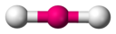

**Problem:**
\(\text{F}_{2}\)

**Solution:**
The molecular shape is linear. (This is a diatomic molecule)

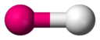

**Problem:**
\(\text{PCl}_{5}\)

**Solution:**
The central atom is phosphorous.

There are five electron pairs around phosphorous and no lone pairs.

The molecule has the general formula \(\text{AX}_{5}\). Using this
                                                        information and Table 3.1 we find that the
                                                        molecular shape is trigonal bipyramidal.

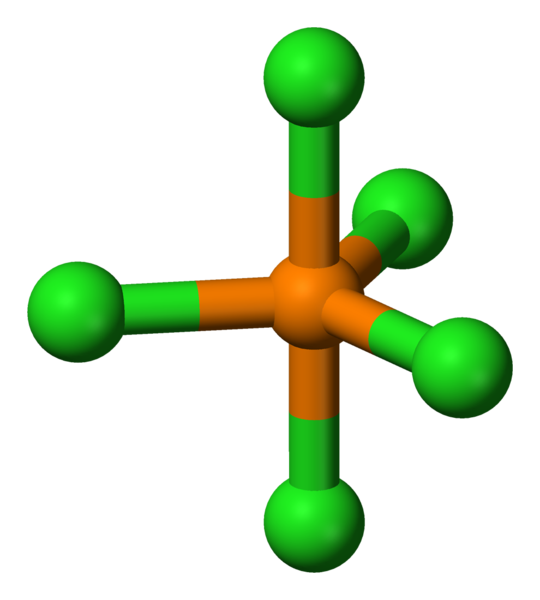

**Problem:**
\(\text{SF}_{6}\)

**Solution:**
The central atom is sulfur.

There are six electron pairs around phosphorous and no lone pairs.

The molecule has the general formula \(\text{AX}_{6}\). Using this
                                                        information and Table 3.1 we find that the
                                                        molecular shape is octahedral.

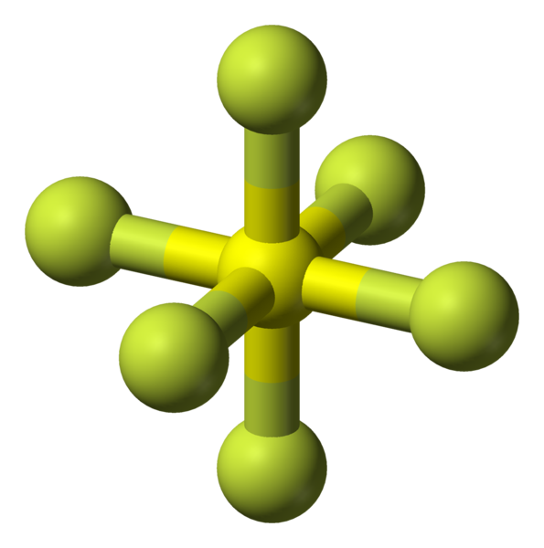

**Problem:**
\(\text{CO}_{2}\)

**Solution:**
The central atom is carbon. (Draw the molecules Lewis diagram to see
                                                        this.)

There are four electron pairs around carbon. These form two double
                                                        bonds. There are no lone pairs around carbon.

The molecule has the general formula \(\text{AX}_{2}\). Using this
                                                        information and Table 3.1 we find that the
                                                        molecular shape is linear.

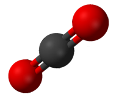

**Problem:**
\(\text{CH}_{4}\)

**Solution:**
The central atom is carbon. (Draw the molecules Lewis diagram to see
                                                        this).

There are four electron pairs around carbon and no lone pairs.

The molecule has the general formula \(\text{AX}_{4}\). Using this
                                                        information and Table 3.1 we find that the
                                                        molecular shape is tetrahedral.

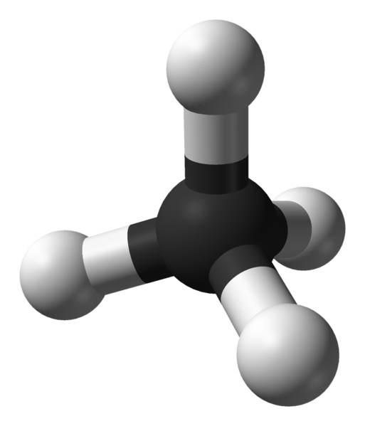

**Problem:**
\(\text{H}_{2}\text{O}\)

**Solution:**
The central atom is oxygen (you can see this by drawing the molecules
                                                        Lewis diagram).

There are two electron pairs around oxygen and two lone pairs.

The molecule has the general formula \(\text{AX}_{2}\text{E}_{2}\).
                                                        Using this information and Table 3.1 we find that the
                                                        molecular shape is bent or angular.

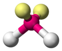

**Problem:**
\(\text{COH}_{2}\)

**Solution:**
The central atom is carbon.

There are four electron pairs around carbon, two of which form a
                                                        double bond to the oxygen atom. There are no lone pairs.

The molecule has the general formula \(\text{AX}_{3}\). Using this
                                                        information and Table 3.1 we find that the
                                                        molecular shape is trigonal planar.

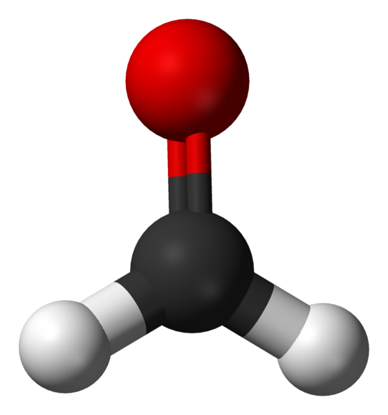
