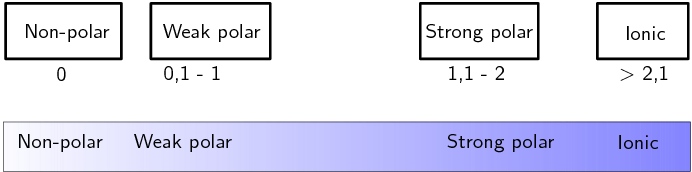
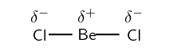

## 3.3 Electronegativity (ESBMD)

So far we have looked at covalent molecules. But how do we know that they are covalent? The answer
                        comes from electronegativity. Each element (except for the noble gases) has an electronegativity
                        value.

**Electronegativity** is a measure of how strongly an atom pulls a shared electron pair
                        towards it. The table below shows the electronegativities of the some of the elements.

For a full list of electronegativities see the periodic table at the front of the book. On this
                        periodic table the electronegativity values are given in the top right corner. Do not confuse
                        these values with the other numbers shown for the elements. Electronegativities will always be
                        between \(\text{0}\) and \(\text{4}\) for any element. If you use a number greater than
                        \(\text{4}\) then you are not using the electronegativity.

<Callout type="tip" title="Note">
Depending on which source you use for electronegativities you may see slightly different
                                values.
</Callout>

| Element | Electronegativity | Element | Electronegativity |
| --- | --- | --- | --- |
| Hydrogen (\(\text{H}\)) | \(\text{2,1}\) | Lithium (\(\text{Li}\)) | \(\text{1,0}\) |
| Beryllium (\(\text{Be}\)) | \(\text{1,5}\) | Boron (\(\text{B}\)) | \(\text{2,0}\) |
| Carbon (\(\text{C}\)) | \(\text{2,5}\) | Nitrogen (\(\text{N}\)) | \(\text{3,0}\) |
| Oxygen (\(\text{O}\)) | \(\text{3,5}\) | Fluorine (\(\text{F}\)) | \(\text{4,0}\) |
| Sodium (\(\text{Na}\)) | \(\text{0,9}\) | Magnesium (\(\text{Mg}\)) | \(\text{1,2}\) |
| Aluminium (\(\text{Al}\)) | \(\text{1,5}\) | Silicon (\(\text{Si}\)) | \(\text{1,8}\) |
| Phosphorous (\(\text{P}\)) | \(\text{2,1}\) | Sulfur (\(\text{S}\)) | \(\text{2,5}\) |
| Chlorine (\(\text{Cl}\)) | \(\text{3,0}\) | Potassium (\(\text{K}\)) | \(\text{0,8}\) |
| Calcium (\(\text{Ca}\)) | \(\text{1,0}\) | Bromine (\(\text{Br}\)) | \(\text{2,8}\) |

Table 3.2:
                                Table of electronegativities for selected elements.

Electronegativity

Electronegativity is a chemical property which describes the power of an atom to
                                        attract electrons towards itself.

<Callout type="note" title="Note">
The concept of electronegativity was introduced by *Linus Pauling* in 1932, and this
                                became very useful in explaining the nature of bonds between atoms in molecules. For
                                this work, Pauling was awarded the Nobel Prize in Chemistry in 1954. He also received
                                the Nobel Peace Prize in 1962 for his campaign against above-ground nuclear testing.
</Callout>

The greater the electronegativity of an atom of an element, the stronger its attractive pull on
                        electrons. For example, in a molecule of hydrogen bromide (\(\text{HBr}\)), the
                        electronegativity of bromine (\(\text{2,8}\)) is higher than that of hydrogen (\(\text{2,1}\)),
                        and so the shared electrons will spend more of their time closer to the bromine atom. Bromine
                        will have a slightly negative charge, and hydrogen will have a slightly positive charge. In a
                        molecule like hydrogen (\(\text{H}_{2}\)) where the electronegativities of the atoms in the
                        molecule are the same, both atoms have a neutral charge.

<Callout type="tip" title="Worked example 9: Calculating electronegativity differences">
**Question:**
Calculate the electronegativity difference between hydrogen and oxygen.

**Read the electronegativity of each element off the periodic table.:**
From the periodic table we find that hydrogen has an electronegativity of
                                        \(\text{2,1}\) and oxygen has an electronegativity of \(\text{3,5}\).

**Calculate the electronegativity difference:**
\(\text{3,5} - \text{2,1} = \text{1,4}\)
</Callout>

### Textbook Exercise 3.7

**Problem:**
Calculate the electronegativity difference between: \(\text{Be}\) and
                                                        \(\text{C}\), \(\text{H}\) and \(\text{C}\), \(\text{Li}\) and
                                                        \(\text{F}\), \(\text{Al}\) and \(\text{Na}\), \(\text{C}\) and
                                                        \(\text{O}\).

**Solution:**
\(\text{Be}\) and \(\text{C}\): \(\text{2,5} - \text{1,5} =
                                                        \text{1,0}.\)

\(\text{H}\) and \(\text{C}\): \(\text{2,5} - \text{2,1} =
                                                        \text{0,4}.\)

\(\text{Li}\) and \(\text{F}\): \(\text{4,0} - \text{1,0} =
                                                        \text{3,0}.\)

\(\text{Al}\) and \(\text{Na}\): \(\text{1,5} - \text{0,9} =
                                                        \text{0,6}.\)

\(\text{C}\) and \(\text{O}\): \(\text{3,5} - \text{2,5} =
                                                        \text{1,0}.\)

### Electronegativity and bonding (ESBMF)

The electronegativity difference between two atoms can be used to determine what type of
                                bonding exists between the atoms. The table below lists the approximate values. Although
                                we have given ranges here bonding is more like a spectrum than a set of boxes.

| Electronegativity difference | Type of bond |
| --- | --- |
| \(\text{0}\) | Non-polar covalent |
| \(\text{0}\) - \(\text{1}\) | Weak polar covalent |
| \(\text{1,1}\) - \(\text{2}\) | Strong polar covalent |
| \(>\) \(\text{2,1}\) | Ionic |

<Callout type="tip" title="Note">
Note that metallic bonding is not given here. Metals have low electronegativities and
                                        so the valence electrons are not drawn strongly to any one atom. Instead, the
                                        valence electrons are loosely shared by all the atoms in the metallic network.
</Callout>

### Non-polar and polar covalent bonds (ESBMG)

It is important to be able to determine if a molecule is polar or non-polar since the
                                *polarity* of molecules affects properties such as *solubility*,
                                *melting points* and *boiling points*.

Electronegativity can be used to explain the difference between two types of covalent bonds.
                                **Non-polar covalent bonds** occur between two identical non-metal atoms,
                                e.g. \(\text{H}_{2}\), \(\text{Cl}_{2}\) and \(\text{O}_{2}\). Because the two atoms
                                have the same electronegativity, the electron pair in the covalent bond is shared
                                equally between them. However, if two different non-metal atoms bond then the shared
                                electron pair will be pulled more strongly by the atom with the higher
                                electronegativity. As a result, a **polar covalent bond** is formed where
                                one atom will have a slightly negative charge and the other a slightly positive charge.

This slightly positive or slightly negative charge is known as a partial charge. These
                                partial charges are represented using the symbols \({\delta }^{+}\) (slightly positive)
                                and \({\delta }^{-}\) (slightly negative). So, in a molecule such as hydrogen chloride
                                (\(\text{HCl}\)), hydrogen is \(\text{H}^{\delta^{+}}\) and chlorine is
                                \(\text{Cl}^{\delta^{-}}\).

<Callout type="tip" title="Note">
The symbol \(\delta\) is read as delta.
</Callout>

### Polar molecules (ESBMH)

Some molecules with polar covalent bonds are **polar molecules**,
                                e.g. \(\text{H}_{2}\text{O}\). But not *all* molecules with polar covalent bonds
                                are polar. An example is \(\text{CO}_{2}\). Although \(\text{CO}_{2}\) has two polar
                                covalent bonds (between
                                \(\text{C}^{\delta^{+}}\) atom and the two \(\text{O}^{\delta^{-}}\) atoms), the
                                molecule itself is not polar. The
                                reason is that \(\text{CO}_{2}\) is a linear molecule, with both terminal atoms the
                                same, and is therefore symmetrical. So there is no difference in charge between the two
                                ends
                                of the molecule.

Polar molecules

A **polar molecule** is one that has one end with a slightly
                                                positive charge, and one end with a slightly negative charge. Examples
                                                include water, ammonia and hydrogen chloride.

Non-polar molecules

A **non-polar molecule** is one where the charge is equally
                                                spread across the molecule or a symmetrical molecule with polar bonds.
                                                Examples include carbon dioxide and oxygen.

<Callout type="tip" title="Note">
To determine if a molecule is symmetrical look first at the atoms around the central
                                        atom. If they are different then the molecule is not symmetrical. If they are
                                        the same then the molecule may be symmetrical and we need to look at the shape
                                        of the molecule.
</Callout>

We can easily predict which molecules are likely to be polar and which are likely to be
                                non-polar by looking at the molecular shape. The following activity will help you
                                determine this and will help you understand more about symmetry.

## Polar and non-polar molecules

The following table lists the molecular shapes. Build the molecule given for each
                                        case using jellytots and toothpicks. Determine if the shape is symmetrical.
                                        (Does it look the same whichever way you look at it?) Now decide if the molecule
                                        is polar or non-polar.

| Geometry | Molecule | Symmetrical | Polar or non-polar |
| --- | --- | --- | --- |
| Linear | \(\text{HCl}\) |  |  |
| Linear | \(\text{CO}_{2}\) |  |  |
| Linear | \(\text{HCN}\) |  |  |
| Bent or angular | \(\text{H}_{2}\text{O}\) |  |  |
| Trigonal planar | \(\text{BF}_{3}\) |  |  |
| Trigonal planar | \(\text{BF}_{2}\text{Cl}\) |  |  |
| Trigonal pyramidal | \(\text{NH}_{3}\) |  |  |
| Tetrahedral | \(\text{CH}_{4}\) |  |  |
| Tetrahedral | \(\text{CH}_{3}\text{Cl}\) |  |  |
| Trigonal bipyramidal | \(\text{PCl}_{5}\) |  |  |
| Trigonal bipyramidal | \(\text{PCl}_{4}\text{F}\) |  |  |
| Octahedral | \(\text{SF}_{6}\) |  |  |
| Octahedral | \(\text{SF}_{5}\text{Cl}\) |  |  |

<Callout type="note" title="Note">
[Simulation:
                                                23PR](http://phet.colorado.edu/en/simulation/molecule-polarity)
</Callout>

<Callout type="tip" title="Worked example 10: Polar and non-polar molecules">
**Question:**
State whether hydrogen (\(\text{H}_{2}\)) is polar or non-polar.

**Determine the shape of the molecule:**
The molecule is linear. There is one bonding pair of electrons and no lone
                                                pairs.

**Write down the electronegativities of each atom:**
Hydrogen: \(\text{2,1}\)

**Determine the electronegativity difference for each bond:**
There is only one bond and the difference is \(\text{0}\).

**Determine the polarity of each bond:**
The bond is non-polar.

**Determine the polarity of the molecule:**
The molecule is non-polar.
</Callout>

<Callout type="tip" title="Worked example 11: Polar and non-polar molecules">
**Question:**
State whether methane (\(\text{CH}_{4}\)) is polar or non-polar.

**Determine the shape of each molecule:**
The molecule is tetrahedral. There are four bonding pairs of electrons and no
                                                lone pairs.

**Determine the electronegativity difference for each bond:**
There are four bonds. Since each bond is between carbon and hydrogen, we only
                                                need to calculate one electronegativity difference. This is:
                                                \(\text{2,5} - \text{2,1} = \text{0,4}\)

**Determine the polarity of each bond:**
Each bond is polar.

**Determine the polarity of the molecule:**
The molecule is symmetrical and so is non-polar.
</Callout>

<Callout type="tip" title="Worked example 12: Polar and non-polar molecules">
**Question:**
State whether hydrogen cyanide (\(\text{HCN}\)) is polar or non-polar.

**Determine the shape of the molecule:**
The molecule is linear. There are four bonding pairs, three of which form a
                                                triple bond and so are counted as \(\text{1}\). There is one lone pair
                                                on the nitrogen atom.

**Determine the electronegativity difference and polarity for
                                                each bond:**
There are two bonds. One between hydrogen and carbon and the other between
                                                carbon and nitrogen. The electronegativity difference between carbon and
                                                hydrogen is \(\text{0,4}\) and the electronegativity difference between
                                                carbon and nitrogen is \(\text{0,5}\). Both of the bonds are polar.

**Determine the polarity of the molecule:**
The molecule is not symmetrical and so is polar.
</Callout>

## Electronegativity

### Textbook Exercise 3.8

In a molecule of beryllium chloride (\(\text{BeCl}_{2}\)):

**Problem:**
What is the electronegativity of beryllium?

**Solution:**
\(\text{1,5}\)

**Problem:**
What is the electronegativity of chlorine?

**Solution:**
\(\text{3,0}\)

**Problem:**
Which atom will have a slightly positive charge and
                                                                        which will have a slightly negative charge in
                                                                        the molecule? Represent this on a sketch of the
                                                                        molecule using partial charges.

**Solution:**
Beryllium will have a slightly positive charge and
                                                                        chlorine will have a slightly negative charge.

**Problem:**
Is the bond a non-polar or polar covalent bond?

**Solution:**
Polar covalent bond. The electronegativity difference
                                                                        is: \(\text{3,0}-\text{1,5} = \text{1,5}\). The
                                                                        bond is strongly polar.

**Problem:**
Is the molecule polar or non-polar?

**Solution:**
Beryllium chloride is linear and symmetrical.
                                                                        Therefore it is a
                                                                        non-polar
                                                                        molecule.

**Problem:**
Complete the table below:

| Molecule | Difference in
                                                                                                electronegativity
                                                                                                between atoms | Non-polar/polar covalent
                                                                                                bond | Polar/non-polar
                                                                                                molecule |
| --- | --- | --- | --- |
| \(\text{H}_{2}\text{O}\) |  |  |  |
| \(\text{HBr}\) |  |  |  |
| \(\text{F}_{2}\) |  |  |  |
| \(\text{CH}_{4}\) |  |  |  |
| \(\text{PF}_{5}\) |  |  |  |
| \(\text{BeCl}_{2}\) |  |  |  |
| \(\text{CO}\) |  |  |  |
| \(\text{C}_{2}\text{H}_{2}\) |  |  |  |
| \(\text{SO}_{2}\) |  |  |  |
| \(\text{BF}_{3}\) |  |  |  |

**Solution:**
| Molecule | Difference in
                                                                                                electronegativity
                                                                                                between atoms | Non-polar/polar covalent
                                                                                                bond | Polar/non-polar
                                                                                                molecule |
| --- | --- | --- | --- |
| \(\text{H}_{2}\text{O}\) | \(\text{3,5}-\text{2,1}=\text{1,4}\) | Polar covalent bond | Polar molecule. Water has a bent or
                                                                                        angular shape. |
| \(\text{HBr}\) | \(\text{2,8}-\text{2,1}=\text{0,7}\) | Polar covalent bond | Polar molecule. Hydrogen bromide is
                                                                                        linear. |
| \(\text{F}_{2}\) | \(\text{4,0}-\text{4,0}=\text{0}\) | Non-polar covalent bond | Non-polar molecule. |
| \(\text{CH}_{4}\) | \(\text{2,5}-\text{2,1}=\text{0,4}\) | Polar covalent bond | Non-polar molecule. Methane is
                                                                                        tetrahedral. |
| \(\text{PF}_{5}\) | \(\text{4,0}-\text{2,1}=\text{1,9}\) | Polar covalent bond | Non-polar molecule. Phosphorous
                                                                                        pentafluoride is trigonal
                                                                                        bypramidal and symmetrical. |
| \(\text{BeCl}_{2}\) | \(\text{3,0}-\text{1,5}=\text{1,5}\) | Polar covalent bond | Non-polar molecule. Beryllium
                                                                                        chloride is linear and
                                                                                        symmetrical. |
| \(\text{CO}\) | \(\text{3,5}-\text{2,5}=\text{1,0}\) | Polar covalent bond | Polar molecule. Carbon monoxide is
                                                                                        linear, but not symmetrical. |
| \(\text{C}_{2}\text{H}_{2}\) | \(\text{2,5}-\text{2,1}=\text{0,4}\) | Polar covalent bond | Non-polar molecule. Acetylene is
                                                                                        linear and symmetrical. |
| \(\text{SO}_{2}\) | \(\text{3,5}-\text{2,5}=\text{1,0}\) | Polar covalent bond | Polar molecule. Sulfur dioxide is
                                                                                        bent or angular and is not
                                                                                        symmetrical. |
| \(\text{BF}_{3}\) | \(\text{4,0}-\text{2,0}=\text{2,0}\) | Polar covalent bond | Non-polar molecule. Boron trifluoride
                                                                                        is trigonal pyramidal and not
                                                                                        symmetrical. |
