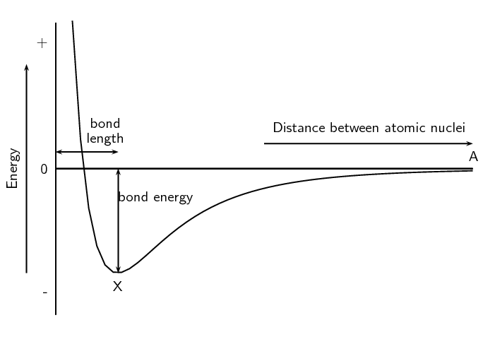
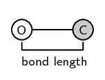
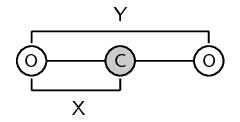

## 3.4 Energy and bonding (ESBMJ)

As we saw earlier in the chapter we can show the energy changes that occur as atoms come together (Figure 3.5). Shown below is the same image but this time
      with two extra pieces of information: the bond energy and the bond length.

Figure 3.9:
        Graph showing the change in energy that takes place as atoms move closer together.

Bond length
The distance between the nuclei of two adjacent atoms when they bond.

Bond energy
The amount of energy that must be added to the system to break the bond that has formed.

It is important to remember that bond length is measured between two atoms that are bonded to each other. The
      following diagrams show the bond length for \(\text{CO}\) and for \(\text{CO}_{2}\). The grey circle represents
      carbon and the white circle represents oxygen.

Figure 3.10: The bond length for carbon monoxide (\(\text{CO}\)).

Figure 3.11: The bond length for each \(\text{C}-\text{O}\) bond in carbon dioxide
        (\(\text{CO}_{2}\)) is indicated by X. Y **is not** the bond length.

A third property of bonds is the bond strength. **Bond strength** means how strongly one atom
      attracts and is held to another. The strength of a bond is related to the bond length, the size of the bonded
      atoms and the number of bonds between the atoms. In general:

- the shorter the bond length, the stronger the bond between the atoms.
- the smaller the atoms involved, the stronger the bond.
- the more bonds that exist between the same atoms, the stronger the bond.

<QuizCard id="s11-03-04a" title="Interactive Exercise 3.10" question="Select the correct term for the following definition: A chemical property which describes the power of an atom to attract electrons towards itself." options=["electronegativity", "VSEPR theory"] answer="VSEPR theory" hint="" explanation="The correct term for \"A chemical property which describes the power of an atom to attract electrons towards itself.\" is: electronegativity Submit your answer as: electronegativity" />

<QuizCard id="s11-03-04a" title="Interactive Exercise 3.10" question="What do X and Y represent?" options=["weaker", "stronger", "shorter", "longer", "higher", "the same", "lower"] answer="
    	            	3
    	            ,
    	            	2
    	            " hint="" explanation="Determine what X and Y represent The diagram shows the change in energy that takes place as the distance between atomic     					nuclei changes. Chemical bonds form to minimise the potential energy     	            	between two atoms so that they are more stable . The turning point on the     	            	graph is the lowest point on the graph. Because energy is on the \(y\) -axis, the turning point represents the distance between the atomic nuclei that gives     	            	the lowest energy . Therefore: X represents bond length . Y represents bond energy . Submit your answer as: bond length and bond energy" />

<QuizCard id="s11-03-04a" title="Interactive Exercise 3.10" question="The graph below shows the changes in energy that take place as the distance between two hydrogen atoms increases. What is the bond energy for hydrogen? What is the bond length for hydrogen?" options=[] answer="
                    2
                ,
                    1
                " hint="" explanation="Determine the bond energy When a bond forms, energy is released , which corresponds to the minimum potential energy value of the system. NOTE: Bond energy is the energy needed to break one mole of a substance into separate atoms. It is equal in magnitude to the amount of energy released when the bond forms. This is why it is positive. So the bond energy for hydrogen is \(\text{436}\ \text{kJ·mol$^{-1}$}\) (check the units!) . Determine the bond length The bond length is the distance between the nuclei of two bonded atoms when the potential energy between the two atoms is at a minimum. So the bond length for hydrogen is \(\text{74}\ \text{pm}\) (check the units!) . Submit your answer as: \(\text{436}\ \text{kJ·mol$^{-1}$}\) and \(\text{74}\ \text{pm}\)" />

<QuizCard id="s11-03-04a" title="Interactive Exercise 3.10" question="Adapted from DBE Nov 2016 Grade 11, P2, Q1.4 Physical constants \(·\) Chemistry formulas \(·\) Periodic table \(·\) Standard reduction potentials The average bond energy of a F−P bond is \(\text{490}\ \text{kJ·mol$^{-1}$}\) , whereas the average bond energy of a P−P bond is \(\text{201}\ \text{kJ·mol$^{-1}$}\) .     			These bond energies are different because ... A the bond length of the F−P bond is smaller than that of the P−P bond. B the F−P bond has a weaker activated complex than the P−P bond. C the number of bonds between atoms is greater in the F−P bond than in the P−P bond. D the bond length of the F−P bond is greater than that of the P−P bond." options=["A", "B", "C", "D"] answer="
                	0
                " hint="" explanation="How are bond length and bond energy related to the strength of a bond? The bond energy of a chemical bond is the average energy needed to break one                 	mole of bonds of that type (for a given chemical species in the gas phase). Bond length is the average distance between the nuclei of two bonded atoms. Stronger bonds have higher bond energies because more energy is required to break them. In general,     				stronger bonds are also shorter. This is because bonds are     				electrostatic in origin, and the electrostatic force is stronger if the distance between charged     				objects is smaller. So in general, the stronger the bond the shorter the bond                 	length, and the more energy is required to break the bond. NOTE: Bond energies depend on many factors, including the electronegativity difference between atoms,                 	electron affinity, the sizes of the atoms, the structure of the substance, and the electron                 	configuration of the atoms involved. Choose the correct option F−P has higher bond     				energy than P−P . So F−P must have a shorter     				bond length than P−P . So these bond energies are different because ... A \({\color{red}{{\checkmark}{\checkmark}}}\) the bond length of the F−P bond is smaller than that of the P−P bond. In general, shorter bond lengths lead to greater bond energies. So the F−P bond being shorter than the P−P bond explains the observed difference. B the F−P bond has a weaker activated complex than the P−P bond. A bond doesn't have an activated complex. So this explanation makes no sense . C the number of bonds between atoms is greater in the F−P bond than in the P−P bond. F−P and P−P have the same number of bonds between atoms (they both have single bonds). D the bond length of the F−P bond is greater than that of the P−P bond. In general, longer bond lengths lead to smaller bond energies. So the F−P bond being longer than the P−P bond does not explain the observed difference. So the correct choice is Option A . Submit your answer as: A" />
