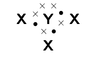
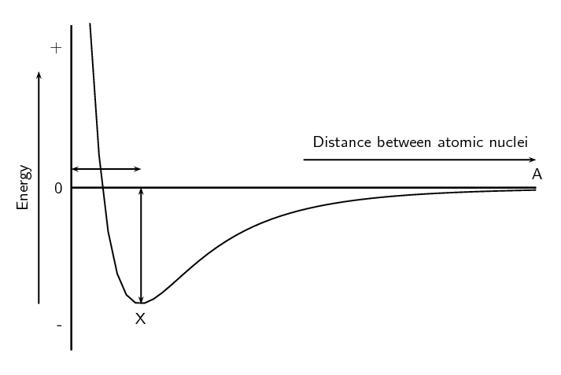
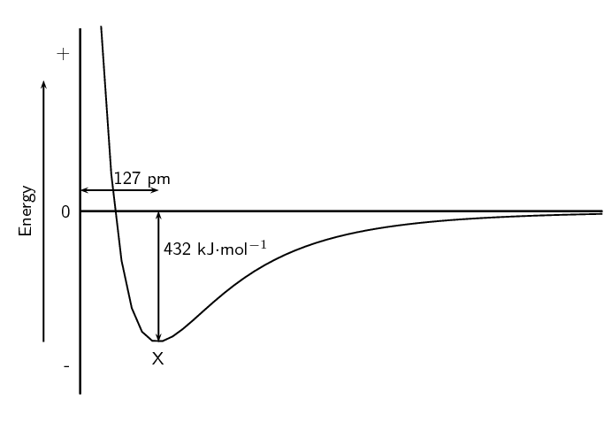

### Textbook Exercise 3.9

Give **one word/term** for each of the following descriptions.

**Problem:**
The distance between two adjacent atoms in a molecule.

**Solution:**
Bond length

**Problem:**
A type of chemical bond that involves the sharing of electrons between two atoms.

**Solution:**
Covalent bond

**Problem:**
A measure of an atom's ability to attract electrons to itself in a chemical bond.

**Solution:**
Electronegativity

**Problem:**
Which ONE of the following best describes the bond formed between an \(\text{H}^{+}\)
                                    ion and the \(\text{NH}_{3}\) molecule?

2. Covalent bond
4. Dative covalent (co-ordinate covalent) bond
6. Ionic Bond
8. Hydrogen Bond

**Solution:**
Dative covalent (co-ordinate covalent) bond

Explain the meaning of each of the following terms:

**Problem:**
valence electrons

**Solution:**
The number of electrons in the outermost shell of an atom that are available for
                                          use in bonding either by sharing, donating or accepting.

**Problem:**
bond energy

**Solution:**
The amount of energy needed for a bond to break.

**Problem:**
covalent bond

**Solution:**
A type of bond that occurs between two atoms with a difference in
                                          electronegativity between \(\text{0}\) and \(\text{2,1}\).

**Problem:**
Which of the following reactions will *not* take place? Explain your answer.

2. \(\text{H} + \text{H} \rightarrow \text{H}_{2}\)
4. \(\text{Ne} + \text{Ne} \rightarrow \text{Ne}_{2}\)
6. \(\text{Cl} + \text{Cl} \rightarrow \text{Cl}_{2}\)

**Solution:**
\(\textrm{Ne} + \textrm{Ne} \rightarrow \textrm{Ne}_{2}\) will not take place as neon
                                    does not have electrons available for bonding. Neon is a noble gas and has a full
                                    outer shell of electrons.

Draw the Lewis diagrams for each of the following:

**Problem:**
An atom of strontium (\(\text{Sr}\)). (Hint: Which group is it in? It will have
                                          an identical Lewis diagram to other elements in that group).

**Solution:**

**Problem:**
An atom of iodine.

**Solution:**

**Problem:**
A molecule of hydrogen bromide (\(\text{HBr}\)).

**Solution:**

**Problem:**
A molecule of nitrogen dioxide (\(\text{NO}_{2}\)). (Hint: There will be a single
                                          unpaired electron).

**Solution:**

Given the following Lewis diagram, where X and Y each represent a different element:

**Problem:**
How many valence electrons does X have?

**Solution:**
\(\text{1}\)

**Problem:**
How many valence electrons does Y have?

**Solution:**
\(\text{5}\)

**Problem:**
Which elements could X and Y represent?

**Solution:**
X could be hydrogen and Y could be nitrogen.

Determine the shape of the following molecules:

**Problem:**
\(\text{O}_{2}\)

**Solution:**
This is a diatomic molecule and so the molecular shape is linear.

**Problem:**
\(\text{MgI}_{2}\)

**Solution:**
The central atom is magnesium (draw the molecules Lewis structure to see this).

There are two electron pairs around magnesium and no lone pairs.

There are two bonding electron pairs and no lone pairs. The molecule has the
                                          general formula \(\text{AX}_{2}\). Using this information and Table 3.1 we find
                                          that the molecular shape is linear.

**Problem:**
\(\text{BCl}_{3}\)

**Solution:**
The central atom is boron (draw the molecules Lewis structure to see this).

There are three electron pairs around boron and no lone pairs.

There are three bonding electron pairs and no lone pairs. The molecule has the
                                          general formula \(\text{AX}_{3}\). Using this information and Table 3.1 we find
                                          that the molecular shape is trigonal planar.

**Problem:**
\(\text{CS}_{2}\)

**Solution:**
The central atom is carbon (draw the molecules Lewis structure to see this).

There are four electron pairs around carbon forming two double bonds. There are
                                          no lone pairs.

The molecule has the general formula \(\text{AX}_{2}\). Using this information
                                          and Table 3.1 we find
                                          that the molecular shape is linear.

**Problem:**
\(\text{CCl}_{4}\)

**Solution:**
The central atom is carbon (draw the molecules Lewis structure to see this).

There are four bonding electron pairs and no lone pairs. The molecule has the
                                          general formula \(\text{AX}_{4}\). Using this information and Table 3.1 we find
                                          that the molecular shape is tetrahedral.

**Problem:**
\(\text{CH}_{3}\text{Cl}\)

**Solution:**
The central atom is carbon (draw the molecules Lewis structure to see this).

There are four bonding electron pairs and no lone pairs. The molecule has the
                                          general formula \(\text{AX}_{4}\). Using this information and Table 3.1 we find
                                          that the molecular shape is tetrahedral.

**Problem:**
\(\text{Br}_{2}\)

**Solution:**
This is a diatomic molecule and so the molecular shape is linear.

**Problem:**
\(\text{SCl}_{5}\text{F}\)

**Solution:**
The central atom is sulfur

There are six electron pairs around beryllium and no lone pairs.

The molecule has the general formula \(\text{AX}_{6}\). Using this information
                                          and Table 3.1 we find
                                          that the molecular shape is octahedral.

**Problem:**
Complete the following table.

| Element pair | Electronegativity difference | Type of bond that could form |
| --- | --- | --- |
| Hydrogen and lithium |  |  |
| Hydrogen and boron |  |  |
| Hydrogen and oxygen |  |  |
| Hydrogen and sulfur |  |  |
| Magnesium and nitrogen |  |  |
| Magnesium and chlorine |  |  |
| Boron and fluorine |  |  |
| Sodium and fluorine |  |  |
| Oxygen and nitrogen |  |  |
| Oxygen and carbon |  |  |

**Solution:**
| Element pair | Electronegativity difference | Type of bond that could form |
| --- | --- | --- |
| Hydrogen and lithium | \(\text{1,22}\) | Strong polar covalent bond |
| Hydrogen and boron | \(\text{0,16}\) | Weak polar covalent bond |
| Hydrogen and oxygen | \(\text{1,24}\) | Strong polar covalent bond |
| Hydrogen and sulfur | \(\text{0,38}\) | Weak polar covalent bond |
| Magnesium and nitrogen | \(\text{1,73}\) | Strong polar covalent bond |
| Magnesium and chlorine | \(\text{1,73}\) | Strong polar covalent bond |
| Boron and fluorine | \(\text{1,94}\) | Strong polar covalent bond |
| Sodium and fluorine | \(\text{3,05}\) | Ionic bond |
| Oxygen and nitrogen | \(\text{0,40}\) | Weak polar covalent bond |
| Oxygen and carbon | \(\text{0,89}\) | Weak polar covalent bond |

Are the following molecules polar or non-polar?

**Problem:**
\(\text{O}_{2}\)

**Solution:**
The molecule is linear. There are two bonding pairs forming a double bond and two
                                          lone pairs on each oxygen atom.

There is one bond. The electronegativity difference between oxygen and oxygen is
                                          \(\text{0}\). The bond is non-polar.

The molecule is symmetrical and is non-polar.

**Problem:**
\(\text{MgBr}_{2}\)

**Solution:**
The molecule is linear. There are two bonding pairs forming two single bonds and
                                          three lone pairs on each bromine atom.

There are two bonds, both of which are between magnesium and bromine. The
                                          electronegativity difference between magnesium and bromine is \(\text{1,6}\).
                                          The bonds are polar.

The molecule is symmetrical and is non-polar.

**Problem:**
\(\text{BF}_{3}\)

**Solution:**
The molecule is trigonal planar. There are three bonding pairs forming three
                                          single bonds and three lone pairs on each fluorine atom.

There are three bonds, all of which are between boron and fluorine. The
                                          electronegativity difference between boron and fluorine is \(\text{2,0}\). The
                                          bonds are polar.

The molecule is symmetrical and is non-polar.

**Problem:**
\(\text{CH}_{2}\text{O}\)

**Solution:**
The molecule is trigonal planar. There are four bonding pairs forming two single
                                          bonds and one double bond. There are two lone pairs on the oxygen atom.

There are three bonds, two of which are between carbon and hydrogen. The
                                          electronegativity difference between carbon and hydrogen is \(\text{0,4}\).
                                          The other bond is between carbon and oxygen. The electronegativity difference
                                          between carbon and oxygen is \(\text{1,0}\). All the bonds are polar.

The molecule is not symmetrical and is polar.

Given the following graph for hydrogen:

**Problem:**
The bond length for hydrogen is \(\text{74}\) \(\text{pm}\). Indicate this value
                                          on the graph. (Remember that \(\text{pm}\) is a picometer and means
                                          \(\text{74} \times \text{10}^{-\text{12}}\) \(\text{m}\)).

The bond energy for hydrogen is \(\text{436}\) \(\text{kJ·mol$^{-1}$}\).
                                          Indicate this value on the graph.

**Solution:**

**Problem:**
What is important about point X?

**Solution:**
At point X the attractive and repulsive forces acting on the two hydrogen atoms
                                          are balanced. The energy is at a minimum.

**Problem:**
Hydrogen chloride has a bond length of \(\text{127}\) \(\text{pm}\) and a bond energy
                                    of \(\text{432}\) \(\text{kJ·mol$^{-1}$}\). Draw a graph of energy versus
                                    distance and indicate these values on your graph. The graph does not have to be
                                    accurate, a rough sketch graph will do.

**Solution:**

