# Chapter 4: Intermolecular forces

If there were no intermolecular forces than all matter would exist as gases and we would not be here. This
      chapter introduces learners to a new concept called an intermolecular force. It is easy for learners to become
      confused as to whether they are talking about bonds or about intermolecular forces, particularly when the
      intermolecular forces in the noble gases are discussed. For this reason you should try and use the word bond or
      bonding to refer to the interatomic forces (the things holding the atoms together) and intermolecular forces for
      the things holding the molecules together. Getting learners to label the bonds and intermolecular forces on
      diagrams of molecules will help them to come to grips with the terminology.

This topic comes right after learners have learnt about electronegativity and polarity so this is a good chapter
      to reinforce those concepts and help learners see the use of electronegativity and polarity. Learners need to be
      very comfortable with determining the polarity and shape of molecules as this will help them determine the kinds
      of intermolecular forces that occur.

A brief overview of the topics covered in this chapter follows.

- **What are intermolecular and how do they differ from bonds (interatomic forces).**
  This topic introduces learners to the concept of intermolecular forces. The five different types of
            intermolecular forces are introduced. Intermolecular forces are one of the main reason that matter exists in
            different states (solids, liquids and gases). Gases have no intermolecular forces between particles. For this
            reason you should either choose examples that are all in the liquid or solid state at room temperature (this
            temperature is the most familiar to learner) or remind learners that although the examples may be gases, we
            can consider the intermolecular forces between gases when they are cooled down and become liquids. It is also
            important to take care if you use the noble gases to explain induced dipole forces since technically these
            forces are not between molecules and so may confuse learners.
- **Physical state and density.**
  Although this is listed as a separate point in CAPs, in this book it has been worked into the explanation of
            intermolecular forces. Solids have the strongest intermolecular forces between molecules and it is these
            forces which hold the molecules in a rigid shape. In a liquid the intermolecular forces are continuously
            breaking and reforming as the molecules move and slide over each other.
- **Particle kinetic energy and temperature.**
  This topic is also listed as a separate point in CAPs and is worked into the explanation of intermolecular
            forces. This topic links back to grade \(\text{10}\) (states of matter and the kinetic molecular theory) and
            also links to chapter \(\text{7}\) (ideal gases).
- **The chemistry of water.**
  The second half of this chapter is devoted to understanding more about water. Water is a unique liquid in
            many aspects. Some of these properties of water are explained in this part of the text. It is important to
            link this into intermolecular forces and in particular the strong hydrogen bonds that are found between water
            molecules.

All around us we see matter in different phases. The air we breathe is a gas, while the water you drink is a liquid
    and the chair you are sitting on is a solid. In this chapter we are going to look at one of the reasons that matter
    exists as solids and liquids.

In the previous chapter, we discussed the different forces that exist *between atoms* (interatomic forces).
    When atoms are joined to one another they form molecules, and these molecules in turn have forces that bind them
    together. These forces are known as **intermolecular forces**.

Intermolecular forces allow us to determine which substances are likely to dissolve in which other substances and
    what the melting and boiling points of substances are. Without intermolecular forces holding molecules together we
    would not exist.

Note that we will use the term molecule throughout this chapter as the compounds we are looking at are all
    covalently bonded and do not exist as giant networks (recall from grade \(\text{10}\) that there are three types of
    bonding: metallic, ionic and covalent). Sometimes you will see the term simple molecule. This is a covalent
    molecular structure.

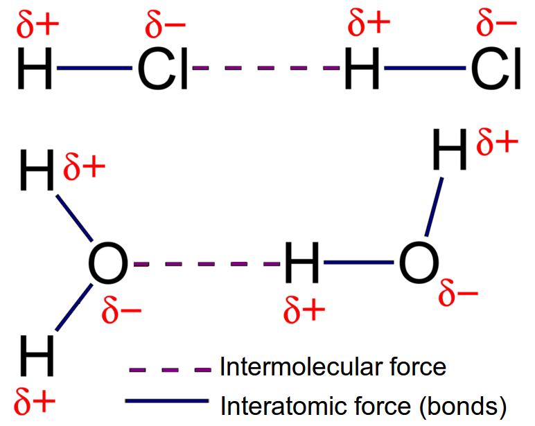

<Callout type="tip" title="Note">
Interatomic (between atoms) forces are also known as intramolecular (within molecules) forces. You can remember
      this by thinking of **inter**national which means between nations.
</Callout>

## 4.1 Intermolecular and interatomic forces (ESBMM)

Intermolecular forces

Intermolecular forces are forces that act between molecules.

You will also recall from the previous chapter, that we can describe molecules as being either
      **polar** or **non-polar**. A polar molecule is one in which there is a difference in
      electronegativity between the atoms in the molecule, such that the shared electron pair spends more time close to
      the atom that attracts it more strongly. The result is that one end of the molecule will have a slightly positive
      charge (\(δ^{+}\)), and the other end will have a slightly negative charge (\(δ^{-}\)). The molecule is
      said to be a **dipole**.

A dipole molecule is a molecule that has two (di) poles. One end of the molecule is slightly positive and the
      other is slightly negative. We can depict this very simply as an oval with one positive side and one negative. In
      reality however, the molecules do not look like this, they look more like the images in Figure 4.1.

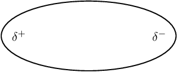

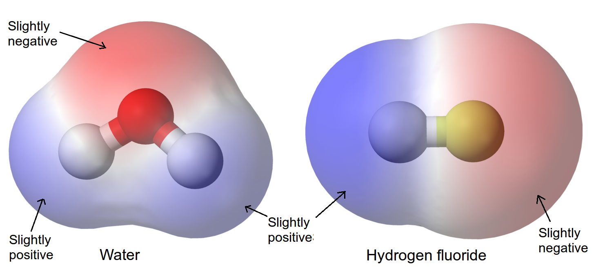

Figure 4.1: A different representation of dipole molecules. The red region is slightly
        negative, and the blue region is slightly positive.

It is important to remember that just because the bonds within a molecule are polar, the molecule itself may not
      necessarily be polar. The shape of the molecule may also affect its polarity. A few examples are shown in Table 4.1 to refresh your memory. Note that we
      have shown tetrahedral molecules with all the terminal atoms at \(\text{90}\)\(\text{°}\) to each other (i.e.
      flat or 2-dimensional), but the shape is really 3-dimensional.

| Molecule | Chemical formula | Bond between atoms | Shape of molecule | Polarity of molecule |
| --- | --- | --- | --- | --- |
| Hydrogen | \(\text{H}_{2}\) | Non-polar covalent |  | Non-polar |
| Hydrogen chloride | \(\text{HCl}\) | Polar covalent |  | Polar |
| Carbon tetrafluoride | \(\text{CF}_{4}\) | Polar covalent |  | Non-polar |
| Trifluoro-methane | \(\text{CHF}_{3}\) | Polar covalent |  | Polar |

Table 4.1:
        Polarity in molecules with different atomic bonds and molecular shapes.

### Types of intermolecular forces (ESBMN)

It is important to be able to recognise whether the molecules in a substance are polar or non-polar because
        this will determine what type of intermolecular forces there are. This is important in explaining the properties
        of the substance.

2. **Ion-dipole forces**
   As the name suggests, this type of intermolecular force exists between an ion and a dipole (polar)
               molecule. You will remember that an *ion* is a charged atom, and this will be attracted to one of the
               charged ends of the polar molecule. A positive ion will be attracted to the negative pole of the polar
               molecule, while a negative ion will be attracted to the positive pole of the polar molecule. This can be
               seen when sodium chloride (\(\text{NaCl}\)) dissolves in water. The positive sodium ion (\(\text{Na}^{+}\))
               will be attracted to the slightly negative oxygen atoms in the water molecule, while the negative chloride
               ion (\(\text{Cl}^{-}\)) is attracted to the slightly positive hydrogen atoms. These intermolecular forces
               weaken the ionic bonds between the sodium and chloride ions so that the sodium chloride dissolves in the
               water (Figure 4.2).
   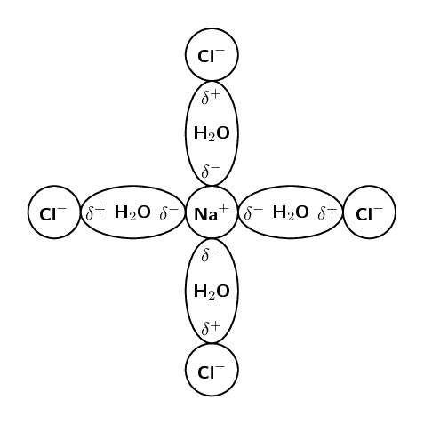
   Figure 4.2:
                 Ion-dipole forces in a sodium chloride solution.
   This is a simplified diagram to highlight the regions of positive and negative charge. When sodium chloride
               dissolves in water it can more accurately be shown as:
   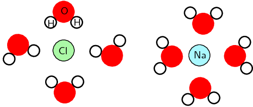
4. **Ion-induced-dipole forces**
   Similar to ion-dipole forces these forces exist between ions and non-polar molecules. The ion induces a
               dipole in the non-polar molecule leading to a weak, short lived force which holds the compounds together.
   These forces are found in haemoglobin (the molecule that carries oxygen around your body). Haemoglobin has
               \(\text{Fe}^{2+}\) ions. Oxygen (\(\text{O}_{2}\)) is attracted to these ions by ion-induced dipole forces.
6. **Dipole-dipole forces**
   When one dipole molecule comes into contact with another dipole molecule, the positive pole of the one
               molecule will be attracted to the negative pole of the other, and the molecules will be held together in
               this way (Figure 4.3). Examples of
               materials/substances that are held together by dipole-dipole forces are \(\text{HCl}\), \(\text{SO}_{2}\)
               and \(\text{CH}_{3}\text{Cl}\).
   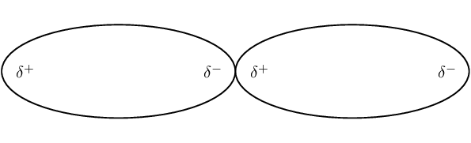
   Figure 4.3:
                 Two dipole molecules are held together by the attractive force between their oppositely charged poles.
   One special case of this is hydrogen bonding.
8. **Induced dipole forces**
   <Callout type="note" title="Note">
   These intermolecular forces are also sometimes called “London forces” or “momentary
                 dipole” forces or “dispersion” forces.
   </Callout>
   We know that while carbon dioxide is a non-polar molecule, we can still freeze it (and we can also freeze
               all other non-polar substances). This tells us that there must be some kind of attractive force in these
               kinds of molecules (molecules can only be solids or liquids if there are attractive forces pulling them
               together). This force is known as an induced dipole force.
   In non-polar molecules the electronic charge is usually evenly distributed but it is possible that at a
               particular moment in time, the electrons might not be evenly distributed (remember that the electrons are
               always moving in their orbitals). The molecule will have a *temporary dipole*. In other words, each
               end of the molecules has a slight charge, either positive or negative. When this happens, molecules that are
               next to each other attract each other very weakly. These forces are found in the halogens (e.g.
               \(\text{F}_{2}\) and \(\text{I}_{2}\)) and in other non-polar molecules such as carbon dioxide and carbon
               tetrachloride.
   All covalent molecules have induced dipole forces. For non-polar covalent molecules these forces are the
               only intermolecular forces. For polar covalent molecules, dipole-dipole forces are found in addition to the
               induced dipole forces.
   <Callout type="tip" title="Note">
   When the noble gases condense, the intermolecular forces that hold the liquid together are induced dipole
                 forces.
   </Callout>
10. **Dipole-induced-dipole forces**
   This type of force occurs when a molecule with a dipole induces a dipole in a non-polar molecule. It is
               similar to an ion-induced dipole force. An example of this type of force is chloroform (\(\text{CHCl}_{3}\))
               in carbon tetrachloride (\(\text{CCl}_{4}\)).

The following image shows the types of intermolecular forces and the kinds of compounds that lead to those
        forces.

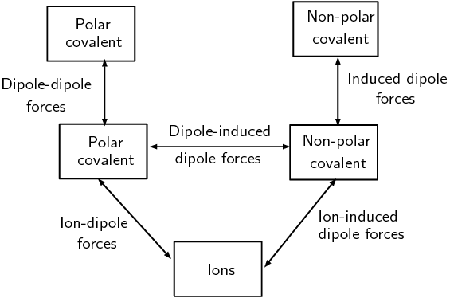

Figure 4.4: The types of intermolecular forces. The boxes represent the type of
          compound while the lines represent the type of force.

The last three forces (dipole-dipole forces, dipole-induced dipole forces and induced dipole forces) are
        sometimes collectively known as van der Waals' forces. We will now look at a special case of dipole-dipole
        forces in more detail.

**Hydrogen bonds**

As the name implies, this type of intermolecular bond involves a hydrogen atom. When a molecule contains a
        hydrogen atom covalently bonded to a highly electronegative atom (\(\text{O}\), \(\text{N}\) or \(\text{F}\))
        this type of intermolecular force can occur. The highly electronegative atom on one molecule attracts the
        hydrogen atom on a nearby molecule.

Water molecules for example, are held together by hydrogen bonds between the hydrogen atom of one molecule and
        the oxygen atom of another (Figure 4.5). Hydrogen
        bonds are a relatively strong intermolecular force and are stronger than other dipole-dipole forces. It is
        important to note however, that hydrogen bonds are weaker than the covalent and ionic bonds that exist between
        *atoms*.

<Callout type="tip" title="Note">
Do not confuse hydrogen bonds with actual chemical bonds. Hydrogen bonding is an example of a case where a
          scientist named something believing it to be one thing when in fact it was another. In this case the strength
          of the hydrogen bonds misled scientists into thinking this was actually a chemical bond, when it is really
          just an intermolecular force.
</Callout>

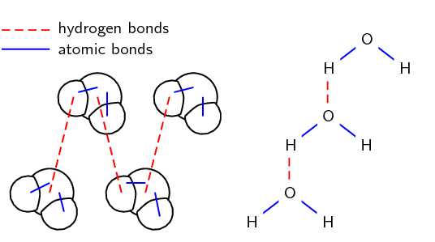

Figure 4.5:
          Two representations showing the hydrogen bonds between water molecules: space-filling model and structural
          formula.

### The difference between intermolecular and interatomic forces (ESBMP)

It is important to realise that there is a difference between the types of interactions that occur in molecules
        and the types that occur between molecules. In the previous chapter we focused on the interactions between
        atoms. These are known as interatomic forces or chemical bonds. We also studied covalent molecules in more
        detail.

Remember that a covalent bond has an electronegativity difference of less than \(\text{2,1}\). Covalent
        molecules have covalent bonds between their atoms. Van der Waals' forces only occur in covalent molecules. We
        can show the interatomic and intermolecular forces between covalent compounds diagrammatically or in words.
        Intermolecular forces occur between molecules and do not involve individual atoms. Interatomic forces are the
        forces that hold the the atoms in molecules together. Figure
          4.5 shows this.

|  | Interatomic forces | Intermolecular forces |
| --- | --- | --- |
| Atoms or molecules | Forces between atoms | Forces between molecules |
| Strength of forces | Strong forces | Relatively weak forces |
| Distance between atoms or molecules | Very short distances | Larger distances than bonds |

Table 4.2: The differences between interatomic and intermolecular forces.

The worked examples on intermolecular forces condense a lot of information into the first step. You may need
          to remind learners how to determine molecular polarity. To do this, you can use the worked examples in atomic
          combinations as a quick refresher of the topic. In tests and exams learners need to be able to quickly
          identify a polar or non-polar molecule and so need to be very comfortable with this skill.

<Callout type="tip" title="Worked example 1: Intermolecular forces">
**Question:**
Which intermolecular forces are found in carbon tetrachloride (\(\text{CCl}_{4}\))?

**Think about what you know about the molecule.:**
Carbon has an electronegativity of \(\text{2,5}\). Chlorine has an electronegativity of \(\text{3,0}\). The
            electronegativity difference between carbon and chlorine is \(\text{1,0}\) (recall the section on
            electronegativity in the previous chapter). We also know that the bond between carbon and chlorine is polar.

Also from the previous chapter we know that carbon tetrachloride is a tetrahedral molecule (recall
            molecular shape). Carbon tetrachloride is symmetrical and so is non-polar overall.

**Now decide which case it is:**
Carbon tetrachloride is non-polar and so the only kind of force that can exist is **induced
              dipole**.
</Callout>

<Callout type="tip" title="Worked example 2: Intermolecular forces">
**Question:**
Which intermolecular forces are found in the following solution: sodium chloride in water?

**Think about what you know about the molecules:**
Sodium chloride is ionic. (the electronegativity difference is \(\text{2,1}\)). Water has polar bonds (the
            electronegativity difference is \(\text{1,4}\)). Water is a polar molecule (its molecular shape is bent or
            angular).

**Now decide which case it is:**
This is an ionic substance interacting with a polar substance. This interaction is an
            **ion-dipole** force.
</Callout>

### Textbook Exercise 4.1

Which intermolecular forces are found in:

**Problem:**
hydrogen fluoride (\(\text{HF}\))

**Solution:**
Hydrogen fluoride is a polar covalent molecule. (It is linear and not symmetrical.) So the type of
                intermolecular force is dipole-dipole forces.

**Problem:**
methane (\(\text{CH}_{4}\))

**Solution:**
Methane is a non-polar covalent molecule. (It is tetrahedral and symmetrical.) So the type of
                intermolecular force is induced dipole forces.

**Problem:**
potassium chloride in ammonia (\(\text{KCl}\) in \(\text{NH}_{3}\))

**Solution:**
Potassium chloride is an ionic compound. Ammonia is a polar covalent molecule. (It is trigonal
                pyramidal and not symmetrical.) So the type of intermolecular force is ion-dipole forces.

**Problem:**
krypton (\(\text{Kr}\))

**Solution:**
Krypton is a noble gas. So the type of intermolecular force is induced dipole forces.

### Understanding intermolecular forces (ESBMQ)

The types of intermolecular forces that occur in a substance will affect its properties, such as its
        **phase**, **melting point** and **boiling point**. You should remember
        from the kinetic theory of matter (see grade \(\text{10}\)), that the *phase* of a substance is
        determined by how strong the forces are between its particles. The weaker the forces, the more likely the
        substance is to exist as a gas. This is because the particles are able to move far apart since they are not held
        together very strongly. If the forces are very strong, the particles are held closely together in a solid
        structure. Remember also that the *temperature* of a material affects the energy of its particles. The
        more energy the particles have, the more likely they are to be able to overcome the forces that are holding them
        together. This can cause a change in phase.

Shown below are the three phases of water. Note that we are showing two dimensional figures when in reality
        these are three dimensional.

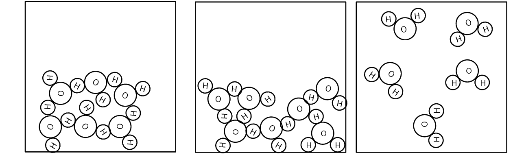

Figure 4.6: The three phases of water.

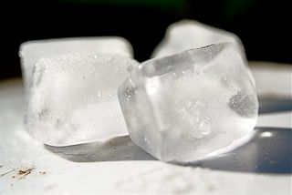

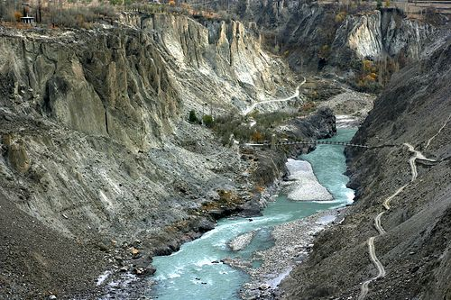

#### The effects of intermolecular forces

The following five experiments investigate the effect of various physical properties (evaporation, surface
          tension, solubility, boiling point and capillarity) of substances and determine how these properties relate to
          intermolecular forces. Each experiment will look at a different property.

A formal experiment on the effects of intermolecular forces is included in this chapter. In this experiment
            learners will investigate how intermolecular forces affect evaporation, surface tension, solubility, boiling
            points and capillarity. Some of the substances that are used (nail polish remover (mainly acetone if you use
            the non acetone free variety), methylated spirits (a mixture of methanol and ethanol), oil (a mostly
            non-polar hydrocarbon), glycerin (a fairly complex organic molecule)) are quite complex substances and
            learners may not have the skills needed to determine the types of intermolecular forces at work here. You
            should guide learners in this and tell them the intermolecular forces for these substances.

You can help learners work out the strength of the intermolecular forces by telling them that larger
            molecules have stronger intermolecular forces than smaller molecules. This is often a big factor in
            determining which substance has the strongest intermolecular forces.

This experiment is split into five experiments. Each experiment focuses on a different property and sees
            how that property relates to intermolecular forces. It will often not be easy for learners to see the small
            differences between some of the molecules chosen and so they need to use a combination of experimental
            results and knowledge about the strength of the intermolecular force to try and predict what may happen.
            Each experiment ends with a conclusion about what should be found to guide learners.

It is very important to work in a well ventilated room (one with lots of air flow) particularly when
            working with methanol and ethanol. Many of the substances used (particularly nail polish remover, ethanol
            and methylated spirits) are highly flammable and so care must be taken when heating these substances. It is
            recommended that learners use a hot plate rather than a Bunsen burner to heat these substances as this
            reduces the risk of fire. When doing chemistry experiments it is also extra important to ensure that your
            learners do not run around, do not try to drink the chemicals, do not eat and drink in the lab, do not throw
            chemicals on the other learners and in general do act in a responsible and safe way. The guidelines for safe
            experimental work can be found in the science skills chapter from grade \(\text{10}\).

## The effects of intermolecular forces: Part \(\text{1}\)

### Aim

To investigate evaporation and to determine the relation between evaporation and intermolecular forces.

### Apparatus

You will need the following items for this experiment:

- ethanol, water, nail polish remover (acetone), methylated spirits
- evaporating dishes (or shallow basins)

### Method

2. Place \(\text{20}\) \(\text{ml}\) of each substance given in separate evaporating dishes.
4. Carefully move each dish to a warm (sunny) spot.
6. Mark the level of liquid in each dish using a permanent marker. Make several marks at different
                   positions around the dish. If the permanent marker is leaving a smudge rather than a noticeable mark,
                   carefully wipe the side of the dish and try again.
8. Observe each dish every minute and note which liquid evaporates fastest.

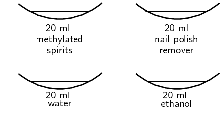

### Results

Record your results in the table below. You do not need to measure the level of the liquid, but rather
              just write how much the level had dropped (e.g. for water you might write did not notice any decrease in
              the level or for ethanol you might write almost all the liquid had evaporated).

| Substance | Liquid level after \(\text{1}\) \(\text{min}\) | \(\text{2}\) \(\text{min}\) | \(\text{3}\) \(\text{min}\) | \(\text{4}\) \(\text{min}\) | \(\text{5}\) \(\text{min}\) |
| --- | --- | --- | --- | --- | --- |
| Ethanol |  |  |  |  |  |
| Water |  |  |  |  |  |
| Nail polish remover |  |  |  |  |  |
| Methylated spirits |  |  |  |  |  |

### Discussion and conclusion

You should find that water takes the longest time to evaporate. Water has strong intermolecular forces
              (hydrogen bonds). Ethanol (\(\text{CH}_{3}\text{CH}_{2}\text{OH}\)) and methylated spirits (mainly ethanol
              (\(\text{CH}_{3}\text{CH}_{2}\text{OH}\)) with some methanol (\(\text{CH}_{3}\text{OH}\))) both have
              hydrogen bonds but these are slightly weaker than the hydrogen bonds in water. Nail polish remover
              (acetone (\(\text{CH}_{3}\text{COCH}_{3}\))) has dipole-dipole forces only and so evaporates quickly.

Substances with weaker intermolecular forces evaporate faster than substances with stronger
              intermolecular forces.

## The effects of intermolecular forces: Part \(\text{2}\)

### Aim

To investigate surface tension and to determine the relation between surface tension and intermolecular
              forces.

### Apparatus

You will need the following items for this experiment:

- water, cooking oil (sunflower oil), glycerin, nail polish remover (acetone), methylated spirits
- small glass beakers or glass measuring cylinders
- small piece of glass or clear plastic (about \(\text{5}\) \(\text{cm}\) by \(\text{5}\)
                  \(\text{cm}\).)

### Method

2. Place about \(\text{50}\) \(\text{ml}\) of each substance given in separate small beakers or measuring
                   cylinders.
4. Observe the shape of the meniscus. (This is the level of the liquid). Note what happens at the edges
                   where the liquid touches the glass. (You can place a few drops of food colouring in each substance to
                   help you see the meniscus.)
6. Now place a drop of the substance on a small piece of glass. Observe the shape of the drop.

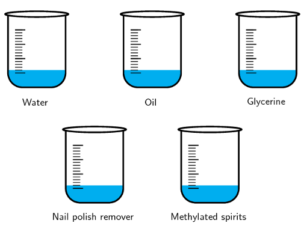

### Results

Record your results in the table below. You just need to give a qualitative result (in other words what
              you see in the experiment).

| Substance | Shape of meniscus | Shape of droplet |
| --- | --- | --- |
| Water |  |  |
| Oil |  |  |
| Glycerine |  |  |
| Nail polish remover |  |  |
| Methylated spirits |  |  |

### Discussion and conclusion

The meniscus for all these substances should be concave (i.e. higher at the edges than in the middle).
              This is because the forces holding the molecules in the substance together are weaker than the attraction
              between the substance and the glass of the tube.

You should also have noticed that water, oil and Glycerine tend to form a drop, while nail polish remover
              and methylated spirits do not. Strong intermolecular forces help hold the substance together, while weaker
              ones do not hold the molecules in the substance together as much.

Water has the strongest intermolecular forces (hydrogen bonds) of all the substances used. Glycerine and
              methylated spirits also have hydrogen bonds, but these intermolecular forces are slightly weaker than in
              water. Sunflower oil is mostly non-polar but has very long molecules which help account for the higher
              surface tension.

Substances with strong intermolecular forces will generally have a greater surface tension than
              substances with weaker intermolecular forces.

## The effects of intermolecular forces: Part \(\text{3}\)

### Aim

To investigate solubility and to determine the relation between solubility and intermolecular forces.

### Apparatus

You will need the following items for this experiment:

- Solids: sodium chloride (table salt), iodine, potassium permanganate
- Solvents: water, ethanol, chloroform
- \(\text{9}\) beakers or test-tubes
- \(\text{3}\) A4 sheets of paper

### Method

2. Place about \(\text{20}\) \(\text{ml}\) of each solvent given in separate beakers. Place this set on a
                   piece of paper labelled “sodium chloride”.
4. Repeat this step twice. The second set is for potassium permanganate (so your piece of paper will say
                   “potassium permanganate”) and the third set is for iodine (so your piece of paper will say
                   “iodine”). You should now have nine beakers in total.
6. Into the first set, add about \(\text{2}\) \(\text{g}\) of sodium chloride.
8. Into the second set, add about \(\text{2}\) \(\text{g}\) of potassium permanganate.
10. Into the third set, add about \(\text{2}\) \(\text{g}\) of iodine.
12. Observe how much of each substance dissolves in the solvent.

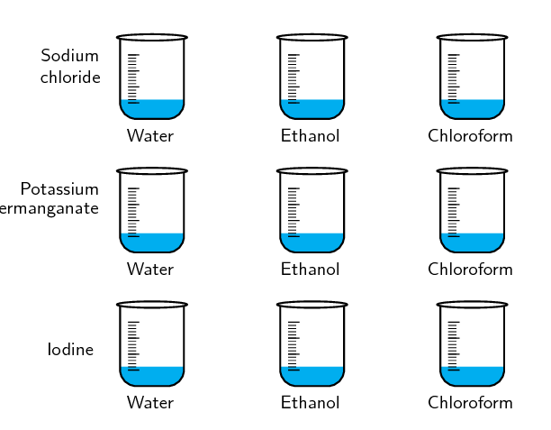

### Results

Record your results in the table below. If you observe only a small amount of the solid dissolving then
              write that very little solid dissolved. If all the solid dissolves then write that all the solid
              dissolved.

| Substance | Water | Chloroform | Ethanol |
| --- | --- | --- | --- |
| Sodium chloride |  |  |  |
| Potassium permanganate |  |  |  |
| Iodine |  |  |  |

### Discussion and conclusion

You should find that the sodium chloride and potassium permanganate dissolved (at least a bit) in all the
              substances. The iodine did not dissolve in any of the substances. The three solvents (water, chloroform
              and ethanol) are all polar and have dipole-dipole forces. Sodium chloride and potassium permanganate are
              both ionic substances, while iodine is non-polar.

Substances will dissolve in solvents that have similar intermolecular forces or in solvents where the
              ionic bonds can be disrupted by the formation of ion-dipole forces.

## The effects of intermolecular forces: Part \(\text{4}\)

### Aim

To investigate boiling point and to determine the relation between boiling point and intermolecular
              forces.

### Apparatus

You will need the following items for this experiment:

- water, cooking oil (sunflower oil), Glycerine, nail polish remover, methylated spirits
- test-tubes and a beaker
- hot plate

### Method

<Callout type="warning" title="Note">
Methylated spirits and nail polish remover are highly flammable. They will easily catch fire if left
                near an open flame. For this reason they must be heated in a water bath. This experiment MUST be
                performed in a well ventilated room.
</Callout>

2. Place about \(\text{20}\) \(\text{ml}\) of each substance given in separate test-tubes.
4. Half-fill the beaker with water and place on the hot plate.
6. Place the test-tubes in the beaker.
8. Observe how long each substance takes to boil. As soon as a substance boils, remove it from the water
                   bath.

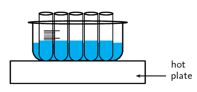

### Results

Write down the order in which the substances boiled, starting with the substance that boiled first and
              ending with the substance that boiled last.

### Discussion and conclusion

You should have found that the nail polish remover and the methylated spirits boil before the water, oil
              and Glycerine.

Glycerine, water and methylated spirits have hydrogen bonds between the molecules. However, in water and
              Glycerine these intermolecular forces are very strong while in the methylated spirits they are slightly
              weaker. This leads to the higher boiling point for water and Glycerine. Nail polish remover has weaker
              dipole-dipole forces.

Although cooking oil is non-polar and has induced dipole forces the molecules are very large and so these
              increase the strength of the intermolecular forces.

Substances with strong intermolecular forces will have a higher boiling point than substances with weaker
              intermolecular forces.

## The effects of intermolecular forces: Part \(\text{5}\)

### Aim

To investigate capillarity (how far up a tube a liquid rises or how far down a liquid falls) and to
              determine the relation between capillarity and intermolecular forces.

### Apparatus

You will need the following items for this experiment:

- water, cooking oil (sunflower oil), nail polish remover, methylated spirits
- large shallow dish, narrow glass tube (with one end closed)

### Method

2. Place about \(\text{20}\) \(\text{ml}\) of water in the shallow dish.
4. Hold the narrow tube just above the level of the water in the dish.
6. Observe how far up the tube the water travels.
8. Repeat for the other three substances, remembering to wash and dry the dish and tube well between each
                   one.

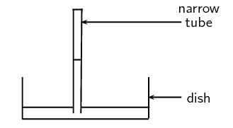

### Results

Record your results in the table below. You do not need to measure how far up the tube the substance
              travels but rather say if it only travelled a short distance or a long distance.

| Substance | Distance travelled up tube |
| --- | --- |
| Water |  |
| Oil |  |
| Nail polish remover |  |
| Methylated spirits |  |

### Discussion and conclusion

Water travels the greatest distance up the tube. Nail polish remover travels the least distance.

Capillarity is related to surface tension. If the attractive force between the glass walls of the tube
              and the substance are stronger than the intermolecular forces in the substance, than the edges of the
              liquid will be pulled above the surface of the liquid. This in turn helps pull the liquid up the tube.

Substances with strong intermolecular forces will travel further up a narrow tube (have a greater
              capillarity) than substances with weaker intermolecular forces.

From these experiments we can see how intermolecular forces (a microscopic property) affect the macroscopic
          behaviour of substances. If a substance has weak intermolecular forces then it will evaporate easily.
          Substances with weak intermolecular forces also have low surface tension and do not rise as far up in narrow
          tubes as substances with strong intermolecular forces. Boiling points are lower for substances with weak
          intermolecular forces. Substances are more likely to be soluble in liquids with similar intermolecular forces.

We will now look at some more properties (molecular size, viscosity, density, melting and boiling points,
        thermal expansion, thermal conductivity) in detail.

**Molecular size**

The alkanes are a group of organic compounds that contain carbon and hydrogen bonded together. The carbon atoms
        link together to form chains of varying lengths.

The boiling point and melting point of these molecules is determined by their molecular structure, and their
        surface area. The more carbon atoms there are in an alkane, the greater the surface area and therefore the
        higher the boiling point. The melting point also increases as the number of carbon atoms in the molecule
        increases. This can be seen in the table below.

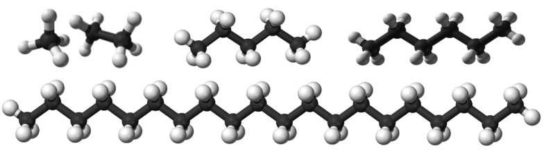

| Formula | \(\text{CH}_{4}\) | \(\text{C}_{2}\text{H}_{6}\) | \(\text{C}_{5}\text{H}_{12}\) | \(\text{C}_{6}\text{H}_{14}\) | \(\text{C}_{20}\text{H}_{42}\) |
| --- | --- | --- | --- | --- | --- |
| Name | methane | ethane | pentane | hexane | icosane |
| Molecular mass (\(\text{g·mol$^{-1}$}\)) | \(\text{16}\) | \(\text{30}\) | \(\text{72}\) | \(\text{86}\) | \(\text{282}\) |
| Melting point (℃) | \(-\text{183}\) | \(-\text{183}\) | \(-\text{130}\) | \(-\text{95}\) | \(\text{37}\) |
| Boiling point (℃) | \(-\text{164}\) | \(-\text{89}\) | \(\text{36}\) | \(\text{69}\) | \(\text{343}\) |
| Phase at room temperature | gas | gas | liquid | liquid | solid |

You will also notice that, when the molecular mass of the alkanes is low (i.e. there are few carbon atoms), the
        organic compounds are *gases* because the intermolecular forces are weak. As the number of carbon atoms
        and the molecular mass increases, the compounds are more likely to be liquids or solids because the
        intermolecular forces are stronger.

You should see that the larger a molecule is the stronger the intermolecular forces are between its molecules.
        This is one of the reasons why methane (\(\text{CH}_{4}\)) is a gas at room temperature while pentane
        (\(\text{C}_{5}\text{H}_{12}\)) is a liquid and icosane (\(\text{C}_{20}\text{H}_{42}\)) is a solid.

<Callout type="note" title="Note">
It is partly the stronger intermolecular forces that explain why petrol (mainly octane
          (\(\text{C}_{8}\text{H}_{18}\))) is a liquid, while candle wax (\(\text{C}_{23}\text{H}_{48}\)) is a solid. If
          these intermolecular forces did not increase with increasing molecular size we would not be able to put liquid
          fuel into our cars or use solid candles.
</Callout>

**Viscosity**

Viscosity is the resistance to flow of a liquid. Compare how easy it is to pour water and syrup or honey. The
        water flows much faster than the syrup or honey.

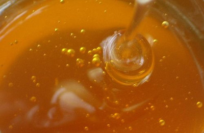

You can see this if you take a cylinder filled with water and a cylinder filled with glycerin. Drop a small
        metal ball into each cylinder and note how easy it is for the ball to fall to the bottom. In the glycerin the
        ball falls slowly, while in the water it falls faster.

Substances with stronger intermolecular forces are more viscous than substances with weaker intermolecular
        forces.

## Machine and motor oils

You are given the following information about engine oils.

| Oil | Use | Other info |
| --- | --- | --- |
| SAE 30 monograde | Engines | Low viscosity |
| SAE 50 monograde | Engines | High viscosity |
| SAE 15W-40 multigrade | Engines | Medium viscosity |
| SAE 0W-40 multigrade | Engines | Medium viscosity |

(Data from [shell.com](http://www.shell.com/home/content/zaf/products_services/on_the_road/consumer_lubricants_tpkg/right_oil/))

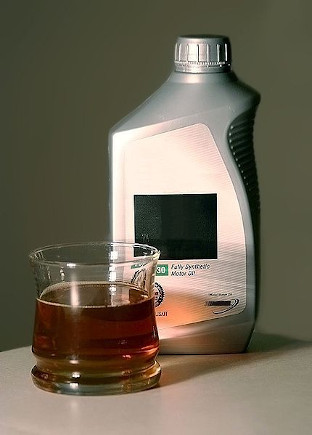

Multigrade oils can be used even in cold weather since they remain fluid (The first number is the rating for
          winter weather and the W shows that this is the rating in winter. The second number is the viscosity rating in
          summer). Monograde oils are given their viscosity rating at \(\text{100}\)\(\text{°C}\). The viscosity is
          an indication of how well the oil flows. The more viscous an oil the larger the molecules that are in the oil.

- Which oil has the longest molecules?
- Which oil has the shortest molecules?
- Which oil has the strongest overall intermolecular forces?
- Which oil has the weakest overall intermolecular forces?
- What can you conclude about the link between the magnitude of the intermolecular force and viscosity?

**Density**

Density
Density is a measure of the mass in a unit volume.

The solid phase is often the most dense phase (water is one noteworthy exception to this). This can be
        explained by the strong intermolecular forces found in a solid. These forces pull the molecules together which
        results in more molecules in one unit volume than in the liquid or gas phases. The more molecules in a unit
        volume the denser that substance will be.

**Melting and boiling points**

Intermolecular forces affect the boiling and melting points of substances. Substances with weak intermolecular
        forces will have low melting and boiling points while those with strong intermolecular forces will have high
        melting and boiling points. In the experiment on intermolecular forces you investigated the boiling points of
        several substances, and should have seen that molecules with weaker intermolecular forces have a lower boiling
        point than molecules with stronger intermolecular forces.

One further point to note is that covalent network structures (recall from grade \(\text{10}\) that these are
        covalent compounds that form large networks and an example is diamond) will have high melting and boiling points
        due to the fact that some bonds (i.e. the strong forces between atoms) have to break before the substance can
        melt. Covalent molecular substances (e.g. water, sugar) often have lower melting and boiling points, because of
        the presence of the weaker intermolecular forces holding these molecules together.

**Thermal expansion**

As substances are heated their molecules start moving more vigorously (their kinetic energy increases). This
        causes the liquid to expand on heating. You can observe this in a thermometer. As the alcohol (or mercury) is
        heated it expands and rises up the tube.

This is why when you tile a floor you have to leave gaps between the tiles to allow for expansion. It is also
        why power lines sag slightly and bridges have slight gaps for expansion.

**Thermal conductivity**

Different materials conduct heat differently. The following activity will highlight this.

## Thermal conductivity

Take a long thin piece of graphite and a long thin piece of copper (or other metal). Attach a bit of wax to
          the one end of each rod (you will need to melt the wax a bit first to make it stick). While the wax is still
          soft, press a toothpick into the blob of wax.

Now suspend the graphite and copper rods from a desk or chair using a piece of string and heat the other end.
          Observe which toothpick falls off first. Try to explain why.

Heat is transferred through a substance from the point being heated to the other end. This is why the bottom of
        a pot gets hot first (assuming you are heating the pot on a stove plate). In metals there are some free,
        delocalised electrons which can help transfer the heat energy through the metal. In covalent molecular compounds
        there are no free, delocalised electrons and the heat does not travel as easily through the material.

<Callout type="tip" title="Worked example 3: Understanding intermolecular forces">
**Question:**
Explain why the melting point of oxygen (\(\text{O}_{2}\)) is much lower than the melting point of hydrogen
            chloride \(\text{HCl}\).

**Write down what you know about melting points and forces:**
The stronger the intermolecular force, the higher the melting point. So if a substance has strong
            intermolecular forces, then that substance will have a high melting point.

**Write down which forces occur in the two given compounds:**
Oxygen is non-polar and has induced dipole forces. Hydrogen chloride is polar and has dipole-dipole forces.

**Combine all the facts to get the answer:**
We know that stronger intermolecular forces lead to higher melting points. We also know that oxygen has
            weaker intermolecular forces than hydrogen chloride (induced dipole versus dipole-dipole forces). Therefore
            oxygen will have a lower melting point than hydrogen chloride since oxygen has weaker intermolecular forces.
</Callout>

## Types of intermolecular forces

### Textbook Exercise 4.2

**Problem:**
Given the following diagram:

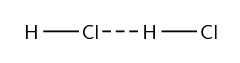

2. Name the molecule and circle it on the diagram
4. Label the interatomic forces (covalent bonds)
6. Label the intermolecular forces

**Solution:**
The molecule is hydrogen chloride.

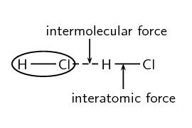

**Problem:**
Given the following molecules and solutions:

\(\text{HCl}\), \(\text{CO}_{2}\), \(\text{I}_{2}\), \(\text{H}_{2}\text{O}\), \(\text{KI}
                (\text{aq})\), \(\text{NH}_{3}\), \(\text{NaCl}(\text{aq})\), \(\text{HF}\), \(\text{MgCl}_{2}\) in
                \(\text{CCl}_{4}\), \(\text{NO}\), \(\text{Ar}\), \(\text{SiO}_{2}\)

Complete the table below by placing each molecule next to the correct type of intermolecular force.

| Ion-dipole |  |
| --- | --- |
| Ion-induced-dipole |  |
| Dipole-dipole (no hydrogen bonding) |  |
| Dipole-dipole (hydrogen bonding) |  |
| Induced dipole |  |
| Dipole-induced-dipole |  |

In which one of the substances listed above are the intermolecular forces:

2. strongest
4. weakest

**Solution:**
| Ion-dipole | \(\text{KI} (\text{aq})\), \(\text{NaCl}(\text{aq})\), \(\text{HF}(\text{aq})\) |
| --- | --- |
| Ion-induced-dipole | \(\text{MgCl}_{2}\) in \(\text{CCl}_{4}\) |
| Dipole-dipole (no hydrogen bonding) | \(\text{HCl}\), \(\text{NO}\) |
| Dipole-dipole (hydrogen bonding) | \(\text{H}_{2}\text{O}\), \(\text{NH}_{3}\) |
| Induced dipole | \(\text{CO}_{2}\), \(\text{I}_{2}\), \(\text{Ar}\) |
| Dipole-induced-dipole | \(\text{SiO}_{2}\) in water |

Water or ammonia are likely to have the strongest forces, while argon, iodine and carbon dioxide are
                likely to have the weakest forces. Induced dipole forces are the weakest intermolecular forces and
                hydrogen bonding is the strongest.

Use your knowledge of different types of intermolecular forces to explain the following statements:

**Problem:**
The boiling point of \(\text{F}_{2}\) is much lower than the boiling point of \(\text{NH}_{3}\)

**Solution:**
\(\text{NH}_{3}\) has hydrogen bonds which are much stronger than the induced dipole forces in
                  \(\text{F}_{2}\). In order for a liquid to boil the intermolecular forces must be broken and if the
                  intermolecular forces are very strong then it will take a lot of energy to overcome these forces and
                  so the boiling point will be higher.

**Problem:**
Water evaporates slower than carbon tetrachloride (\(\text{CCl}_{4}\)).

**Solution:**
Water has strong intermolecular forces (hydrogen bonds) while carbon tetrachloride only has weaker
                  induced dipole forces. (Carbon tetrachloride is non-polar). Substances with stronger intermolecular
                  forces take longer to evaporate than substances with weaker intermolecular forces.

**Problem:**
Sodium chloride is likely to dissolve in methanol (\(\text{CH}_{3}\text{OH}\)) .

**Solution:**
Sodium chloride is ionic. Methanol is polar. The type of intermolecular force that can exist when
                  sodium chloride dissolves in methanol is ion-dipole forces. The formation of these forces helps to
                  disrupt the ionic bonds in sodium chloride and so sodium chloride can dissolve in methanol.

**Problem:**
Tumi and Jason are helping their dad tile the bathroom floor. Their dad tells them to leave small gaps
                between the tiles. Why do they need to leave these small gaps?

**Solution:**
Materials (such as tiles) expand on heating and so small gaps need to be left between the tiles to
                allow for this expansion. If Tumi and Jason did not leave these gaps between the tiles, the tiles would
                soon lift up.
