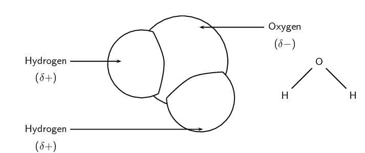
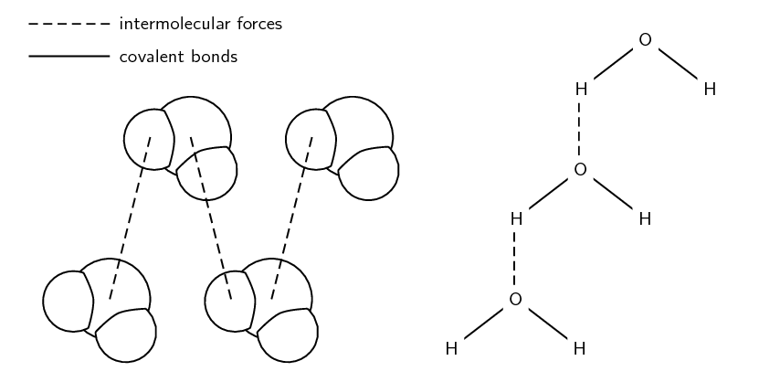
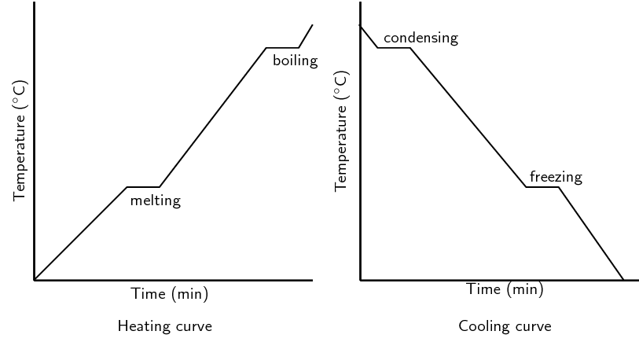

## 4.2 The chemistry of water (ESBMR)

<Callout type="note" title="Note">
<VideoPlayer src="https://youtu.be/EJrmR-RGjUM" title="Video: 23R8" />
</Callout>

We will now look at how intermolecular forces apply to a very special liquid. This section shows how
                        the knowledge of intermolecular forces can be applied to the case of water.

### The microscopic structure of water (ESBMS)

In many ways, water behaves very differently from other compounds. These properties are
                                directly related to the microscopic structure of water, and more specifically to the
                                *shape* of the molecule and its *polar nature*, and to the
                                *intermolecular forces* that hold water molecules together.

<Callout type="note" title="Note">
There are about \(\text{55,5}\) \(\text{mol}\) of water in \(\text{1}\) \(\text{L}\).
                                        This is equivalent to \(\text{3,34} \times \text{10}^{\text{25}}\) molecules of
                                        water. That's a lot of water molecules!
</Callout>

In the previous chapter you learnt about molecular shape and polarity. Water has two hydrogen
                                atoms around a central oxygen atom. The central oxygen atom also has two lone pairs of
                                electrons. This gives water a bent (or angular) shape. It also means that water is polar
                                since the two hydrogen atoms are not parallel to each other and so do not cancel out the
                                bond polarity (refer back to the previous chapter on molecular shape). We can see this
                                in the following image:

Figure 4.7:
                                        Diagrams showing the structure of a water molecule. Each molecule is made up of
                                        two hydrogen atoms that are attached to one oxygen atom.

Water molecules are held together by **hydrogen bonds**. Hydrogen bonds are a
                                much stronger type of intermolecular force than those found in many other substances,
                                and this affects the properties of water.

Figure 4.8:
                                        Intermolecular and covalent bonds (interatomic forces) in water. Note that the
                                        diagram on the left only shows *intermolecular* forces. The covalent
                                        bonds (interatomic forces) are between the atoms of each water molecule.

### The unique properties of water (ESBMT)

We will now look at a few of the properties of water.

2. **Specific heat**
   Specific heat
   Specific heat is the amount of heat energy that is needed to
                                                                   increase the temperature of a unit mass of a substance
                                                                   by one degree.
   Water has a high specific heat, meaning that a lot of energy must be absorbed
                                                   by water before its temperature changes.
   You have probably observed this phenomenon if you have boiled water in a pot
                                                   on the stove. The metal of the pot heats up very quickly, and can burn
                                                   your fingers if you touch it, while the water may take several minutes
                                                   before its temperature increases even slightly. How can we explain this
                                                   in terms of hydrogen bonding? Remember that increasing the temperature
                                                   of a substance means that its particles will move more quickly. However,
                                                   before they can move faster, the intermolecular forces between them must
                                                   be disrupted. In the case of water, these forces are strong hydrogen
                                                   bonds, and so a lot of energy is needed just to break these, before the
                                                   particles can start moving further apart.
4. **Absorption of infra-red radiation**
   Water is able to absorb infra-red radiation (heat) from the sun. As a result
                                                   of this, the oceans and other water bodies act as heat reservoirs, and
                                                   are able to help moderate the Earth's climate.
   <Callout type="note" title="Note">
   It is the high specific heat of water and its ability to absorb
                                                           infra-red radiation that allows water to regulate the climate.
                                                           Towns close to the sea often have less extreme temperatures than
                                                           inland towns due to the oceans ability to absorb the heat.
   </Callout>
6. **Melting point and boiling point**
   The melting point of water is \(\text{0}\) \(\text{℃}\) and its boiling
                                                   point is \(\text{100}\) \(\text{℃}\) (at standard pressure or
                                                   \(\text{0,987}\) \(\text{atm}\)). This large difference between the
                                                   melting and boiling point is very important because it means that water
                                                   can exist as a liquid over a large range of temperatures. (This
                                                   temperature range is only large in the world around us, if we look at
                                                   space and the universe then this is a very narrow temperature range.)
   <Callout type="note" title="Note">
   When the boiling point of water is measured at sea level (e.g. towns
                                                           like Cape Town and Durban), it is often very close to
                                                           \(\text{100}\) \(\text{℃}\) since the atmospheric pressure
                                                           is almost the same as the standard pressure. If you measure the
                                                           boiling point of water in a town at a higher altitudes (e.g.
                                                           Johannesburg or Polokwane) it will have a slightly lower boiling
                                                           point.
   </Callout>
   In grade \(\text{10}\) you studied the heating and cooling curve of water.
                                                   This is given below.
   
   Figure 4.9:
                                                           Heating and cooling curves for water.
8. **High heat of vaporisation**
   Heat of vaporisation
   Heat of vaporisation is the energy that is needed to change a
                                                                   given quantity of a substance into a gas.
   The strength of the hydrogen bonds between water molecules also means that it
                                                   has a high heat of vaporisation. “Heat of vaporisation” is
                                                   the heat energy that is needed to change water from the liquid to the
                                                   gas phase. Because the forces between molecules are strong, water has to
                                                   be heated to \(\text{100}\) \(\text{℃}\) before it changes phase.
                                                   At this temperature, the molecules have enough energy to break the
                                                   intermolecular forces that hold the molecules together. The heat of
                                                   vaporisation for water is \(\text{40,65}\)
                                                   \(\text{kJ·mol$^{-1}$}\).
   It is very important for life on earth that water does have a high heat of
                                                   vaporisation. Can you imagine what a problem it would be if water's heat
                                                   of vaporisation was much lower? All the water that makes up the cells in
                                                   our bodies would evaporate and most of the water on earth would no
                                                   longer be able to exist as a liquid!
10. **Less dense solid phase**
   Another unusual property of water is that its solid phase (ice) is *less
                                                           dense* than its liquid phase. You can observe this if you
                                                   put ice into a glass of water. The ice doesn't sink to the bottom of the
                                                   glass, but floats on top of the liquid. This phenomenon is also related
                                                   to the hydrogen bonds between water molecules. While other materials
                                                   contract when they solidify, water expands. The ability of ice to float
                                                   as it solidifies is a very important factor in the environment. If ice
                                                   sank, then eventually all ponds, lakes, and even the oceans would freeze
                                                   solid as soon as temperatures dropped below freezing, making life as we
                                                   know it impossible on Earth. During summer, only the upper few metres of
                                                   the ocean would thaw. Instead, when a deep body of water cools, the
                                                   floating ice insulates the liquid water below, preventing it from
                                                   freezing and allowing life to exist under the frozen surface.
   <Callout type="note" title="Note">
   Antarctica, the “frozen continent”, has one of the
                                                           world's largest and deepest freshwater lakes. And this lake is
                                                           hidden beneath \(\text{4}\) \(\text{km}\) of ice! Lake Vostok is
                                                           \(\text{200}\) \(\text{km}\) long and \(\text{50}\)
                                                           \(\text{km}\) wide. The thick, glacial blanket of ice acts as an
                                                           insulator, preventing the water from freezing.
   </Callout>

It should be clear now, that water is an amazing compound, and that without its unique
                                properties, life on Earth would definitely not be possible.

<Callout type="tip" title="Worked example 4: Properties of water">
**Question:**
Explain why water takes a long time to heat up, but the pot that you are
                                                heating it in gets hot quickly.

**Decide which property is applied here:**
We are asked why water takes a long time to heat up compared to the pot you
                                                are heating it in. The property that applies here is the high specific
                                                heat of water. The other properties of water do not apply here since we
                                                are comparing the pot to the water and the pot is not changing phase.

**Write the final answer:**
Water has a high specific heat, while the metal that the pot is made of does
                                                not. The metal pot needs less energy to heat it up and so it gets hotter
                                                faster. Water needs a lot of energy to change its temperature and so it
                                                takes longer to get hot.
</Callout>

An experiment for informal assessment is included in this chapter. This experiment is
                                        very similar to the one on intermolecular forces. In this experiment learners
                                        focus on the properties of water. This is a good experiment to do to guide
                                        learners in understanding the properties of water.

When working with Bunsen burners learners should ensure that loose clothing is tucked
                                        away and long hair is tied back. As always with chemistry experiments you should
                                        open all the windows to ensure a well ventilated room. At the end of the
                                        experiment check that all Bunsen burners are turned off.

If learners leave the beaker of water on the Bunsen burner for to long and the water
                                        starts to boil or steam is observed, then make sure the learners do not touch
                                        the beaker as they will be burn themselves.

<QuizCard id="s11-04-02a" title="Interactive Exercise 4.3" question="What is the shape of the molecule?" options=["non-polar", "polar", "dipole-dipole forces", "hydrogen bonds", "induced dipole forces"] answer="
                        5
                    " hint="" explanation="Recall VSEPR theory To determine the shape of the molecule we need to look at the AXE method                     of VSEPR theory. The A stands for the central atom. The X stands for atoms bonded to the central atom. And the E stands for lone pairs on the central atom. AXE Molecular shape AX 2 linear AX 3 trigonal planar AX 2 E bent AX 4 tetrahedral AX 3 E trigonal pyramidal AX 2 E 2 bent AX 5 trigonal bipyramidal AX 6 octahedral NOTE: These are the molecular shapes, not the electron geometries. For example, AX 2 E has a bent molecular shape and a trigonal planar electron geometry. We need to draw the Lewis diagram of the molecule: The central atom is oxygen. There are two hydrogen atoms and two lone pairs around the central atom ( AX 2 E 2 ). And so water has a bent molecular shape. Diagram from PhET Interactive Simulations, University of Colorado Boulder ( CC-BY ). Submit your answer as: bent (or angular)" />

<QuizCard id="s11-04-02a" title="Interactive Exercise 4.3" question="Is the following statement true or false? Water exists as a liquid over a relatively large range of temperatures (compared to other substances)." options=["true", "false"] answer="
                    0
                " hint="" explanation="What do we know about water? We know the following about water: It has a high specific heat (the amount of energy needed to increase the temperature of a unit mass by one degree Celsius). It has a high heat of vapourisation (the energy needed to change a given quantity of a substance into vapour). It is able to absorb infrared radiation from the sun and can act as a heat reservoir . It has a less dense solid phase due to hydrogen bonds between water molecules creating an open hexagonal structure in the solid state. This means that ice floats on water. It exists as a liquid over a relatively large temperature range compared to other substances. It has a much higher boiling point temperature than other simple hydrides. Is the statement true or false? From this information we can say that the statement is true : Water exists as a liquid over a relatively large range of temperatures (compared to other substances). Submit your answer as: true" />

<QuizCard id="s11-04-02a" title="Interactive Exercise 4.3" question="Is the following statement true or false? Ice floats on water because water has a more dense solid phase than liquid phase." options=["true", "false"] answer="
                    1
                " hint="" explanation="What do we know about water? We know the following about water: It has a high specific heat (the amount of energy needed to increase the temperature of a unit mass by one degree Celsius). It has a high heat of vapourisation (the energy needed to change a given quantity of a substance into vapour). It is able to absorb infrared radiation from the sun and can act as a heat reservoir . It has a less dense solid phase due to hydrogen bonds between water molecules creating an open hexagonal structure in the solid state. This means that ice floats on water. It exists as a liquid over a relatively large temperature range compared to other substances. It has a much higher boiling point temperature than other simple hydrides. Is the statement true or false? From this information we can say that the statement is false . Submit your answer as: false" />

<QuizCard id="s11-04-02a" title="Interactive Exercise 4.3" question="Is the following statement true or false? Specific heat is the amount of heat energy that is needed to increase the temperature of a unit mass of a substance, like water, to that substance's boiling point." options=["true", "false"] answer="
                    1
                " hint="" explanation="What do we know about water? We know the following about water: It has a high specific heat (the amount of energy needed to increase the temperature of a unit mass by one degree Celsius). It has a high heat of vapourisation (the energy needed to change a given quantity of a substance into vapour). It is able to absorb infrared radiation from the sun and can act as a heat reservoir . It has a less dense solid phase due to hydrogen bonds between water molecules creating an open hexagonal structure in the solid state. This means that ice floats on water. It exists as a liquid over a relatively large temperature range compared to other substances. It has a much higher boiling point temperature than other simple hydrides. Is the statement true or false? From this information we can say that the statement is false . Submit your answer as: false" />

<QuizCard id="s11-04-02a" title="Interactive Exercise 4.3" question="Adapted from DBE Nov 2016 Grade 11, P2, Q1.3 Physical constants \(·\) Chemistry formulas \(·\) Periodic table The strongest type of intermolecular forces experienced     			by molecules of water, H 2 O , are ... A London dispersion forces B hydrogen bonds C dipole-dipole forces D ion-induced dipole forces" options=["A", "B", "C", "D"] answer="
                	1
                " hint="" explanation="Determine the polarity of H 2 O The electronegativities of different elements can be found on the periodic table . The difference in electronegativity between O and H is: \[                     \begin{aligned}                 		\Delta{EN} &= \text{3,4} - \text{2,2} \\                 		&= \text{1,2}                     \end{aligned}                 \] This means that the bonds in H 2 O are polar . H 2 O has a bent molecular shape. Diagram from PhET Interactive Simulations, University of Colorado Boulder ( CC-BY ). The molecule is not symmetrical .                 	Therefore H 2 O is a polar molecule. Determine the type of intermolecular forces between molecules of H 2 O All molecules experience induced-dipole (London dispersion) forces. These are generally the     				weakest type of intermolecular force. H 2 O is polar , and it contains a highly electronegative oxygen atom bonded to a hydrogen atom. So it forms hydrogen bonds as well, which are stronger than London dispersion forces. Now we can choose the strongest type of force experienced 	                by molecules of H 2 O . A London dispersion forces B \({\color{red}{{\checkmark}{\checkmark}}}\) hydrogen bonds C dipole-dipole forces D ion-induced dipole forces The correct choice is Option B . Submit your answer as: B" />

<QuizCard id="s11-04-02a" title="Interactive Exercise 4.3" question="Define the term boiling point." options=["process during", "pressure at", "volume at", "temperature at", "equal to", "less than", "greater than", "Acetic acid", "Water", "Citric acid", "Methanol", "Glycerol", "smallest molecular mass", "highest boiling point", "lowest melting point", "lowest boiling point"] answer="0, 0" hint="" explanation="Recall the definition of boiling point The boiling point is the temperature at which the vapour pressure of a substance is equal to the external (or atmospheric) pressure . Submit your answer as: temperature at and equal to" />

## The properties of water

### Aim

To investigate the properties of water.

### Apparatus

- water
- ice
- beakers
- carbon tetrachloride, oil, ethanol
- various solids (e.g. sodium chloride, potassium chloride, potassium
                                                          permanganate, iodine)

### Method

2. Pour about \(\text{100}\) \(\text{ml}\) of water into a glass
                                                                   beaker.
4. Place the beaker on a stand and heat it over a Bunsen burner
                                                                   for about a minute.
6. After this time, carefully touch the side of the beaker (Make
                                                                   sure you touch the glass very lightly because it will be
                                                                   very hot and may burn you!). Then test the temperature
                                                                   of the water.
8. Note what happens when you place ice into water.
10. Carefully layer water and carbon tetrachloride in a
                                                                   test-tube. Which substances floats on top? Try adding
                                                                   the water first and the carbon tetrachloride second and
                                                                   then the other way around. Repeat with oil and ethanol.
12. Dissolve the different solid substances in water. Observe how
                                                                   much of each solid (if any) dissolves.

### Results

Record all your results in the following table.

| Property | Observation |
| --- | --- |
| Temperature |  |
| Ice in water |  |
| Carbon tetrachloride and water |  |
| Oil and water |  |
| Ethanol and water |  |
| Solubility |  |

### Conclusion

You should find that the glass beaker heats up faster than the water. You
                                                should also find that water is more dense in the liquid phase than in
                                                the solid phase. Water floats on some liquids and other liquids float on
                                                water. Water is a good solvent for polar and ionic substances.

## How humans have used the properties of water

Carry out some research into: water bags on cars, clay pots and carafes for water and
                                        safe or “cool” rooms to keep food cool. Find out which people groups
                                        use these things and how the properties of water help in each case.

## The properties of water

### Textbook Exercise 4.3

Hope returns home from school on a hot day and pours herself
                                                                a glass of water. She adds ice cubes to the water and
                                                                notices that they float on the water.

**Problem:**
What property of ice cubes allows them to float in
                                                                        the water?

**Solution:**
Ice cubes are less dense than liquid water. Water has
                                                                        a less dense solid phase than solid water.

**Problem:**
Briefly describe how this property affects the
                                                                        survival of aquatic life during winter.

**Solution:**
If the ice did not float on top of the water then all
                                                                        bodies of water would freeze from the bottom up.
                                                                        This would mean that aquatic life would not be
                                                                        able to survive through the cold winters as
                                                                        there would be no habitat for them.

**Problem:**
Which properties of water allow it to remain in its liquid
                                                                phase over a large temperature range? Explain why this
                                                                is important for life on earth.

**Solution:**
High boiling point and low melting point. Water has strong
                                                                hydrogen bonds between molecules. These bonds require a
                                                                lot of energy before they will break. This leads to
                                                                water having a higher boiling point than if there were
                                                                only weaker dipole-dipole forces. Water also has a high
                                                                specific heat. If water did not have such a large range
                                                                in which it is a liquid, bodies of water would freeze
                                                                over faster, destroying the life in them. Also if the
                                                                boiling point of water was lower, then all the water
                                                                could evaporate on a hot day, which would cause all life
                                                                to die.

**Problem:**
Which property of water allows the oceans to act as heat
                                                                reservoirs? What effect does this have on the Earths
                                                                climate?

**Solution:**
Water is able to absorb infrared radiation (heat) from the
                                                                sun. This heat energy is stored in the oceans. Without
                                                                this effect, the heat from the sun would cause the
                                                                daytime temperatures on the Earth to become unbearably
                                                                hot.
