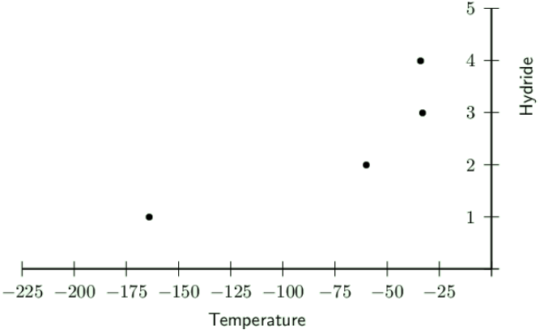

### Textbook Exercise 4.4

Give one word or term for each of the following descriptions:

**Problem:**
The attractive force that exists between molecules.

**Solution:**
Intermolecular force

**Problem:**
A molecule that has an unequal distribution of charge.

**Solution:**
Polar molecule

**Problem:**
The amount of heat energy that is needed to increase the temperature of a unit mass of a
                            substance by one degree.

**Solution:**
Specific heat

**Problem:**
Refer to the list of substances below:

\(\text{HCl}\), \(\text{Cl}_{2}\), \(\text{H}_{2}\text{O}\), \(\text{NH}_{3}\), \(\text{N}_{2}\),
                        \(\text{HF}\)

Select the true statement from the list below:

2. \(\text{NH}_{3}\) is a non-polar molecule
4. The melting point of \(\text{NH}_{3}\) will be higher than for \(\text{Cl}_{2}\)
6. Ion-dipole forces exist between molecules of \(\text{HF}\)
8. At room temperature \(\text{N}_{2}\) is usually a liquid

**Solution:**
The melting point of \(\text{NH}_{3}\) will be higher than for \(\text{Cl}_{2}\)

The following table gives the melting points of various hydrides:

| Hydride | Melting point (℃) |
| --- | --- |
| \(\text{HI}\) | \(-\text{34}\) |
| \(\text{NH}_{3}\) | \(-\text{33}\) |
| \(\text{H}_{2}\text{S}\) | \(-\text{60}\) |
| \(\text{CH}_{4}\) | \(-\text{164}\) |

**Problem:**
In which of these hydrides does hydrogen bonding occur?

2. \(\text{HI}\) only
4. \(\text{NH}_{3}\) only
6. \(\text{HI}\) and \(\text{NH}_{3}\) only
8. \(\text{HI}\), \(\text{NH}_{3}\) and \(\text{H}_{2}\text{S}\)

**Solution:**
\(\text{HI}\) and \(\text{NH}_{3}\) only

**Problem:**
Draw a graph to show the melting points of the hydrides.

**Solution:**
Hydrides are numbered as: \(\text{HI}\) is \(\text{4}\), \(\text{NH}_{3}\) is \(\text{3}\),
                            \(\text{H}_{2}\text{S}\) is \(\text{2}\) and \(\text{CH}_{4}\) is \(\text{1}\).

**Problem:**
Explain the shape of the graph.

**Solution:**
There is a decrease in the temperature from the first hydride (number \(\text{4}\) on the
                            graph) to the last one (number \(\text{1}\) on the graph). The shape of the graph shows the
                            decreasing intermolecular forces between the molecules in the compounds.

The respective boiling points for four chemical substances are given below:

| Hydrogen sulphide | \(-\text{60}\) \(\text{℃}\) |
| --- | --- |
| Ammonia | \(-\text{33}\) \(\text{℃}\) |
| Hydrogen fluoride | \(\text{20}\) \(\text{℃}\) |
| Water | \(\text{100}\) \(\text{℃}\) |

**Problem:**
Which one of the substances exhibits the strongest forces of attraction between its molecules
                            in the liquid state?

**Solution:**
Water

**Problem:**
Give the name of the force responsible for the relatively high boiling points of hydrogen
                            fluoride and water and explain how this force originates.

**Solution:**
Hydrogen bonding. This force occurs between the hydrogen atoms of one molecule and a high
                            electronegativity atom of another molecule. The relatively positive hydrogen atom is
                            attracted to the relatively negative atom (e.g. oxygen, nitrogen, fluorine).

**Problem:**
The shapes of the molecules of hydrogen sulfide and water are similar, yet their boiling
                            points differ. Explain.

**Solution:**
Hydrogen sulfide does not have hydrogen bonding since sulfur has a low electronegativity.
                            This reduces the boiling point of hydrogen sulfide since it is easier to break the
                            intermolecular forces between molecules of hydrogen sulfide.

**Problem:**
Susan states that van der Waals forces include ion-dipole forces, dipole-dipole forces and
                        induced dipole forces.

Simphiwe states that van der Waals forces include ion-dipole forces, ion-induced dipole forces
                        and induced dipole forces.

Thembile states that van der Waals forces include dipole-induced dipole forces, dipole-dipole
                        forces and induced dipole forces.

Who is correct and why?

**Solution:**
Thembile is correct. Van der Waals forces are the only forces that can exist with covalent
                        molecules and so including either ion-dipole or ion-induced dipole forces is not correct.

Jason and Bongani are arguing about which molecules have which intermolecular forces. They have
                        drawn up the following table:

| Compound | Type of force |
| --- | --- |
| Potassium iodide in water (\(\text{KI} (\text{aq})\)) | dipole-induced dipole forces |
| Hydrogen sulfide (\(\text{H}_{2}\text{S}\)) | induced dipole forces |
| Helium (\(\text{He}\)) | ion-induced dipole forces |
| Methane (\(\text{CH}_{4}\)) | induced dipole forces |

**Problem:**
Jason says that hydrogen sulfide (\(\text{H}_{2}\text{S}\)) is non-polar and so has induced
                            dipole forces. Bongani says hydrogen sulfide is polar and has dipole-dipole forces. Who is
                            correct and why?

**Solution:**
Bongani is correct. \(\text{NH}_{3}\) is polar. It has one lone pair of electrons and so is
                            trigonal pyramidal. The three polar bonds do not cancel each other out, since the molecule
                            is not symmetrical. This makes ammonia a dipole molecule. So the type of intermolecular
                            force that exists is dipole-dipole forces.

**Problem:**
Bongani says that helium (\(\text{He}\)) is an ion and so has ion-induced dipole forces.
                            Jason says helium is non-polar and has induced dipole forces. Who is correct and why?

**Solution:**
Jason is correct. Helium is a noble gas and so exists as single atoms, not as a compound.
                            Helium is non-polar and so has induced-dipole forces.

**Problem:**
They both agree on the rest of the table. However, they have not got the correct force for
                            potassium iodide in water (\(\text{KI}(\text{aq})\)). What type of force actually exists in
                            this compound?

**Solution:**
\(\text{KI}(\text{aq})\) has potassium and iodine ions in water. Water is a polar molecule.
                            So the type of force must be ion-dipole.

**Problem:**
Khetang is looking at power lines around him for a school project. He notices that they sag
                        slightly between the pylons. Why do power lines need to sag slightly?

**Solution:**
Materials expand on heating and contract on cooling. If the power lines were strung tightly and
                        did not sag then every time the weather got cold the power lines would contract and break.

**Problem:**
Briefly describe how the properties of water make it a good liquid for life on Earth.

**Solution:**
Water has a high heat of vaporisation which means that it has to be heated to a high temperature
                        before it will evaporate. This helps to ensure that all the water in our bodies does not
                        evaporate on a warm day. This also keeps the oceans and other water bodies liquid.

Water has a high specific heat which means that it takes a long time for the temperature of the
                        water to increase by one degree. Water is also able to absorb infrared radiation from the sun.
                        These two properties help to regulate the climate of the Earth. Without these properties of
                        water, the Earth would be much hotter.

Water also has a less dense solid phase. This means that when water freezes only the top layer
                        freezes. If this did not happen then the Earth would freeze over. This property also ensures
                        that life can exist beneath the ice surface during cold winters.
