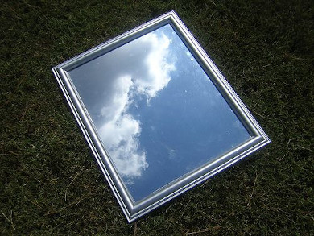

# Chapter 5: Geometrical optics

This chapter introduces the concepts of geometrical optics. In earlier grades learners were introduced to
      reflection and the laws of reflection. This work and the concept of a light ray are revised in this chapter.
      Learners will also learn about the speed of light and how to sketch ray diagrams. Snell's law and how total
      internal reflection arises are covered.

The topics covered in this chapter are briefly summarised below.

- **Reflection and the law of reflection**
  The concept of a light ray is first introduced. This imaginary construct is a useful tool to help learners
            understand how light reflects and refracts. The concepts of reflection and the law of reflection are revised
            from earlier grades. Although this topic is included under refraction in CAPs it is treated separately in this
            book.
- **The speed of light**
  Light has a set speed in different mediums. The maximum speed of light occurs for light travelling in a
            vacuum. In all other media light travels slightly slower. This changing of the speed of light is what gives
            rise to refraction.
- **Refraction and refractive index**
  Refraction is the bending of light as it moves from one medium to another. It is best seen when looking at a
            straw in water. Each medium has a refractive index associated with it and this is a measure of how much light
            will refract when entering that medium. The refractive index is closely linked to the optical density (or
            optical absorbance) of a medium.
- **Sketching ray diagrams for the path of light through different media**
  This topic teaches learners how to sketch the path of light as it moves through different media and helps to
            consolidate the concept of refractive indices. Learners need to understand that light bends to different
            degrees and the direction in which it bends depends on the refractive index of the medium.
- **Snell's law**
  This topic shows learners how to calculate a precise angle for the degree of bending of light, as well as how
            to calculate the refractive index of a medium. Snell's law relates the refractive index of one medium to the
            refractive index of another medium using the sine of the angle of incidence and the sine of the angle of
            refraction.
- **Total internal reflection**
  Snell's law leads into the idea of a critical angle for light travelling from a more optically dense to a
            less optically dense medium. This concept is then expanded on to total internal reflection. Total internal
            reflection is important in communications and medicine, among other fields.

Your reflection in the mirror, a straw in a glass of water, telescopes, communications, spotlights and car
    headlights. All these things rely on the way light reflects off surfaces or refracts in different media. If light
    did not reflect and refract as it does, you would not be able to see how you look before going out or communicate
    over long distances.

<Callout type="note" title="Note">
- Equations - Mathematics, Grade 10, Equations and inequalities
- Trigonometry - Mathematics, Grade 10, Trigonometry
</Callout>

## 5.1 Summary of properties of light (ESBMW)

Imagine you are indoors on a sunny day. A beam of sunlight through a window lights up a section of the floor. How
      would you draw this sunbeam? You might draw a series of parallel lines showing the path of the sunlight from the
      window to the floor. This is not exactly accurate — no matter how hard you look, you will not find unique
      lines of light in the sunbeam! However, this is a good way to draw light and to model light geometrically, as we
      will see in this chapter.

We call these narrow, imaginary lines of light **light rays**. Recall that light can behave like a
      wave and so you can think of a light ray as the path of a point on the crest of a wave.

We can use light rays to model the behaviour of light relative to mirrors, lenses, telescopes, microscopes, and
      prisms. The study of how light interacts with materials is called **optics**. When dealing with light
      rays, we are usually interested in the shape of a material and the angles at which light rays hit it. From these
      angles, we can determine, for example, the distance between an object and its reflection. We call these methods
      **geometrical optics**.

