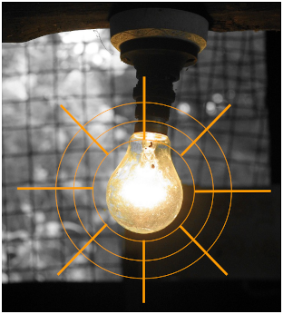
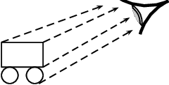
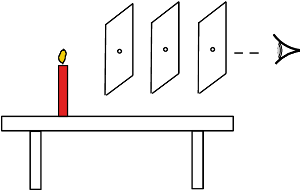
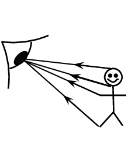
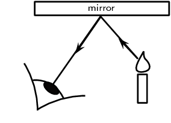

## 5.2 Light rays (ESBMX)

In physics we use the idea of a *light ray* to indicate the direction in which light travels. In
      geometrical optics, we represent light rays with straight arrows to show how light propagates. Light rays are not
      an exact description of the light; rather they show the direction in which the light wavefronts are travelling.

Light ray

Light rays are lines which are perpendicular to the light's wavefronts. In geometrical optics we represent
          light rays with arrows with straight lines.

The lightbulb is a source of light. The light wavefronts are shown by the concentric circles coming from the
      bulb. We represent the direction in which the wavefronts are moving by drawing light rays (the arrows)
      perpendicular to the wavefronts.

In Figure 5.1, the light rays from the object enter the
      eye and the eye *sees* the object. Note that we can *only* see an object when light from the object
      enters our eyes. The object must be a source of light (e.g. a light bulb) or else it must reflect light from a
      source (e.g. the moon which reflects light from the sun), and the light must enter our eyes.

Figure 5.1:
        We can only see an object when light from that object enters our eyes. When the light travels from the object to
        the eye, the eye can see the object. Light rays entering the eye from the cart are shown as dashed lines. The
        second wheel of the cart will be invisible as no straight, unobstructed lines exist between it and the eye.

From the figures you can see that the light rays showing the path of light are straight arrows. In geometrical
      optics, light travels in straight lines.

## To demonstrate that light travels in straight lines

### Apparatus

You will need a candle, matches and three sheets of paper.

### Method

2. Make a small hole in the middle of each of the three sheets of paper.
4. Light the candle.
6. Look at the burning candle through the hole in the first sheet of paper.
8. Place the second sheet of paper between you and the candle so that you can still see the candle through
                 the holes.
10. Now do the same with the third sheet so that you can still see the candle. The sheets of paper must not
                 touch each other.
   
12. What do you notice about the holes in the paper?

### Conclusions

In the investigation you will notice that the holes in the paper need to be in a straight line. This shows
          that light travels in a straight line. We cannot see around corners. This also proves that light does not bend
          around a corner, but travels straight.

### Ray diagrams (ESBMY)

A ray diagram is a drawing that shows the path of light rays. Light rays are drawn using straight lines and
        arrow heads. The figure below shows some examples of ray diagrams.

