## 5.3 Properties of light: revision (ESBMZ)

When light interacts with objects or a medium, such as glass or water, it displays certain
                        properties: it can either be **reflected**, **absorbed** or
                        **transmitted**.

### Reflection (ESBN2)

When you smile into a mirror, you see your own face smiling back at you. This is caused by
                                the reflection of light rays on the mirror. Reflection occurs when an incoming light ray
                                bounces off a surface. In the following figure, a still lake reflects the landscape
                                surrounding it.

Figure 5.2: A landscape reflection from a still lake.

To describe the reflection of light, we will use the following terminology. The incoming
                                light ray is called the **incident ray**. The light ray moving away from
                                the surface is the **reflected ray**. The most important characteristic of
                                these rays is their angles in relation to the reflecting surface. These angles are
                                measured with respect to the normal of the surface. The **normal** is an
                                imaginary line perpendicular to the surface. The **angle of incidence,
                                        \(\theta_i\)** is measured between the incident ray and the surface
                                normal. The **angle of reflection, \(\theta_r\)** is measured between the
                                reflected ray and the surface normal. This is shown in Figure 5.3.

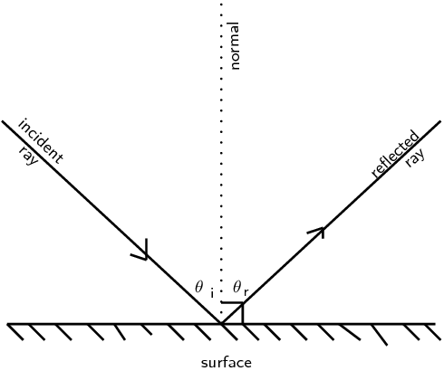

Figure 5.3: The angles of incidence and reflection are
                                        measured with respect to the normal to the surface.

When a ray of light is reflected, the reflected ray lies in the same plane as the incident
                                ray and the normal. This plane is called the **plane of incidence** and is
                                shown in Figure 5.4.

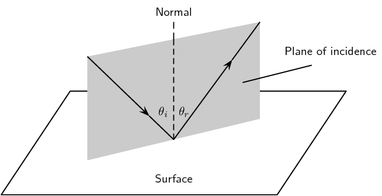

Figure 5.4: The plane of incidence is the plane including
                                        the incident ray and the normal to the surface. The reflected ray also lies in
                                        the plane of incidence.

Law of reflection

The angle of incidence is equal to the angle of reflection:

                                        \[\theta_{i} = \theta_{r}\]

and the incident ray, reflected ray, and the normal, all lie in the same
                                                plane.

The simplest example of the law of reflection is if the angle of incidence is
                                \(\text{0}\)\(\text{°}\). In this case, the angle of reflection is also
                                \(\text{0}\)\(\text{°}\). You see this when you look straight into a mirror.

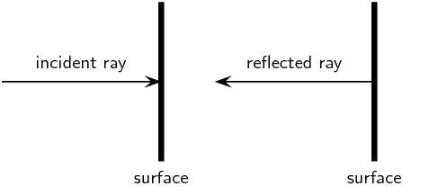

Figure 5.5: When a light ray strikes a surface at right
                                        angles to the surface, then the ray is reflected directly back.

Applying what we know from the law of reflection, if a light ray strikes a surface at
                                \(\text{60}\)\(\text{°}\) to the normal to the surface, then the angle that the
                                reflected ray makes with the normal must also be \(\text{60}\)\(\text{°}\) as shown
                                in Figure 5.6.

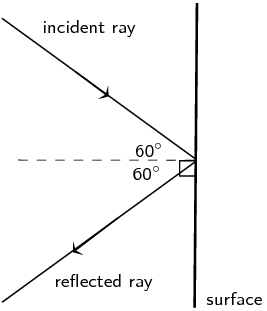

Figure 5.6: Ray diagram showing angle of incidence and angle
                                        of reflection. The law of reflection states that when a light ray reflects off a
                                        surface, the angle of reflection \(\theta_r\) is the same as the angle of
                                        incidence \(\theta_i\).

<QuizCard id="s11-05-03a" title="Interactive Exercise 5.1" question="Which of the labels, A-E, in the diagram, correspond to the following:" options=["A", "B", "C", "D", "E", "A", "B", "C", "D", "E", "A", "B", "C", "D", "E", "A", "B", "C", "D", "E", "A", "B", "C", "D", "E"] answer="2, 0, 4, 1, 3" hint="" explanation="incidence ray  -   C reflected ray  -   A angle of incidence \(\theta_i\) - E angle of reflection \(\theta_r\) - B normal    -      D Submit your answer as: C and A and E and B and D" />

<QuizCard id="s11-05-03a" title="Interactive Exercise 5.1" question="Light shines on a mirror. The light rays strike the mirror at \(\text{64}\text{°}\) to the normal of the surface. Calculate the angle of reflection." options=[] answer="64" hint="You should enter a number here. If you want to, you can use a space to separate thousands.                Example: 12 800,25 For scientific notation you need to use the multiply symbol                ( ∗ ) and the exponent symbol ( ^ ). For example 6,673 × 10 −11 should be written as: 6,673 ∗ 10^−11" explanation="Draw a ray diagram showing the incident ray, reflected ray and surface normal. The law of reflection tells us that the angle of incidence and the angle of reflection are equal: \[             \begin{aligned}               \theta_i & = \theta_r              \end{aligned}           \] You are given the information that the rays strike the mirror at \(\text{64}\text{°}\) to the normal of the surface. Look at your image and you see you have been given the incidence angle. \[             \begin{aligned}               \theta_i & = \text{64}\text{°} \\               \therefore \theta_r & = \text{64}\text{°}              \end{aligned}           \] Submit your answer as:" />

#### Real world applications of reflection

A parabolic reflector is a mirror or dish (e.g. a satellite dish) which has a
                                        parabolic shape. Some examples of very useful parabolic reflectors are car
                                        headlamps, spotlights, telescopes and satellite dishes. In the case of car
                                        headlights or spotlights, the outgoing light produced by the bulb is reflected
                                        by a parabolic mirror behind the bulb so that it leaves as a collimated beam
                                        (i.e. all the reflected rays are parallel). The reverse situation is true for a
                                        telescope where the incoming light from distant objects arrives as parallel rays
                                        and is focused by the parabolic mirror to a point, called the focus, where an
                                        image can be made. The surface of this sort of reflector has to be shaped very
                                        carefully so that the rays all arrive at the same focal point.

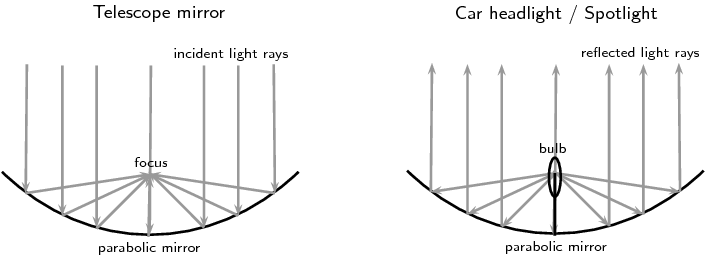

Figure 5.7: On the left is a ray diagram showing how
                                                a telescope mirror works to collect incoming incident light (parallel
                                                rays) from a distant object such as a star or galaxy and focus the rays
                                                to a point where a detector e.g. a camera, can make an image. The
                                                diagram on the right shows how the same kind of parabolic reflector can
                                                cause light coming from a car headlight or spotlight bulb to be
                                                collimated. In this case the reflected rays are parallel.

## Rays and Reflection

### Textbook Exercise 5.1

**Problem:**
Are light rays real? Explain.

**Solution:**
Light rays are not real.

In physics we use the idea of a light ray to indicate the
                                                                direction in which light travels. In geometrical optics,
                                                                we represent light rays with straight arrows to show how
                                                                light propagates. Light rays are not an exact
                                                                description of the light; rather they show the direction
                                                                in which the light wavefronts are travelling.

**Problem:**
The diagram shows a curved surface. Draw normals to the
                                                                surface at the marked points.

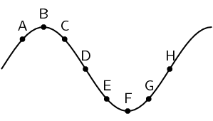

**Solution:**
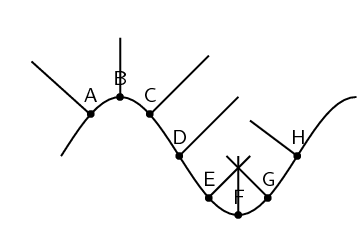

Which of the labels, A-H, in the diagram, correspond to the
                                                                following:

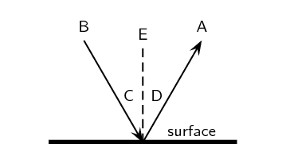

**Problem:**
normal

**Solution:**
E

**Problem:**
angle of incidence

**Solution:**
C

**Problem:**
angle of reflection

**Solution:**
D

**Problem:**
incident ray

**Solution:**
B

**Problem:**
reflected ray

**Solution:**
A

**Problem:**
State the Law of Reflection. Draw a diagram, label the
                                                                appropriate angles and write a mathematical expression
                                                                for the Law of Reflection.

**Solution:**
The law of reflection states that the angle of incidence is
                                                                equal to the angle of reflection and the incident ray,
                                                                reflected ray, and the normal, all lie in the same
                                                                plane.

We can write this mathematically as: \(θ_{i} =
                                                                θ_{r}\).

**Problem:**
Draw a ray diagram to show the relationship between the angle
                                                                of incidence and the angle of reflection.

**Solution:**

**Problem:**
The diagram shows an incident ray \(I\). Which of the other 5
                                                                rays (A, B, C, D, E) best represents the reflected ray
                                                                of \(I\)?

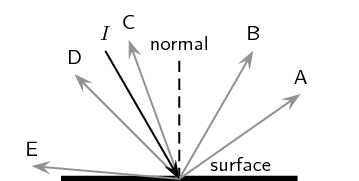

**Solution:**
Ray B looks like it is reflected at the same angle as the
                                                                incident ray.

**Problem:**
A ray of light strikes a surface at
                                                                \(\text{15}\)\(\text{°}\) to the normal to the
                                                                surface. Draw a ray diagram showing the incident ray,
                                                                reflected ray and surface normal. Calculate the angles
                                                                of incidence and reflection and fill them in on your
                                                                diagram.

**Solution:**
We are told that the ray of light strikes the surface at
                                                                \(\text{15}\)\(\text{°}\) to the normal to the
                                                                surface, so the angle of incidence is
                                                                \(\text{15}\)\(\text{°}\). Since the angle of
                                                                incidence is equal to the angle of reflection, the angle
                                                                of reflection is also \(\text{15}\)\(\text{°}\).

Putting this onto a ray diagram (not to scale!):

**Problem:**
A ray of light leaves a surface at
                                                                \(\text{45}\)\(\text{°}\) to the normal to the
                                                                surface. Draw a ray diagram showing the incident ray,
                                                                reflected ray and surface normal. Calculate the angles
                                                                of incidence and reflection and fill them in on your
                                                                diagram.

**Solution:**
We are told that the ray of light leaves the surface at
                                                                \(\text{45}\)\(\text{°}\) to the normal to the
                                                                surface, so the angle of reflection is
                                                                \(\text{45}\)\(\text{°}\). Since the angle of
                                                                reflection is equal to the angle of incidence, the angle
                                                                of incidence is also \(\text{15}\)\(\text{°}\).

Putting this onto a ray diagram (not to scale!):

**Problem:**
A ray of light strikes a surface at
                                                                \(\text{25}\)\(\text{°}\) to the surface. Draw a
                                                                ray diagram showing the incident ray, reflected ray and
                                                                surface normal. Calculate the angles of incidence and
                                                                reflection and fill them in on your diagram.

**Solution:**
We are told that the ray of light strikes the surface at
                                                                \(\text{25}\)\(\text{°}\) to the surface. To find
                                                                the angle of incidence we note that the normal is drawn
                                                                at \(\text{90}\)\(\text{°}\) to the surface. So the
                                                                angle of incidence is \(\text{90}\text{°} -
                                                                \text{25}\text{°} = \text{65}\text{°}\). Since
                                                                the angle of incidence is equal to the angle of
                                                                reflection, the angle of reflection is also
                                                                \(\text{65}\)\(\text{°}\).

Putting this onto a ray diagram (not to scale!):

**Problem:**
A ray of light leaves a surface at
                                                                \(\text{65}\)\(\text{°}\) to the surface. Draw a
                                                                ray diagram showing the incident ray, reflected ray and
                                                                surface normal. Calculate the angles of incidence and
                                                                reflection and fill them in on your diagram.

**Solution:**
We are told that the ray of light leaves the surface at
                                                                \(\text{65}\)\(\text{°}\) to the surface. To find
                                                                the angle of reflection we note that the normal is drawn
                                                                at \(\text{90}\)\(\text{°}\) to the surface. So the
                                                                angle of reflection is \(\text{90}\text{°} -
                                                                \text{65}\text{°} = \text{25}\text{°}\). Since
                                                                the angle of reflection is equal to the angle of
                                                                incidence, the angle of incidence is also
                                                                \(\text{25}\)\(\text{°}\).

Putting this onto a ray diagram (not to scale!):

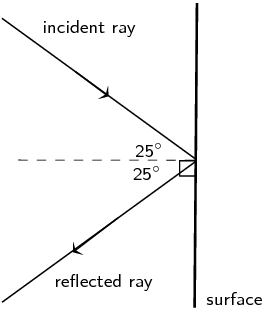

**Problem:**
A beam of light (for example from a torch) is generally not
                                                                visible at night, as it travels through air. Try this
                                                                for yourself. However, if you shine the torch through
                                                                dust, the beam is visible. Explain why this happens.

**Solution:**
To see the beam from a torch the light rays emitted by the
                                                                torch need to be reflected off something for our eye to
                                                                see it. At night the light rays are not being reflected
                                                                off anything and so we do not see the beam of the torch.
                                                                If we shine the torch through dust, then we can see the
                                                                beam as the light rays reflect off the dust particles.

**Problem:**
If a torch beam is shone across a classroom, only students in
                                                                the direct line of the beam would be able to see that
                                                                the torch is shining. However, if the beam strikes a
                                                                wall, the entire class will be able to see the spot made
                                                                by the beam on the wall. Explain why this happens.

**Solution:**
To see the beam from a torch the light rays emitted by the
                                                                torch need to be reflected off something for our eye to
                                                                see it. So only the students in the direct path of the
                                                                light will see that the torch is shining. However as
                                                                soon as the torch beam is reflected off the wall, the
                                                                learners are all able to see the spot where the beam
                                                                reflects.

A scientist looking into a flat mirror hung perpendicular to
                                                                the floor cannot see her feet but she can see the hem of
                                                                her lab coat. Draw a ray diagram to help explain the
                                                                answers to the following questions:

**Problem:**
Will she be able to see her feet if she backs away
                                                                        from the mirror?

**Solution:**
She will not be able to see her feet. Your eye sights
                                                                        along a line to see your feet. This line must
                                                                        intersect the mirror.

The solid lines show the path of light from her
                                                                        labcoat hem to her eyes, while the dotted line
                                                                        shows the path that light would have to take to
                                                                        reach her eyes from her feet. As she moves
                                                                        further away the only thing that changes is the
                                                                        angles of incidence and reflection.

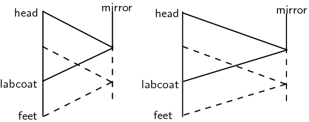

**Problem:**
What if she moves towards the mirror?

**Solution:**
She still will not be able to see her feet. Your eye
                                                                        sights along a line to see your feet. This line
                                                                        must intersect the mirror.

The solid lines show the path of light from her
                                                                        labcoat hem to her eyes, while the dotted line
                                                                        shows the path that light would have to take to
                                                                        reach her eyes from her feet. As she moves
                                                                        closer the only thing that changes is the angles
                                                                        of incidence and reflection.

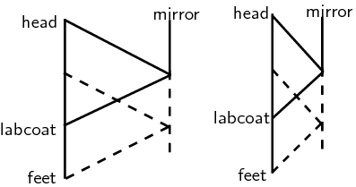

#### Absorption

In addition to being reflected, light can also be **absorbed**. Recall
                                        from grade 10 that visible light covers a range of wavelengths in the
                                        electromagnetic spectrum. The colours we see with our eyes correspond to light
                                        waves with different wavelengths or frequencies.

Imagine that you shine a torch or other source of white light onto a white piece of
                                        paper. The light is reflected off the paper and into our eyes and we see the
                                        colour of the paper as white. Now if we were to shine the same light onto a red
                                        apple we will notice that the colour of the apple appears red. This means that
                                        the surface of the apple is only reflecting red light into our eyes. All the
                                        other wavelengths in the incident white light are absorbed by the apple's skin.
                                        If you touch the apple, it will feel warm because it is absorbing the energy
                                        from all the light it is absorbing. Because of absorption and reflection, we can
                                        perceive colours of different objects. White objects reflect all or most of the
                                        wavelengths of light falling on them, coloured objects reflect particular
                                        wavelengths of light and absorb the rest. Black objects absorb all the light
                                        falling on them. This is why wearing a white t-shirt outside in the sun is
                                        cooler than wearing a black t-shirt, since the white t-shirt reflects most
                                        of the light falling on it, while the black t-shirt will absorb it and heat up.

#### Transmission

A further property of light is that it can be **transmitted** through
                                        objects or a medium. Objects through which light can be transmitted are called
                                        *transparent* and objects which block out light or that light cannot pass
                                        through are called *opaque*.

For example, glass windows allow visible light to pass through them which is why we
                                        can see through windows. The light rays from things outside the window can pass
                                        through or be transmitted through the glass and into our eyes. Brick walls on
                                        the other hand are opaque to visible light. We cannot see through brick walls
                                        because the light cannot be transmitted through the wall into our eyes. The
                                        transmission of light through an object depends on the wavelength of the light.
                                        For example, short wavelength visible light cannot be transmitted through a
                                        brick wall whereas long wavelength radio waves can easily pass through walls and
                                        be received by a radio or cell phone. In other words, a brick wall is
                                        transparent to radio waves!
