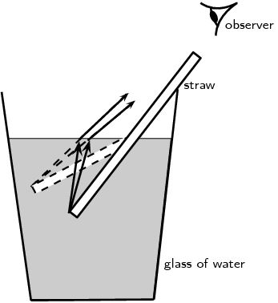
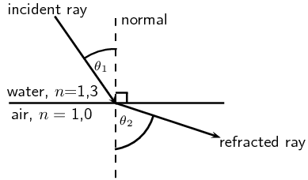
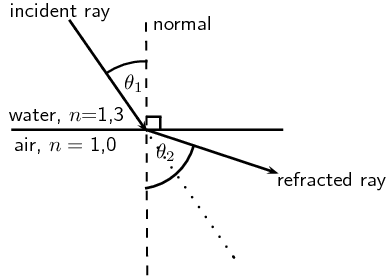
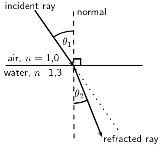
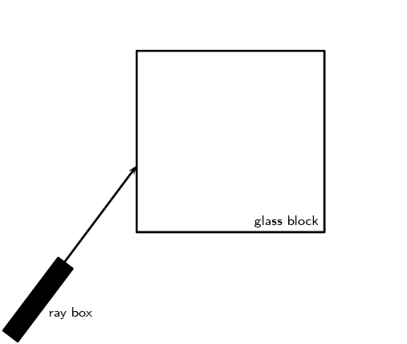
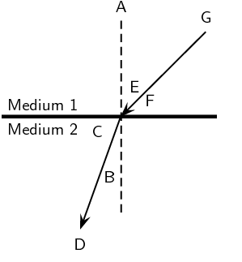
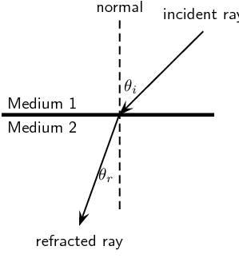
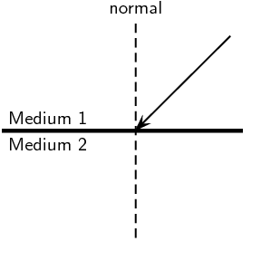
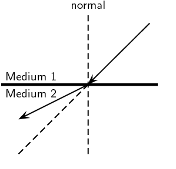
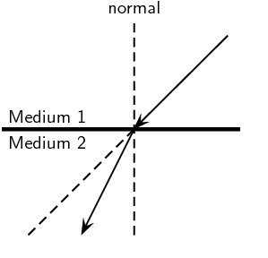

## 5.5 Refraction (ESBN4)

<Callout type="note" title="Note">
<VideoPlayer src="https://youtu.be/FAivtXJOsiI" title="Video: 23SD" />
</Callout>

<Callout type="note" title="Note">
<VideoPlayer src="https://youtu.be/OXDbc7QfTXU" title="Video: 23SF" />
</Callout>

In the previous sections we studied light reflecting off various surfaces. What happens when light
                        passes from one medium into another? The speed of light, like that of all waves, is dependent on
                        the medium through which it is travelling. When light moves from one medium into another (for
                        example, from air to glass), the speed of light changes.
                        If the light ray hits the boundary of the new medium (for example the edge of a glass block) at
                        any angle which is not perpendicular to or parallel with the boundary, the light ray will change
                        its direction through the next medium, or appear to `bend'. This is called
                        **refraction** of light. It is important to note that while the speed of the light
                        changes when it passes into the new medium, the frequency of the light remains the same.

Refraction

Refraction occurs at the boundary of two media when light travels from one medium
                                        into the other and its speed changes but its frequency remains the same. If the
                                        light ray hits the boundary at an angle which is not perpendicular to or
                                        parallel to the surface, then it will change direction and appear to `bend'.

Refraction is nicely demonstrated when you look from above at an angle at a straw in a glass of
                        water. The straw appears bent in the liquid. This is because the light rays leaving the straw
                        change direction when they hit the surface between the liquid and the air. Your eyes trace the
                        light rays backwards as straight lines to the point they would have come from if they had not
                        changed direction and as a result you see the tip of the straw as being shallower in the liquid
                        than it really is.

Figure 5.8: Due to refraction, a straw in a glass of water appears
                                bent when an observer looks down at an angle from above the water surface.

<QuizCard id="s11-05-05a" title="Interactive Exercise 5.2" question="Adapted from DBE Grade 11 Nov 2015 P1, Q6.2 Physical constants · Physics formulas Define the term refraction ." options=["period", "frequency", "direction", "amplitude", "amplitude", "frequency", "speed", "period", "air into water only", "air into any medium", "one medium into another", "air into glass only"] answer="0, 0, 0" hint="" explanation="Define refraction Refraction is the change in direction of a wave due to a change in speed when the wave travels from one medium into another obliquely (at an angle). Any wave can be refracted. When a light wave is refracted, the two media must have different optical densities . For example, the image below shows a light wave being refracted when it passes from ice into air. Submit your answer as: direction and speed and one medium into another" />

<QuizCard id="s11-05-05a" title="Interactive Exercise 5.2" question="Adapted from DBE Grade 11 Nov 2016 P1, Q6.7 Physical constants · Physics formulas Benzene floats on palm oil because its density is lower than that of palm oil. However, the refractive index of benzene is \(\text{1,501}\) while the refractive index of palm oil is \(\text{1,450}\) . When a light wave travels from one medium to another, its speed changes because of the different optical densities of the two media. State how each of the following wave properties will change (or remain constant) when the light wave crosses the boundary between palm oil and benzene." options=["increases", "decreases", "remains constant", "increases", "decreases", "remains constant"] answer="1, 2" hint="" explanation="What happens to frequency and wavelength during refraction? When a light wave is refracted, its frequency remains constant . Knowing this, we can work out how wavelength is affected during refraction. Recall the wave equation: \[                     \begin{array}{c}                 		v = f \lambda                     \end{array}                 \] For a constant frequency , the speed of the wave and its wavelength are directly proportional : \[                     \begin{array}{c}                 		v \propto \lambda                     \end{array}                 \] In this question, the light wave goes from palm oil (lower optical density) to benzene (higher optical density). Because the speed of a light wave decreases when it goes from a medium of a lower optical density to a medium with a higher optical density the wavelength also decreases . Submit your answer as: decreases and remains constant" />

### Refractive index (ESBN5)

The speed of light and therefore the degree of bending of the light depends on the
                                *refractive index* of material through which the light passes. The refractive
                                index (symbol \(n\)) is the ratio of the speed of light in a vacuum to its speed in the
                                material.

Refractive index

The refractive index (symbol \(n\)) of a material is the ratio of the speed
                                                of light in a vacuum to its speed in the material and gives an
                                                indication of how difficult it is for light to get through the material.

\[n = \frac{c}{v}\]

                                                where
                                                \[\begin{array}{rl}
                                                n &= \text{refractive index (no unit)} \\
                                                c &= \text{speed of light in a vacuum } (\text{3,00} \times
                                                \text{10}^{\text{8}}\text{ m·s$^{-1}$}) \\
                                                v &= \text{speed of light in a given medium }
                                                (\text{m·s$^{-1}$}) \\
                                                \end{array}\]

Using the definition of refractive index
                                \[n = \frac{c}{v}\]

                                we can see how the speed of light changes in different media, because the speed of light
                                in a vacuum, \(c\), is constant.

If the refractive index, \(n\), increases, the speed of light in the material, \(v\), must
                                decrease. Therefore light travels slower through materials of high refractive index,
                                \(n\).

<QuizCard id="s11-05-05b" title="Interactive Exercise 5.3" question="Adapted from DBE Grade 11 Nov 2016 P1, Q6.1 Physical constants · Physics formulas Define the term refractive index ." options=["exponent of", "ratio of", "sum of", "product of", "air", "a vacuum", "water", "diamond", "direction of light in", "optical density of", "speed of light in", "mass density of"] answer="0, 0, 0" hint="" explanation="Define the refractive index The refractive index ( \(n\) ) of a material is the ratio of the speed of light in a vacuum ( \(c\) ) to the speed of light in the material ( \(v\) ). \[ 	                    \begin{array}{c} 	                    	n = \dfrac{c}{v} 	                    \end{array} 	                \] Submit your answer as: ratio of and a vacuum and speed of light in" />

<QuizCard id="s11-05-05b" title="Interactive Exercise 5.3" question="The speed of light in a material \((v)\) , the speed of light in a vacuum \((c)\) , and the refractive index \((n)\) are three quantities used in geometrical optics. Which one of the following equations correctly represents the relationship between these quantities? A \(c = n v\) B \(c = \dfrac{n}{v}\) C \(c = \dfrac{v}{n}\)" options=["A", "B", "C"] answer="A" hint="" explanation="Identify the relationship Light has a speed \(c=\text{3} \times \text{10}^{\text{8}}\ \text{m·s$^{-1}$}\) in a vacuum. When light passes through matter it slows down. The refractive index gives an indication of how difficult it is for light to get through the material. It is equal to the ratio of the speed of light in a vacuum and the speed of light through the material. The speed of light in a material, the speed of light in a vacuum, and the refractive index are related to each other by the following equation: \[                     \begin{aligned}                         n = \frac{c}{v}                     \end{aligned}                 \] NOTE: Because the speed of light in any medium must be slower than the speed of light in a vacuum, \(v<c\) . This means that the refractive index for any substance will be greater than 1 . Refractive index is sometimes referred to as \"optical density\". Make \(c\) the subject of the formula We need to isolate \(c\) . We can  do this by multiplying both sides of the equation by \({\color{blue}{v}}\) . \[                         \begin{aligned}                             n &= \frac{ c }{ v } \\                             n {\color{blue}{v}} &= \frac{ c }{ v }  {\color{blue}{v}} \\                             n v &= c \frac{ {\color{darkgray}{v}} }{ {\color{darkgray}{v}} } \\                             \therefore n v &= c                         \end{aligned}                     \] Therefore the relationship with \(c\) the subject of the formula is: \[                     \begin{array}{c}                         c = n v                     \end{array}                 \] We can compare this equation to the given options: A ✔ \(c = n v\) B ✘ \(c = \dfrac{n}{v}\) C ✘ \(c = \dfrac{v}{n}\) Therefore the correct equation is A . Submit your answer as: A" />

Table 5.1 shows refractive indices for
                                various materials. Light travels slower in any material than it does in a vacuum, so all
                                values for \(n\) are greater than \(\text{1}\).

| Medium | Refractive Index |
| --- | --- |
| Vacuum | \(\text{1}\) |
| Helium | \(\text{1,000036}\) |
| Air* | \(\text{1,0002926}\) |
| Carbon dioxide | \(\text{1,00045}\) |
| Water: Ice | \(\text{1,31}\) |
| Water: Liquid (\(\text{20}\)\(\text{°C}\)) | \(\text{1,333}\) |
| Acetone | \(\text{1,36}\) |
| Ethyl Alcohol (Ethanol) | \(\text{1,36}\) |
| Sugar solution (\(\text{30}\%\)) | \(\text{1,38}\) |
| Fused quartz | \(\text{1,46}\) |
| Glycerine | \(\text{1,4729}\) |
| Sugar solution (\(\text{80}\%\)) | \(\text{1,49}\) |
| Rock salt | \(\text{1,516}\) |
| Crown Glass | \(\text{1,52}\) |
| Sodium chloride | \(\text{1,54}\) |
| Polystyrene | \(\text{1,55}\) to \(\text{1,59}\) |
| Bromine | \(\text{1,661}\) |
| Sapphire | \(\text{1,77}\) |
| Glass (typical) | \(\text{1,5}\) to \(\text{1,9}\) |
| Cubic zirconia | \(\text{2,15}\) to \(\text{2,18}\) |
| Diamond | \(\text{2,419}\) |
| Silicon | \(\text{4,01}\) |

Table 5.1: Refractive indices of some materials. \(n_{\text{air}}\)
                                        is calculated at standard temperature and pressure (STP).

<Callout type="tip" title="Worked example 1: Refractive index">
**Question:**
Calculate the speed of light through glycerine which has a refractive index
                                                of \(\text{1,4729}\).

**Determine what is given and what is required:**
We are given the refractive index, \(n\) of glycerine and we need to
                                                calculate the speed of light in glycerine.

**Determine how to approach the problem:**
We can use the definition of refractive index since the speed of light in
                                                vacuum is a constant and we know the value of glycerine's refractive
                                                index.

**Do the calculation:**
\[n = \frac{c}{v}\]

                                                Rearrange the equation to solve for \(v\) and substitute in the known
                                                values:
                                                \begin{align*}
                                                v &= \frac{c}{n} \\
                                                &= \frac{\text{3} \times \text{10}^{\text{8}}\text{
                                                m·s$^{-1}$}}{\text{1,4729}} \\
                                                &= \text{2,04} \times \text{10}^{\text{8}}\text{ m·s$^{-1}$}
                                                \end{align*}
</Callout>

<QuizCard id="s11-05-05c" title="Interactive Exercise 5.4" question="Light shines through crown glass, which has a refractive index of \(n = \text{1,52}\) . What is the speed of the light in the crown glass? INSTRUCTION: Use \(c = \text{3} \times \text{10}^{\text{8}}\ \text{m·s$^{-1}$}\) and write your answer in scientific notation, rounding to two digits after the decimal point." options=[] answer="(1.97e+8; 1.96e+8; 1.984e+8)" hint="You should enter a number here. If you want to, you can use a space to separate thousands.                Example: 12 800,25 For scientific notation you need to use the multiply symbol                ( ∗ ) and the exponent symbol ( ^ ). For example 6,673 × 10 −11 should be written as: 6,673 ∗ 10^−11" explanation="You need to calculate the speed of light in crown glass. The formula for the speed of light in a medium (substance) is: \[             \begin{aligned}               v & = \frac{c}{n}             \end{aligned}           \] You are given: \(c = \text{3} \times \text{10}^{\text{8}}\ \text{m·s$^{-1}$}\) \(n = \text{1,52}\) (the refractive index for crown glass) Substitute the values into the equation: \[             \begin{aligned}               v & = \frac{c}{n} \\                 & = \frac{\text{3} \times \text{10}^{\text{8}}\ \text{m·s$^{-1}$}}{\text{1,52}} \\                 & = \text{1,97368...} \times \text{10}^{\text{8}} \\ & \approx \text{1,97} \times \text{10}^{\text{8}}\ \text{m·s$^{-1}$}             \end{aligned}           \] Therefore, the speed of the light in the crown glass is \(\text{1,97} \times \text{10}^{\text{8}}\ \text{m·s$^{-1}$}\) . Submit your answer as:" />

<QuizCard id="s11-05-05c" title="Interactive Exercise 5.4" question="Calculate the refractive index of an unknown substance where the speed of light through the substance is \(\text{1,39535} \times \text{10}^{\text{8}}\ \text{m·s$^{-1}$}\) . Round off your answer to 2 decimal places. Using the table below, identify what the unknown substance is. Medium Refractive Index Sodium chloride \(\text{1,54}\) Diamond \(\text{2,419}\) Glass (typical) \(\text{1,5}\) Glycerine \(\text{1,4729}\) Polystyrene \(\text{1,55}\) Silicon \(\text{4,01}\) Ice (water) \(\text{1,31}\) Cubic zirconia \(\text{2,15}\) Water (liquid  at \(\text{20}\text{°C}\) ) \(\text{1,333}\) Bromine \(\text{1,661}\) Sugar solution (80%) \(\text{1,49}\) Sapphire \(\text{1,77}\) Crown Glass \(\text{1,52}\) Fused quartz \(\text{1,46}\) Acetone \(\text{1,36}\) Use \(c = \text{3} \times \text{10}^{\text{8}}\ \text{m·s$^{-1}$}\) ." options=["Sodium chloride", "Diamond", "Glass", "Glycerine", "Polystyrene", "Silicon", "Ice", "Cubic zirconia", "Water", "Bromine", "Sugar solution", "Sapphire", "Crown Glass", "Fused quartz", "Acetone"] answer="2.15, 7" hint="You should enter a number here. If you want to, you can use a space to separate thousands.                Example: 12 800,25 For scientific notation you need to use the multiply symbol                ( ∗ ) and the exponent symbol ( ^ ). For example 6,673 × 10 −11 should be written as: 6,673 ∗ 10^−11" explanation="You are given: \(v = \text{1,39535} \times \text{10}^{\text{8}}\ \text{m·s$^{-1}$}\) \(c = \text{3} \times \text{10}^{\text{8}}\ \text{m·s$^{-1}$}\) You need to calculate the refractive index of the medium. The formula for the refractive index of a medium is: \[             \begin{aligned}               n & = \frac{c}{v} \\                 & = \frac{\text{3} \times \text{10}^{\text{8}}\ \text{m·s$^{-1}$}}{\text{1,39535} \times \text{10}^{\text{8}}\ \text{m·s$^{-1}$}} \\                 & = \text{2,15}             \end{aligned}           \] Thus the refractive index for the unknown medium is \(\text{2,15}\) . Now compare this number to the refractive indices in the table. Cubic zirconia has a refractive index of \(\text{2,15}\) . This is the medium with the closest refractive index to the value we calculated. Therefore the conclude the medium the light is moving through is cubic zirconia . Submit your answer as: and Cubic zirconia" />

<QuizCard id="s11-05-05c" title="Interactive Exercise 5.4" question="Adapted from DBE Grade 11 Nov 2015 P1, Q6.4 Physical constants · Physics formulas A group of learners perform some refraction experiments with some optical media.                 The table below shows accurate values for the refractive indices ( relative to a vacuum ) that they obtained                  as a result of their experiments. Medium Refractive index flint glass \(\text{1,600}\) salt water \(\text{1,383}\) acetone \(\text{1,357}\) milk \(\text{1,349}\) The optical densities of the media decrease as you go down the table from flint glass to milk. Consider a ray of light which travels from flint glass into milk. Will the refractive index of milk relative to flint glass be greater than , less than , or equal to the refractive index of milk in the table above?" options=[] answer="1" hint="" explanation="Determine an expression for the refractive index of milk relative to flint glass Recall the definition of refractive index of a medium relative to a vacuum : The refractive index ( \(n\) ) of a medium is the ratio of the speed of light in a vacuum ( \(c\) ) to its speed in the medium ( \(v\) ). \[                         \begin{array}{c}                             n = \dfrac{c}{v}                         \end{array}                     \] So the refractive index of flint glass relative to a vacuum is the speed of light in a vacuum divided by the speed of light in flint glass: \[                     \begin{aligned}                 		{\color{OrangeRed}{n_{\text{flint glass}}}} & = \dfrac{{\color{ForestGreen}{c}}}{{\color{OrangeRed}{v_{\text{flint glass}}}}} \\ 						\therefore {\color{OrangeRed}{v_{\text{flint glass}}}} & = \dfrac{{\color{ForestGreen}{c}}}{{\color{OrangeRed}{n_{\text{flint glass}}}}}                     \end{aligned}                 \] where we can think of \({\color{OrangeRed}{n_{\text{flint glass}}}}\) as \(n_{{\color{OrangeRed}{\text{flint glass}}},{\color{ForestGreen}{\text{vacuum}}}}\) . Similarly, the refractive index of milk relative to a vacuum is: \[                     \begin{aligned}                         {\color{DarkBlue}{n_{\text{milk}}}} & = \dfrac{{\color{ForestGreen}{c}}}{{\color{DarkBlue}{v_{\text{milk}}}}} \\                         \therefore {\color{DarkBlue}{v_{\text{milk}}}} & = \dfrac{{\color{ForestGreen}{c}}}{{\color{DarkBlue}{n_{\text{milk}}}}}                     \end{aligned}                 \] where we can think of \({\color{DarkBlue}{n_{\text{milk}}}}\) as \(n_{{\color{DarkBlue}{\text{milk}}},{\color{ForestGreen}{\text{vacuum}}}}\) . In a similar way, the refractive index of milk relative to flint glass is the ratio of the speed of light in flint glass to the speed of light in milk: \[                     \begin{aligned} 						  & n_{{\color{DarkBlue}{\text{milk}}}, {\color{OrangeRed}{\text{flint glass}}}} \\[2mm] 						= & \dfrac{{\color{OrangeRed}{v_{\text{flint glass}}}}}{{\color{DarkBlue}{v_{\text{milk}}}}} \\ 						= & \dfrac{{\color{ForestGreen}{c}}}{{\color{OrangeRed}{n_{\text{flint glass}}}}} \div \dfrac{{\color{ForestGreen}{c}}}{{\color{DarkBlue}{n_{\text{milk}}}}} \\ 						= & \dfrac{{\color{ForestGreen}{c}}}{{\color{OrangeRed}{n_{\text{flint glass}}}}} \times \dfrac{{\color{DarkBlue}{n_{\text{milk}}}}}{{\color{ForestGreen}{c}}} \\ 						= & \dfrac{{\color{DarkBlue}{n_{\text{milk}}}}}{{\color{OrangeRed}{n_{\text{flint glass}}}}}                     \end{aligned}                 \] so \[                     \begin{array}{c}                         n_{{\color{DarkBlue}{\text{milk}}}, {\color{OrangeRed}{\text{flint glass}}}} = \dfrac{{\color{DarkBlue}{n_{\text{milk}}}}}{{\color{OrangeRed}{n_{\text{flint glass}}}}}                     \end{array}                 \] We know that \({\color{OrangeRed}{n_{\text{flint glass}}}} > \text{1}\) . We can see this in the table, but we also know that all media have a refractive index relative to a vacuum greater than \(\text{1}\) . So the denominator in the fraction above is greater than \(\text{1}\) , which means \(n_{{\color{DarkBlue}{\text{milk}}}, {\color{OrangeRed}{\text{flint glass}}}}\) is less than \({\color{DarkBlue}{n_{\text{milk}}}}\) . Therefore the refractive index of milk relative to flint glass is less than the refractive index of milk in the table above. NOTE: A vacuum has a refractive index of \(\text{1}\) . This is lower than any physical medium (even air). So the refractive index of any medium (relative to a vacuum) will always be greater than the refractive index of that medium relative to some other medium. Submit your answer as: less than" />

## Refractive index

### Textbook Exercise 5.2

**Problem:**
Use the values given in Table 5.1, and the
                                                                definition of refractive index to calculate the speed of
                                                                light in water (ice).

**Solution:**
We look in Table
                                                                        5.1 and find that the refractive index of
                                                                water (ice) is \(\text{1,31}\). So the speed of light in
                                                                ice is:

                                                        \begin{align*}
                                                        v &= \frac{c}{n} \\
                                                        &= \frac{\text{3} \times \text{10}^{\text{8}}\text{
                                                        m·s$^{-1}$}}{\text{1,31}} \\
                                                        &= \text{2,29} \times \text{10}^{\text{8}}\text{
                                                        m·s$^{-1}$}
                                                        \end{align*}

**Problem:**
Calculate the refractive index of an unknown substance where
                                                                the speed of light through the substance is
                                                                \(\text{1,974} \times \text{10}^{\text{8}}\)
                                                                \(\text{m·s$^{-1}$}\). Round off your answer to 2
                                                                decimal places. Using Table 5.1, identify
                                                                what the unknown substance is.

**Solution:**
We are told that the speed of light in the unknown substance
                                                                is: \(\text{1,974} \times \text{10}^{\text{8}}\)
                                                                \(\text{m·s$^{-1}$}\). We use this to find the
                                                                refractive index of the substance:

                                                        \begin{align*}
                                                        v &= \frac{c}{n} \\
                                                        n &= \frac{c}{v} \\
                                                        &= \frac{\text{3} \times \text{10}^{\text{8}}\text{
                                                        m·s$^{-1}$}}{\text{1,974} \times \text{10}^{\text{8}}\text{
                                                        m·s$^{-1}$}} \\
                                                        &= \text{1,52}
                                                        \end{align*}

We look on Table
                                                                        5.1 for the substance that has this
                                                                refractive index and find that the substance is crown
                                                                glass.

### Optical density (ESBN6)

Optical density is a measure of the refracting power of a medium. In other words, the higher
                                the optical density, the more the light will be refracted or slowed down as it moves
                                through the medium. Optical density is related to refractive index in that materials
                                with a high refractive index will also have a high optical density. Light will travel
                                slower through a medium with a high refractive index and high optical density and faster
                                through a medium which has a low refractive index and a low optical density.

Optical density

Optical density is a measure of the refracting power of a medium.

<QuizCard id="s11-05-05d" title="Interactive Exercise 5.5" question="Adapted from DBE Grade 11 Nov 2015 P1, Q6.1 Physical constants · Physics formulas A group of scientists perform some refraction experiments with some optical media.             	The table below shows accurate values for the refractive indices ( relative to a vacuum ) that they obtained             	 as a result of their experiments. Medium Refractive index salt water \(\text{1,374}\) perspex \(\text{1,481}\) benzene \(\text{1,500}\) silicon \(\text{4,010}\) The optical densities of the media increase as you go down the table from salt water to silicon. What important deduction about the relationship between a medium and its refractive index can be made using the above table?" options=[] answer="0" hint="" explanation="Recall the definition of optical density Optical density is a measure of the refracting power of a medium. The higher the optical density, the more the light will be refracted or slowed down as it moves through the medium. How is optical density related to refractive index? We were told that the optical densities of the media increase as you go down the table. So as you go down the table, light will be refracted or slowed down more as it moves through the medium. We can also see that as you go down the table, the refractive indices increase. Therefore, the medium with the highest refractive index has the greatest bending effect on light. Submit your answer as: The medium with the highest refractive index has the greatest bending effect on light." />

<QuizCard id="s11-05-05d" title="Interactive Exercise 5.5" question="Adapted from DBE Grade 11 Nov 2016 P1, Q6.1 Physical constants · Physics formulas Define the term refractive index ." options=["ratio of", "product of", "sum of", "difference between", "a vacuum", "water", "perspex", "diamond", "optical density of", "speed of light in", "direction of light in", "mass density of"] answer="0, 0, 0" hint="" explanation="Define the refractive index The refractive index ( \(n\) ) of a material is the ratio of the speed of light in a vacuum ( \(c\) ) to the speed of light in the material ( \(v\) ). \[ 	                    \begin{array}{c} 	                    	n = \dfrac{c}{v} 	                    \end{array} 	                \] Submit your answer as: ratio of and a vacuum and speed of light in" />

### Representing refraction with ray diagrams (ESBN7)

It is useful to draw ray diagrams to understand how the geometrical optics concepts we have
                                discussed previously work. Before we can draw the diagrams we need to define a few
                                concepts such as the normal to a surface, the angle of incidence and the angle of
                                refraction.

Normal

The normal to a surface is the line which is perpendicular to the plane of
                                                the surface.

Angle of incidence

The angle of incidence is the angle defined between the normal to a surface
                                                and the incoming (incident) light ray.

Angle of refraction

The angle of refraction is the angle defined between the normal to a surface
                                                and the refracted light ray.

Figure 5.9: The diagram shows the boundary between two
                                        media: water and air. An incoming light ray is refracted when it passes through
                                        the surface of the water into the air. The angle of incidence is \(\theta_{1}\)
                                        and the angle of refraction is \(\theta_{2}\).

When light travels from one medium to another, it is refracted. If the angle of incidence is
                                not equal to zero, the light ray will change direction from its original path as it is
                                refracted.

Figure 5.10: Light is moving from an optically dense medium
                                        to an optically less dense medium.

Figure 5.11: Light is moving from an optically less dense
                                        medium to an optically denser medium.

<QuizCard id="s11-05-05e" title="Interactive Exercise 5.6" question="Which of the labels, A-E, in the diagram, correspond to the following:" options=["A", "B", "C", "D", "E", "A", "B", "C", "D", "E", "A", "B", "C", "D", "E", "A", "B", "C", "D", "E", "A", "B", "C", "D", "E"] answer="4, 1, 0, 3, 2" hint="" explanation="incidence ray  -   E refracted ray  -   B angle of incidence \(\theta_i\) - A angle of refraction \(\theta_r\) - D normal    -      C Submit your answer as: E and B and A and D and C" />

<QuizCard id="s11-05-05e" title="Interactive Exercise 5.6" question="In the diagram below light is shown travelling from Medium 1 into Medium 2. The angle of refraction \(\theta_{\text{r}}\) is different from the angle of incidence \(\theta_{\text{i}}\) . Which medium has the greater optical density? Which medium has the higher refractive index?" options=["Medium 1", "Medium 2", "Neither medium", "Medium 1", "Medium 2", "Neither medium"] answer="0, 0" hint="" explanation="Which medium has the greater optical density? Recall the definition of refraction: Refraction is the apparent 'bending' of light which occurs when light travels from one medium to another and its speed changes but its frequency remains the same. The dotted line represents the path the light would travel if it had kept going straight. This happens if the two media have exactly the same optical density. The angle of refraction for the light ray in the new medium will equal the incidence angle in the first medium. For two media with different optical densities there are two things that can happen to the light ray: If the new medium has a lower optical density then the angle of refraction for the light ray will be further from the normal than the incidence angle in the first medium. The light bends away from the normal. If the new medium has a higher optical density then the angle of refraction for the light ray will be closer to the normal than the incidence angle in the first medium. The light bends towards the normal. TIP: The following rhyme might help you remember the above two points: 🎶 “Less to more it bends to war ds, more to less it will digress !”🎶 In this case the ray is 'bent' away from the normal and so Medium 1 has a greater optical density than Medium 2. Which medium has the greater refractive index? You may recall that the refractive index is the ratio of the speed of light in a vacuum and the speed of light in a medium. \[               \begin{array}{c}                 n = \dfrac{c}{v_{\text{medium}}}               \end{array}           \] So the lower the speed of light in a medium, the greater the refractive index. The greater the optical density of a material, the slower light moves through it, and the higher the refractive index of the material. We determined that Medium 1 has the greater optical density . Therefore it will also have the higher refractive index . Submit your answer as: Medium 1 and Medium 1" />

<QuizCard id="s11-05-05e" title="Interactive Exercise 5.6" question="Adapted from DBE Grade 11 Nov 2016 P1, Q6.5 Physical constants · Physics formulas Turpentine floats on palm oil because its density is lower than that of palm oil. However, the refractive index of turpentine is \(\text{1,470}\) while the refractive index of palm oil is \(\text{1,450}\) . If a light ray passes from turpentine into air, will it refract towards or away from the normal? Give a reason for your answer." options=["away from", "towards"] answer="0, 3" hint="" explanation="What happens to the light when it goes from turpentine into air? Turpentine has a higher refractive index than air. This means it is more optically dense than air. So when the light ray passes from turpentine into air, it goes from a more optically dense medium into a less optically dense medium. NOTE: The density of a substance does not affect refraction. It is the optical density that affects refraction. When light is refracted into a less optically dense medium: The speed of the light wave will increase which causes the light ray to refract (bend) away from the normal and so the angle of refraction ( \(\theta_{\text{r}}\) ) will be more than the angle of incidence ( \(\theta_{\text{i}}\) ). The following diagram (not to scale) illustrates this: NOTE: The frequency (and period) of the light wave will remain the same .                     So the wavelength of the light wave will increase (because \(v = f\lambda\) with \(f\) constant). Answer the question So when a light ray passes from turpentine into air it will bend away from the normal. This is because the light ray moves from a medium with a higher refractive index to  one with a lower refractive index. TIP: The following \"rhyme\" might help you remember the direction in which the refracted ray bends: 🎶 “Less to more it bends to war ds, more to less it will digress !”🎶 Submit your answer as: away from and The light ray moves from a medium with a higher refractive index to  one with a lower refractive index." />

<QuizCard id="s11-05-05e" title="Interactive Exercise 5.6" question="Adapted from DBE Nov 2015 Grade 11, P1, Q1.5 Physical constants · Physics formulas A light ray is refracted when it travels from air into silicon. The table below gives different options relating to the frequency of the light ray and the direction of the refracted ray. Which one of the combinations below is correct? Frequency of the light ray Direction of the refracted ray A remains the same towards the normal B increases towards the normal C remains the same away from the normal D increases away from the normal" options=["A", "B", "C", "D"] answer="A" hint="" explanation="What happens to the light when it goes from air into silicon? Air is less optically dense than silicon. This means it has a lower refractive index. So when the light ray passes from air into silicon it goes from a less optically dense medium into a more optically dense medium. When light is refracted into a more optically dense medium : the light ray will refract (bend) towards the normal the angle of refraction ( \(\theta_{\text{r}}\) ) will be less than the angle of incidence ( \(\theta_{\text{i}}\) ) the frequency (and period) of the light wave will remain the same the speed of the light wave will decrease so the wavelength of the light wave will also decrease (because \(v = f\lambda\) ) The following diagram illustrates this: Choose the correct option We now have enough information to answer the question. Frequency of the light ray Direction of the refracted ray A \({\color{red}{{\checkmark}{\checkmark}}}\) remains the same towards the normal B increases towards the normal C remains the same away from the normal D increases away from the normal The correct option is A . TIP: The following \"rhyme\" might help you remember the direction in which the refracted ray bends: 🎶 “Less to more it bends to war ds, more to less it will digress !”🎶 Submit your answer as: A" />

## Propagation of light from air into glass and back into air

### Aim

To investigate propagation of light from air into glass and back into air

### Apparatus

ray box, rectangular glass block, plain paper, pencil, ruler, protractor.

### Method

Follow the steps below:

2. Place the glass block on a plain piece of paper and use your
                                                                   pencil to draw around the block to make its outline on
                                                                   the paper.
4. Now turn on the ray box and aim the light ray through the
                                                                   left side of the glass block as illustrated in the
                                                                   diagram:
   
6. Now use your pencil to draw a dot somewhere on the incident
                                                                   light ray and another dot at the point where it enters
                                                                   the glass block.
8. Use your pencil to draw a dot at the point where the light
                                                                   exits the glass block and also somewhere else along the
                                                                   exiting ray.
10. Turn off the ray box and remove the glass block from the
                                                                   paper. Use your ruler to join the dots so that you have
                                                                   drawn a picture that looks like the figure above.
12. Now draw the normals to the surfaces where the light ray
                                                                   enters and leaves the block and mark the angle of
                                                                   incidence and angle of refraction on the left surface
                                                                   and the right surface.

### Questions for discussion

2. At the surface where the light enters the glass block, what
                                                                   do you notice about the angle of incidence compared to
                                                                   the angle of refraction?
4. Now look at the surface where the light exits the glass
                                                                   block. Compare the angle of incidence and angle of
                                                                   refraction here.
6. How do the optical densities and indices of refraction for
                                                                   air and glass compare?

A recommended experiment for informal assessment is also included. This investigates
                                        the propagation of light from one medium into another. Learners will need glass
                                        blocks of various shapes, a transparent container, water, plain paper, a pencil,
                                        a ruler, a protractor and a ray box. The questions for discussion at the end of
                                        the experiment get learners thinking about what they found in the experiment.

## Propagation of light from one medium into another medium

### Aim

To investigate the propagation of light from one medium into another

### Apparatus

ray box, glass blocks of various shapes, a transparent container filled with
                                                water, plain paper, pencil, ruler, protractor.

### Method

Starting with the rectangular glass block, repeat the steps below for each of
                                                the various differently shaped glass blocks:

2. Place the glass block on a plain piece of paper and use your
                                                                   pencil to draw around the block to make its outline on
                                                                   the paper.
4. Turn on the ray box and aim the light ray through one of the
                                                                   block's surfaces.
6. Draw a dot at the point where the light enters the block and
                                                                   another dot somewhere else along the incident ray. Also
                                                                   draw a dot at the point where the ray exits the surface
                                                                   of the block and another somewhere along the exiting
                                                                   ray.
8. Remove the glass block and turn off the ray box. Use your
                                                                   ruler to join the dots.
10. Now draw the normals to the surfaces where the light ray
                                                                   enters and exits the block.
12. Use your protractor to measure the angles of incidence and
                                                                   refraction at the surfaces where the light ray enters
                                                                   and exits the block.

Now follow the same steps as before but place differently coloured filters at
                                                the surface of the blocks where the light enters the block.

Lastly, replace the glass blocks with the container of water and repeat the
                                                same steps as above. For this case, try to aim the ray box so that the
                                                angle of incidence on the water container is the same as it was for the
                                                rectangular glass block you investigated first. This is easier if you
                                                place your new piece of paper on top of the drawing you made with the
                                                rectangular block. Line up the water container where you drew the edge
                                                of your glass block. Then you can aim the ray box so that the light
                                                lines up with the incident ray on your paper and follow the steps as
                                                before.

### Questions for discussion

2. For each of your differently shaped glass blocks, how does
                                                                   the angle of incidence going from air to glass compare
                                                                   to the angle of refraction?
4. What happens when you place a coloured filter at the boundary
                                                                   between the air and a glass block?
6. When you compare your two diagrams for the rectangular glass
                                                                   block and the water container, if you did it correctly,
                                                                   the angles of incidence from air to glass/water should
                                                                   be the same. What can you say about the angles of
                                                                   refraction for glass and water respectively? How does
                                                                   this compare with what you already know about the
                                                                   refractive indices or optical densities of these
                                                                   materials?

<Callout type="note" title="Note">
[Simulation: 23SJ](http://phet.colorado.edu/en/simulation/bending-light)
</Callout>

## Refraction

### Textbook Exercise 5.3

**Problem:**
Explain refraction in terms of a change of wave speed in different
                                                        media.

**Solution:**
Refraction occurs at the boundary of two media when light travels
                                                        from one medium into the other and its speed changes but its
                                                        frequency remains the same. If the light ray hits the boundary
                                                        at an angle which is not perpendicular to or parallel to the
                                                        surface, then it will change direction and appear to
                                                        ‘bend’.

We can also say that refraction is the bending of light caused by a
                                                        change in the speed of light as it moves from medium to another.

**Problem:**
In the diagram, label the following:

2. angle of incidence
4. angle of refraction
6. incident ray
8. refracted ray
10. normal

**Solution:**

**Problem:**
What is *the angle of refraction*?

**Solution:**
The angle of refraction is the angle defined between the normal to a
                                                        surface and the refracted light ray.

**Problem:**
Describe what is meant by *the refractive index of a medium*.

**Solution:**
The refractive index (symbol n) of a material is the ratio of the
                                                        speed of light in a vacuum to its speed in the material and
                                                        gives an indication of how difficult it is for light to get
                                                        through the material.

In the diagram, a ray of light strikes the interface between two
                                                        media.

Draw what the refracted ray would look like if:

**Problem:**
medium 1 had a higher refractive index than medium 2.

**Solution:**

**Problem:**
medium 1 had a lower refractive index than medium 2.

**Solution:**

**Problem:**
**Challenge question:** What values of \(n\) are
                                                        physically impossible to achieve? Explain your answer. The
                                                        values provide the limits of possible refractive indices.

**Solution:**
A refractive index of less than 1 is impossible. This would mean that
                                                        light in this medium was travelling at a speed faster than the
                                                        speed of light in a vacuum. However scientists have produced
                                                        materials with negative refractive indices. So the values of n
                                                        that are impossible to achieve physically would be: \(0
                                                        \leqslant n < 1\).

**Problem:**
**Challenge question:** You have been given a glass
                                                        beaker full of an unknown liquid. How would you identify what
                                                        the liquid is? You have the following pieces of equipment
                                                        available for the experiment: a laser or ray box, a protractor,
                                                        a ruler, a pencil, and a reference guide containing optical
                                                        properties of various liquids.

**Solution:**
The answer to this question is covered in the experiment on using
                                                        Snell's law to determine the refractive index of an unknown
                                                        liquid.
