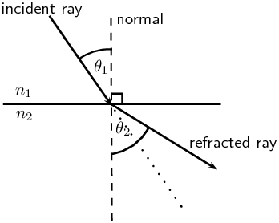
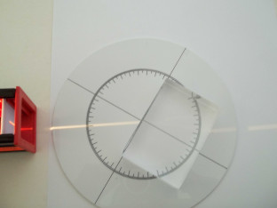
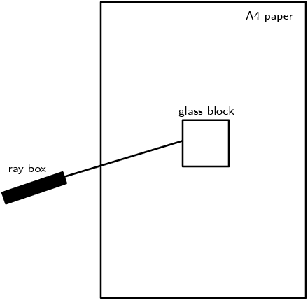
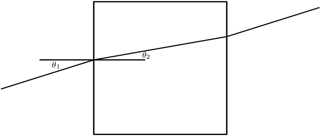
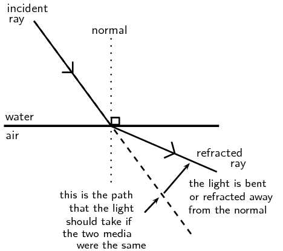
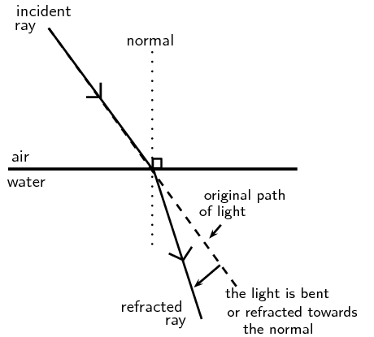
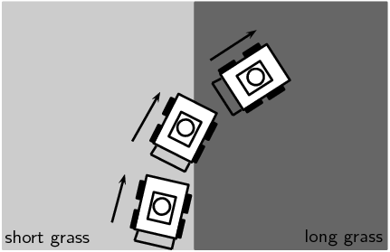
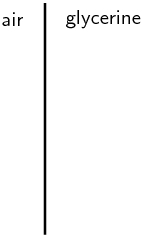
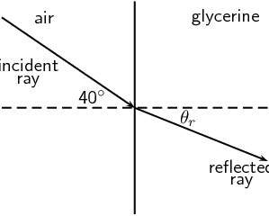

## 5.6 Snell's Law (ESBN8)

Now that we know that the degree of bending, or the angle of refraction, is dependent on the
                        refractive index of a medium, how do we calculate the angle of refraction? The answer to this
                        question was discovered by a Dutch physicist called Willebrord Snell in 1621 and is now called
                        Snell's Law or the Law of Refraction.

Snell's law

\[\boxed{n_1 \sin \theta_1 = n_2 \sin \theta_2}\]

                                        where
                                        \[\begin{array}{rl}
                                        n_1 &= \text{Refractive index of material 1} \\
                                        n_2 &= \text{Refractive index of material 2} \\
                                        \theta_1 &= \text{Angle of incidence} \\
                                        \theta_2 &= \text{Angle of refraction} \\
                                        \end{array}\]

Remember that angles of incidence and refraction are measured from the normal, which is an imaginary
                        line perpendicular to the surface.

Suppose we have two media with refractive indices \(n_1\) and \(n_2\). A light ray is incident on the
                        surface between these materials with an **angle of incidence \(\theta_1\)**. The
                        refracted ray that passes through the second medium will have an **angle of refraction
                                \(\theta_2\)**.

<Callout type="note" title="Note">
Snell never published his discovery of the Law of Refraction. His work was actually published
                                by another prominent physicist of the time, Christiaan Huygens, who gave credit to
                                Snell.
</Callout>

A recommended project for formal assessment on verifying Snell's laws and determining the
                                refractive index of an unknown transparent solid should be done. Learners will need a
                                glass block, ray box, 0-360 protractor, a glass block, a transparent block of an unknown
                                material and A4 paper. This project is given as two formal experiments, which learners
                                can complete and then write up as a project. The project should include some background
                                information on Snell's law, all the steps taken in the experiments, key experimental
                                results and a conclusion about the experiment (including identification of the unknown
                                solid from the refractive index).

## Verifying Snell's Law

### Aim

To verify Snell's law

### Apparatus

glass block, ray box, \(\text{360}\)\(\text{°}\) protractor, 5 pieces of A4
                                        paper, pencil, ruler

### Method

This experiment will require you to follow the steps below 5 times (once for each
                                        piece of A4 paper).

2. Place the glass block in the middle of the A4 piece of paper so that
                                                           its sides are parallel to each of the sides of the paper and
                                                           draw around the block with a pencil to make its outline on the
                                                           piece of paper.
4. Turn on the ray box and aim the light ray towards the glass block so
                                                           that it makes an angle with the nearest surface of the block as
                                                           shown in the picture. For each piece of paper, change the angle
                                                           of the incoming ray.
   
6. You will now need to mark on the paper, the path of the incoming and
                                                           outgoing light rays. Do this by first drawing a dot on the paper
                                                           somewhere along the incoming light ray. Now draw a second dot on
                                                           the paper at the point where the incoming light ray hits the
                                                           surface of the block. Do the same thing for the outgoing light
                                                           ray; mark the point where it leaves the block and some other
                                                           point along its path.
8. Now switch off the ray box and remove the glass block from the paper.
                                                           Use a ruler to join the dots of the incoming ray. Now join the
                                                           dots of the outgoing ray. Lastly, draw a line which joins the
                                                           point where the incoming ray hits the block and where the
                                                           outgoing ray leaves the block. This is the path of the light ray
                                                           through the glass.
10. The aim of this experiment is to verify Snell's law. i.e. \(n_1 \sin
                                                           \theta_1 = n_2 \sin \theta_2\). We know the refractive index of
                                                           our two media:
   For air, \(n_1 =\text{1,0}\)
   For glass, \(n_2 =\text{1,5}\)
   Now we need to measure the two angles, \(\theta_1\) and \(\theta_2\).
                                                           To do this, we need to draw the normal to the surface where the
                                                           light ray enters the block. Use the protractor to measure an
                                                           angle of \(\text{90}\)\(\text{°}\) to the entry surface and
                                                           draw the normal. At this point, the drawing on your piece of
                                                           paper should look something like the picture:
   
12. Now measure \(\theta_1\) and \(\theta_2\) using the protractor. Enter
                                                           the values you measured into a table which looks like:
   | \(\theta_1\) | \(\theta_2\) | \(n_1 \sin \theta_1\) | \(n_2 \sin \theta_2\) |
   | --- | --- | --- | --- |

### Discussion

Have a look at your completed table. You should have 5 rows filled in, one for each
                                        of your pieces of A4 paper. For each row, what do you notice about the values in
                                        the last two columns? Do your values agree with what Snell's law predicts?

## Using Snell's law to determine the refractive index of an unknown material

### Aim

To determine the refractive index of an unknown material

### Apparatus

ray box, \(\text{360}\)\(\text{°}\) protractor, 5 pieces of A4 paper, a block of
                                        unknown transparent material, pencil, ruler

### Method

This experiment will require you to follow the steps below at least 5 times. The
                                        steps are the same as you followed in the previous experiment.

2. Place the block in the middle of the A4 piece of paper so that its
                                                           sides are parallel to each of the sides of the paper and draw
                                                           around the block with a pencil to make its outline on the piece
                                                           of paper.
4. Turn on the ray box and aim the light ray towards the block so that
                                                           it makes an angle with the nearest surface of the block. For
                                                           each piece of paper, change the angle of the incoming ray.
6. You will now need to mark on the paper, the path of the incoming and
                                                           outgoing light rays. Do this by first drawing a dot on the paper
                                                           somewhere along the incoming light ray. Now draw a second dot on
                                                           the paper at the point where the incoming light ray hits the
                                                           surface of the block. Do the same thing for the outgoing light
                                                           ray; mark the point where it leaves the block and some other
                                                           point along its path.
8. Now switch off the ray box and remove the block from the paper. Use a
                                                           ruler to join the dots of the incoming ray. Now join the dots of
                                                           the outgoing ray. Lastly, draw a line which joins the point
                                                           where the incoming ray hits the block and where the outgoing ray
                                                           leaves the block. This is the path of the light ray through the
                                                           block.
10. The aim of this experiment is to determine the refractive index
                                                           \(n_2\) of the unknown material using Snell's law which states
                                                           \(n_1 \sin \theta_1 = n_2 \sin \theta_2\). We know that for air
                                                           \(n_1\) = \(\text{1,0}\) and we can measure the angle of
                                                           incidence, \(\theta_1\) and the angle of refraction,
                                                           \(\theta_2\). Then we can solve the equation for the unknown,
                                                           \(n_2\).
   To measure \(\theta_1\) and \(\theta_2\), we need to draw the normal
                                                           to the surface where the light ray enters the block. Use the
                                                           protractor to measure an angle of \(\text{90}\)\(\text{°}\)
                                                           to the entry surface and draw the normal. Now use the protractor
                                                           to measure \(\theta_1\) and \(\theta_2\).
12. Enter the values you measured into a table which looks like the one
                                                           below and calculate the resulting value for \(n_2\).
   | \(\theta_1\) | \(\theta_2\) | \(n_2 = \frac{n_1 \sin \theta_1}{\sin
                                                                                   \theta_2}\) |
   | --- | --- | --- |

### Question

What do you notice about all your values in the last column of the table?

### Discussion

You should have noticed that the values in the last column of the table are similar
                                        but not identical. This is due to measurement errors when you measured the
                                        angles of incidence and angles of refraction. These sorts of errors are common
                                        in all physics experiments and lead to a measure of uncertainty in the final
                                        extracted value. However, since we did the same experiment 5 times, we can
                                        average the 5 independent measurements of \(n_2\) to get a good approximation to
                                        the real value for our unknown material.

If
                        \[n_2 > n_1\]

                        then from Snell's Law,
                        \[\sin \theta_1 > \sin \theta_2\]

For angles smaller than \(\text{90}\)\(\text{°}\), \(\sin{\theta}\) increases as \(\theta\)
                        increases. Therefore,
                        \[\theta_1 > \theta_2.\]

                        This means that the angle of incidence is greater than the angle of refraction and the light ray
                        is bent toward the normal.

Similarly, if
                        \[n_2 < n_1\]

                        then from Snell's Law,
                        \[\sin \theta_1 < \sin \theta_2.\]

                        For angles smaller than \(\text{90}\)\(\text{°}\), \(\sin{\theta}\) increases as \(\theta\)
                        increases. Therefore,
                        \[\theta_1 < \theta_2.\]

                        This means that the angle of incidence is less than the angle of refraction and the light ray is
                        bent away from the normal.

Figure 5.12: Light is moving from a medium with a higher refractive
                                index to one with a lower refractive index. Light is refracted away from the normal.

Figure 5.13: Light is moving from a medium with a lower refractive
                                index to a medium with a higher refractive index. Light is refracted towards the normal.

What happens to a ray that lies along the normal line? In this case, the angle of incidence is
                        \(\text{0}\)\(\text{°}\) and
                        \begin{align*}
                        \sin \theta_2 &= \frac{n_1}{n_2} \sin \theta_1 \\
                        &= \text{0} \\
                        \therefore \theta_2 &= \text{0}.
                        \end{align*}

This shows that if the light ray is incident at \(\text{0}\)\(\text{°}\), then the angle of
                        refraction is also \(\text{0}\)\(\text{°}\).

                        The direction of the light ray is unchanged, however, the speed of the light will change as it
                        moves into the new medium. Therefore refraction still occurs although it will not be easily
                        observed.

Let's use an everyday example that you can more easily imagine. Imagine you are pushing a lawnmower
                        or a cart through short grass. As long as the grass is pretty much the same length everywhere,
                        it is easy to keep the mower or cart going in a straight line. However, if the wheels on one
                        side of the mower or cart enter an area of grass that is longer than the grass on the other
                        side, that side of the mower will move more slowly since it is harder to push the wheels through
                        the longer grass. The result is that the mower will start to turn inwards, towards the longer
                        grass side as you can see in the picture. This is similar to light which passes through a medium
                        and then enters a new medium with a higher refractive index or higher optical density. The light
                        will change direction towards the normal, just like the mower in the longer grass. The opposite
                        happens when the mower moves from an area of longer grass into an area with shorter grass. The
                        side of the mower in the shorter grass will move faster and
                        the mower will turn outwards, just like a light ray moving from a medium with high refractive
                        index into a medium with low refractive index moves away from the normal.

Figure 5.14: The lawnmower is moving from an area of short grass
                                into an area of longer grass. When it reaches the boundary between the areas, the wheels
                                which are in the long grass move slower than the wheels which are still in the short
                                grass, causing the lawnmower to change direction and its path to bend inwards.

<Callout type="tip" title="Worked example 2: Using Snell's Law">
**Question:**
Light is refracted at the boundary between water and an unknown medium. If the angle
                                        of incidence is \(\text{25}\)\(\text{°}\), and the angle of refraction is
                                        \(\text{20,6}\)\(\text{°}\), calculate the refractive index of the unknown
                                        medium and use [Table 5.1](/read/science/grade-11/geometrical-optics/05-geometrical-optics-05#tab:indices) to
                                        identify the material.

**Determine what is given and what is being asked:**
The angle of incidence \(\theta_{1}=\)\(\text{25}\)\(\text{°}\)

The angle of refraction \(\theta_{2}=\)\(\text{20,6}\)\(\text{°}\)

We can look up the refractive index for water in [Table 5.1](/read/science/grade-11/geometrical-optics/05-geometrical-optics-05#tab:indices): \(n_{1} =\text{1,333}\)

We need to calculate the refractive index for the unknown medium and identify it.

**Determine how to approach the problem:**
We can use Snell's law to calculate the unknown refractive index, \(n_{2}\)

According to Snell's Law:
                                        \begin{align*}
                                        n_1 \sin \theta_1 &= n_2 \sin \theta_2 \\
                                        n_2 &= \frac{n_1 \sin \theta_1}{\sin \theta_2} \\
                                        n_2 &= \frac{\text{1,333} \sin \text{25}\text{°}}{\sin
                                        \text{20,6}\text{°}} \\
                                        n_2 &= \text{1,6}
                                        \end{align*}

**Identify the unknown medium:**
According to [Table 5.1](/read/science/grade-11/geometrical-optics/05-geometrical-optics-05#tab:indices), typical glass
                                        has a refractive index between \(\text{1,5}\) to \(\text{1,9}\). Therefore the
                                        unknown medium is typical glass.
</Callout>

<Callout type="tip" title="Worked example 3: Using Snell's law">
**Question:**
A light ray with an angle of incidence of \(\text{35}\)\(\text{°}\) passes from
                                        water to air. Find the angle of refraction using Snell's Law and [Table 5.1](/read/science/grade-11/geometrical-optics/05-geometrical-optics-05#tab:indices). Discuss the
                                        meaning of your answer.

**Determine the refractive indices of water and air:**
From [Table 5.1](/read/science/grade-11/geometrical-optics/05-geometrical-optics-05#tab:indices), the refractive index
                                        is \(\text{1,333}\) for water and about \(\text{1}\) for air. We know the angle
                                        of incidence, so we are ready to use Snell's Law.

**Substitute values:**
According to Snell's Law:
                                        \begin{align*}
                                        n_1 \sin \theta_1 &= n_2 \sin \theta_2 \\
                                        \text{1,33} \sin \text{35}\text{°} &= \text{1} \sin \theta_2 \\
                                        \sin \theta_2 &= \text{0,763} \\
                                        \theta_2 &= \text{49,7}\text{°} \text{ or } \text{130,3}\text{°}
                                        \end{align*}

Since \(\text{130,3}\)\(\text{°}\) is larger than
                                        \(\text{90}\)\(\text{°}\), the solution is:
                                        \[\theta_2 = \text{49,7}\text{°}\]

**Discuss the answer:**
The light ray passes from a medium of high refractive index to one of low refractive
                                        index. Therefore, the light ray is bent away from the normal.
</Callout>

<Callout type="tip" title="Worked example 4: Using Snell's Law">
**Question:**
A light ray passes from water to diamond with an angle of incidence of
                                        \(\text{75}\)\(\text{°}\). Calculate the angle of refraction. Discuss the
                                        meaning of your answer.

**Determine the refractive indices of water and air:**
From [Table 5.1](/read/science/grade-11/geometrical-optics/05-geometrical-optics-05#tab:indices), the refractive index
                                        is \(\text{1,333}\) for water and \(\text{2,42}\) for diamond. We know the angle
                                        of incidence, so we are ready to use Snell's Law.

**Substitute values and solve:**
According to Snell's Law:
                                        \begin{align*}
                                        n_1 \sin \theta_1 &= n_2 \sin \theta_2 \\
                                        \text{1,33} \sin \text{75}\text{°} &= \text{2,42} \sin \theta_2 \\
                                        \sin{\theta_2} &= \text{0,531} \\
                                        \theta_2 & = \text{32,1}\text{°}
                                        \end{align*}

**Discuss the answer:**
The light ray passes from a medium of low refractive index to one of high refractive
                                        index. Therefore, the light ray is bent towards the normal.
</Callout>

<QuizCard id="s11-05-06a" title="Interactive Exercise 5.7" question="Light is refracted at the interface between cubic zirconia with a refractive index of \(\text{2,15}\) and sapphire with a refractive index of \(\text{1,77}\) . If the angle of incidence is \(\text{39}\text{°}\) , calculate the angle of refraction. INSTRUCTION: Round your answer to one decimal place ." options=[] answer="49.9" hint="You should enter a number here. If you want to, you can use a space to separate thousands.                Example: 12 800,25 For scientific notation you need to use the multiply symbol                ( ∗ ) and the exponent symbol ( ^ ). For example 6,673 × 10 −11 should be written as: 6,673 ∗ 10^−11" explanation="We are required to find the refraction angle of the sapphire \(\theta_{r}\) . We have the following information: Incidence angle \(\theta_i = \text{39}\text{°}\) (light travelling through the cubic zirconia) The refractive index of cubic zirconia is \(n_{\textrm{cubic zirconia}} =   \text{2,15}\) The refractive index of sapphire is \(n_{\textrm{sapphire}} = \text{1,77}\) Recall that Snell's Law (the Law of Refraction) relates the refractive indices of two mediums, the angles of incidence and refraction to each other. Let's do the calculation: \[             \begin{aligned}               n_{\textrm{sapphire}} \sin \theta_{r} & = n_{\textrm{cubic zirconia}} \sin \theta_{i} \\               \sin \theta_{r} & = \frac{n_{\textrm{cubic zirconia}} \sin \theta_{i}}{n_{\textrm{sapphire}}} \\             & = \frac{\text{2,15} \sin (\text{39}\text{°})}{(\text{1,77})} \\               \therefore \theta_{r} & = \sin^{-1}\left(\frac{\text{1,35303...}}{\text{1,77}}\right) \\                & = \text{49,8561...}\text{°} \\ & \approx \text{49,9}\text{°}             \end{aligned}           \] The refraction angle (after the light has passed the boundary between the mediums and is travelling through the sapphire) is \(\text{49,9}\text{°}\) . Submit your answer as:" />

<QuizCard id="s11-05-06a" title="Interactive Exercise 5.7" question="Light is refracted at the interface between air and an unknown medium. If the angle of incidence \(\theta_{i}\) is \(\text{39}\text{°}\) and the angle of refraction \(\theta_{r}\) is \(\text{22,3}\text{°}\) , calculate the refractive index of the unknown, second medium. You may assume that the refractive index of air is one. Round your answer to two decimal places." options=[] answer="1.66" hint="You should enter a number here. If you want to, you can use a space to separate thousands.                Example: 12 800,25 For scientific notation you need to use the multiply symbol                ( ∗ ) and the exponent symbol ( ^ ). For example 6,673 × 10 −11 should be written as: 6,673 ∗ 10^−11" explanation="We are required to find the refractive index of the unknown medium \(n_{\textrm{unknown}}\) . We have the following information: Incidence angle \(\theta_i = \text{39}\text{°}\) (light travelling through air) Refraction angle \(\theta_r = \text{22,3}\text{°}\) (after the light has passed the boundary between the mediums and is travelling through the unknown medium) We may assume that the refractive index for air is \(n_{\textrm{air}} = 1\) Recall that Snell's Law (the Law of Refraction) relates the refractive indices of two mediums, the angle of incidence and the angle of refraction to each other. Let's do the calculation: \[             \begin{aligned}               n_{\textrm{unknown}} \sin \theta_{r} & = n_{\textrm{air}} \sin \theta_{i} \\               n_{\textrm{unknown}}  & = (\text{1}) \frac {\sin \theta_{i}}{\sin \theta_{r}} \\                                     & = \frac{\sin (\text{39}\text{°})}{\sin (\text{22,3}\text{°})} \\                                     & = \text{1,66}             \end{aligned}           \] The refraction index of the unknown medium is thus \(\text{1,66}\) . Submit your answer as:" />

<QuizCard id="s11-05-06a" title="Interactive Exercise 5.7" question="Light is refracted at the interface between air with a refractive index of \(\text{1,0}\) and Water with a refractive index of \(\text{1,333}\) . If the angle of incidence is \(\text{36}\text{°}\) , calculate the angle of refraction and reflection. INSTRUCTION: Round your answer to one decimal place ." options=[] answer="26.2, 36" hint="You should enter a number here. If you want to, you can use a space to separate thousands.                Example: 12 800,25 For scientific notation you need to use the multiply symbol                ( ∗ ) and the exponent symbol ( ^ ). For example 6,673 × 10 −11 should be written as: 6,673 ∗ 10^−11" explanation="We are required to find the refraction \(\theta_{r}\) and reflection \(\alpha_{r}\) angles of a light ray through and off Water . We have the following information: Incidence angle \(\theta_i = \text{36}\text{°}\) (light travelling through the air) The refractive index of air is \(n_{\textrm{air}} =   \text{1,0}\) The refractive index of Water is \(n_{\textrm{Water}} = \text{1,333}\) The light which gets reflected follows the Law of Reflection which states that the angle of incidence is equal to the angle of reflection . Therefore: \[             \begin{aligned}               \theta_i & = \alpha_r \\                        & = \text{36}\text{°}             \end{aligned}           \] The angle of reflection is thus \(\text{36}\text{°}\) . Recall that Snell's Law (the Law of Refraction) relates the refractive indices of two mediums, the angles of incidence and refraction to each other. Let's do the calculation: \[             \begin{aligned}               n_{\textrm{Water}} \sin \theta_{r} & = n_{\textrm{air}} \sin \theta_{i} \\                \sin \theta_{r} & = \frac{n_{\textrm{air}} \sin \theta_{i}}{n_{\textrm{Water}}} \\                & = \frac{(\text{1,0}) \sin (\text{36}\text{°})}{(\text{1,333})} \\                \therefore \theta_{r} & = \sin^{-1}\left( \frac{\text{0,58778...}}{\text{1,333}}\right) \\                & = \text{26,1644...}\text{°} \\ & \approx \text{26,2}\text{°}             \end{aligned}           \] The refraction angle (after the light has passed the boundary between the mediums and is travelling through the Water) is \(\text{26,2}\text{°}\) . Submit your answer as: and" />

<QuizCard id="s11-05-06a" title="Interactive Exercise 5.7" question="Light strikes the interface between sugar solution and an unknown medium with an incident angle of \(\text{52}\text{°}\) . The angle of refraction is measured to be \(\text{51,5}\text{°}\) . Calculate the refractive index of the medium and use the table below to identify the medium. Round your answer to two decimal places. Medium Refractive Index Air (STP) \(\text{1,0003}\) Ice (water) \(\text{1,31}\) Water (liquid  at \(\text{20}\text{°  C}\) ) \(\text{1,333}\) Acetone \(\text{1,36}\) Fused quartz \(\text{1,46}\) Glycerine \(\text{1,4729}\) Sugar solution (80%) \(\text{1,49}\) Glass (typical) \(\text{1,5}\) Rock salt \(\text{1,516}\) Sodium chloride \(\text{1,54}\) Polystyrene \(\text{1,55}\) Bromine \(\text{1,661}\) Sapphire \(\text{1,77}\) Cubic zirconia \(\text{2,15}\) Diamond \(\text{2,419}\) Silicon \(\text{4,01}\)" options=["Air", "Ice", "Water", "Acetone", "Fused quartz", "Glycerine", "Sugar solution", "Glass", "Rock salt", "Sodium chloride", "Polystyrene", "Bromine", "Sapphire", "Cubic zirconia", "Diamond", "Silicon"] answer="1.5, 7" hint="You should enter a number here. If you want to, you can use a space to separate thousands.                Example: 12 800,25 For scientific notation you need to use the multiply symbol                ( ∗ ) and the exponent symbol ( ^ ). For example 6,673 × 10 −11 should be written as: 6,673 ∗ 10^−11" explanation="We are asked to determine two things: The refractive index of the unknown medium. Use the refractive index of the unknown medium to determine what it is. Before we start calculating the refractive index, let us first see what information we have: Incidence angle \(\theta_i = \text{52}\text{°}\) (light travelling through the sugar solution) Refraction angle \(\theta_r = \text{51,5}\text{°}\) (after the light has passed the boundary between the mediums and is travelling through the unknown medium) The refractive index for sugar solution is \(n_{\textrm{Sugar solution}} = \text{1,49}\) (read this from the table) Draw a sketch to visualise the situation: Recall that Snell's Law (the Law of Refraction) relates the refractive indices of two mediums, the angle of incidence and the angle of refraction to each other. Let's do the calculation: \[             \begin{aligned}               n_{\textrm{unknown}} \sin \theta_{r} & = n_{\textrm{sugar solution}} \sin \theta_{i} \\               n_{\textrm{unknown}}  & =  n_{\textrm{sugar solution}} \frac {\sin \theta_{i}}{\sin \theta_{r}} \\                                     & = (\text{1,49}) \frac{\sin (\text{52}\text{°})}{\sin (\text{51,5}\text{°})} \\                                     & = \text{1,5}             \end{aligned}           \] Thus the refractive index for the unknown medium is \(\text{1,5}\) . Now compare this number to the refractive indices in the table. Glass has a refractive index of \(\text{1,5}\) . This is the medium with the closest refractive index to the value we calculated. Therefore the conclude the medium the light is moving through is glass . Submit your answer as: and Glass" />

## Snell's Law

### Textbook Exercise 5.4

**Problem:**
State Snell's Law.

**Solution:**
Snell's law states that the angle of incidence times the refractive
                                                        index of medium 1 is equal to the angle of refraction times the
                                                        refractive index of medium 2. Mathematically this is: \(n_{1}
                                                        \sin \theta_{1} = n_{2} \sin \theta_{2}\)

Light travels from a region of glass into a region of glycerine,
                                                        making an angle of incidence of \(\text{40}\)\(\text{°}\).

**Problem:**
Draw the incident and refracted light rays on the diagram and
                                                                label the angles of incidence and refraction.

**Solution:**

**Problem:**
Calculate the angle of refraction.

**Solution:**
The refractive index of air is \(\text{1}\) and the
                                                                refractive index of glycerine is \(\text{1,4729}\).

                                                        \begin{align*}
                                                        n_1 \sin \theta_1 &= n_2 \sin \theta_2 \\
                                                        \text{1} \sin \text{40}\text{°} &= \text{1,4729} \sin
                                                        \theta_2 \\
                                                        \sin{\theta_2} &= \text{0,436} \\
                                                        \theta_2 & = \text{25,88}\text{°}
                                                        \end{align*}

**Problem:**
A ray of light travels from silicon to water. If the ray of light in
                                                        the water makes an angle of \(\text{69}\)\(\text{°}\) to
                                                        the normal to the surface, what is the angle of incidence in the
                                                        silicon?

**Solution:**
The refractive index of silicon is \(\text{4,01}\) and the refractive
                                                        index of water is \(\text{1,333}\).

                                                \begin{align*}
                                                n_1 \sin \theta_1 &= n_2 \sin \theta_2 \\
                                                \text{1,333} \sin \text{69}\text{°} &= \text{4,01} \sin
                                                \theta_2 \\
                                                \sin{\theta_2} &= \text{0,310} \\
                                                \theta_2 & = \text{18,08}\text{°}
                                                \end{align*}

Light travels from a medium with \(n = \text{1,25}\) into a medium of
                                                        \(n = \text{1,34}\), at an angle of
                                                        \(\text{27}\)\(\text{°}\) from the normal.

**Problem:**
What happens to the speed of the light? Does it increase,
                                                                decrease, or remain the same?

**Solution:**
The speed of light decreases as it enters the second medium.

**Problem:**
What happens to the wavelength of the light? Does it
                                                                increase, decrease, or remain the same?

**Solution:**
The wavelength of the light remains the same. Wavelength is
                                                                related to frequency and the frequency of light does not
                                                                change as it moves from one medium to another.

**Problem:**
Does the light bend towards the normal, away from the normal,
                                                                or not at all?

**Solution:**
Towards the normal.

Light travels from a medium with \(n = \text{1,63}\) into a medium of
                                                        \(n = \text{1,42}\).

**Problem:**
What happens to the speed of the light? Does it increase,
                                                                decrease, or remain the same?

**Solution:**
The speed of light increases as it enters the second medium.

**Problem:**
What happens to the wavelength of the light? Does it
                                                                increase, decrease, or remain the same?

**Solution:**
The wavelength of the light remains the same. Wavelength is
                                                                related to frequency and the frequency of light does not
                                                                change as it moves from one medium to another.

**Problem:**
Does the light bend towards the normal, away from the normal,
                                                                or not at all?

**Solution:**
Away from the normal

**Problem:**
Light is incident on a rectangular glass prism. The prism is
                                                        surrounded by air. The angle of incidence is
                                                        \(\text{23}\)\(\text{°}\). Calculate the angle of
                                                        reflection and the angle of refraction.

**Solution:**
The angle of reflection is the same as the angle of incidence:
                                                        \(\text{23}\)\(\text{°}\).

To find the angle of refraction we need the indices of refraction for
                                                        glass and air. The index of refraction for air is \(\text{1}\)
                                                        and for the prism it is \(\text{1,5}\) - \(\text{1,9}\) (we
                                                        assume that the prism is made of typical glass). Since typical
                                                        glass has a range of refractive indices we will calculate the
                                                        maximum and minimum possible angles of refraction.

The maximum possible angle of refraction is:

                                                \begin{align*}
                                                n_1 \sin \theta_1 &= n_2 \sin \theta_2 \\
                                                \text{1} \sin \text{23}\text{°} &= \text{1,5} \sin \theta_2 \\
                                                \sin{\theta_2} &= \text{0,2604} \\
                                                \theta_2 & = \text{15,10}\text{°}
                                                \end{align*}

The minimum possible angle of refraction is:

                                                \begin{align*}
                                                n_1 \sin \theta_1 &= n_2 \sin \theta_2 \\
                                                \text{1} \sin \text{23}\text{°} &= \text{1,9} \sin \theta_2 \\
                                                \sin{\theta_2} &= \text{0,2056} \\
                                                \theta_2 & = \text{11,87}\text{°}
                                                \end{align*}

**Problem:**
Light is refracted at the interface between air and an unknown
                                                        medium. If the angle of incidence is
                                                        \(\text{53}\)\(\text{°}\) and the angle of refraction is
                                                        \(\text{37}\)\(\text{°}\), calculate the refractive index
                                                        of the unknown, second medium.

**Solution:**
The index of refraction for air is \(\text{1}\). The refractive index
                                                        of the unknown medium is:

                                                \begin{align*}
                                                n_1 \sin \theta_1 &= n_2 \sin \theta_2 \\
                                                \text{1} \sin \text{53}\text{°} &= n_{2} \sin
                                                \text{37}\text{°} \\
                                                n_{2} &= \text{1,327}
                                                \end{align*}

**Problem:**
Light is refracted at the interface between a medium of refractive
                                                        index \(\text{1,5}\) and a second medium of refractive index
                                                        \(\text{2,1}\). If the angle of incidence is
                                                        \(\text{45}\)\(\text{°}\), calculate the angle of
                                                        refraction.

**Solution:**
The angle of refraction is:

                                                \begin{align*}
                                                n_1 \sin \theta_1 &= n_2 \sin \theta_2 \\
                                                \text{1,5} \sin \text{45}\text{°} &= \text{2,1} \sin \theta_{2}
                                                \\
                                                \sin \theta_{2} &= \text{0,5051} \\
                                                \theta_{2} & = \text{30,34}\text{°}
                                                \end{align*}

**Problem:**
A ray of light strikes the interface between air and diamond. If the
                                                        incident ray makes an angle of \(\text{30}\)\(\text{°}\)
                                                        with the interface, calculate the angle made by the refracted
                                                        ray with the interface.

**Solution:**
The refractive index of air is 1 and the refractive index of diamond
                                                        is \(\text{2,419}\). The angle of refraction is:

                                                \begin{align*}
                                                n_1 \sin \theta_1 &= n_2 \sin \theta_2 \\
                                                \text{1} \sin \text{30}\text{°} &= \text{2,419} \sin \theta_{2}
                                                \\
                                                \sin \theta_{2} &= \text{0,20669} \\
                                                \theta_{2} & = \text{11,93}\text{°}
                                                \end{align*}

This is the angle between the normal and the refracted ray. The
                                                        question actually wants the angle between the refracted ray and
                                                        the interface. This angle is:

                                                \begin{align*}
                                                \text{90}\text{°} - \text{11,93}\text{°} =
                                                \text{78,07}\text{°}
                                                \end{align*}

**Problem:**
The angles of incidence and refraction were measured in five unknown
                                                        media and recorded in the table below. Use your knowledge about
                                                        Snell's Law to identify each of the unknown media A–E. Use
                                                        [Table 5.1](/read/science/grade-11/geometrical-optics/05-geometrical-optics-05#tab:indices) to
                                                        help you.

| Medium 1 | \(n_1\) | \(\theta_1\) | \(\theta_2\) | \(n_2\) | Unknown Medium |
| --- | --- | --- | --- | --- | --- |
| Air | \(\text{1,0002926}\) | \(\text{38}\) | \(\text{27}\) | ? | A |
| Air | \(\text{1,0002926}\) | \(\text{65}\) | \(\text{38,4}\) | ? | B |
| Vacuum | \(\text{1}\) | \(\text{44}\) | \(\text{16,7}\) | ? | C |
| Air | \(\text{1,0002926}\) | \(\text{15}\) | \(\text{6,9}\) | ? | D |
| Vacuum | \(\text{1}\) | \(\text{20}\) | \(\text{13,3}\) | ? | E |

**Solution:**
For substance A, the refractive index is:

                                                \begin{align*}
                                                n_1 \sin \theta_1 &= n_2 \sin \theta_2 \\
                                                \text{1,0002926} \sin \text{38}\text{°} &= n_{2} \sin
                                                \text{27}\text{°} \\
                                                n_{2} & = \text{1,36}
                                                \end{align*}

Substance A is acetone.

For substance B, the refractive index is:

                                                \begin{align*}
                                                n_1 \sin \theta_1 &= n_2 \sin \theta_2 \\
                                                \text{1,0002926} \sin \text{65}\text{°} &= n_{2} \sin
                                                \text{38,4}\text{°} \\
                                                n_{2} & = \text{1,459}
                                                \end{align*}

Substance B is fused quartz.

For substance C, the refractive index is:

                                                \begin{align*}
                                                n_1 \sin \theta_1 &= n_2 \sin \theta_2 \\
                                                \text{1} \sin \text{44}\text{°} &= n_{2} \sin
                                                \text{16,7}\text{°} \\
                                                n_{2} & = \text{2,419}
                                                \end{align*}

Substance C is diamond.

For substance D, the refractive index is:

                                                \begin{align*}
                                                n_1 \sin \theta_1 &= n_2 \sin \theta_2 \\
                                                \text{1,0002926} \sin \text{15}\text{°} &= n_{2} \sin
                                                \text{6,9}\text{°} \\
                                                n_{2} & = \text{2,15}
                                                \end{align*}

Substance D is cubic zirconia.

For substance E, the refractive index is:

                                                \begin{align*}
                                                n_1 \sin \theta_1 &= n_2 \sin \theta_2 \\
                                                \text{1} \sin \text{20}\text{°} &= n_{2} \sin
                                                \text{13,3}\text{°} \\
                                                n_{2} & = \text{1,49}
                                                \end{align*}

Substance E is an \(\text{80}\%\) sugar solution.

Zingi and Tumi performed an investigation to identify an unknown
                                                        liquid. They shone a ray of light into the unknown liquid,
                                                        varying the angle of incidence and recording the angle of
                                                        refraction. Their results are recorded in the following table:

| Angle of incidence | Angle of refraction |
| --- | --- |
| \(\text{0,0}\)\(\text{°}\) | \(\text{0,00}\)\(\text{°}\) |
| \(\text{5,0}\)\(\text{°}\) | \(\text{3,76}\)\(\text{°}\) |
| \(\text{10,0}\)\(\text{°}\) | \(\text{7,50}\)\(\text{°}\) |
| \(\text{15,0}\)\(\text{°}\) | \(\text{11,2}\)\(\text{°}\) |
| \(\text{20,0}\)\(\text{°}\) | \(\text{14,9}\)\(\text{°}\) |
| \(\text{25,0}\)\(\text{°}\) | \(\text{18,5}\)\(\text{°}\) |
| \(\text{30,0}\)\(\text{°}\) | \(\text{22,1}\)\(\text{°}\) |
| \(\text{35,0}\)\(\text{°}\) | \(\text{25,5}\)\(\text{°}\) |
| \(\text{40,0}\)\(\text{°}\) | \(\text{28,9}\)\(\text{°}\) |
| \(\text{45,0}\)\(\text{°}\) | \(\text{32,1}\)\(\text{°}\) |
| \(\text{50,0}\)\(\text{°}\) | \(\text{35,2}\)\(\text{°}\) |
| \(\text{55,0}\)\(\text{°}\) | \(\text{38,0}\)\(\text{°}\) |
| \(\text{60,0}\)\(\text{°}\) | \(\text{40,6}\)\(\text{°}\) |
| \(\text{65,0}\)\(\text{°}\) | \(\text{43,0}\)\(\text{°}\) |
| \(\text{70,0}\)\(\text{°}\) | ? |
| \(\text{75,0}\)\(\text{°}\) | ? |
| \(\text{80,0}\)\(\text{°}\) | ? |
| \(\text{85,0}\)\(\text{°}\) | ? |

**Problem:**
Write down an aim for the investigation.

**Solution:**
To use refractive indices and Snell's law to determine an
                                                                unknown substance.

**Problem:**
Make a list of all the apparatus they used.

**Solution:**
Protractor, ruler, ray box, paper, pencils, beakers.

**Problem:**
Identify the unknown liquid.

**Solution:**
We can use any of the pairs of data to find the refractive
                                                                index of the unknown substance. We will use the second
                                                                pair of readings.

                                                        \begin{align*}
                                                        n_1 \sin \theta_1 &= n_2 \sin \theta_2 \\
                                                        \text{1} \sin \text{5}\text{°} &= n_{2} \sin
                                                        \text{3,76}\text{°} \\
                                                        n_{2} & = \text{1,329}
                                                        \end{align*}

The substance is water.

**Problem:**
Predict what the angle of refraction will be for
                                                        \(\text{70}\)\(\text{°}\), \(\text{75}\)\(\text{°}\),
                                                        \(\text{80}\)\(\text{°}\) and
                                                        \(\text{85}\)\(\text{°}\).

**Solution:**
The angle of refraction at \(\text{70}\)\(\text{°}\) is:

                                                \begin{align*}
                                                n_1 \sin \theta_1 &= n_2 \sin \theta_2 \\
                                                \text{1} \sin \text{70}\text{°} &= \text{1,329} \sin \theta_{2}
                                                \\
                                                \sin \theta_{2} & = \text{0,707} \\
                                                n_{2} & = \text{45,0}\text{°}
                                                \end{align*}

The angle of refraction at \(\text{75}\)\(\text{°}\) is:

                                                \begin{align*}
                                                n_1 \sin \theta_1 &= n_2 \sin \theta_2 \\
                                                \text{1} \sin \text{75}\text{°} &= \text{1,329} \sin \theta_{2}
                                                \\
                                                \sin \theta_{2} & = \text{0,7268} \\
                                                n_{2} & = \text{46,6}\text{°}
                                                \end{align*}

The angle of refraction at \(\text{80}\)\(\text{°}\) is:

                                                \begin{align*}
                                                n_1 \sin \theta_1 &= n_2 \sin \theta_2 \\
                                                \text{1} \sin \text{80}\text{°} &= \text{1,329} \sin \theta_{2}
                                                \\
                                                \sin \theta_{2} & = \text{0,741} \\
                                                n_{2} & = \text{47,8}\text{°}
                                                \end{align*}

The angle of refraction at \(\text{85}\)\(\text{°}\) is:

                                                \begin{align*}
                                                n_1 \sin \theta_1 &= n_2 \sin \theta_2 \\
                                                \text{1} \sin \text{85}\text{°} &= \text{1,329} \sin \theta_{2}
                                                \\
                                                \sin \theta_{2} & = \text{0,75} \\
                                                n_{2} & = \text{48,55}\text{°}
                                                \end{align*}
