## 5.7 Critical angles and total internal reflection (ESBN9)

### Total internal reflection (ESBNB)

<Callout type="note" title="Note">
<VideoPlayer src="https://www.youtube.com/embed/5BPC9fWqkDw" title="Video:
                                                23T8" />
</Callout>

You may have noticed when experimenting with ray boxes and glass blocks in the previous
                                section that sometimes, when you changed the angle of incidence of the light, it was not
                                refracted out into the air, but was reflected back through the block. When the entire
                                incident light ray travelling through an optically denser medium is reflected back at
                                the boundary between that medium and another of lower optical density, instead of
                                passing through and being refracted, this is called total internal reflection.

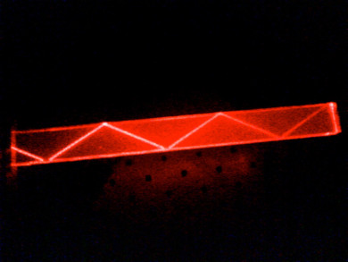

As we increase the angle of incidence, we reach a point where the angle of refraction is
                                \(\text{90}\)\(\text{°}\) and the refracted ray travels along the boundary of the
                                two media. This angle of incidence is called the critical angle.

Critical angle

The critical angle is the angle of incidence where the angle of refraction is
                                                \(\text{90}\)\(\text{°}\). The light must travel from an optically
                                                more dense medium to an optically less dense medium.

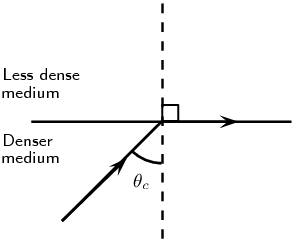

Figure 5.15: When the angle of incidence is equal to the
                                        critical angle, the angle of refraction is equal to
                                        \(\text{90}\)\(\text{°}\).

If the angle of incidence is bigger than this critical angle, the refracted ray will not
                                emerge from the medium, but will be reflected back into the medium. This is called
                                **total internal reflection**.

The conditions for total internal reflection are:

2. light is travelling from an optically denser medium (higher refractive index) to an
                                           optically less dense medium (lower refractive index).
4. the angle of incidence is greater than the critical angle.

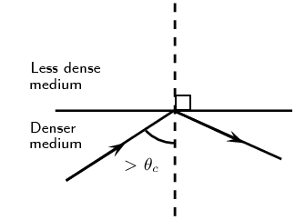

Figure 5.16: When the angle of incidence is greater than the
                                        critical angle, the light ray is reflected at the boundary of the two media and
                                        total internal reflection occurs.

Each pair of media have their own unique critical angle. For example, the critical angle for
                                light moving from glass to air is \(\text{42}\)\(\text{°}\), and that of water to
                                air is \(\text{48,8}\)\(\text{°}\).

<QuizCard id="s11-05-07a" title="Interactive Exercise 5.8" question="Adapted from DBE Grade 11 Nov 2016 P1, Q1.5 Physical constants · Physics formulas A light ray travels from silicon towards milk with an angle of incidence of \(\text{20}\text{°}\) . Milk has a lower refractive index than silicon and the critical angle for the boundary between the two media is \(\text{20}\text{°}\) . Which one of the sketches below best represents the correct path of the light ray? A B C D" options=["A", "B", "C", "D"] answer="C" hint="" explanation="Recall the conditions for total internal reflection We are given an angle of incidence and a critical angle. We need to work out if the light will be refracted or if total internal reflection will occur. Total internal reflection will occur if both of the following are true: The light starts in the medium with the higher optical density and travels towards the medium with the lower optical density. The angle of incidence is greater than the critical angle. We need to check both of these criteria to work out what will happen to the light ray. Check if the conditions for total internal reflection are met Silicon has a higher optical density than milk.         And the angle of incidence is equal to the critical angle.         This is a special case and the light ray will be refracted with an angle of refraction of \(\text{90}\text{°}\) .         This means it will travel along the boundary between the two media. So the correct diagram is C . Submit your answer as: C" />

<QuizCard id="s11-05-07a" title="Interactive Exercise 5.8" question="Adapted from DBE Grade 11 Nov 2016 P1, Q6.6 Physical constants · Physics formulas Turpentine floats on milk because its density is lower than that of milk. However, the refractive index of turpentine is \(\text{1,470}\) while the refractive index of milk is \(\text{1,350}\) . A light ray is shone into the cylinder from above. At which boundary is total internal reflection most likely to occur?" options=["air and milk", "air and turpentine", "turpentine and milk"] answer="0, 3" hint="" explanation="What is the first condition for total internal reflection? The first condition for total internal reflection is that light must start in the medium with the higher optical density , which is the medium with the higher refractive index . Which boundary satisfies this condition? The light ray is coming from above. This means that when it hits the air and turpentine boundary, it is going from a lower optical density to a higher optical density. Total internal reflection will not occur and so the light will be refracted into the turpentine. When the light hits the turpentine and milk boundary, it will be going from a higher optical density to a lower optical density. This meets the condition above, so total internal reflection might take place. Therefore the boundary at which total internal reflection is most likely to occur is the boundary between turpentine and milk . NOTE: The second condition for total internal reflection is that the angle of incidence must be greater than the critical angle for the two media. We don't know if this condition is met, but that's okay - the question only asked about the boundary at which total internal reflection was most likely . Submit your answer as: turpentine and milk and The incident ray must be in the medium with the higher refractive index." />

A recommended experiment for informal assessment is also included. This covers
                                        determining the critical angle for light travelling through a rectangular glass
                                        block. Learners will need a rectangular glass block, a
                                        \(\text{360}\)\(\text{°}\) protractor, pencil, paper, ruler and a ray box.
                                        Learners should all get similar results at the end of the experiment.

 <section class="activity informalexperiment">
                                <h2 class="title">The critical angle of a rectangular glass block</h2>
                                <section class="activity">
                                        <h3>Aim</h3>
                                        
To determine the critical angle for a rectangular glass block.

                                </section>
                                <section class="activity">
                                        <h3>Apparatus</h3>
                                        
rectangular glass block, ray box, \(\text{360}\)\(\text{&#176;}\) protractor,
                                                paper, pencil, ruler

                                </section>
                                <section class="activity">
                                        <h3>Method</h3>
                                        <ol class="ListEnumerated">
                                                <li>
                                                        
Place the glass block in the middle of the piece of paper and
                                                                draw around the outside of the block with your pencil to
                                                                make its outline.

                                                </li>
                                                <li>
                                                        
Turn on the ray box and aim the light ray into the left side
                                                                of the glass block. Adjust the angle at which the light
                                                                strikes the glass block until you see the refracted
                                                                light ray travelling along the top edge of the glass
                                                                block (i.e. the angle of refraction is
                                                                \(\text{90}\)\(\text{&#176;}\)). This situation should
                                                                look something like the following diagram:

                                                        
                                                </li>
                                                <li>
                                                        
Draw a dot on the paper at the point where the light enters
                                                                the glass block from the ray box. Then draw a dot on the
                                                                paper at the point where the light is refracted (at the
                                                                top of the glass block).

                                                </li>
                                                <li>
                                                        
Turn off the ray box and remove the glass block from the
                                                                paper.

                                                </li>
                                                <li>
                                                        
Now use your ruler to draw a line between the two dots. This
                                                                line represents the incident light ray.

                                                </li>
                                                <li>
                                                        
When the angle of refraction is
                                                                \(\text{90}\)\(\text{&#176;}\), the angle of incidence
                                                                is equal to the critical angle. Therefore to determine
                                                                the critical angle, we need to measure this angle of
                                                                incidence. Do this using your protractor.

                                                </li>
                                                <li>
                                                        
Compare your answer with the values other members of your
                                                                class obtain and discuss why they might not be identical
                                                                (although they should be similar!).

                                                </li>
                                        </ol>
                                </section>
                        </section>

#### Calculating the critical angle

Instead of always having to measure the critical angles of different materials, it is
                                        possible to calculate the critical angle at the surface between two media using
                                        Snell's Law. To recap, Snell's Law states:
                                        \[n_1 \sin \theta_1 = n_2 \sin \theta_2\]

                                        where \(n_1\) is the refractive index of material \(\text{1}\), \(n_2\) is the
                                        refractive index of material \(\text{2}\), \(\theta_1\) is the angle of
                                        incidence and \(\theta_2\) is the angle of refraction. For total internal
                                        reflection we know that the angle of incidence is the critical angle. So,
                                        \[\theta_1 = \theta_c.\]

However, we also know that the angle of refraction at the critical angle is
                                        \(\text{90}\)\(\text{°}\). So we have:
                                        \[\theta_2=90^{\circ}.\]

We can then write Snell's Law as:
                                        \[n_1 \sin{\theta_c} = n_2 \sin{90^{\circ}}\]

Solving for \(\theta_c\) gives:
                                        \begin{align*}
                                        n_1 \sin \theta_c &= n_2 \sin \text{90}\text{°} \\
                                        \sin \theta_c &= \frac{n_2}{n_1}(1)
                                        \end{align*}
                                        \[\boxed{\therefore \theta_c = \sin^{-1}\left(\frac{n_2}{n_1}\right)}\]

<Callout type="tip" title="Note">
Remember that for total internal reflection the incident ray is always in the
                                                denser medium!
</Callout>

<Callout type="tip" title="Worked example 5: Critical angle 1">
**Question:**
Given that the refractive indices of air and water are
                                                        \(\text{1,00}\) and \(\text{1,33}\) respectively, find the
                                                        critical angle.

**Determine how to approach the problem:**
We can use Snell's law to determine the critical angle since we know
                                                        that when the angle of incidence equals the critical angle, the
                                                        angle of refraction is \(\text{90}\)\(\text{°}\).

**Solve the problem:**
\begin{align*}
                                                        n_1 \sin{\theta_c} &= n_2 \sin{90^{\circ}}\\
                                                        \theta_c &=\sin^{-1}\left(\frac{n_2}{n_1}\right) \\
                                                        &=\sin^{-1}\left(\frac{1}{\text{1,33}}\right) \\
                                                        &= \text{48,8}\text{°}
                                                        \end{align*}

**Write the final answer:**
The critical angle for light travelling from water to air is
                                                        \(\text{48,8}\)\(\text{°}\).
</Callout>

<Callout type="tip" title="Worked example 6: Critical angle 2">
**Question:**
Complete the following ray diagrams to show the path of light in each
                                                        situation.

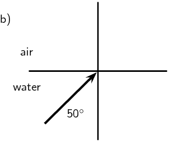

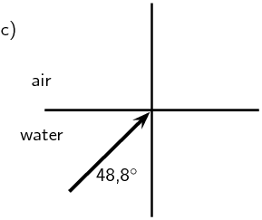

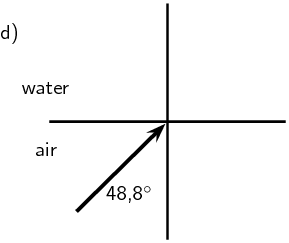

**Identify what is given and what is asked:**
The critical angle for water is \(\text{48,8}\)\(\text{°}\)

We are asked to complete the diagrams.

For incident angles smaller than \(\text{48,8}\)\(\text{°}\)
                                                        refraction will occur.

For incident angles greater than \(\text{48,8}\)\(\text{°}\)
                                                        total internal reflection will occur.

For incident angles equal to \(\text{48,8}\)\(\text{°}\)
                                                        refraction will occur at \(\text{90}\)\(\text{°}\).

The light must travel from a medium with a higher refractive index
                                                        (higher optical density) to a medium with lower refractive index
                                                        (lower optical density).

**Complete the diagrams:**
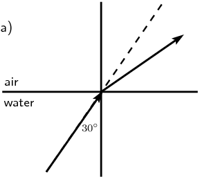

Refraction occurs (ray is bent away from the normal).

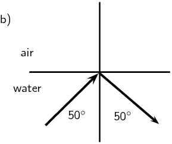

Total internal reflection occurs.

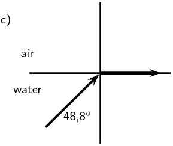

\(\theta_c = \text{48,8}\text{°}.\)

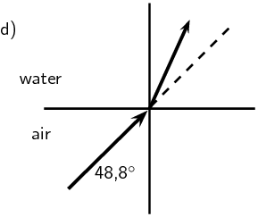

Refraction towards the normal (air is less dense than water).
</Callout>

<QuizCard id="s11-05-07b" title="Interactive Exercise 5.9" question="What is the critical angle? INSTRUCTION: Round your answer to one decimal place ." options=["yes", "no"] answer="63.5" hint="You should enter a number here. If you want to, you can use a space to separate thousands.                Example: 12 800,25 For scientific notation you need to use the multiply symbol                ( ∗ ) and the exponent symbol ( ^ ). For example 6,673 × 10 −11 should be written as: 6,673 ∗ 10^−11" explanation="We are required to find the critical angle - this is the angle of incidence where the angle of refraction is \(\text{90}\text{°}\) .  We have the following information: The refraction angle \(\theta_r = \text{90}\text{°}\) (light travelling through the crown glass) The refractive index of crown glass is \(n_{\textrm{crown glass}} =   \text{1,52}\) The refractive index of ethanol is \(n_{\textrm{ethanol}} = \text{1,36}\) Now recall that Snell's Law (the Law of Refraction) relates the refractive indices of two mediums, the angles of incidence and refraction to each other. Let's do the calculation to find the incidence angle that results in a refraction angle of \(\text{90}\text{°}\) : \[                 \begin{aligned}                   n_{\textrm{crown glass}} \sin \theta_{i} & = n_{\textrm{ethanol}} \sin \theta_{r} \\                    \sin \theta_{i} & = \frac{n_{\textrm{ethanol}} \sin \theta_{r}}{n_{\textrm{crown glass}}} \\                  \sin \theta_{c} & = \frac{(\text{1,36}) \sin (\text{90}\text{°})}{\text{1,52}} \\                  & = \frac{\text{1,36}}{\text{1,52}} (\text{1}) \\                 \therefore \theta_{c} & = \sin^{-1}(\text{0,89473...}) \\                  & =  \text{63,4746...}\text{°} \\ & \approx \text{63,5}\text{°}                 \end{aligned}               \] The critical angle of the light travelling through the crown glass is \(\text{63,5}\text{°}\) for the light to refract in the Ethanol with an angle of \(\text{90}\text{°}\) . Submit your answer as:" />

<QuizCard id="s11-05-07b" title="Interactive Exercise 5.9" question="Given that the refractive indices of ethanol and water are \(\text{1,36}\) and \(\text{1,333}\) respectively, find the critical angle. INSTRUCTION: Round your answer to one decimal place ." options=[] answer="78.6" hint="You should enter a number here. If you want to, you can use a space to separate thousands.                Example: 12 800,25 For scientific notation you need to use the multiply symbol                ( ∗ ) and the exponent symbol ( ^ ). For example 6,673 × 10 −11 should be written as: 6,673 ∗ 10^−11" explanation="We are required to find the critical angle - this is the angle of incidence where the angle of refraction is \(\text{90}\text{°}\) .  We have the following information: The refraction angle \(\theta_r = \text{90}\text{°}\) (light travelling through the ethanol) The refractive index of ethanol is \(n_{\textrm{Ethanol}} =   \text{1,36}\) The refractive index of water is \(n_{\textrm{Water}} = \text{1,333}\) This phenomenon, where the angle of refraction is \(\text{90}\text{°}\) , can only happen when the light is travelling from an optically more dense medium to an optically less dense medium. The light is travelling from ethanol to water, ethanol has a higher refractive index than water and therefore is more dense. :-) Draw a quick diagram just to make sure you know what is happening: Now recall that Snell's Law (the Law of Refraction) relates the refractive indices of two mediums, the angles of incidence and refraction to each other. Let's do the calculation to find the incidence angle that results in a refraction angle of \(\text{90}\text{°}\) : \[             \begin{aligned}               n_{\textrm{ethanol}} \sin \theta_{i} & = n_{\textrm{water}} \sin \theta_{r} \\               \sin \theta_{i} & = \frac{n_{\textrm{water}} \sin \theta_{r}}{n_{\textrm{ethanol}} } \\             \sin \theta_{c} & = \frac{(\text{1,333}) \sin (\text{90}\text{°})}{\text{1,36}} \\               & = \frac{\text{1,333}}{\text{1,36}} (\text{1}) \\              \therefore \theta_{c} & = \sin^{-1}(\text{0,98014...}) \\               & = \text{78,5640...}\text{°} \\ & \approx \text{78,6}\text{°}             \end{aligned}           \] The critical angle of the light travelling through the ethanol is \(\text{78,6}\text{°}\) for the light to refract in the water with an angle of \(\text{90}\text{°}\) . Submit your answer as:" />

<QuizCard id="s11-05-07b" title="Interactive Exercise 5.9" question="What is the refractive index of the unknown medium. INSTRUCTION: Round your answer to two decimal places ." options=["Air", "Ice", "Water", "Acetone", "Fused quartz", "Glycerine", "Sugar solution", "Glass", "Crown Glass", "Sodium chloride", "Polystyrene", "Bromine", "Sapphire", "Cubic zirconia", "Diamond", "Silicon"] answer="1.47" hint="You should enter a number here. If you want to, you can use a space to separate thousands.                Example: 12 800,25 For scientific notation you need to use the multiply symbol                ( ∗ ) and the exponent symbol ( ^ ). For example 6,673 × 10 −11 should be written as: 6,673 ∗ 10^−11" explanation="We are required to find the refractive index of the unknown medium. We have the following information: The critical angle \(\theta_c = \text{37,51}\text{°}\) (light travelling through the diamond) The refraction angle \(\theta_r = \text{90}\text{°}\) (since the critical angle is given) The refractive index of diamond is \(n_{\textrm{diamond}} =   \text{2,419}\) Draw a quick diagram just to make sure you know what is happening: Now recall that Snell's Law (the Law of Refraction) relates the refractive indices of two mediums, the angles of incidence and refraction to each other. Let's do the calculation to find the refractive index of the unknown medium: \[                 \begin{aligned}     n_{\textrm{unknown}} \sin \theta_{r} & = n_{\textrm{diamond}} \sin \theta_{i} \\                   n_{\textrm{unknown}}  & = (\text{2,419}) \frac {\sin \theta_{c}}{\sin (\text{90}\text{°})} \\                                         & = (\text{2,419})\frac{ \sin (\text{37,51}\text{°})}{1} \\                                         & = \text{1,47292...} \\ & \approx \text{1,47}                 \end{aligned}               \] Thus the refractive index for the unknown medium is \(\text{1,47}\) . NOTE: This phenomenon, where the angle of refraction is \(\text{90}\text{°}\) , can only happen when the light is travelling from an optically more dense medium to an optically less dense medium. Thus we can use this as a check whether the refractive index for the unknown medium we get makes sense. Check: is our answer less than \(\text{2,419}\) ? Submit your answer as:" />

#### Fibre optics

Total internal reflection is a very useful natural phenomenon since it can be used to
                                        confine light. One of the most common applications of total internal reflection
                                        is in *fibre optics*. An optical fibre is a thin, transparent fibre,
                                        usually made of glass or plastic, for transmitting light. Optical fibres are
                                        usually thinner than a human hair! The construction of a single optical fibre is
                                        shown in Figure 5.17.

The basic functional structure of an optical fibre consists of an outer protective
                                        *cladding* and an *inner core* through which light pulses travel.
                                        The overall diameter of the fibre is about \(\text{125}\) \(\text{μm}\)
                                        (\(\text{125} \times \text{10}^{-\text{6}}\) \(\text{m}\)) and that of the core
                                        is just about \(\text{50}\) \(\text{μm}\) (\(\text{50} \times
                                        \text{10}^{-\text{6}}\) \(\text{m}\)). The difference in refractive index of the
                                        cladding and the core allows total internal reflection to occur in the same way
                                        as happens at an air-water surface. If light is incident on a cable end with an
                                        angle of incidence greater than the critical angle then the light will remain
                                        trapped inside the glass strand. In this way, light travels very quickly down
                                        the length of the cable.

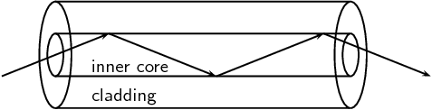

Figure 5.17: Structure of a single optical fibre.

Fibre Optics in Telecommunications

Optical fibres are most common in telecommunications, because information can
                                                be transported over long distances, with minimal loss of data. This
                                                gives optical fibres an advantage over conventional cables.

Signals are transmitted from one end of the fibre to another in the form of
                                                laser pulses. A single strand of fibre optic cable is capable of
                                                handling over \(\text{3 000}\) transmissions at the same time which
                                                is a huge improvement over the conventional co-axial cables. Multiple
                                                signal transmission is achieved by sending individual light pulses at
                                                slightly different angles. For example if one of the pulses makes a
                                                \(\text{72,23}\)\(\text{°}\) angle of incidence then a separate
                                                pulse can be sent at an angle of \(\text{72,26}\)\(\text{°}\)! The
                                                transmitted signal is received almost instantaneously at the other end
                                                of the cable since the information coded onto the laser travels at the
                                                speed of light! During transmission over long distances *repeater
                                                        stations* are used to amplify the signal which has weakened
                                                by the time it reaches the station. The amplified signals are then
                                                relayed towards
                                                their destination and may encounter several other repeater stations on
                                                the way.

Fibre optics in medicine

Optic fibres are used in medicine in *endoscopes*.

<Callout type="note" title="Note">
Endoscopy means *to look inside* and refers to looking inside
                                                        the human body for diagnosing medical conditions.
</Callout>

The main part of an endoscope is the optical fibre. Light is shone down the
                                                optical fibre and a medical doctor can use the endoscope to look inside
                                                the body of a patient. Endoscopes can be used to examine the inside of a
                                                patient's stomach, by inserting the endoscope down the patient's throat.

Endoscopes also allow minimally invasive surgery. This means that a person
                                                can be diagnosed and treated through a small incision (cut). This has
                                                advantages over open surgery because endoscopy is quicker and cheaper
                                                and the patient recovers more quickly. The alternative is open surgery
                                                which is expensive, requires more time and is more traumatic for the
                                                patient.

## Total internal reflection and fibre optics

### Textbook Exercise 5.5

**Problem:**
Describe total internal reflection by using a diagram and
                                                                referring to the conditions that must be satisfied for
                                                                total internal reflection to occur.

**Solution:**
If the angle of incidence is bigger than the critical angle,
                                                                the refracted ray will not emerge from the medium, but
                                                                will be reflected back into the medium. This is called
                                                                total internal reflection.

The critical angle occurs when the angle of incidence where
                                                                the angle of refraction is
                                                                \(\text{90}\)\(\text{°}\). The light must travel
                                                                from an optically more dense medium to an optically less
                                                                dense medium.

The conditions for total internal reflection are the the
                                                                light is travelling from an optically denser medium
                                                                (higher refractive index) to an optically less dense
                                                                medium (lower refractive index) and that the angle of
                                                                incidence is greater than the critical angle.

Representing this on a diagram gives:

**Problem:**
Define what is meant by the *critical angle* when
                                                                referring to total internal reflection. Include a ray
                                                                diagram to explain the concept.

**Solution:**
The critical angle occurs when the angle of incidence where
                                                                the angle of refraction is
                                                                \(\text{90}\)\(\text{°}\). The light must travel
                                                                from an optically more dense medium to an optically less
                                                                dense medium.

**Problem:**
Will light travelling from diamond to silicon ever undergo
                                                                total internal reflection?

**Solution:**
Diamond (index of refraction is about 3) is less optically
                                                                dense than silicon (index of refraction is about 4) and
                                                                so total internal reflection cannot occur.

**Problem:**
Will light travelling from sapphire to diamond undergo total
                                                                internal reflection?

**Solution:**
Sapphire (index of refraction is \(\text{1,77}\)) is less
                                                                optically dense than diamond (index of refraction is
                                                                about 3) and so total internal reflection cannot occur.

**Problem:**
What is the critical angle for light travelling from air to
                                                                acetone?

**Solution:**
The critical angle is:

                                                        \begin{align*}
                                                        n_1 \sin{\theta_c} &= n_2 \sin{90^{\circ}}\\
                                                        \theta_c &=\sin^{-1}\left(\frac{n_2}{n_1}\right) \\
                                                        &=\sin^{-1}\left(\frac{1}{\text{1,36}}\right) \\
                                                        &= \text{47,33}\text{°}
                                                        \end{align*}

**Problem:**
Light travelling from diamond to water strikes the interface
                                                                with an angle of incidence of
                                                                \(\text{86}\)\(\text{°}\) as shown in the picture.
                                                                Calculate the critical angle to determine whether the
                                                                light be totally internally reflected and so be trapped
                                                                within the diamond.

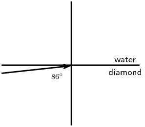

**Solution:**
The critical angle is:

                                                        \begin{align*}
                                                        n_1 \sin{\theta_c} &= n_2 \sin{90^{\circ}}\\
                                                        \theta_c &=\sin^{-1}\left(\frac{n_2}{n_1}\right) \\
                                                        &=\sin^{-1}\left(\frac{\text{1,33}}{\text{2,419}}\right) \\
                                                        &= \text{33,35}\text{°}
                                                        \end{align*}

The angle of incidence is greater than the critical angle and
                                                                so the light will be trapped within the diamond.

**Problem:**
Which of the following interfaces will have the largest
                                                                critical angle?

2. a glass to water interface
4. a diamond to water interface
6. a diamond to glass interface

**Solution:**
a glass to water interface

**Problem:**
If a fibre optic strand is made from glass, determine the
                                                                critical angle of the light ray so that the ray stays
                                                                within the fibre optic strand.

**Solution:**
The critical angle is:

                                                        \begin{align*}
                                                        n_1 \sin{\theta_c} &= n_2 \sin{90^{\circ}}\\
                                                        \theta_c &=\sin^{-1}\left(\frac{n_2}{n_1}\right) \\
                                                        &=\sin^{-1}\left(\frac{\text{1}}{\text{1,5}}\right) \\
                                                        &= \text{41,8}\text{°}
                                                        \end{align*}

**Problem:**
A glass slab is inserted in a tank of water. If the
                                                                refractive index of water is \(\text{1,33}\) and that of
                                                                glass is \(\text{1,5}\), find the critical angle.

**Solution:**
The critical angle is:

                                                        \begin{align*}
                                                        n_1 \sin{\theta_c} &= n_2 \sin{90^{\circ}}\\
                                                        \theta_c &=\sin^{-1}\left(\frac{n_2}{n_1}\right) \\
                                                        &=\sin^{-1}\left(\frac{\text{1,33}}{\text{1,5}}\right) \\
                                                        &= \text{62,46}\text{°}
                                                        \end{align*}

Note that the light must be travelling from the glass into
                                                                the water for total internal reflection to occur.

**Problem:**
A diamond ring is placed in a container full of glycerin. If
                                                                the critical angle is found to be
                                                                \(\text{37,4}\)\(\text{°}\) and the refractive
                                                                index of glycerin is given to be \(\text{1,47}\), find
                                                                the refractive index of diamond.

**Solution:**
The refractive index is:

                                                        \begin{align*}
                                                        n_1 \sin{\theta_c} &= n_2 \sin{90^{\circ}}\\
                                                        n_{1} &= \frac{n_1}{\sin{\theta_c}} \\
                                                        &= \frac{\text{1,47}}{ \sin \text{37,4}\text{°}} \\
                                                        &= \text{2,42}\text{°}
                                                        \end{align*}

**Problem:**
An optical fibre is made up of a core of refractive index
                                                                \(\text{1,9}\), while the refractive index of the
                                                                cladding is \(\text{1,5}\). Calculate the maximum angle
                                                                which a light pulse can make with the wall of the core.
                                                                NOTE: The question does not ask for the angle of
                                                                incidence but for the angle made by the ray with the
                                                                wall of the core, which will be equal to
                                                                \(\text{90}\)\(\text{°}\) − angle of
                                                                incidence.

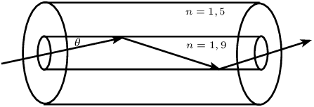

**Solution:**
The critical angle is:

                                                        \begin{align*}
                                                        n_1 \sin{\theta_c} &= n_2 \sin{90^{\circ}}\\
                                                        \theta_c &=\sin^{-1}\left(\frac{n_2}{n_1}\right) \\
                                                        &=\sin^{-1}\left(\frac{\text{1,5}}{\text{1,9}}\right) \\
                                                        &= \text{52,14}\text{°}
                                                        \end{align*}

The maximum angle is: \(\text{90}\text{°} -
                                                                \text{52,14}\text{°} = \text{37,86}\text{°}\)
