## End of chapter exercises

### Textbook Exercise 5.6

Give one word for each of the following descriptions:

**Problem:**
The perpendicular line that is drawn at right angles to a reflecting surface at
                                          the point of incidence.

**Solution:**
normal

**Problem:**
The bending of light as it travels from one medium to another.

**Solution:**
refraction

**Problem:**
The bouncing of light off a surface.

**Solution:**
reflection

State whether the following statements are **true** or
                                    **false**. If they are false, rewrite the statement correcting it.

**Problem:**
The refractive index of a medium is an indication of how fast light will travel
                                          through the medium.

**Solution:**
False. The refractive index is the ratio of the speed of light in a vacuum to its
                                    speed in the material and gives an indication of how difficult it is for light to
                                    get through the material.

**Problem:**
Total internal refraction takes place when the incident angle is larger than the
                                          critical angle.

**Solution:**
True

**Problem:**
The speed of light in a vacuum is about \(\text{3} \times \text{10}^{\text{8}}\)
                                          \(\text{m·s$^{-1}$}\).

**Solution:**
True

Complete the following ray diagrams to show the path of light.

**Problem:**
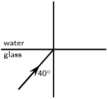

**Solution:**
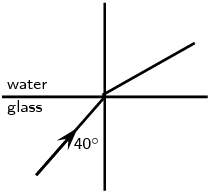

**Problem:**
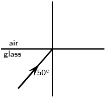

**Solution:**
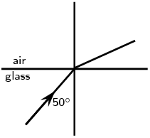

**Problem:**
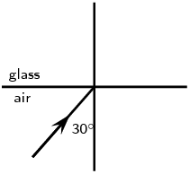

**Solution:**
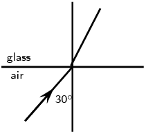

**Problem:**
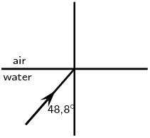

**Solution:**
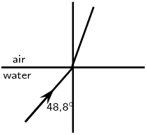

**Problem:**
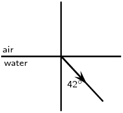

**Solution:**
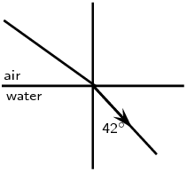

**Problem:**
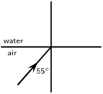

**Solution:**

**Problem:**
A ray of light strikes a surface at \(\text{35}\)\(\text{°}\) to the normal to the
                                    surface. Draw a ray diagram showing the incident ray, reflected ray and surface
                                    normal. Calculate the angles of incidence and reflection and fill them in on your
                                    diagram.

**Solution:**
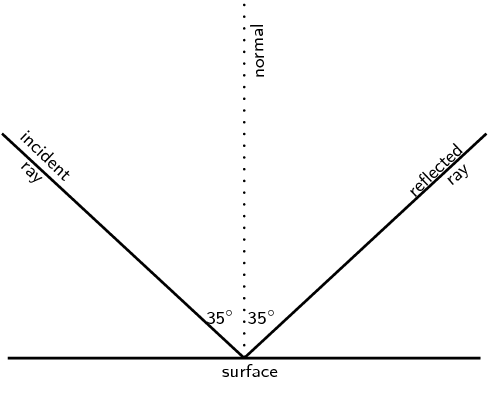

The angle of incidence equals the angle of reflection. This angle is
                                    \(\text{35}\)\(\text{°}\).

Light travels from glass (\(n = \text{1,5}\)) to acetone (\(n = \text{1,36}\)). The
                                    angle of incidence is \(\text{25}\)\(\text{°}\).

**Problem:**
Describe the path of light as it moves into the acetone.

**Solution:**
The light bends towards the normal.

**Problem:**
Calculate the angle of refraction.

**Solution:**
\begin{align*}
                                    n_{1} \sin \theta_{1} & = n_{2} \sin \theta_{2} \\
                                    \text{1,5} \sin \text{25}\text{°} & = \text{1,36} \sin \theta_{2} \\
                                    \sin \theta_{2} & = \text{0,466} \\
                                    \theta_{2} & = \text{27,78}\text{°}
                                    \end{align*}

**Problem:**
What happens to the speed of the light as it moves from the glass to the acetone?

**Solution:**
The speed of light increases.

**Problem:**
What happens to the wavelength of the light as it moves into the acetone?

**Solution:**
The wavelength of the light increases.

**Problem:**
Light strikes the interface between diamond and an unknown medium with an incident
                                    angle of \(\text{32}\)\(\text{°}\). The angle of refraction is measured to be
                                    \(\text{46}\)\(\text{°}\). Calculate the refractive index of the medium and
                                    identify the medium.

**Solution:**
\begin{align*}
                              n_{1} \sin \theta_{1} & = n_{2} \sin \theta_{2} \\
                              \text{2,419} \sin \text{32}\text{°} & = n_{2} \sin \text{46}\text{°} \\
                              n_{2} & = \text{1,78}
                              \end{align*}

The substance is sapphire.

**Problem:**
Explain what total internal reflection is and how it is used in medicine and
                                    telecommunications. Why is this technology much better to use?

**Solution:**
Total internal reflection takes place when light travels from one medium to another of
                                    lower optical density. If the angle of incidence is greater than the critical angle
                                    for the medium, the light will be reflected back into the medium. No refraction
                                    takes place.

Optical fibres are most common in telecommunications, because information can be
                                    transported over long distances, with minimal loss of data. This gives optical
                                    fibres an advantage over conventional cables. Signals are transmitted from one end
                                    of the fibre to another in the form of laser pulses. A single strand of fibre optic
                                    cable is capable of handling over \(\text{3 000}\) transmissions at the same
                                    time which is a huge improvement over the conventional co-axial cables. Multiple
                                    signal transmission is achieved by sending individual light pulses at slightly
                                    different angles. The transmitted signal is received almost instantaneously at the
                                    other end of the cable since the information coded onto the laser travels at the
                                    speed of light! During transmission over long distances repeater stations are used
                                    to amplify the signal which has weakened by the time it reaches the station. The
                                    amplified signals are then relayed towards their destination and may encounter
                                    several other repeater stations on the
                                    way.

Optic fibres are used in medicine in endoscopes. The main part of an endoscope is the
                                    optical fibre. Light is shone down the optical fibre and a medical doctor can use
                                    the endoscope to look inside the body of a patient. Endoscopes can be used to
                                    examine the inside of a patient’s stomach, by inserting the endoscope down the
                                    patient’s throat. Endoscopes also allow minimally invasive surgery. This means
                                    that a person can be diagnosed and treated through a small incision (cut). This has
                                    advantages over open surgery because endoscopy is quicker and cheaper and the
                                    patient recovers more quickly. The alternative is open surgery which is expensive,
                                    requires more time and is more traumatic for the patient.
