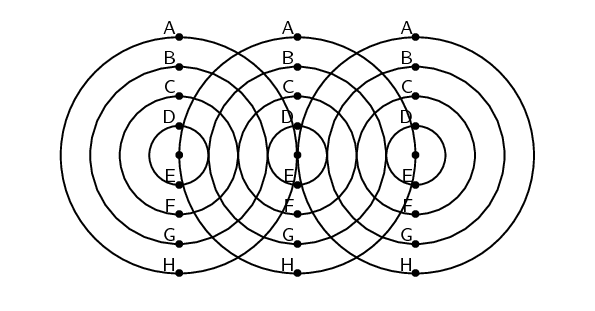
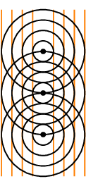

## 6.2 Wavefronts (ESBNF)

## Wavefronts

The diagram below shows three identical waves being emitted by three point sources. A point source is something
        that generates waves and is so small that we consider it to be a point. It is not large enough to affect the
        waves. All points marked with the same letter are in phase. Join all points with the same letter.

What type of lines (straight, curved, etc.) do you get? How does this compare to the line that joins the
        sources?

Consider three point sources of waves. If each source emits waves isotropically (i.e. the same in all directions)
      we will get the situation shown in as shown in Figure
        6.1 below.

Figure 6.1:
        Wavefronts are imaginary lines joining waves that are in phase. In the example, the wavefronts (shown by the
        orange, vertical lines) join all waves at the crest of their cycle.

Wavefront

A wavefront is an imaginary line that connects waves that are in phase.

We define a **wavefront** as the imaginary line that joins waves that are in phase. These are
      indicated by the grey, vertical lines in Figure
        6.1. The points that are in phase can be peaks, troughs or anything in between, it doesn't matter which
      points you choose as long as they are in phase.
