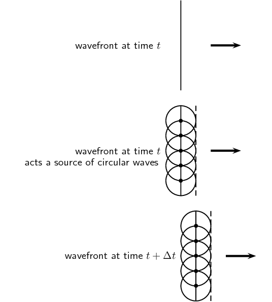
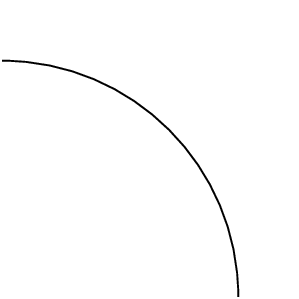
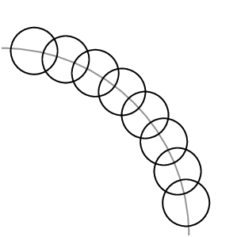
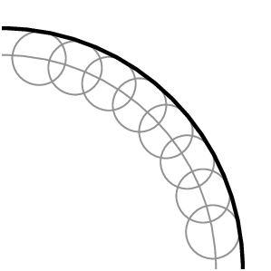

## 6.3 Huygens' principle (ESBNG)

Christiaan Huygens described how to determine the path of waves through a medium.

The Huygens' Principle

Every point of a wave front serves as a point source of spherical, secondary waves. After a time t, the new
          position of the wave front will be that of a surface tangent to the secondary waves.

Huygens' principle applies to any wavefront, even those that are curved as you would get from a single point
      source. A simple example of the Huygens' Principle is to consider the single wavefront in Figure 6.2.

Figure 6.2:
        A single wavefront at time t acts as a series of point sources of circular waves that interfere to give a new
        wavefront at a time \(t+\Delta t\). The process continues and applies to any shape of waveform.

<Callout type="tip" title="Worked example 1: Application of the Huygens' principle">
**Question:**
Given the wavefront,

use the Huygens' Principle to determine the wavefront at a later time.

**Draw circles at various points along the given wavefront:**

**Join the circle crests to get the wavefront at a later time:**

</Callout>

<QuizCard id="s11-06-03a" title="Interactive Exercise 6.2" question="Complete the following definition: A _____ is the imaginary line or surface that joins points on waves that are in phase." options=[] answer="['wavefront', 'wavefront', 'wave-front']" hint="" explanation="A wavefront is the imaginary line or surface that joins points on waves that are in phase. Submit your answer as:" />

<QuizCard id="s11-06-03a" title="Interactive Exercise 6.2" question="Adapted from DBE Nov 2016 Grade 11, P1, Q7 Physical constants · Physics formulas State Huygens's principle ." options=[] answer="
					3
				" hint="" explanation="Recall the statement of Huygens's principle Every point of a wave front serves as a point source of spherical, secondary waves that move forward with the same speed as the wave.  					At a later time, the position of the new wave front will be that of a surface tangent to the secondary waves. The diagram below illustrates Huygens's principle for a plane wave in two dimensions. Adapted from OpenStax ( CC-BY ). Submit your answer as: Every point of a wave front is a point source of spherical, secondary waves. At a later time, the position of the new wave front will be that of a surface tangent to the secondary waves." />
