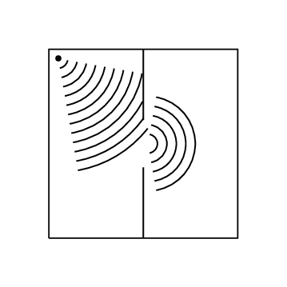

## 6.4 Diffraction (ESBNH)

One of the most interesting, and also very useful, properties of waves is **diffraction**.

Diffraction

Diffraction is the ability of a wave to spread out in wavefronts as the wave passes through a small aperture
          or around a sharp edge.

For example, if two rooms are connected by an open doorway and a sound is produced in a remote corner of one of
      them, a person in the other room will hear the sound as if it originated at the doorway.

As far as the second room is concerned, the vibrating air in the doorway is the source of the sound.

This means that when waves move through small holes they appear to bend around the sides because there are not
      enough points on the wavefront to form another straight wavefront. This is bending round the sides we call
      *diffraction*.

Diffraction

Diffraction effects are more clear for water waves with longer wavelengths. Diffraction can be demonstrated by
        placing small barriers and obstacles in a ripple tank and observing the path of the water waves as they
        encounter the obstacles. The waves are seen to pass around the barrier into the regions behind it; subsequently
        the water behind the barrier is disturbed. The amount of diffraction (the sharpness of the bending) increases
        with increasing wavelength and decreases with decreasing wavelength. In fact, when the wavelength of the waves
        are smaller than the obstacle, no noticeable diffraction occurs.

This experiment demonstrates diffraction using water waves in a ripple tank. You can also demonstrate diffraction
      using a single slit and a light source with coloured filters.

## Diffraction

Water waves in a ripple tank can be used to demonstrate diffraction and interference.

- Turn on the wave generator so that it produces waves with a high frequency (short wavelength).
  - Place a few obstacles, one at a time, (e.g. a brick or a ruler) in the ripple tank. What happens to the
                    wavefronts as they propagate near/past the obstacles? Draw your observations.
  - How does the diffraction change when you change the size of the object?
- Now turn down the frequency of the wave generator so that it produces waves with longer wavelengths.
  - Place the same obstacles in the ripple tank (one at a time). What happens to the wavefronts as they
                    propagate near/past the obstacles? Draw your observations.
  - How does the diffraction change from the higher frequency case?
- Remove all obstacles from the ripple tank and insert a second wave generator. Turn on both generators so
              that they start at the same time and have the same frequency.
  - What do you notice when the two sets of wavefronts meet each other?
  - Can you identify regions of constructive and destructive interference?
- Now turn on the generators so that they are out of phase (i.e. start them so that they do not make waves at
              exactly the same time).
  - What do you notice when the two sets of wavefronts meet each other?
  - Can you identify regions of constructive and destructive interference?

<QuizCard id="s11-06-04a" title="Interactive Exercise 6.3" question="Adapted from DBE Nov 2015 Grade 11, P1, Q8 Physical constants · Physics formulas Diffraction is a phenomenon that can occur for all types of waves. If something can be diffracted,     			it is evidence that it is a wave. Define the term diffraction ." options=[] answer="
                	1
                " hint="" explanation="Recall the definition of diffraction Diffraction is the ability of a wave to spread out in wave fronts as the wave passes through a small aperture or around a sharp edge . The image below shows diffraction taking place when a plane wave passes through a small aperture (hole). Adapted from OpenStax ( CC-BY ). Submit your answer as: the apparent change in direction of a wave around the corners of small obstacles or small slits." />

<QuizCard id="s11-06-04a" title="Interactive Exercise 6.3" question="Adapted from DBE Nov 2015 Grade 11, P1, Q1.6 Physical constants · Physics formulas A learner hiding behind an open door of a room can hear people talking outside the room although she cannot see 				them. The reason for this is that: A Light travels only in straight lines and only sound can bend around corners. B The width of the door is much larger than the wavelength of sound. C The width of the door is much closer to the wavelength of sound than it is to that of light. D Sound has a shorter wavelength than a light wave." options=["A", "B", "C", "D"] answer="
					2
				" hint="" explanation="Compare the wavelength of light to that of sound Visible light has a very small wavelength ( \(\text{380}\) - \(\text{750}\ \text{nm}\) ) compared to the wavelength 					of sound in air ( \(\text{17}\ \text{mm}\) to about \(\text{17}\ \text{m}\) ). This means that the width of the 					doorway is much larger than the wavelength of light, but of a similar 					order (size) compared to that of sound. This means light will experience very little diffraction and it will have a sharp shadow when it passes through the doorway. Any light passing through the doorway will behave like a 					ray and continue travelling in a straight line, without bending. Sound will experience a larger amount of diffraction . This means it will bend around 					the edge of the door to a large extent. We can now choose the correct reason that enables the learner to hear around the corner even though 					she can't see the source of the sound. A Light travels only in straight lines and only sound can bend around corners. B The width of the door is much larger than the wavelength of sound. C \({\color{red}{{\checkmark}{\checkmark}}}\) The width of the door is much closer to the wavelength of sound than it is to that of light. D Sound has a shorter wavelength than a light wave. The correct option is C . Diagrams adapted from OpenStax ( CC-BY ). Submit your answer as: C" />
