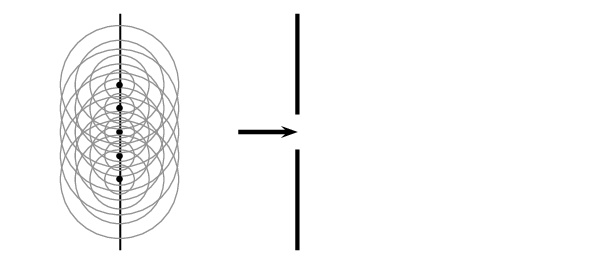
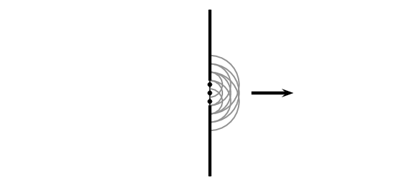
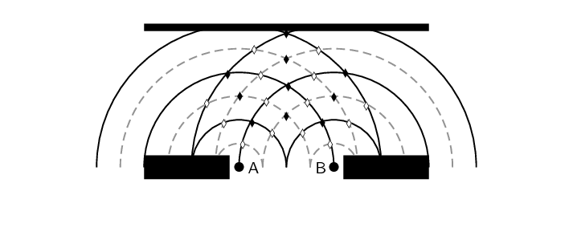
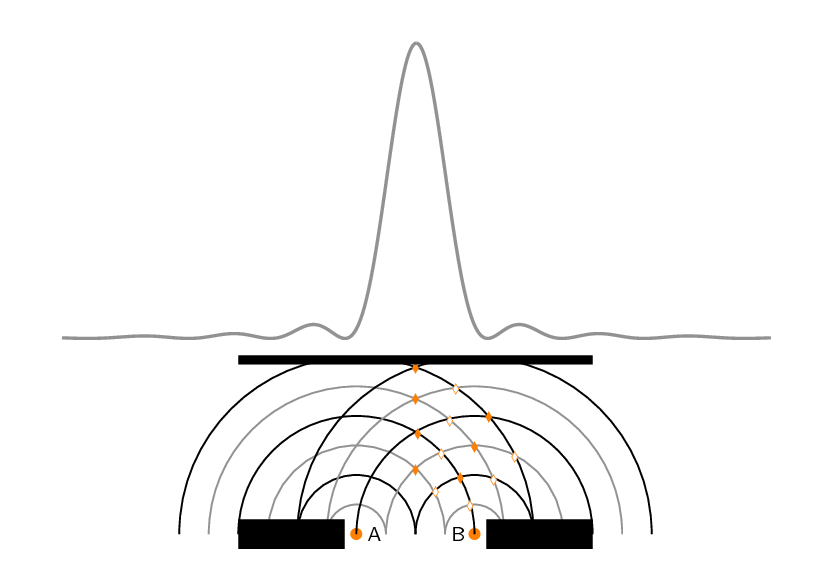
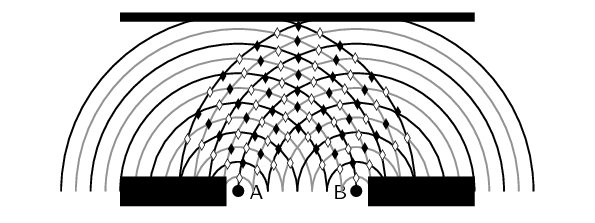
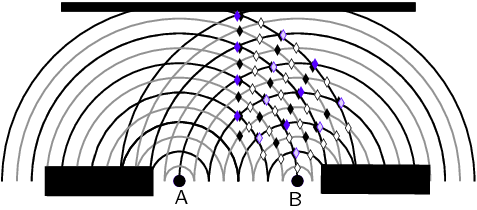
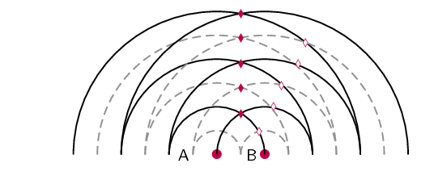
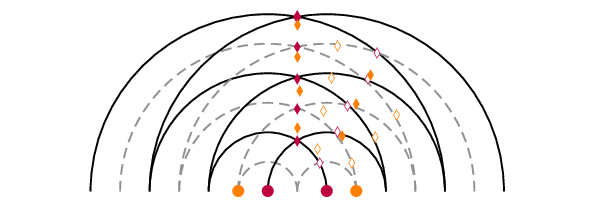
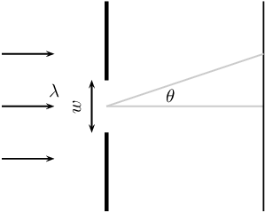

## 6.5 Diffraction through a single slit (ESBNJ)

Waves diffract when they encounter obstacles. Why does this happen? If we apply Huygens' principle it becomes
            clear. Think about a wavefront impinging on a barrier with a slit in it, only the points on the wavefront
            that move into the slit can continue emitting forward moving waves - but because a lot of the wavefront has
            been blocked by the barrier, the points on the edges of the hole emit waves that bend round the edges. How
            to use this approach to understand what happens is sketched below:

Before the the wavefront strikes the barrier the wavefront generates another forward moving wavefront
            (applying Huygens' principle). Once the barrier blocks most of the wavefront you can see that the forward
            moving wavefront bends around the slit because the secondary waves they would need to interfere with to
            create a straight wavefront have been blocked by the barrier.

If you employ Huygens' principle you can see the effect is that the wavefronts are no longer straight lines.

### Diffraction patterns (ESBNK)

We can learn even more about what happens after the wavefront strikes the barrier by applying Huygens'
                principle further.

Each point on the wavefront moving through the slit acts like a point source. We can think about some of
                the effects of this if we analyse what happens when two point sources are close together and emit
                wavefronts with the same wavelength and frequency. These two point sources represent the point sources
                on the two edges of the slit and we can call the source A and source B.

Each point source emits wavefronts from the edge of the slit. In the diagram we show a series of
                wavefronts emitted from each point source. The black lines show peaks in the waves emitted by the point
                sources and the gray lines represent troughs. We label the places where constructive interference (peak
                meets a peak or trough meets a trough) takes place with a solid diamond and places where destructive
                interference (trough meets a peak) takes place with a hollow diamond. When the wavefronts hit a barrier
                there will be places on the barrier where constructive interference takes place and places where
                destructive interference happens.

The measurable effect of the constructive or destructive interference at a barrier depends on what type
                of waves we are dealing with. If we were dealing with sound waves, then it would be very noisy at points
                along the barrier where the constructive interference is taking place and quiet where the destructive
                interference is taking place.

<Callout type="note" title="Note">
The pattern of constructive then destructive interference measured some distance away from a single
                    slit is caused because of two properties of waves, diffraction **and** interference.
                    Sometimes this pattern is called an interference pattern and sometimes it is called a diffraction
                    pattern. Both names are correct and both properties are required for the pattern to be observed. For
                    consistency we will call it a *diffraction pattern* in for the rest of this book.
</Callout>

The intensity of the diffraction pattern for a single narrow slit looks like this:

The picture above sketches how the wavefronts interfere to form the diffraction pattern. The peaks
                correspond to places where the waves are adding constructively and the minima are places where
                destructive interference is taking place. If you look at the picture you can see that if the wavelength
                (the distance between two consecutive peaks/troughs) of the waves were different the pattern would be
                different. For example, if the wavelength were halved the sketch would be:

The amount that the waves diffract depends on the wavelength. We can compare the spread in the points of
                constructive and destructive interference by plotting the highlighted points together for the two cases.
                We have to line up the central maximum from the two cases to see the difference. The case where the
                wavelength is smaller results in smaller angles between the lines of constructive and destructive
                interference.

It also depends on the width of the slit, changing the width of the slit would change the distance
                between the points labelled A and B in the sketch. For example, if we repeat the sketch halving the
                distance between the points A and B we would get:

We can compare the spread in the points of constructive and destructive interference by plotting the
                highlighted points together for the two cases. We have to line up the central maximum from the two cases
                to see the difference. The case where the two points are closer together, in purple, results in bigger
                angles between the lines of constructive and destructive interference.

<QuizCard id="s11-06-05a" title="Interactive Exercise 6.4" question="Consider a wavefront approaching a slit. Each point on the wavefront moving through the slit acts like a point source. In the image below the two point sources represent the point sources on the two edges of the slit. The solid lines represent the crests of the waves and the dashed lines the troughs. The waves interfere with each other and on the opposite wall we see an interference pattern. Identify the places where the waves are interfering constructively ." options=["A", "B"] answer="A" hint="" explanation="Waves interfere constructively and destructively. Where a crest and a trough of two waves meet destructive interference occurs. On the image below those are represented by stars. Where a crest and a crest or a trough and a trough of two waves meet constructive interference occurs. On the image below those are represented by hearts. We can populate the whole diagram with points of destructive and constructive interference. We are asked to identify the constructive interference. A , is at the end of a line of hearts, therefore where constructive interference is taking place. If this wavefront was of blue light, this is the interference pattern we would see on the wall. Note how we see peaks of intensity in the light where we expect constructive interference, A, and dark areas (minimum intensity) where we expect destructive interference, B. The correct answer is thus A . Submit your answer as: A" />

<QuizCard id="s11-06-05a" title="Interactive Exercise 6.4" question="Consider a wavefront approaching a slit. Each point on the wavefront moving through the slit acts like a point source. In the image below the two point sources represent the point sources on the two edges of the slit. The solid lines represent the crests of the waves and the dashed lines the troughs. The waves interfere with each other and on the opposite wall we see an interference pattern. Identify the places where the waves are interfering destructively ." options=["A", "B"] answer="B" hint="" explanation="Waves interfere constructively and destructively. Where a crest and a trough of two waves meet destructive interference occurs. On the image below those are represented by spades. Where a crest and a crest or a trough and a trough of two waves meet constructive interference occurs. On the image below those are represented by stars. We can populate the whole diagram with points of destructive and constructive interference. We are asked to identify the destructive interference. B , is at the end of a line of spades, therefore where destructive interference is taking place. If this wavefront was of blue light, this is the interference pattern we would see on the wall. Note how we see peaks of intensity in the light where we expect constructive interference, A, and dark areas (minimum intensity) where we expect destructive interference, B. The correct answer is thus B . Submit your answer as: B" />

### Effect of slit width and wavelength on diffraction patterns (ESBNM)

Using our sketches we see that the extent to which the diffracted wave passing through the slit spreads
                out depends on the width of the slit and the wavelength of the waves. The narrower the slit, the more
                diffraction there is and the shorter the wavelength the less diffraction there is. The degree to which
                diffraction occurs is:\[\text{diffraction}\propto \frac{\lambda}{w}\]
                where \(\lambda\) is the wavelength of the wave and \(w\) is the width of the slit.

We can do a sanity check on the relationship by considering some special cases, very big and very small
                values for each of the numerator and denominator to see what sort of behaviour we expect (this is not a
                calculation, just a check to see what sort outcomes we expect when we change wavelength or slit width):

- Set \(\lambda=1\) and \(w\) very large, the result will be \(\frac{1}{\text{very big number}}\)
                      which is a very small number. So for a very big slit there is very little diffraction.
- Set \(\lambda=1\) and \(w\) very small, the result will be \(\frac{1}{\text{very small number}}\)
                      which is a very big number. So for a very small slit there is large diffraction (this makes sense
                      because eventually you are dealing with a point source which emits circular wavefronts).
- Set \(\lambda\) very large and \(w=1\), the result will be \(\frac{\text{very big number}}{1}\)
                      which is a very big number. So for a very big wavelength there is large diffraction.
- Set \(\lambda\) very small and \(w=1\), the result will be \(\frac{\text{very small number}}{1}\)
                      which is a very small number. So for a very small wavelength there is little diffraction.

<QuizCard id="s11-06-05b" title="Interactive Exercise 6.5" question="As the width of the slit producing a single-slit diffraction pattern is reduced, how will the diffraction pattern produced change?" options=["Less diffraction is observed.", "More diffraction is observed.", "No change is observed.", "Not enough information given."] answer="More diffraction is observed." hint="" explanation="We want to know how a diffraction pattern will change when the slit width changes. Let us consider this question in two ways. Firstly, let us look at the maths: \[             \begin{aligned}               \textrm{diffraction} & \propto \frac{\lambda}{w}             \end{aligned}           \] The extent to which the diffracted wave passing through the slit spreads out depends on the ratio of the wavelength of the waves ( \(\lambda\) ) and the width of the slit ( \(w\) ). The narrower the slit width , the more diffraction we see. We can check this by considering a special case where if \(\lambda = 1\) and \(w\) is very small (this is not a calculation, just a check to see what sort outcomes we expect when we change the slit width), the result will be: \[\begin{aligned} \textrm{diffraction} \propto \frac{1}{\text{very small number}} \end{aligned} \] which is a very large number. So we expect that if we decrease the slit width there will be more diffraction (this makes sense because eventually you are dealing with a point source which emits circular wavefronts). Now, let us think about how this will look, how would changing the slit width effect the diffraction pattern? If we look at diffraction pattern of red light as we go from a wide to a narrower slit width this is what we see: \[             \begin{aligned}               \quad \\               \quad \\               \Downarrow \quad\quad\quad\quad\quad\quad\\               \textrm{decrease slit width}\\               \Downarrow \quad\quad\quad\quad\quad\quad\\               \quad             \end{aligned}           \] Thus the correct answer would be: more diffraction is observed. Submit your answer as: More diffraction is observed." />

<QuizCard id="s11-06-05b" title="Interactive Exercise 6.5" question="Adapted from DBE Nov 2016 Grade 11, P1, Q7 Physical constants · Physics formulas Amogelang and Mathe investigate the effect of the 				width of the slit on the degree (amount) of diffraction through a single slit. 				They use an indigo light source with a frequency of \(\text{6,8} \times \text{10}^{\text{14}}\ \text{Hz}\) . They set up an experiment, as shown below, and 				then measure the distance of the first dark line from the centre of the bright central band \((\Delta y)\) when changing the slit width. Slit width ( \(\text{mm}\) ) \(\Delta y\) ( \(\text{m}\) ) \(\text{0,0186}\) \(\text{0,0402}\) \(\text{0,0356}\) \(\text{0,0210}\) \(\text{0,0471}\) \(\text{0,0159}\) Describe how the pattern on the screen will change if light of frequency \(\text{6} \times \text{10}^{\text{14}}\ \text{Hz}\) is now used. Hence, determine 				how the measurements of \(\Delta y\) will change. Give a reason for your answer." options=["increase", "decrease", "remain the same"] answer="
					1
				,
					0
				,
					2
				" hint="" explanation="How does the light source affect the diffraction pattern? The amount (degree) of diffraction is directly proportional to the wavelength \((\lambda)\) of the light source used. The longer the wavelength of light, the more it will be diffracted. \[ 				    \begin{array}{c} 						\text{degree of diffraction} \propto \lambda 				    \end{array} 				\] Frequency and wavelength are inversely proportional to each other. So the lower the frequency of the light, the more it will be diffracted. The original light source has a frequency of \(\text{6,8} \times \text{10}^{\text{14}}\ \text{Hz}\) . The new light source has a frequency of \(\text{6} \times \text{10}^{\text{14}}\ \text{Hz}\) . The new light source has a lower frequency. So the new light source has a longer wavelength than the original light source. This means that the diffraction pattern will spread out and the broad central band will become wider . You can see this in the diagrams below. The amount (degree) of diffraction will increase . This will happen for 			    	every slit width used. This means that: The bright central band will become broader . The dark bands move further apart . Hence, the measurements of \(\Delta y\) will all increase . Submit your answer as: move further apart. and increase and The lower the frequency, the greater the amount of diffraction." />

<QuizCard id="s11-06-05b" title="Interactive Exercise 6.5" question="Adapted from DBE Nov 2016 Grade 11, P1, Q7 Physical constants · Physics formulas Jessica and Bongani investigate the effect of the 				wavelength of the light source used on the degree (amount) of diffraction through a single slit. 				They use a barrier with a slit width of \(\text{0,207}\ \text{mm}\) . They set up an experiment, as shown below, and 				then measure the distance of the first dark line from the centre of the bright central band \((\Delta y)\) when changing the wavelength of light. Wavelength ( \(\text{nm}\) ) \(\Delta y\) ( \(\text{m}\) ) \(\text{300}\) \(\text{2,76} \times \text{10}^{-\text{3}}\) \(\text{390}\) \(\text{3,58} \times \text{10}^{-\text{3}}\) \(\text{580}\) \(\text{5,33} \times \text{10}^{-\text{3}}\) Describe how the pattern on the screen will change if the slit width is changed to \(\text{2,07}\ \text{mm}\) . Hence, determine 				how the measurements of \(\Delta y\) will change. Give a reason for your answer." options=["increase", "decrease", "remain the same"] answer="
					2
				,
					1
				,
					2
				" hint="" explanation="How does the slit width affect the diffraction pattern? The amount (degree) of diffraction is inversely proportional to the width of the slit \((w)\) . The larger the slit, the less the light will be diffracted. \[ 				    \begin{array}{c} 						\text{degree of diffraction} \propto \dfrac{1}{w} 				    \end{array} 				\] The original slit had a width of \(\text{0,207}\ \text{mm}\) . The new slit has a width of \(\text{2,07}\ \text{mm}\) . The slit width has increased . This means that the diffraction pattern will be compressed and the broad central band will become narrower . You can see this in the diagrams below. The amount (degree) of diffraction will decrease . This will happen for 			    	every wavelength used. This means that: The bright central band will become narrower . The dark bands move closer together . Hence, the measurements of \(\Delta y\) will all decrease . Submit your answer as: move closer together. and decrease and The greater the width of the slit, the smaller the degree of diffraction." />

<QuizCard id="s11-06-05b" title="Interactive Exercise 6.5" question="For this experiment, identify: the independent variable the dependent variable any fixed (controlled) variable" options=[] answer="
						1
					,
						2
					,
						0
					" hint="" explanation="What are variables? In science, a variable is any factor in an investigation that can be manipulated by the experimenter, 					    change as a result of the experiment, or affect the results of the experiment. Of all these variables, 					    one is chosen to be the independent variable, at least one is chosen as a dependent variable, and all 					    other variables that could affect the results must remain fixed (constant). In any science investigation 					    it is important to identify your variables. Recall the definition of the independent variable The independent variable (or input variable) of an investigation is the variable 						that the experimenter chooses the value of. In order for an experiment to be fair you should only test 						one independent variable at a time. We were told that Masoabi and Joanna change the frequency of light. 					    They choose which frequencies to use. Therefore frequency of light is the independent variable. Recall the definition of the dependent variable The dependent variable (or output variable) of an investigation is the 						variable that changes as a result of changes to the independent variable. The experimenter 						does not choose the values of the dependent variable, but instead measures the dependent 						variable for each value of the independent variable chosen. Masoabi and Joanna measured the distance of 					    the first dark band from the centre of the bright central band. This is a  measure of the degree (amount) 					    of diffraction. The bigger this distance \((\Delta y)\) , the wider the bright central band 					    and the more the light is diffracted. Therefore the distance of the first dark line from the centre of the bright central band is the dependent variable. Recall the definition of a fixed (controlled) variable A fixed variable in an investigation is any variable other than the independent 					    variable that could reasonably be expected to affect the results of an experiment. All such variables 					    must have their values fixed (kept constant) by the experimenter so that they do not change the results 					    of the experiment. This ensures that there is only one independent variable so that the experiment is fair. Any of the following are factors that might possibly affect the results of the experiment and should be kept fixed: the slit width the number of slits used the distance from the screen the intensity (brightness) of the light source used the thickness of the beam of the light source the light levels in the room (to help take consistent readings) NOTE: The most important variable to keep fixed is the first one (the slit width ) 						because we know this definitely changes the amount (degree) of diffraction. Therefore the intensity (brightness) of the light source used is a fixed variable. Submit your answer as: frequency of light and distance of the first dark line from the centre of the bright central band and intensity (brightness) of the light source used" />

### Wave nature of light (ESBNN)

In Grade 10 we learnt about electromagnetic radiation and that visible light is a small part of the EM
                spectrum. EM radiation is a wave so we should see diffraction for visible light when it strikes a
                barrier or passes through a slit. In everyday life you don't notice diffraction of light around objects
                or when light passes through an open door or window. This is because the wavelength of light is very
                small and the "slits" like doors and windows are quite large.

We can put some everyday numbers into \[\text{diffraction}\propto \frac{\lambda}{w}\]
                to see how much diffraction we expect. White light is combination of light of many different colours and
                each colour has a different frequency or wavelength. To make things simpler lets just think about one
                colour, green light has a wavelength of \(\text{532} \times \text{10}^{-\text{9}}\) \(\text{m}\). If a
                wavefront of green light struck the wall of a house with an open door that is \(\text{1}\) \(\text{m}\)
                wide what would we expect to see?

\begin{align*}
                \text{diffraction} &\propto \frac{\lambda}{w} \\
                & \propto \frac{\text{532} \times \text{10}^{-\text{9}}\text{ m}}{\text{1}\text{ m}} \\
                &\propto \text{532} \times \text{10}^{-\text{9}}
                \end{align*}

Figure 6.3: A diffraction grating reflecting green light.

The result is a very small number so we expect to see very little diffraction. In fact, the effect is so
                small that we cannot see it with the human eye. We can observe diffraction of green light but for us to
                get \(\text{diffraction} \propto 1\) we need the wavelength and slit width to be the same number. So we
                know the effects of diffraction should become noticeable when the wavelength and slit width are similar.
                We can't change the wavelength of green light but there are objects called diffraction gratings that
                have very narrow slits that we can use to study the diffraction of light. We let wavefronts of green
                light strike a diffraction grating and then put a screen on the other side. We can see where the
                intensity of the the light on the screen is large and where it is small. For green light on a particular
                diffraction grating the pattern of green light on the screen looks like:

Blue light with a wavelength of \(\text{450} \times \text{10}^{-\text{9}}\) \(\text{m}\) and the same
                diffraction grating will produce:

<Callout type="tip" title="Worked example 2: Diffraction">
**Question:**
Two diffraction patterns are presented, determine which one has the longer wavelength based on
                        the features of the diffraction pattern. The first pattern is for green light:

The second pattern is for red light:

The same diffraction grating is used in to generate both diffraction patterns.

**Determine what is required:**
We need to compare the diffraction patterns to extract information about the relative wavelengths
                        so we can decide which one is longer. We know that the diffraction pattern depends on wavelength
                        and slit width through: \[\text{diffraction}\propto \frac{\lambda}{w}\]

The diffraction grating is the same in both cases so we know that the slit width is fixed.

**Analyse patterns:**
By eye we can see that the red pattern is wider than the green pattern. There is more diffraction
                        for the red light, this means that:
                        \begin{align*}
                        \text{diffraction}_{red} &> \text{diffraction}_{green}\\
                        \frac{\lambda_{red}}{w} &> \frac{\lambda_{green}}{w}\\
                        \lambda_{red} &> \lambda_{green}
                        \end{align*}

**Final answer:**
The wavelength of the red light is longer than that of the green light.
</Callout>

<QuizCard id="s11-06-05c" title="Interactive Exercise 6.6" question="Consider the diffraction pattern below. How would the diffraction pattern change if the slit width gets larger? Choose an option from the diffraction patterns below. A B C D" options=["A", "B", "C", "D"] answer="B" hint="" explanation="Recall the relationship between diffraction, wavelength, and slit width The extent to which the diffracted wave passing through the slit spreads out depends on the width of the slit and the wavelength of the waves. The narrower the slit, the more diffraction there is and the shorter the wavelength the less diffraction there is. \[                     \begin{aligned}                         \text{diffraction} & \propto \frac{\lambda}{w}                     \end{aligned}                 \] Also as the wavelength or frequency of the light changes, the colour changes: As the wavelength increases the light appears \"redder\". Recall that \(\lambda = \frac{c}{f}\) , therefore if the frequency where to increase the light would appear \"bluer\". In other words, diffraction is directly proportional to the light's wavelength and inversely proportional to the slit width. Identify the correct diffraction pattern In this case we want to know the effect on the diffraction pattern if the slit width gets larger. We will notice two things: since the wavelength is the same - the colour stays the same and the dispersion pattern will be narrower. Thus the correct choice would be: B Submit your answer as: B" />

<QuizCard id="s11-06-05c" title="Interactive Exercise 6.6" question="A light source emits light with a fixed wavelength of \(\text{600}\ \text{nm}\) . This light is then passed through slits of different sizes which causes the light to be diffracted. Order the following slit widths by how much they will diffract the light, from the most to the least diffraction: A \(               \text{5,26} \times \text{10}^{-\text{6}}               \ \text{m}             \) B \(               \text{9,948} \times \text{10}^{-\text{6}}               \ \text{m}             \) C \(               \text{6,166}               \ \text{μm}             \)" options=["A", "B", "C", "A", "B", "C", "A", "B", "C"] answer="0, 2, 1" hint="" explanation="Consider what is given and what is required You are given: The light has a fixed wavelength of \(\text{600}\ \text{nm}\) . You are given three slit widths to compare. You are asked: How the diffraction will vary as the slit width changes. To order the degree of diffraction that the three slit widths produce from most to  least. Identify which relationship to use to solve the problem We are working with single slit diffraction. So immediately you can bring to mind how diffraction is related to wavelength and slit width: \[             \begin{aligned}               \textrm{diffraction} & \propto \frac{\lambda}{w}             \end{aligned}           \] This relationship tells us: that the longer your wavelength \(\lambda\) , the more diffraction you see and that the wider your slit width \(w\) , the less diffraction you see. Convert all lengths where necessary First check that all the numbers have the same units so that we can compare them. A \(               \text{5,26} \times \text{10}^{-\text{6}}               \ \text{m}             \) B \(               \text{9,948} \times \text{10}^{-\text{6}}               \ \text{m}             \) C \(               \text{6,166}               \ \text{μm}             \) The slid widths are not in the same units. We should convert all slit widths to metres and scientific notation. A \(\text{5,26} \times \text{10}^{-\text{6}}\ \text{m}\) B \(\text{9,948} \times \text{10}^{-\text{6}}\ \text{m}\) C \(\text{6,166}\ \text{μm}\) \(= \text{6,166} \times \text{10}^{-\text{6}}\ \text{m}\) Order the slit widths Now we can order them. Remember that the wider the slit width the less diffraction you see. Therefore we need to order the slit widths from narrowest to widest to see decreasing diffraction. Slit width narrowest \(\text{5,260} \times \text{10}^{-\text{6}}\ \text{m}\) A \(\downarrow\) \(\text{6,166} \times \text{10}^{-\text{6}}\ \text{m}\) C widest \(\text{9,948} \times \text{10}^{-\text{6}}\ \text{m}\) B Therefore the answer for ordering the slit widths which will yield the most to least diffraction is: Amount of diffraction most A \(\downarrow\) C least B Submit your answer as: A and C and B" />

<QuizCard id="s11-06-05c" title="Interactive Exercise 6.6" question="Two diffraction patterns are presented, determine which one has the longer wavelength based on the features of the diffraction pattern. The first pattern is for red light and the second pattern is for violet light: The same diffraction grating is used to generate both diffraction patterns." options=["red", "violet"] answer="red" hint="" explanation="We need to compare the diffraction patterns to extract information about the relative wavelengths so we can decide which one is longer. We know that the diffraction pattern depends on wavelength and slit width through: \[             \begin{aligned}               \textrm{diffraction} & \propto \frac{\lambda}{w}             \end{aligned}           \] The diffraction grating is the same in both cases so we know that the slit width is fixed. By inspection (by eye) we can see that the red pattern is wider than the violet pattern. There is more diffraction for the red light, this means that: \[             \begin{aligned}               \textrm{diffraction}_{\textrm{red}} & > \textrm{diffraction}_{\textrm{violet}}   \\                 \frac{\lambda_{\textrm{red}}}{w} & > \frac{\lambda_{\textrm{violet}}}{w} \\                   \lambda_{\textrm{red}} & > \lambda_{\textrm{violet}}             \end{aligned}           \] The wavelength of the red light is longer than that of the violet light. Submit your answer as: red" />

<QuizCard id="s11-06-05c" title="Interactive Exercise 6.6" question="For a fixed slit width of \(\text{0,1951}\ \text{mm}\) , order the following electromagnetic waves with the given wavelengths from most to least diffracted: A violet at \(               \text{405}               \ \text{nm}             \) B red at \(               \text{640}               \ \text{nm}             \) C green at \(               \text{495}               \ \text{nm}             \)" options=["A", "B", "C", "A", "B", "C", "A", "B", "C"] answer="1, 2, 0" hint="" explanation="Consider what is given and what is required You are given: The slit width is fixed at \(\text{0,1951}\ \text{mm}\) . You are given three colours of light and their wavelengths to compare. You are asked: How the diffraction will vary as the wavelength changes. To order the degree of diffraction that the three colours of light and their wavelengths produce from most to  least. Identify which relationship to use to solve the problem We are working with single slit diffraction. So immediately you can bring to mind how diffraction is related to wavelength and slit width: \[             \begin{aligned}               \textrm{diffraction} & \propto \frac{\lambda}{w}             \end{aligned}           \] This relationship tells us: that the longer your wavelength \(\lambda\) , the more diffraction you see and that the wider your slit width \(w\) , the less diffraction you see. Convert all lengths where necessary First check that all the numbers have the same units so that we can compare them. A violet at \(               \text{405}               \ \text{nm}             \) B red at \(               \text{640}               \ \text{nm}             \) C green at \(               \text{495}               \ \text{nm}             \) They are all in nanometres. Order the wavelengths Now we can order them. Remember that the longer the wavelength the more diffraction you see. Therefore we need to order the wavelengths from longest to shortest to see decreasing diffraction. Wavelength longest \( \text{640} \ \text{nm} \) B \(\downarrow\) \( \text{495} \ \text{nm} \) C shortest \( \text{405} \ \text{nm} \) A Therefore the answer for ordering the wavelengths which will yield the most to least diffraction is: Amount of diffraction most B \(\downarrow\) C least A Submit your answer as: B and C and A" />

<QuizCard id="s11-06-05c" title="Interactive Exercise 6.6" question="Describe the pattern observed on the screen." options=["increase", "decrease", "remain the same", "increase", "decrease", "remain the same"] answer="
    	            	1
    	            ,
    	            	0
    	            " hint="" explanation="Describe the diffraction pattern The central band is broad and bright and on both sides of the central band     	            	you will see alternating bright and dark bands which decrease in intensity as     	            	you go outwards from the central band. Adapted from OpenStax ( CC-BY ). Submit your answer as: broad and bright and alternating bright and dark bands." />

### Textbook Exercise 6.1

**Problem:**
As the width of the slit producing a single-slit diffraction pattern is reduced, how will the
                            diffraction pattern produced change?

**Solution:**
More diffraction is observed as the slit width is reduced.

**Problem:**
A water break at the entrance to a harbour consists of a rock barrier with a \(\text{50}\)
                            \(\text{m}\) wide opening. Ocean waves of \(\text{20}\) \(\text{m}\) wavelength approach the
                            opening straight on. Light with a wavelength of \(\text{500} \times \text{10}^{-\text{9}}\)
                            \(\text{m}\) strikes a single slit of width \(\text{30} \times \text{10}^{-\text{9}}\)
                            \(\text{m}\). Which waves are diffracted to a greater extent?

**Solution:**
We need to calculate the diffraction for each type of wave. We start by calculating the
                            diffraction of the water waves:

                        \begin{align*}
                        \text{diffraction} & \propto \frac{\lambda}{w} \\
                        & \propto \frac{\text{20}\text{ m}}{\text{50}\text{ m}} \\
                        & \propto \text{0,4}
                        \end{align*}

The diffraction of the light waves is:

                        \begin{align*}
                        \text{diffraction} & \propto \frac{\lambda}{w} \\
                        & \propto \frac{\text{500} \times \text{10}^{-\text{9}}\text{ m}}{\text{30} \times
                        \text{10}^{-\text{9}}\text{ m}} \\
                        & \propto \text{16,67}
                        \end{align*}

The light waves are diffracted more.

For the diffraction pattern below, sketch what you expect to change if:

**Problem:**
the wavelength gets larger

**Solution:**
More diffraction would occur. The resulting diffraction pattern is wider:

**Problem:**
the wavelength gets smaller

**Solution:**
Less diffraction would occur. The resulting diffraction pattern is narrower:

**Problem:**
the slit width gets larger

**Solution:**
Less diffraction would occur. The resulting diffraction pattern is narrower:

**Problem:**
the slit width gets smaller

**Solution:**
More diffraction would occur. The resulting diffraction pattern is wider:

**Problem:**
the frequency of the wave gets smaller

**Solution:**
Frequency is inversely related to wavelength. So the wavelength gets longer and more
                                diffraction would occur. The resulting diffraction pattern is wider:

**Problem:**
the frequency of the wave gets larger

**Solution:**
Frequency is inversely related to wavelength. The wavelength gets shorter and less
                                diffraction would occur. The resulting diffraction pattern is narrower:

### Extension: Calculating maxima and minima [NOT IN CAPS] (ESBNP)

There is a formula we can use to determine where the peaks and minima are in the interference spectrum.
                There will be more than one minimum. There are the same number of minima on either side of the central
                peak and the distances from the first one on each side are the same to the peak. The distances to the
                peak from the second minimum on each side is also the same, in fact the two sides are mirror images of
                each other. We label the first minimum that corresponds to a positive angle from the centre as \(m=1\)
                and the first on the other side (a negative angle from the centre) as \(m=-1\), the second set of minima
                are labelled \(m=2\) and \(m=-2\) etc.

The equation for the angle at which the minima occur is given in the definition below:

Interference Minima

The angle at which the minima in the interference spectrum occur is:

                    \(\sin\theta =\frac{m\lambda }{w}\)

where

θ is the angle to the minimum

w is the width of the slit

λ is the wavelength of the impinging wavefronts

m is the order of the minimum, \(m=±1,±2,±3,...\)

<Callout type="tip" title="Worked example 3: Diffraction minimum">
**Question:**
A slit with a width of \(\text{2 511}\) \(\text{nm}\) has red light of wavelength
                        \(\text{650}\) \(\text{nm}\) impinge on it. The diffracted light interferes on a surface. At
                        which angle will the first minimum be?

**Check what you are given:**
We know that we are dealing with diffraction patterns from the diffraction of light passing
                        through a slit. The slit has a width of \(\text{2 511}\) \(\text{nm}\) which is
                        \(\text{2 511} \times \text{10}^{-\text{9}}\) \(\text{m}\) and we know that the wavelength
                        of the light is \(\text{650}\) \(\text{nm}\) which is \(\text{650} \times
                        \text{10}^{-\text{9}}\) \(\text{m}\). We are looking to determine the angle to first minimum so
                        we know that \(m=1\).

**Applicable principles:**
We know that there is a relationship between the slit width, wavelength and interference minimum
                        angles:

                    \(\sin\theta =\frac{m\lambda }{w}\)

We can use this relationship to find the angle to the minimum by substituting what we know and
                        solving for the angle.

**Substitution:**
\begin{align*}
                    \sin \theta & = \dfrac{\text{650} \times \text{10}^{-\text{9}}\text{ m}}{\text{2 511}
                    \times \text{10}^{-\text{9}}\text{ m}} \\
                    \sin \theta & = \dfrac{\text{650}}{\text{2 511}} \\
                    \sin \theta & = \text{0,258861012} \\
                    \theta & = \sin ^{-1}\text{0,258861012} \\
                    \theta & = 15 °
                    \end{align*}

The first minimum is at \(\text{15}\)\(\text{°}\) from the centre maximum.
</Callout>

<Callout type="tip" title="Worked example 4: Diffraction minimum">
**Question:**
A slit with a width of \(\text{2 511}\) \(\text{nm}\) has green light of wavelength
                        \(\text{532}\) \(\text{nm}\) impinge on it. The diffracted light interferes on a surface, at
                        what angle will the first minimum be?

**Check what you are given:**
We know that we are dealing with diffraction patterns from the diffraction of light passing
                        through a slit. The slit has a width of \(\text{2 511}\) \(\text{nm}\) which is
                        \(\text{2 511} \times \text{10}^{-\text{9}}\) \(\text{m}\) and we know that the wavelength
                        of the light is \(\text{532}\) \(\text{nm}\) which is \(\text{532} \times
                        \text{10}^{-\text{9}}\) \(\text{m}\). We are looking to determine the angle to first minimum so
                        we know that \(m=1\).

**Applicable principles:**
We know that there is a relationship between the slit width, wavelength and interference minimum
                        angles:

                    \(\sin\theta =\frac{m\lambda }{w}\)

We can use this relationship to find the angle to the minimum by substituting what we know and
                        solving for the angle.

**Substitution:**
\begin{align*}
                    \sin \theta & = \dfrac{\text{532} \times \text{10}^{-\text{9}}\text{ m}}{\text{2 511}
                    \times \text{10}^{-\text{9}}\text{ m}} \\
                    \sin \theta & = \dfrac{\text{532}}{\text{2 511}} \\
                    \sin \theta & = \text{0,211867782} \\
                    \theta & = \sin ^{-1}\text{0,211867782} \\
                    \theta & = 12.2 °
                    \end{align*}

The first minimum is at \(\text{12,2}\)\(\text{°}\) from the centre peak.
</Callout>

From the formula \(\sin\theta =\frac{m\lambda }{w}\) you can see that a smaller wavelength for the same
                slit results in a smaller angle to the interference minimum. This is something you just saw in the two
                worked examples. Do a sanity check, go back and see if the answer makes sense. Ask yourself which light
                had the longer wavelength, which light had the larger angle and what do you expect for longer
                wavelengths from the formula.

<Callout type="tip" title="Worked example 5: Diffraction minimum">
**Question:**
A slit has a width which is unknown and has green light of wavelength 532 nm impinge on it. The
                        diffracted light interferes on a surface, and the first minimum is measure at an angle of
                        \(\text{20,77}\)\(\text{°}\)?

**Check what you are given:**
We know that we are dealing with diffraction patterns from the diffraction of light passing
                        through a slit. We know that the wavelength of the light is \(\text{532}\) \(\text{nm}\) which
                        is \(\text{532} \times \text{10}^{-\text{9}}\) \(\text{m}\). We know the angle to first minimum
                        so we know that \(m=1\) and \(\theta =20.77°\).

**Applicable principles:**
We know that there is a relationship between the slit width, wavelength and interference minimum
                        angles:

                    \(\sin\theta =\frac{m\lambda }{w}\)

We can use this relationship to find the width by substituting what we know and solving for the
                        width.

**Substitution:**
\begin{align*}
                    \sin \theta & = \dfrac{\text{532} \times \text{10}^{-\text{9}}\text{ m}}{w} \\
                    \sin \text{20,77} ° & = \dfrac{\text{532} \times \text{10}^{-\text{9}}}{w} \\
                    w &= \dfrac{\text{532} \times \text{10}^{-\text{9}}}{\text{0,3546666667}} \\
                    w &= \text{1 500} \times \text{10}^{-\text{9}} \\
                    w &= \text{1 500}\text{ nm}
                    \end{align*}

The slit width is \(\text{1 500}\) \(\text{nm}\).
</Callout>

<Callout type="note" title="Note">
[Simulation: 23VK](http://phet.colorado.edu/en/simulation/wave-interference)
</Callout>
