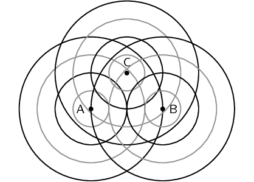
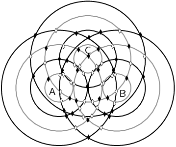

### Textbook Exercise 6.2

**Problem:**
In the diagram below the peaks of wavefronts are shown by black lines and the
                                                troughs by grey lines. Mark all the points where constructive
                                                interference between two waves is taking place and where destructive
                                                interference is taking place. Also note whether the interference results
                                                in a peak or a trough.

**Solution:**
The solid diamonds represent constructive interference (crests) and the open
                                                diamonds represent destructive interference (troughts).

**Problem:**
For a slit of width \(\text{1 300}\) \(\text{nm}\), order the following
                                                EM waves from least to most diffracted:

2. green at \(\text{510}\) \(\text{nm}\)
4. blue at \(\text{475}\) \(\text{nm}\)
6. red at \(\text{650}\) \(\text{nm}\)
8. yellow at \(\text{570}\) \(\text{nm}\)

**Solution:**
blue, green, yellow, red

**Problem:**
For light of wavelength \(\text{540}\) \(\text{nm}\), determine which of the
                                                following slits widths results in the maximum and which results in the
                                                minimum amount of diffraction

2. \(\text{323} \times \text{10}^{-\text{9}}\) \(\text{m}\)
4. \(\text{12,47}\) \(\text{nm}\)
6. \(\text{21,1}\) \(\text{pm}\)

**Solution:**
We know that narrower slits give more diffraction. So we need to determine
                                                which is the narrowest slit and which is the widest. \(\text{21,1}\)
                                                \(\text{pm}\) is the narrowest slit (A \(\text{pm}\) is
                                                \(\text{10}^{-\text{12}}\) \(\text{m}\)). The widest slit is
                                                \(\text{323} \times \text{10}^{-\text{9}}\) \(\text{m}\) (this is the
                                                same as \(\text{323}\) \(\text{nm}\)).

So the slit with the maximum diffraction is \(\text{21,1}\) \(\text{pm}\).

The slit with the minimum diffraction is \(\text{323}\) \(\text{nm}\).

For light of wavelength \(\text{635}\) \(\text{nm}\), determine what the
                                                width of the slit needs to be to have the diffraction be less than the
                                                angle of diffraction in each of these cases:

**Problem:**
Water waves at the entrance to a harbour which has a rock barrier
                                                        with a \(\text{3}\) \(\text{m}\) wide opening. The waves have a
                                                        wavelength of \(\text{16}\) \(\text{m}\) wavelength approach the
                                                        opening straight on.

**Solution:**
The angle of diffraction for the water waves is:

                                                \begin{align*}
                                                \sin \theta & = \dfrac{m \lambda}{w} \\
                                                & = \dfrac{\text{3}\text{ m}}{\text{16}\text{ m}} \\
                                                \sin \theta & = \text{0,1875} \\
                                                \theta &= \text{10,81}
                                                \end{align*}

We need to find a slit width that will give a smaller angle of
                                                        diffraction for light of \(\text{635}\) \(\text{nm}\):

                                                \begin{align*}
                                                \sin \theta & = \dfrac{m \lambda}{w} \\
                                                \text{0,1875} & = \dfrac{\text{635} \times
                                                \text{10}^{-\text{9}}\text{ m}}{w} \\
                                                w & = \frac{\text{635} \times \text{10}^{-\text{9}}\text{
                                                m}}{\text{0,1875}} \\
                                                &= \text{3,4} \times \text{10}^{-\text{6}}\text{ m}
                                                \end{align*}

The slit must be less than \(\text{3,4} \times
                                                        \text{10}^{-\text{6}}\) \(\text{m}\).

**Problem:**
Light with a wavelength of \(\text{786} \times
                                                        \text{10}^{-\text{9}}\) \(\text{m}\) strikes a single slit of
                                                        width \(\text{30} \times \text{10}^{-\text{7}}\) \(\text{m}\).

**Solution:**
The angle of diffraction is:

                                                \begin{align*}
                                                \sin \theta & = \dfrac{m \lambda}{w} \\
                                                & = \dfrac{\text{786} \times \text{10}^{-\text{9}}\text{
                                                m}}{\text{30} \times \text{10}^{-\text{7}}\text{ m}} \\
                                                \sin \theta & = \text{0,262} \\
                                                \theta &= \text{15,18}
                                                \end{align*}

We need to find a slit width that will give a smaller angle of
                                                        diffraction for light of \(\text{635}\) \(\text{nm}\):

                                                \begin{align*}
                                                \sin \theta & = \dfrac{m \lambda}{w} \\
                                                \text{0,262} & = \dfrac{\text{635} \times
                                                \text{10}^{-\text{9}}\text{ m}}{w} \\
                                                w & = \frac{\text{635} \times \text{10}^{-\text{9}}\text{
                                                m}}{\text{0,262}} \\
                                                &= \text{2,4} \times \text{10}^{-\text{6}}\text{ m}
                                                \end{align*}

The slit must be less than \(\text{2,4} \times
                                                        \text{10}^{-\text{6}}\) \(\text{m}\).
