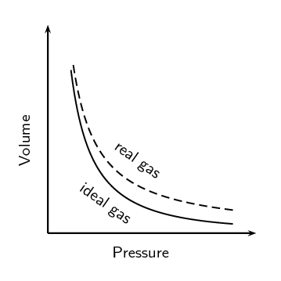
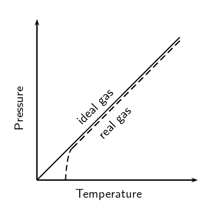

# Chapter 7: Ideal gases

In this chapter learners are introduced to the concept of ideal gases. They will explore the
                        different gas laws and learn about the motion of gas particles. The following list provides a
                        summary of the topics covered in this chapter.

- **The motion of particles**
  In grade \(\text{10}\) learners were introduced to the kinetic molecular theory and
                                          the idea that all particles in a substance are constantly moving. In this
                                          chapter the motion of particles is applied to gases and is used to help
                                          distinguish between real gases and ideal gases.
- **Real gases and ideal gases**
  A real gas is very similar to an ideal gas except at high pressures and low
                                          temperatures. The main distinguishing characteristics of a real gas are that the
                                          particles have volume, the particles in the gas have an average speed (since
                                          each particle is moving at a different speed) and that forces of attraction
                                          exist between particles.
- **The kinetic theory of gases**
  The kinetic theory of gases is similar to the kinetic theory of matter that learners
                                          learnt about in grade \(\text{10}\) (states of matter and the kinetic molecular
                                          theory). The kinetic theory of gases helps to explain all the gas laws and
                                          learners are encouraged to think about what the different laws mean rather than
                                          just learning the laws.
- **Boyle's law, Charles' law, the pressure-temperature relation (Gay-Lussac's or
                                                  Amonton's law), the general gas equation and the ideal gas
                                                  equation**
  In this book we talk about the pressure-temperature relation. CAPs refers to this as
                                          Gay-Lussac's law, while other sources call it Amonton's law. At the time when
                                          this law was discovered many scientists were working on the same problems and
                                          often it is hard now to say who actually discovered what. Learners should know
                                          that different names for the gas laws exist and they should be aware of the
                                          other names that exist.
  Boyle's law, Charles' law and the pressure-temperature relation all require very
                                          specific conditions to be true. These laws are then expanded into the general
                                          gas equation and finally the ideal gas equation is introduced. All the gas laws
                                          except the ideal gas law compare a sample of gas at two different sets of
                                          readings (e.g. two different sets of pressure and temperature readings, while
                                          the volume and amount of gas remains the same).
- **Temperature and pressure**
  Although temperature and pressure are given last in CAPs, in this book they are
                                          placed with the kinetic theory of gases and the explanation of real and ideal
                                          gases since temperature and pressure are key to understanding these topics.
  The pressure is a result of the motion of particles in the gas and is a measure of
                                          how many times the particles in the gas collide with each other and with the
                                          walls of the container. Temperature is a measure of the kinetic energy that the
                                          particles have.

We are surrounded by gases in our atmosphere which support and protect life on this planet. Everyday we
                breathe in oxygen and release carbon dioxide. Green plants take in the carbon dioxide and release
                oxygen. One way or another we are surrounded by a mix of many different gases, some that we need and
                some that are harmful to us.

In this chapter, we are going to learn more about gases and about the different gas laws.

Gas cylinders for cooking

<Callout type="note" title="Note">
- Ratio and proportion - Physical Sciences, Grade 10, Science skills
- Equations - Mathematics, Grade 10, Equations and inequalities
- Graphs - Mathematics, Grade 10, Functions and graphs
- Units and unit conversions - Physical Sciences, Grade 10, Science skills
</Callout>

<QuizCard id="s11-07-01a" title="Interactive Exercise 7.1" question="Solve the following equation for \(v\) . \[                 \begin{array}{c}                     p = mv                 \end{array}             \] INSTRUCTIONS: Write the full equation as your answer. Case matters! Pay attention to whether you are working with upper case or lower case letters." options=[] answer="v = p/m" hint="Your answer should be a mathematical equation. Here is an example of a famous                equation: E = mc^2 You can use the following symbols to write equations: add: + subtract: − multiply: ∗ divide: / exponent: ^ The following special symbols are also recognised: pi (π): pi infinity (∞): oo It is also possible to write certain functions: √: sqrt( ) log: log( ) sin: sin( ) cosec: cosec( ) cos: cos( ) sec: sec( ) tan: tan( ) cot: cot( ) To write a logarithm with a specific base, use the underscore _ symbol.                For example, log of x base 3 can be written as: log_3 x" explanation="User inverse operations to rearrange the equation We need to rearrange the given equation in order to have just \(v\) on its own. Divide both sides by \(\color{DarkBlue}{m}\) : \[                     \begin{array}{c}                         \dfrac{p}{m} = \dfrac{mv}{m}                     \end{array}                 \] Simplify: \[                     \begin{array}{c}                         \dfrac{p}{m} = v                     \end{array}                 \] We can switch the two sides around: \[                     \begin{array}{c}                         v = \dfrac{p}{m}                     \end{array}                 \] Submit your answer as:" />

<QuizCard id="s11-07-01a" title="Interactive Exercise 7.1" question="Nthofeela is trying to convert between \(\text{Pa}\) and \(\text{atm}\) . He knows that: \[                 \begin{aligned}                 \text{101 300}\ \text{Pa} \,= \text{1}\ \text{atm}                 \end{aligned}             \] and \[\begin{array}{c}\text{101 300}\ \text{Pa} \,= \text{760}\ \text{mmHg}\end{array}\] Can you help him to convert \(\text{7}\ \text{atm}\) into \(\text{Pa}\) ? INSTRUCTION: Round your answer to four decimal places if necessary." options=[] answer="
                    ['709100.0', '709275.0']
                " hint="You should enter a number here. If you want to, you can use a space to separate thousands.                Example: 12 800,25 For scientific notation you need to use the multiply symbol                ( ∗ ) and the exponent symbol ( ^ ). For example 6,673 × 10 −11 should be written as: 6,673 ∗ 10^−11" explanation="We are given a value in \(\text{atm}\) and we want to convert this to \(\text{Pa}\) . We are told that: \[                 \begin{aligned}                 \text{101 300}\ \text{Pa} \,= \text{1}\ \text{atm}                 \end{aligned}             \] and \[\begin{array}{c}\text{101 300}\ \text{Pa} \,= \text{760}\ \text{mmHg}\end{array}\] So how do we carry out the conversion? To convert from \(\text{atm}\) to \(\text{Pa}\) we note the following (note how we write the units so we can cancel out the same units): \[\begin{array}{c} \text{1} \, \color{red}{\text{atm}} \times \dfrac{\text{101 300}\ \text{Pa}}{\text{1}\color{red}{\text{atm}}} \end{array}\] Now we can apply this to the given problem: \[                     \begin{aligned}                     \text{7}\ \text{atm} \times \dfrac{\text{101 300}\ \text{Pa}}{\text{1}\ \text{atm}} = \text{709 100}\ \text{Pa}                     \end{aligned}                 \] Therefore the correct answer is \(\text{709 100}\ \text{Pa}\) . Submit your answer as:" />

<QuizCard id="s11-07-01a" title="Interactive Exercise 7.1" question="Consider the following graphs, and select the graph that shows direct proportion ." options=[] answer="1" hint="" explanation="Choose the graph that shows direct proportion Two quantities \(x\) and \(y\) are in direct proportion if their ratio is constant: \(\frac{y}{x} = k\) . This is the same as \(y = kx\) , which is the graph of a straight line passing through the origin . The graph of a directly proportional relationship is a straight line that passes through the origin. Graph B is the only graph that is a straight line passing through the origin. Therefore Graph B shows direct proportion. Submit your answer as: B" />

<QuizCard id="s11-07-01a" title="Interactive Exercise 7.1" question="Zenzile and Yogo each have some marbles. The                 ratio of Zenzile's to Yogo's marbles is \(3:2\) . If they have \(\text{20}\) marbles in total,                 how many marbles does Zenzile have?" options=[] answer="12" hint="You should enter a number here. If you want to, you can use a space to separate thousands.                Example: 12 800,25 For scientific notation you need to use the multiply symbol                ( ∗ ) and the exponent symbol ( ^ ). For example 6,673 × 10 −11 should be written as: 6,673 ∗ 10^−11" explanation="Use the ratio to find the number of equal parts We know that Zenzile \(\, : \,\) Yogo \(= {\color{MediumVioletRed}{3}} : {\color{teal}{2}}\) . There are \(\text{20}\) marbles in total. The total is divided into \(\text{5}\) equal parts, since \({\color{MediumVioletRed}{3}} + {\color{teal}{2}} = 5\) . \[ 					\begin{array}{c} 						20 \div 5 = 4 					\end{array} 				\] Therefore there are \(\text{4}\) marbles in each part. How many marbles does Zenzile have? The diagram shows us that Zenzile has \({\color{MediumVioletRed}{3}} \times 4 = 12\) marbles. Yogo has \({\color{teal}{2}} \times 4 = 8\) marbles. Therefore, Zenzile has \(\text{12}\) marbles. Submit your answer as:" />

## 7.1 Motion of particles (ESBNR)

### The kinetic theory of gases (ESBNS)

In grade \(\text{10}\) you learnt about the kinetic theory of matter. The kinetic theory of
                                matter says that all matter is composed of particles which have a certain amount of
                                energy which allows them to move at different speeds depending on the temperature
                                (energy). There are spaces between the particles and also attractive forces between
                                particles when they come close together.

Now we will look at applying the same ideas to gases.

The main assumptions of the kinetic theory of gases are as follows:

- Gases are made up of **particles** (e.g. atoms or molecules).
                                                  The size of these particles is very small compared to the distance
                                                  between the particles.
- These particles are constantly moving because they have kinetic energy. The
                                                  particles move in straight lines at different speeds.
- There are **attractive forces** between particles. These forces
                                                  are very weak for gases.
- The collisions between particles and the walls of the container do not change
                                                  the kinetic energy of the system.
- The **temperature** of a gas is a measure of the **average
                                                          kinetic energy** of the particles.

From these assumptions we can define the pressure and temperature of any gas.

Pressure
The **pressure** of a gas is a measure of the number of collisions of
                                        the gas particles with each other and with the sides of the container that they
                                        are in.

<Callout type="note" title="Note">
<VideoPlayer src="https://youtu.be/p3b9pK-O6cE" title="Video: 23VS" />
</Callout>

Temperature
The **temperature** of a substance is a measure of the **average
                                                kinetic energy** of the particles.

If the gas is heated (i.e. the temperature increases), the average kinetic energy of the gas
                                particles will increase and if the temperature is decreased, the average kinetic energy
                                of the particles decreases. If the energy of the particles decreases significantly, the
                                gas liquefies (becomes a liquid).

One of the assumptions of the kinetic theory of gases is that all particles have a different
                                speed. However, this is only the case for a **real** gas. For an ideal gas
                                we assume that all particles in the gas have the **same** speed.

So for an ideal gas we can simply talk about the speed of particles. But for a real gas we
                                must use the average speed of all the particles.

<Callout type="note" title="Note">
<VideoPlayer src="https://youtu.be/Mgyp94TZdqQ" title="Video: 23VT" />
</Callout>

<QuizCard id="s11-07-01b" title="Interactive Exercise 7.2" question="State whether the following statement is true or false. The higher the temperature of a gas, the faster the particles of that gas move." options=["false", "true"] answer="false" hint="" explanation="Temperature is defined as the average kinetic energy of the particles of a substance. The higher the temperature, the greater the particles' average kinetic energy and so they will be moving faster. Therefore the correct answer is true . Submit your answer as: true" />

<QuizCard id="s11-07-01b" title="Interactive Exercise 7.2" question="State whether the following statement is true or false. Gases are made up of particles which are large compared to the distance between the particles." options=["false", "true"] answer="true" hint="" explanation="An ideal gas has identical particles of zero volume, with no intermolecular forces between them. Real gas particles have a small volume compared to the distance between the gas particles. Therefore the correct answer is false . Submit your answer as: false" />

<QuizCard id="s11-07-01b" title="Interactive Exercise 7.2" question="State whether the following statement is true or false. Gases are made up of particles which are very small compared to the distance between the particles." options=["true", "false"] answer="true" hint="" explanation="An ideal gas has identical particles of zero volume, with no intermolecular forces between them. Real gas particles have a small volume compared to the distance between the gas particles. Therefore the correct answer is true . Submit your answer as: true" />

<QuizCard id="s11-07-01b" title="Interactive Exercise 7.2" question="State whether the following statement is true or false. The temperature of a gas is a measure of the average potential energy of the particles." options=["true", "false"] answer="false" hint="" explanation="Temperature is defined as the average kinetic energy of the particles of a substance. The higher the temperature, the greater the particles' average kinetic energy and so they will be moving faster. Therefore the correct answer is false . Submit your answer as: false" />

<QuizCard id="s11-07-01b" title="Interactive Exercise 7.2" question="State whether the following statement is true or false. There are no attractive forces between particles in a real gas." options=["false", "true"] answer="true" hint="" explanation="There are no intermolecular forces between the particles of an ideal gas. There are intermolecular forces between the particles in a real gas. Therefore the correct answer is false . Submit your answer as: false" />

### Ideal gases and non-ideal gas behaviour (ESBNT)

When we look at the gas laws in the next section we will only deal with ideal gases.

Ideal gas

An ideal gas has identical particles of zero volume, with no intermolecular
                                                forces between them. The atoms or molecules in an ideal gas move at the
                                                same speed.

Almost all gases obey the gas laws within a limited range of pressures and temperatures. So
                                we can use the gas laws to predict how real gases will behave.

Real gas

Real gases behave more or less like ideal gases except at high pressures and
                                                low temperatures.

Before we go on to look at the gas laws we will first see what happens to gases at high
                                pressures and low temperatures.

When we defined an ideal gas, we said that an ideal gas has identical particles of zero
                                volume and that there are no intermolecular forces between the particles in the gas. We
                                need to look more closely at these statements because they affect how gases behave at
                                high pressures or at low temperatures.

2. *Molecules do occupy volume*
   When pressures are very high and the molecules are compressed, the volume of
                                                   the molecules becomes significant. This means that the total volume
                                                   available for the gas molecules to move is reduced and collisions become
                                                   more frequent. This causes the pressure of the gas to be *higher*
                                                   than what would be expected for an ideal gas (Figure 7.1).
   
   Figure 7.1:
                                                           Gases deviate from ideal gas behaviour at high pressure.
4. *Forces of attraction do exist between molecules*
   At low temperatures, when the speed of the molecules decreases and they move
                                                   closer together, the intermolecular forces become more apparent. As the
                                                   attraction between molecules increases, their movement decreases and
                                                   there are fewer collisions between them. The pressure of the gas at low
                                                   temperatures is therefore lower than what would have been expected for
                                                   an ideal gas (Figure
                                                           7.2). If the temperature is low enough or the pressure high
                                                   enough, a real gas will **liquefy**.
   
   Figure 7.2:
                                                           Gases deviate from ideal gas behaviour at low temperatures.

### Textbook Exercise 7.1

**Problem:**
Summarise the difference between a real gas and an ideal gas in the
                                                        following table:

| Property | Ideal gas | Real gas |
| --- | --- | --- |
| Size of particles |  |  |
| Attractive forces |  |  |
| Speed of molecules |  |  |

**Solution:**
| Property | Ideal gas | Real gas |
| --- | --- | --- |
| Size of particles | No volume and can be ignored | Non-negligible volume |
| Attractive forces | No attractive forces | Attractive forces |
| Speed of molecules | All molecules at the same speed. | Molecules move at different speeds and we use the
                                                                        average speed. |
