## 7.2 Ideal gas laws (ESBNV)

There are several laws to explain the behaviour of ideal gases. The first three that we will look at apply
            under very strict conditions. These laws are then combined to form the general gas equation and the ideal
            gas equation.

Before we start looking at these laws we need to look at some common conversions for units.

The following table gives the SI units. This table also shows how to convert between common units. Do not
            worry if some of the units are strange to you. By the end of this chapter you will have had a chance to see
            all these units in action.

| Variable | SI Units | Other units |
| --- | --- | --- |
| Pressure (p) | Pascals (\(\text{Pa}\)) | \(\begin{aligned}
                        \text{760}\text{ mm Hg} &= \text{1}\text{ atm}\\
                        &= \text{101 325}\text{ Pa} \\
                        &= \text{101,325}\text{ kPa}
                        \end{aligned}\) |
| Volume (V) | \(\text{m$^{3}$}\) | \(\begin{aligned}
                        \text{1}\text{ m$^{3}$} & = \text{1 000 000}\text{ cm$^{3}$}\\
                        & = \text{1 000}\text{ dm$^{3}$} \\
                        & = \text{1 000}\text{ L}
                        \end{aligned}\) |
| Moles (n) | mol |  |
| Universal gas constant (R) | \(\text{J·K$^{-1}$·mol$^{-1}$}\) |  |
| Temperature (\(\text{K}\)) | Kelvin (\(\text{K}\)) | \(\text{K} = \text{℃} + \text{273}\) |

Table 7.1:
                Conversion table showing SI units of measurement and common conversions.

Two very useful volume relations to remember are: \(\text{1}\text{ mL} = \text{1}\text{ cm$^{3}$}\) and
            \(\text{1}\text{ L} = \text{1}\text{ dm$^{3}$}\).

### Boyle's law: Pressure and volume of an enclosed gas (ESBNW)

If you have ever tried to force in the plunger of a syringe or a bicycle pump while sealing the opening
                with your finger, you will have seen Boyle's Law in action! The following experiment will allow you to
                see this law in action.

Boyle's Law

The pressure of a fixed quantity of gas is inversely proportional to the volume it occupies so
                        long as the temperature remains constant.

An informal experiment is included here. This is to verify Boyle's law and to verify Charles' law.
                    This experiment is split into two parts and each part is given at the relevant section of the book.
                    For the experiment on Boyle's law you will need a pressure gauge, \(\text{10}\) \(\text{ml}\)
                    syringe, \(\text{3}\) \(\text{cm}\) silicon tubing and water bowl or Boyle's law apparatus. Learners
                    will plot a graph of their results and use these to determine if Boyle's law has been verified. They
                    should get a curved line for plotting pressure (\(x\)-axis) vs. volume (\(y\)-axis) and a straight
                    line when they plot pressure against the inverse of volume (\(\frac{\text{1}}{V}\)).

## Boyle's law

### Aim

To verify Boyle's law.

### Apparatus

Boyle's law apparatus (a syringe or bicycle pump attached to a pressure gauge.)

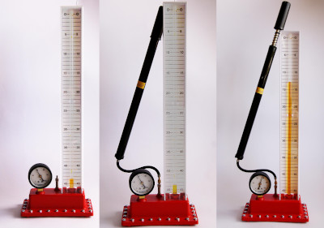

### Method

2. Use the pump to fill the syringe (or glass tube) until the pressure gauge reads the
                                   maximum value. Note the volume and the pressure reading.
4. Slowly release some of the air until the pressure has dropped by about \(\text{20}\)
                                   units (the units will depend on what your pressure gauge measures, e.g. \(\text{kPa}\)).
6. Let the system stabilise for about \(\text{2}\) \(\text{min}\) and then read the volume.
8. Repeat the above two steps until you have six pairs of pressure-volume readings.

### Results

Record your results in the following table. Remember that your pressure and volume units will be
                        determined by the apparatus you are using.

| Pressure | Volume |
| --- | --- |

What happens to the volume as the pressure decreases?

Plot your results as a graph of pressure versus volume (in other words plot pressure on the
                        x-axis and volume on the y-axis). Pressure is the independent variable, which we are changing to
                        see what happens to volume.

Plot your results as a graph of pressure versus the inverse of volume (in other words
                        \(\frac{\text{1}}{V}\), so for each volume reading you will work out the value of \(\text{1}\)
                        divided by the volume reading).

What do you notice about each graph?

### Conclusion

If the volume of the gas decreases, the pressure of the gas increases. If the volume of the gas
                        increases, the pressure decreases. These results support Boyle's law.

In the above experiment, the volume of the gas decreased when the pressure increased, and the volume
                increased when the pressure decreased. This is called an **inverse relationship** (or
                more-less relationship). The inverse relationship between pressure and volume is shown in Figure 7.3.

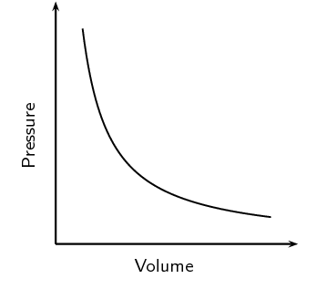

Figure 7.3:
                    Graph showing the inverse relationship between pressure and volume.

Can you use the kinetic theory of gases to explain this inverse relationship between the pressure and
                volume of a gas? Let's think about it. If you decrease the volume of a gas, this means that the same
                number of gas particles are now going to come into contact with each other and with the sides of the
                container much more often. But we said that **pressure** is a measure of the *number of
                    collisions* of gas particles with each other and with the sides of the container they are in.
                So, if the volume decreases, the number of collisions increases and so the pressure will naturally
                increase. The opposite is true if the volume of the gas is increased. Now, the gas particles collide
                less frequently and the pressure will decrease.

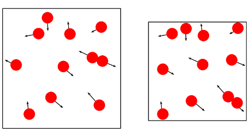

Robert Boyle is the scientist who is credited with discovering that the pressure and volume of a sample
                of gas are **inversely proportional**. This can be seen when a graph of pressure against
                the inverse of volume is plotted. When the values are plotted, the graph is a straight line. This
                relationship is shown in Figure 7.4.

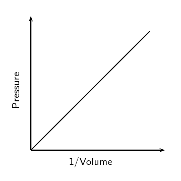

Figure 7.4:
                    The graph of pressure plotted against the inverse of volume, produces a straight line. This shows
                    that pressure and volume are inversely proportional.

We have just seen that the pressure of a gas is *inversely proportional* to the volume of the gas,
                provided the temperature stays the same. We can write this relationship symbolically as:

            \[p ∝ \frac{\text{1}}{V}\]

where \(∝\) means proportional and we write \(\frac{\text{1}}{V}\) to show that the proportionality
                is inverse .

This equation can also be written as follows:

            \[p = \frac{k}{V}\]

where \(k\) is a proportionality constant. If we rearrange this equation, we can say that:

            \[pV = k\]

This equation means that, assuming the temperature and amount of gas is constant, multiplying any
                pressure and volume values for a fixed amount of gas will always give the same value (\(k\)). For
                example:
                \begin{align*}
                p_{1}V_{1} &= k \\
                p_{2}V_{2} &= k
                \end{align*}

where the subscripts \(\text{1}\) and \(\text{2}\) refer to two pairs of pressure and volume readings for
                the same mass of any gas at the same temperature.

From this, we can then say that:

            \[\boxed{p_{1}V_{1} = p_{2}V_{2}}\]

And we can also generalise this to say that:
                \begin{align*}
                p_{1}V_{1} &= p_{2}V_{2} \\
                &= p_{3}V_{3} \\
                &= p_{n}V_{n}
                \end{align*}

In other words we can use any two pairs of readings, it does not have to be the first and second
                readings, it can be the first and third readings or the second and fifth readings.

If you work out the value of \(k\) for any pair of pressure readings from the experiment above and then
                work out \(k\) for any other pair of pressure readings you should find they are the same.

For example if you have:
                \begin{align*}
                p_{1} & = \text{1}\text{ atm}\\
                p_{2} & = \text{2}\text{ atm}\\
                V_{1} & = \text{4}\text{ cm$^{3}$}\\
                V_{2} & = \text{2}\text{ cm$^{3}$}
                \end{align*}
                then using the first pressure and volume gives:
                \begin{align*}
                k &= p_{1}V_{1} \\
                k & = (\text{1}\text{ atm})(\text{4}\text{ cm$^{3}$}) \\
                & = \text{4}\text{ atm·cm$^{3}$}
                \end{align*}
                and using the second pressure and volume gives:
                \begin{align*}
                k &= p_{2}V_{2} \\
                & = (\text{2}\text{ atm})(\text{2}\text{ cm$^{3}$}) \\
                & = \text{4}\text{ atm·cm$^{3}$}
                \end{align*}

Remember that Boyle's Law requires two conditions. First, the **amount** of gas must stay
                constant. If you let a little of the air escape from the container in which it is enclosed, the pressure
                of the gas will decrease along with the volume, and the inverse proportion relationship is broken.
                Second, the **temperature** must stay constant. Cooling or heating matter generally causes
                it to contract or expand, or the pressure to decrease or increase. In the experiment, if we were to heat
                up the gas, it would expand and require you to apply a greater force to keep the plunger at a given
                position. Again, the proportionality would be broken.

<Callout type="note" title="Note">
Did you know that the mechanisms involved in *breathing* also relate to Boyle's Law? Just
                    below the lungs is a muscle called the **diaphragm**. When a person breathes in, the
                    diaphragm moves down and becomes more “flattened” so that the volume of the lungs can
                    increase. When the lung volume *increases*, the pressure in the lungs *decreases*
                    (Boyle's law). Since air always moves from areas of high pressure to areas of lower pressure, air
                    will now be drawn into the lungs because the air pressure *outside* the body is higher than
                    the pressure *in* the lungs. The opposite process happens when a person breathes out. Now,
                    the diaphragm moves upwards and causes the volume of the lungs to *decrease*. The pressure in
                    the lungs will *increase*, and the air that was in the lungs will be forced out towards the
                    lower air pressure outside the body.
</Callout>

<Callout type="note" title="Note">
[Simulation: 23VW](http://phet.colorado.edu/en/simulation/gas-properties)
</Callout>

Before we look at some calculations using Boyle's law we first need to know some different units for
                volume and pressure. Volume units should be familiar to you from earlier grades and will usually be
                \(\text{cm$^{3}$}\) or \(\text{dm$^{3}$}\) or \(\text{m$^{3}$}\) or \(\text{L}\). The SI unit for volume
                is \(\text{m$^{3}$}\).

Pressure is measured in several different units. We can measure pressure in millimetres of mercury
                (\(\text{mm Hg}\)) or pascals (\(\text{Pa}\)) or atmospheres (\(\text{atm}\)). The SI unit for pressure
                is \(\text{Pa}\). See Table 7.1 for converting between
                units.

<Callout type="tip" title="Worked example 1: Boyle's law">
**Question:**
A sample of helium occupies a volume of \(\text{160}\) \(\text{cm$^{3}$}\) at \(\text{100}\)
                        \(\text{kPa}\)
                        and \(\text{25}\) \(\text{℃}\). What volume will it occupy if the pressure is adjusted to
                        \(\text{80}\) \(\text{kPa}\) and the temperature remains unchanged?

**Write down all the information that you know about the gas.:**
\begin{align*}
                        p_{1} &= \text{100}\text{ kPa}\\
                        p_{2} &= \text{80}\text{ kPa} \\
                        V_{1} &= \text{160}\text{ cm$^{3}$} \\
                        V_{2} &= ?
                        \end{align*}

**Use an appropriate gas law equation to calculate the unknown variable.:**
Because the temperature of the gas stays the same, the following equation can be used:

\[p_{2}V_{2} = p_{1}V_{1}\]

**Substitute the known values into the equation, making sure that the units for each
                        variable are the same . Calculate the unknown variable.:**
\begin{align*}
                        (\text{80})V_{2} &= (\text{100})(\text{160}) \\
                        (\text{80})V_{2} &= \text{16 000} \\
                        V_{2} &= \text{200}\text{ cm$^{3}$}
                        \end{align*}

The volume occupied by the gas at a pressure of \(\text{80}\) \(\text{kPa}\) is \(\text{200}\)
                        \(\text{cm$^{3}$}\)

**Check your answer:**
Boyle's law states that the pressure is inversely proportional to the volume. Since the pressure
                        decreased the volume must increase. Our answer for the volume is greater than the initial volume
                        and so our answer is reasonable.
</Callout>

<Callout type="tip" title="Note">
It is not necessary to convert to SI units for Boyle's law. Changing pressure and volume into
                    different units involves *multiplication*. If you were to change the units in the above
                    equation, this would involve multiplication on both sides of the equation, and so the conversions
                    cancel each other out. However, although *SI* units don't have to be used, you must make sure
                    that for each variable you use the *same* units throughout the equation. This is not true for
                    some of the calculations we will do at a later stage, where SI units *must* be used.
</Callout>

<Callout type="tip" title="Worked example 2: Boyle's law">
**Question:**
The volume of a sample of gas is increased from \(\text{2,5}\) \(\text{L}\) to \(\text{2,8}\)
                        \(\text{L}\) while a constant temperature is maintained. What is the final pressure of the gas
                        under these volume conditions, if the initial pressure is \(\text{695}\) \(\text{Pa}\)?

**Write down all the information that you know about the gas.:**
\begin{align*}
                        V_{1} &= \text{2,5}\text{ L} \\
                        V_{2} &= \text{2,8}\text{ L} \\
                        p_{1} &= \text{695}\text{ Pa} \\
                        p_{2} &= ?
                        \end{align*}

**Choose a relevant gas law equation to calculate the unknown variable.:**
The sample of gas is at constant temperature and so we can use Boyle's law:
                        \[p_{2}V_{2} = p_{1}V_{1}\]

**Substitute the known values into the equation, making sure that the units for each
                        variable are the same . Calculate the unknown variable.:**
\begin{align*}
                        (\text{2,8})p_{2} &= (\text{695})(\text{2,5}) \\
                        (\text{2,8})p_{2} &= \text{1 737,5} \\
                        p_{2} &= \text{620,5}\text{ kPa}
                        \end{align*}

The pressure of the gas at a volume of \(\text{2,8}\) \(\text{L}\) is \(\text{620,5}\)
                        \(\text{kPa}\)

**Check your answer:**
Boyle's law states that the pressure is inversely proportional to the volume. Since the volume
                        increased the pressure must decrease. Our answer for the pressure is less than the initial
                        pressure and so our answer is reasonable.
</Callout>

## Boyle's law

### Textbook Exercise 7.2

**Problem:**
An unknown gas has an initial pressure of \(\text{150}\) \(\text{kPa}\) and a volume of
                                \(\text{1}\) \(\text{L}\). If the volume is increased to \(\text{1,5}\) \(\text{L}\),
                                what will the pressure be now?

**Solution:**
\begin{align*}
                            p_{2}V_{2} &= p_{1}V_{1}\\
                            \text{1,5}\text{ L}p_{2} & = (\text{150}\text{ kPa})(\text{1}\text{ L}) \\
                            p_{2} & = \frac{\text{150}}{\text{1,5}}\\
                            & = \text{100}\text{ kPa}
                            \end{align*}

**Problem:**
A bicycle pump contains \(\text{250}\) \(\text{cm$^{3}$}\) of air at a pressure of
                                \(\text{90}\) \(\text{kPa}\). If the air is compressed, the volume is reduced to
                                \(\text{200}\) \(\text{cm$^{3}$}\). What is the pressure of the air inside the pump?

**Solution:**
\begin{align*}
                            p_{2}V_{2} & = p_{1}V_{1}\\
                            \text{200}\text{ cm$^{3}$}p_{2} & = (\text{90}\text{ kPa})(\text{250}\text{ cm$^{3}$})\\
                            \text{200}\text{ cm$^{3}$}p_{2} & = \text{22 500}\text{ kPa}\\
                            p_{2} & = \frac{\text{22 500}}{\text{200}}\\
                            & = \text{112,5}\text{ kPa}
                            \end{align*}

**Problem:**
The air inside a syringe occupies a volume of \(\text{10}\) \(\text{cm$^{3}$}\) and
                                exerts a pressure of \(\text{100}\) \(\text{kPa}\). If the end of the syringe is sealed
                                and the plunger is pushed down, the pressure increases to \(\text{120}\) \(\text{kPa}\).
                                What is the volume of the air in the syringe?

**Solution:**
\begin{align*}
                            p_{2}V_{2} & = p_{1}V_{1}\\
                            \text{120}\text{ kPa}V_{2} & = (\text{100}\text{ kPa})(\text{10}\text{ cm$^{3}$})\\
                            V_{2} & = \frac{\text{1 000}}{\text{120}}\\
                            & = \text{8,33}\text{ cm$^{3}$}
                            \end{align*}

During an investigation to find the relationship between the pressure and volume of an
                                enclosed gas at constant temperature, the following results were obtained.

| Volume (\(\text{dm$^{3}$}\)) | \(\text{12}\) | \(\text{16}\) | \(\text{20}\) | \(\text{24}\) | \(\text{28}\) | \(\text{32}\) | \(\text{36}\) | \(\text{40}\) |
| --- | --- | --- | --- | --- | --- | --- | --- | --- |
| Pressure (\(\text{kPa}\)) | \(\text{400}\) | \(\text{300}\) | \(\text{240}\) | \(\text{200}\) | \(\text{171}\) | \(\text{150}\) | \(\text{133}\) | \(\text{120}\) |

**Problem:**
Plot a graph of pressure (p) against volume (V). Volume will be on the x-axis and
                                    pressure on the y-axis. Describe the relationship that you see.

**Solution:**
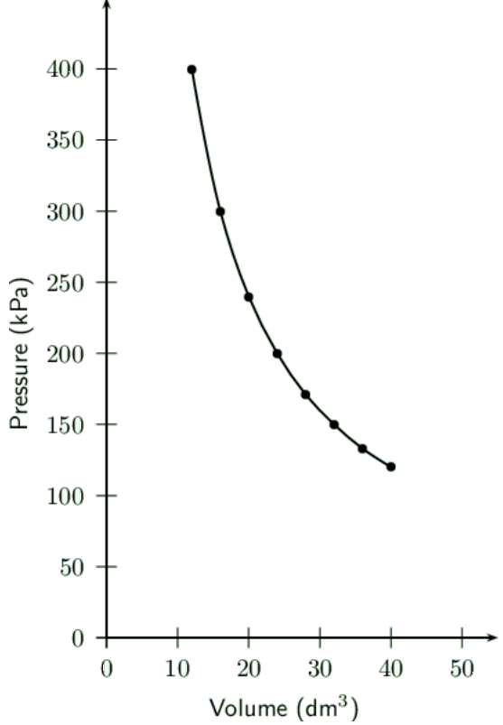

**Problem:**
Plot a graph of p against \(\dfrac{1}{V}\). Describe the relationship that you see.

**Solution:**
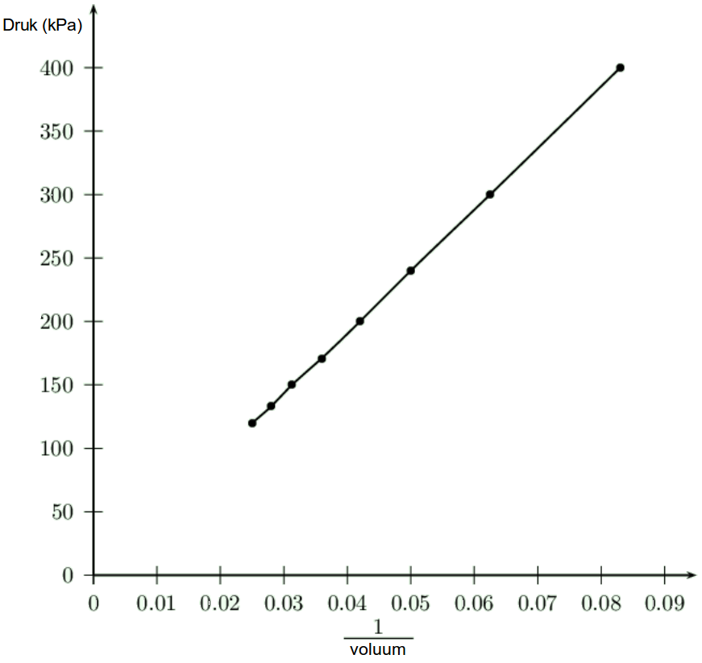

The graph is a straight line. This straight line shows the inverse relation between
                                    pressure and volume.

**Problem:**
Do your results support Boyle's Law? Explain your answer.

**Solution:**
The graph of p against \(\frac{1}{V}\) gives a straight line which shows that
                                    pressure is inversely proportional to volume. This is the expected result from
                                    Boyle's law.

Masoabi and Justine are experimenting with Boyle's law. They both used the same amount of
                                gas. Their data is given in the table below:

|  | Masoabi | Justine |
| --- | --- | --- |
| Initial | Final | Initial | Final |
| Temperature (\(\text{K}\)) | \(\text{325}\) | \(\text{350}\) | \(\text{325}\) | \(\text{325}\) |
| Volume \(\text{(dm$^{3}$)}\) | \(\text{1}\) | \(\text{3}\) | \(\text{1}\) | \(\text{3}\) |
| Pressure (\(\text{Pa}\)) | \(\text{650}\) | \(\text{233}\) | \(\text{650}\) | \(\text{217}\) |

Masoabi and Justine argue about who is correct.

**Problem:**
Calculate the final pressure that would be expected using the initial pressure and
                                    volume and the final volume.

**Solution:**
\begin{align*}
                                p_{2}V_{2} & = p_{1}V_{1} \\
                                (\text{3})p_{2} & = (\text{650})(\text{1}) \\
                                \text{3}p_{2} & = \text{650}\\
                                p_{2} & = \text{217}\text{ Pa}
                                \end{align*}

**Problem:**
Who correctly followed Boyle's law and why?

**Solution:**
From the above calculation we see that Justine has the correct pressure as predicted
                                    by Boyle's law. Masoabi did not get the expected reading.

Justine kept the temperature constant and so has correctly repeated Boyle's law.
                                    Masoabi changed the temperature for the second part of the experiment and so did not
                                    repeat Boyle's law (she actually repeated another gas law).

### Charles' law: Volume and temperature of an enclosed gas (ESBNX)

Charles' law describes the relationship between the **volume** and
                **temperature** of a gas. The law was first published by Joseph Louis Gay-Lussac in 1802,
                but he referenced unpublished work by Jacques Charles from around 1787. This law states that at constant
                pressure, the volume of a given mass of an ideal gas increases or decreases by the same factor as its
                temperature (in Kelvin) increases or decreases. Another way of saying this is that temperature and
                volume are **directly proportional**.

Charles' Law

The volume of an enclosed sample of gas is directly proportional to its Kelvin temperature
                        provided the pressure and amount of gas is kept constant.

An informal experiment is included here. This is to verify Boyle's law and to verify Charles' law
                    (see notes under Boyle's law). In this second part of the experiment learners will verify Charles'
                    law. You will need glass bottles, balloons, beakers or pots, water, hot plates. Learners place a
                    balloon over the mouth of the bottle and then place it in a beaker or pot of water and see what
                    happens. They can also place a bottle with a balloon into a freezer and see what happens.

## Charles's law

### Aim

To demonstrate Charles's Law.

### Apparatus

glass bottle (e.g. empty glass coke bottle), balloon, beaker or pot, water, hot plate

### Method

2. Place the balloon over the opening of the empty bottle.
4. Fill the beaker or pot with water and place it on the hot plate.
6. Stand the bottle in the beaker or pot and turn the hot plate on.
8. Observe what happens to the balloon.

### Results

You should see that the balloon starts to expand. As the air inside the bottle is heated, the
                        pressure also increases, causing the volume to increase. Since the volume of the glass bottle
                        can't increase, the air moves into the balloon, causing it to expand.

### Conclusion

The temperature and volume of the gas are directly related to each other. As one increases, so
                        does the other.

You can also see this if you place the balloon and bottle into a freezer. The balloon will shrink after
                being in the freezer for a short while.

Mathematically, the relationship between volume and pressure can be represented as follows:

            \[V ∝ T\]

In other words, the volume is directly proportional to the temperature.

Or, replacing the proportionality symbol with the constant of proportionality (\(k\)):

            \[V = kT\]

If the equation is rearranged, then:
                \[\frac{V}{T} = k\]

or:
                \begin{align*}
                \frac{V_{1}}{T_{1}} & = k \\
                \frac{V_{2}}{T_{2}} & = k \\
                \frac{V_{n}}{T_{n}} & = k
                \end{align*}

So we can say that:

            \[\boxed{\frac{V_{1}}{T_{1}} = \frac{V_{2}}{T_{2}}}\]

The equation relating volume and temperature produces a straight line graph.

However, if we plot this graph using the **Celsius** temperature scale (i.e. using
                \(\text{℃}\)), the zero point of temperature doesn't correspond to the zero point of volume. When
                the volume is zero, the temperature is actually \(-\text{273}\) \(\text{℃}\) (Figure 7.5).

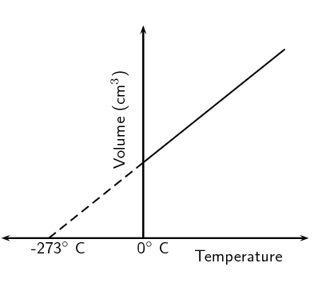

Figure 7.5:
                    The relationship between volume and temperature, shown on the Celsius temperature scale.

A new temperature scale, the **Kelvin scale** must be used instead. Since zero on the
                Celsius scale corresponds with a Kelvin temperature of \(-\text{273}\) \(\text{℃}\), it can be
                said that:

\(\text{Kelvin temperature (}T_{K}\text{)} = \text{Celsius temperature (}T_{C}\text{)} + \text{273}\)

We can write:

\(T_{K} = T_{C} + \text{273}\)

or

\(T_{C} = T_{K} - \text{273}\)

We can now plot the graph of temperature versus volume on the Kelvin scale. This is shown in Figure 7.6.

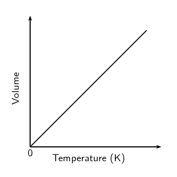

Figure 7.6:
                    The volume of a gas is directly proportional to its temperature, provided the pressure of the gas is
                    constant.

<Callout type="note" title="Note">
<VideoPlayer src="https://youtu.be/K4sOfGKEaxs" title="Video: 23W4" />
</Callout>

Can you explain Charles' law in terms of the kinetic theory of gases? When the temperature of a gas
                increases, so does the average speed of its molecules. The molecules collide with the walls of the
                container more often and with greater impact. These collisions will push back the walls, so that the gas
                occupies a greater volume than it did at the start. We saw this in the first demonstration. Because the
                glass bottle couldn't expand, the gas pushed out the balloon instead.

<Callout type="tip" title="Worked example 3: Charles' law">
**Question:**
At a temperature of \(\text{298}\) \(\text{K}\)
                        , a certain amount of \(\text{CO}_{2}\) gas occupies a volume of \(\text{6}\) \(\text{L}\). What
                        temperature will the gas be at if its volume is reduced to \(\text{5,5}\) \(\text{L}\)? The
                        pressure remains constant.

**Write down all the information that you know about the gas.:**
\begin{align*}
                        V_{1} & = \text{6}\text{ L} \\
                        V_{2} & = \text{5,5}\text{ L} \\
                        T_{1} & = \text{298}\text{ K} \\
                        T_{2} & = ?
                        \end{align*}

**Convert the known values to SI units if necessary.:**
Temperature data is already in Kelvin, and so no conversions are necessary.

**Choose a relevant gas law equation that will allow you to calculate the unknown
                        variable.:**
The pressure is kept constant while the volume and temperature are being varied. The amount of
                        gas is also kept constant and so we can use Charles' law:
                        \[\frac{V_{1}}{T_{1}} = \frac{V_{2}}{T_{2}}\]

**Substitute the known values into the equation. Calculate the unknown variable.:**
\begin{align*}
                        \frac{\text{6}}{\text{298}} & = \frac{\text{5,5}}{T_{2}} \\
                        \text{0,0201}\ldots & = \frac{\text{5,5}}{T_{2}} \\
                        (\text{0,0201}\ldots)T_{2} & = \text{5,5} \\
                        T_{2} & = \text{273,2}\text{ K}
                        \end{align*}

The gas will be at a temperature of \(\text{273,2}\) \(\text{K}\).

**Check your answer:**
Charles' law states that the temperature is directly proportional to the volume. In this example
                        the volume decreases and so the temperature must decrease. Our answer gives a lower final
                        temperature than the initial temperature and so is correct.
</Callout>

<Callout type="tip" title="Worked example 4: Charles' law">
**Question:**
Ammonium chloride and calcium hydroxide are allowed to react. The ammonia that is released in the
                        reaction is collected in a gas syringe (a syringe that has very little friction so that the
                        plunger can move freely) and sealed in. This gas is allowed to come to room temperature which is
                        \(\text{20}\) \(\text{℃}\). The volume of the ammonia is found to be \(\text{122}\)
                        \(\text{mL}\). It is now placed in a water bath set at \(\text{32}\) \(\text{℃}\). What
                        will be the volume reading after the syringe has been left in the bath for \(\text{1}\)
                        \(\text{hour}\) (assume the plunger moves completely freely)? (By leaving the syringe for this
                        length of time, we can be certain that the sample of gas is at the higher temperature.)

**Write down all the information that you know about the gas.:**
\begin{align*}
                        V_{1} & = \text{122}\text{ mL} \\
                        V_{2} & = ? \\
                        T_{1} & = \text{20}\text{ ℃} \\
                        T_{2} & = \text{7}\text{ ℃}
                        \end{align*}

**Convert the known values to SI units if necessary.:**
Here, temperature must be converted into Kelvin, therefore:

\begin{align*}
                        T_{1} & = \text{20} + \text{273} = \text{293}\text{ K} \\
                        T_{2} & = \text{32} + \text{273} = \text{305}\text{ K}
                        \end{align*}

**Choose a relevant gas law equation that will allow you to calculate the unknown
                        variable.:**
The pressure is kept constant while the volume and temperature are being varied. The amount of
                        gas is also kept constant and so we can use Charles' law:
                        \[\frac{V_{2}}{T_{2}} = \frac{V_{1}}{T_{1}}\]

**Substitute the known values into the equation. Calculate the unknown variable.:**
\begin{align*}
                        \frac{V_{2}}{\text{305}} & = \frac{\text{122}}{\text{293}} \\
                        \frac{V_{2}}{\text{305}} & = \text{0,416}\ldots \\
                        V_{2} & = \text{127}\text{ mL}
                        \end{align*}

The volume reading on the syringe will be \(\text{127}\) \(\text{mL}\) after the syringe has been
                        left in the water bath for one hour.

**Check your answer:**
Charles' law states that the temperature is directly proportional to the volume. In this example
                        the temperature increases and so the volume must increase. Our answer gives a higher final
                        volume than the initial volume and so is correct.
</Callout>

<Callout type="tip" title="Note">
Note that here the temperature must be converted to Kelvin since the change from degrees Celsius
                    involves addition, not multiplication by a fixed conversion ratio (as is the case with pressure and
                    volume.)
</Callout>

## Charles' law

### Textbook Exercise 7.3

The table below gives the temperature (in \(\text{℃}\)) of helium gas under
                                different volumes at a constant pressure.

| Volume (\(\text{L}\)) | Temperature (\(\text{℃}\)) |
| --- | --- |
| \(\text{1,0}\) | \(-\text{161,9}\) |
| \(\text{1,5}\) | \(-\text{106,7}\) |
| \(\text{2}\) | \(-\text{50,8}\) |
| \(\text{2,5}\) | \(\text{4,8}\) |
| \(\text{3,0}\) | \(\text{60,3}\) |
| \(\text{3,5}\) | \(\text{115,9}\) |

**Problem:**
Draw a graph to show the relationship between temperature and volume.

**Solution:**
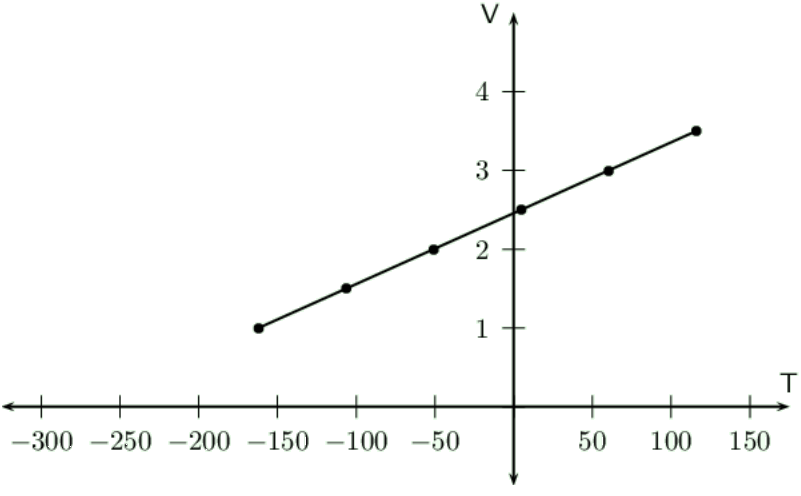

**Problem:**
Describe the relationship you observe.

**Solution:**
As the volume increases so does the temperature.

**Problem:**
If you extrapolate the graph (in other words, extend the graph line even though you
                                    may not have the exact data points), at what temperature does it intersect the
                                    \(x\)-axis?

**Solution:**
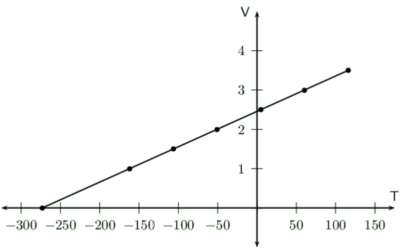

The graph intersects the \(x\)-axis at \(-\text{273}\) \(\text{℃}\)

**Problem:**
What is significant about this temperature?

**Solution:**
This point corresponds to absolute zero. At absolute zero all gases have no volume.
                                    This is the lowest temperature that it is possible to achieve.

**Problem:**
What conclusions can you draw? Use Charles' law to help you.

**Solution:**
We can conclude that volume and temperature are directly proportional.

**Problem:**
A sample of nitrogen monoxide (\(\text{NO}\)) gas is at a temperature of \(\text{8}\)
                                \(\text{℃}\) and occupies a volume of \(\text{4,4}\) \(\text{dm$^{3}$}\). What
                                volume will the sample of gas have if the temperature is increased to \(\text{25}\)
                                \(\text{℃}\)?

**Solution:**
First convert the temperature to Kelvin:
                                \begin{align*}
                                T_{1} & = 8 + \text{273} = \text{281}\\
                                T_{2} & = \text{25} + \text{273} = \text{298}
                                \end{align*}

\begin{align*}
                                \frac{V_{2}}{T_{2}} & = \frac{V_{1}}{T_{1}}\\
                                \frac{V_{2}}{\text{298}} & = \frac{\text{4,4}}{\text{281}} \\
                                \frac{V_{2}}{\text{298}} & = \text{0,01565}\ldots \\
                                & = \text{4,67}\text{ dm$^{3}$}
                                \end{align*}

**Problem:**
A sample of oxygen (\(\text{O}_{2}\)) gas is at a temperature of \(\text{340}\)
                                \(\text{K}\) and occupies a volume of \(\text{1,2}\) \(\text{dm$^{3}$}\). What
                                temperature will the sample of gas be at if the volume is decreased to \(\text{200}\)
                                \(\text{cm$^{3}$}\)?

**Solution:**
Note that the two volumes are not in the same units. So we convert the second volume to
                                \(\text{dm$^{3}$}\).
                                \[V_{2} = \frac{\text{200}}{\text{1 000}} = \text{0,2}\text{ dm$^{3}$}\]

\begin{align*}
                                \frac{V_{1}}{T_{1}} & = \frac{V_{2}}{T_{2}}\\
                                \frac{\text{1,2}}{\text{340}} & = \frac{\text{0,2}}{T_{2}} \\
                                \text{0,003529}\ldots & = \frac{\text{0,2}}{T_{2}} \\
                                (\text{0,003529}\ldots)T_{2} & = \text{0,2} \\
                                & = \text{56,67}\text{ K}
                                \end{align*}

**Problem:**
Explain what would happen if you were verifying Charles' law and you let some of the gas
                                escape.

**Solution:**
If some of the gas escaped, the volume of the gas would decrease. This would lead to an
                                decrease in the temperature. So the final temperature that you read would be lower than
                                it should be. This will lead to the incorrect conclusion that Charles' law is not
                                correct.

### Pressure-temperature relation (ESBNY)

The pressure of a gas is directly proportional to its temperature, if the volume is kept constant (Figure 7.7). Recall that as the temperature of a
                gas increases, so does the kinetic energy of the particles in the gas. This causes the particles in the
                gas to move more rapidly and to collide with each other and with the side of the container more often.
                Since pressure is a measure of these collisions, the pressure of the gas increases with an increase in
                temperature. The pressure of the gas will decrease if its temperature decreases.

<Callout type="tip" title="Note">
You may see this law referred to as Gay-Lussac's law or as Amontons' law. Many scientists were
                    working on the same problems at the same time and it is often difficult to know who actually
                    discovered a particular law.
</Callout>

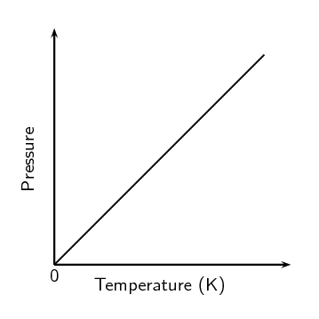

Figure 7.7:
                    The relationship between the temperature and pressure of a gas.

In the same way that we have done for the other gas laws, we can describe the relationship between
                temperature and pressure using symbols, as follows:

\(T ∝ p\),

therefore:

\(p = kT\)

Rearranging this we get:

            \[\frac{p}{T} = k\]

and that, provided the **amount** of gas stays the same (and the volume also stays the
                same):

            \[\boxed{\dfrac{p_{1}}{T_{1}} = \frac{p_{2}}{T_{2}}}\]

<Callout type="tip" title="Worked example 5: Pressure-temperature relation">
**Question:**
At a temperature of \(\text{298}\) \(\text{K}\)
                        , a certain amount of oxygen (\(\text{O}_{2}\)) gas has a pressure of \(\text{0,4}\)
                        \(\text{atm}\). What temperature will the gas be at if its pressure is increased to
                        \(\text{0,7}\) \(\text{atm}\)?

**Write down all the information that you know about the gas.:**
\begin{align*}
                        T_{1} & = \text{298}\text{ K} \\
                        T_{2} & = ? \\
                        p_{1} & = \text{0,4}\text{ atm} \\
                        p_{2} & = \text{0,7}\text{ atm}
                        \end{align*}

**Convert the known values to SI units if necessary.:**
The temperature is already in Kelvin. We do not need to convert the pressure to pascals.

**Choose a relevant gas law equation that will allow you to calculate the unknown
                        variable.:**
The volume is kept constant while the pressure and temperature are being varied. The amount of
                        gas is also kept constant and so we can use the pressure-temperature relation:
                        \[\frac{p_{1}}{T_{1}} = \frac{p_{2}}{T_{2}}\]

**Substitute the known values into the equation. Calculate the unknown variable.:**
\begin{align*}
                        \frac{\text{0,4}}{\text{298}} & = \frac{\text{0,7}}{T_{2}} \\
                        \text{0,0013}\ldots & = \frac{\text{0,7}}{T_{2}} \\
                        (\text{0,0013}\ldots)T_{2} & = \text{0,7} \\
                        T_{2} & = \text{521,5}\text{ K}
                        \end{align*}

The temperature will be \(\text{521,5}\) \(\text{K}\).

**Check your answer:**
The pressure-temperature relation states that the pressure is directly proportional to the
                        temperature. In this example the pressure increases and so the temperature must increase. Our
                        answer gives a higher final temperature than the initial temperature and so is correct.
</Callout>

<Callout type="tip" title="Worked example 6: Pressure-temperature relation">
**Question:**
A fixed volume of carbon monoxide (\(\text{CO}\)) gas has a temperature of \(\text{32}\)
                        \(\text{℃}\) and a pressure of \(\text{680}\) \(\text{Pa}\). If the temperature is
                        decreased to \(\text{15}\) \(\text{℃}\) what will the pressure be?

**Write down all the information that you know about the gas.:**
\begin{align*}
                        T_{1} & = \text{32}\text{ ℃} \\
                        T_{2} & = \text{15}\text{ ℃} \\
                        p_{1} & = \text{680}\text{ Pa} \\
                        p_{2} & = ?
                        \end{align*}

**Convert the known values to SI units if necessary.:**
We need to convert the given temperatures to Kelvin temperature.
                        \begin{align*}
                        T_{1} & = \text{32} + \text{273} \\
                        & = \text{305}\text{ K}\\
                        T_{2} & = \text{15} + \text{273} \\
                        & = \text{288}\text{ K}
                        \end{align*}

**Choose a relevant gas law equation that will allow you to calculate the unknown
                        variable.:**
\[\frac{p_{2}}{T_{2}} = \frac{p_{1}}{T_{1}}\]

**Substitute the known values into the equation. Calculate the unknown variable.:**
\begin{align*}
                        \frac{p_{2}}{\text{288}} & = \frac{\text{680}}{\text{305}} \\
                        \frac{p_{2}}{\text{288}} & = \text{2,2295}\ldots \\
                        p_{2} & = \text{642,1}\text{ Pa}
                        \end{align*}

The pressure will be \(\text{642,1}\) \(\text{Pa}\).

**Check your answer:**
The pressure-temperature relation states that the pressure is directly proportional to the
                        temperature. In this example the temperature decreases and so the pressure must decrease. Our
                        answer gives a lower final pressure than the initial pressure and so is correct.
</Callout>

## Pressure-temperature relation

### Textbook Exercise 7.4

The table below gives the temperature (in \(\text{℃}\)) of helium under
                                different
                                pressures at a constant volume.

| Pressure (\(\text{atm}\)) | Temperature (\(\text{℃}\)) | Temperature (\(\text{K}\)) |
| --- | --- | --- |
| \(\text{1,0}\) | \(\text{20}\) |  |
| \(\text{1,2}\) | \(\text{78,6}\) |  |
| \(\text{1,4}\) | \(\text{137,2}\) |  |
| \(\text{1,6}\) | \(\text{195,8}\) |  |
| \(\text{1,8}\) | \(\text{254,4}\) |  |
| \(\text{2,0}\) | \(\text{313}\) |  |

**Problem:**
Convert all the temperature data to Kelvin.

**Solution:**
| Pressure (\(\text{atm}\)) | Temperature (\(\text{℃}\)) | Temperature (\(\text{K}\)) |
| --- | --- | --- |
| \(\text{1,0}\) | \(\text{20}\) | \(\text{293}\) |
| \(\text{1,2}\) | \(\text{78,6}\) | \(\text{351,6}\) |
| \(\text{1,4}\) | \(\text{137,2}\) | \(\text{410,2}\) |
| \(\text{1,6}\) | \(\text{195,8}\) | \(\text{468,8}\) |
| \(\text{1,8}\) | \(\text{254,4}\) | \(\text{527,4}\) |
| \(\text{2,0}\) | \(\text{313}\) | \(\text{586}\) |

**Problem:**
Draw a graph to show the relationship between temperature and pressure.

**Solution:**
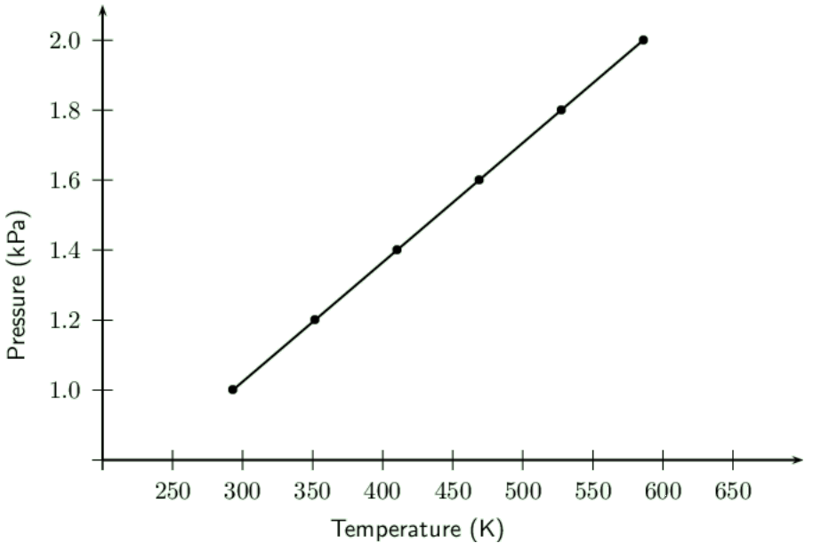

**Problem:**
Describe the relationship you observe.

**Solution:**
There is a linear relationship. Pressure and temperature are directly
                                    proportional.
                                    The graph is a straight line.

**Problem:**
A cylinder that contains methane gas is kept at a temperature of \(\text{15}\)
                                \(\text{℃}\) and exerts a pressure of \(\text{7}\) \(\text{atm}\). If the
                                temperature of the cylinder increases to \(\text{25}\) \(\text{℃}\), what
                                pressure
                                does the gas now exert?

**Solution:**
We need to convert the given temperatures to Kelvin temperature.

                            \begin{align*}
                            T_{1} & = \text{15} + \text{273} \\
                            & = \text{288}\text{ K}\\
                            T_{2} & = \text{25} + \text{273} \\
                            & = \text{298}\text{ K}
                            \end{align*}

                            \begin{align*}
                            \frac{p_{2}}{T_{2}} & = \frac{p_{1}}{T_{1}} \\
                            \frac{p_{2}}{\text{298}} & = \frac{\text{7}}{\text{288}} \\
                            \frac{p_{2}}{\text{298}} & = \text{0,024}\ldots \\
                            p_{2} & = \text{7,24}\text{ atm}
                            \end{align*}

The pressure will be \(\text{7,24}\) \(\text{atm}\).

**Problem:**
A cylinder of propane gas at a temperature of \(\text{20}\) \(\text{℃}\) exerts
                                a
                                pressure of \(\text{8}\) \(\text{atm}\). When a cylinder has been placed in
                                sunlight,
                                its temperature increases to \(\text{25}\) \(\text{℃}\). What is the pressure
                                of
                                the gas inside the cylinder at this temperature?

**Solution:**
We first convert the temperature to Kelvin:

                            \begin{align*}
                            T_{1} & = \text{20} + \text{273} = \text{293}\text{ K}\\
                            T_{2} & = \text{25} + \text{273} = \text{298}\text{ K}
                            \end{align*}

And then we can find the pressure:

                            \begin{align*}
                            \frac{p_{2}}{T_{2}} & = \frac{p_{1}}{T_{1}} \\
                            \frac{p_{2}}{\text{298}} & = \frac{\text{8}}{\text{293}} \\
                            \frac{p_{2}}{\text{298}} & = \text{0,0273}\ldots \\
                            p_{2} & = \text{8,14}\text{ atm}
                            \end{align*}

**Problem:**
A hairspray can is a can that contains a gas under high pressures. The can has the
                                following warning written on it: “Do not place near open flame. Do not dispose
                                of
                                in a fire. Keep away from heat.” Use what you know about the pressure and
                                temperature of gases to explain why it is dangerous to not follow this warning.

**Solution:**
The pressure of a gas is directly proportional to its temperature at a fixed volume.
                                Since the volume of gas in an aerosol can does not change, this relation holds. If
                                the
                                temperature of the can is increased by placing near an open flame or in a hot place,
                                the
                                pressure will increase. This may lead to the can exploding. The same is true if you
                                dispose of in a fire.

**Problem:**
A cylinder of acetylene gas is kept at a temperature of \(\text{291}\) \(\text{K}\).
                                The
                                pressure in the cylinder is \(\text{5}\) \(\text{atm}\). This cylinder can withstand
                                a
                                pressure of \(\text{8}\) \(\text{atm}\) before it explodes. What is the maximum
                                temperature that the cylinder can safely be stored at?

**Solution:**
\begin{align*}
                            \frac{p_{1}}{T_{1}} & = \frac{p_{2}}{T_{2}} \\
                            \frac{\text{5}}{\text{291}} & = \frac{\text{8}}{T_{2}} \\
                            \text{0,017}\ldots & = \frac{\text{8}}{T_{2}} \\
                            (\text{0,017}\ldots)T_{2} & = \text{8} \\
                            T_{2} & = \text{465,6}\text{ K}
                            \end{align*}

### The general gas equation (ESBNZ)

All the gas laws we have described so far rely on the fact that the amount of gas and one other
                variable
                (temperature, pressure or volume) remains constant. Since this is unlikely to be the case most
                times, it
                is useful to combine the relationships into one equation. We will use Boyle's law and the
                pressure-temperature relation to work out the general gas equation.

Boyle's law: \(p ∝ \dfrac{1}{V}\) (constant T)

In other words pressure is inversely proportional to the volume at constant temperature.

Pressure-temperature relation: \(p ∝ T\) (constant V)

In other words pressure is also directly proportional to the temperature at constant volume.

If we now vary both the volume and the temperature, the two proportionalities will still hold, but
                will
                be equal to a different proportionality constant.

So we can combine these relationships, to get:

            \[p ∝ \frac{T}{V}\]

Note that this says that the pressure is still directly proportional to the temperature and inversely
                proportional to the volume.

If we introduce the proportionality constant, k, we get:

            \[p = k\frac{T}{V}\]

or, rearranging the equation:

            \[pV = kT\]

We can also rewrite this relationship as follows:

            \[\frac{pV}{T} = k\]

Provided the mass of the gas stays the same, we can also say that:

            \[\boxed{\frac{p_{1}V_{1}}{T_{1}} = \frac{p_{2}V_{2}}{T_{2}}}\]

In the above equation, the subscripts \(\text{1}\) and \(\text{2}\) refer to two pressure and volume
                readings for the same mass of gas under different conditions. This is known as the **general
                    gas
                    equation**. Temperature is always in Kelvin and the units used for pressure and volume
                must
                be the same on both sides of the equation.

<Callout type="tip" title="Note">
Remember that the general gas equation only applies if the mass (or number of moles) of the gas
                    is
                    fixed.
</Callout>

<Callout type="tip" title="Worked example 7: General gas equation">
**Question:**
At the beginning of a journey, a truck tyre has a volume of \(\text{30}\) \(\text{dm$^{3}$}\)
                        and
                        an internal pressure of \(\text{170}\) \(\text{kPa}\). The temperature of the tyre is
                        \(\text{16}\) \(\text{℃}\). By the end of the trip, the volume of the tyre has
                        increased
                        to \(\text{32}\) \(\text{dm$^{3}$}\) and the temperature of the air inside the tyre is
                        \(\text{40}\) \(\text{℃}\). What is the tyre pressure at the end of the journey?

**Write down all the information that you know about the gas.:**
\begin{align*}
                        T_{1} & = \text{16}\text{ ℃} \\
                        T_{2} & = \text{40}\text{ ℃} \\
                        V_{1} & = \text{30}\text{ dm$^{3}$} \\
                        V_{2} & = \text{32}\text{ dm$^{3}$} \\
                        p_{1} & = \text{170}\text{ kPa} \\
                        p_{2} & = ?
                        \end{align*}

**Convert the known values to SI units if necessary.:**
We need to convert the given temperatures to Kelvin temperature.
                        \begin{align*}
                        T_{1} & = \text{16} + \text{273} \\
                        & = \text{289}\text{ K}\\
                        T_{2} & = \text{40} + \text{273} \\
                        & = \text{313}\text{ K}
                        \end{align*}

**Choose a relevant gas law equation that will allow you to calculate the
                        unknown
                        variable.:**
Temperature, pressure and volume are all varying so we must use the general gas equation:
                        \[\frac{p_{2}V_{2}}{T_{2}} = \frac{p_{1}V_{1}}{T_{1}}\]

**Substitute the known values into the equation. Calculate the unknown variable.:**
\begin{align*}
                        \frac{(\text{32})p_{2}}{\text{313}} & = \frac{(\text{170})(\text{30})}{\text{289}} \\
                        \frac{(\text{32})p_{2}}{\text{313}} & = \text{17,647}\ldots \\
                        (\text{32})p_{2} & = \text{5 523,529}\ldots \\
                        p_{2} & = \text{172,6}\text{ kPa}
                        \end{align*}

The pressure will be \(\text{172,6}\) \(\text{kPa}\).
</Callout>

<Callout type="tip" title="Worked example 8: General gas equation">
**Question:**
A sample of a gas exerts a pressure of \(\text{100}\) \(\text{kPa}\) at \(\text{15}\)
                        \(\text{℃}\). The volume under these conditions is \(\text{10}\) \(\text{dm$^{3}$}\).
                        The
                        pressure increases to \(\text{130}\) \(\text{kPa}\) and the temperature increases to
                        \(\text{32}\) \(\text{℃}\). What is the new volume of the gas?

**Write down all the information that you know about the gas.:**
\begin{align*}
                        T_{1} & = \text{15}\text{ ℃} \\
                        T_{2} & = \text{32}\text{ ℃} \\
                        p_{1} & = \text{100}\text{ kPa} \\
                        p_{2} & = \text{130}\text{ kPa} \\
                        V_{1} & = \text{10}\text{ dm$^{3}$} \\
                        V_{2} & = ?
                        \end{align*}

**Convert the known values to SI units if necessary.:**
Here, temperature must be converted into Kelvin, therefore:

\begin{align*}
                        T_{1} & = \text{15} + \text{273} = \text{288}\text{ K} \\
                        T_{2} & = \text{32} + \text{273} = \text{305}\text{ K}
                        \end{align*}

**Choose a relevant gas law equation that will allow you to calculate the
                        unknown
                        variable.:**
We use the general gas equation:

\[\frac{p_{2}V_{2}}{T_{2}} = \frac{p_{1}V_{1}}{T_{1}}\]

**Substitute the known values into the equation. Calculate the unknown variable.:**
\begin{align*}
                        \frac{(\text{130})V_{2}}{\text{305}} & = \frac{(\text{100})(\text{10})}{\text{288}} \\
                        \frac{(\text{130})V_{2}}{\text{305}} & = \text{3,47}\ldots \\
                        (\text{130})V_{2} & = \text{1 059,027}\ldots \\
                        V_{2} & = \text{8,15}\text{ dm$^{3}$}
                        \end{align*}

The volume will be \(\text{8,15}\) \(\text{dm$^{3}$}\).
</Callout>

<Callout type="tip" title="Worked example 9: General gas equation">
**Question:**
A cylinder of propane gas is kept at a temperature of \(\text{298}\) \(\text{K}\). The gas
                        exerts
                        a pressure of \(\text{5}\) \(\text{atm}\) and the cylinder holds \(\text{4}\)
                        \(\text{dm$^{3}$}\) of gas. If the pressure of the cylinder increases to \(\text{5,2}\)
                        \(\text{atm}\) and \(\text{0,3}\) \(\text{dm$^{3}$}\) of gas leaks out, what temperature is
                        the
                        gas now at?

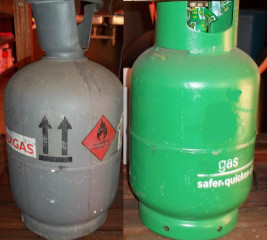

**Write down all the information that you know about the gas.:**
\begin{align*}
                        T_{1} & = \text{298}\text{ K} \\
                        T_{2} & = ? \\
                        V_{1} & = \text{4}\text{ dm$^{3}$} \\
                        V_{2} & = \text{4} - \text{0,3} = \text{3,7}\text{ dm$^{3}$} \\
                        p_{1} & = \text{5}\text{ atm} \\
                        p_{2} & = \text{5,2}\text{ atm}
                        \end{align*}

**Convert the known values to SI units if necessary.:**
Temperature data is already in Kelvin. All other values are in the same units.

**Choose a relevant gas law equation that will allow you to calculate the
                        unknown
                        variable.:**
Since volume, pressure and temperature are varying, we must use the general gas equation:

\[\frac{p_{1}V_{1}}{T_{1}} = \frac{p_{2}V_{2}}{T_{2}}\]

**Substitute the known values into the equation. Calculate the unknown variable.:**
\begin{align*}
                        \frac{(\text{5})(\text{4})}{\text{298}} & = \frac{(\text{5,2})(\text{3,7})}{T_{2}} \\
                        \text{0,067}\ldots & = \frac{\text{19,24}}{T_{2}} \\
                        (\text{0,067}\ldots)T_{2} & = \text{19,24} \\
                        T_{2} & = \text{286,7}\text{ K}
                        \end{align*}

The temperature will be \(\text{286,7}\) \(\text{K}\).
</Callout>

## The general gas equation

### Textbook Exercise 7.5

**Problem:**
A closed gas system initially has a volume of \(\text{8}\) \(\text{L}\) and a
                                temperature
                                of \(\text{100}\) \(\text{℃}\). The pressure of the gas is unknown. If the
                                temperature of the gas decreases to \(\text{50}\) \(\text{℃}\), the gas
                                occupies a
                                volume of \(\text{5}\) \(\text{L}\) and the pressure of the gas is
                                \(\text{1,2}\)
                                \(\text{atm}\). What was the initial pressure of the gas?

**Solution:**
We first convert the temperature to Kelvin:

                            \begin{align*}
                            T_{1} & = \text{100} + \text{273} = \text{373}\text{ K}\\
                            T_{2} & = \text{50} + \text{273} = \text{323}\text{ K}
                            \end{align*}

Now we can use the gas equation:

                            \begin{align*}
                            \frac{p_{1}V_{1}}{T_{1}} & = \frac{p_{2}V_{2}}{T_{2}}\\
                            \frac{(p_{1})(\text{8})}{\text{373}} & =
                            \frac{(\text{1,2})(\text{5})}{\text{323}}
                            \\
                            \frac{(p_{1})(\text{8})}{\text{373}} & = \text{0,0185}\ldots \\
                            (p_{1})(\text{8}) & = \text{6,928}\ldots \\
                            p_{1} & = \text{0,87}\text{ atm}
                            \end{align*}

**Problem:**
A balloon is filled with helium gas at \(\text{27}\) \(\text{℃}\) and a
                                pressure of
                                \(\text{1,0}\) \(\text{atm}\). As the balloon rises, the volume of the balloon
                                increases
                                by a factor of \(\text{1,6}\) and the temperature decreases to \(\text{15}\)
                                \(\text{℃}\). What is the final pressure of the gas (assuming none has
                                escaped)?

**Solution:**
We first convert the temperature to Kelvin:

                            \begin{align*}
                            T_{1} & = \text{27} + \text{273} = \text{300}\text{ K}\\
                            T_{2} & = \text{15} + \text{273} = \text{288}\text{ K}
                            \end{align*}

Let the initial volume be \(V_{1}\) and the final volume be \(\text{1,6}V_{1}\)

Now we can use the gas equation:

                            \begin{align*}
                            \frac{p_{2}V_{2}}{T_{2}} & = \frac{p_{1}V_{1}}{T_{1}}\\
                            \frac{p_{2}(\text{1,6}V_{1})}{\text{288}} & =
                            \frac{(\text{1})V_{1}}{\text{300}}\\
                            \text{480}V_{1}p_{2} & = \text{288}V_{1}\\
                            p_{2} & = \text{0,6}\text{ atm}
                            \end{align*}

**Problem:**
\(\text{25}\) \(\text{cm$^{3}$}\) of gas at \(\text{1}\) \(\text{atm}\) has a
                                temperature
                                of \(\text{25}\) \(\text{℃}\). When the gas is compressed to \(\text{20}\)
                                \(\text{cm$^{3}$}\), the temperature of the gas increases to \(\text{28}\)
                                \(\text{℃}\). Calculate the final pressure of the gas.

**Solution:**
We first convert the temperature to Kelvin:

                            \begin{align*}
                            T_{1} & = \text{25} + \text{273} = \text{298}\text{ K}\\
                            T_{2} & = \text{28} + \text{273} = \text{301}\text{ K}
                            \end{align*}

Now we can use the gas equation:

                            \begin{align*}
                            \frac{p_{2}V_{2}}{T_{2}} & = \frac{p_{1}V_{1}}{T_{1}}\\
                            \frac{(p_{2})(\text{20})}{\text{301}} & =
                            \frac{(\text{1})(\text{25})}{\text{298}}
                            \\
                            \frac{(p_{2})(\text{20})}{\text{301}} & = \text{0,08389}\ldots \\
                            (p_{2})(\text{20}) & = \text{25,516}\ldots \\
                            p_{1} & = \text{1,26}\text{ atm}
                            \end{align*}

### The ideal gas equation (ESBP2)

In the early 1800's, Amedeo Avogadro noted that if you have samples of different gases, of the
                same
                volume, at a fixed temperature and pressure, then the samples must contain the same number of
                freely
                moving particles (i.e. atoms or molecules).

Avogadro's Law

Equal volumes of gases, at the same temperature and pressure, contain the same number of
                        molecules.

You will remember from the previous section, that we combined different gas law equations to get
                *one* that included temperature, volume and pressure. In this equation

            \[\dfrac{pV}{T} = k\]

the value of k is different for different masses of gas.

We find that when we calculate \(k\) for \(\text{1}\) \(\text{mol}\) of gas that we get:

            \[\frac{pV}{T} = \text{8,314}\]

This result is given a special name. It is the universal gas constant, \(R\). \(R\) is measured
                in
                units
                of \(\text{J·K$^{-1}$·mol$^{-1}$}\). No matter which gas we use, \(\text{1}\)
                \(\text{mol}\)
                of that gas will have the same constant.

<Callout type="tip" title="Note">
A joule can be defined as \(\text{Pa·m$^{3}$}\). So when you are using the ideal gas
                    equation
                    you must use the SI units to ensure that you get the correct answer.
</Callout>

If we now extend this result to any number of moles of a gas we get the following:

            \[\frac{pV}{T} = nR\]

where \(n\) is the number of moles of gas.

Rearranging this equation gives:

            \[\boxed{pV = nRT}\]

This is the ideal gas equation. When you work with this equation you must have all units in SI
                units.

<Callout type="tip" title="Note">
All quantities in the equation \(pV = nRT\) must be in the same units as the value of R. In
                    other
                    words, SI units must be used throughout the equation.
</Callout>

<Callout type="note" title="Note">
<VideoPlayer src="https://www.youtube.com/embed/WScwPIPqZa0" title="Video: 23WK" />
</Callout>

<Callout type="tip" title="Worked example 10: Ideal gas equation">
**Question:**
Two moles of oxygen \((\text{O}_{2})\) gas occupy a volume of \(\text{25}\)
                        \(\text{dm$^{3}$}\)
                        at a temperature of \(\text{40}\) \(\text{℃}\). Calculate the pressure of the gas
                        under
                        these conditions.

**Write down all the information that you know about the gas.:**
\begin{align*}
                        p & = ? \\
                        V & = \text{25}\text{ dm$^{3}$} \\
                        n & = \text{2}\text{ mol} \\
                        T & = \text{40}\text{ ℃}\\
                        R & = \text{8,314}\text{ J·K·mol$^{-1}$}
                        \end{align*}

**Convert the known values to SI units if necessary.:**
We need to convert the temperature to Kelvin. Note that we can leave the volume in
                        \(\text{dm$^{3}$}\), but this means that the value we calculate for \(p\) will be in
                        \(\text{kPa}\).
                        \begin{align*}
                        T_{K} & = T_{C} + \text{273} \\
                        & = \text{40} + \text{273} \\
                        & = \text{313}\text{ K}
                        \end{align*}

**Choose a relevant gas law equation that will allow you to calculate the
                        unknown
                        variable.:**
We are varying everything (temperature, pressure, volume and amount of gas) and so we
                        must
                        use
                        the ideal gas equation.
                        \[pV = nRT\]

**Substitute the known values into the equation. Calculate the unknown
                        variable.:**
\begin{align*}
                        (\text{25}\text{ dm$^{3}$})(p) & = (\text{2}\text{ mol})(\text{8,314}\text{
                        J·K$^{-1}$·mol$^{-1}$})(\text{313}\text{ K}) \\
                        (\text{25}\text{ dm$^{3}$})(p) & = \text{5 204,564}\text{ kPa·dm$^{3}$} \\
                        p & = \text{208,18256}\text{ kPa}
                        \end{align*}

The pressure will be \(\text{208,18}\) \(\text{kPa}\).
</Callout>

<Callout type="tip" title="Worked example 11: Ideal gas equation">
**Question:**
Carbon dioxide \((\text{CO}_{2})\) gas is produced as a result of the reaction between
                        calcium
                        carbonate and hydrochloric acid. The gas that is produced is collected in a container of
                        unknown
                        volume. The pressure of the gas is \(\text{105}\) \(\text{kPa}\) at a temperature of
                        \(\text{20}\) \(\text{℃}\). If the number of moles of gas collected is
                        \(\text{0,86}\)
                        \(\text{mol}\), what is the volume?

**Write down all the information that you know about the gas.:**
\begin{align*}
                        p & = \text{105}\text{ kPa} \\
                        V & = ? \\
                        n & = \text{0,86}\text{ mol} \\
                        T & = \text{20}\text{ ℃}\\
                        R & = \text{8,314}\text{ J·K·mol$^{-1}$}
                        \end{align*}

**Convert the known values to SI units if necessary.:**
We need to convert the temperature to Kelvin and the pressure to \(\text{Pa}\):
                        \begin{align*}
                        p & = \text{105} \times \text{1 000} = \text{105 000}\text{ Pa} \\
                        T & = \text{20} + \text{273} = \text{293}\text{ K}
                        \end{align*}

**Choose a relevant gas law equation that will allow you to calculate the
                        unknown
                        variable.:**
We are varying everything (temperature, pressure, volume and amount of gas) and so we
                        must
                        use
                        the ideal gas equation.
                        \[pV = nRT\]

**Substitute the known values into the equation. Calculate the unknown
                        variable.:**
\begin{align*}
                        (\text{105 000}\text{ Pa})V & = (\text{8,314}\text{
                        J·K$^{-1}$·mol$^{-1}$})(\text{293}\text{ K})(\text{0,86}\text{ mol}) \\
                        (\text{105 000}\text{ Pa})V & = \text{2 094,96}\text{ Pa·m$^{3}$} \\
                        V & = \text{0,020}\text{ m$^{3}$} \\
                        & = \text{20}\text{ dm$^{3}$}
                        \end{align*}

The volume is \(\text{20}\) \(\text{dm$^{3}$}\).
</Callout>

<Callout type="tip" title="Worked example 12: Ideal gas equation">
**Question:**
Nitrogen \((\text{N}_{2})\) reacts with hydrogen \((\text{H}_{2})\) according to the
                        following
                        equation:

                    \[\text{N}_{2} + 3 \text{H}_{2} \rightarrow 2\text{NH}_{3}\]

\(\text{2}\) \(\text{mol}\) ammonia \((\text{NH}_{3})\) gas is collected in a separate
                        gas
                        cylinder which has a volume of \(\text{25}\) \(\text{dm$^{3}$}\). The pressure of the
                        gas is
                        \(\text{195,89}\) \(\text{kPa}\). Calculate the temperature of the gas inside the
                        cylinder.

**Write down all the information that you know about the gas.:**
\begin{align*}
                        p & = \text{195,98}\text{ Pa} \\
                        V & = \text{25}\text{ dm$^{3}$} \\
                        n & = \text{2}\text{ mol} \\
                        R & = \text{8,3}\text{ J·K$^{-1}$mol$^{-1}$}\\
                        T & = ?
                        \end{align*}

**Convert the known values to SI units if necessary.:**
We must convert the volume to \(\text{m$^{3}$}\) and the pressure to \(\text{Pa}\):
                        \begin{align*}
                        V & = \frac{\text{25}}{\text{1 000}}\\
                        & = \text{0,025}\text{ m$^{3}$}\\
                        p & = \text{195,89} \times \text{1 000}\\
                        & = \text{195 890}\text{ Pa}
                        \end{align*}

**Choose a relevant gas law equation that will allow you to calculate the
                        unknown
                        variable.:**
\[pV = nRT\]

**Substitute the known values into the equation. Calculate the unknown
                        variable.:**
\begin{align*}
                        (\text{195 890})(\text{0,025}) & = (\text{2})(\text{8,314})T \\
                        \text{4 897,25} & = \text{16,628}(T) \\
                        T & = \text{294,52}\text{ K}
                        \end{align*}

The temperature is \(\text{294,52}\) \(\text{K}\).
</Callout>

<Callout type="tip" title="Worked example 13: Ideal gas equation">
**Question:**
Calculate the number of moles of air particles in a classroom of length \(\text{10}\)
                        \(\text{m}\), a width of \(\text{7}\) \(\text{m}\) and a height of \(\text{2}\)
                        \(\text{m}\)
                        on
                        a day when the temperature is \(\text{23}\) \(\text{℃}\) and the air pressure is
                        \(\text{98}\) \(\text{kPa}\)
                        .

**Calculate the volume of air in the classroom:**
The classroom is a rectangular prism (recall grade \(\text{10}\) maths on measurement).
                        We
                        can
                        calculate the volume using:
                        \begin{align*}
                        V & = \text{length} \times \text{width} \times \text{height} \\
                        & = (\text{10})(\text{7})(\text{2}) \\
                        & = \text{140}\text{ m$^{3}$}
                        \end{align*}

**Write down all the information that you know about the gas.:**
\begin{align*}
                        p & = \text{98}\text{ kPa} \\
                        V & = \text{140}\text{ m$^{3}$} \\
                        n & = ? \\
                        R & = \text{8,314}\text{ J·K$^{-1}$mol$^{-1}$}\\
                        T & = \text{23}\text{ ℃}
                        \end{align*}

**Convert the known values to SI units if necessary.:**
We must convert the temperature to \(\text{K}\) and the pressure to \(\text{Pa}\):
                        \begin{align*}
                        T & = \text{25} + \text{273} = \text{298}\text{ K}\\
                        p & = \text{98} \times \text{1 000} = \text{98 000}\text{ Pa}
                        \end{align*}

**Choose a relevant gas law equation that will allow you to calculate the
                        unknown
                        variable.:**
\[pV = nRT\]

**Substitute the known values into the equation. Calculate the unknown
                        variable.:**
\begin{align*}
                        (\text{98 000})(\text{140}) & = n(\text{8,314})(\text{298}) \\
                        \text{13 720 000} & = \text{2 477,572}(n) \\
                        n & = \text{5 537,7}\text{ mol}
                        \end{align*}

The number of moles in the classroom is \(\text{5 537,7}\) \(\text{mol}\).
</Callout>

## The ideal gas equation

### Textbook Exercise 7.6

**Problem:**
An unknown gas has a pressure of \(\text{0,9}\) \(\text{atm}\), a temperature
                                of
                                \(\text{120}\) \(\text{℃}\) and the number of moles is \(\text{0,28}\)
                                \(\text{mol}\). What is the volume of the sample?

**Solution:**
First convert all units to SI units:

                            \begin{align*}
                            T & = \text{273} + \text{120} = \text{393}\text{ K}\\
                            V & = ? \\
                            p & = \frac{\text{101 325}}{\text{0,9}} = \text{112 583,33}\text{
                            Pa}
                            \end{align*}

Now we can use the ideal gas equation to find the volume of gas:

                            \begin{align*}
                            pV &= nRT \\
                            (\text{112 583,33})V & = (\text{0,28})(\text{8,314})(\text{393}) \\
                            \text{112 583,33}V & = \text{895,7256} \\
                            V & = \text{0,008}\text{ m$^{3}$} \\
                            V & = \text{8}\text{ dm$^{3}$}
                            \end{align*}

**Problem:**
\(\text{6}\) \(\text{g}\) of chlorine \((\text{Cl}_{2})\) occupies a volume
                                of
                                \(\text{0,002}\) \(\text{m$^{3}$}\) at a temperature of \(\text{26}\)
                                \(\text{℃}\). What is the pressure of the gas under these conditions?

**Solution:**
First find the number of moles of chlorine gas:

                            \begin{align*}
                            n & = \frac{m}{M}\\
                            & = \frac{\text{6}}{\text{70}} \\
                            & = \text{0,0857}\text{ mol}
                            \end{align*}

Next convert all units to SI units:

                            \[T = \text{273} + \text{26} = \text{299}\text{ K}\]

Now we can use the ideal gas equation to find the pressure:

                            \begin{align*}
                            pV &= nRT \\
                            (p)(\text{0,002}) & = (\text{0,0857})(\text{8,314})(\text{299}) \\
                            (p)(\text{0,002}) & = \text{213,075}\ldots \\
                            & = \text{106 537,9714}\text{ Pa}\\
                            & = \text{106,54}\text{ kPa}
                            \end{align*}

**Problem:**
An average pair of human lungs contains about \(\text{3,5}\) \(\text{L}\) of
                                air
                                after
                                inhalation and about \(\text{3,0}\) \(\text{L}\) after exhalation. Assuming
                                that
                                air
                                in
                                your lungs is at \(\text{37}\) \(\text{℃}\) and \(\text{1,0}\)
                                \(\text{atm}\),
                                determine the number of moles of air in a typical breath.

**Solution:**
One breath has a volume of:

                            \begin{align*}
                            \text{3,5} - \text{3,0} = & \text{0,5}\text{ L}\\
                            = & \text{0,0005}\text{ m$^{3}$}
                            \end{align*}

Convert all units to SI units:

                            \begin{align*}
                            T & = \text{273} + \text{37} = \text{310}\text{ K}\\
                            p & = \text{101 325}\text{ Pa}
                            \end{align*}

Now we can use the ideal gas equation to find the number of moles:

                            \begin{align*}
                            pV &= nRT \\
                            (\text{101 325})(\text{0,0005}) & = (n)(\text{8,314})(\text{310}) \\
                            \text{50,6625} & = (n)(\text{2 577,34}) \\
                            & = \text{0,02}\text{ mol}
                            \end{align*}

A learner is asked to calculate the answer to the problem below:

*Calculate the pressure exerted by \(\text{1,5}\) \(\text{moles}\) of
                                    nitrogen
                                    gas
                                    in
                                    a container with a volume of \(\text{20}\) \(\text{dm$^{3}$}\) at a
                                    temperature
                                    of
                                    \(\text{37}\) \(\text{℃}\).*

The learner writes the solution as follows:

                            \begin{align*}
                            V & = \text{20}\text{ dm$^{3}$}\\
                            n & = \text{1,5}\text{ mol}\\
                            R & = \text{8,314}\text{ J·K$^{-1}$·mol$^{-1}$}\\
                            T & = \text{37} + \text{273} = \text{310}\text{ K}
                            \end{align*}\begin{align*}
                            pT & = nRV \\
                            p(\text{310}) & = (\text{1,5})(\text{8,314})(\text{20})\\
                            p(\text{310}) & = (\text{249,42}) \\
                            & = \text{0,8}\text{ kPa}
                            \end{align*}

**Problem:**
Identify \(\text{2}\) mistakes the learner has made in the calculation.

**Solution:**
The learner has not used the correct equation. The ideal gas equation is
                                    \(pV=nRT\).
                                    The learner did not convert the volume to SI units.

**Problem:**
Are the units of the final answer correct?

**Solution:**
The pressure should be given in pascals (\(\text{Pa}\)) first and then
                                    converted
                                    to
                                    kiloPascals (\(\text{kPa}\)).

**Problem:**
Rewrite the solution, correcting the mistakes to arrive at the right
                                    answer.

**Solution:**
\begin{align*}
                                V & = \text{0,02}\text{ m$^{3}$}\\
                                n & = \text{1,5}\text{ mol}\\
                                R & = \text{8,314}\text{ J·K$^{-1}$·mol$^{-1}$}\\
                                T & = \text{37} + \text{273} = \text{310}\text{ K}
                                \end{align*}
                                \begin{align*}
                                pV & = nRT \\
                                p(\text{0,020}\text{ m$^{3}$}) & = (\text{1,5}\text{
                                mol})(\text{8,314}\text{
                                J·K$^{-1}$·mol$^{-1}$})(\text{310}\text{ K}) \\
                                p(\text{0,020}\text{ m$^{3}$}) & = \text{3 866,01}\text{ J} \\
                                p & = \text{193 300,5}\text{ Pa}\\
                                & = \text{193,3}\text{ kPa}
                                \end{align*}

Most modern cars are equipped with airbags for both the driver and the
                                passenger.
                                An
                                airbag will completely inflate in \(\text{0,05}\) \(\text{s}\). This is
                                important
                                because a typical car collision lasts about \(\text{0,125}\) \(\text{s}\).
                                The
                                following
                                reaction of sodium azide (a compound found in airbags) is activated by an
                                electrical
                                signal:

\(2\text{NaN}_{3}\text{(s)} → 2\text{Na (s)} +
                                3\text{N}_{2}\text{(g)}\)

**Problem:**
Calculate the mass of \(\text{N}_{2} (\text{g})\) needed to inflate a
                                    sample
                                    airbag
                                    to a volume of \(\text{65}\) \(\text{dm$^{3}$}\) at \(\text{25}\)
                                    \(\text{℃}\)
                                    and \(\text{99,3}\) \(\text{kPa}\). Assume the gas temperature remains
                                    constant
                                    during the reaction.

**Solution:**
We first convert all units to SI units:

                                \begin{align*}
                                P & = \text{99,3} \times \text{1 000} = \text{99 300}\text{
                                Pa}\\
                                V & = \frac{\text{65}}{\text{1 000}} = \text{0,065}\text{
                                m$^{3}$}\\
                                T & = \text{25} + \text{273} = \text{298}\text{ K}
                                \end{align*}
                                \begin{align*}
                                pV & = nRT \\
                                (\text{99 300})(\text{0,065}) & = n(\text{8,314})(\text{298}) \\
                                \text{6 464,5} & = n(\text{2 477,572}) \\
                                n & = \text{2,61}\text{ mol}
                                \end{align*}

Next we convert the number of moles to grams:

                                \begin{align*}
                                n & = \frac{m}{M} \\
                                \text{2,61} & = \frac{m}{\text{28}} \\
                                m & = \text{73,1}\text{ g}
                                \end{align*}

**Problem:**
The above reaction produces heat, which raises the temperature in the
                                    airbag.
                                    Describe, in terms of the kinetic theory of gases, how the pressure in
                                    the
                                    sample
                                    airbag will change, if at all, as the gas temperature returns to
                                    \(\text{25}\)
                                    \(\text{℃}\).

**Solution:**
When the temperature decreases the intensity of collisions with the walls
                                    of
                                    the
                                    airbag and between particles decreases. Therefore pressure decreases.
