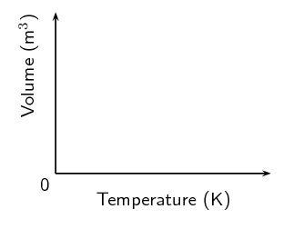
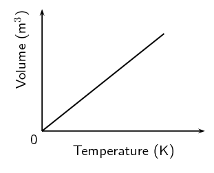
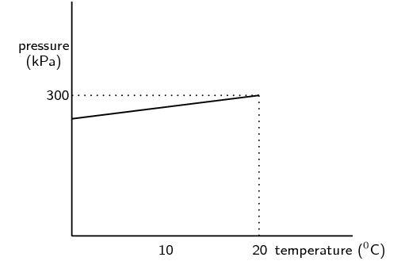
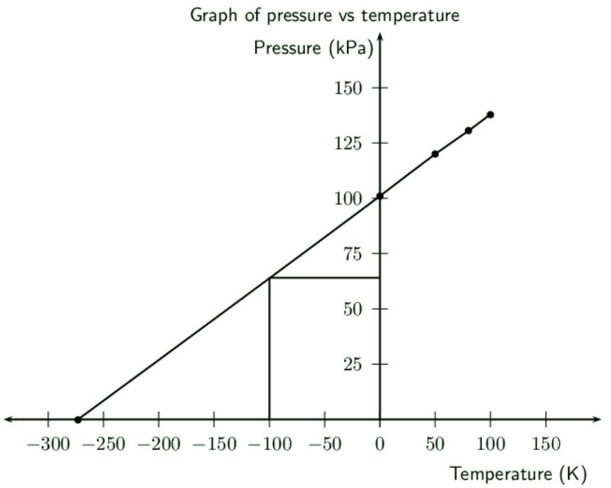

### Textbook Exercise 7.7

Give one word or term for each of the following definitions.

**Problem:**
A gas is that has identical particles of zero volume, with no intermolecular forces between
                            the particles.

**Solution:**
Ideal gas

**Problem:**
The law that states that the volume of a gas is directly proportional to the temperature of
                            the gas, provided that the pressure and the amount of the gas remain constant.

**Solution:**
Charles' law

**Problem:**
A measure of the average kinetic energy of gas particles.

**Solution:**
Temperature

**Problem:**
Which one of the following properties of a fixed quantity of a gas must be kept constant during
                        an investigation of Boyle's law?

2. density
4. pressure
6. temperature
8. volume

(*IEB 2003 Paper \(\text{2}\)*)

**Solution:**
Temperature must be kept constant.

**Problem:**
Three containers of *equal volume* are filled with *equal masses* of helium,
                        nitrogen and carbon dioxide gas respectively. The gases in the three containers are all at the
                        same *temperature*. Which one of the following statements is correct regarding the
                        pressure of the gases?

2. All three gases will be at the same pressure
4. The helium will be at the greatest pressure
6. The nitrogen will be at the greatest pressure
8. The carbon dioxide will be at the greatest pressure

(*IEB 2004 Paper \(\text{2}\)*)

**Solution:**
The sample of helium gas will be at the greatest pressure.

**Problem:**
The ideal gas equation is given by **pV = nRT**. Which one of the following
                        conditions is true according to Avogadro's hypothesis?

| a | \(p ∝ \frac{\text{1}}{V}\) | (T = constant) |
| --- | --- | --- |
| b | \(V ∝ T\) | (p = constant) |
| c | \(V ∝ n\) | (p, T = constant) |
| d | \(p ∝ T\) | (n = constant) |

(*DoE Exemplar paper \(\text{2}\), 2007*)

**Solution:**
\(V ∝ n\), with p, T constant.

**Problem:**
Complete the following table by stating whether or not the property is constant or variable for
                        the given gas law.

| Law | Pressure (p) | Volume (V) | Temperature (T) | Moles (n) |
| --- | --- | --- | --- | --- |
| Boyle's law |  |  |  |  |
| Charles' law |  |  |  |  |
| Gay-Lussac's law |  |  |  |  |
| General gas equation |  |  |  |  |
| Ideal gas equation |  |  |  |  |

**Solution:**
| Law | Pressure (p) | Volume (V) | Temperature (T) | Moles (n) |
| --- | --- | --- | --- | --- |
| Boyle's law | variable | variable | constant | constant |
| Charles' law | constant | variable | variable | constant |
| Gay-Lussac's law | variable | constant | variable | constant |
| General gas equation | variable | variable | variable | constant |
| Ideal gas equation | variable | variable | variable | variable |

Use your knowledge of the gas laws to explain the following statements.

**Problem:**
It is dangerous to put an aerosol can near heat.

**Solution:**
As the temperature of a gas increases the pressure also increases (provided the volume stays
                            constant). Since the volume of an aerosol can stays constant, the pressure will increase and
                            cause the can to explode.

**Problem:**
A pressure vessel that is poorly designed and made can be a serious safety hazard (a pressure
                            vessel is a closed, rigid container that is used to hold gases at a pressure that is higher
                            than the normal air pressure).

**Solution:**
As the temperature of a gas increases the pressure also increases (provided the volume stays
                            constant). Since the volume of a pressure vessel stays constant, the pressure will increase
                            if the temperature increases and cause the vessel to explode. Also since the vessel keeps
                            the gas at a higher pressure than normal, the gas is more likely to burst out of the
                            container.

**Problem:**
The volume of a car tyre increases after a trip on a hot road.

**Solution:**
Volume is proportional to temperature at a fixed pressure. The pressure of a car tyre is
                            fixed. After a long trip, the temperature of the tyre increases which leads to an increase
                            in the volume.

Copy the following set of labelled axes and answer the questions that follow:

**Problem:**
On the axes, **using a solid line**, draw the graph that would be obtained for a
                            fixed mass of an ideal gas if the pressure is kept constant.

**Solution:**

**Problem:**
If the gradient of the above graph is measured to be \(\text{0,008}\)
                            \(\text{m$^{3}$·K$^{-1}$}\), calculate the pressure that \(\text{0,3}\) \(\text{mol}\)
                            of this gas would exert.

**Solution:**
The equation of a straight line graph is \(y=mx+x\). Since the above graph intersects the
                            y-axis at \(\text{0}\), \(c = \text{0}\). We are told that the gradient is \(\text{0,008}\).
                            So the equation for the above graph is \(y=\text{0,008}x\).

The ideal gas equation is \(pV = nRT\). Since the above graph plots temperature on the x-axis
                            and volume on the y-axis, we rearrange the ideal gas equation to find: \(V =
                            \frac{nR}{p}T\).

Therefore, the gradient of the graph is equal to \(\frac{nR}{p}\).

                        \begin{align*}
                        \text{0,008} & = \frac{(\text{0,3})(\text{8,314})}{p}\\
                        p & = \text{311,775}\text{ Pa}
                        \end{align*}

**Problem:**
Two gas cylinders, A and B, have a volume of \(\text{0,15}\) \(\text{m$^{3}$}\) and
                        \(\text{0,20}\) \(\text{m$^{3}$}\) respectively. Cylinder A contains \(\text{35}\)
                        \(\text{mol}\) \(\text{He}\) gas at pressure p and cylinder B contains \(\text{40}\)
                        \(\text{mol}\) \(\text{He}\) gas at \(\text{5}\) \(\text{atm}\). The ratio of the Kelvin
                        temperatures A:B is \(\text{1,80}\):\(\text{1,00}\). Calculate the pressure of the gas (in
                        \(\text{kPa}\)) in cylinder A.

(*IEB 2002 Paper \(\text{2}\)*)

**Solution:**
Let the temperature of gas B be \(T_{B}\) and the temperature of gas A is then
                        \(\text{1,8}T_{B}\).

We convert the pressure of gas B to SI units:

                    \begin{align*}
                    p_{B} & = (\text{5})(\text{101 325}) = \text{506 625}
                    \end{align*}

For gas B we have:

                    \begin{align*}
                    pV & = nRT \\
                    (\text{506 625})(\text{0,2}) & = (\text{40})(\text{8,314})(T_{B})\\
                    \text{101 325} & = (\text{332,56})(T_{B})\\
                    T_{B} & = \text{304,68}\text{ K}
                    \end{align*}

So the temperature of gas A is:

                    \begin{align*}
                    T_{A} & = \text{1,8}T_{B} \\
                    & = (\text{1,8})(\text{304,68})\\
                    & = \text{548,43}\text{ K}
                    \end{align*}

For gas A we have:

                    \begin{align*}
                    pV & = nRT \\
                    p(\text{0,15}) & = (\text{35})(\text{8,314})(\text{548,43})\\
                    p(\text{0,15}) & = (\text{159 586,875})\\
                    p & = \text{106 391,25}\text{ Pa}\\
                    p & = \text{106,39}\text{ kPa}
                    \end{align*}

A learner investigates the relationship between the Celsius temperature and the pressure of a
                        fixed amount of helium gas in a \(\text{500}\) \(\text{cm$^{3}$}\) closed container. From the
                        results of the investigation, she draws the graph below:

**Problem:**
Under the conditions of this investigation, helium gas behaves like an ideal gas. Explain
                            briefly why this is so.

**Solution:**
The pressure is not high enough to cause molecular volume to start taking effect. The
                            temperature range is well above heliums boiling point to prevent helium becoming a liquid.

**Problem:**
From the shape of the graph, the learner concludes that the pressure of the helium gas is
                            directly proportional to the Celsius temperature. Is her conclusion correct? Briefly explain
                            your answer.

**Solution:**
No. The pressure is directly proportional to the Kelvin temperature. The conversion between
                            Kelvin and Celsius relies on addition and subtraction. This conversion affects the
                            proportionality constant differently depending on whether Celsius or Kelvin is used. If the
                            conversion used multiplication or division then the learners conclusion would be correct.

**Problem:**
Calculate the pressure of the helium gas at \(\text{0}\) \(\text{℃}\).

**Solution:**
At \(\text{20}\) \(\text{℃}\) the pressure is \(\text{300}\) \(\text{kPa}\). Using the
                            relationship between pressure and temperature we find the pressure:

                        \begin{align*}
                        \frac{p_{2}}{T_{2}} & = \frac{p_{1}}{T_{1}} \\
                        \frac{p_{2}}{(\text{273})} & = \frac{(\text{300} \times \text{10}^{\text{3}})}{(\text{293})}
                        \\
                        \frac{p_{2}}{(\text{273})} & = \text{87 900 000} \\
                        p_{2} & = \text{321 978,022}\text{ Pa}\\
                        & = \text{322,0}\text{ kPa}
                        \end{align*}

**Problem:**
Calculate the mass of helium gas in the container.

**Solution:**
We can use either of the temperature-pressure readings.

The number of moles is:

                        \begin{align*}
                        pV & = nRT \\
                        (\text{300} \times \text{10}^{\text{3}})(\text{500} \times \text{10}^{-\text{3}}) & =
                        n(\text{8,314})(\text{293}) \\
                        \text{150 000} & = (\text{2 436,002})n \\
                        n & = \text{61,58}\text{ mol}
                        \end{align*}

And the mass is:

                        \begin{align*}
                        m & = nM \\
                        & = (\text{61,58})(\text{4}) \\
                        & = \text{246,31}\text{ g}
                        \end{align*}

**Problem:**
One of the cylinders of a motor car engine, before compression contains \(\text{450}\)
                        \(\text{cm$^{3}$}\) of a mixture of air and petrol in the gaseous phase, at a temperature of
                        \(\text{30}\) \(\text{℃}\) and a pressure of \(\text{100}\) \(\text{kPa}\). If the volume
                        of the cylinder after compression decreases to one tenth of the original volume, and the
                        temperature of the gas mixture rises to \(\text{140}\) \(\text{℃}\), calculate the
                        pressure now exerted by the gas mixture.

**Solution:**
First convert the temperature to Kelvin and the volume to \(\text{m$^{3}$}\):

                    \begin{align*}
                    T_{1} & = \text{30} + \text{273} = \text{303}\text{ K} \\
                    T_{2} & = \text{140} + \text{273} = \text{413}\text{ K} \\
                    V_{1} & = \frac{\text{450}}{\text{1 000}} = \text{0,450}\text{ m$^{3}$} \\
                    V_{2} & = \frac{1}{10}V_{1} = \text{0,0450}\text{ m$^{3}$}
                    \end{align*}

Now we can find the pressure:

                    \begin{align*}
                    \frac{p_{2}V_{2}}{T_{2}} & = \frac{p_{1}V_{1}}{T_{1}} \\
                    \frac{p_{2}(\text{0,045})}{\text{413}} & =
                    \frac{(\text{100 000})(\text{0,450})}{\text{303}} \\
                    \frac{p_{2}(\text{0,045})}{\text{413}} & = \text{148,52}\\
                    p_{2}(\text{0,045}) & = \text{61 336,6}\\
                    p_{2} & = \text{1 363 036,3}\text{ Pa}\\
                    & = \text{1 363,0}\text{ kPa}
                    \end{align*}

**Problem:**
A gas of unknown volume has a temperature of \(\text{14}\) \(\text{℃}\). When the
                        temperature of the gas is increased to \(\text{100}\) \(\text{℃}\), the volume is found to
                        be \(\text{5,5}\) \(\text{L}\). What was the initial volume of the gas?

**Solution:**
First convert the temperature to Kelvin:

                    \begin{align*}
                    T_{1} & = \text{14} + \text{273} = \text{287}\text{ K} \\
                    T_{2} & = \text{100} + \text{273} = \text{373}\text{ K}
                    \end{align*}

Next we an find the initial volume:

                    \begin{align*}
                    \frac{V_{1}}{T_{1}} & = \frac{V_{2}}{T_{2}} \\
                    \frac{V_{1}}{\text{287}} & = \frac{\text{5,5}}{\text{373}} \\
                    \frac{V_{1}}{\text{287}} & = \text{0,020}\ldots\\
                    V_{1} & = \text{5,78}\text{ L}
                    \end{align*}

A gas has an initial volume of \(\text{2 600}\) \(\text{mL}\) and a temperature of
                        \(\text{350}\) \(\text{K}\).

**Problem:**
If the volume is reduced to \(\text{1 500}\) \(\text{mL}\), what will the temperature of
                            the gas be in Kelvin?

**Solution:**
\begin{align*}
                        \frac{V_{1}}{T_{1}} & = \frac{V_{2}}{T_{2}} \\
                        \frac{\text{2,6}}{\text{350}} & = \frac{\text{1,5}}{T_{2}} \\
                        \text{0,007428}\ldots & = \frac{\text{1,5}}{T_{2}} \\
                        (\text{0,007428}\ldots)T_{2} & = \text{1,5} \\
                        T_{2} & = \text{201,9}\text{ K}
                        \end{align*}

**Problem:**
Has the temperature *increased* or *decreased*?

**Solution:**
Decreased.

**Problem:**
Explain this change, using the kinetic theory of gases.

**Solution:**
When the temperature of a gas decreases, so does the average speed of its molecules. The
                            molecules collide with the walls of the container less often and with lesser impact. These
                            collisions will not push back the walls, so that the gas occupies a lesser volume than it
                            did at the start.

In an experiment to determine the relationship between pressure and temperature of a fixed mass
                        of gas, a group of learners obtained the following results:

| Pressure (\(\text{kPa}\)) | \(\text{101}\) | \(\text{120}\) | \(\text{130,5}\) | \(\text{138}\) |
| --- | --- | --- | --- | --- |
| Temperature (\(\text{℃}\)) | \(\text{0}\) | \(\text{50}\) | \(\text{80}\) | \(\text{100}\) |
| Total gas volume (\(\text{cm$^{3}$}\)) | \(\text{250}\) | \(\text{250}\) | \(\text{250}\) | \(\text{250}\) |

**Problem:**
Draw a straight-line graph of pressure (on the dependent, y-axis) versus temperature (on the
                            independent, x-axis) on a piece of graph paper. Plot the points. Give your graph a suitable
                            heading.

**Solution:**

**Problem:**
*A straight-line graph passing through the origin is essential to obtain a mathematical
                                relationship between pressure and temperature.*.

Extrapolate (extend) your graph and determine the temperature (in \(\text{℃}\)) at
                            which the graph will pass through the temperature axis.

**Solution:**
See above.

**Problem:**
Write down, in words, the relationship between pressure and Kelvin temperature.

**Solution:**
The pressure for a fixed mass of gas is directly proportional to the Kelvin temperature.

**Problem:**
From your graph, determine the pressure (in \(\text{kPa}\)) at \(\text{173}\) \(\text{K}\).
                            Indicate on your graph how you obtained this value.

**Solution:**
\(\text{173}\) \(\text{K}\) is \(-\text{100}\) \(\text{℃}\). So we draw a line from
                            \(-\text{100}\) \(\text{℃}\) to the graph and then draw a line across to the y-axis.
                            (See graph above).

This gives a pressure of about \(\text{64}\) \(\text{kPa}\) (you can check this by
                            calculation).

**Problem:**
How would the gradient of the graph be affected (if at all) if a larger mass of the gas is
                            used? Write down ONLY **increases**, **decreases** or
                            **stays the same**.

**Solution:**
Increases.
