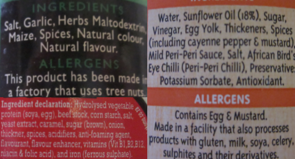

# Chapter 8: Quantitative aspects of chemical change

This topic builds on the gr10 chapter of the same title. A quick revision (no more than 15 minutes) of the
            gr10 work would greatly help learners to recall how to calculate molar masses, number of moles and
            concentration. In this chapter learners will learn about molar volumes of gases, concentration of solutions,
            more on stoichiometry and volume relationships in gaseous reactions. Topics covered in this chapter are:

- **1 mole of gas occupies \(\text{22,4}\) \(\text{dm$^{3}$}\) and expansion to any number of
                          moles of gas**
  In grade 10 learners learnt about the molar volume of gases. This concept is refreshed here and then
                      expanded on to cover any number of moles of gases. This is a very important result that is used in
                      stoichiometric calculations to go from volume of a gas to number of moles and from there via the
                      balanced equation to the desired quantity of one of the products or reactants in that reaction.
- **Interpretation of chemical equations**
  Learners should be able to understand that chemical equations can be interpreted in words or in
                      symbols (as seen in grade 10) or in terms of the quantities of the substances involved in the
                      reaction. This second interpretation is a valuable skill for stoichiometric calculations.
- **Calculation of molar concentration of solutions and expanding this to titration
                          calculations**
  CAPs lists an activity on titration calculations which is worked into the text with concentration
                      calculations. In grade 10 learners learnt about calculating concentration, in this chapter
                      concentration calculations are expanded to cover titrations.
- **Limiting reagents**
  In grade 10 learners saw how to use the balanced chemical equation to move from products to reactants
                      and vice versa. This is now expanded on to include information about both reactants where learners
                      have to determine which reactant is limiting and which is in excess before calculating the amount of
                      product formed.
- **Percent yield**
  In this section learners are introduced to percent yield. Care must be taken in this section to
                      ensure that learners do not mix up theoretical yield and percent yield. The percent yield can only
                      be determined from experiment, while the theoretical yield comes from stoichiometric calculations.
- **Empirical and molecular formula**
  This is revision from grade 10. Learners are reminded how to calculate the empirical and molecular
                      formula of a substance and are reminded about percent composition.
- **Percent purity**
  The concept of percent purity is the last concept that is covered. This looks at how pure a sample of
                      a compound is. It is important to note that CAPs refers to percent purity as being interchangeable
                      with percent composition which is not strictly true. Percent composition deals with how much of a
                      particular element is in a substance while percent purity deals with how much of a compound is in a
                      sample or how pure your final product in a reaction is.
- **Calculations involving gases, liquids and solids**
  CAPs also lists an activity on precipitation calculations which can be included in the final topic.
  At the end of the chapter learners bring together all the concepts that they have learnt into this
                      topic. Learners are introduced to the idea that the balanced chemical equation can be used to
                      calculate any quantity of a substance from any of the other products or reactions in that reaction.
                      This is particularly important as reactions do not occur in just one state but occur in multiple
                      states and being able to move freely between, for example, calculating moles of a gas to calculating
                      mass of a substance, is an important skill.

Wherever we look in real life we see the importance of mixing things in precise quantities. Cooking and baking,
        the medicines you take when sick, the products that you buy, all of these rely on the ingredients being mixed in
        specific amounts. And even the amount of product formed relies on how much of each ingredient is used. In this
        chapter we will look at some of these quantities and how they can be calculated.

In grade 10 we learnt about writing chemical equations and about the information that can be obtained from a
        balanced chemical equation. In this chapter we are going to explore these concepts further and learn more about
        gases, solutions and reactions. We will explore the concept of theoretical yield in greater detail and learn
        about limiting reagents.

<Callout type="note" title="Note">
- Ratio and proportion - Physical Sciences, Grade 10, Science skills
- Equations - Mathematics, Grade 10, Equations and inequalities
- Units and unit conversions - Physical Sciences, Grade 10, Science skills
</Callout>

## 8.1 Gases and solutions (ESBP4)

<QuizCard id="s11-08-01a" title="Interactive Exercise 8.1" question="Convert \(\text{5}\ \text{daC}\) (decacoulombs) to \(\text{C}\) . Leave your answer in scientific notation." options=[] answer="
                    5e+01
                " hint="You should enter a number here. If you want to, you can use a space to separate thousands.                Example: 12 800,25 For scientific notation you need to use the multiply symbol                ( ∗ ) and the exponent symbol ( ^ ). For example 6,673 × 10 −11 should be written as: 6,673 ∗ 10^−11" explanation="We first need to know the power of 10 to use. The following table provides a summary of the unit prefixes you should know. Prefix Symbol Power of 10 Exponent giga G \(\text{10}^{\text{9}}\) \(\text{9}\) mega M \(\text{10}^{\text{6}}\) \(\text{6}\) kilo k \(\text{10}^{\text{3}}\) \(\text{3}\) hecto h \(\text{10}^{\text{2}}\) \(\text{2}\) deca da \(\text{10}^{\text{1}}\) \(\text{1}\) No prefix unit symbol on its own \(\text{10}^{\text{0}}\) \(\text{0}\) deci d \(\text{10}^{-\text{1}}\) \(-\text{1}\) centi c \(\text{10}^{-\text{2}}\) \(-\text{2}\) milli m \(\text{10}^{-\text{3}}\) \(-\text{3}\) micro \(\mu\) \(\text{10}^{-\text{6}}\) \(-\text{6}\) nano n \(\text{10}^{-\text{9}}\) \(-\text{9}\) These exponents represent the prefix part of the unit name. We are given \(\color{red}{\text{da}}\) C and we need to get to \(\text{C}\) . The prefix part is \(\text{da}\) (deca). So we look on the table for \(\text{da}\) (deca) and see that we need to use \(\text{10}^{\text{1}}\) to carry out the conversion. Now that we know what power of 10 we need to use we can carry out the conversion. We replace the prefix with the correct power of 10: \(\text{5} \times \text{10}^{\text{1}}\ \text{C}\) . Since we are asked to leave our answer in scientific notation this is the answer. Submit your answer as:" />

<QuizCard id="s11-08-01a" title="Interactive Exercise 8.1" question="Use SI prefixes to calculate the value of: \[\begin{array}{c}\text{0,100000}\ \text{mC} \; - \; \text{0,372981}\ \text{hC}\end{array}\] INSTRUCTIONS: Write your answer in scientific notation , and then round it to three decimal places . Give your answer in units of \(\text{C}\) ." options=[] answer="-3.730e+1" hint="You should enter a number here. If you want to, you can use a space to separate thousands.                Example: 12 800,25 For scientific notation you need to use the multiply symbol                ( ∗ ) and the exponent symbol ( ^ ). For example 6,673 × 10 −11 should be written as: 6,673 ∗ 10^−11" explanation="Convert each number to the same unit We are asked to carry out a calculation. However before we can carry out the calculation we need to convert the numbers into the same units. We will use our knowledge about unit prefixes to convert the two numbers to the same unit (in this case we will convert to \(\text{C}\) since this is the base unit with no prefix) so that we can carry out the calculation. The following table provides a summary of the unit prefixes you should know. Prefix Symbol Power of 10 Exponent giga G \(\text{10}^{\text{9}}\) \(\text{9}\) mega M \(\text{10}^{\text{6}}\) \(\text{6}\) kilo k \(\text{10}^{\text{3}}\) \(\text{3}\) hecto h \(\text{10}^{\text{2}}\) \(\text{2}\) deca da \(\text{10}^{\text{1}}\) \(\text{1}\) No prefix unit symbol on its own \(\text{10}^{\text{0}}\) \(\text{0}\) deci d \(\text{10}^{-\text{1}}\) \(-\text{1}\) centi c \(\text{10}^{-\text{2}}\) \(-\text{2}\) milli m \(\text{10}^{-\text{3}}\) \(-\text{3}\) micro \(\mu\) \(\text{10}^{-\text{6}}\) \(-\text{6}\) nano n \(\text{10}^{-\text{9}}\) \(-\text{9}\) These exponents represent the prefix part of the unit name. We are given \({\color{red}{\textbf{m}}}\text{C}\) and we need to get to \(\text{C}\) . The prefix part is \(\color{red}{\text{m}}\) ( milli ). So we look on the table for \(\text{m}\) (milli) and see that we need to use \(\color{red}{\text{10}^{-\text{3}}}\) to convert \({\color{red}{\text{m}}}\text{C}\) to \(\text{C}\) . We repeat for the second number and see that we need to use \(\color{blue}{\text{10}^{\text{2}}}\) to convert \({\color{blue}{\textbf{h}}}\text{C}\) to \(\text{C}\) . Perform the calculation Now that we know what powers of \(\text{10}\) we need to use we can carry out the conversion. We replace the prefixes with the correct powers of \(\text{10}\) : \(\text{0,100000} \times \text{10}^{-\text{3}}\ \text{C}\) and \(\text{0,372981} \times \text{10}^{\text{2}}\ \text{C}\) . Now we are ready to carry out the calculation: \[                     \begin{aligned}                         &\hphantom{=} \;\; \text{0,100000}\ \text{mC} \, - \,                         \text{0,372981}\ \text{hC} \\                         &= \text{0,100000} \times \text{10}^{-\text{3}}\ \text{C}                         \, - \,                         \text{0,372981} \times \text{10}^{\text{2}}\ \text{C} \\                         &= -\text{3,7298} \times \text{10}^{\text{1}}\ \text{C} \\ & \approx -\text{3,730} \times \text{10}^{\text{1}}\ \text{C}                     \end{aligned}                 \] NOTE: You can only add or subtract numbers that have the same unit . This will also be the unit for the answer. Submit your answer as:" />

<QuizCard id="s11-08-01a" title="Interactive Exercise 8.1" question="Lethabo is trying to convert between \(\text{s}\) and \(\text{min}\) . He knows that: \[                 \begin{aligned}                 \text{1}\ \text{h} \,= \text{60}\ \text{min}                 \end{aligned}             \] and \[\begin{array}{c}\text{1}\ \text{min} \,= \text{60}\ \text{s}\end{array}\] Can you help him to convert \(\text{6}\ \text{min}\) into \(\text{s}\) ? INSTRUCTION: Round your answer to four decimal places if necessary." options=[] answer="
                    ['360.0']
                " hint="You should enter a number here. If you want to, you can use a space to separate thousands.                Example: 12 800,25 For scientific notation you need to use the multiply symbol                ( ∗ ) and the exponent symbol ( ^ ). For example 6,673 × 10 −11 should be written as: 6,673 ∗ 10^−11" explanation="We are given a value in \(\text{min}\) and we want to convert this to \(\text{s}\) . We are told that: \[                 \begin{aligned}                 \text{1}\ \text{h} \,= \text{60}\ \text{min}                 \end{aligned}             \] and \[\begin{array}{c}\text{1}\ \text{min} \,= \text{60}\ \text{s}\end{array}\] So how do we carry out the conversion? To convert from minutes to seconds we note the following (note how we write the units so we can cancel out the same units): \[\begin{array}{c} \text{1} \, \color{red}{\text{min}} \times \dfrac{\text{60}\ \text{s}}{\text{1} \, \color{red}{\text{min}}} \end{array}\] Now we can apply this to the given problem: \[                     \begin{aligned}                     \text{6}\ \text{min} \times \dfrac{\text{60}\ \text{s}}{\text{1}\ \text{min}} = \text{360}\ \text{s}                     \end{aligned}                 \] Therefore the correct answer is \(\text{360}\ \text{s}\) . Submit your answer as:" />

We will begin by taking a closer look at gases and solutions and work out how to solve problems relating to
            them.

### Molar volumes of gases (ESBP5)

It is possible to calculate the volume of one mole of gas at standard temperature and pressure (STP)
                using what we now know about gases.

<Callout type="tip" title="Note">
STP is a temperature of \(\text{273}\) \(\text{K}\) and a pressure of \(\text{101,3}\)
                    \(\text{kPa}\). The amount of gas is usually \(\text{1}\) \(\text{mol}\).
</Callout>

We write down all the values that we know about one mole of gas at STP:

            \begin{align*}
            p & = \text{101,3}\text{ kPa} = \text{101 300}\text{ Pa} \\
            n & = \text{1}\text{ mol} \\
            R & = \text{8,31}\text{ J·K$^{-1}$·mol$^{-1}$} \\
            T & = \text{273}\text{ K}
            \end{align*}

Now we can substitute these values into the ideal gas equation:

\begin{align*}
                pV & = nRT \\
                (\text{101 300})V & = (\text{1})(\text{8,31})(\text{273}) \\
                (\text{101 300})V & = \text{2 265,9} \\
                V & = \text{0,0224}\text{ m$^{3}$} \\
                V & = \text{22,4}\text{ dm$^{3}$}
                \end{align*}

The volume of 1 mole of gas at STP is \(\text{22,4}\) \(\text{dm$^{3}$}\).

And if we had any number of moles of gas, not just one mole then we would get:
                \[\boxed{V_{g} = \text{22,4}n_{g}}\]

<Callout type="tip" title="Note">
The standard units used for this equation are p in \(\text{Pa}\), V in \(\text{m$^{3}$}\) and T in
                    \(\text{K}\). Remember also that \(\text{1 000}\) \(\text{cm$^{3}$}\) \(=\) \(\text{1}\)
                    \(\text{dm$^{3}$}\) and \(\text{1 000}\) \(\text{dm$^{3}$}\) \(=\) \(\text{1}\)
                    \(\text{m$^{3}$}\).
</Callout>

<Callout type="tip" title="Worked example 1: Molar gas volume">
**Question:**
What is the volume of \(\text{2,3}\) \(\text{mol}\) of hydrogen gas at STP?

**Find the volume:**
\begin{align*}
                        V_{g} & = (\text{22,4})n_{g} \\
                        & = (\text{22,4})(\text{2,3})\\
                        & = \text{51,52}\text{ dm$^{3}$}
                        \end{align*}
</Callout>

<QuizCard id="s11-08-01b" title="Interactive Exercise 8.2" question="A sample of nitrogen gas contains \(\text{3,3}\ \text{mol}\) of gas. What volume will this gas occupy at standard temperature and pressure (STP)? INSTRUCTION: Round your answer to two decimal places ." options=[] answer="
                    (73.92; 73.91; 73.98)
                " hint="You should enter a number here. If you want to, you can use a space to separate thousands.                Example: 12 800,25 For scientific notation you need to use the multiply symbol                ( ∗ ) and the exponent symbol ( ^ ). For example 6,673 × 10 −11 should be written as: 6,673 ∗ 10^−11" explanation="Identify which relationship to use At standard temperature and pressure \(\text{1}\ \text{mol}\) of any gas will occupy a volume of \(\text{22,4}\ \text{dm$^{3}$·mol$^{-1}$}\) . We can define the molar gas volume as: \[                     \begin{array}{c}                     V_\text{m} = \text{22,4}\ \text{dm$^{3}$·mol$^{-1}$}                     \end{array}                 \] The unit is \(\text{dm$^{3}$·mol$^{-1}$}\) because there are \(\text{22,4}\ \text{dm$^{3}$}\) per mole of gas at STP. To calculate the volume of \(n\) moles of gas we can simply multiply the number of moles by the molar gas volume: \[                     \begin{array}{c}                     V_\text{g} = nV_\text{m}                     \end{array}                 \] Substitute into the formula and calculate the gas volume We substitute the number of moles ( \(n\) ) and the molar gas volume at STP ( \(V_\text{m}\) ) into the relationship: \[                     \begin{aligned}                     V_{g} &= nV_\text{m} \\                     & = (\text{3,3}\ \text{mol})(\text{22,4}\ \text{dm$^{3}$·mol$^{-1}$}) \\                     & = \text{73,92}\ \text{dm$^{3}$}                     \end{aligned}                 \] TIP: Notice how the the units \(\text{mol}\) from \(n\) and \(\text{mol$^{-1}$}\) from \(V_\text{m}\) cancel each other out. Therefore \(\text{3,3}\ \text{mol}\) of nitrogen gas will occupy a volume of \(\text{73,92}\ \text{dm$^{3}$}\) at STP. Submit your answer as:" />

### Reactions and gases (ESBP6)

Some reactions take place between gases. For these reactions we can work out the volumes of the gases
                using the fact that volume is proportional to the number of moles.

We can use the following formula:

            \begin{align*}
            V_{\text{A}} & = \frac{a}{b} V_{\text{B}}
            \end{align*}

where:

            \begin{align*}
            V_{A} & = \text{volume of A}\\
            V_{B} & = \text{volume of B}\\
            a & = \text{stoichiometric coefficient of A}\\
            b & = \text{stoichiometric coefficient of B}
            \end{align*}

<Callout type="tip" title="Note">
The number in front of a reactant or a product in a balanced chemical equation is called the
                    stoichiometric coefficient or stoichiometric ratio.
</Callout>

<Callout type="tip" title="Worked example 2: Volume and gases">
**Question:**
Hydrogen and oxygen react to form water according to the following equation:

\[2\text{H}_{2} \text{(g)} + \text{O}_{2} \text{(g)} \rightarrow 2\text{H}_{2}\text{O}
                        \text{(g)}\]

If \(\text{3}\) \(\text{dm$^{3}$}\) of oxygen is used, what volume of water is produced?

**Determine the volume of water produced in the reaction.:**
We use the equation given above to work out the volume of water needed:
                        \begin{align*}
                        V_{A} & = \frac{a}{b}V_{B} \\
                        V_{\text{H}_{2}\text{O}} & = \frac{2}{1}V_{\text{O}_{2}} \\
                        & = 2(\text{3})\\
                        & = \text{6}\text{ dm$^{3}$}
                        \end{align*}
</Callout>

We can interpret the chemical equation in the worked example above (\(2\text{H}_{2} \text{(g)} +
                \text{O}_{2} \text{(g)} \rightarrow 2\text{H}_{2}\text{O} \text{(g)}\)) as:

\(\text{2}\) moles of hydrogen react with \(\text{1}\) mole of oxygen to produce \(\text{2}\) moles of
                water. We can also say that \(\text{2}\) volumes of hydrogen react with \(\text{1}\) volume of oxygen to
                produce \(\text{2}\) volumes of water.

<Callout type="tip" title="Worked example 3: Gas phase calculations">
**Question:**
What volume of oxygen at STP is needed for the complete combustion of \(\text{3,3}\)
                        \(\text{dm$^{3}$}\) of propane (\(\text{C}_{3}\text{H}_{8}\))? (Hint: \(\text{CO}_{2}\) and
                        \(\text{H}_{2}\text{O}\) are the products as in all combustion reactions)

**Write a balanced equation for the reaction.:**
\(\text{C}_{3}\text{H}_{8}\text{(g)} + 5\text{O}_{2}\text{(g)} → 3\text{CO}_{2}\text{(g)} +
                        4\text{H}_{2}\text{O (g)}\)

**Determine the volume of oxygen needed for the reaction.:**
We use the equation given above to work out the volume of oxygen needed:
                        \begin{align*}
                        V_{A} & = \frac{a}{b}V_{B} \\
                        V_{\text{O}_{2}} & = \frac{5}{1}V_{\text{C}_{3}\text{H}_{8}} \\
                        & = 5(\text{3,3})\\
                        & = \text{16,5}\text{ dm$^{3}$}
                        \end{align*}
</Callout>

### Textbook Exercise 8.1

**Problem:**
Methane burns in oxygen, forming water and carbon dioxide according to the following
                                equation:

                            \[\text{CH}_{4} \text{(g)} + 2\text{O}_{2} \text{(g)} \rightarrow 2\text{H}_{2}\text{O}
                            \text{(g)} + \text{CO}_{2}\text{(g)}\]

If \(\text{4}\) \(\text{dm$^{3}$}\) of methane is used, what volume of water is produced?

**Solution:**
\begin{align*}
                            V_{A} & = \frac{a}{b}V_{B} \\
                            V_{\text{H}_{2}\text{O}} & = \frac{2}{1}V_{\text{CH}_{4}} \\
                            & = 2(\text{4}) \\
                            & = \text{8}\text{ dm$^{3}$}
                            \end{align*}

<QuizCard id="s11-08-01c" title="Interactive Exercise 8.3" question="How many moles of beryllium oxide can be produced from \(\text{0,71}\ \text{mol}\) of beryllium ( Be )?" options=["beryllium", "oxygen"] answer="
                        0.71
                    " hint="You should enter a number here. If you want to, you can use a space to separate thousands.                Example: 12 800,25 For scientific notation you need to use the multiply symbol                ( ∗ ) and the exponent symbol ( ^ ). For example 6,673 × 10 −11 should be written as: 6,673 ∗ 10^−11" explanation="Write down what you know and what you need to calculate: Moles of Be : \(\text{0,71}\ \text{mol}\) Moles of BeO : ? From the balanced equation we can see that the mole ratio of Be to BeO is 2:2 (these are the numbers in front of the compound formulae). \[                         \begin{aligned}                         n_{\text{BeO}} & = n_{\text{Be}} \times \frac{\text{stoichiometric coefficient }\text{BeO}}{\text{stoichiometric coefficient }\text{Be}} \\                         & = \text{0,71} \times \frac{2}{2} \\                         & =  \text{0,71}\ \text{mol}                         \end{aligned}                     \] Therefore \(\text{0,71}\ \text{mol}\) of beryllium oxide can be produced from \(\text{0,71}\ \text{mol}\) of beryllium ( Be ). Submit your answer as:" />

### Solutions (ESBP7)

In grade 10 you learnt how to calculate the molar concentration of a solution. The molar concentration of
                a solution is the number of moles of solute per litre of solvent (\(\text{mol·L$^{-1}$}\)). This is
                more commonly given as moles of solute per cubic decimetre of solution (\(\text{mol·dm$^{-3}$}\)).

To calculate concentration we use \(c = \frac{n}{V}\), where \(c\) is the molar concentration, \(n\) is
                the number of moles and \(V\) is the volume of the solution.

Calculating molar concentrations is useful to determine how much solute we need to add to a given volume
                of solvent in order to make a standard solution.

A standard solution is a solution in which the concentration is known to a high degree of precision. When
                we work with standard solutions we can take the concentration to be constant.

<Callout type="tip" title="Note">
When you are busy with these calculations, you will need to remember the following:

\(\text{1}\) \(\text{dm$^{3}$}\)=\(\text{1}\) \(\text{L}\)=\(\text{1 000}\)
                    \(\text{mL}\)=\(\text{1 000}\) \(\text{cm$^{3}$}\), therefore dividing a volume in
                    \(\text{cm$^{3}$}\) by \(\text{1 000}\) will give you the equivalent volume in
                    \(\text{dm$^{3}$}\).
</Callout>

<Callout type="tip" title="Worked example 4: Concentration calculations">
**Question:**
How much sodium chloride (in g) will one need to prepare \(\text{500}\) \(\text{cm$^{3}$}\) of a
                        standard solution with a concentration of \(\text{0,01}\) \(\text{mol·dm$^{-3}$}\)?

**Convert all quantities into the correct units for this equation.:**
The volume must be converted to \(\text{dm$^{3}$}\):
                        \begin{align*}
                        V & = \frac{\text{500}}{\text{1 000}} \\
                        & = \text{0,5}\text{ dm$^{3}$}
                        \end{align*}

**Calculate the number of moles of sodium chloride needed.:**
\begin{align*}
                        c &= \frac{n}{V} \\
                        \text{0,01} & = \frac{n}{\text{0,5}} \\
                        n & = \text{0,005}\text{ mol}
                        \end{align*}

**Convert moles of \(\text{NaCl}\) to mass.:**
To find the mass of \(\text{NaCl}\) we need the molar mass of \(\text{NaCl}\). We can get this
                        from the periodic table (recall from grade 10 how to calculate the molar mass of a compound).

                    \begin{align*}
                    m & = nM \\
                    & = (\text{0,005})(\text{58,45})\\
                    & = \text{0,29}\text{ g}
                    \end{align*}

The mass of sodium chloride needed is \(\text{0,29}\) \(\text{g}\)
</Callout>

<QuizCard id="s11-08-01d" title="Interactive Exercise 8.4" question="Anathi has two solutions of zinc(II) chloride. She knows that the mass of the sample in the first solution is a third of that in the second solution. What is the relationship between the concentration  of the two solutions if the volume  of both solutions is the same? Give a reason for your answer." options=["a quarter of", "more than", "triple", "a third of", "m is inversely proportional to V", "c is inversely proportional to m", "c is directly proportional to m", "c is directly proportional to V", "m and M", "V and M", "V and c", "V and m"] answer="0,
                    0
                ,
                    0
                " hint="" explanation="What is the relationship between the concentration, mass, molar mass and volume? This equation brings together two important relationships. So firstly, we need to understand how number of moles, mass and molar mass are related to each other. The following equation represents that relationship: \[\begin{array}{c}n = \dfrac{m}{M} \qquad (1)\end{array}\] This equation tells us that the number of moles in a sample is equal to the mass of the sample divided by the molar mass of the substance. Secondly, we need to understand how concentration, number of moles and volume are related to each other. The following equation represents that relationship: \[\begin{array}{c}c = \dfrac{n}{V} \qquad (2)\end{array}\] This equation tells us that the concentration of a solution is equal to the number of moles divided by the volume of the solution. We can combine these two equations by substituting (1) into (2) to get the relationship between concentration, volume, molar mass and mass. \[\begin{array}{c}c = \dfrac{m}{MV} \qquad (3)\end{array}\] We are told that the volume  of  both solutions is the same. It is also important to note that for a given substance molar mass is constant . We can write the following proportionality expression relating concentration to mass. \[\begin{array}{c}c \propto m\end{array}\] That is, concentration is directly proportional to mass. For example, if the mass of the sample in a solution is increased by a certain factor and the volume   is constant, then the concentration  must have also increased by that same factor . NOTE: If \(c\) is directly proportional to \(m\) that means that \(m\) is also directly proportional to \(c\) . \[\begin{array}{c}m \propto c\end{array}\] What is the relationship between the concentrations  of the first and second solutions? Now that we know how \(c\) , \(V\) , \(M\) and \(m\) are related we can decide how the concentration  of the first solution is related to the concentration  of the second solution. We know that: the concentration  of a solution and the mass of the sample in that solution are directly proportional to each other when the volume  is held constant. the volume  of both solutions is the same. the molar mass of zinc(II) chloride is constant . the mass of the sample in the first solution is a third of the mass of the sample in the second solution. Therefore, the concentration  of the first solution must also be a third of the concentration  of the second solution because concentration ( \(c\) ) is directly proportional to mass ( \(m\) ), and volume ( \(V\) ) and molar mass ( \(M\) ) are constant . Submit your answer as: a third of and c is directly proportional to m and V and M" />

We will now look at another use of concentration which is for titration calculations.

**Titrations**

A titration is a technique for determining the concentration of an unknown solution. Titrations can be
                done using many different types of reactions. Acid-base reactions and redox reactions are both commonly
                used for titrations.

In grade 10 you did a simple acid-base titration. Now we will look at how to calculate the concentration
                of an unknown solution using an acid-base titration.

<Callout type="tip" title="Note">
When performing a titration we say that the substance of unknown concentration is
                    **titrated** with the standard solution. A pipette is a measuring device that is used
                    to measure an exact amount of a liquid. If you use a pipette to add liquid to a flask then you would
                    say that the liquid was **pipetted** into a flask.
</Callout>

We can reduce the number of calculations that we have to do in titration calculations by using the
                following:
                \begin{align*}
                \frac{c_{A}V_{A}}{a} & = \frac{c_{B}V_{B}}{b}
                \end{align*}

The \(a\) and \(b\) are the stoichiometric coefficients of compounds A and B respectively.

<Callout type="tip" title="Worked example 5: Titration calculation">
**Question:**
Given the equation:

\[\text{NaOH (aq)} + \text{HCl (aq)} → \text{NaCl (aq)} + \text{H}_{2}\text{O(ℓ)}\]

\(\text{25}\) \(\text{cm$^{3}$}\) of a \(\text{0,2}\) \(\text{mol·dm$^{-3}$}\) hydrochloric
                        acid solution was pipetted into a conical flask and titrated with sodium hydroxide. It was found
                        that \(\text{15}\) \(\text{cm$^{3}$}\) of the sodium hydroxide was needed to neutralise the
                        acid. Calculate the concentration of the sodium hydroxide.

**Write down all the information you know about the reaction, and make sure that the
                        equation is balanced.:**
\(\text{NaOH}\): \(V =\text{15}\text{ cm$^{3}$}\)

\(\text{HCl}\): \(V=\text{25}\text{ cm$^{3}$}\); \(C= \text{0,2}\text{ mol·dm$^{-3}$}\)

The equation is already balanced.

**Convert the volume to \(\text{dm$^{3}$}\):**
\begin{align*}
                    V_{\text{NaOH}} & = \frac{\text{15}}{\text{1 000}} \\
                    & = \text{0,015}\text{ dm$^{3}$}
                    \end{align*}\begin{align*}
                    V_{\text{HCl}} & = \frac{\text{25}}{\text{1 000}} \\
                    & = \text{0,025}\text{ dm$^{3}$}
                    \end{align*}

**Calculate the concentration of the sodium hydroxide:**
\begin{align*}
                        \frac{c_{A}V_{A}}{a} & = \frac{c_{B}V_{B}}{b} \\
                        \frac{(\text{0,2})(\text{0,025})}{\text{1}} & =
                        \frac{(c_{\text{NaOH}})(\text{0,015})}{\text{1}} \\
                        \text{0,005} & = (\text{0,015})c_{\text{NaOH}}\\
                        c_{\text{NaOH}} & = \text{0,33}\text{ mol·dm$^{-3}$}
                        \end{align*}

The concentration of the \(\text{NaOH}\) solution is \(\text{0,33}\)
                        \(\text{mol·dm$^{-3}$}\)
</Callout>

<Callout type="tip" title="Worked example 6: Titration calculation">
**Question:**
\(\text{4,9}\) \(\text{g}\)
                        of sulfuric acid is dissolved in water and the final solution has a volume of \(\text{220}\)
                        \(\text{cm$^{3}$}\). Using an acid-base titration, it was found that \(\text{20}\)
                        \(\text{cm$^{3}$}\) of this solution was able to completely neutralise \(\text{10}\)
                        \(\text{cm$^{3}$}\) of a sodium hydroxide solution. Calculate the concentration of the sodium
                        hydroxide in \(\text{mol·dm$^{-3}$}\).

**Write a balanced equation for the titration reaction.:**
\[\text{H}_{2}\text{SO}_{4}\text{(aq)} + 2\text{NaOH(aq)} →
                        \text{Na}_{2}\text{SO}_{4}\text{(aq)} + 2\text{H}_{2}\text{O(ℓ)}\]

**Calculate the concentration of the sulfuric acid solution.:**
First convert the volume into \(\text{dm$^{3}$}\):

                    \begin{align*}
                    V & = \frac{\text{220}}{\text{1 000}} = \text{0,22}\text{ dm$^{3}$}
                    \end{align*}

Then calculate the number of moles of sulfuric acid:

                    \begin{align*}
                    n & = \frac{m}{M} \\
                    & = \frac{\text{4,9}}{\text{98,12}}\\
                    & = \text{0,0499}\ldots\text{ mol}
                    \end{align*}

Now we can calculate the concentration of the sulfuric acid:

                    \begin{align*}
                    c & = \frac{n}{V} \\
                    & = \frac{\text{0,0499}\ldots}{\text{0,22}}\\
                    & = \text{0,226}\ldots\text{ mol·dm$^{-3}$}
                    \end{align*}

**Calculate the concentration of the sodium hydroxide solution.:**
Remember that only \(\text{20}\) \(\text{cm$^{3}$}\) or \(\text{0,02}\) \(\text{dm$^{3}$}\) of
                        the sulfuric acid solution is used.

\begin{align*}
                        \frac{c_{a}V_{a}}{n_{a}} & = \frac{c_{b}V_{b}}{n_{b}} \\
                        \frac{(\text{0,226}\ldots)(\text{0,02})}{\text{1}} & =
                        \frac{(c_{\text{NaOH}})(\text{0,01})}{\text{2}} \\
                        \text{0,00453}\ldots & = (\text{0,005})c_{\text{NaOH}}\\
                        c_{\text{NaOH}} & = \text{0,908}\text{ mol·dm$^{-3}$}
                        \end{align*}
</Callout>

## Gases and solutions

### Textbook Exercise 8.2

**Problem:**
Acetylene (\(\text{C}_{2}\text{H}_{2}\)) burns in oxygen according to the following
                                reaction:

                            \begin{align*}
                            2\text{C}_{2}\text{H}_{2}\text{(g)} + 5\text{O}_{2}\text{(g)} \rightarrow
                            4\text{CO}_{2}\text{(g)} + 2\text{H}_{2}\text{O(g)}
                            \end{align*}

If \(\text{3,5}\) \(\text{dm$^{3}$}\) of acetylene gas is burnt, what volume of carbon
                                dioxide will be produced?

**Solution:**
\begin{align*}
                            V_{A} & = \frac{a}{b}V_{B} \\
                            V_{\text{CO}_{2}} & = \frac{4}{2}(\text{3,5}) \\
                            & = \text{7}\text{ dm$^{3}$}
                            \end{align*}

\(\text{130}\) \(\text{g}\) of magnesium chloride (\(\text{MgCl}_{2}\)) is dissolved in
                                \(\text{300}\) \(\text{mL}\) of water.

**Problem:**
Calculate the concentration of the solution.

**Solution:**
The number of moles of magnesium chloride is:
                                    \begin{align*}
                                    n&=\frac{m}{M}\\
                                    &=\frac{\text{130}}{\text{95}} \\
                                    &=\text{1,37}\text{ mol}
                                    \end{align*}

To convert from \(\text{mL}\) to \(\text{dm$^{3}$}\) we divide by
                                    \(\text{1 000}\) (\(\text{1 000}\) \(\text{mL}\) = \(\text{1}\)
                                    \(\text{L}\) = \(\text{1}\) \(\text{dm$^{3}$}\)):
                                    \begin{align*}
                                    \frac{\text{300}\text{ mL}}{\text{1 000}}& = \text{0,3}\text{ dm$^{3}$}
                                    \end{align*}

The concentration is:

                                \begin{align*}
                                c& = \frac{n}{V}\\
                                & = \frac{\text{1,37}}{\text{0,3}}\\
                                &= \text{4,56}\text{ mol·dm$^{-3}$}
                                \end{align*}

**Problem:**
What mass of magnesium chloride would need to be added for the concentration to
                                    become \(\text{6,7}\) \(\text{mol·dm$^{-3}$}\)?

**Solution:**
We first work out what mass of magnesium chloride is needed to make a solution with a
                                    concentration of \(\text{6,7}\) \(\text{mol·dm$^{-3}$}\). The volume will still
                                    be \(\text{0,3}\) \(\text{dm$^{3}$}\).
                                    \begin{align*}
                                    n & = cV\\
                                    & = (\text{6,7})(\text{0,3})\\
                                    &= \text{2,01}\text{ mol}
                                    \end{align*}

This gives a mass of:
                                    \begin{align*}
                                    m&= nM\\
                                    &= (\text{2,01})(\text{95}) \\
                                    &=\text{190,95}\text{ g}
                                    \end{align*}

To get from a concentration of \(\text{4,56}\) \(\text{mol·dm$^{-3}$}\) to a
                                    concentration of \(\text{6,7}\) \(\text{mol·dm$^{-3}$}\) we must add:
                                    \begin{align*}
                                    \text{190,95}-\text{130} & = \text{60,95}\text{ g}
                                    \end{align*}
                                    of magnesium chloride.

**Problem:**
Given the equation:

\[\text{KOH(aq)} + \text{HNO}_{3}\text{(aq)} → \text{KNO}_{3}\text{(aq)} +
                                \text{H}_{2}\text{O(ℓ)}\]

\(\text{20}\) \(\text{cm$^{3}$}\) of a \(\text{1,3}\) \(\text{mol·dm$^{-3}$}\)
                                potassium hydroxide (\(\text{KOH}\)) solution was pipetted into a conical flask and
                                titrated with nitric acid (\(\text{HNO}_{3}\)). It was found that \(\text{17}\)
                                \(\text{cm$^{3}$}\) of the nitric acid was needed to neutralise the base. Calculate the
                                concentration of the nitric acid.

**Solution:**
Write down all the information you know about the reaction, and make sure that the
                                equation is balanced.

\(\text{KOH}\): \(V =\text{20}\text{ cm$^{3}$}\); \(c= \text{1,3}\text{
                                mol·dm$^{-3}$}\)

\(\text{HNO}_{3}\): \(V=\text{17}\text{ cm$^{3}$}\)

The equation is already balanced.

Now we can work out the concentration of the nitric acid:

                            \begin{align*}
                            \frac{c_{a}V_{a}}{n_{a}} & = \frac{c_{b}V_{b}}{n_{b}} \\
                            \frac{c_{\text{HNO}_{3}}(\text{17})}{\text{1}} & =
                            \frac{(\text{1,3})(\text{20})}{\text{1}} \\
                            \text{17}c_{\text{HNO}_{3}} & = \text{26} \\
                            c_{\text{HNO}_{3}} & = \text{1,529}\text{ mol·dm$^{-3}$}
                            \end{align*}

Note that we don't need to convert the volumes because they are both in
                                \(\text{cm$^{3}$}\).

**Problem:**
Given the equation:

\[3\text{Ca(OH)}_{2}\text{(aq)} + 2\text{H}_{3}\text{PO}_{4}\text{(aq)} →
                                \text{Ca}_{3}\text{(PO}_{4}\text{)}_{2}\text{(aq)} + 6\text{H}_{2}\text{O(ℓ)}\]

\(\text{10}\) \(\text{cm$^{3}$}\) of a \(\text{0,4}\) \(\text{mol·dm$^{-3}$}\)
                                calcium hydroxide (\(\text{Ca}(\text{OH})_{2}\)) solution was pipetted into a conical
                                flask and titrated with phosphoric acid (\(\text{H}_{3}\text{PO}_{4}\)). It was found
                                that \(\text{11}\) \(\text{cm$^{3}$}\) of the phosphoric acid was needed to neutralise
                                the base. Calculate the concentration of the phosphoric acid.

**Solution:**
Write down all the information you know about the reaction, and make sure that the
                                equation is balanced.

\(\text{Ca}(\text{OH})_{2}\): \(V =\text{10}\text{ cm$^{3}$}\); \(c= \text{0,4}\text{
                                mol·dm$^{-3}$}\)

\(\text{H}_{3}\text{PO}_{4}\): \(V=\text{11}\text{ cm$^{3}$}\)

The equation is already balanced.

Now we can work out the concentration of the phosphoric acid:

                            \begin{align*}
                            \frac{c_{a}V_{a}}{n_{a}} & = \frac{c_{b}V_{b}}{n_{b}} \\
                            \frac{(c_{\text{H}_{3}\text{PO}_{4}})(\text{11})}{\text{2}} &=
                            \frac{(\text{0,4})(\text{10})}{\text{3}} \\
                            (\text{5,5})c_{\text{H}_{3}\text{PO}_{4}} &=
                            \text{1,333} \\
                            c_{\text{H}_{3}\text{PO}_{4}} & = \text{0,24}\text{ mol·dm$^{-3}$}
                            \end{align*}

Note that we don't need to convert the volumes because they are both in
                                \(\text{cm$^{3}$}\).

**Problem:**
A \(\text{3,7}\) \(\text{g}\) sample of an antacid (which contains mostly calcium
                                carbonate) is dissolved in water. The final solution has a volume of \(\text{500}\)
                                \(\text{mL}\). \(\text{25}\) \(\text{mL}\) of this solution is then pipetted into a
                                conical flask and titrated with hydrochloric acid. It is found that \(\text{20}\)
                                \(\text{mL}\) of the hydrochloric acid completely neutralises the antacid solution. What
                                is the concentration of the hydrochloric acid?

The equation for this reaction is:

                            \[\text{CaCO}_{3}\text{(aq)} + 2\text{HCl(aq)} \rightarrow \text{CaCl}_{2}\text{(aq)} +
                            \text{H}_{2}\text{O(ℓ)} + \text{CO}_{2}\text{(g)}\]

**Solution:**
First convert the volume of the standard solution into \(\text{dm$^{3}$}\):
                                \begin{align*}
                                V & = \frac{\text{500}}{\text{1 000}} = \text{0,5}\text{ L}\\
                                & = \text{0,5}\text{ dm$^{3}$}
                                \end{align*}

The molar mass of calcium carbonate is:

                            \begin{align*}
                            M_{\text{CaCO}_{3}} &= \text{40,1} + \text{12} + \text{16} \times \text{3} \\
                            &= \text{100,1 mol·dm$^{-3}$}
                            \end{align*}

Calculate the number of moles of calcium carbonate:
                                \begin{align*}
                                n & = \frac{m}{M} \\
                                & = \frac{\text{3,7}}{\text{100,1}}\\
                                & = \text{0,03696}\ldots\text{ mol}
                                \end{align*}

Now we can calculate the concentration of the calcium carbonate standard solution:
                                \begin{align*}
                                c & = \frac{n}{V} \\
                                & = \frac{\text{0,03696}\ldots}{\text{0,5}}\\
                                & = \text{0,07392}\ldots\text{ mol·dm$^{-3}$}
                                \end{align*}

Now calculate the concentration of the hydrochloric acid.

Remember that only \(\text{25}\) \(\text{mL}\) or \(\text{0,025}\) \(\text{dm$^{3}$}\) of
                                the calcium carbonate solution is used.

\begin{align*}
                                \frac{c_{a}V_{a}}{n_{a}} & = \frac{c_{b}V_{b}}{n_{b}} \\
                                \frac{(c_{\text{HCl}})(\text{0,02})}{\text{2}} &
                                \frac{(\text{0,07392}\ldots)(\text{0,025})}{\text{1}} \\
                                (\text{0,01})c_{\text{HCl}} & = \text{0,001848}\ldots \\
                                c_{\text{HCl}} & = \text{0,185}\text{ mol·dm$^{-3}$}
                                \end{align*}
