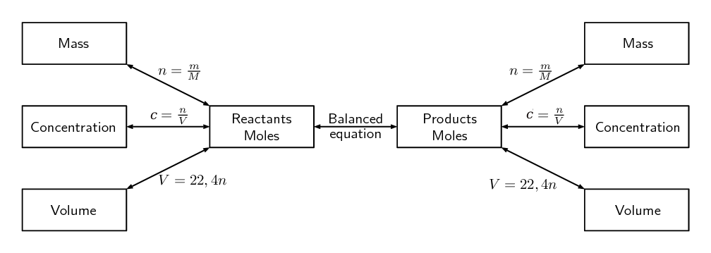

## 8.2 Stoichiometric calculations (ESBP8)

In grade 10 you learnt how to write balanced chemical equations and started looking at stoichiometric
            calculations. By knowing the ratios of substances in a reaction, it is possible to use stoichiometry to
            calculate the amount of either reactants or products that are involved in the reaction.

The following figure highlights the relation between the balanced chemical equation and the number of moles:

Figure 8.1: Stoichiometric flow diagram

In grade 10 we explored some of the concepts of stoichiometry. We looked at how to calculate the number of
            moles of a substance and how to find the molar mass. We also looked at how to find the molecular and
            empirical formulae of substances. Now we will explore more of these concepts such as limiting reagents,
            percent purity and percent yield.

<QuizCard id="s11-08-02a" title="Interactive Exercise 8.6" question="What is the molar ratio of BeO to Be ? Do not simplify this ratio!" options=[] answer="
                        2
                    ,
                        2
                    " hint="You should enter a number here. If you want to, you can use a space to separate thousands.                Example: 12 800,25 For scientific notation you need to use the multiply symbol                ( ∗ ) and the exponent symbol ( ^ ). For example 6,673 × 10 −11 should be written as: 6,673 ∗ 10^−11" explanation="Work out the molar ratio The molar ratio is determined by looking at the numbers in front of each compound in the balanced chemical equation. These numbers are called stoichiometric coefficients or balancing coefficients . We look at the balanced chemical equation and find that the number in front of BeO is \(\text{2}\) and the number in front of Be is \(\text{2}\) . Recall that we were instructed not to simplify the ratio. Therefore the molar ratio of BeO to Be is \(\text{2}\) : \(\text{2}\) . Submit your answer as: and" />

### Limiting reagents (ESBP9)

## What is a limiting reagent?

For this activity you will need A4 sheets of paper in white, red, blue, yellow, green and pink. (or
                    you can use several sheets of white paper and colour them using kokis or crayons).

Tear the white sheet into five pieces, the red sheet into ten pieces, the blue sheet into eight
                    pieces, the yellow sheet into seven pieces, the green sheet into nine pieces and the pink piece into
                    four pieces.

2. Stick two red pieces to each white piece. Do you have any red or white pieces left?
4. Stick one yellow piece to each blue piece. Do you have any yellow or blue pieces left?
6. Stick three green pieces to each pink piece. Do you have any green or pink pieces left?

You should find that you had no red or white pieces left. For the blue and yellow pieces you should
                    have one blue piece left. And for the green and pink pieces you should have had one pink piece left.

We say that the pink and blue pieces were in excess while the green and yellow sheets were limiting.
                    In other words you would have had to tear the green and yellow sheets into **more**
                    pieces or you would have had to tear the blue and pink pieces into **less** pieces.

In the above activity we could solve the problem of having too many or too few pieces of paper by simply
                tearing the pieces of paper into more pieces. In chemistry we also encounter this problem when mixing
                different substances. Often we will find that we added too much or too little of a particular substance.
                It is important to know that this happens and to know how much (i.e. the quantities) of different
                reactants are used in the reaction. This knowledge is used in industrial reactions.

Limiting reagent
A limiting reagent (or reactant) is a reagent that is completely used up in a chemical reaction.

Excess reagent
An excess reagent (or reactant) is a reagent that is not completely used up in a chemical reaction.

<Callout type="note" title="Note">
[Simulation:
                        23XN](http://phet.colorado.edu/en/simulation/reactants-products-and-leftovers)
</Callout>

<Callout type="tip" title="Worked example 7: Limiting reagents">
**Question:**
Sulfuric acid (\(\text{H}_{2}\text{SO}_{4}\)) reacts with ammonia (\(\text{NH}_{3}\)) to produce
                        the fertiliser ammonium sulfate (\((\text{NH}_{4})_{2}\text{SO}_{4}\)) according to the
                        following equation:

\[\text{H}_{2}\text{SO}_{4}\text{(aq)} + 2\text{NH}_{3}\text{(g)} →
                        \text{(NH}_{4}\text{)}_{2}\text{SO}_{4}\text{(aq)}\]

What is the maximum mass of ammonium sulfate that can be obtained from \(\text{2,0}\)
                        \(\text{kg}\) of sulfuric acid and \(\text{1,0}\) \(\text{kg}\) of ammonia?

**Convert the mass of sulfuric acid and ammonia into moles:**
Moles of sulfuric acid:
                        \begin{align*}
                        n & = \frac{m}{M}\\
                        & = \frac{\text{2 000}}{\text{98,12}} \\
                        & = \text{20,38}\text{ mol}
                        \end{align*}

Moles of ammonia:
                        \begin{align*}
                        n & = \frac{m}{M}\\
                        & = \frac{\text{1 000}}{\text{17,03}} \\
                        & = \text{58,72}\text{ mol}
                        \end{align*}

**Use the balanced equation to determine which of the reactants is limiting.:**
We need to look at how many moles of product we can get from each reactant. Then we compare these
                        two results. The smaller number is the amount of product that we can produce and the reactant
                        that gives the smaller number, is the limiting reagent.

The mole ratio of \(\text{H}_{2}\text{SO}_{4}\) to \((\text{NH}_{4})_{2}\text{SO}_{4}\) is
                        \(1:1\). So the number of moles of \((\text{NH}_{4})_{2}\text{SO}_{4}\) that can be produced
                        from the sulfuric acid is:
                        \begin{align*}
                        n_{\text{(NH}_{4}\text{)}_{2}\text{SO}_{4}} & = n_{\text{H}_{2}\text{SO}_{4}} \times
                        \frac{\text{stoichiometric coefficient (NH}_{4}\text{)}_{2}\text{SO}_{4}}{
                        \text{stoichiometric coefficient H}_{2}\text{SO}_{4}}\\
                        & = \text{20,38}\text{ mol} \text{ H}_{2}\text{SO}_{4} \times \frac{\text{1}\text{ mol}
                        \text{ (NH}_{4}\text{)}_{2}\text{SO}_{4}}{\text{1}\text{ mol} \text{ H}_{2}\text{SO}_{4}}\\
                        & = \text{20,38}\text{ mol} \text{ (NH}_{4}\text{)}_{2}\text{SO}_{4}
                        \end{align*}

The mole ratio of \(\text{NH}_{3}\) to \((\text{NH}_{4})_{2}\text{SO}_{4}\) is \(2:1\). So the
                        number of moles of \((\text{NH}_{4})_{2}\text{SO}_{4}\) that can be produced from the ammonia
                        is:
                        \begin{align*}
                        n_{\text{(NH}_{4}\text{)}_{2}\text{SO}_{4}} & = n_{\text{NH}_{3}} \times
                        \frac{\text{stoichiometric coefficient (NH}_{4}\text{)}_{2}\text{SO}_{4}}{
                        \text{stoichiometric coefficient NH}_{3}}\\
                        & = \text{58,72}\text{ mol} \text{ NH}_{3} \times \frac{\text{1}\text{ mol} \text{
                        (NH}_{4}\text{)}_{2}\text{SO}_{4}}{\text{2}\text{ mol} \text{ NH}_{3}}\\
                        & = \text{29,36}\text{ mol} \text{ (NH}_{4}\text{)}_{2}\text{SO}_{4}
                        \end{align*}

Since we get less \((\text{NH}_{4})_{2}\text{SO}_{4}\) from \(\text{H}_{2}\text{SO}_{4}\) than is
                        produced from \(\text{NH}_{3}\), the sulfuric acid is the limiting reactant.

**Calculate the maximum mass of ammonium sulfate that can be produced:**
From the step above we saw that we have \(\text{20,38}\) \(\text{mol}\) of
                        \((\text{NH}_{4})_{2}\text{SO}_{4}\).

The maximum mass of ammonium sulfate that can be produced is calculated as follows:

\begin{align*}
                        m & = nM\\
                        & = (\text{20,38})(\text{132,18}) \\
                        & = \text{2 693,8}\text{ g}\\
                        & = \text{2,6938}\text{ kg}
                        \end{align*}

The maximum mass of ammonium sulfate that can be produced is \(\text{2,694}\) \(\text{kg}\).
</Callout>

### Textbook Exercise 8.3

**Problem:**
When an electrical current is passed through a sodium chloride solution, sodium hydroxide
                                can be produced according to the following equation:

\[2\text{NaCl(aq)} + 2\text{H}_{2}\text{O(ℓ)} → \text{Cl}_{2}\text{(g)} +
                                \text{H}_{2}\text{(g)} + 2\text{NaOH(aq)}\]

What is the maximum mass of sodium hydroxide that can be obtained from \(\text{4,0}\)
                                \(\text{kg}\) of sodium chloride and \(\text{3,0}\) \(\text{kg}\) of water?

**Solution:**
Moles of sodium chloride:
                                \begin{align*}
                                M_{\text{NaCl}} &= \text{23} + \text{35,45} \\
                                &= \text{58,45 g·mol$^{-1}$}
                                \end{align*}
                                \begin{align*}
                                n & = \frac{m}{M}\\
                                & = \frac{\text{4 000}}{\text{58,45}} \\
                                & = \text{68,434}\ldots\text{ mol}
                                \end{align*}

Moles of water:
                                \begin{align*}
                                M_{\text{H}_{2}\text{O}} &= \text{1,01} \times \text{2} + \text{16} \\
                                &= \text{18,02 g·mol$^{-1}$}
                                \end{align*}
                                \begin{align*}
                                n & = \frac{m}{M}\\
                                & = \frac{\text{3 000}}{\text{18,02}} \\
                                & = \text{166,481}\ldots\text{ mol}
                                \end{align*}

Now we look at the number of moles of product that each reactant can form.

The mole ratio of \(\text{H}_{2}\text{O}\) to \(\text{NaOH}\) is \(2:2\). So the number
                                of moles of \(\text{NaOH}\) that can be produced from the available water is:
                                \begin{align*}
                                n_{\text{NaOH}} & = n_{\text{H}_{2}\text{O}} \times \frac{
                                \text{stoichiometric coefficient NaOH}}{
                                \text{stoichiometric coefficient H}_{2}\text{O}}\\
                                & = \text{166,481}\ldots\text{ mol} \text{ H}_{2}\text{O} \times
                                \frac{\text{2}\text{ mol }
                                \text{NaOH}}{\text{2}\text{ mol } \text{ H}_{2}\text{O}}\\
                                & = \text{166,481}\ldots\text{ mol } \text{NaOH}
                                \end{align*}

The mole ratio of \(\text{NaCl}\) to \(\text{NaOH}\) is also \(2:2\) (or \(1:1\)). So the
                                number of moles of \(\text{NaOH}\) that can be produced from the available sodium
                                chloride is:
                                \begin{align*}
                                n_{\text{NaOH}} & = n_{\text{NaCl}} \times \frac{
                                \text{stoichiometric coefficient NaOH}}{\text{stoichiometric coefficient NaCl}}\\
                                & = \text{68,434}\ldots\text{ mol } \text{NaCl} \times \frac{\text{2}\text{ mol }
                                \text{NaOH}}{\text{2}\text{ mol } \text{ NaCl}}\\
                                & = \text{68,434}\ldots\text{ mol } \text{NaOH}
                                \end{align*}

Since the available \(\text{NaCl}\) can produce less \(\text{NaOH}\) than the available
                                \(\text{H}_{2}\text{O}\), the sodium chloride is the limiting reagent.

We have \(\text{68,434}\ldots\) \(\text{mol}\) of \(\text{NaOH}\).

The maximum mass of sodium hydroxide that can be produced is calculated as follows:

                            \begin{align*}
                            M_{\text{NaOH}} &= \text{23} + \text{16} + \text{1,01} \\
                            &= \text{40,01 g·mol$^{-1}$}
                            \end{align*}

\begin{align*}
                                m & = nM\\
                                & = (\text{68,434}\ldots)(\text{40,01}) \\
                                & = \text{2 738,066}\ldots\text{ g}\\
                                & = \text{2,7380}\ldots\text{ kg}
                                \end{align*}

The maximum amount of sodium hydroxide that can be produced is \(\text{2,74}\)
                                \(\text{kg}\).

### Percent yield (ESBPB)

The percent yield of a reaction is very important as it tells us how efficient a reaction is. A reaction
                that has a low percent yield is not very useful in industry. If you are making a new medicine or
                pesticide and your reaction has a low percent yield then you would search for a different way of doing
                the reaction. This reduces the amount of (often very expensive) chemicals that you use and reduces
                waste.

The percent yield can be calculated using:
                \begin{align*}
                \% \text{yield} = \frac{\text{actual yield}}{\text{theoretical yield}} \times 100
                \end{align*}
                where the actual yield is the amount of product that is produced when you carry out the reaction and the
                theoretical yield is the amount of product that you calculate for the reaction using stoichiometric
                methods.

<Callout type="tip" title="Worked example 8: Percent yield">
**Question:**
Sulfuric acid (\(\text{H}_{2}\text{SO}_{4}\)) reacts with ammonia (\(\text{NH}_{3}\)) to produce
                        the fertiliser ammonium sulfate (\((\text{NH}_{4})_{2}\text{SO}_{4}\)) according to the
                        following equation:

\[\text{H}_{2}\text{SO}_{4}\text{(aq)} + 2\text{NH}_{3}\text{(g)} →
                        \text{(NH}_{4}\text{)}_{2}\text{SO}_{4}\text{(aq)}\]

A factory worker carries out the above reaction (using \(\text{2,0}\) \(\text{kg}\) of sulfuric
                        acid and \(\text{1,0}\) \(\text{kg}\) of ammonia) and gets \(\text{2,5}\) \(\text{kg}\) of
                        ammonium sulfate. What is the percentage yield of the reaction?

**Determine which is the limiting reagent:**
We determined the limiting reagent for this reaction with the same amounts of reactants in the
                        previous worked example, so we will just use the result from there.

Sulfuric acid is the limiting reagent. The number of moles of ammonium sulfate that can be
                        produced is \(\text{20,38}\) \(\text{mol}\).

**Calculate the theoretical yield of ammonium sulphate:**
From the previous worked example we found the maximum mass of ammonium sulfate that could be
                        produced.

The theoretical yield (or maximum mass) of ammonium sulfate that can be produced is
                        \(\text{2,694}\) \(\text{kg}\).

**Calculate the percentage yield:**
\begin{align*}
                        \% \text{yield} &= \frac{\text{actual yield}}{\text{theoretical yield}} \times \text{100}\\
                        & = \frac{\text{2,5}}{\text{2,694}}(\text{100})\\
                        & = \text{92,8} \%
                        \end{align*}

This reaction has a high percent yield and so would therefore be a useful reaction to use in
                        industry.
</Callout>

### Textbook Exercise 8.4

**Problem:**
When an electrical current is passed through a sodium chloride solution, sodium hydroxide
                                can be produced according to the following equation:

\[2\text{NaCl} + 2\text{H}_{2}\text{O} → \text{Cl}_{2} + \text{H}_{2} +
                                2\text{NaOH}\]

A chemist carries out the above reaction using \(\text{4,0}\) \(\text{kg}\) of sodium
                                chloride and \(\text{3,0}\) \(\text{kg}\) of water. The chemist finds that they get
                                \(\text{1,8}\) \(\text{kg}\) of sodium hydroxide. What is the percentage yield?

**Solution:**
Moles of sodium chloride:
                                \begin{align*}
                                M_{\text{NaCl}} &= \text{23} + \text{35,45} \\
                                &= \text{58,45 g·mol$^{-1}$}
                                \end{align*}
                                \begin{align*}
                                n & = \frac{m}{M}\\
                                & = \frac{\text{4 000}}{\text{58,45}} \\
                                & = \text{68,434}\ldots\text{ mol}
                                \end{align*}

Moles of water:
                                \begin{align*}
                                M_{\text{H}_{2}\text{O}} &= \text{1,01} \times \text{2} + \text{16} \\
                                &= \text{18,02 g·mol$^{-1}$}
                                \end{align*}
                                \begin{align*}
                                n & = \frac{m}{M}\\
                                & = \frac{\text{3 000}}{\text{18,02}} \\
                                & = \text{166,481}\ldots\text{ mol}
                                \end{align*}

Now we look at the number of moles of product that each reactant can form.

The mole ratio of \(\text{H}_{2}\text{O}\) to \(\text{NaOH}\) is \(2:2\). So the number
                                of moles of \(\text{NaOH}\) that can be produced from the available water is:
                                \begin{align*}
                                n_{\text{NaOH}} & = n_{\text{H}_{2}\text{O}} \times \frac{
                                \text{stoichiometric coefficient NaOH}}{
                                \text{stoichiometric coefficient H}_{2}\text{O}}\\
                                & = \text{166,481}\ldots\text{ mol} \text{ H}_{2}\text{O} \times
                                \frac{\text{2}\text{ mol }
                                \text{NaOH}}{\text{2}\text{ mol } \text{ H}_{2}\text{O}}\\
                                & = \text{166,481}\ldots\text{ mol } \text{NaOH}
                                \end{align*}

The mole ratio of \(\text{NaCl}\) to \(\text{NaOH}\) is also \(2:2\) (or \(1:1\)). So the
                                number of moles of \(\text{NaOH}\) that can be produced from the available sodium
                                chloride is:
                                \begin{align*}
                                n_{\text{NaOH}} & = n_{\text{NaCl}} \times \frac{
                                \text{stoichiometric coefficient NaOH}}{\text{stoichiometric coefficient NaCl}}\\
                                & = \text{68,434}\ldots\text{ mol } \text{NaCl} \times \frac{\text{2}\text{ mol }
                                \text{NaOH}}{\text{2}\text{ mol } \text{ NaCl}}\\
                                & = \text{68,434}\ldots\text{ mol } \text{NaOH}
                                \end{align*}

Since the available \(\text{NaCl}\) can produce less \(\text{NaOH}\) than the available
                                \(\text{H}_{2}\text{O}\), the sodium chloride is the limiting reagent.

We have \(\text{68,434}\ldots\) \(\text{mol}\) of \(\text{NaOH}\).

The maximum mass of sodium hydroxide that can be produced is calculated as follows:

                            \begin{align*}
                            M_{\text{NaOH}} &= \text{23} + \text{16} + \text{1,01} \\
                            &= \text{40,01 g·mol$^{-1}$}
                            \end{align*}

\begin{align*}
                                m & = nM\\
                                & = (\text{68,434}\ldots)(\text{40,01}) \\
                                & = \text{2 738,066}\ldots\text{ g}\\
                                & = \text{2,7380}\ldots\text{ kg}
                                \end{align*}

The percent yield is:

                            \begin{align*}
                            \% \text{yield} &= \frac{\text{actual yield}}{\text{theoretical yield}} \times
                            \text{100}\\
                            & = \frac{\text{1,8}}{\text{2,7380}\ldots}(\text{100})\\
                            & = \text{65,74}\%
                            \end{align*}

### Molecular and empirical formulae (ESBPC)

Molecular and empirical formulae were introduced in grade 10. The empirical formula is the simplest
                formula of a compound (and represents the ratio of atoms of each element in a compound). The molecular
                formula is the full formula of the compound (and represents the total number of atoms of each element in
                a compound). You should also recall from grade 10 the percent composition of a substance. This is the
                percentage by molecular mass that each element contributes to the overall formula. For example water
                (\(\text{H}_{2}\text{O}\)) has the following percentage composition: \(\text{89}\%\) oxygen and
                \(\text{11}\%\) hydrogen.

<Callout type="tip" title="Worked example 9: Empirical and molecular formula">
**Question:**
Vinegar, which is used in our homes, is a dilute form of acetic acid. A sample of acetic acid has
                        the following percentage composition: \(\text{39,9}\%\) carbon, \(\text{6,7}\%\) hydrogen and
                        \(\text{53,4}\%\) oxygen.

2. Determine the empirical formula of acetic acid.
4. Determine the molecular formula of acetic acid if the molar mass of acetic acid is
                                   \(\text{60,06}\) \(\text{g·mol$^{-1}$}\).

**Find the mass:**
In \(\text{100}\) \(\text{g}\) of acetic acid, there is: \(\text{39,9}\) \(\text{g}\)
                        \(\text{C}\), \(\text{6,7}\) \(\text{g}\) \(\text{H}\) and \(\text{53,4}\) \(\text{g}\)
                        \(\text{O}\).

**Find the moles:**
\(n = \frac{m}{M}\)

\begin{align*}
                        n_{\text{C}} & = \frac{\text{39,9}}{\text{12}} = \text{3,325}\text{ mol}\\
                        n_{\text{H}} & = \frac{\text{6,7}}{\text{1,01}} = \text{6,6337}\text{ mol}\\
                        n_{\text{O}} & = \frac{\text{53,4}}{\text{16}} = \text{3,3375}\text{ mol}
                        \end{align*}

**Find the empirical formula:**
To find the empirical formula we first note how many moles of each element we have. Then we
                        divide the moles of each element by the smallest of these numbers, to get the ratios of the
                        elements. This ratio is rounded off to the nearest whole number.

| \(\text{C}\) | \(\text{H}\) | \(\text{O}\) |
| --- | --- | --- |
| \(\text{3,325}\) | \(\text{6,6337}\) | \(\text{3,3375}\) |
| \(\dfrac{\text{3,325}}{\text{3,325}}\) | \(\dfrac{\text{6,6337}}{\text{3,325}}\) | \(\dfrac{\text{3,3375}}{\text{3,325}}\) |
| 1 | 2 | 1 |

The empirical formula is \(\text{CH}_{2}\text{O}\).

**Find the molecular formula:**
The molar mass of acetic acid using the empirical formula (\(\text{CH}_{2}\text{O}\)) is
                        \(\text{30,02}\) \(\text{g·mol$^{-1}$}\). However the question gives the molar mass as
                        \(\text{60,06}\) \(\text{g·mol$^{-1}$}\). Therefore the actual number of moles of each
                        element must be double what it is in the empirical formula
                        \(\left(\dfrac{\text{60,06}}{\text{30,02}}
                        = \text{2}\right)\).
                        The molecular formula is therefore \(\text{C}_{2}\text{H}_{4}\text{O}_{2}\) or
                        \(\text{CH}_{3}\text{COOH}\)
</Callout>

### Textbook Exercise 8.5

**Problem:**
A sample of oxalic acid has the following percentage composition: \(\text{26,7}\%\)
                                carbon, \(\text{2,2}\%\) hydrogen and \(\text{71,1}\%\) oxygen.

Determine the molecular formula of oxalic acid if the molar mass of oxalic acid is
                                \(\text{90}\) \(\text{g·mol$^{-1}$}\).

**Solution:**
In \(\text{100}\) \(\text{g}\) of oxalic acid, there is: \(\text{26,7}\) \(\text{g}\)
                                \(\text{C}\), \(\text{2,2}\) \(\text{g}\) \(\text{H}\) and \(\text{71,1}\) \(\text{g}\)
                                \(\text{O}\).

\(n = \frac{m}{M}\)

\begin{align*}
                                n_{\text{C}} & = \frac{\text{26,7}}{\text{12}} = \text{2,225}\text{ mol}\\
                                n_{\text{H}} & = \frac{\text{2,2}}{\text{1,01}} = \text{2,18}\text{ mol}\\
                                n_{\text{O}} & = \frac{\text{71,1}}{\text{16}} = \text{4,44}\text{ mol}
                                \end{align*}

To find the empirical formula we first note how many moles of each element we have. Then
                                we divide by the smallest number to get the ratios of each element. This ratio is
                                rounded off to the nearest whole number.

| \(\text{C}\) | \(\text{H}\) | \(\text{O}\) |
| --- | --- | --- |
| \(\text{2,225}\) | \(\text{2,18}\) | \(\text{4,44}\) |
| \(\dfrac{\text{2,225}}{\text{2,18}}\) | \(\dfrac{\text{2,18}}{\text{2,18}}\) | \(\dfrac{\text{4,44}}{\text{2,18}}\) |
| 1 | 1 | 2 |

The empirical formula is \(\text{CHO}_{2}\).

The molar mass of oxalic acid using the empirical formula is \(\text{45}\)
                                \(\text{g·mol$^{-1}$}\). However the question gives the molar mass as \(\text{90}\)
                                \(\text{g·mol$^{-1}$}\). Therefore the actual number of moles of each element must
                                be double what it is in the empirical formula \(\left(\dfrac{\text{90}}{\text{45}} =
                                \text{2}\right)\). The molecular formula is therefore
                                \(\text{C}_{2}\text{H}_{2}\text{O}_{4}\).

### Percent purity (ESBPD)

The final use of stoichiometric calculations that we will look at is to determine the percent purity of a
                sample. Percent purity is important since when you make a compound you may have a small amount of
                impurity in the sample and you would need to keep this below a certain level. Or you may need to know
                how much of a particular ion is dissolved in water to determine if it is below the legally allowed
                level.

Percent purity can be calculated using:
                \[\% \text{purity} = \frac{\text{mass of compound}}{\text{mass of sample}} \times 100\]

<Callout type="tip" title="Worked example 10: Percent purity">
**Question:**
Shells contain calcium carbonate (\(\text{CaCO}_{3}\)) as well as other minerals. Faarah wants to
                        know how much calcium carbonate is in a shell. She finds that the shell weighs \(\text{5}\)
                        \(\text{g}\). After performing some more experiments she finds that the mass of calcium
                        carbonate and the crucible (a container that is used to heat compounds in) is \(\text{3,2}\)
                        \(\text{g}\). The mass of the crucible is \(\text{0,5}\) \(\text{g}\). How much calcium
                        carbonate is in the shell?

**Write down an equation for percent purity:**
Percent purity is given by:
                        \[\% \text{purity} = \frac{\text{mass of compound}}{\text{mass of sample}} \times 100\]

**Find the mass of the product:**
We are given the mass of the crucible and the mass of the crucible with the product. We need to
                        subtract the mass of the crucible from the mass of the crucible with the product to obtain only
                        the mass of the product.
                        \begin{align*}
                        \text{Mass product} & = \text{3,2}\text{ g} - \text{0,5}\text{ g} \\
                        & = \text{2,7}\text{ g}
                        \end{align*}

**Calculate the answer.:**
Substituting the calculated mass into the equation for percent purity gives:
                        \begin{align*}
                        \% \text{purity} &= \frac{\text{mass of compound}}{\text{mass of sample}} \times 100\\
                        & = \frac{\text{2,7}}{\text{5}} (\text{100})\\
                        & = \text{54}\%
                        \end{align*}
</Callout>

<Callout type="tip" title="Worked example 11: Percent purity">
**Question:**
Limestone is mostly calcium carbonate (\(\text{CaCO}_{3}\)). Jake wants to know how much calcium
                        carbonate is in a sample of limestone. He finds that the sample weighs \(\text{3,5}\)
                        \(\text{g}\). He then adds concentrated hydrochloric acid (\(\text{HCl}\)) to the sample. The
                        equation for this reaction is:
                        \begin{align*}
                        \text{CaCO}_{3}\text{(s)} + 2\text{HCl (aq)} \rightarrow \text{CO}_{2}\text{(g)} +
                        \text{CaCl}_{2}\text{(aq)} + \text{H}_{2}\text{O (l)}
                        \end{align*}

If the mass of calcium chloride produced is \(\text{3,6}\) \(\text{g}\), what is the percent
                        purity of the limestone sample?

**Calculate the number of moles of calcium chloride:**
The number of moles of calcium chloride is:
                        \begin{align*}
                        n & = \frac{m}{M} \\
                        & = \frac{\text{3,6}}{\text{111}} \\
                        & = \text{0,03243}\ldots\text{ mol}
                        \end{align*}

**Calculate the number of moles of calcium carbonate:**
The molar ratio of calcium chloride to calcium carbonate is 1:1. Therefore the number of moles of
                        calcium carbonate is \(\text{0,032}\) \(\text{mol}\).

**Calculate the mass of calcium carbonate:**
The mass of calcium carbonate is:
                        \begin{align*}
                        m & = nM \\
                        & = (\text{0,03243}\ldots)(\text{100}) \\
                        m & = \text{3,243}\ldots\text{ g}
                        \end{align*}

**Calculate the percent purity:**
Substituting the calculated mass into the equation for percent purity gives:
                        \begin{align*}
                        \% \text{purity} &= \frac{\text{mass of compound}}{\text{mass of sample}} \times 100\\
                        & = \frac{\text{3,243}\ldots}{\text{3,5}} \times (100)\\
                        & \approx \text{92,66}\%
                        \end{align*}
</Callout>

### Textbook Exercise 8.6

**Problem:**
Hematite contains iron oxide (\(\text{Fe}_{2}\text{O}_{3}\)) as well as other compounds.
                                Thembile wants to know how much iron oxide is in a sample of hematite. He finds that the
                                sample of hematite weighs \(\text{6,2}\) \(\text{g}\). After performing some experiments
                                he finds that the mass of iron oxide and the crucible (a container that is used to heat
                                compounds in) is \(\text{4,8}\) \(\text{g}\). The mass of the crucible is \(\text{0,5}\)
                                \(\text{g}\). How much iron oxide is in the sample of hematite?

**Solution:**
Percent purity is given by:

                            \[\% \text{purity} = \frac{\text{mass of compound}}{\text{mass of sample}} \times 100\]

We are given the mass of the product and the mass of the crucible. We need to subtract
                                the mass of the crucible from this to obtain just the mass of the product.

                            \begin{align*}
                            \text{Mass product} & = \text{4,8}\text{ g} - \text{0,5}\text{ g} \\
                            & = \text{4,3}\text{ g}
                            \end{align*}

Substituting the calculated mass into the equation for percent purity gives:

                            \begin{align*}
                            \% \text{purity} &= \frac{\text{mass of compound}}{\text{mass of sample}} \times 100\\
                            & = \frac{\text{4,3}}{\text{6,2}} (\text{100})\\
                            & = \text{69}\%
                            \end{align*}

This chapter includes a recommended experiment for informal assessment. It is recommended that you do
                this experiment as a demonstration for your class. In this experiment you will show your learners what
                happens when a small sample (about \(\text{0,5}\) \(\text{g}\)) of lead(II) nitrate is heated. You must
                work outside or in a well ventilated space and remember that lead(II) nitrate makes a crackling sound on
                heating.

A second experiment to determine the percent yield of magnesium carbonate from magnesium sulfate (Epsom
                salts) and sodium carbonate (washing soda) has also been included. You will need magnesium sulfate,
                sodium carbonate, mass meter, hot plate or Bunsen burner, small heat resistant beakers, funnel and
                filter paper. If time and space permits, learners can write their names on their pieces of filter paper
                before filtering and leave these in an undisturbed place (such as a back room) overnight to dry before
                weighing them. If this cannot be done remind learners that due to their samples containing some water
                the sample may not be completely dry when weighing. This makes it slightly harder to take a mass reading
                and may lead to a percent yield of greater than \(\text{100}\%\).

When working with a Bunsen burner you must ensure that the room is well ventilated by opening all
                windows. Also ensure that learners tie long hair up and tuck in any loose clothing.

<Callout type="note" title="Note">
<VideoPlayer src="https://youtu.be/csEnz9ZsAFM" title="Video: 23XT" />
</Callout>

## The thermal decomposition of lead(II) nitrate

### Aim

To observe what happens when lead(II) nitrate is heated.

### Apparatus

- Bunsen burner
- Test tube (glass)
- Test tube holder
- \(\text{0,5}\) \(\text{g}\) lead(II) nitrate

### Method

<Callout type="warning" title="Note">
Lead(II) nitrate produces toxic nitrogen dioxide on heating.
</Callout>

2. Place the lead(II) nitrate sample in the test tube.
4. Light the Bunsen burner and carefully hold the test tube in the flame. Remember to point the
                           mouth of the test tube away from you.
6. Observe what happens.

### Results

A crackling noise is heard on heating the sample and a small amount of a brownish coloured gas is
                    noted. The white powder became yellow.

If a glowing splint is held at the mouth of the test tube the splint reignites.

The balanced chemical for this reaction is:

                \begin{align*}
                2\text{Pb(NO}_{3}\text{)}_{2}\text{(s)} + \text{ heat } \rightarrow 2\text{PbO (s)} + 4\text{NO}_{2}
                \text{(g)} + \text{O}_{2}\text{(g)}
                \end{align*}

## Stoichiometry

### Aim

To determine the percentage yield of magnesium carbonate from magnesium sulfate and sodium carbonate.

### Apparatus

- magnesium sulfate (Epsom salts)
- sodium carbonate
- mass meter
- hot plate
- small glass beakers (heat resistant)
- funnel
- filter paper

### Method

2. Weigh out \(\text{5}\) \(\text{g}\) of magnesium sulfate.
4. Dissolve the magnesium sulfate in \(\text{20}\) \(\text{ml}\) of water. Heat the solution
                               until all the solid dissolves.
6. Dissolve \(\text{5}\) \(\text{g}\) of sodium carbonate in \(\text{20}\) \(\text{ml}\) of warm
                               water. If necessary heat the solution to dissolve all the sodium carbonate.
8. Carefully pour the sodium carbonate solution into the hot magnesium sulfate solution. You
                               should have a milky looking solution.
10. Weigh the filter paper (if your mass meter is not very accurate then assume the mass of the
                               filter paper is \(\text{0}\)). Carefully filter the final solution.
12. Leave the filter paper to dry slightly (or overnight) and then weigh it. The solid that stays
                               on the filter paper is magnesium carbonate.

### Results

The equation for this reaction is:

\[\text{MgSO}_{4}\text{(aq)} +
                    \text{Na}_{2}\text{CO}_{3}\text{(aq)} \rightarrow \text{Na}_{2}\text{SO}_{4}\text{(aq)} +
                    \text{MgCO}_{3}\text{(s)} + \text{H}_{2}\text{O(ℓ)}\]

Use the above equation to work out the percentage yield of the magnesium sulfate. Remember that you
                    need to determine which of the reactants is limiting. (You may get a percentage yield of greater
                    than \(\text{100}\%\) if your sample is not completely dry.)

### Conclusion

By performing an experiment we were able to calculate the percentage yield of a reaction.

## Stoichiometry

### Textbook Exercise 8.7

**Problem:**
Given the following reaction:

                        \[3\text{Fe}_{2}\text{O}_{3}\text{(s)} + \text{CO(g)} →
                        2\text{Fe}_{2}\text{O}_{4}\text{(s)} + \text{CO}_{2}\text{(g)}\]

If \(\text{2,3}\) \(\text{kg}\) of \(\text{Fe}_{2}\text{O}_{3}\) and \(\text{1,7}\)
                            \(\text{kg}\) of \(\text{CO}\) is used, what is the maximum mass of
                            \(\text{Fe}_{2}\text{O}_{4}\) that can be produced?

**Solution:**
Moles of \(\text{Fe}_{2}\text{O}_{3}\) (the molar mass of iron is \(\text{55,8}\)
                            \(\text{g·mol$^{-1}$}\)):
                            \begin{align*}
                            n & = \frac{m}{M}\\
                            & = \frac{\text{2 300}}{\text{159,6}} \\
                            & = \text{14,411}\text{ mol}
                            \end{align*}

Moles of carbon monoxide:
                            \begin{align*}
                            n & = \frac{m}{M}\\
                            & = \frac{\text{1 700}}{\text{28}} \\
                            & = \text{60,714}\text{ mol}
                            \end{align*}

Now we look at the number of moles of product that each reactant can form.

The mole ratio of \(\text{Fe}_{2}\text{O}_{3}\) to \(\text{Fe}_{2}\text{O}_{4}\) is \(3:2\).
                            So the number of moles of \(\text{Fe}_{2}\text{O}_{4}\) that can be produced from the
                            available
                            \(\text{Fe}_{2}\text{O}_{3}\) is:
                            \begin{align*}
                            n_{\text{Fe}_{2}\text{O}_{4}} & = n_{\text{Fe}_{2}\text{O}_{4}} \times
                            \frac{\text{stoichiometric coefficient Fe}_{2}\text{O}_{4}}{
                            \text{stoichiometric coefficient Fe}_{2}\text{O}_{4}}\\
                            & = \text{14,411}\text{ mol} \text{ Fe}_{2}\text{O}_{3} \times \frac{\text{2}\text{ mol
                            }
                            \text{Fe}_{2}\text{O}_{4}}{\text{3}\text{ mol} \text{ Fe}_{2}\text{O}_{3}}\\
                            & = \text{9,607}\text{ mol } \text{Fe}_{2}\text{O}_{4}
                            \end{align*}

The mole ratio of \(\text{CO}\) to \(\text{Fe}_{2}\text{O}_{4}\) is or \(1:2\). So the number
                            of moles of \(\text{Fe}_{2}\text{O}_{3}\) that can be produced from the available carbon
                            monoxide is:
                            \begin{align*}
                            n_{\text{Fe}_{2}\text{O}_{4}} & = n_{\text{CO}} \times \frac{
                            \text{stoichiometric coefficient Fe}_{2}\text{O}}{\text{stoichiometric coefficient CO}}\\
                            & = \text{60,714}\text{ mol } \text{CO} \times \frac{\text{2}\text{ mol}
                            \text{Fe}_{2}\text{O}_{4}}{\text{1}\text{ mol} \text{ CO}}\\
                            & = \text{121,428}\text{ mol } \text{Fe}_{2}\text{O}_{4}
                            \end{align*}

Since the available \(\text{Fe}_{2}\text{O}_{3}\) can produce less
                            \(\text{Fe}_{2}\text{O}_{4}\) than
                            the available \(\text{CO}\), the \(\text{Fe}_{2}\text{O}_{3}\) is the limiting reagent.

We have \(\text{9,607}\) \(\text{mol}\) of \(\text{Fe}_{2}\text{O}_{4}\).

The maximum mass of \(\text{Fe}_{2}\text{O}_{4}\) that can be produced is calculated as
                            follows:

\begin{align*}
                            m & = nM\\
                            & = (\text{9,607})(\text{175,6}) \\
                            & = \text{1 686,989}\text{ g}\\
                            & = \text{1,687}\text{ kg}
                            \end{align*}

The maximum amount (theoretical yield) of \(\text{Fe}_{2}\text{O}_{4}\) that can be produced
                            is \(\text{1,687}\) \(\text{kg}\).

**Problem:**
Sodium nitrate decomposes on heating to produce sodium nitrite and oxygen according to the
                            following equation:

                        \[2\text{NaNO}_{3}\text{(s)} → 2\text{NaNO}_{2}\text{(s)} + \text{O}_{2}\text{(g)}\]

Nombusa carries out the above reaction using \(\text{50}\) \(\text{g}\) of sodium nitrate.
                            Nombusa finds that they get \(\text{36}\) \(\text{g}\) of sodium nitrite. What is the
                            percentage yield?

**Solution:**
There is only one reactant and so we do not need to find the limiting reagent.

We find the number of moles of sodium nitrate:
                            \begin{align*}
                            n & = \frac{m}{M}\\
                            & = \frac{\text{50}}{\text{85}} \\
                            & = \text{0,588}\text{ mol}
                            \end{align*}

Now we find the number of moles of sodium nitrite.

The mole ratio of \(\text{NaNO}_{3}\) to \(\text{NaNO}_{2}\) is \(2:2\) (or \(1:1\)). So the
                            number of moles of \(\text{NaNO}_{2}\) is also \(\text{0,588}\) \(\text{mol}\).

The maximum mass of sodium nitrite that can be produced is:

\begin{align*}
                            m & = nM\\
                            & = (\text{0,588})(\text{69}) \\
                            & = \text{40,588}\text{ g}
                            \end{align*}

The maximum amount (theoretical yield) of sodium nitrite that can be produced is
                            \(\text{40,588}\) \(\text{g}\).

The percent yield is:

                        \begin{align*}
                        \% \text{yield} &= \frac{\text{actual yield}}{\text{theoretical yield}} \times \text{100}\\
                        & = \frac{\text{36}}{\text{40,588}}(\text{100})\\
                        & = \text{88,69}\%
                        \end{align*}

**Problem:**
Benzene has the following percentage composition: \(\text{92,31}\%\) carbon and
                            \(\text{7,69}\%\) hydrogen

Determine the molecular formula of benzene if the molar mass of benzene is \(\text{78}\)
                            \(\text{g·mol$^{-1}$}\).

**Solution:**
In \(\text{100}\) \(\text{g}\) of benzene, there is: \(\text{92,31}\) \(\text{g}\)
                            \(\text{C}\) and \(\text{7,69}\) \(\text{g}\) \(\text{H}\).

\(n = \frac{m}{M}\)

\begin{align*}
                            n_{\text{C}} & = \frac{\text{92,31}}{\text{12}} = \text{7,6925}\text{ mol}\\
                            n_{\text{H}} & = \frac{\text{7,69}}{\text{1,01}} = \text{7,614}\text{ mol}
                            \end{align*}

We note that the two values are approximately equal.

The empirical formula is \(\text{CH}\).

The molar mass of benzene using the empirical formula is \(\text{13}\)
                            \(\text{g·mol$^{-1}$}\). However the question gives the molar mass as \(\text{78}\)
                            \(\text{g·mol$^{-1}$}\). We divide the given molar mass by the calculated molar mass to
                            find the molecular formula: \(\frac{\text{78}}{\text{13}} = \text{6}\). Therefore the
                            molecular formula is: \(\text{C}_{6}\text{H}_{6}\).

**Problem:**
Cuprite is a minor ore of copper. Cuprite is mainly composed of copper(I) oxide
                            (\(\text{Cu}_{2}\text{O}\)). Jennifer wants to know how much copper oxide is in a sample of
                            cuprite. She has a sample of cuprite that weighs \(\text{7,7}\) \(\text{g}\). She performs
                            some experiments and finds that the mass of iron oxide and crucible (a container that is
                            used to heat compounds in) is \(\text{7,4}\) \(\text{g}\). The mass of the crucible is
                            \(\text{0,2}\) \(\text{g}\). What is the percent purity of the sample of cuprite?

**Solution:**
Percent purity is given by:

                        \[\% \text{purity} = \frac{\text{mass of compound}}{\text{mass of sample}} \times 100\]

We are given the mass of the product and the mass of the crucible. We need to subtract the
                            mass of the crucible from this to obtain just the mass of the product.

                        \begin{align*}
                        \text{Mass product} & = \text{7,4}\text{ g} - \text{0,2}\text{ g} \\
                        & = \text{7,2}\text{ g}
                        \end{align*}

Substituting the calculated mass into the equation for percent purity gives:

                        \begin{align*}
                        \% \text{purity} &= \frac{\text{mass of compound}}{\text{mass of sample}} \times 100\\
                        & = \frac{\text{7,2}}{\text{7,7}} (\text{100})\\
                        & = \text{93,5}\%
                        \end{align*}

**Problem:**
A sample containing tin dioxide (\(\text{SnO}_{2}\)) is to be tested to see how much tin
                            dioxide it contains. The sample weighs \(\text{6,2}\) \(\text{g}\). Sulfuric acid
                            (\(\text{H}_{2}\text{SO}_{4}\)) is added to the sample and tin sulfate
                            (\(\text{Sn}(\text{SO}_{4})_{2}\)) forms. The equation for this reaction is:
                            \begin{align*}
                            \text{SnO}_{2}\text{(s)} + 2\text{H}_{2}\text{SO}_{4}\text{(aq)} \rightarrow
                            \text{Sn(SO}_{4}\text{)}_{2}\text{(s)} + 2\text{H}_{2}\text{O}\text{(ℓ)}
                            \end{align*}

If the mass of tin sulfate produced is \(\text{4,7}\) \(\text{g}\), what is the percent
                            purity of the sample?

**Solution:**
The number of moles of tin sulfate is (the molar mass of tin is (\(\text{119}\)
                            \(\text{g·mol$^{-1}$}\))):
                            \begin{align*}
                            n & = \frac{m}{M} \\
                            & = \frac{\text{6,2}}{\text{311}} \\
                            & = \text{0,0199}\text{ mol}
                            \end{align*}

The molar ratio of tin sulfate to tin dioxide is 1:1. Therefore the number of moles of tin
                            dioxide is \(\text{0,0199}\) \(\text{mol}\).

The mass of tin dioxide is:
                            \begin{align*}
                            m & = nM \\
                            & = (\text{0,0199})(\text{151}) \\
                            & = \text{3,01}\text{ g}
                            \end{align*}

Substituting the calculated mass into the equation for percent purity gives:
                            \begin{align*}
                            \% \text{purity} &= \frac{\text{mass of compound}}{\text{mass of sample}} \times 100\\
                            & = \frac{\text{3,01}}{\text{6,2}} \times (100)\\
                            & = \text{48,6}\%
                            \end{align*}
