## 9.2 Coulomb's law (ESBPJ)

Like charges repel each other while unlike charges attract each other. If the charges are at rest then the force
      between them is known as the **electrostatic force**. The electrostatic force between charges
      increases when the magnitude of the charges increases or the distance between the charges decreases.

The electrostatic force was first studied in detail by Charles-Augustin de Coulomb around 1784. Through his
      observations he was able to show that the **magnitude** of the electrostatic force between two
      point-like charges is inversely proportional to the square of the distance between the charges. He also discovered
      that the **magnitude** of the force is proportional to the product of the charges. That is:
      \[F \propto \frac{Q_1 Q_2}{r^2},\]

      where \(Q_1\) and \(Q_2\) are the magnitudes of the two charges respectively and r is the distance between them.
      The magnitude of the electrostatic force between two point-like charges is given by *Coulomb's law*.

Coulomb's law

Coulomb's law states that the magnitude of the electrostatic force between two point charges is directly
          proportional to the product of the magnitudes of the charges and inversely proportional to the square of the
          distance between them.
          \[F = \frac{k Q_1 Q_2}{r^2}\]

The proportionality constant \(k\) is called the *electrostatic constant* and has the value:

\(\text{9,0} \times \text{10}^{\text{9}}\text{ N·m$^{2}$·C$^{-2}$}\) in free space.

**Similarity of Coulomb's law to Newton's universal law of gravitation.**

Notice how similar in form Coulomb's law is to Newton's universal law of gravitation between two point-like
      particles:
      \[F_G = \frac{G m_1 m_2}{d^2}\]

where \({m}_{1}\) and \({m}_{2}\) are the masses of the two point-like particles, \(d\) is the distance between
      them, and \(G\) is the gravitational constant. Both are inverse-square laws.

Both laws represent the force exerted by particles (point masses or point charges) on each other that interact by
      means of a field.

<Callout type="note" title="Note">
<VideoPlayer src="https://www.youtube.com/embed/NXMgvrS8Gr8" title="Video: 23YQ" />
</Callout>

<Callout type="tip" title="Worked example 1: Coulomb's law">
**Question:**
Two point-like charges carrying charges of \(\text{+3} \times \text{10}^{-\text{9}}\) \(\text{C}\) and
          \(-\text{5} \times \text{10}^{-\text{9}}\) \(\text{C}\) are \(\text{2}\) \(\text{m}\) apart. Determine the
          magnitude of the force between them and state whether it is attractive or repulsive.

**Determine what is required:**
We are required to determine the force between two point charges given the charges and the distance between
          them.

**Determine how to approach the problem:**
We can use Coulomb's law to calculate the magnitude of the force.

        \[F=k\frac{{Q}_{1}{Q}_{2}}{{r}^{2}}\]

**Determine what is given:**
We are given:

- \(Q_1\) = \(\text{+3} \times \text{10}^{-\text{9}}\) \(\text{C}\)
- \(Q_2\) = \(-\text{5} \times \text{10}^{-\text{9}}\) \(\text{C}\)
- \(r\) = \(\text{2}\) \(\text{m}\)

We know that \(k=\text{9,0} \times \text{10}^{\text{9}}\text{ N·m$^{2}$·C$^{-2}$}\).

We can draw a diagram of the situation.

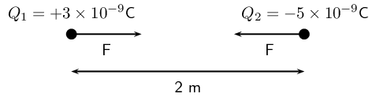

**Check units:**
All quantities are in SI units.

**Determine the magnitude of the force:**
Using Coulomb's law
          we have

\begin{align*}
          F &= \frac{k Q_1 Q_2}{r^2} \\
          &= \frac{(\text{9,0}\times 10^{9})(\text{3}\times 10^{-9})(\text{5}\times 10^{-9})}{(2)^2} \\
          &= \text{3,37} \times \text{10}^{-\text{8}}\text{ N}
          \end{align*}

Thus the *magnitude* of the force is \(\text{3,37} \times \text{10}^{-\text{8}}\) \(\text{N}\).
          However since the point charges have opposite signs, the force will be attractive.

**Free body diagram:**
We can draw a free body diagram to show the forces. Each charge experiences a force with the same magnitude
          and the forces are attractive, so we have:

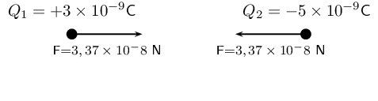
</Callout>

Next is another example that demonstrates the difference in magnitude between the gravitational force and the
      electrostatic force.

<Callout type="tip" title="Worked example 2: Coulomb's law">
**Question:**
Determine the magnitudes of the electrostatic force and gravitational force between two electrons
          \(\text{10}^{-\text{10}}\) \(\text{m}\) apart (i.e. the forces felt inside an atom) and state whether the
          forces are attractive or repulsive.

**Determine what is required:**
We are required to calculate the electrostatic and gravitational forces between two electrons, a given
          distance apart.

**Determine how to approach the problem:**
We can use:
          \[F_e = \frac{k Q_1 Q_2}{r^2}\]

to calculate the electrostatic force and
          \[F_g = \frac{G m_1 m_2}{d^2}\]

to calculate the gravitational force.

**Determine what is given:**
- \({Q}_{1}={Q}_{2} = \text{1,6} \times \text{10}^{-\text{19}}\text{ C}\) (The charge on an electron)
- \({m}_{1}={m}_{2}= \text{9,1} \times \text{10}^{-\text{31}}\text{ kg}\) (The mass of an electron)
- \(r = d = \text{1} \times \text{10}^{-\text{10}}\text{ m}\)

We know that:

- \(k=\text{9,0} \times \text{10}^{\text{9}}\text{ N·m$^{2}$·C$^{-2}$}\)
- \(G=\text{6,67} \times \text{10}^{-\text{11}}\text{ N·m$^{2}$·kg$^{-2}$}\)

All quantities are in SI units.

We can draw a diagram of the situation.

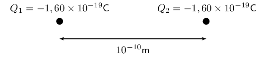

**Calculate the electrostatic force:**
\begin{align*}
          F_e &= \frac{k Q_1 Q_2}{r^2} \\
          &= \frac{(\text{9,0}\times 10^9)(\text{1,60}\times 10^{-19})(\text{1,60}\times 10^{-19})}{(10^{-10})^2} \\
          &= \text{2,30} \times \text{10}^{-\text{8}}\text{ N}
          \end{align*}

          Hence the *magnitude* of the electrostatic force between the
          electrons is \(\text{2,30} \times \text{10}^{-\text{8}}\text{ N}\). Since electrons carry like charges, the
          force is repulsive.

**Calculate the gravitational force:**
\begin{align*}
          F_g &= \frac{G m_1 m_2}{d^2} \\
          &= \frac{(\text{6,67}\times 10^{-11})(\text{9,11}\times 10^{-31})(\text{9,11}\times
          10^{-31})}{(10^{-10})^2} \\
          &= \text{5,54} \times \text{10}^{-\text{51}}\text{ N}
          \end{align*}

          The magnitude of the gravitational force between the electrons is \(\text{5,54} \times
          \text{10}^{-\text{51}}\) \(\text{N}\). Remember that the gravitational force is always an attractive force.

Notice that the gravitational force between the electrons is **much smaller** than the
          electrostatic force.
</Callout>

<QuizCard id="s11-09-02a" title="Interactive Exercise 9.2" question="What is the nature of the interaction between \(Q_1\) and \(Q_2\) ?" options=["repulsive", "attractive"] answer="repulsive" hint="" explanation="The nature of the interaction We know that two charges of the same type repel each other, and two charges of opposite types attract . \(Q_1\) carries a negative charge , and \(Q_2\) carries a negative charge . This means that \(Q_1\) and \(Q_2\) are of the same type. Therefore, the nature of the interaction between \(Q_1\) and \(Q_2\) will be repulsive , as shown in the figure below. Submit your answer as: repulsive" />

<Callout type="tip" title="Note">
We can apply Newton's third law to charges because two charges exert forces of equal magnitude on one another
        in opposite directions.
</Callout>

<Callout type="tip" title="Note">
**Choosing a positive direction**

When substituting into the Coulomb's law
        equation, one may choose a positive direction thus making it unnecessary to include the signs of the charges.
        Instead, select a positive direction. Those forces that tend to move the charge in this direction are added,
        while forces acting in the opposite direction are subtracted.
</Callout>

<Callout type="tip" title="Worked example 3: Coulomb's law">
**Question:**
Three point charges are in a straight line.
          Their charges are \(Q_1 = \text{+2} \times \text{10}^{-\text{9}}\text{ C}\), \(Q_2 = \text{+1} \times
          \text{10}^{-\text{9}}\text{ C}\) and \(Q_3 = -\text{3} \times \text{10}^{-\text{9}}\text{ C}\). The distance
          between \(Q_1\) and \(Q_2\) is \(\text{2} \times \text{10}^{-\text{2}}\) \(\text{m}\) and the distance between
          \(Q_2\) and \(Q_3\) is \(\text{4} \times \text{10}^{-\text{2}}\) \(\text{m}\). What is the net electrostatic
          force on \(Q_2\) due to the other two charges?

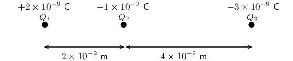

**Determine what is required:**
We need to calculate the net force on \({Q}_{2}\). This force is the sum of the two electrostatic forces -
          the forces between \({Q}_{1}\) on \({Q}_{2}\) and \({Q}_{3}\) on \({Q}_{2}\).

**Determine how to approach the problem:**
- We need to calculate the two electrostatic forces on \({Q}_{2}\), using Coulomb's law.
- We then need to add up the two forces using our rules for adding vector quantities, because force is a
                vector quantity.

**Determine what is given:**
We are given all the charges and all the distances.

**Calculate the magnitude of the forces.:**
Force on \(Q_2\) due to \(Q_1\):

\begin{align*}
          F_1 & = k\frac{Q_1Q_2}{r^2} \\
          &= (\text{9,0} \times \text{10}^{\text{9}})\frac{(\text{2} \times \text{10}^{-\text{9}})(\text{1} \times
          \text{10}^{-\text{9}})}{(\text{2} \times \text{10}^{-\text{2}})^2} \\
          &= (\text{9,0} \times \text{10}^{\text{9}})\frac{(\text{2} \times \text{10}^{-\text{9}})(\text{1} \times
          \text{10}^{-\text{9}})}{(\text{4} \times \text{10}^{-\text{4}})} \\
          &= \text{4,5} \times \text{10}^{-\text{5}}\text{ N}
          \end{align*}

Force on \(Q_2\) due to \(Q_3\):

\begin{align*}
          F_3 & = k\frac{Q_2Q_3}{r^2} \\
          &= (\text{9,0} \times \text{10}^{\text{9}})\frac{(\text{1} \times \text{10}^{-\text{9}})(\text{3} \times
          \text{10}^{-\text{9}})}{(\text{4} \times \text{10}^{-\text{2}})^2} \\
          &= (\text{9,0} \times \text{10}^{\text{9}})\frac{(\text{1} \times \text{10}^{-\text{9}})(\text{3} \times
          \text{10}^{-\text{9}})}{(\text{16} \times \text{10}^{-\text{4}})} \\
          &= \text{1,69} \times \text{10}^{-\text{5}}\text{ N}
          \end{align*}

**Vector addition of forces:**
We know the force magnitudes but we need to use the charges to determine whether the forces are repulsive or
          attractive. It is helpful to draw the force diagram to help determine the final direction of the net force on
          \(Q_2\).
          We choose the positive direction to be to the right (the positive \(x\)-direction).

The force between \(Q_1\) and \(Q_2\) is repulsive (like charges). This means that it pushes \(Q_2\) to the
          right, or in the positive direction.

The force between \(Q_2\) and \(Q_3\) is attractive (unlike charges) and pulls \(Q_2\) to the right.

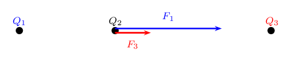

Therefore both forces are acting in the positive direction.

Therefore,\begin{align*}
          F_R & = \text{4,5} \times \text{10}^{-\text{5}}\text{ N} + \text{1,69} \times \text{10}^{-\text{5}}\text{
          N} \\
          & = \text{6,19} \times \text{10}^{-\text{5}}\text{ N}
          \end{align*}

The resultant force acting on \(Q_2\) is \(\text{6,19} \times \text{10}^{-\text{5}}\) \(\text{N}\) to the
          right.
</Callout>

<Callout type="tip" title="Worked example 4: Coulomb's law">
**Question:**
Three point charges form a right-angled triangle.
          Their charges are \(Q_1 = \text{4} \times \text{10}^{-\text{9}}\text{ C}=\text{4}\text{ nC}\), \(Q_2 =
          \text{6} \times \text{10}^{-\text{9}}\text{ C}=\text{6}\text{ nC}\)
          and \(Q_3 = -\text{3} \times \text{10}^{-\text{9}}\text{ C}=-\text{3}\text{ nC}\). The distance between
          \({Q}_{1}\) and \({Q}_{2}\)
          is \(\text{5} \times \text{10}^{-\text{2}}\) \(\text{m}\)
          and the distance between
          \({Q}_{1}\) and \({Q}_{3}\)
          is \(\text{3} \times \text{10}^{-\text{2}}\) \(\text{m}\). What is the net electrostatic force on \({Q}_{1}\)
          due to the other two charges if they are arranged as shown?

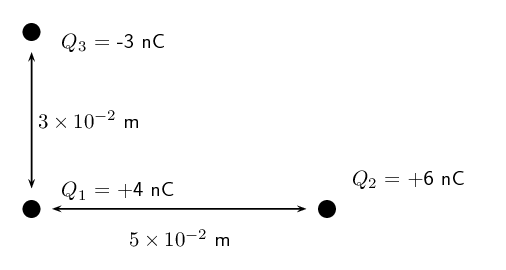

**Determine what is required:**
We need to calculate the net force on \({Q}_{1}\). This force is the sum of the two electrostatic forces -
          the forces of \({Q}_{2}\) on \({Q}_{1}\) and \({Q}_{3}\) on \({Q}_{1}\).

**Determine how to approach the problem:**
- We need to calculate, using Coulomb's law, the electrostatic force exerted on \(Q_1\) by \(Q_2\), and the
                electrostatic force exerted on \(Q_1\) by \(Q_3\).
- We then need to add up the two forces using our rules for adding vector quantities, because force is a
                vector quantity.

**Determine what is given:**
We are given all the charges and two of the distances.

**Calculate the magnitude of the forces.:**
The magnitude of the force exerted by \({Q}_{2}\) on \({Q}_{1}\), which we will call \(F_2\), is:

\begin{align*}
          F_2 & = k\frac{Q_1Q_2}{r^2} \\
          &= (\text{9,0} \times \text{10}^{\text{9}})\frac{(\text{4} \times \text{10}^{-\text{9}})(\text{6} \times
          \text{10}^{-\text{9}})}{(\text{5} \times \text{10}^{-\text{2}})^2} \\
          &= (\text{9,0} \times \text{10}^{\text{9}})\frac{(\text{4} \times \text{10}^{-\text{9}})(\text{6} \times
          \text{10}^{-\text{9}})}{(\text{25} \times \text{10}^{-\text{4}})} \\
          &= \text{8,630} \times \text{10}^{-\text{5}}\text{ N}
          \end{align*}

The magnitude of the force exerted by \({Q}_{3}\) on \({Q}_{1}\), which we will call \(F_3\), is:

\begin{align*}
          F_3 & = k\frac{Q_1Q_3}{r^2} \\
          &= (\text{9,0} \times \text{10}^{\text{9}})\frac{(\text{4} \times \text{10}^{-\text{9}})(\text{3} \times
          \text{10}^{-\text{9}})}{(\text{3} \times \text{10}^{-\text{2}})^2} \\
          &= (\text{9,0} \times \text{10}^{\text{9}})\frac{(\text{4} \times \text{10}^{-\text{9}})(\text{3} \times
          \text{10}^{-\text{9}})}{(\text{9} \times \text{10}^{-\text{4}})} \\
          &= \text{1,199} \times \text{10}^{-\text{4}}\text{ N}
          \end{align*}

**Vector addition of forces:**
This is a two-dimensional problem involving vectors. We have already solved many two-dimensional force
          problems and will use precisely the **same procedure** as before. Determine the vectors on the
          Cartesian plane, break them into components in the \(x\)- and \(y\)-directions, and then sum components in
          each direction to get the components of the resultant.

We choose the positive directions to be to the right (the positive \(x\)-direction) and up (the positive
          \(y\)-direction). We know the magnitudes of the forces but we need to use the signs of the charges to
          determine whether the forces are repulsive or attractive. Then we can use a diagram to determine the
          directions.

The force between \({Q}_{1}\) and \({Q}_{2}\) is repulsive (like charges). This means that it pushes
          \({Q}_{1}\) to the left, or in the negative \(x\)-direction.

The force between \({Q}_{1}\) and \({Q}_{3}\) is attractive
          (unlike charges) and pulls \({Q}_{1}\) in the positive \(y\)-direction.

We can redraw the diagram as a free-body diagram illustrating the forces to make sure we can visualise the
          situation:

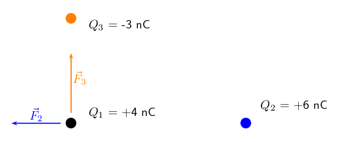

**Resultant force:**
The magnitude of the resultant force acting on \(Q_1\) can be calculated from the forces using Pythagoras'
          theorem because there are only two forces and they act in the \(x\)- and \(y\)-directions:
          \begin{align*}
          F^{2}_R & = F_{2}^{2} + F_{3}^{2} \text{by Pythagoras' theorem}\\
          F_R &= \sqrt{(\text{8,630} \times \text{10}^{-\text{5}})^{2} + (\text{1,199} \times
          \text{10}^{-\text{4}})^{2}}\\
          F_R &= \text{1,48} \times \text{10}^{-\text{4}}\text{ N}
          \end{align*} and the angle, \(\theta_R\) made with the \(x\)-axis can be found using trigonometry.

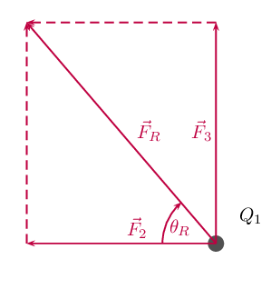

\begin{align*}
          \tan(\theta_R) &= \frac{\text{y-component}}{\text{x-component}} \\
          \tan(\theta_R) &= \frac{\text{1,199} \times \text{10}^{-\text{4}}}{\text{8,630} \times
          \text{10}^{-\text{5}}} \\
          \theta_R &= \tan^{-1}(\frac{\text{1,199} \times \text{10}^{-\text{4}}}{\text{8,630} \times
          \text{10}^{-\text{5}}}) \\
          \theta_R &= \text{54,25}\text{°} {\text{ to 2 decimal places}}
          \end{align*}

The final resultant force acting on \(Q_1\) is \(\text{1,48} \times \text{10}^{-\text{4}}\) \(\text{N}\)
          acting at an angle of \(\text{54,25}\)\(\text{°}\) to the negative \(x\)-axis or
          \(\text{125,75}\)\(\text{°}\)to the positive \(x\)-axis.
</Callout>

We mentioned in grade 10 that charge placed on a spherical conductor spreads evenly along the surface. As a
      result, if we are far enough from the charged sphere, electrostatically, it behaves as a point-like charge. Thus
      we can treat spherical conductors (e.g. metallic balls) as point-like charges, with all the charge acting at the
      centre.

## Electrostatic forces

### Textbook Exercise 9.1

**Problem:**
Calculate the electrostatic force between two charges of \(\text{+6}\) \(\text{nC}\) and \(\text{+1}\)
              \(\text{nC}\) if they are separated by a distance of \(\text{2}\) \(\text{mm}\).

**Solution:**
\begin{align*}
            F_e &= \frac{k Q_1 Q_2}{r^2} \\
            &= \frac{(\text{9,0} \times \text{10}^{\text{9}})(\text{6} \times \text{10}^{-\text{9}})(\text{1} \times
            \text{10}^{-\text{9}})}{(\text{2} \times \text{10}^{-\text{3}})^2} \\
            &= \text{1,35} \times \text{10}^{-\text{2}}\text{ N}
            \end{align*}

This force is repulsive since it is between two like charges.

**Problem:**
What is the magnitude of the repulsive force between two pith balls (a pith ball is a small, light ball
              that can easily be charged) that are \(\text{8}\) \(\text{cm}\) apart and have equal charges of
              \(-\text{30}\) \(\text{nC}\)?

**Solution:**
\begin{align*}
            F_e &= \frac{k Q_1 Q_2}{r^2} \\
            &= \frac{(\text{9,0} \times \text{10}^{\text{9}})(\text{30} \times \text{10}^{-\text{9}})(\text{30}
            \times \text{10}^{-\text{9}})}{(\text{8} \times \text{10}^{-\text{2}})^2} \\
            &= \text{1,27} \times \text{10}^{-\text{3}}\text{ N}
            \end{align*}

This force is repulsive since it is between two like charges.

**Problem:**
How strong is the attractive force between a glass rod with a \(\text{0,7}\) \(\mu\)C charge and a silk
              cloth with a \(-\text{0,6}\) \(\mu\)C charge, which are \(\text{12}\) \(\text{cm}\) apart, using the
              approximation that they act like point charges?

**Solution:**
\begin{align*}
            F_e &= \frac{k Q_1 Q_2}{r^2} \\
            &= \frac{(\text{9,0} \times \text{10}^{\text{9}})(\text{0,6} \times \text{10}^{-\text{6}})(\text{0,7}
            \times \text{10}^{-\text{6}})}{(\text{12} \times \text{10}^{-\text{2}})^2} \\
            &= \text{0,26}\text{ N}
            \end{align*}

This force is attractive since it is between two unlike charges.

**Problem:**
Two point charges exert a \(\text{5}\) \(\text{N}\) force on each other. What will the resulting force be
              if the distance between them is increased by a factor of three?

**Solution:**
Let the charges be \(Q_{1}\) and \(Q_{2}\). For the first situation we have:

            \[F_{e1} = \frac{k Q_1 Q_2}{r^2}\]

Now we increase the distance by a factor of three so we get:

            \[F_{e2} = \frac{k Q_1 Q_2}{9r^2}\]

We now note the following:

            \[(F_{e1})(r^2) = k Q_1 Q_2\]

and:

            \[(F_{e2})(9r^2) = k Q_1 Q_2\]

Therefore:

            \begin{align*}
            (F_{e1})(r^2) & = (F_{e2})(9r^2) \\
            F_{e1} & = (F_{e2})(9) \\
            \therefore F_{e2} & = \text{0,56}\text{ N}
            \end{align*}

**Problem:**
Two point charges are brought closer together, increasing the force between them by a factor of 25. By
              what factor was their separation decreased?

**Solution:**
Let the charges be \(Q_{1}\) and \(Q_{2}\). For the first situation we have:

            \[F_{e1} = \frac{k Q_1 Q_2}{r^2}\]

Now we decrease by an unknown factor, \(x\), the distance and we get:

            \[F_{e2} = \frac{k Q_1 Q_2}{(xr)^2}\]

We now note the following:

and:

            \[(F_{e2}) = \text{25}\frac{k Q_1 Q_2}{r^2}\]

Therefore:

            \begin{align*}
            \text{25}(\frac{k Q_1 Q_2}{r^2}) & = \frac{k Q_1 Q_2}{(xr)^2} \\
            \text{25} & = \frac{1}{x^2} \\
            \therefore x & = \text{0,2}
            \end{align*}

**Problem:**
If two equal charges each of \(\text{1}\) \(\text{C}\) each are separated in air by a distance of
              \(\text{1}\) \(\text{km}\), what is the magnitude of the force acting between them?

**Solution:**
\begin{align*}
            F_e &= \frac{k Q_1 Q_2}{r^2} \\
            &= \frac{(\text{9,0} \times \text{10}^{\text{9}})(\text{1})(\text{1})}{(\text{1} \times
            \text{10}^{\text{3}})^2} \\
            &= \text{9 000}\text{ N}
            \end{align*}

This force is repulsive since it is between two like charges.

You should notice that even at a distance as large as \(\text{1}\) \(\text{km}\), the repulsive force is
              substantial because \(\text{1}\) \(\text{C}\) is a very significant amount of charge.

**Problem:**
Calculate the distance between two charges of \(\text{+4}\) \(\text{nC}\) and \(-\text{3}\) \(\text{nC}\)
              if the electrostatic force between them is \(\text{0,005}\) \(\text{N}\).

**Solution:**
\begin{align*}
            F_e &= \frac{k Q_1 Q_2}{r^2} \\
            \text{0,005} &= \frac{(\text{9,0} \times \text{10}^{\text{9}})(\text{4} \times
            \text{10}^{-\text{9}})(\text{3} \times \text{10}^{-\text{9}})}{(d)^2} \\
            \text{0,005}d^{2} &= \text{1,07} \times \text{10}^{-\text{9}} \\
            d^{2} &= \text{2,1576} \times \text{10}^{-\text{5}} \\
            &= \text{4,6} \times \text{10}^{-\text{3}}\text{ m}
            \end{align*}

**Problem:**
For the charge configuration shown, calculate the resultant force on \(Q_2\) if:

- \(Q_1 = \text{2,3} \times \text{10}^{-\text{7}}\) \(\text{C}\)
- \(Q_2 = \text{4} \times \text{10}^{-\text{6}}\) \(\text{C}\)
- \(Q_3 = \text{3,3} \times \text{10}^{-\text{7}}\) \(\text{C}\)
- \(r_1 = \text{2,5} \times \text{10}^{-\text{1}}\) \(\text{m}\)
- \(r_2 = \text{3,7} \times \text{10}^{-\text{2}}\) \(\text{m}\)

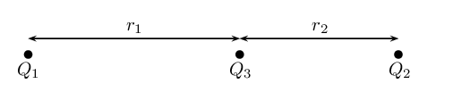

**Solution:**
We first calculate the force on \(Q_{2}\) from \(Q_{3}\):

            \begin{align*}
            F_{23} &= \frac{k Q_2 Q_3}{(r_{2})^2} \\
            &= \frac{(\text{9,0} \times \text{10}^{\text{9}})(\text{4}
            \times \text{10}^{-\text{6}})(\text{3,3} \times \text{10}^{-\text{7}})}{(\text{3,7} \times
            \text{10}^{-\text{2}})^{2}} \\
            &= \text{8,678}\text{ N}
            \end{align*}

And then we calculate the force of \(Q_{1}\) on \(Q_{2}\). Note that for this force we must add \(r_{1}\)
              and \(r_{2}\).

            \begin{align*}
            F_{21} &= \frac{k Q_1 Q_2}{(r_{1} + r_{2})^2} \\
            &= \frac{(\text{9,0} \times \text{10}^{\text{9}})(\text{2,3}
            \times \text{10}^{-\text{7}})(\text{4} \times \text{10}^{-\text{6}})}{(\text{2,5} \times
            \text{10}^{-\text{1}} + \text{3,7} \times
            \text{10}^{-\text{2}})^2} \\
            &= \text{0,101}\text{ N}
            \end{align*}

Next we note that the force of \(Q_{3}\) on \(Q_{2}\) is repulsive and the force of \(Q_{1}\) on
              \(Q_{2}\) is also repulsive. So these two forces act in the same direction (towards the right). The
              resultant force is:

            \begin{align*}
            F_{eR} &= F_{23} + F_{21} \\
            &= \text{8,678}\text{ N} + \text{0,101}\text{ N} \\
            &= \text{8,779}\text{ N to the right}.
            \end{align*}

**Problem:**
For the charge configuration shown, calculate the charge on \(Q_3\) if the resultant force
              on \(Q_2\) is \(\text{6,3} \times \text{10}^{-\text{1}}\) \(\text{N}\) to the right and:

- \(Q_1 = \text{4,36} \times \text{10}^{-\text{6}}\) \(\text{C}\)
- \(Q_2 = -\text{7} \times \text{10}^{-\text{7}}\) \(\text{C}\)
- \(r_1 = \text{1,85} \times \text{10}^{-\text{1}}\) \(\text{m}\)
- \(r_2 = \text{4,7} \times \text{10}^{-\text{2}}\) \(\text{m}\)

**Solution:**
We are told that the resultant force is \(\text{6,3} \times \text{10}^{-\text{1}}\) \(\text{N}\) to the
              right. Since the force of \(Q_{1}\) on \(Q_{2}\) is attractive, the force of \(Q_{3}\) on \(Q_{2}\) must
              be repulsive to cause a resultant force to the right (if it was also attractive, the resultant force would
              be to the left). So we know that \(Q_{3}\) must be negative.

We first calculate the force on \(Q_{2}\) from \(Q_{1}\):

            \begin{align*}
            F_{e1} &= \frac{k Q_1 Q_2}{r^2} \\
            &= \frac{(\text{9,0} \times \text{10}^{\text{9}})(\text{4,36} \times \text{10}^{-\text{6}})(\text{7}
            \times \text{10}^{-\text{7}})}{(\text{1,85} \times \text{10}^{-\text{1}} + \text{4,7} \times
            \text{10}^{-\text{2}})^2} \\
            &= \text{0,510}\ldots\text{ N}
            \end{align*}

Next we use this and the resultant force to find the force on \(Q_{2}\) from \(Q_{3}\)

            \begin{align*}
            F_{eR} &= F_{e1} + F_{e2} \\
            F_{e2} &= \text{6,3} \times \text{10}^{-\text{1}}\text{ N} - \text{0,510}\ldots\text{ N} \\
            &= \text{0,119}\ldots\text{ N}
            \end{align*}

And then we calculate the charge on \(Q_{3}\):

            \begin{align*}
            F_{e2} &= \frac{k Q_2 Q_3}{r^2} \\
            \text{0,119}\ldots &= \frac{(\text{9,0} \times \text{10}^{\text{9}})(\text{7} \times
            \text{10}^{-\text{7}})(Q_{3})}{(\text{4,7} \times \text{10}^{-\text{2}})^2} \\
            \text{2,64}\ldots \times \text{10}^{-\text{4}} &= (\text{6,3} \times \text{10}^{\text{3}})(Q_{3}) \\
            Q_{3} &= \text{4,2} \times \text{10}^{-\text{8}}\text{ C}
            \end{align*}

**Problem:**
Calculate the resultant force on \(Q_1\) given this charge configuration:

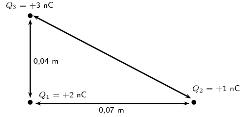

**Solution:**
We first calculate the force on \(Q_{1}\) from \(Q_{2}\):

            \begin{align*}
            F_e &= \frac{k Q_1 Q_2}{r^2} \\
            &= \frac{(\text{9,0} \times \text{10}^{\text{9}})(\text{1} \times \text{10}^{-\text{9}})(\text{2} \times
            \text{10}^{-\text{9}})}{(\text{0,07})^2} \\
            &= \text{3,7} \times \text{10}^{-\text{6}}\text{ N}
            \end{align*}

And then we calculate the force of \(Q_{3}\) on \(Q_{1}\):

            \begin{align*}
            F_e &= \frac{k Q_1 Q_3}{r^2} \\
            &= \frac{(\text{9,0} \times \text{10}^{\text{9}})(\text{3} \times \text{10}^{-\text{9}})(\text{2} \times
            \text{10}^{-\text{9}})}{(\text{0,04})^2} \\
            &= \text{3,4} \times \text{10}^{-\text{5}}\text{ N}
            \end{align*}

The magnitude of the resultant force acting on \(Q_{1}\) can be calculated from the forces using
              Pythagoras' theorem because there are only two forces and they act in the \(x\)- and \(y\)-directions:

            \begin{align*}
            F_{R}^{2} & = F_{x}^{2} + F_{y}^{2} \\
            F_{R} & = \sqrt{(\text{3,7} \times \text{10}^{-\text{6}})^{2} + (\text{3,4} \times
            \text{10}^{-\text{5}})^{2}} \\
            & = \text{3,42} \times \text{10}^{-\text{5}}\text{ N}
            \end{align*}

We can find the angle using trigonometry:

            \begin{align*}
            \tan \theta_{R} & = \frac{y \text{-component}}{x \text{-component}} \\
            & = \frac{\text{3,42} \times \text{10}^{-\text{5}}}{\text{3,7} \times \text{10}^{-\text{6}}}\\
            & = \text{9,2432}\ldots \\
            \theta_{R} & = \text{83,8}\text{°}
            \end{align*}

The final resultant force acting on \(Q_1\) is \(\text{3,42} \times \text{10}^{-\text{5}}\) \(\text{N}\)
              acting at an angle of \(\text{83,8}\)\(\text{°}\) to the negative \(x\)-axis.

**Problem:**
Calculate the resultant force on \(Q_1\) given this charge configuration:

**Solution:**
We first calculate the force on \(Q_{1}\) from \(Q_{2}\):

            \begin{align*}
            F_e &= \frac{k Q_1 Q_2}{r^2} \\
            &= \frac{(\text{9,0} \times \text{10}^{\text{9}})(\text{1} \times \text{10}^{-\text{9}})(\text{9} \times
            \text{10}^{-\text{9}})}{(\text{0,65})^2} \\
            &= \text{1,92} \times \text{10}^{-\text{7}}\text{ N}
            \end{align*}

And then we calculate the force of \(Q_{3}\) on \(Q_{1}\):

            \begin{align*}
            F_e &= \frac{k Q_1 Q_3}{r^2} \\
            &= \frac{(\text{9,0} \times \text{10}^{\text{9}})(\text{3} \times \text{10}^{-\text{9}})(\text{9} \times
            \text{10}^{-\text{9}})}{(\text{0,4})^2} \\
            &= \text{1,52} \times \text{10}^{-\text{6}}\text{ N}
            \end{align*}

The magnitude of the resultant force acting on \(Q_{1}\) can be calculated from the forces using
              Pythagoras' theorem because there are only two forces and they act in the \(x\)- and \(y\)-directions:

            \begin{align*}
            F_{R}^{2} & = F_{x}^{2} + F_{y}^{2} \\
            F_{R} & = \sqrt{(\text{1,92} \times \text{10}^{-\text{7}})^{2} + (\text{1,52} \times
            \text{10}^{-\text{6}})^{2}} \\
            & = \text{1,52} \times \text{10}^{-\text{6}}\text{ N}
            \end{align*}

We can find the angle using trigonometry:

            \begin{align*}
            \tan \theta_{R} & = \frac{y \text{-component}}{x \text{-component}} \\
            & = \frac{\text{1,52} \times \text{10}^{-\text{6}}}{\text{1,92} \times \text{10}^{-\text{7}}}\\
            & = \text{7,91666}\ldots \\
            \theta_{R} & = \text{82,80}\text{°}
            \end{align*}

The final resultant force acting on \(Q_1\) is \(\text{1,52} \times \text{10}^{-\text{6}}\) \(\text{N}\)
              acting at an angle of \(\text{82,80}\)\(\text{°}\) to the positive \(x\)-axis.

**Problem:**
Calculate the resultant force on \(Q_2\) given this charge configuration:

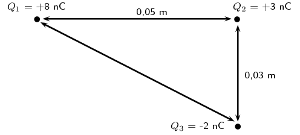

**Solution:**
We first calculate the force on \(Q_{2}\) from \(Q_{1}\):

            \begin{align*}
            F_e &= \frac{k Q_1 Q_2}{r^2} \\
            &= \frac{(\text{9,0} \times \text{10}^{\text{9}})(\text{8} \times \text{10}^{-\text{9}})(\text{3} \times
            \text{10}^{-\text{9}})}{(\text{0,05})^2} \\
            &= \text{8,63} \times \text{10}^{-\text{5}}\text{ N}
            \end{align*}

And then we calculate the force of \(Q_{3}\) on \(Q_{2}\):

            \begin{align*}
            F_e &= \frac{k Q_1 Q_3}{r^2} \\
            &= \frac{(\text{9,0} \times \text{10}^{\text{9}})(\text{3} \times \text{10}^{-\text{9}})(\text{2} \times
            \text{10}^{-\text{9}})}{(\text{0,03})^2} \\
            &= \text{5,99} \times \text{10}^{-\text{5}}\text{ N}
            \end{align*}

The magnitude of the resultant force acting on \(Q_{2}\) can be calculated from the forces using
              Pythagoras' theorem because there are only two forces and they act in the \(x\)- and \(y\)-directions:

            \begin{align*}
            F_{R}^{2} & = F_{x}^{2} + F_{y}^{2} \\
            F_{R} & = \sqrt{(\text{8,63} \times \text{10}^{-\text{5}})^{2} + (\text{5,99} \times
            \text{10}^{-\text{5}})^{2}} \\
            & = \text{1,05} \times \text{10}^{-\text{4}}\text{ N}
            \end{align*}

We can find the angle using trigonometry:

            \begin{align*}
            \tan \theta_{R} & = \frac{y \text{-component}}{x \text{-component}} \\
            & = \frac{\text{5,99} \times \text{10}^{-\text{5}}}{\text{8,63} \times \text{10}^{-\text{5}}}\\
            & = \text{0,694}\ldots \\
            \theta_{R} & = \text{34,76}\text{°}
            \end{align*}

The final resultant force acting on \(Q_1\) is \(\text{1,05} \times \text{10}^{-\text{4}}\) \(\text{N}\)
              acting at an angle of \(\text{34,76}\)\(\text{°}\) to the positive \(x\)-axis.
