## 9.3 Electric field (ESBPK)

We have seen in the previous section that point charges exert forces on each other even when they are far apart
      and not touching each other. How do the charges "know" about the existence of other charges around them?

The answer is that you can think of every charge as being surrounded in space by an electric field. The electric
      field is the region of space in which an electric charge will experience a force. The direction of the electric
      field represents the direction of the force a positive test charge would experience if placed in the electric
      field. In other words, the direction of an electric field at a point in space is the same direction in which a
      positive test charge would move if placed at that point.

Electric field

A region of space in which an electric charge will experience a force. The direction of the field at a point
          in space is the direction in which a positive test charge would moved if placed at that point.

### Representing electric fields (ESBPM)

We can represent the strength and direction of an electric field at a point using **electric field
          lines**. This is similar to representing magnetic fields around magnets using magnetic field lines as
        you studied in Grade 10. In the following we will study what the electric fields look like around isolated
        charges.

#### Positive charge acting on a test charge

The magnitude of the force that a test charge experiences due to another charge is governed by Coulomb's law.
          In the diagram below, at each point around the positive charge, \(+Q\), we calculate the force a positive test
          charge, \(+q\), would experience, and represent this force (a vector) with an arrow. The force vectors for
          some points around \(+Q\) are shown in the diagram along with the positive test charge \(+q\) (in red) located
          at one of the points.

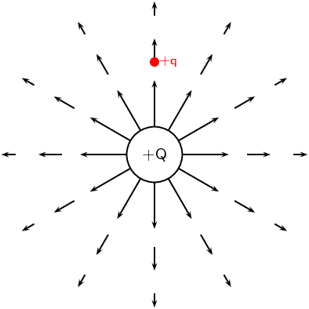

At every point around the charge \(+Q\), the positive test charge, \(+q\), will experience a force pushing it
          away.
          This is because both charges are positive and so they repel each other. We cannot draw an arrow at every point
          but we include enough arrows to illustrate what the field would look like. The arrows represent the force the
          test charge would experience at each point. Coulomb's law is an inverse-square law which means that the force
          gets weaker the greater the distance between the two charges. This is why the arrows get shorter further away
          from \(+Q\).

#### Negative charge acting on a test charge

For a negative charge, \(-Q\), and a positive test charge, \(+q\), the force vectors would look like:

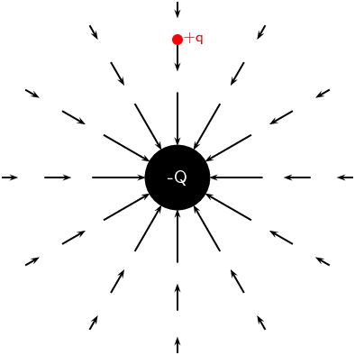

Notice that it is almost identical to the positive charge case. The arrows are the same lengths as in the
          previous diagram because the absolute magnitude of the charge is the same and so is the magnitude of the test
          charge. Thus the magnitude of the force is the same at the same points in space. However, the arrows point in
          the opposite direction because the charges now have opposite signs and attract each other.

#### Electric fields around isolated charges - summary

Now, to make things simpler, we draw continuous lines that are tangential to the force that a test charge
          would experience at each point. The field lines are closer together where the field is stronger. Look at the
          diagram below: close to the central charges, the field lines are close together. This is where the electric
          field is strongest. Further away from the central charges where the electric field is weaker, the field lines
          are more spread out from each other.

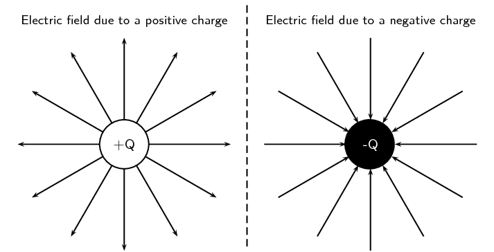

We use the following conventions when drawing electric field lines:

- Arrows on the field lines indicate the direction of the field, i.e. the direction in which a positive
                test charge would move if placed in the field.
- Electric field lines point away from positive charges (like charges repel) and towards negative charges
                (unlike charges attract).
- Field lines are drawn closer together where the field is stronger.
- Field lines do not touch or cross each other.
- Field lines are drawn perpendicular to a charge or charged surface.
- The greater the magnitude of the charge, the stronger its electric field. We represent this by drawing
                more field lines around the greater charge than for charges with smaller magnitudes.
  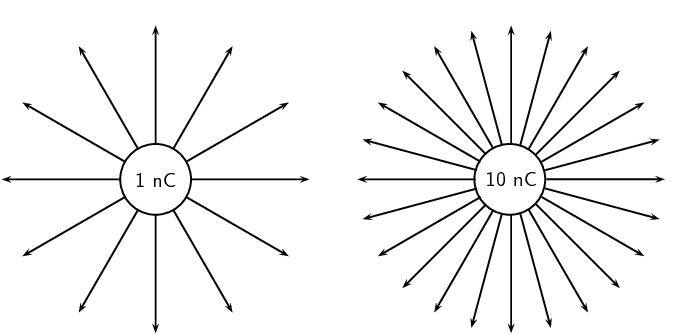

**Some important points to remember about electric fields:**

- There is an electric field at **every point** in space
                surrounding a charge.
- Field lines are merely a **representation** – they are not
                real. When we draw them, we just pick convenient places to
                indicate the field in space.
- Field lines exist in three dimensions, not only in two dimension as we've drawn them.
- The number of field lines passing through a surface is proportional to the charge contained inside the
                surface.

### Electric fields around different charge configurations (ESBPN)

We have seen what the electric fields look like around isolated positive and negative charges. Now we will
        study what the electric fields look like around combinations of charges placed close together.

#### Electric field around two unlike charges

We will start by looking at the electric field around a positive and negative charge placed next to each
          other. Using the rules for drawing electric field lines, we will sketch the electric field one step at a time.
          The net resulting field is the sum of the fields from each of the charges. To start off let us sketch the
          electric fields for each of the charges separately.

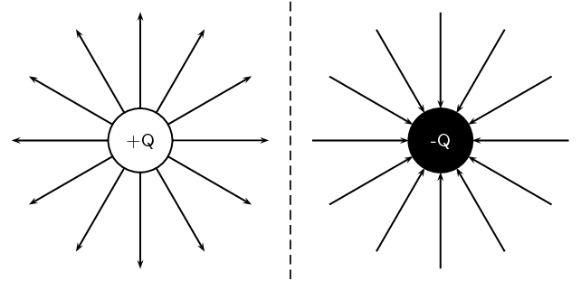

A positive test charge (red dots) placed at different positions directly between the two charges would be
          pushed away (orange force arrows) from the positive charge and pulled towards (blue force arrows) the negative
          charge in a straight line. The orange and blue force arrows have been drawn slightly offset from the dots for
          clarity. In reality they would lie on top of each other. Notice that the further from the positive charge, the
          smaller the repulsive force, \(F_+\) (shorter orange arrows) and the closer to the negative charge the greater
          the attractive force, \(F_-\) (longer blue arrows).
          The resultant forces are shown by the red arrows.
          The electric field line is the black line which is tangential to the resultant forces and is a straight line
          between the charges pointing from the positive to the negative charge.

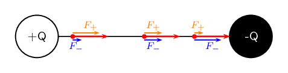

Now let's consider a positive test charge placed slightly higher than the line joining the two charges.
          The test charge will experience a repulsive force (\(F_+\) in orange) from the positive charge and an
          attractive force (\(F_-\) in blue) due to the negative charge. As before, the magnitude of these forces will
          depend on the distance of the test charge from each of the charges according to Coulomb's law.

          Starting at a position closer to the positive charge, the test charge will experience a larger repulsive force
          due to the positive charge and a weaker attractive force from the negative charge. At a position half-way
          between the positive and negative charges, the magnitudes of the repulsive and attractive forces are the same.
          If the test charge is placed closer to the negative charge, then the attractive force will be greater and the
          repulsive force it experiences due to the more distant positive charge will be weaker. At each point we add
          the forces due to the positive and negative charges to find the resultant force on the test charge (shown by
          the red arrows). The resulting electric field line, which is tangential to the resultant force vectors, will
          be a curve.

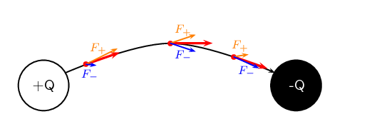

Now we can fill in the other field lines quite easily using the same ideas. The electric field lines look
          like:

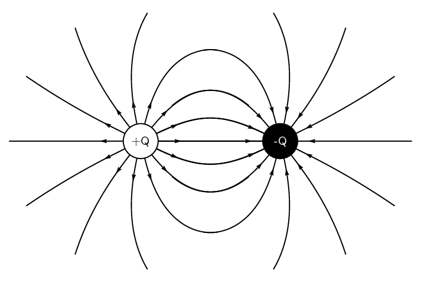

#### Electric field around two like charges (both positive)

For the case of two positive charges \(Q_1\) and \(Q_2\) of the same magnitude, things look a little
          different. We can't just turn the arrows around the way we did before. In this case the positive test charge
          is repelled by both charges. The electric fields around each of the charges in isolation looks like.

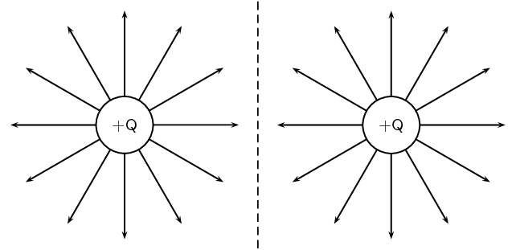

Now we can look at the resulting electric field when the charges are placed next to each other.
          Let us start by placing a positive test charge directly between the two charges.
          We can draw the forces exerted on the test charge due to \(Q_1\) and \(Q_2\) and determine the resultant
          force.

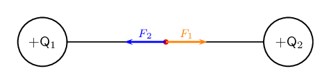

The force \(F_1\) (in orange) on the test charge (red dot) due to the charge \(Q_1\) is equal in magnitude
          but opposite in direction to \(F_2\) (in blue) which is the force exerted on the test charge due to \(Q_2\).
          Therefore they cancel each other out and there is no resultant force. This means that the electric field
          directly between the charges cancels out in the middle. A test charge placed at this point would not
          experience a force.

Now let's consider a positive test charge placed close to \(Q_1\) and above the imaginary line joining the
          centres of the charges. Again we can draw the forces exerted on the test charge due to \(Q_1\) and \(Q_2\) and
          sum them to find the resultant force (shown in red). This tells us the direction of the electric field line at
          each point. The electric field line (black line) is tangential to the resultant forces.

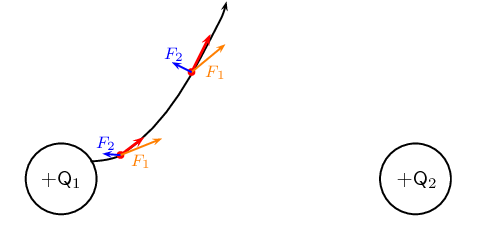

If we place a test charge in the same relative positions but *below* the imaginary line joining the
          centres of the charges, we can see in the diagram below that the resultant forces are reflections of the
          forces above. Therefore, the electric field line is just a reflection of the field line above.

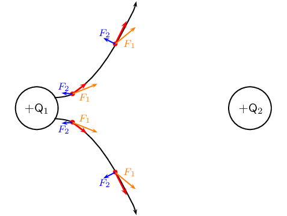

Since \(Q_2\) has the same charge as \(Q_1\), the forces at the same relative points close to \(Q_2\) will
          have the same magnitudes but opposite directions i.e. they are also reflections . We can therefore easily draw
          the next two field lines as follows:

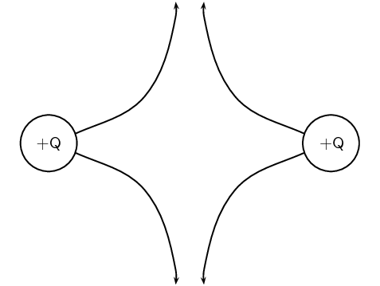

Working through a number of possible starting points for the test
          charge we can show the electric field can be represented by:

#### Electric field around two like charges (both negative)

We can use the fact that the direction of the force is reversed
          for a test charge if you change the sign of the charge that is
          influencing it. If we change to the case where both charges are
          negative we get the following result:

#### Charges of different magnitudes

When the magnitudes are not equal the larger charge will influence the direction of the field lines more than
          if they were equal. For example, here is a configuration where the positive charge is much larger than the
          negative charge. You can see that the field lines look more similar to that of an isolated charge at greater
          distances than in the earlier example. This is because the larger charge gives rise to a stronger field and
          therefore makes a larger relative contribution to the force on a test charge than the smaller charge.

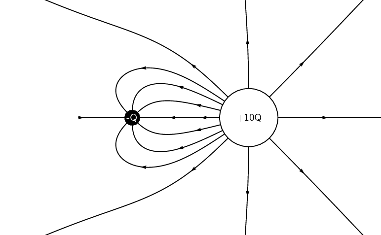

<QuizCard id="s11-09-03a" title="Interactive Exercise 9.4" question="Adapted from DBE Nov 2016 Grade 11, P1, Q8 Physical constants · Physics formulas Two charged spheres R and S are placed in a vacuum at a distance of \(\text{0,07}\ \text{m}\) apart. Draw the resulting electric field pattern between the two charges." options=[] answer="0" hint="" explanation="What are the directions of the electric field lines? The direction of the electric field vector at a point is the direction that a positive test charge would move if placed at that point. The electric field points away from positive charges and towards negative charges . What is the shape? We are working with unlike charges so they will attract each other. The electric field lines will move towards each other and join up. Draw the field pattern When drawing electric field patterns, it is important that: You draw the correct shape . Field lines between like charges curve away from each other and field lines between unlike charges join up with each other. You show the correct direction . Electric field lines point away from positive charges and towards negative charges. You obey all rules for electric field patterns . Field lines do not cross and they enter and leave the spheres perpendicularly. Submit your answer as: Diagram I" />

### Electric field strength (ESBPP)

In the previous sections we have studied how we can represent the electric fields around a charge or
        combination of charges by means of electric field lines. In this representation we see that the electric field
        strength is represented by how close together the field lines are. In addition to the drawings of the electric
        field, we would also like to be able to quantify (put a number to) how strong an electric field is and what its
        direction is at any point in space.

A small test charge \(q\) placed near a charge \(Q\) will experience a force due to the electric field
        surrounding \(Q\). The magnitude of the force is described by Coulomb's law and depends on the magnitude of the
        charge \(Q\) and the distance of the test charge from \(Q\). The closer the test charge \(q\) is to the charge
        \(Q\), the greater the force it will experience. Also, at points closer to the charge \(Q\), the stronger is its
        electric field. We define the electric field at a point as the force per unit charge.

Electric field

The magnitude of the electric field, \(E\), at a point can be quantified as the force per unit charge
            We can write this as:

          \[E = \frac{F}{q}\]

where \(F\) is the Coulomb force exerted by a charge on a test charge \(q\).

The units of the electric field are newtons per coulomb: \(\text{N·C$^{-1}$}\).

Since the force \(F\) is a vector and \(q\) is a scalar, the electric field, \(E\), is also a vector; it has a
        magnitude and a direction at every point.

Given the definition of electric field above and substituting the expression for Coulomb's law for \(F\):
        \begin{align*}
        E & = \frac{F}{q} \\
        & = \frac{kQq}{r^2 q}\\
        E & = \frac{kQ}{r^2}
        \end{align*}
        we can see that the electric field \(E\) only depends on the charge \(Q\) and not the magnitude of the test
        charge.

If the electric field is known, then the electrostatic force on any charge \(q\) placed into the field is
        simply obtained by rearranging the definition equation:
        \[F=qE.\]

<Callout type="note" title="Note">
<VideoPlayer src="https://www.youtube.com/embed/0YOGrTNgGhE" title="Video: 23Z6" />
</Callout>

<Callout type="note" title="Note">
[Simulation: 23Z7](http://phet.colorado.edu/sims/charges-and-fields/charges-and-fields_en.html)
</Callout>

<QuizCard id="s11-09-03b" title="Interactive Exercise 9.5" question="Using the concepts of electric charge , and electric field strength , determine the following: Calculate the magnitude of the electric field strength at a distance of \(\text{7,43}\ \text{cm}\) away from a very small object that carries \(+\text{6,47}\ \text{nC}\) of charge. INSTRUCTIONS: Write your answer in scientific notation , and then round it to two decimal places . Use the values for any physical constants you might need, as listed here ." options=[] answer="(1.05e+4; 1.04e+4; 1.065e+4)" hint="You should enter a number here. If you want to, you can use a space to separate thousands.                Example: 12 800,25 For scientific notation you need to use the multiply symbol                ( ∗ ) and the exponent symbol ( ^ ). For example 6,673 × 10 −11 should be written as: 6,673 ∗ 10^−11" explanation="Determine the electric field strength The magnitude of electric field strength is defined as: \[\begin{array}{c}E = \dfrac{F}{q} ~~~~~~~~ \text{(1)}\end{array}\] \(F\) represents the magnitude of the electrostatic force of an electric charge \(Q\) on a positive test charge \(q\) , measured in newton \(\text{(N)}\) . \(q\) represents the magnitude of a positive test charge \(q\) , located within the electric field of the main electric charge \(Q\) , measured in coulomb \(\text{(C)}\) . Coulomb's law states that the magnitude of the electrostatic force of the main charge on the test charge: \[\begin{array}{c}F = \dfrac{kQq}{r^2} ~~~~~~~~ \text{(2)}\end{array}\] where, \(k~\) is Coulomb's constant \(Q~\) is the magnitude of the main charge \(q~\) is the magnitude of the test charge, and \(r~\) is the distance between the main charge and the test charge Using \(\text{(2)}\) , and substituting for \(F~\) in \(\text{(1)}\) , we get: \[\begin{array}{c}E = \dfrac{F}{q} =\dfrac{\left(\frac{kQq}{r^2}\right)}{q} = \dfrac{kQ}{r^2} ~~~~~~~~ \text{(3)}\end{array}\] We can see from \(\text{(3)}\) that the magnitude of the electric field strength \(E\) , only depends on the magnitude of the main charge \(Q\) , and the distance \(r~\) from the main charge. Electric field strength does not depend on a second charge being present. Therefore, it does not matter what the magnitude of the test charge \(q~\) is, since electric field strength is a property of the main charge. Think of it in this way: Your eye colour does not depend on someone else. It is a property of you. But, to determine what your eye colour is, we need an observer. The test charge \(q~\) acts like this observer. It is only a tool we use to determine the electric field strength of the main charge \(Q\) . Calculate the final answer We are given the following information (all values converted to SI Units): Coulomb's constant \(k = \text{9,0} \times \text{10}^{\text{9}}\ \text{N·m$^{2}$·C$^{-2}$}\) (assume this number is exact) the magnitude of the charge on the object \(Q = \text{6,47}\ \text{nC} =  \text{6,47} \times \text{10}^{-\text{9}}\ \text{C}\) the distance from the charge \(r = \text{7,43}\ \text{cm} =\text{7,43} \times \text{10}^{-\text{2}}\ \text{m}\) Using the above information, and \(\text{(3)}\) , we can calculate \(E\) : \[                         \begin{aligned}                             E   & = \frac{kQ}{r^2} \\                                 & = \frac{(\text{9,0} \times \text{10}^{\text{9}})(\text{6,47} \times \text{10}^{-\text{9}})}{(\text{7,43} \times \text{10}^{-\text{2}})^2} \\                                 & = \text{1,05479...} \times \text{10}^{\text{4}} \\ & \approx \text{1,05} \times \text{10}^{\text{4}}\ \text{N·C$^{-1}$}                         \end{aligned}                     \] Therefore, the magnitude of the electric field strength is \(\text{1,05} \times \text{10}^{\text{4}}\ \text{N·C$^{-1}$}\) . Submit your answer as:" />

<Callout type="tip" title="Worked example 5: Electric field 1">
**Question:**
Calculate the electric field strength \(\text{30}\) \(\text{cm}\) from a \(\text{5}\) \(\text{nC}\) charge.

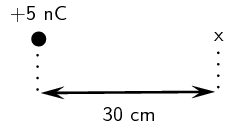

**Determine what is required:**
We need to calculate the electric field a distance from a given charge.

**Determine what is
            given:**
We are given the magnitude of the charge and the distance from the charge.

**Determine how to approach the problem:**
We will use the equation:

            \(E=k\frac{Q}{{r}^{2}}.\)

**Solve the problem:**
\begin{align*}
            E & = \frac{kQ}{r^2} \\
            & = \frac{(\text{9,0} \times \text{10}^{\text{9}})(\text{5} \times \text{10}^{-\text{9}})}{\text{0,3}^2}
            \\
            & = \text{4,99} \times \text{10}^{\text{2}}\text{ N·C$^{-1}$}
            \end{align*}
</Callout>

<Callout type="tip" title="Worked example 6: Electric field 2">
**Question:**
Two charges of \({Q}_{1}=+3\mathrm{nC}\) and \({Q}_{2}=-4\mathrm{nC}\) are separated by a distance of
            \(\text{50}\) \(\text{cm}\). What is the electric
            field strength at a point that is \(\text{20}\) \(\text{cm}\) from \({Q}_{1}\) and \(\text{50}\)
            \(\text{cm}\) from \({Q}_{2}\)? The point lies between \({Q}_{1}\) and \({Q}_{2}\).

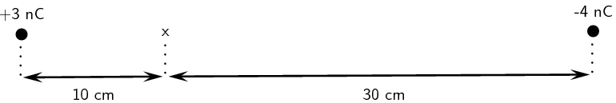

**Determine what is required:**
We need to calculate the electric field a distance from two given charges.

**Determine what is given:**
We are given the magnitude of the charges and
            the distances from the charges.

**Determine how to approach the problem:**
We will use the equation:

            \(E=k\frac{Q}{{r}^{2}}.\)

We need to calculate the electric field for each charge separately and then add them to determine the
            resultant field.

**Solve the problem:**
We first solve for \({Q}_{1}\):

            \begin{align*}
            E &= \frac{kQ}{r^2} \\
            &= \frac{(\text{9,0} \times \text{10}^{\text{9}})(\text{3} \times \text{10}^{-\text{9}})}{\text{0,2}^2}
            \\
            & = \text{6,74} \times \text{10}^{\text{2}}\text{ N·C$^{-1}$}
            \end{align*}

Then for \({Q}_{2}\):

            \begin{align*}
            E &= \frac{kQ}{r^2} \\
            &= \frac{(\text{9,0} \times \text{10}^{\text{9}})(\text{4} \times \text{10}^{-\text{9}})}{\text{0,3}^2}
            \\
            & = \text{3,99} \times \text{10}^{\text{2}}\text{ N·C$^{-1}$}
            \end{align*}

We need to add the two electric fields because both are in the same direction. The field is away from
            \({Q}_{1}\) and towards \({Q}_{2}\).
            Therefore, \({E}_{\text{total}}= \text{6,74} \times \text{10}^{\text{2}} + \text{3,99} \times
            \text{10}^{\text{2}} = \text{1,08} \times \text{10}^{\text{2}}\text{ N·C$^{-1}$}\)
</Callout>

<Callout type="tip" title="Worked example 7: Two-dimensional electric fields">
**Question:**
Two point charges form a right-angled triangle with the point \(A\) at the origin.
            Their charges are \(Q_2 = \text{6} \times \text{10}^{-\text{9}}\text{ C}=\text{6}\text{ nC}\)
            and \(Q_3 = -\text{3} \times \text{10}^{-\text{9}}\text{ C}=-\text{3}\text{ nC}\). The distance between
            \(A\) and \({Q}_{2}\)
            is \(\text{5} \times \text{10}^{-\text{2}}\) \(\text{m}\)
            and the distance between
            \(A\) and \({Q}_{3}\)
            is \(\text{3} \times \text{10}^{-\text{2}}\) \(\text{m}\). What is the net electric field measured at \(A\)
            from the two charges if they are arranged as shown?

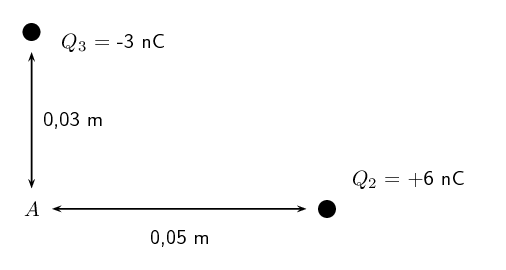

**Determine what is required:**
We are required to calculate the net electric field at \(A\). This field is the sum of the two electric
            fields - the field from \({Q}_{2}\) at \(A\) and from \({Q}_{3}\) at \(A\).

**Determine how to approach the problem:**
- We need to calculate the two fields at \(A\), using \(E=k\frac{Q}{r^2}\) for the magnitude and
                  determining the direction from the charge signs.
- We then need to add up the two fields using our rules for adding vector quantities, because the
                  electric field is a vector quantity.

**Determine what is given:**
We are given all the charges and the distances.

**Calculate the magnitude of the fields.:**
The magnitude of the field from \({Q}_{2}\) at \(A\), which we will call \(E_2\), is:

\begin{align*}
            E_2 & = k\frac{Q_2}{r^2} \\
            &= (\text{9,0} \times \text{10}^{\text{9}})\frac{(\text{6} \times \text{10}^{-\text{9}})}{(\text{5}
            \times \text{10}^{-\text{2}})^2} \\
            &= (\text{9,0} \times \text{10}^{\text{9}})\frac{(\text{6} \times \text{10}^{-\text{9}})}{(\text{25}
            \times \text{10}^{-\text{4}})} \\
            &= \text{2,158} \times \text{10}^{\text{4}}\text{ N·C$^{-1}$}
            \end{align*}

The magnitude of the electric field from \({Q}_{3}\) at \(A\), which we will call \(E_3\), is:

\begin{align*}
            E_3 & = k\frac{Q_3}{r^2} \\
            &= (\text{9,0} \times \text{10}^{\text{9}})\frac{(\text{3} \times \text{10}^{-\text{9}})}{(\text{3}
            \times \text{10}^{-\text{2}})^2} \\
            &= (\text{9,0} \times \text{10}^{\text{9}})\frac{(\text{3} \times \text{10}^{-\text{9}})}{(\text{9}
            \times \text{10}^{-\text{4}})} \\
            &= \text{2,997} \times \text{10}^{\text{4}}\text{ N·C$^{-1}$}
            \end{align*}

**Vector addition of electric fields:**
We will use precisely the **same procedure** as before. Determine the vectors on the Cartesian
            plane, break them into components in the \(x\)- and \(y\)-directions, sum components in each direction to
            get the components of the resultant.

We choose the positive directions to be to the right (the positive \(x\)-direction) and up (the positive
            \(y\)-direction). We know the electric field magnitudes but we need to use the charges to determine the
            direction. Then we can use the diagram to determine the directions.

The force between a positive test charge and \({Q}_{2}\) is repulsive (like charges). This means that the
            electric field is to the left, or in the negative \(x\)-direction.

The force between a positive test charge and \({Q}_{3}\) is attractive
            (unlike charges) and the electric field will be in the positive \(y\)-direction.

We can redraw the diagram illustrating the fields to make sure we can visualise the situation:

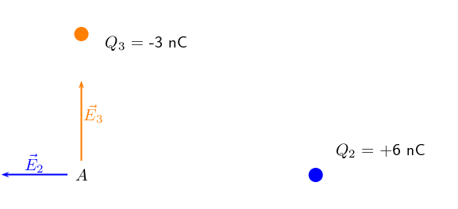

**Resultant force:**
The magnitude of the resultant force acting on \(Q_1\) can be calculated from the forces using Pythagoras'
            theorem because there are only two forces and they act in the \(x\)- and \(y\)-directions:
            \begin{align*}
            E^{2}_R & = E_{2}^{2} + E_{3}^{2}\ \text{Pythagoras' theorem}\\
            E_R &= \sqrt{(\text{2,158} \times \text{10}^{\text{4}})^{2} + (\text{2,997} \times
            \text{10}^{\text{4}})^{2}}\\
            E_R &= \text{3,693} \times \text{10}^{\text{4}}\text{ N·C$^{-1}$}
            \end{align*} and the angle, \(\theta_R\) made with the \(x\)-axis can be found using trigonometry.

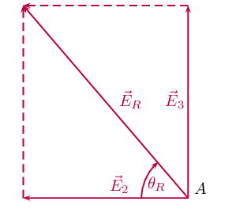

\begin{align*}
            \tan(\theta_R) &= \frac{\text{y-component}}{\text{x-component}} \\
            \tan(\theta_R) &= \frac{\text{2,997} \times \text{10}^{\text{4}}}{\text{2,158} \times
            \text{10}^{\text{4}}} \\
            \theta_R &= \tan^{-1}(\frac{\text{2,997} \times \text{10}^{\text{4}}}{\text{2,158} \times
            \text{10}^{\text{4}}}) \\
            \theta_R &= \text{54,24}\text{°}
            \end{align*}

The final resultant electric field acting at \(A\) is \(\text{3,693} \times \text{10}^{\text{4}}\)
            \(\text{N·C$^{-1}$}\) acting at \(\text{54,24}\)\(\text{°}\) to the negative \(x\)-axis or
            \(\text{125,76}\)\(\text{°}\)to the positive \(x\)-axis.
</Callout>

## Electric fields

### Textbook Exercise 9.2

**Problem:**
Calculate the electric field strength \(\text{20}\) \(\text{m}\) from a \(\text{7}\) \(\text{nC}\)
              charge.

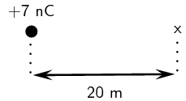

**Solution:**
We need to calculate the electric field a distance from a given charge. We are given the magnitude of the
              charge and the distance from the charge. We will use the equation:
              \(E=k\frac{Q}{{r}^{2}}.\)

\begin{align*}
              E & = \frac{kQ}{r^2} \\
              & = \frac{(\text{9,0} \times \text{10}^{\text{9}})(\text{7} \times
              \text{10}^{-\text{9}})}{\text{20}^2} \\
              & = \text{0,15}\text{ N·C$^{-1}$}
              \end{align*}

**Problem:**
Two charges of \({Q}_{1}=-\text{6}\text{ pC}\) and \({Q}_{2}=-\text{8}\text{ pC}\) are separated by a
              distance of \(\text{3}\) \(\text{km}\). What is the electric field strength at a point that is
              \(\text{2}\) \(\text{km}\) from \({Q}_{1}\) and \(\text{1}\) \(\text{km}\) from \({Q}_{2}\)? The point
              lies between \({Q}_{1}\) and \({Q}_{2}\).

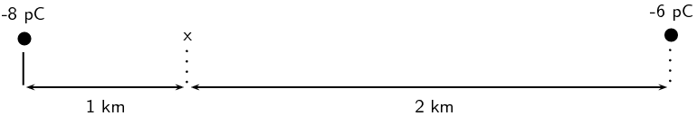

**Solution:**
We need to calculate the electric field a distance from two given charges. We are given the magnitude of
              the charges and the distances from the charges.

We will use the equation:
              \(E=k\frac{Q}{{r}^{2}}.\)

We need to calculate the electric field for each charge separately and then add them to determine the
              resultant field.

We first solve for \({Q}_{1}\):
              \begin{align*}
              E &= \frac{kQ}{r^2} \\
              &= \frac{(\text{9,0} \times \text{10}^{\text{9}})(\text{6} \times \text{10}^{-\text{12}})}{(\text{2}
              \times \text{10}^{\text{3}})^2} \\
              & = \text{1,3} \times \text{10}^{-\text{8}}\text{ N·C$^{-1}$}
              \end{align*}

Then for \({Q}_{2}\):
              \begin{align*}
              E &= \frac{kQ}{r^2} \\
              &= \frac{(\text{9,0} \times \text{10}^{\text{9}})(\text{8} \times \text{10}^{-\text{12}})}{(\text{1}
              \times \text{10}^{\text{3}})^2} \\
              & = \text{7,1} \times \text{10}^{-\text{8}}\text{ N·C$^{-1}$}
              \end{align*}

We need to subtract the two electric fields because they are in opposite directions. The electric fields
              due to each charge will be towards the charge causing it.
              Therefore, \({E}_{\text{total}}= \text{1,3} \times \text{10}^{-\text{8}} - \text{7,1} \times
              \text{10}^{-\text{8}} = -\text{5,8} \times \text{10}^{-\text{8}}\text{ N·C$^{-1}$}\) in the direction
              of the \(-\text{8}\) \(\text{pC}\) charge.
