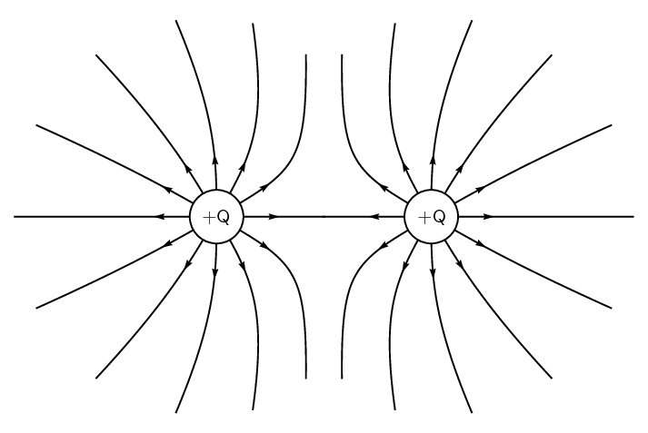
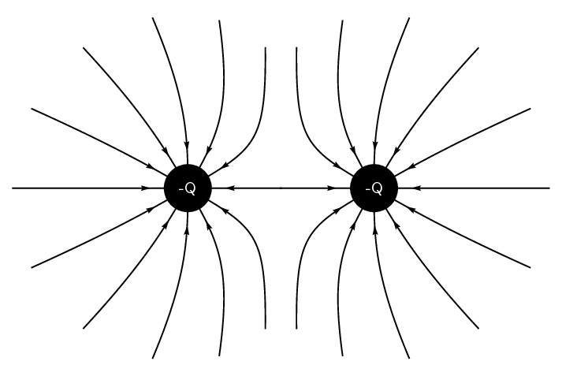
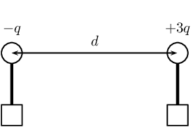
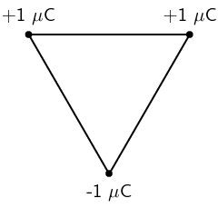
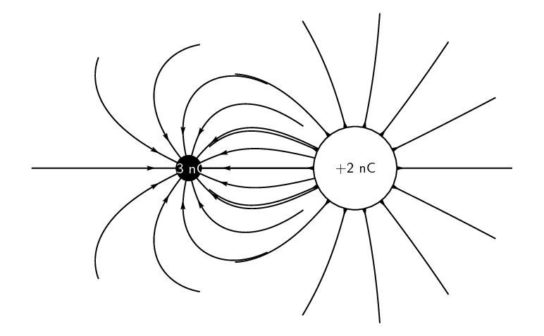

### Textbook Exercise 9.3

**Problem:**
Two charges of \(\text{+3}\) \(\text{nC}\) and \(-\text{5}\) \(\text{nC}\) are separated by a
                        distance of \(\text{40}\) \(\text{cm}\). What is the electrostatic force between the two
                        charges?

**Solution:**
\begin{align*}
                    F & = \frac{kQ_{1}Q_{2}}{r^{2}} \\
                    & = \frac{(\text{9,0} \times \text{10}^{\text{9}})(\text{3} \times
                    \text{10}^{-\text{9}})(\text{5} \times \text{10}^{-\text{9}})}{(\text{40} \times
                    \text{10}^{-\text{2}})^{2}} \\
                    & = \text{8,44} \times \text{10}^{-\text{7}}\text{ N·C$^{-1}$}
                    \end{align*}

Two conducting metal spheres carrying charges of \(\text{+6}\) \(\text{nC}\) and \(-\text{10}\)
                        \(\text{nC}\) are separated by a distance of \(\text{20}\) \(\text{mm}\).

**Problem:**
What is the electrostatic force between the spheres?

**Solution:**
\begin{align*}
                        F & = \frac{kQ_{1}Q_{2}}{r^{2}} \\
                        & = \frac{(\text{9,0} \times \text{10}^{\text{9}})(\text{6} \times
                        \text{10}^{-\text{9}})(\text{10} \times \text{10}^{-\text{9}})}{(\text{20} \times
                        \text{10}^{-\text{3}})^{2}} \\
                        & = \text{1,35} \times \text{10}^{-\text{3}}\text{ N·C$^{-1}$} \text{ towards the other
                        sphere}.
                        \end{align*}

**Problem:**
The two spheres are touched and then separated by a distance of \(\text{60}\) \(\text{mm}\).
                            What are the new charges on the spheres?

**Solution:**
The spheres are conducting and so when they touch the charge is spread equally across the two
                            spheres. So the new charge on each sphere is:

                        \[\frac{Q_{1} + Q_{2}}{2} = \frac{6+(-10)}{2} = -\text{2}\text{ nC}\]

**Problem:**
What is new electrostatic force between the spheres at this distance?

**Solution:**
\begin{align*}
                        F & = \frac{kQ_{1}Q_{2}}{r^{2}} \\
                        & = \frac{(\text{9,0} \times \text{10}^{\text{9}})(\text{2} \times
                        \text{10}^{-\text{9}})(\text{2} \times \text{10}^{-\text{9}})}{(\text{60} \times
                        \text{10}^{-\text{3}})^{2}} \\
                        & = \text{1,00} \times \text{10}^{-\text{5}}\text{ N·C$^{-1}$} \text{ towards the other
                        sphere}.
                        \end{align*}

**Problem:**
The electrostatic force between two charged spheres of \(\text{+3}\) \(\text{nC}\) and
                        \(\text{+4}\) \(\text{nC}\) respectively is \(\text{0,4}\) \(\text{N}\). What is the distance
                        between the spheres?

**Solution:**
\begin{align*}
                    F_e &= \frac{k Q_1 Q_2}{r^2} \\
                    \text{0,4} &= \frac{(\text{9,0} \times \text{10}^{\text{9}})(\text{4} \times
                    \text{10}^{-\text{9}})(\text{3} \times \text{10}^{-\text{9}})}{(d)^2} \\
                    \text{0,4}d^{2} &= \text{1,07} \times \text{10}^{-\text{9}} \\
                    d^{2} &= \text{1,07} \times \text{10}^{-\text{7}} \\
                    &= \text{3,3} \times \text{10}^{-\text{4}}\text{ m}
                    \end{align*}

Draw the electric field pattern lines between:

**Problem:**
two equal positive point charges.

**Solution:**

**Problem:**
two equal negative point charges.

**Solution:**

**Problem:**
Two small identical metal spheres, on insulated stands, carry charges \(-q\) and \(+3q\)
                        respectively. When the centres of the spheres are separated by a distance d the one exerts an
                        electrostatic force of magnitude F on the other.

The spheres are now made to touch each other and are then brought
                        back to the same distance d apart. What will be the magnitude of
                        the electrostatic force which one sphere now exerts on the other?

2. \(\frac{1}{4}F\)
4. \(\frac{1}{3}F\)
6. \(\frac{1}{2}F\)
8. \(3F\)

[SC 2003/11]

**Solution:**
\(\frac{1}{3}F\)

**Problem:**
Three point charges of magnitude \(\text{+1}\) \(\text{C}\), \(\text{+1}\) \(\text{C}\) and
                        \(-\text{1}\) \(\text{C}\) respectively are placed on the three corners of an equilateral
                        triangle as shown.

Which vector best represents the direction of the resultant force
                        acting on the \(-\text{1}\) \(\text{C}\) charge as a result of the forces exerted
                        by the other two charges?

| (a) | (b) | (c) | (d) |

[SC 2003/11]

**Solution:**
a

**Problem:**
Write a statement of Coulomb's law.

**Solution:**
The magnitude of the electrostatic force between two point charges is directly proportional
                            to the product of the magnitudes of the charges and inversely proportional to the square of
                            the distance between
                            them.

**Problem:**
Calculate the magnitude of the force exerted by a point charge of \(\text{+2}\) \(\text{nC}\)
                            on another point charge of \(-\text{3}\) \(\text{nC}\) separated by a distance of
                            \(\text{60}\) \(\text{mm}\).

**Solution:**
\begin{align*}
                        F & = \frac{kQ_{1}Q_{2}}{r^{2}} \\
                        & = \frac{(\text{9,0} \times \text{10}^{\text{9}})(\text{2} \times
                        \text{10}^{-\text{9}})(\text{3} \times \text{10}^{-\text{9}})}{(\text{60} \times
                        \text{10}^{-\text{3}})^{2}} \\
                        & = \text{1,5} \times \text{10}^{-\text{5}}\text{ N·C$^{-1}$}
                        \end{align*}

**Problem:**
Sketch the electric field between two point charges of \(\text{+2}\) \(\text{nC}\) and
                            \(-\text{3}\) \(\text{nC}\), respectively, placed \(\text{60}\) \(\text{mm}\) apart from
                            each other.

**Solution:**

**Problem:**
The electric field strength at a distance \(x\) from a point charge
                        is E. What is the magnitude of the electric field strength at a
                        distance \(2x\) away from the point charge?

2. \(\frac{1}{4}E\)
4. \(\frac{1}{2}E\)
6. \(2E\)
8. \(4E\)

[SC 2002/03 HG1]

**Solution:**
\(2E\)
