## 10.2 Magnetic field associated with a current (ESBPS)

If you hold a compass near a wire through which current is
      flowing, the needle on the compass will be deflected.

Since compasses work by pointing along magnetic field lines, this means that there must be a magnetic field near
      the wire through which the current is flowing.

The magnetic field produced by an electric current is always
      oriented perpendicular to the direction of the current flow. Below is a sketch of what the magnetic field around a
      wire looks like when the wire has a current flowing in it. We use \(\vec{B}\) to denote a magnetic field and
      arrows on field lines to show the direction of the magnetic field.
      **Note** that if there is no current there will be no magnetic field.

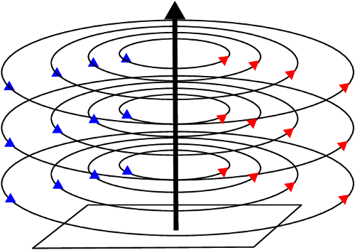

The direction of the current in the conductor (wire) is shown by the central arrow. The circles are field lines
      and they also have a direction indicated by the arrows on the lines. Similar to the situation with electric field
      lines, the greater the number of lines (or the closer they are together) in an area the stronger the magnetic
      field.

**Important:** all of our discussion regarding field directions assumes that we are dealing with
      **conventional current**.

To help you visualise this situation, stand a pen or pencil straight up on a desk. The circles are centred around
      the pencil or pen and would be drawn parallel to the surface of the desk. The tip of the pen or pencil would point
      in the direction of the current flow.

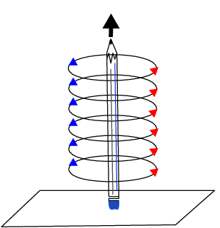

You can look at the pencil or pen from above and the pencil or pen will be a dot in the centre of the circles.
      The direction of the magnetic field lines is counter-clockwise for this situation.

To make it easier to see what is happening we are only going to draw one set of circular fields lines but note
      that this is just for the illustration.

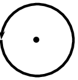

If you put a piece of paper behind the pencil and look at it from the side, then you would be seeing the circular
      field lines side on and it is hard to know that they are circular. They go through the paper. Remember that field
      lines have a direction, so when you are looking at the piece of paper from the side it means that the circles go
      into the paper on one side of the pencil and come out of the paper on the other side.

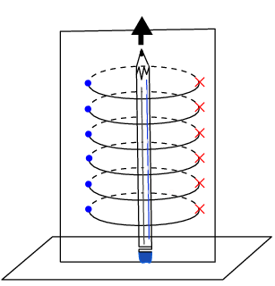

When
      we are drawing directions of magnetic fields and currents, we use
      the symbols \(\odot\) and \(\otimes\).
      The symbol
      \(\odot\)
      represents an
      arrow that is coming out of the page and the symbol
      \(\otimes\)
      represents an arrow that is going into the page.

It is easy to remember the meanings of the symbols if you think of
      an arrow with a sharp tip at the head and a tail with feathers in the shape of a cross.

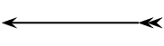

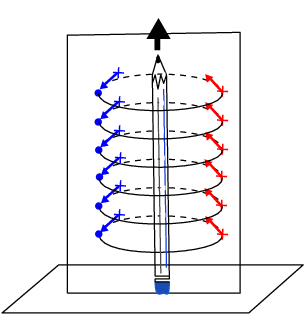

<Callout type="note" title="Note">
The Danish physicist, Hans Christian Oersted, was lecturing one day in 1820 on the possibility of electricity
        and magnetism being related to one another, and in the process demonstrated it conclusively with an experiment
        in front of his whole class. By passing an electric current through a metal wire suspended above a magnetic
        compass, Oersted was able to produce a definite motion of the compass needle in response to the current. What
        began as a guess at the start of the class session was confirmed as fact at the end. Needless to say, Oersted
        had to revise his lecture notes for future classes. His discovery paved the way for a whole new branch of
        science - electromagnetism.
</Callout>

We will now look at three examples of current carrying wires. For each example we will determine the magnetic
      field and draw the magnetic field lines around the conductor.

### Magnetic field around a straight wire (ESBPT)

The direction of the magnetic field around the current carrying
        conductor is shown in Figure 10.1.

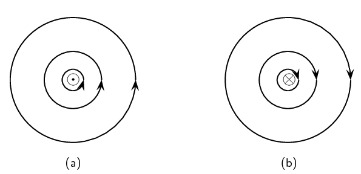

Figure 10.1:
          Magnetic field around a conductor when you look at the
          conductor from one end. (a) Current flows out of the page and the
          magnetic field is counter-clockwise. (b) Current flows into the
          page and the magnetic field is clockwise.

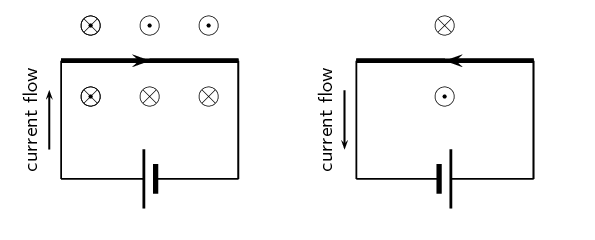

Figure 10.2:
          Magnetic fields around a conductor looking down on the conductor. (a) Current flows clockwise. (b) current
          flows counter-clockwise.

## Direction of a magnetic field

Using the directions given in Figure 10.1 and Figure 10.2 try to find a rule that easily tells you the
          direction of the magnetic field.

Hint: Use your fingers. Hold the wire in your hands and try to find a link between the direction of your
          thumb and the direction in which your fingers curl.

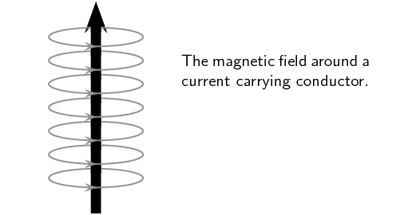

There is a simple method of finding the relationship between the direction of the current flowing in a
        conductor and the direction of the magnetic field around the same conductor. The method is called the *Right
          Hand Rule*. Simply stated, the Right Hand Rule says that the magnetic field lines produced by a
        current-carrying wire will be oriented in the same direction as the curled fingers of a person's right hand (in
        the “hitchhiking” position), with the thumb pointing in the direction of the current flow.

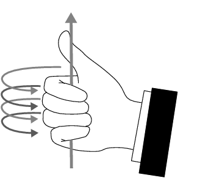

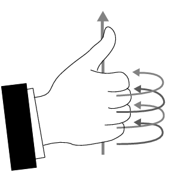

<Callout type="note" title="Note">
Your right hand and left hand are unique in the sense that you cannot rotate one of them to be in the same
          position as the other. This means that the right hand part of the rule is essential. You will always get the
          wrong answer if you use the wrong hand.
</Callout>

<QuizCard id="s11-10-02a" title="Interactive Exercise 10.1" question="Lethabo is studying how current flowing in a wire can induce a magnetic field around the wire. He draws the following diagram of current flowing in a straight wire: The arrow shows the direction of conventional current in the wire. The \(\odot\) and \(\otimes\) symbols show the direction of the magnetic field. Did Lethabo draw the diagram correctly?" options=[] answer="0" hint="" explanation="Recall the Right Hand Grip Rule The magnetic field lines produced by a current-carrying wire will point in the same direction as the curled fingers of a person’s right hand (in the “hitch-hiking” position), with the thumb pointing in the direction of conventional current. What do the symbols \(\odot\) and \(\otimes\) mean? The symbol \(\odot\) means a vector is pointing out of the page (towards you) and the symbol \(\otimes\) means a vector is pointing into the page (away from you). TIP: To remember this, think of an arrow with a sharp tip and a feathered end . If the arrow is coming towards you, you'll just see the tip which will look a bit like \(\mathbf{{\color{blue}{\odot}}}\) . And if the arrow is moving away from you, you'll see the feathered end which will look a bit like \(\mathbf{{\color{red}{\otimes}}}\) . Lethabo's diagram is correct. Submit your answer as: The diagram is correct." />

<QuizCard id="s11-10-02a" title="Interactive Exercise 10.1" question="Anathi is studying how current flowing in a wire can induce a magnetic field around the wire. She draws the following diagram of current flowing in a straight wire: The arrow shows the direction of conventional current in the wire. The \(\odot\) and \(\otimes\) symbols show the direction of the magnetic field. Did Anathi draw the diagram correctly?" options=[] answer="1" hint="" explanation="Recall the Right Hand Grip Rule The magnetic field lines produced by a current-carrying wire will point in the same direction as the curled fingers of a person’s right hand (in the “hitch-hiking” position), with the thumb pointing in the direction of conventional current. What do the symbols \(\odot\) and \(\otimes\) mean? The symbol \(\odot\) means a vector is pointing out of the page (towards you) and the symbol \(\otimes\) means a vector is pointing into the page (away from you). TIP: To remember this, think of an arrow with a sharp tip and a feathered end . If the arrow is coming towards you, you'll just see the tip which will look a bit like \(\mathbf{{\color{blue}{\odot}}}\) . And if the arrow is moving away from you, you'll see the feathered end which will look a bit like \(\mathbf{{\color{red}{\otimes}}}\) . Anathi's diagram is incorrect. The correct diagram is: Submit your answer as: The diagram is incorrect." />

## The Right Hand Rule

Use the Right Hand Rule to draw in the directions of the magnetic fields for the following conductors with
          the currents flowing in the directions shown by the arrows. The first problem has been completed for you.

| 1. |  | 2. |  | 3. |  | 4. |  |
| --- | --- | --- | --- | --- | --- | --- | --- |
| 5. |  | 6. |  | 7. |  | 8. |  |
| 9. |  | 10. |  | 11. |  | 12. |  |

## Magnetic field around a current carrying conductor

### Apparatus

2. one \(\text{9}\) \(\text{V}\)
                   battery with holder
4. two hookup wires with alligator clips
6. compass
8. stop watch

### Method

2. Connect your wires to the battery leaving one end of each wire unconnected so that the circuit is not
                   closed.
4. Be sure to limit the current flow to \(\text{10}\) \(\text{seconds}\) at a time (Why you might ask, the
                   wire has very little resistance on its own so the battery will go flat very quickly). This is to
                   preserve battery life as well as to prevent overheating of the wires and battery contacts.
6. Place the compass close to the wire.
8. Close the circuit and observe what happens to the compass.
10. Reverse the polarity of the battery and close the circuit. Observe what happens to the compass.

### Conclusions

Use your observations to answer the following questions:

2. Does a current flowing in a wire generate a magnetic field?
4. Is the magnetic field present when the current is not flowing?
6. Does the direction of the magnetic field produced by a current in a wire depend on the direction of the
                   current flow?
8. How does the direction of the current affect the magnetic field?

### Magnetic field around a current carrying loop (ESBPV)

So far we have only looked at straight wires carrying a current and the magnetic fields around them. We are
        going to study the magnetic field set up by circular loops of wire carrying a current because the field has very
        useful properties, for example you will see that we can set up a uniform magnetic field.

## Magnetic field around a loop of conductor

Imagine two loops made from wire which carry currents (in opposite directions) and are parallel to the page
          of your book. By using the Right Hand Rule, draw what you think the magnetic field would look like at
          different points around each of the two loops. Loop 1 has the current flowing in a counter-clockwise
          direction, while loop 2 has the current flowing in a clockwise direction.

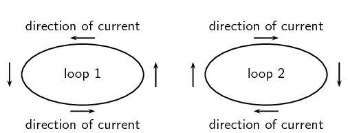

If you make a loop of current carrying conductor, then the direction of the magnetic field is obtained by
        applying the Right Hand Rule to different points in the loop.

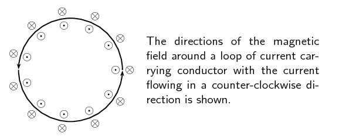

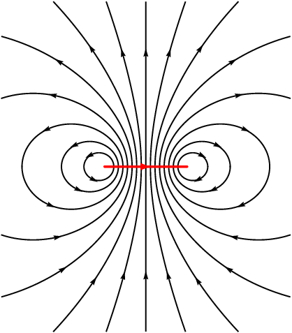

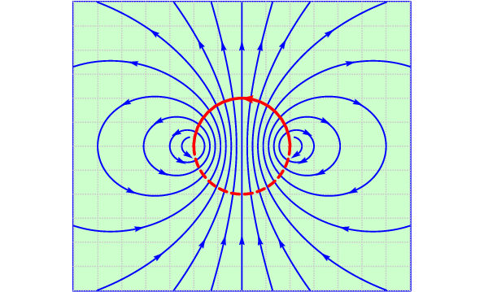

Notice that there is a variation on the Right Hand Rule. If you make the fingers of your right hand follow the
        direction of the current in the loop, your thumb will point in the direction where the field lines emerge. This
        is similar to the north pole (where the field lines emerge from a bar magnet) and shows you which side of the
        loop would attract a bar magnet's north pole.

<QuizCard id="s11-10-02b" title="Interactive Exercise 10.2" question="Werner is studying how current flowing in a wire can induce a magnetic field around the wire. He draws the following diagram of current flowing in a loop of wire: The arrows show the direction of conventional current in the wire. The \(\odot\) and \(\otimes\) symbols show the direction of the magnetic field. Did Werner draw the diagram correctly?" options=[] answer="0" hint="" explanation="Recall the Right Hand Grip Rule The magnetic field lines produced by a current-carrying wire will point in the same direction as the curled fingers of a person’s right hand (in the “hitch-hiking” position), with the thumb pointing in the direction of conventional current. What do the symbols \(\odot\) and \(\otimes\) mean? The symbol \(\odot\) means a vector is pointing out of the page (towards you) and the symbol \(\otimes\) means a vector is pointing into the page (away from you). TIP: To remember this, think of an arrow with a sharp tip and a feathered end . If the arrow is coming towards you, you'll just see the tip which will look a bit like \(\mathbf{{\color{blue}{\odot}}}\) . And if the arrow is moving away from you, you'll see the feathered end which will look a bit like \(\mathbf{{\color{red}{\otimes}}}\) . Werner's diagram is correct. Submit your answer as: The diagram is correct." />

<QuizCard id="s11-10-02b" title="Interactive Exercise 10.2" question="Nthabiseng is studying how current flowing in a wire can induce a magnetic field around the wire. She draws the following diagram of current flowing in a loop of wire: The arrows show the direction of conventional current in the wire. The \(\odot\) and \(\otimes\) symbols show the direction of the magnetic field. Did Nthabiseng draw the diagram correctly?" options=[] answer="1" hint="" explanation="Recall the Right Hand Grip Rule The magnetic field lines produced by a current-carrying wire will point in the same direction as the curled fingers of a person’s right hand (in the “hitch-hiking” position), with the thumb pointing in the direction of conventional current. What do the symbols \(\odot\) and \(\otimes\) mean? The symbol \(\odot\) means a vector is pointing out of the page (towards you) and the symbol \(\otimes\) means a vector is pointing into the page (away from you). TIP: To remember this, think of an arrow with a sharp tip and a feathered end . If the arrow is coming towards you, you'll just see the tip which will look a bit like \(\mathbf{{\color{blue}{\odot}}}\) . And if the arrow is moving away from you, you'll see the feathered end which will look a bit like \(\mathbf{{\color{red}{\otimes}}}\) . Nthabiseng's diagram is incorrect. The correct diagram is: Submit your answer as: The diagram is incorrect." />

### Magnetic field around a solenoid (ESBPW)

If we now add another loop with the current in the same direction, then the magnetic field around each loop can
        be added together to create a stronger magnetic field. A coil of many such loops is called a *solenoid*.
        A solenoid is a cylindrical coil of wire acting as a magnet when an electric current flows through the wire. The
        magnetic field pattern around a solenoid is similar to the magnetic field pattern around the bar magnet that you
        studied in Grade 10, which had a definite north and south pole as shown in Figure 10.3.

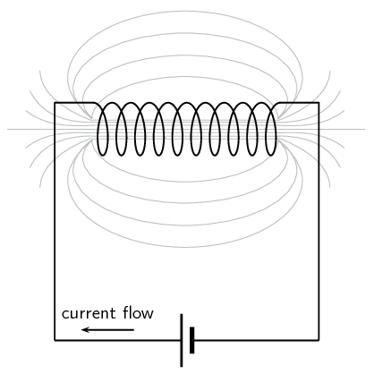

Figure 10.3:
          Magnetic field around a solenoid.

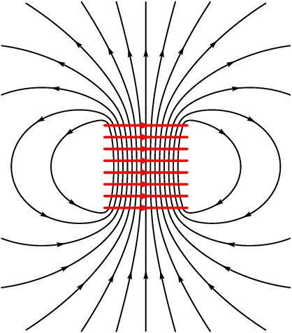

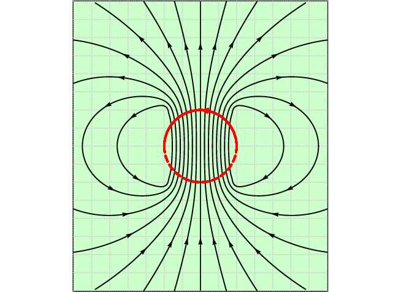

### Real-world applications (ESBPX)

#### Electromagnets

An *electromagnet* is a piece of wire intended to generate a magnetic field with the passage of
          electric current through it. Though all current-carrying conductors produce magnetic fields, an electromagnet
          is usually constructed in such a way as to maximise the strength of the magnetic field it produces for a
          special purpose. Electromagnets are commonly used in research, industry, medical, and consumer products. An
          example of a commonly used electromagnet is in security doors, e.g. on shop doors which open automatically.

As an electrically-controllable magnet, electromagnets form part of a wide variety of
          “electromechanical” devices: machines that produce a mechanical force or motion through electrical
          power. Perhaps the most obvious example of such a machine is the *electric motor* which will be
          described in detail in Grade 12. Other examples of the use of electromagnets are electric bells, relays,
          loudspeakers and scrapyard cranes.

<Callout type="note" title="Note">
<VideoPlayer src="https://youtu.be/VB55RwvoPi4" title="Video: 23ZP" />
</Callout>

## Electromagnets

### Aim

A magnetic field is created when an electric current flows through a wire. A single wire does not produce
              a strong magnetic field, but a wire coiled around an iron core does. We will investigate this behaviour.

### Apparatus

2. a battery and holder
4. a length of wire
6. a compass
8. a few nails

### Method

2. If you have not done the previous experiment in this chapter do it now.
4. Bend the wire into a series of coils before attaching it to the battery. Observe what happens to the
                     deflection of the needle on the compass. Has the deflection of the compass grown stronger?
6. Repeat the experiment by changing the number and size of the coils in the wire. Observe what happens
                     to the deflection on the compass.
8. Coil the wire around an iron nail and then attach the coil to the battery. Observe what happens to
                     the deflection of the compass needle.

### Conclusions

2. Does the number of coils affect the strength of the magnetic field?
4. Does the iron nail increase or decrease the strength of the magnetic field?

## Overhead power lines and the environment

### Physical impact

Power lines are a common sight all across our country. These lines bring power from the power stations to
            our homes and offices. But these power lines can have negative impacts on the environment. One hazard that
            they pose is to birds which fly into them. Conservationist Jessica Shaw has spent the last few years looking
            at this threat. In fact, power lines pose the primary threat to the blue crane, South Africa's national
            bird, in the Karoo.

“We are lucky in South Africa to have a wide range of bird species, including many large birds like
            cranes, storks and bustards. Unfortunately, there are also a lot of power lines, which can impact on birds
            in two ways. They can be electrocuted when they perch on some types of pylons, and can also be killed by
            colliding with the line if they fly into it, either from the impact with the line or from hitting the ground
            afterwards. These collisions often happen to large birds, which are too heavy to avoid a power line if they
            only see it at the last minute. Other reasons that birds might collide include bad weather, flying in flocks
            and the lack of experience of younger birds.

Over the past few years we have been researching the serious impact that power line collisions have on Blue
            Cranes and Ludwig’s Bustards. These are two of our endemic species, which means they are only found in
            southern Africa. They are both big birds that have long lifespans and breed slowly, so the populations might
            not recover from high mortality rates. We have walked and driven under power lines across the Overberg and
            the Karoo to count dead birds. The data show that thousands of these birds are killed by collisions every
            year, and Ludwig’s Bustard is now listed as an Endangered species because of this high level of
            unnatural mortality. We are also looking for ways to reduce this problem, and have been working with Eskom
            to test different line marking devices. When markers are hung on power lines, birds might be able to see the
            power line from further away, which will give them enough time to avoid a collision.”

### Impact of fields

The fact that a field is created around the power lines means that they can potentially have an impact at a
            distance. This has been studied and continues to be a topic of significant debate. At the time of writing,
            the World Health Organisation guidelines for human exposure to electric and magnetic fields indicate that
            there is no clear link between exposure to the magnetic and electric fields that the general public
            encounters from power lines, because these are extremely low frequency fields.

Power line noise can interfere with radio communications and broadcasting. Essentially, the power lines or
            associated hardware improperly generate unwanted radio signals that override or compete with desired radio
            signals. Power line noise can impact the quality of radio and television reception. Disruption of radio
            communications, such as amateur radio, can also occur. Loss of critical communications, such as police,
            fire, military and other similar users of the radio spectrum, can result in even more serious consequences.

Group discussion:

- Discuss the above information.
- Discuss other ways that power lines affect the environment.

<Callout type="note" title="Note">
When lightning strikes a ship or an aeroplane, it can damage or otherwise change its magnetic compass. There
          have been recorded instances of a lightning strike changing the polarity of the compass so the needle points
          south instead of north.
</Callout>

## Magnetic Fields

### Textbook Exercise 10.1

**Problem:**
Give evidence for the existence of a magnetic field near a current carrying wire.

**Solution:**
If you hold a compass near a wire through which current is flowing, the needle on the compass will be
                deflected. Since compasses work by pointing along magnetic field lines, this means that there must be a
                magnetic field near the wire through which the current is flowing. If the current stops flowing the
                compass returns to its original direction. If the current starts to flow again then the deflection
                happens again.

**Problem:**
Describe how you would use your right hand to determine the direction of a magnetic field around a
                current carrying conductor.

**Solution:**
We use the right hand rule which says that the magnetic field lines produced by a current-carrying wire
                will be oriented in the same direction as the curled fingers of a person's right hand (in the
                “hitchhiking” position), with the thumb pointing in the direction of the current flow:

Use the Right Hand Rule to determine the direction of the magnetic field for the following situations:

**Problem:**
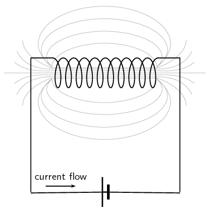

**Solution:**
Out of the page

**Problem:**

**Solution:**
into the page

**Problem:**
Use the Right Hand Rule to find the direction of the magnetic fields at each of the points labelled A -
                H in the following diagrams.

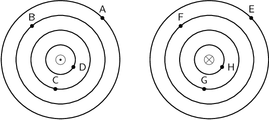

**Solution:**
- A: counterclockwise
- B: counterclockwise
- C: counterclockwise
- D: counterclockwise
- E: clockwise
- F: clockwise
- G: clockwise
- H: clockwise
