## 10.3 Faraday's law of electromagnetic induction (ESBPY)

### Current induced by a changing magnetic field (ESBPZ)

While Oersted's surprising discovery of electromagnetism paved the way for more practical applications of
        electricity, it was Michael Faraday who gave us the key to the practical generation of electricity:
        **electromagnetic induction**.

Faraday discovered that when he moved a magnet near a wire a voltage was generated across it. If the magnet was
        held stationary no voltage was generated, the voltage only existed while the magnet was moving. We call this
        voltage the induced emf (\(\mathcal{E}\)).

A circuit loop connected to a sensitive ammeter will register a current if it is set up as in this figure and
        the magnet is moved up and down:

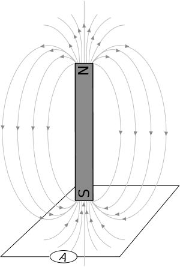

#### Magnetic flux

Before we move onto the definition of Faraday's law of electromagnetic induction and examples, we first need
          to spend some time looking at the magnetic flux. For a loop of area \(A\) in the presence of a uniform
          magnetic field, \(\vec{B}\), the magnetic flux (\(φ\)) is defined as:
          \[\phi = BA\cos\theta\]

          Where:
          \begin{align*}
          \theta & = \text{the angle between the magnetic field, B, and the normal to the loop of area A}\\
          A & = \text{the area of the loop}\\
          B & = \text{the magnetic field}
          \end{align*}

The S.I. unit of magnetic flux is the weber (Wb).

You might ask yourself why the angle \(\theta\) is included. The flux depends on the magnetic field that
          passes through surface. We know that a field parallel to the surface can't induce a current because it doesn't
          pass through the surface. If the magnetic field is not perpendicular to the surface then there is a component
          which is perpendicular and a component which is parallel to the surface. The parallel component can't
          contribute to the flux, only the vertical component can.

In this diagram we show that a magnetic field at an angle other than perpendicular can be broken into
          components. The component perpendicular to the surface has the magnitude \(B\cos(\theta)\) where \(\theta\) is
          the angle between the normal and the magnetic field.

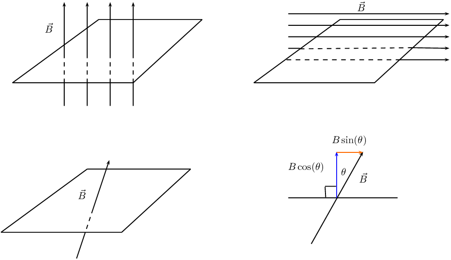

<QuizCard id="s11-10-03a" title="Interactive Exercise 10.3" question="A cylindrical solenoid is placed in a uniform magnetic field. The solenoid is made up of \(\text{13}\) turns and it has a radius of \(\text{1,6}\ \text{m}\) . The strength of the magnetic field is \(\text{2,4}\ \text{T}\) . The normal to the solenoid makes an angle of \(\text{75}\text{°}\) to the magnetic field. Calculate the magnetic flux through the solenoid. INSTRUCTION: Round your answer to two decimal places ." options=[] answer="['5.00', '5.00e+0']" hint="You should enter a number here. If you want to, you can use a space to separate thousands.                Example: 12 800,25 For scientific notation you need to use the multiply symbol                ( ∗ ) and the exponent symbol ( ^ ). For example 6,673 × 10 −11 should be written as: 6,673 ∗ 10^−11" explanation="Identify what is given and what is required First, we can list the variables that we have: \[ 				\begin{aligned} 					B & = \text{2,4}\ \text{T} \\ 					\theta & = \text{75}\text{°} \\ 					r & = \text{1,6}\ \text{m} \\ 					\phi & = \Large{\textbf{?}} 				\end{aligned} 				\] We also have the number of turns in the solenoid, \(N\) , but we do not need this to calculate magnetic flux. How is magnetic flux calculated? The magnetic flux is a measure of the number of field lines passing through the cross-sectional area of a coil (the area enclosed by the coil). It depends on the strength of the magnetic field , the size of the cross-sectional area , and the angle between the magnetic field lines and the normal to the coil. The normal to the coil is perpendicular to the cross-sectional area by definition . Diagram from OpenStax ( CC-BY ). The magnetic flux \((\phi)\) passing through an area is calculated using the formula: \[                     \begin{array}{c}                         \phi = BA\cos{\theta}                     \end{array}                 \] TIP: The magnetic flux through the coil is through just one turn of the coil. You must not multiply by the number of turns. Use the definition of magnetic flux and solve for the unknown In this case the shape of the coil is a cylinder, so the cross-sectional area is that of a circle \(A = \pi r^{2}\) . We can substitute this into the above equation to get: \[ 					\begin{aligned} 						\phi &= B (\pi r^{2}) \cos\theta \\ 						\therefore \phi & = (\text{2,4}) (\pi) (\text{1,6}^2) \cos\text{75}\text{°} \\  						& = \text{4,99571...} \\ & \approx \text{5,00}\ \text{Wb} 					\end{aligned} 				\] Therefore the magnetic flux through the solenoid is \(\text{5,00}\ \text{Wb}\) . Submit your answer as:" />

Faraday's Law of electromagnetic induction

The emf, \(\mathcal{E}\), produced around a loop of conductor is proportional to the rate of change of the
            magnetic flux, φ, through the area, A, of the loop. This can be stated mathematically as:

          \[\mathcal{E} = -N\frac{\Delta\phi}{\Delta t}\]

where \(\phi =B·A\) and B is the strength of the magnetic field. \(N\) is the number of circuit loops.
            A magnetic field is measured in units of teslas (T). The minus sign indicates direction and that the induced
            emf tends to oppose the change in the magnetic flux. The minus sign can be ignored when calculating
            magnitudes.

<QuizCard id="s11-10-03b" title="Interactive Exercise 10.4" question="Adapted from DBE Nov 2015 Grade 11, P1, Q10.1 Physical constants · Physics formulas The arrangement of apparatus to demonstrate Faraday's law of electromagnetic induction is shown below. State Faraday's law of electromagnetic induction in words." options=["induced emf", "number of windings", "magnetic field strength", "magnetic flux", "inversely proportional to", "less than", "directly proportional to", "greater than", "induced current", "rate of change of magnetic flux", "equivalent resistance", "change in magnetic field"] answer="0, 0, 0" hint="" explanation="Recall Faraday's law The magnitude of the induced emf across the ends of a conductor is directly proportional to the rate of change of the magnetic flux . We can represent this relationship symbolically: \[                     \begin{array}{c}                         {\color{DarkOrange}{\mathcal{E}}} \propto {\color{teal}{\dfrac{\Delta \phi}{\Delta t}}}                     \end{array}                 \] \({\color{DarkOrange}{\mathcal{E}}}\) is the induced emf \(\Delta \phi\) is the change in magnetic flux \(\Delta t\) is the time interval over which the magnetic flux changes The fraction \({\color{teal}{\dfrac{\Delta \phi}{\Delta t}}}\) is the rate of change of the magnetic flux with respect to time. Submit your answer as: induced emf and directly proportional to and rate of change of magnetic flux" />

<QuizCard id="s11-10-03b" title="Interactive Exercise 10.4" question="Adapted from DBE Nov 2015 Grade 11, P1, Q10.1 Physical constants · Physics formulas The arrangement of apparatus to demonstrate Faraday's law of electromagnetic induction is shown below. Identify two ways in which the size of the deflection on the galvanometer can be decreased ." options=[] answer="2, 0" hint="" explanation="Use Faraday's law The deflection of the galvanometer is a measure of the size of the induced current or the induced emf when a magnet moves near a coil. So we're looking for factors that will decrease the size of the induced emf. Recall Faraday's law and the definition of magnetic flux: \[                     \begin{array}{c}                         \mathcal{E} = -N\dfrac{\Delta \phi}{\Delta t} \\                         \text{and} \\                         \phi = B A \cos{\theta}                     \end{array}                 \] If we combine these we have: \[                     \begin{array}{c}                         \mathcal{E} = -N\dfrac{\Delta (B A \cos{\theta})}{\Delta t}                     \end{array}                 \] So the size of the deflection on the galvanometer will depend on: \(N\) , the number of windings (turns) in the coil \(B\) , the strength of the magnetic field (from the magnet) \(A\) , the cross-sectional area of the coil (the area enclosed by the coil) \(\theta\) , the angle between the field lines and the normal to the coil (which depends on the orientation of the magnet) \(\Delta t\) , how much time it takes to move the magnet Pay careful attention to which factors are in the denominator and which are in the numerator of the fraction. Any of the following will decrease the size of the induced emf: decreasing \(N\) , \(B\) , or \(A\) increasing \(\theta\) (which will decrease \(\cos{\theta}\) ) increasing \(\Delta t\) (by moving the magnet slower) What factors will decrease the size of the deflection? Any of the following changes will decrease the the size of the deflection of the galvanometer: using a coil with a smaller cross-sectional area moving the magnet slower using a coil with fewer windings moving the magnet further away from the coil using a weaker magnet Submit your answer as: using a coil with a smaller cross-sectional area and moving the magnet slower." />

Faraday's Law relates induced emf to the rate of change of flux, which is the product of the magnetic field and
        the cross-sectional area through which the field lines pass.

<Callout type="note" title="Note">
It is not the area of the wire itself but the area that the wire encloses. This means that if you bend the
          wire into a circle, the area we would use in a flux calculation is the surface area of the circle, not the
          wire.
</Callout>

In this illustration, where the magnet is in the same plane as the circuit loop, there would be no current even
        if the magnet were moved closer and further away. This is because the magnetic field lines do not pass through
        the enclosed area but are parallel to it. The magnetic field lines must pass through the area enclosed by the
        circuit loop for an emf to be induced.

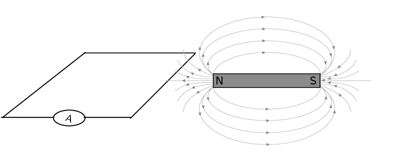

### Direction of induced current (ESBQ2)

The most important thing to remember is that the induced current opposes whatever change is taking place.

In the first picture (left) the circuit loop has the south pole of a magnet moving closer. The magnitude of the
        field from the magnet is getting larger. The response from the induced emf will be to try to resist the field
        towards the pole getting stronger. The field is a vector so the current will flow in a direction so that the
        fields due to the current tend to cancel those from the magnet, keeping the resultant field the same.

To resist the change from an approaching south pole from above, the current must result in field lines that
        move away from the approaching pole. The induced magnetic field must therefore have field lines that go down on
        the inside of the loop. The current direction indicated by the arrows on the circuit loop will achieve this.
        Test this by using the Right Hand Rule. Put your right thumb in the direction of one of the arrows and notice
        that the field curls downwards into the area enclosed by the loop.

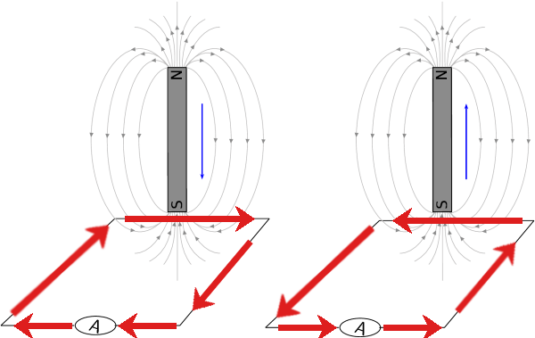

In the second diagram the south pole is moving away. This means that the field from the magnet will be getting
        weaker. The response from the induced current will be to set up a magnetic field that adds to the existing one
        from the magnetic to resist it decreasing in strength.

Another way to think of the same feature is just using poles. To resist an approaching south pole the current
        that is induced creates a field that looks like another south pole on the side of the approaching south pole.
        Like poles repel, you can think of the current setting up a south pole to repel the approaching south pole. In
        the second panel, the current sets up a north pole to attract the south pole to stop it moving away.

We can also use the variation of the Right Hand Rule, putting your fingers in the direction of the current to
        get your thumb to point in the direction of the field lines (or the north pole).

We can test all of these on the cases of a north pole moving closer or further away from the circuit. For the
        first case of the north pole approaching, the current will resist the change by setting up a field in the
        opposite direction to the field from the magnet that is getting stronger. Use the Right Hand Rule to confirm
        that the arrows create a field with field lines that curl upwards in the enclosed area cancelling out those
        curling downwards from the north pole of the magnet.

Like poles repel, alternatively test that putting the fingers of your right hand in the direction of the
        current leaves your thumb pointing upwards indicating a north pole.

For the second figure where the north pole is moving away the situation is reversed.

### Direction of induced current in a solenoid (ESBQ3)

The approach for looking at the direction of current in a solenoid is the same the approach described above.
        The only difference being that in a solenoid there are a number of loops of wire so the magnitude of the induced
        emf will be different. The flux would be calculated using the surface area of the solenoid multiplied by the
        number of loops.

**Remember:** the directions of currents and associated magnetic fields can all be found using
        only the Right Hand Rule. When the fingers of the right hand are pointed in the direction of the magnetic field,
        the thumb points in the direction of the current. When the thumb is pointed in the direction of the magnetic
        field, the fingers point in the direction of the current.

The direction of the current will be such as to oppose the change. We would use a setup as in this sketch to do
        the test:

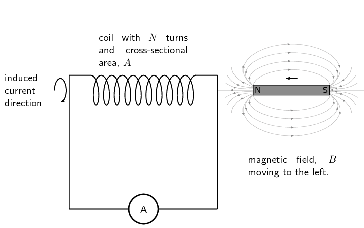

In the case where a north pole is brought towards the solenoid the current will flow so that a north pole is
        established at the end of the solenoid closest to the approaching magnet to repel it (verify using the Right
        Hand Rule):

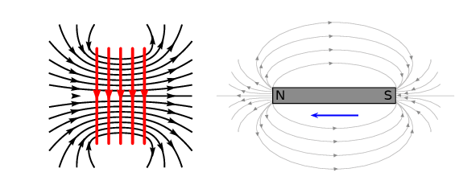

In the case where a north pole is moving away from the solenoid the current will flow so that a south pole is
        established at the end of the solenoid closest to the receding magnet to attract it:

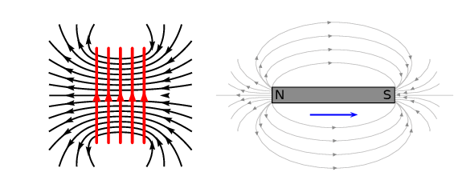

In the case where a south pole is moving away from the solenoid the current will flow so that a north pole is
        established at the end of the solenoid closest to the receding magnet to attract it:

In the case where a south pole is brought towards the solenoid the current will flow so that a south pole is
        established at the end of the solenoid closest to the approaching magnet to repel it:

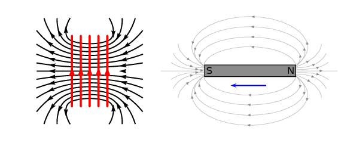

<QuizCard id="s11-10-03c" title="Interactive Exercise 10.5" question="Adapted from DBE Nov 2015 Grade 11, P1, Q1.9 Physical constants · Physics formulas In the diagram below, the south pole of a bar magnet is pulled away from Point X at the end of a solenoid. Which one of the following options about the polarity of X and the direction of the magnetic field inside the solenoid is correct? Polarity of X Magnetic field direction inside the solenoid A north pole Y to X B north pole X to Y C south pole X to Y D south pole Y to X" options=["A", "B", "C", "D"] answer="A" hint="" explanation="Apply Lenz's law A change in magnetic flux through a conductor will induce an emf in the conductor. Lenz's law states that the direction of the induced emf (and current) will be such that it opposes the change in magnetic flux. The induced current will create its own magnetic field. This magnetic field will have a direction so that the motion of the magnet is opposed. If the magnet moves away from the solenoid, the induced magnetic field in the solenoid will tend to attract the magnet. If the magnet moves towards the solenoid, the induced magnetic field in the solenoid will tend to repel the magnet. Remember that like poles repel each other and opposite poles attract . The south pole of the magnet is pulled away from X . This means that X will become a north pole to attract the magnet in order to \"oppose the change\". Work out the direction of the magnetic field inside the solenoid Magnetic fields form complete loops. Magnetic fields have direction. On the outside of a magnet, they always point from north to south. But on the inside of a magnet, they always point from south to north ! Because X is a north pole, the field lines on the inside of the solenoid must point from Y to X . NOTE: The magnetic field from the bar magnet and the induced field from the solenoid will interact with each other. The above diagram shows only the field of the solenoid. We can now answer the question. Polarity of X Magnetic field direction inside the solenoid A \({\color{red}{{\checkmark}{\checkmark}}}\) north pole Y to X B north pole X to Y C south pole X to Y D south pole Y to X The correct option is A . Submit your answer as: A" />

<QuizCard id="s11-10-03c" title="Interactive Exercise 10.5" question="Adapted from DBE Nov 2016 Grade 11, P1, Q1.9 Physical constants · Physics formulas A magnet is moved near a solenoid. Which one of the diagrams below correctly shows the induced polarity of the solenoid? A B C D" options=["A", "B", "C", "D"] answer="C" hint="" explanation="Apply Lenz's law A change in magnetic flux through a conductor will induce an emf in the conductor. Lenz's law states that the direction of the induced emf (and current) will be such that it opposes the change in magnetic flux. The induced current will create its own magnetic field. This magnetic field will have a direction so that the motion of the magnet is opposed. If the magnet moves away from the solenoid, the induced magnetic field in the solenoid will tend to attract the magnet. If the magnet moves towards the solenoid, the induced magnetic field in the solenoid will tend to repel the magnet. Remember that like poles repel each other and opposite poles attract each other. Choose the correct diagram We can now answer the question. A Wrong. The poles of the solenoid are the wrong way round. The nearest pole will repel the magnet but it should attract it based on the motion of the magnet. B Wrong. The poles of the solenoid are the wrong way round. The nearest pole will attract the magnet but it should repel it based on the motion of the magnet. C \({\color{red}{{\checkmark}{\checkmark}}}\) Correct. The north pole induced in the solenoid correctly attracts the magnet in order to oppose its motion. D Wrong. The poles of the solenoid are the wrong way round. The nearest pole will repel the magnet but it should attract it based on the motion of the magnet. The correct option is C . Submit your answer as: C" />

<Callout type="tip" title="Note">
An easy way to create a magnetic field of changing intensity is to move a permanent magnet next to a wire or
          coil of wire. The magnetic field must increase or decrease in intensity *perpendicular* to the wire (so
          that the magnetic field lines “cut across” the conductor), or else no voltage will be induced.
</Callout>

<Callout type="tip" title="Note">
The induced current generates a magnetic field. The induced magnetic field is in a direction that tends to
          cancel out the change in the magnetic field in the loop of wire. So, you can use the Right Hand Rule to find
          the direction of the induced current by remembering that the induced magnetic field is opposite in direction
          to the change in the magnetic field.
</Callout>

#### Induction

Electromagnetic induction is put into practical use in the construction of electrical generators which use
          mechanical power to move a magnetic field past coils of wire to generate voltage. However, this is by no means
          the only practical use for this principle.

If we recall, the magnetic field produced by a current-carrying wire is always perpendicular to the wire, and
          that the flux intensity of this magnetic field varies with the amount of current which passes through it. We
          can therefore see that a wire is capable of inducing a voltage *along its own length* if the current is
          changing. This effect is called *self-induction*. Self-induction is when a changing magnetic field is
          produced by changes in current through a wire, inducing a voltage along the length of that same wire.

If the magnetic flux is enhanced by bending the wire into the shape of a coil, and/or wrapping that coil
          around a material of high permeability, this effect of self-induced voltage will be more intense. A device
          constructed to take advantage of this effect is called an *inductor*.

Remember that the induced current will create a magnetic field that opposes the change in the magnetic flux.
          This is known as Lenz's law.

<Callout type="tip" title="Worked example 1: Faraday's law">
**Question:**
Consider a flat square coil with 5 turns. The coil is \(\text{0,50}\) \(\text{m}\) on each side and has a
            magnetic field of \(\text{0,5}\) \(\text{T}\) passing through it. The plane of the coil is perpendicular to
            the magnetic field: the field points out of the page. Use Faraday's Law to calculate the induced emf, if the
            magnetic field is increases uniformly from \(\text{0,5}\) \(\text{T}\) to \(\text{1}\) \(\text{T}\) in
            \(\text{10}\) \(\text{s}\). Determine the direction of the induced current.

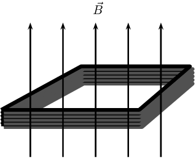

**Identify what is required:**
We are required to use
            Faraday's Law to calculate the induced emf.

**Write Faraday's Law:**
\[\mathcal{E}=-N\frac{\Delta\phi}{\Delta t}\]

            We know that the magnetic field is at right angles to the surface and so aligned with the normal. This means
            we do not need to worry about the angle that the field makes with the normal and \(\phi=BA\). The starting
            or initial magnetic field, \(B_i\), is given as is the final field magnitude, \(B_f\). We want to determine
            the magnitude of the emf so we can ignore the minus sign.

The area, \(A\), is the area of square coil.

**Solve Problem:**
\begin{align*}
          \mathcal{E}&=N\frac{\Delta\phi}{\Delta t}\\
          &=N\frac{\phi_f-\phi_i}{\Delta t} \\
          &=N\frac{B_fA - B_iA}{\Delta t} \\
          &=N\frac{A(B_f - B_i)}{\Delta t} \\
          &=(5)\frac{(\text{0,50})^2(\text{1} - \text{0,50})}{\text{10}} \\
          &=(5)\frac{(\text{0,50})^2(\text{1} - \text{0,50})}{\text{10}} \\
          &=\text{0,0625}\text{ V}
          \end{align*}

The induced current is anti-clockwise as viewed from the direction of the increasing magnetic field.
</Callout>

<Callout type="tip" title="Worked example 2: Faraday's law">
**Question:**
Consider a solenoid of 9 turns with unknown radius, \(r\). The solenoid is subjected to a magnetic field of
            \(\text{0,12}\) \(\text{T}\). The axis of the solenoid is parallel to the magnetic field. When the field is
            uniformly switched to \(\text{12}\) \(\text{T}\) over a period of 2 minutes an emf with a magnitude of
            \(-\text{0,3}\) \(\text{V}\) is induced.
            Determine the radius of the solenoid.

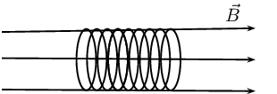

**Identify what is required:**
We are required to determine the radius of the solenoid. We know that the relationship between the induced
            emf and the field is governed by Faraday's law which includes the geometry of the solenoid. We can use this
            relationship to find the radius.

**Write Faraday's Law:**
\[\mathcal{E}=-N\frac{\Delta\phi}{\Delta t}\]

            We know that the magnetic field is at right angles to the surface and so aligned with the normal. This means
            we do not need to worry about the angle the field makes with the normal and \(\phi=BA\). The starting or
            initial magnetic field, \(B_i\), is given as is the final field magnitude, \(B_f\). We can drop the minus
            sign because we are working with the magnitude of the emf only.

The area, \(A\), is the surface area of the solenoid which is \(\pi r^2\).

**Solve Problem:**
\begin{align*}
          \mathcal{E}&=N\frac{\Delta\phi}{\Delta t}\\
          &=N\frac{\phi_f-\phi_i}{\Delta t} \\
          &=N\frac{B_fA - B_iA}{\Delta t} \\
          &=N\frac{A(B_f - B_i)}{\Delta t} \\
          (\text{0,30})&=(9)\frac{(\pi r^2)(\text{12} - \text{0,12})}{\text{120}} \\
          r^2 &= \frac{(\text{0,30})(\text{120})}{(9)\pi(\text{12} - \text{0,12})} \\
          r^2&=\text{0,107175} \\
          r&=\text{0,32}\text{ m}
          \end{align*}

The solenoid has a radius of \(\text{0,32}\) \(\text{m}\).
</Callout>

<Callout type="tip" title="Worked example 3: Faraday's law">
**Question:**
Consider a circular coil of 4 turns with radius \(\text{3} \times \text{10}^{-\text{2}}\) \(\text{m}\). The
            solenoid is subjected to a varying magnetic field that changes uniformly from \(\text{0,4}\) \(\text{T}\) to
            \(\text{3,4}\) \(\text{T}\) in an interval of \(\text{27}\) \(\text{s}\). The axis of the solenoid makes an
            angle of \(\text{35}\)\(\text{°}\) to the magnetic field. Find the induced emf.

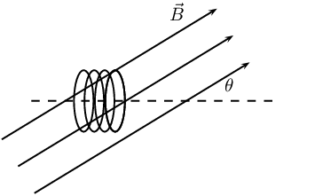

**Identify what is required:**
We are required to use
            Faraday's Law to calculate the induced emf.

**Write Faraday's Law:**
\[\mathcal{E}=-N\frac{\Delta\phi}{\Delta t}\]

            We know that the magnetic field is at an angle to the surface normal. This means we must account for the
            angle that the field makes with the normal and \(\phi=BA\cos(\theta)\). The starting or initial magnetic
            field, \(B_i\), is given as is the final field magnitude, \(B_f\). We want to determine the magnitude of the
            emf so we can ignore the minus sign.

The area, \(A\), will be \(\pi r^2\).

**Solve Problem:**
\begin{align*}
          \mathcal{E}&=N\frac{\Delta\phi}{\Delta t}\\
          &=N\frac{\phi_f-\phi_i}{\Delta t} \\
          &=N\frac{B_fA\cos(\theta) - B_iA\cos(\theta)}{\Delta t} \\
          &=N\frac{A\cos(\theta)(B_f - B_i)}{\Delta t} \\
          &=(4)\frac{(\pi(\text{0,03})^2\cos(\text{35}))(\text{3,4} - \text{0,4})}{\text{27}} \\
          &=\text{1,03} \times \text{10}^{-\text{3}}\text{ V}
          \end{align*}

The induced current is anti-clockwise as viewed from the direction of the increasing magnetic field.
</Callout>

<QuizCard id="s11-10-03d" title="Interactive Exercise 10.6" question="A solenoid is placed in a uniform magnetic field. The solenoid consists of \(\text{11}\ \text{turns}\) . The change in magnetic flux of the solenoid is \(\text{14,9}\ \text{Wb}\) in a time interval of \(\text{4,64}\ \text{s}\) . Find the magnitude (size) of the emf induced in the coil. INSTRUCTION: Round your answer to two decimal places ." options=[] answer="['35.32', '3.53e+1', '-35.32', '-3.53e+1']" hint="You should enter a number here. If you want to, you can use a space to separate thousands.                Example: 12 800,25 For scientific notation you need to use the multiply symbol                ( ∗ ) and the exponent symbol ( ^ ). For example 6,673 × 10 −11 should be written as: 6,673 ∗ 10^−11" explanation="Consider what is given and what is required First, we can list the variables that we have and identify the one we are asked to find: \[             \begin{aligned}               \mathcal{E} & = \Large{\textbf{?}} \\               N & = \text{11}\ \text{turns} \\               \Delta \phi & = \text{14,9}\ \text{Wb} \\               \Delta t & = \text{4,64}\ \text{s}             \end{aligned}             \] Use Faraday's law of electromagnetic induction \[                 \begin{aligned}                     \mathcal{E} &= - N \dfrac{\Delta \phi}{\Delta t} \\                     \therefore \mathcal{E} & = - (\text{11}) \left( \dfrac{\text{14,9}}{\text{4,64}} \right) \\                      &= -\text{35,32327...} \\ & \approx -\text{35,32}\ \text{V}                 \end{aligned}             \] Therefore the magnitude (size) of the emf induced in the coil is \(\text{35,32}\ \text{V}\) . Submit your answer as:" />

<QuizCard id="s11-10-03d" title="Interactive Exercise 10.6" question="A solenoid is placed in a uniform magnetic field. The solenoid consists of \(\text{10}\ \text{turns}\) . The change in magnetic flux of the solenoid is \(-\text{6,2}\ \text{Wb}\) . The emf induced in the coil is \(\text{38,77}\ \text{V}\) . Calculate the time taken for the flux to change. INSTRUCTION: Round your answer to two decimal places ." options=[] answer="['1.60', '1.60e+0']" hint="You should enter a number here. If you want to, you can use a space to separate thousands.                Example: 12 800,25 For scientific notation you need to use the multiply symbol                ( ∗ ) and the exponent symbol ( ^ ). For example 6,673 × 10 −11 should be written as: 6,673 ∗ 10^−11" explanation="Consider what is given and what is required First, we can list the variables that we have and identify the one we are asked to find: \[             \begin{aligned}               \mathcal{E} & = \text{38,77}\ \text{V} \\               N & = \text{10}\ \text{turns} \\               \Delta \phi & = -\text{6,2}\ \text{Wb} \\               \Delta t & = \Large{\textbf{?}}             \end{aligned}             \] Use Faraday's law of electromagnetic induction \[                 \begin{aligned}                     \mathcal{E} &= - N \dfrac{\Delta \phi}{\Delta t} \\                     \therefore \text{38,77} & = - (\text{10}) \left( \dfrac{-\text{6,2}}{\Delta t} \right) \\ \therefore \Delta t &= \dfrac{(-\text{10})(-\text{6,2})}{\text{38,77}} \\                     &= \text{1,59917...} \\ & \approx \text{1,60}\ \text{s}                 \end{aligned}             \] Therefore the time taken for the flux to change is \(\text{1,60}\ \text{s}\) . Submit your answer as:" />

<Callout type="note" title="Note">
[Simulation: 23ZW](http://phet.colorado.edu/en/simulation/faraday)
</Callout>

#### Real-life applications

The following devices use Faraday's Law in their operation.

- induction stoves
- tape players
- metal detectors
- transformers

## Real-life applications of Faraday's Law

Choose one of the following devices and do some research on the internet, or in a library, how your device
            works. You will need to refer to Faraday's Law in your explanation.

- induction stoves
- tape players
- metal detectors
- transformers

## Faraday's Law

### Textbook Exercise 10.2

**Problem:**
State Faraday's Law of electromagnetic induction in words and write down a mathematical relationship.

**Solution:**
The emf, \(\mathcal{E}\), produced around a loop of conductor is proportional to the rate of change
                  of the magnetic flux, φ, through the area, A, of the loop. This can be stated mathematically as:

                \[\mathcal{E} = -N\frac{\Delta\phi}{\Delta t}\]

where \(\phi =B·A\) and B is the strength of the magnetic field. \(N\) is the number of circuit
                  loops. A magnetic field is measured in units of teslas (T). The minus sign indicates direction and
                  that the induced emf tends to oppose the change in the magnetic flux. The minus sign can be ignored
                  when calculating magnitudes.

**Problem:**
Describe what happens when a bar magnet is pushed into or pulled out of a solenoid connected to an
                  ammeter. Draw pictures to support your description.

**Solution:**
In the case where a north pole is brought towards the solenoid the current will flow so that a north
                  pole is established at the end of the solenoid closest to the approaching magnet to repel it (verify
                  using the Right Hand Rule):

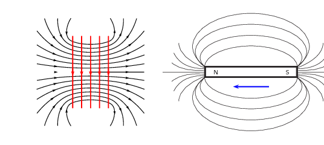

In the case where a north pole is moving away from the solenoid the current will flow so that a south
                  pole is established at the end of the solenoid closest to the receding magnet to attract it:

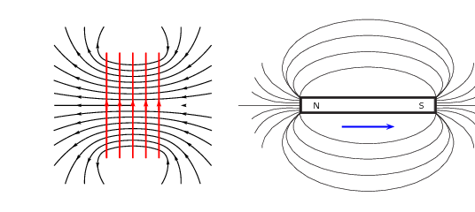

In the case where a south pole is moving away from the solenoid the current will flow so that a north
                  pole is established at the end of the solenoid closest to the receding magnet to attract it:

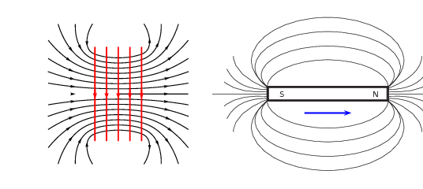

In the case where a south pole is brought towards the solenoid the current will flow so that a south
                  pole is established at the end of the solenoid closest to the approaching magnet to repel it:

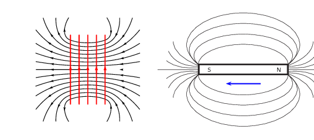

**Problem:**
Explain how it is possible for the magnetic flux to be zero when the magnetic field is not zero.

**Solution:**
The flux is related to the magnetic field:

                \(\phi = BA \cos \theta\)

If \(\cos \theta\) is 0, then the magnetic flux will be 0 even if there is a magnetic field. In this
                  case the magnetic field is parallel to the surface and does not pass through it.

**Problem:**
Use the Right Hand Rule to determine the direction of the induced current in the solenoid below.

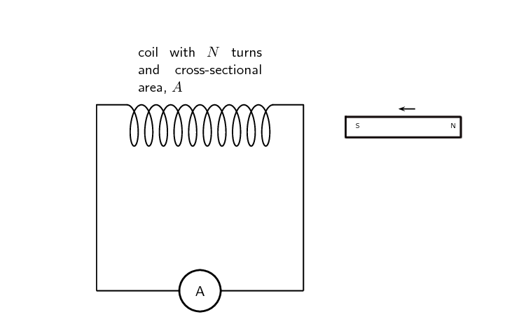

**Solution:**
A south pole of a magnet is approaching the solenoid. Lenz's law tells us that the current will flow
                  so as to oppose the change. A south pole at the end of the solenoid would oppose the approaching south
                  pole. The current will circulate into the page at the top of the coil so that the thumb on a right
                  hand points to the left.

**Problem:**
Consider a circular coil of 5 turns with radius \(\text{1,73}\) \(\text{m}\). The coil is subjected
                  to a varying magnetic field that changes uniformly from \(\text{2,18}\) \(\text{T}\) to
                  \(\text{12,7}\) \(\text{T}\) in an interval of \(\text{3}\) \(\text{minutes}\). The axis of the
                  solenoid makes an angle of \(\text{27}\)\(\text{°}\) to the magnetic field. Find the induced emf.

**Solution:**
We know that the magnetic field is at an angle to the surface normal. This means we must account for
                  the angle that the field makes with the normal and \(φ = BA \cos(θ)\). The starting or
                  initial magnetic field, \(B_{i}\), is given as is the final field magnitude, \(B_f\). We want to
                  determine the magnitude of the emf so we can ignore the minus sign. The area, A, will be
                  \(πr^{2}\) .

                \begin{align*}
                \mathcal{E} &= N\frac{\Delta\phi}{\Delta t} \\
                & = N\frac{\phi_{f} - \phi_{i}}{\Delta t} \\
                & = N\frac{B_{f}A\cos \theta - B_{i}A \cos \theta}{\Delta t} \\
                & = N\frac{A\cos \theta(B_{f} - B_{i})}{\Delta t} \\
                & = 5 \left( \frac{\pi(\text{1,73})^{2} \cos (\text{27})(\text{12,7} -
                \text{2,18})}{\text{3}\times\text{60}} \right) \\
                & = \text{2,45}\text{ V}
                \end{align*}

Consider a solenoid coil of 11 turns with radius \(\text{13,8} \times \text{10}^{-\text{2}}\)
                  \(\text{m}\). The solenoid is subjected to a varying magnetic field that changes uniformly from
                  \(\text{5,34}\) \(\text{T}\) to \(\text{2,7}\) \(\text{T}\) in an interval of \(\text{12}\)
                  \(\text{s}\). The axis of the solenoid makes an angle of \(\text{13}\)\(\text{°}\) to the
                  magnetic field.

**Problem:**
Find the induced emf.

**Solution:**
\begin{align*}
                  \mathcal{E} &= N\frac{\Delta\phi}{\Delta t} \\
                  & = N\frac{\phi_{f} - \phi_{i}}{\Delta t} \\
                  & = N\frac{B_{f}A\cos \theta - B_{i}A \cos \theta}{\Delta t} \\
                  & = N\frac{A\cos \theta(B_{f} - B_{i})}{\Delta t} \\
                  & = 11 \left( \frac{\pi(\text{13,8} \times \text{10}^{-\text{2}})^{2} \cos (\text{13})(\text{2,7}
                  - \text{5,34})}{12} \right) \\
                  & = -\text{0,14}\text{ V}
                  \end{align*}

**Problem:**
If the angle is changed to \(\text{67,4}\)\(\text{°}\), what would the radius need to be for
                    the emf to remain the same?

**Solution:**
\begin{align*}
                  \mathcal{E} &= N\frac{\Delta\phi}{\Delta t} \\
                  & = N\frac{\phi_{f} - \phi_{i}}{\Delta t} \\
                  & = N\frac{B_{f}A\cos \theta - B_{i}A \cos \theta}{\Delta t} \\
                  & = N\frac{A\cos \theta(B_{f} - B_{i})}{\Delta t} \\
                  -\text{0,14}& = 11 \left( \frac{\pi(r)^{2} \cos (\text{67,4})(\text{2,7} - \text{5,34})}{12}
                  \right) \\
                  -\text{1,68}& = -\text{35,06}(r)^{2} \\
                  r^{2} & = \text{0,0479} \\
                  r & = \text{0,22}\text{ m}
                  \end{align*}

Consider a solenoid with 5 turns and a radius of \(\text{11} \times \text{10}^{-\text{2}}\)
                  \(\text{m}\). The axis of the solenoid makes an angle of \(\text{23}\)\(\text{°}\) to the
                  magnetic field.

**Problem:**
Find the change in flux if the emf is \(\text{12}\) \(\text{V}\) over a period of \(\text{12}\)
                    \(\text{s}\).

**Solution:**
\begin{align*}
                  \mathcal{E} &= N\frac{\Delta\phi}{\Delta t} \\
                  12 & = 5 \left( \frac{\Delta \phi}{12} \right) \\
                  \Delta \phi & = \text{28,8}\text{ Wb}
                  \end{align*}

**Problem:**
If the angle is changed to \(\text{45}\)\(\text{°}\), what would the time interval need to
                    change to for the induced emf to remain the same?

**Solution:**
\begin{align*}
                  \mathcal{E} &= N\frac{\Delta\phi}{\Delta t} \\
                  & = N\frac{\phi_{f} - \phi_{i}}{\Delta t} \\
                  & = N\frac{B_{f}A\cos \theta - B_{i}A \cos \theta}{\Delta t} \\
                  & = \cos\theta \times N\frac{B_{f}A - B_{i}A}{\Delta t}
                  \end{align*}

All the values remain the same between the two situations described except for the angle and the
                    time. We can equate the equations for the two scenarios:

                  \begin{align*}
                  \mathcal{E}_1 &= \mathcal{E}_2 \\
                  \cos\theta_1 \times N\frac{B_{f}A - B_{i}A}{\Delta t_1} & = \cos\theta_2 \times N\frac{B_{f}A -
                  B_{i}A}{\Delta t_2} \\
                  \cos\theta_1 \frac{1}{\Delta t_1} & = \cos\theta_2 \frac{1}{\Delta t_2} \\
                  \Delta t_2 & = \frac{\Delta t_1 \cos\theta_2}{\cos \theta_1} \\
                  \Delta t_2 & = \frac{(\text{12} \cos(\text{45}}{\cos(\text{23})} \\
                  \Delta t_2 & = \text{9,22}\text{ s}
                  \end{align*}
