## 11.2 Ohm's Law (ESBQ6)

<QuizCard id="s11-11-02a" title="Interactive Exercise 11.2" question="What does the symbol \( Q\) represent?" options=["time interval", "amount of charge", "joules", "current", "energy", "\u03a9", "C", "A", "V", "s"] answer="amount of charge" hint="" explanation="What do the symbols in the equation mean? The equation we are working with is: \[                         \begin{aligned}                         I & = \frac{Q}{\Delta t}                         \end{aligned}                     \] This equation shows the relationship between current, charge moved, and the time interval. The symbol for: current is \(I\) . charge moved is \(Q\) . the time interval is \(\Delta t\) . So the symbol \(Q\) represents the amount of charge . Submit your answer as: amount of charge" />

<QuizCard id="s11-11-02a" title="Interactive Exercise 11.2" question="What does the symbol \( W\) represent?" options=["voltage", "amount of charge", "power", "weight", "work done", "V", "\u03a9", "C", "J", "s"] answer="work done" hint="" explanation="What do the symbols in the equation mean? The equation we are working with is: \[                         \begin{aligned}                         V & = \frac{W}{Q}                         \end{aligned}                     \] This equation shows the relationship between the voltage between two points in a circuit, the amount of work done in order to move charge between these two points, and the amount of charge that moves between those two points. The symbol for: voltage is \(V\) . work done is \(W\) . charge is \(Q\) . So the symbol \(W\) represents the work done . Submit your answer as: work done" />

<QuizCard id="s11-11-02a" title="Interactive Exercise 11.2" question="Adapted from DBE Nov 2015 Grade 10, P1, Q11.2 Physical constants · Physics formulas Define the term potential difference across a conductor." options=[] answer="2" hint="" explanation="Define potential difference Potential difference across a conductor is the energy transferred (work done) per unit electric charge flowing through it. or Potential difference across a conductor is the difference in electrical potential energy per unit electric charge between its ends. The mathematical equation that matches the definition for potential difference is: \[                     \begin{array}{c}                     	{\color{OrangeRed}{V}} = \dfrac{{\color{DarkBlue}{W}}}{{\color{DarkGreen}{Q}}}                     \end{array}                 \] This equation shows the relationship between the potential difference (voltage) between two points in a circuit, the amount of energy transferred (work done) in order to move charge between these two points, and the amount of charge that moves between those two points. NOTE: Potential difference is measured in volts ( \(\text{V}\) ). By definition, one volt is equal to one joule of work done per coulomb of charge : \[                         \begin{array}{c}                     		1 {\color{OrangeRed}{\text{ V}}} = 1 {\color{DarkBlue}{\text{ J}}}{\cdot}{\color{DarkGreen}{\text{C}}}^{-1}                     	\end{array}                     \] Submit your answer as: difference in electrical potential energy per unit electric charge between its ends." />

<QuizCard id="s11-11-02a" title="Interactive Exercise 11.2" question="The name of the SI unit for potential difference (the full name of the unit, not the symbol or an abbreviation)." options=[] answer="['volt', 'volts', 'a volt', 'the volt']" hint="" explanation="A volt is the unit for potential difference. Submit your answer as:" />

Three quantities which are fundamental to electric circuits are **current, voltage (potential
                difference)** and **resistance**. To recap:

2. Electrical current, \(I\), is defined as the rate of flow of charge through a circuit.
4. Potential difference or voltage, \(V\), is the amount of energy per unit charge needed to move that
                       charge between two points in a circuit.
6. Resistance, \(R\), is a measure of how `hard' it is to push current through a circuit element.

We will now look at how these three quantities are related to each other in electric circuits.

An important relationship between the current, voltage and resistance in a circuit was discovered by Georg
            Simon Ohm and it is called **Ohm's Law**.

Ohm's Law

The amount of electric current through a metal conductor, at a constant temperature, in a circuit is
                    proportional to the voltage across the conductor and can be described by

                \(I = \frac{V}{R}\)

where \(I\) is the current through the conductor, \(V\) is the voltage across the conductor and \(R\)
                    is the resistance of the conductor. In other words, at constant temperature, the resistance of the
                    conductor is constant, independent of the voltage applied across it or current passed through it.

Ohm's Law tells us that if a conductor is at a constant temperature, the current flowing through the
            conductor is directly proportional to the voltage across it. This means that if we plot voltage on the
            x-axis of a graph and current on the y-axis of the graph, we will get a straight-line.

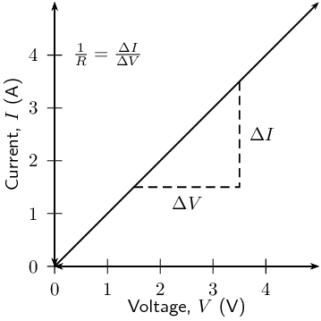

The gradient of the straight-line graph is related to the resistance of the conductor as
            \[\frac{I}{V} = \frac{1}{R}\]

            This can be rearranged in terms of the constant resistance as:
            \[R = \frac{V}{I}\]

<QuizCard id="s11-11-02b" title="Interactive Exercise 11.3" question="What does the symbol \( I\) represent?" options=["voltage", "resistance", "charge", "work", "current", "V", "C\u00b7s", "\u03a9", "A", "J"] answer="current" hint="" explanation="What do the symbols in the equation mean? The equation we are working with is: \[                         \begin{aligned}                         V & = I R                         \end{aligned}                     \] This equation shows the relationship between voltage, current, and resistance. The symbol for: voltage is \(V\) . current is \(I\) . resistance is \(R\) . So the symbol \(I\) represents the current . Submit your answer as: current" />

<QuizCard id="s11-11-02b" title="Interactive Exercise 11.3" question="Adapted from DBE Nov 2015 Grade 11, P1, Q11 Physical constants · Physics formulas State Ohm's law ." options=["current through", "resistivity of", "brightness of", "magnetic flux through", "equal to", "less than", "directly proportional to", "inversely proportional to", "greater than", "thickness of", "potential difference across", "power dissipated by", "resistivity of", "temperature", "power", "pressure", "current"] answer="0, 0, 0, 0" hint="" explanation="Recall Ohm's law The current through a conductor is directly proportional to the potential difference across the conductor at constant temperature . Mathematically, Ohm's law can be written: \[                     \begin{array}{c}                         {\color{OrangeRed}{I}} = \dfrac{{\color{DarkBlue}{V}}}{R}                     \end{array}                 \] where \(R\) is the resistance of the conductor. Submit your answer as: current through and directly proportional to and potential difference across and temperature" />

## Ohm's Law

### Aim

To determine the relationship between the current going through a resistor and the potential
                    difference (voltage) across the same resistor.

### Apparatus

4 cells, 4 resistors, an ammeter, a voltmeter, connecting wires

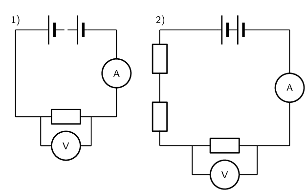

### Method

This experiment has two parts. In the first part we will vary the applied voltage across the resistor
                    and measure the resulting current through the circuit. In the second part we will vary the current
                    in the circuit and measure the resulting voltage across the resistor. After obtaining both sets of
                    measurements, we will examine the relationship between the current and the voltage across the
                    resistor.

2. Varying the voltage:
   2. Set up the circuit according to circuit diagram 1), starting with just one cell.
   4. Draw the following table in your lab book.
      | Number of cells | Voltage, V (\(\text{V}\)) | Current, I (\(\text{A}\)) |
      | --- | --- | --- |
      | \(\text{1}\) |  |  |
      | \(\text{2}\) |  |  |
      | \(\text{3}\) |  |  |
      | \(\text{4}\) |  |  |
   6. Get your teacher to check the circuit before turning the power on.
   8. Measure the voltage across the resistor using the voltmeter, and the current in the
                                          circuit using the ammeter.
   10. Add one more \(\text{1,5}\) \(\text{V}\) cell to the circuit and repeat your
                                          measurements.
   12. Repeat until you have four cells and you have completed your table.
4. Varying the current:
   2. Set up the circuit according to circuit diagram 2), starting with only 1 resistor in
                                          the circuit.
   4. Draw the following table in your lab book.
      | Voltage, V (\(\text{V}\)) | Current, I (\(\text{A}\)) |
      | --- | --- |
   6. Get your teacher to check your circuit before turning the power on.
   8. Measure the current and measure the voltage across the single resistor.
   10. Now add another resistor in series in the circuit and measure the current and the
                                          voltage across only the original resistor again. Continue adding resistors until you
                                          have four in series, but remember to only measure the voltage across the original
                                          resistor each time. Enter the values you measure into the table.

### Analysis and results

2. Using the data you recorded in the first table, draw a graph of current versus voltage. Since
                               the voltage is the variable which we are directly varying, it is the independent variable
                               and will be plotted on the \(x\)-axis. The current is the dependent variable and must be
                               plotted on the \(y\)-axis.
4. Using the data you recorded in the second table, draw a graph of voltage vs. current. In this
                               case the independent variable is the current which must be plotted on the \(x\)-axis, and
                               the voltage is the dependent variable and must be plotted on the \(y\)-axis.

### Conclusions

2. Examine the graph you made from the first table. What happens to the current through the
                               resistor when the voltage across it is increased? i.e. Does it increase or decrease?
4. Examine the graph you made from the second table. What happens to the voltage across the
                               resistor when the current increases through the resistor? i.e. Does it increase or decrease?
6. Do your experimental results verify Ohm's Law? Explain.

### Questions and discussion

2. For each of your graphs, calculate the gradient and from this determine the resistance of the
                           original resistor. Do you get the same value when you calculate it for each of your graphs?
4. How would you go about finding the resistance of an unknown resistor using only a power
                               supply, a voltmeter and a known resistor \(R_0\)?

<Callout type="note" title="Note">
[Simulation: 242K](http://phet.colorado.edu/sims/ohms-law/ohms-law_en.html)
</Callout>

## Ohm's Law

### Textbook Exercise 11.1

Use the data in the table below to answer the following questions.

| Voltage, V (\(\text{V}\)) | Current, I (\(\text{A}\)) |
| --- | --- |
| \(\text{3,0}\) | \(\text{0,4}\) |
| \(\text{6,0}\) | \(\text{0,8}\) |
| \(\text{9,0}\) | \(\text{1,2}\) |
| \(\text{12,0}\) | \(\text{1,6}\) |

**Problem:**
Plot a graph of voltage (on the x-axis) and current (on the y-axis).

**Solution:**
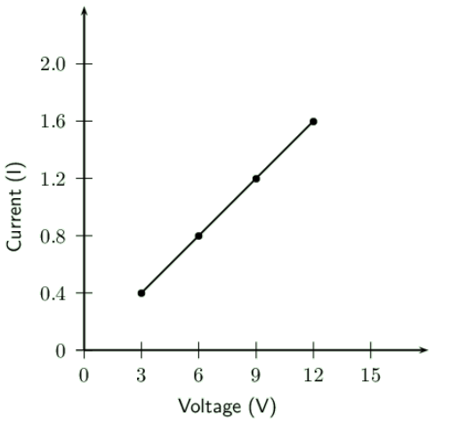

**Problem:**
What type of graph do you obtain (straight-line, parabola, other curve)

**Solution:**
straight-line

**Problem:**
Calculate the gradient of the graph.

**Solution:**
The gradient of the graph (\(m\)) is the change in the current divided by the change in
                                the voltage:

                            \begin{align*}
                            m & = \frac{\Delta I}{\Delta V} \\
                            & = \frac{(\text{1,6}) - (\text{0,4})}{(\text{12}) - (\text{3})} \\
                            & = \text{0,13}
                            \end{align*}

**Problem:**
Do your experimental results verify Ohm's Law? Explain.

**Solution:**
Yes. A straight line graph is obtained when we plot a graph of voltage vs. current.

**Problem:**
How would you go about finding the resistance of an unknown resistor using only a power
                                supply, a voltmeter and a known resistor \(R_{0}\)?

**Solution:**
You start by connecting the known resistor in a circuit with the power supply. Now you
                                read the voltage of the power supply and note this down.

Next you connect the two resistors in series. You can now take the voltage measurements
                                for each of resistors.

So we can find the voltages for the two resistors. Now we note that:

                            \[V = IR\]

So using this and the fact that for resistors in series, the current is the same
                                everywhere in the circuit we can find the unknown resistance.

                            \begin{align*}
                            V_{0} & = IR_{0} \\
                            I & = \frac{V_{0}}{R_{0}} \\
                            V_{U} & = IR_{U} \\
                            I & = \frac{V_{U}}{R_{U}} \\
                            \frac{V_{U}}{R_{U}} & = \frac{V_{0}}{R_{0}} \\
                            \therefore R_{U} & = \frac{V_{U}R_{0}}{V_{0}}
                            \end{align*}

### Ohmic and non-ohmic conductors (ESBQ7)

Conductors which obey Ohm's Law have a constant resistance when the voltage is varied across them or the
                current through them is increased. These conductors are called *ohmic* conductors. A graph of the
                current vs. the voltage across these conductors will be a straight-line. Some examples of ohmic
                conductors are circuit resistors and nichrome wire.

As you have seen, there is a mention of *constant temperature* when we talk about Ohm's Law. This
                is because the resistance of some conductors changes as their temperature changes. These types of
                conductors are called *non-ohmic* conductors, because they do not obey Ohm's Law. A light bulb is
                a common example of a non-ohmic conductor. Other examples of non-ohmic conductors are diodes and
                transistors.

In a light bulb, the resistance of the filament wire will increase dramatically as it warms from room
                temperature to operating temperature. If we increase the supply voltage in a real lamp circuit, the
                resulting increase in current causes the filament to increase in temperature, which increases its
                resistance. This effectively limits the increase in current. In this case, voltage and current do not
                obey Ohm's Law.

The phenomenon of resistance changing with variations in temperature is one shared by almost all metals,
                of which most wires are made. For most applications, these changes in resistance are small enough to be
                ignored. In the application of metal lamp filaments, which increase a lot in temperature (up to about
                \(\text{1 000}\) \(\text{℃}\), and starting from room temperature) the change is quite large.

In general, for non-ohmic conductors, a graph of voltage against current will not be a straight-line,
                indicating that the resistance is not constant over all values of voltage and current.

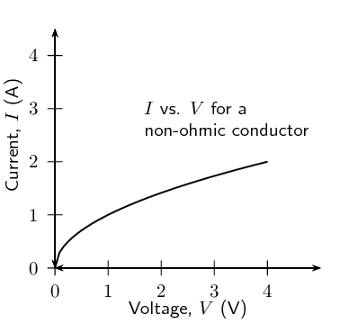

A recommended experiment for informal assessment is included. In this experiment learners will obtain
                    current and voltage data for a resistor and light bulb and determine which obeys Ohm's law. You will
                    need light bulbs, resistors, connecting wires, power source, ammeter and voltmeter. Learners should
                    find that the resistor obeys Ohm's law, while the light bulb does not.

## Ohmic and non-ohmic conductors

### Aim

To determine whether two circuit elements (a resistor and a lightbulb) obey Ohm's Law

### Apparatus

4 cells, a resistor, a lightbulb, connecting wires, a voltmeter, an ammeter

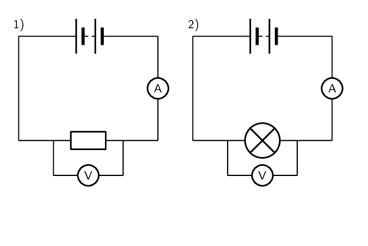

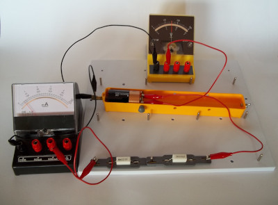

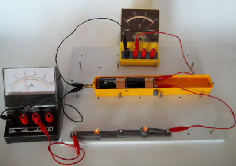

### Method

The two circuits shown in the diagrams above are the same, except in the first there is a
                        resistor and in the second there is a lightbulb. Set up both the circuits above, starting with 1
                        cell. For each circuit:

2. Measure the voltage across the circuit element (either the resistor or lightbulb) using
                                   the voltmeter.
4. Measure the current in the circuit using the ammeter.
6. Add another cell and repeat your measurements until you have 4 cells in your circuit.

### Results

Draw two tables which look like the following in your book. You should have one table for the
                        first circuit measurements with the resistor and another table for the second circuit
                        measurements with the lightbulb.

| Number of cells | Voltage, V (\(\text{V}\)) | Current, I (\(\text{A}\)) |
| --- | --- | --- |
| \(\text{1}\) |  |  |
| \(\text{2}\) |  |  |
| \(\text{3}\) |  |  |
| \(\text{4}\) |  |  |

### Analysis

Using the data in your tables, draw two graphs of \(I\) (\(y\)-axis) vs. \(V\) (\(x\)-axis), one
                        for the resistor and one for the lightbulb.

### Questions and Discussion

Examine your graphs closely and answer the following questions:

2. What should the graph of \(I\) vs. \(V\) look like for a conductor which obeys Ohm's Law?
4. Do either or both your graphs look like this?
6. What can you conclude about whether or not the resistor and/or the lightbulb obey Ohm's
                                   Law?
8. Is the lightbulb an ohmic or non-ohmic conductor?

### Using Ohm's Law (ESBQ8)

We are now ready to see how Ohm's Law is used to analyse circuits.

Consider a circuit with a cell and an ohmic resistor, R. If the resistor has a resistance of \(\text{5}\)
                \(\text{Ω}\) and voltage across the resistor is \(\text{5}\) \(\text{V}\), then we can use Ohm's
                Law to calculate the current flowing through the resistor. Our first task is to draw the circuit
                diagram. When solving any problem with electric circuits it is very important to make a diagram of the
                circuit before doing any calculations. The circuit diagram for this problem looks like the following:

The equation for Ohm's Law is:

                \[R = \frac{V}{I}\]

which can be rearranged to:
                \[I = \frac{V}{R}\]

The current flowing through the resistor is:

\begin{align*}
                I &= \frac{V}{R} \\
                &= \frac{\text{5}\text{ V}}{\text{5 }\Omega} \\
                &= \text{1}\text{ A}
                \end{align*}

<QuizCard id="s11-11-02c" title="Interactive Exercise 11.4" question="The diagram shows an electric circuit consisting of a cell and one ohmic resistor. resistor \(R_1 = \text{4,6}\ \text{Ω}\) the voltage across resistor \(R_1\) is \(V_1 = \text{3,5}\ \text{V}\) What current \(I_A\) will flow through the cell? INSTRUCTION: Round your answer to two decimal places ." options=[] answer="['0.76']" hint="You should enter a number here. If you want to, you can use a space to separate thousands.                Example: 12 800,25 For scientific notation you need to use the multiply symbol                ( ∗ ) and the exponent symbol ( ^ ). For example 6,673 × 10 −11 should be written as: 6,673 ∗ 10^−11" explanation="Apply Ohm's Law We are asked to calculate the current \(I_A\) which will flow through the cell. Let us recall Ohm's Law . It relates the amount of electric current through a metal conductor, at a constant temperature, in a circuit is proportional to the voltage across the conductor and can be described by, \[\begin{array}{c}I = \frac{V}{R}\end{array}\] where \(I\) is the current through the conductor, \(V\) is the voltage across the conductor and \(R\) is the resistance of the conductor. We are interested in the current flowing through the conductor, in this case the current flowing through the cell. \[\begin{array}{c}I = \frac{V}{R}\end{array}\] Identify relevant components to solve the question We can take it one step further and specify the specific values we are interested in: If all the components are ohmic, then Ohm's Law holds for each component \(V_i=I_iR_i\) , the total voltage across all the components is then the sum of their individual voltages, \(V_A = V_1 + V_2 + ...\) and for resistors in series, they all have the same current flowing through them \(I_A = I_1 = I_2 = ... \) therefore if there are two resistors \[           \begin{aligned}               V_A & = V_1 + V_2 + V_3 \\                   & = I_1 R_1 + I_2 R_2 + I_3 R_3 \\                   & = I_A R_1 + I_A R_2 + I_A R_3 \\                   & = I_A ( R_1 + R_2 + R_3) \\                   & = I_A R_{eq} \\               I_A & = \frac{V_A}{R_{eq}}           \end{aligned}       \] Now we can redraw the circuit as below: So we can rewrite Ohm's Law as applied to \(I_{A}\) : \[\begin{array}{c}I_A = \frac{V_A}{R_{eq}}\end{array}\] Where \(V_A\) is the voltage across the cell, \(I_A\) is the current through the cell and \(R_{eq}\) is the equivalent resistance of the circuit. Thus to do this calculation using Ohm's Law we need: the equivalent resistance \(R_{eq}\) through the cell ( \(\times\) not given) the voltage \(V_A\) across the cell ( \(\times\) not given) Substitute and calculate the final answer We need to first calculate the equivalent resistance. There is only one resistor, therefore the equivalent (total) resistance of the circuit is simply: \[           \begin{aligned}               R_{eq} & = R_1 \\                        & = \text{4,6}\ \text{Ω}           \end{aligned}       \] We also need the voltage across the cell, and since there is only one resistor: \[\begin{aligned}       V_A & = V_1 \\           & = \text{3,5}\ \text{V}       \end{aligned}\] Now we have everything we need to apply Ohm's Law: \[             	    \begin{aligned}        I_A & = \frac{V_A}{R_{eq}} \\           & = \frac{\text{3,5}}{\text{4,6}} \\                         &= \text{0,76086...}\ \text{A} \\ & \approx \text{0,76}\ \text{A}                     \end{aligned}                 \] The current \(I_A\) flowing through the cell is \(\text{0,76}\ \text{A}\) . Submit your answer as:" />

<Callout type="tip" title="Worked example 1: Ohm's Law">
**Question:**
Study the circuit diagram below:

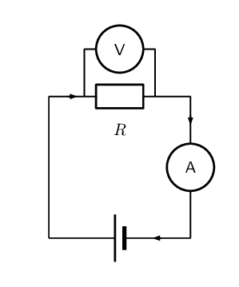

The resistance of the resistor is \(\text{10}\) \(\text{Ω}\) and the current going through
                        the resistor is \(\text{4}\) \(\text{A}\). What is the potential difference (voltage) across the
                        resistor?

**Determine how to approach the problem:**
We are given the resistance of the resistor and the current passing through it and are asked to
                        calculate the voltage across it. We can apply Ohm's Law to this problem using:
                        \[R = \frac{V}{I}.\]

**Solve the problem:**
Rearrange the equation above and substitute the known values for \(R\) and \(I\) to solve for
                        \(V\).

                        \begin{align*}
                        R &= \frac{V}{I} \\
                        R \times I&= \frac{V}{I} \times I\\
                        V &= I \times R \\
                        &= \text{10} \times \text{4} \\
                        &= \text{40}\text{ V}
                        \end{align*}

**Write the final answer:**
The voltage across the resistor is \(\text{40}\) \(\text{V}\).
</Callout>

## Ohm's Law

### Textbook Exercise 11.2

**Problem:**
Calculate the resistance of a resistor that has a potential difference of \(\text{8}\)
                                \(\text{V}\) across it when a current of \(\text{2}\) \(\text{A}\) flows through it.
                                Draw the circuit diagram before doing the calculation.

**Solution:**
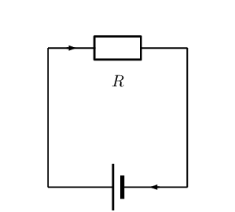

The resistance of the unknown resistor is:

                            \begin{align*}
                            R & = \frac{V}{I} \\
                            & = \frac{8}{2} \\
                            & = \text{4}\text{ Ω}
                            \end{align*}

**Problem:**
What current will flow through a resistor of \(\text{6}\) \(\text{Ω}\) when there is
                                a potential difference of \(\text{18}\) \(\text{V}\) across its ends? Draw the circuit
                                diagram before doing the calculation.

**Solution:**

The resistance of the unknown resistor is:

                            \begin{align*}
                            I & = \frac{V}{R} \\
                            & = \frac{18}{6} \\
                            & = \text{3}\text{ A}
                            \end{align*}

**Problem:**
What is the voltage across a \(\text{10}\) \(\text{Ω}\) resistor when a current of
                                \(\text{1,5}\) \(\text{A}\) flows though it? Draw the circuit diagram before doing the
                                calculation.

**Solution:**

The resistance of the unknown resistor is:

                            \begin{align*}
                            V & = I \cdot R \\
                            & = (\text{1,5})(10) \\
                            & = \text{15}\text{ V}
                            \end{align*}

### Recap of resistors in series and parallel (ESBQ9)

In Grade 10, you learnt about resistors and were introduced to circuits where resistors were connected in
                series and in parallel. In a series circuit there is one path along which current flows. In a parallel
                circuit there are multiple paths along which current flows.

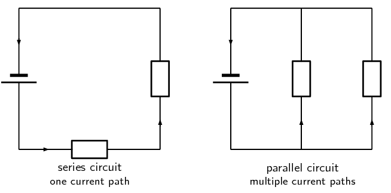

When there is more than one resistor in a circuit, we are usually able to calculate the total combined
                resistance of all the resistors. This is known as the *equivalent resistance*.

#### Equivalent series resistance

In a circuit where the resistors are connected in series, the equivalent resistance is just the sum
                    of the resistances of all the resistors.

Equivalent resistance in a series circuit,

For n resistors in series the equivalent resistance is:

                        \[R_{s} = R_{1} + R_{2} + R_{3} + \ldots + R_{n}\]

Let us apply this to the following circuit.

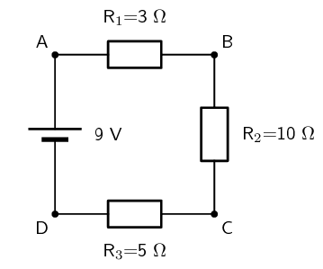

The resistors are in series, therefore:

                \begin{align*}
                R_{s} & = R_{1} + R_{2} + R_{3} \\
                & = \text{3}\text{ Ω} + \text{10}\text{ Ω} + \text{5}\text{ Ω} \\
                & =\text{18}\text{ Ω}
                \end{align*}

<Callout type="note" title="Note">
[Simulation:
                            242R](http://phet.colorado.edu/en/simulation/circuit-construction-kit-dc)
</Callout>

<Callout type="note" title="Note">
<VideoPlayer src="https://www.youtube.com/embed/3o8_EARoMtg" title="Video: 242S" />
</Callout>

#### Equivalent parallel resistance

In a circuit where the resistors are connected in parallel, the equivalent resistance is given by the
                    following definition.

Equivalent resistance in a parallel circuit

For \(n\) resistors in parallel, the equivalent resistance is:

                        \[\frac{1}{R_{p}} = \frac{1}{R_{1}} + \frac{1}{R_{2}} + \frac{1}{R_{3}} + \ldots +
                        \frac{1}{R_{n}}\]

Let us apply this formula to the following circuit.

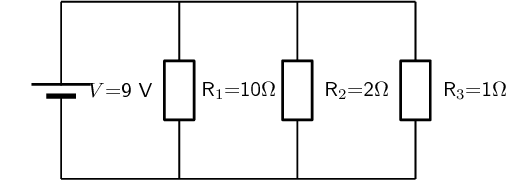

What is the total (equivalent) resistance in the circuit?

                \begin{align*}
                \frac{1}{R_{p}} & = \left( \frac{1}{R_{1}} + \frac{1}{R_{2}} + \frac{1}{R_{3}} \right) \\
                & = \left( \frac{1}{\text{10}\text{ Ω}} + \frac{1}{\text{2}\text{ Ω}} +
                \frac{1}{\text{1}\text{ Ω}} \right) \\
                & = \left( \frac{\text{1}\text{ Ω} + \text{5}\text{ Ω} + \text{10}\text{
                Ω}}{\text{10}\text{ Ω}} \right) \\
                & = \left( \frac{\text{16}\text{ Ω}}{\text{10}\text{ Ω}} \right) \\
                R_{p} & = \text{0,625}\text{ Ω}
                \end{align*}

<Callout type="note" title="Note">
<VideoPlayer src="https://www.youtube.com/embed/7vHh1sfZ5KE" title="Video: 242T" />
</Callout>

<Callout type="note" title="Note">
<VideoPlayer src="https://www.youtube.com/embed/ZrMw7P6P2Gw" title="Video: 242V" />
</Callout>

## Series and parallel resistance

### Textbook Exercise 11.3

**Problem:**
Two \(\text{10}\) \(\text{kΩ}\) resistors are connected in series. Calculate the
                                equivalent resistance.

**Solution:**
Since the resistors are in series we can use:

                            \[R_{s} = R_{1} + R_{2}\]

The equivalent resistance is:

                            \begin{align*}
                            R_{s} & = R_{1} + R_{2} \\
                            & = \text{10}\text{ kΩ} + \text{10}\text{ kΩ} \\
                            & = \text{20}\text{ kΩ}
                            \end{align*}

**Problem:**
Two resistors are connected in series. The equivalent resistance is \(\text{100}\)
                                \(\text{Ω}\). If one resistor is \(\text{10}\) \(\text{Ω}\), calculate the
                                value of the second resistor.

**Solution:**
Since the resistors are in series we can use:

                            \[R_{s} = R_{1} + R_{2}\]

The equivalent resistance is:

                            \begin{align*}
                            R_{s} & = R_{1} + R_{2} \\
                            R_{2} & = R_{s} - R_{1} \\
                            & = \text{100}\text{ Ω} - \text{10}\text{ Ω} \\
                            & = \text{90}\text{ Ω}
                            \end{align*}

**Problem:**
Two \(\text{10}\) \(\text{kΩ}\) resistors are connected in parallel. Calculate the
                                equivalent resistance.

**Solution:**
Since the resistors are in parallel we can use:

                            \[\frac{1}{R_{p}} = \frac{1}{R_{1}} + \frac{1}{R_{2}}\]

The equivalent resistance is:

                            \begin{align*}
                            \frac{1}{R_{p}} & = \frac{1}{R_{1}} + \frac{1}{R_{2}} \\
                            & = \frac{1}{\text{100}} + \frac{1}{\text{10}} \\
                            & = \frac{1 + 10}{\text{100}} \\
                            & = \frac{11}{\text{100}} \\
                            R_{p} & = \text{9,09}\text{ kΩ}
                            \end{align*}

**Problem:**
Two resistors are connected in parallel. The equivalent resistance is \(\text{3,75}\)
                                \(\text{Ω}\). If one resistor has a resistance of \(\text{10}\) \(\text{Ω}\),
                                what is the resistance of the second resistor?

**Solution:**
Since the resistors are in parallel we can use:

                            \[\frac{1}{R_{p}} = \frac{1}{R_{1}} + \frac{1}{R_{2}}\]

The equivalent resistance is:

                            \begin{align*}
                            \frac{1}{R_{p}} & = \frac{1}{R_{1}} + \frac{1}{R_{2}} \\
                            \frac{1}{R_{2}} & = \frac{1}{R_{p}} - \frac{1}{R_{1}} \\
                            & = \frac{1}{\text{3,75}} - \frac{1}{\text{10}} \\
                            & = \frac{\text{10} - \text{3,75}}{\text{37,5}} \\
                            & = \frac{\text{6,25}}{\text{37,5}} \\
                            R_{2} & = \text{6}\text{ Ω}
                            \end{align*}

**Problem:**
Calculate the equivalent resistance in each of the following circuits:

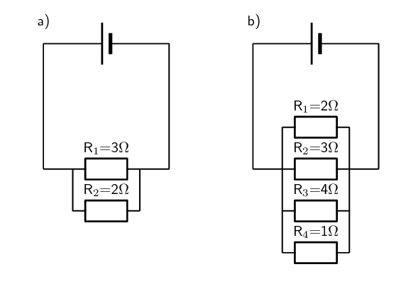

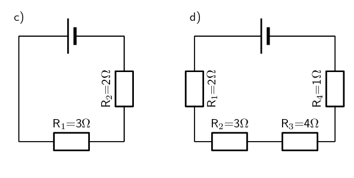

**Solution:**
**a)** The resistors are in parallel and so we use:

                            \[\frac{1}{R_{p}} = \frac{1}{R_{1}} + \frac{1}{R_{2}}\]

The equivalent resistance is:

                            \begin{align*}
                            \frac{1}{R_{p}} & = \frac{1}{R_{1}} + \frac{1}{R_{2}} \\
                            & = \frac{1}{\text{3}} + \frac{1}{\text{2}} \\
                            & = \frac{\text{2} + \text{3}}{\text{6}} \\
                            & = \frac{\text{5}}{\text{6}} \\
                            R & = \text{1,2}\text{ Ω}
                            \end{align*}

**b)** The resistors are in parallel and so we use:

                            \[\frac{1}{R_{p}} = \frac{1}{R_{1}} + \frac{1}{R_{2}} + \frac{1}{R_{3}} + \frac{1}{R_{4}}\]

The equivalent resistance is:

                            \begin{align*}
                            \frac{1}{R_{p}} & = \frac{1}{R_{1}} + \frac{1}{R_{2}} + \frac{1}{R_{3}} +
                            \frac{1}{R_{4}} \\
                            & = \frac{1}{\text{2}} + \frac{1}{\text{3}} + \frac{1}{\text{4}} + \frac{1}{\text{1}} \\
                            & = \frac{\text{6} + \text{4} + \text{3} + \text{12}}{\text{12}} \\
                            & = \frac{\text{25}}{\text{12}} \\
                            R & = \text{0,48}\text{ Ω}
                            \end{align*}

**c)** The resistors are in series and so we use:

                            \[R_{s} = R_{1} + R_{2}\]

The equivalent resistance is:

                            \begin{align*}
                            R_{s} & = R_{1} + R_{2} \\
                            & = \text{2}\text{ Ω} + \text{3}\text{ Ω} \\
                            & = \text{5}\text{ Ω}
                            \end{align*}

**d)** The resistors are in series and so we use:

                            \[R_{s} = R_{1} + R_{2} + R_{3} + R_{4}\]

The equivalent resistance is:

                            \begin{align*}
                            R_{s} & = R_{1} + R_{2} + R_{3} + R_{4} \\
                            & = \text{2}\text{ Ω} + \text{3}\text{ Ω} + \text{4}\text{ Ω} +
                            \text{1}\text{ Ω} \\
                            & = \text{10}\text{ Ω}
                            \end{align*}

### Use of Ohm's Law in series and parallel circuits (ESBQB)

Using the definitions for equivalent resistance for resistors in series or in parallel, we can analyse
                some circuits with these setups.

#### Series circuits

Consider a circuit consisting of three resistors and a
                    single cell connected in series.

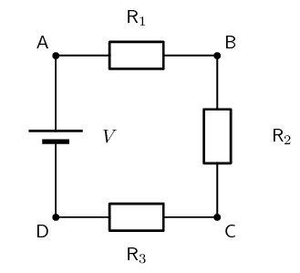

The first principle to understand about series circuits is that the amount of current is the same
                    through any component in the circuit. This is because there is only one path for electrons to flow
                    in a series circuit. From the way that the battery is connected, we can tell in which direction the
                    current will flow. We know that current flows from positive to negative by convention. Conventional
                    current in this circuit will flow in a clockwise direction, from point A to B to C to D and back to
                    A.

We know that in a series circuit the current has to be the same in all components. So we can write:

                \[I = I_{1} = I_{2} = I_{3}.\]

We also know that total voltage of the circuit has to be equal to the sum of the voltages over all
                    three resistors. So we can write:

                \[V = V_{1} + V_{2} + V_{3}\]

Using this information and what we know about calculating the equivalent resistance of resistors in
                    series, we can approach some circuit problems.

<Callout type="tip" title="Worked example 2: Ohm's Law, series circuit">
**Question:**
Calculate the current (I) in this circuit if the resistors are both ohmic in nature.

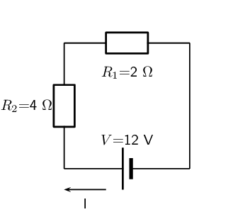

**Determine what is required:**
We are required to calculate the current flowing in the circuit.

**Determine how to approach the problem:**
Since the resistors are ohmic in nature, we can use Ohm's Law. There are however two
                            resistors in the circuit and we need to find the total resistance.

**Find total resistance in circuit:**
Since the resistors are connected in series, the total (equivalent) resistance R is:

                        \[R = R_{1} + R_{2}\]

Therefore,

                        \begin{align*}
                        R & = \text{2} + \text{4} \\
                        & = \text{6}\text{ Ω}
                        \end{align*}

**Apply Ohm's Law:**
\begin{align*}
                            R & = \frac{V}{I} \\
                            R \times \frac{I}{R} & = \frac{V}{I} \times \frac{I}{R} \\
                            I & = \frac{V}{R} \\
                            & = \frac{12}{6} \\
                            & = \text{2}\text{ A}
                            \end{align*}

**Write the final answer:**
A current of \(\text{2}\) \(\text{A}\) is flowing in the circuit.
</Callout>

<Callout type="tip" title="Worked example 3: Ohm's Law, series circuit">
**Question:**
Two ohmic resistors (\(R_{1}\) and \(R_{2}\)) are connected in series with a cell. Find the
                            resistance of \(R_{2}\), given that the current flowing through \(R_{1}\) and \(R_{2}\) is
                            \(\text{0,25}\) \(\text{A}\) and that the voltage across the cell is \(\text{1,5}\)
                            \(\text{V}\). \(R_{1}\) =\(\text{1}\) \(\text{Ω}\).

**Draw the circuit and fill in all known values.:**
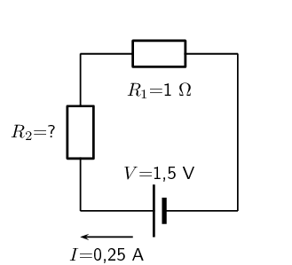

**Determine how to approach the problem.:**
We can use Ohm's Law to find the total resistance R in the circuit, and then calculate the
                            unknown resistance using:

                        \[R = R_{1} + R_{2}\]

because it is in a series circuit.

**Find the total resistance:**
\begin{align*}
                        R & = \frac{V}{I} \\
                        & = \frac{\text{1,5}}{\text{0,25}} \\
                        & = \text{6}\text{ Ω}
                        \end{align*}

**Find the unknown resistance:**
We know that:

                        \[R = \text{6}\text{ Ω}\]

and that

                        \[R_{1} = \text{1}\text{ Ω}\]

Since

                        \[R = R_{1} + R_{2}\]
                        \[R_{2} = R - R_{1}\]

Therefore,

                        \[R_{1} = \text{5}\text{ Ω}\]
</Callout>

<Callout type="tip" title="Worked example 4: Ohm's Law, series circuit">
**Question:**
For the following circuit, calculate:

2. the voltage drops \(V_1\), \(V_2\) and \(V_3\) across the resistors \(R_1\), \(R_2\),
                                       and \(R_3\)
4. the resistance of \(R_3\).

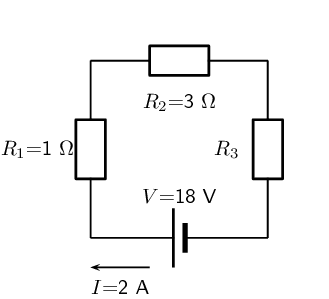

**Determine how to approach the problem:**
We are given the voltage across the cell and the current in the circuit, as well as the
                            resistances of two of the three resistors. We can use Ohm's Law to calculate the voltage
                            drop across the known resistors. Since the resistors are in a series circuit the voltage is
                            \(V = V_1 + V_2 + V_3\) and we can calculate \(V_3\). Now we can use this information to
                            find the voltage across the unknown resistor \(R_3\).

**Calculate voltage drop across \(R_1\):**
Using Ohm's Law:
                            \begin{align*}
                            R_1 &= \frac{V_1}{I} \\
                            I \cdot R_1 &= I \cdot \frac{V_1}{I} \\
                            V_1 &= {I}\cdot{R_1}\\
                            &= 2 \cdot 1 \\
                            V_1 &= \text{2}\text{ V}
                            \end{align*}

**Calculate voltage drop across \(R_2\):**
Again using Ohm's Law:
                            \begin{align*}
                            R_2 &= \frac{V_2}{I} \\
                            I \cdot R_2 &= I \cdot \frac{V_2}{I} \\
                            V_2 &= {I}\cdot{R_2}\\
                            &= 2 \cdot 3 \\
                            V_2 &= \text{6}\text{ V}
                            \end{align*}

**Calculate voltage drop across \(R_3\):**
Since the voltage drop across all the resistors combined must be the same as the voltage drop
                            across the cell in a series circuit, we can find \(V_3\) using:
                            \begin{align*}
                            V &= V_1 + V_2 + V_3\\
                            V_3 &= V - V_1 - V_2 \\
                            &= 18 - 2 - 6 \\
                            V_3&= \text{10}\text{ V}
                            \end{align*}

**Find the resistance of \(R_3\):**
We know the voltage across \(R_3\) and the current through it, so we can use Ohm's Law to
                            calculate the value for the resistance:
                            \begin{align*}
                            R_3 &= \frac{V_3}{I}\\
                            &= \frac{10}{2} \\
                            R_3&= \text{5 } \Omega
                            \end{align*}

**Write the final answer:**
\(V_1 = \text{2}\text{ V}\)

\(V_2 = \text{6}\text{ V}\)

\(V_3 = \text{10}\text{ V}\)

\(R_1 = \text{5 } \Omega\)
</Callout>

<QuizCard id="s11-11-02e" title="Interactive Exercise 11.6" question="The diagram shows an electric circuit consisting of a cell and three ohmic resistors. resistor \(R_1 = \text{2,8}\ \text{Ω}\) resistor \(R_2 = \text{7,3}\ \text{Ω}\) resistor \(R_3 = \text{5,5}\ \text{Ω}\) What is the equivalent resistance of the circuit? INSTRUCTION: Round your answer to one decimal place." options=[] answer="15.6" hint="You should enter a number here. If you want to, you can use a space to separate thousands.                Example: 12 800,25 For scientific notation you need to use the multiply symbol                ( ∗ ) and the exponent symbol ( ^ ). For example 6,673 × 10 −11 should be written as: 6,673 ∗ 10^−11" explanation="Choose which relationship to use In a series circuit there is one path along which current flows. Each resistor in the path of the current steals some of the potential in the circuit, thus we will see a potential difference over a resistor (a voltage drop). We can compare the circuit to a river where a resistor is like an obstacle in a river that resists the flow of water. The more obstacles in the way the more resistance occurs. Therefore in a series circuit, as you add more resistors (obstacles), the resistance increases. The equivalent (total) resistance is thus the sum of the resistances of all the resistors: \[               \begin{aligned}                 R_{\text{eq}} & = R_1 + R_2 + ... \\               \end{aligned}             \] Substitute and solve for the equivalent resistance There are three resistors in this circuit, thus: \[               \begin{aligned}                 R_{\text{eq}} & = R_1 + R_2 + R_3 \\                        & = \text{2,8} + \text{7,3} + \text{5,5} \\                        & = \text{15,6}\ \text{Ω} \\               \end{aligned}             \] The equivalent resistance of the circuit is \(\text{15,6}\ \text{Ω}\) . Submit your answer as:" />

#### Parallel circuits

Consider a circuit consisting of a single cell and three resistors that are connected in parallel.

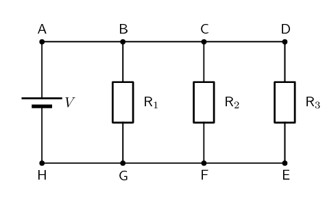

The first principle to understand about parallel circuits is that the
                    voltage is equal across all components in the circuit. This is because there are only two sets of
                    electrically common points in a parallel circuit, and voltage measured between sets of common points
                    must always be the same at any given time. So, for the circuit shown, the following is true:

                \[V = V_{1} = V_{2} = V_{3}.\]

The second principle for a parallel circuit is that all the currents through each resistor must add
                    up to the total current in the circuit:

                \[I = I_{1} + I_{2} + I_{3}.\]

Using these principles and our knowledge of how to calculate the equivalent resistance of parallel
                    resistors, we can now approach some circuit problems involving parallel resistors.

<Callout type="tip" title="Worked example 5: Ohm's Law, parallel circuit">
**Question:**
Calculate the current (I) in this circuit if the resistors are both ohmic in nature.

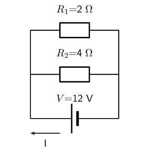

**Determine what is required:**
We are required to calculate the current flowing in the circuit.

**Determine how to approach the problem:**
Since the resistors are ohmic in nature, we can use Ohm's Law. There are however two
                            resistors in the circuit and we need to find the total resistance.

**Find the equivalent resistance in circuit:**
Since the resistors are connected in parallel, the total (equivalent) resistance R is:

                        \[\frac{1}{R} = \frac{1}{R_{1}} + \frac{1}{R_{2}}.\]
                        \begin{align*}
                        \frac{1}{R} &= \frac{1}{R_1} + \frac{1}{R_2} \\
                        &= \frac{1}{2} + \frac{1}{4} \\
                        &= \frac{2+1}{4} \\
                        &= \frac{3}{4} \\
                        \text{Therefore, } R &= \text{1,33 } \Omega
                        \end{align*}

**Apply Ohm's Law:**
\begin{align*}
                        R&= \frac{V}{I} \\
                        R \cdot \frac{I}{R} &= \frac{V}{I} \cdot \frac{I}{R} \\
                        I &= \frac{V}{R}\\
                        I &= V \cdot \frac{1}{R}\\
                        &= (12) \left(\frac{3}{4}\right) \\
                        &= \text{9}\text{ A}
                        \end{align*}

**Write the final answer:**
The current flowing in the circuit is \(\text{9}\) \(\text{A}\).
</Callout>

<Callout type="tip" title="Worked example 6: Ohm's Law, parallel circuit">
**Question:**
Two ohmic resistors (\(R_1\) and \(R_2\)) are connected in parallel with a cell. Find the
                            resistance of \(R_2\), given that the current flowing through the cell is \(\text{4,8}\)
                            \(\text{A}\) and that the voltage across the cell is \(\text{9}\) \(\text{V}\).

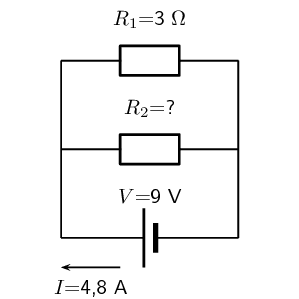

**Determine what is required:**
We need to calculate the resistance \(R_2\).

**Determine how to approach the problem:**
Since the resistors are ohmic and we are given the voltage across the cell and the current
                            through the cell, we can use Ohm's Law to find the equivalent resistance in the circuit.
                            \begin{align*}
                            R & = \frac{V}{I} \\
                            & = \frac{9}{\text{4,8}} \\
                            & = \text{1,875} \ \Omega
                            \end{align*}

**Calculate the value for \(R_2\):**
Since we know the equivalent resistance and the resistance of \(R_1\), we can use the formula
                            for resistors in parallel to find the resistance of \(R_2\).
                            \begin{align*}
                            \frac{1}{R} & = \frac{1}{R_1} + \frac{1}{R_2}
                            \end{align*}
                            Rearranging to solve for \(R_2\):
                            \begin{align*}
                            \frac{1}{R_2} & = \frac{1}{R} - \frac{1}{R_1} \\
                            & = \frac{1}{\text{1,875}} - \frac{1}{3}\\
                            & = \text{0,2} \\
                            R_2 & = \frac{1}{\text{0,2}} \\
                            & = \text{5} \ \Omega
                            \end{align*}

**Write the final answer:**
The resistance \(R_2\) is \(\text{5}\) \(\Omega\)
</Callout>

<QuizCard id="s11-11-02f" title="Interactive Exercise 11.7" question="The diagram shows an electric circuit consisting of a cell and two ohmic resistors. the current through resistor \(R_1\) is \(I_1 = \text{0,761}\ \text{A}\) the current through resistor \(R_2\) is \(I_2 = \text{0,574}\ \text{A}\) the voltage across the cell is \(V_A = \text{3,5}\ \text{V}\) What is the resistance of resistor \(R_2\) ? INSTRUCTION: Round your answer to two decimal places ." options=[] answer="6.10" hint="You should enter a number here. If you want to, you can use a space to separate thousands.                Example: 12 800,25 For scientific notation you need to use the multiply symbol                ( ∗ ) and the exponent symbol ( ^ ). For example 6,673 × 10 −11 should be written as: 6,673 ∗ 10^−11" explanation="Apply Ohm's Law We are asked to determine the voltage across the cell. Let us recall Ohm's Law . It relates the amount of electric current through a metal conductor, at a constant temperature, in a circuit is proportional to the voltage across the conductor and can be described by, \[                     \begin{aligned}                       I = \frac{V}{R}                     \end{aligned}                   \] where \(I\) is the current through the conductor, \(V\) is the voltage across the conductor and \(R\) is the resistance of the conductor. We are interested in the voltage across the conductor, in this case the cell. If all the components are ohmic, then Ohm's Law holds for each component \(V_i = I_i R_i\) , and for resistors in parallel, the same potential difference is measured across each of the components \(V_A=V_1=V_2=...\) We are interested in the resistance of resistor \(R_2\) . Therefore we can rearrange the equation, making what we require the subject of the equation: \[                   \begin{aligned}                     R_{2} = \frac{V_{2}}{I_{2}}                   \end{aligned}                 \] Thus to do this calculation using Ohm's Law we need: current \(I_{2}\) flowing through resistor \(R_2\) ( \(\checkmark\) given) the potential difference \(V_{2}\) across resistor \(R_2\) ( \(\times\) not given) Substitute and calculate the final answer. We know that for resistance in parallel \(V_A = V_{2}\) , we are given the potential difference across the cell, therefore, \[                   \begin{aligned}                     V_{2} & = V_A \\                       & = \text{3,5}\ \text{V}                   \end{aligned}                 \] Now we have everything we need to apply Ohm's Law to resistor \(R_2\) : \[                   \begin{aligned}                     R_{2} & = \frac{V_{2}}{I_{2}} \\                     & = \frac{\text{3,5}}{\text{0,574}} \\                     & = \text{6,09756...}\ \text{Ω} \\ & \approx \text{6,10}\ \text{Ω}                   \end{aligned}                 \] The resistance of resistor \(R_2\) is therefore \(\text{6,10}\ \text{Ω}\) . Submit your answer as:" />

<Callout type="tip" title="Worked example 7: Ohm's Law, parallel circuit">
**Question:**
An 18 volt cell is connected to two parallel resistors of \(\text{4}\) \(\Omega\) and
                            \(\text{12}\) \(\Omega\) respectively. Calculate the current through the cell and through
                            each of the resistors.

**First draw the circuit before doing any calculations:**
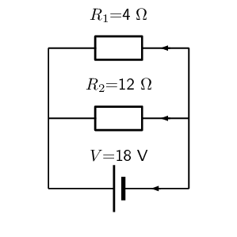

**Determine how to approach the problem:**
We need to determine the current through the cell and each of the parallel resistors. We have
                            been given the potential difference across the cell and the resistances of the resistors, so
                            we can use Ohm's Law to calculate the current.

**Calculate the current through the cell:**
To calculate the current through the cell we first need to determine the equivalent
                            resistance of the rest of the circuit. The resistors are in parallel and therefore:
                            \begin{align*}
                            \frac{1}{R} &= \frac{1}{R_1} + \frac{1}{R_2} \\
                            &= \frac{1}{4} + \frac{1}{12} \\
                            &= \frac{3+1}{12} \\
                            &= \frac{4}{12} \\
                            R &= \frac{12}{4} = \text{3} \ \Omega
                            \end{align*}
                            Now using Ohm's Law to find the current through the cell:
                            \begin{align*}
                            R &= \frac{V}{I} \\
                            I &= \frac{V}{R} \\
                            &= \frac{18}{3} \\
                            I &= \text{6}\text{ A}
                            \end{align*}

**Now determine the current through one of the parallel resistors:**
We know that for a purely parallel circuit, the voltage across the cell is the same as the
                            voltage across each of the parallel resistors. For this circuit:
                            \begin{align*}
                            V &= V_1 = V_2 = \text{18}\text{ V}
                            \end{align*}
                            Let's start with calculating the current through \(R_1\) using Ohm's Law:
                            \begin{align*}
                            R_1 &= \frac{V_1}{I_1} \\
                            I_1 &= \frac{V_1}{R_1} \\
                            &= \frac{18}{4} \\
                            I_1 &= \text{4,5}\text{ A}
                            \end{align*}

**Calculate the current through the other parallel resistor:**
We can use Ohm's Law again to find the current in \(R_2\):
                            \begin{align*}
                            R_2 &= \frac{V_2}{I_2} \\
                            I_2 &= \frac{V_2}{R_2} \\
                            &= \frac{18}{12} \\
                            I_2 &= \text{1,5}\text{ A}
                            \end{align*}

                            An alternative method of calculating \(I_2\) would have been to use the fact that the
                            currents through each of the parallel resistors must add up to the total current through the
                            cell:

                            \begin{align*}
                            I &= I_1 + I_2 \\
                            I_2 &= I - I_1 \\
                            &= 6 - 4.5 \\
                            I_2 &= \text{1,5}\text{ A}
                            \end{align*}

**Write the final answer:**
The current through the cell is \(\text{6}\) \(\text{A}\).

The current through the \(\text{4}\) \(\Omega\) resistor is \(\text{4,5}\) \(\text{A}\).

The current through the \(\text{12}\) \(\Omega\) resistor is \(\text{1,5}\) \(\text{A}\).
</Callout>

## Ohm's Law in series and parallel circuits

### Textbook Exercise 11.4

**Problem:**
Calculate the value of the unknown resistor in the circuit:

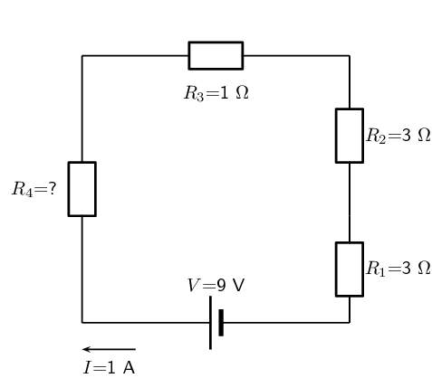

**Solution:**
We first use Ohm's law to calculate the total series resistance:

                            \begin{align*}
                            R & = \frac{V}{I} \\
                            & = \frac{9}{1} \\
                            & = \text{9}\text{ Ω}
                            \end{align*}

Now we can find the unknown resistance:

                            \begin{align*}
                            R_{s} & = R_{1} + R_{2} + R_{3} + R_{4} \\
                            R_{4} & = R_{s} - R_{1} - R_{2} - R_{3} \\
                            & = 9 - 3 - 3 - 1 \\
                            & = \text{2}\text{ Ω}
                            \end{align*}

**Problem:**
Calculate the value of the current in the following circuit:

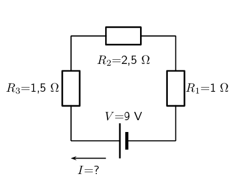

**Solution:**
We first find the total resistance:

                            \begin{align*}
                            R_{s} & = R_{1} + R_{2} + R_{3} \\
                            & = \text{1} + \text{2,5} + \text{1,5} \\
                            & = \text{5}\text{ Ω}
                            \end{align*}

Now we can calculate the current:

                            \begin{align*}
                            I & = \frac{V}{R} \\
                            & = \frac{9}{5} \\
                            & = \text{1,8}\text{ A}
                            \end{align*}

**Problem:**
Three resistors with resistance \(\text{1}\) \(\text{Ω}\), \(\text{5}\)
                                \(\text{Ω}\) and \(\text{10}\) \(\text{Ω}\) respectively, are connected in
                                series with a \(\text{12}\) \(\text{V}\) battery. Calculate the value of the current in
                                the circuit.

**Solution:**
We draw the circuit diagram:

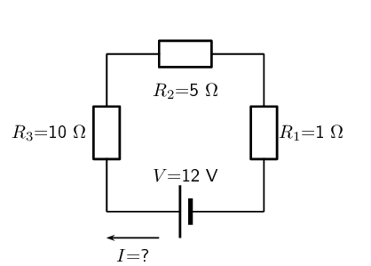

We now find the total resistance:

                            \begin{align*}
                            R_{s} & = R_{1} + R_{2} + R_{3} \\
                            & = \text{1} + \text{5} + \text{10} \\
                            & = \text{16}\text{ Ω}
                            \end{align*}

Now we can calculate the current:

                            \begin{align*}
                            I & = \frac{V}{R} \\
                            & = \frac{12}{16} \\
                            & = \text{0,75}\text{ A}
                            \end{align*}

**Problem:**
Calculate the current through the cell if the resistors are both ohmic in nature.

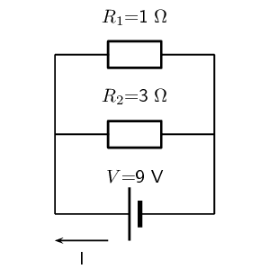

**Solution:**
We first find the total resistance:

                            \begin{align*}
                            \frac{1}{R_{p}} & = \frac{1}{R_{1}} + \frac{1}{R_{2}} \\
                            & = \frac{1}{\text{1}} + \frac{1}{\text{3}} \\
                            & = \frac{3 + 1}{\text{3}} \\
                            & = \frac{4}{\text{3}} \\
                            & = \text{0,75}\text{ Ω}
                            \end{align*}

Now we can calculate the current:

                            \begin{align*}
                            I & = \frac{V}{R} \\
                            & = \frac{9}{\text{0,75}} \\
                            & = \text{12}\text{ A}
                            \end{align*}

**Problem:**
Calculate the value of the unknown resistor \(R_{4}\) in the circuit:

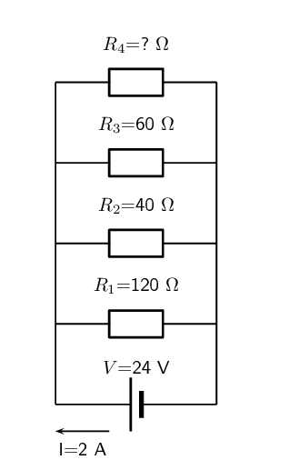

**Solution:**
We first find the total resistance:

                            \begin{align*}
                            R & = \frac{V}{I} \\
                            & = \frac{24}{\text{2}} \\
                            & = \text{12}\text{ Ω}
                            \end{align*}

Now we can calculate the unknown resistance:

                            \begin{align*}
                            \frac{1}{R_{p}} & = \frac{1}{R_{1}} + \frac{1}{R_{2}} + \frac{1}{R_{3}} +
                            \frac{1}{R_{4}}\\
                            \frac{1}{R_{4}} & = \frac{1}{R_{p}} - \frac{1}{R_{1}} - \frac{1}{R_{2}} -
                            \frac{1}{R_{3}}\\
                            & = \frac{1}{\text{12}} - \frac{1}{\text{120}} - \frac{1}{\text{40}} -
                            \frac{1}{\text{60}} \\
                            & = \frac{10 - 1 - 3 - 2}{\text{120}} \\
                            & = \frac{4}{\text{120}} \\
                            & = \text{30}\text{ Ω}
                            \end{align*}

Three resistors with resistance \(\text{1}\) \(\text{Ω}\), \(\text{5}\)
                                \(\text{Ω}\) and \(\text{10}\) \(\text{Ω}\) respectively, are connected in
                                parallel with a \(\text{20}\) \(\text{V}\) battery. All the resistors are ohmic in
                                nature. Calculate:

**Problem:**
the value of the current through the battery

**Solution:**
We draw a circuit diagram:

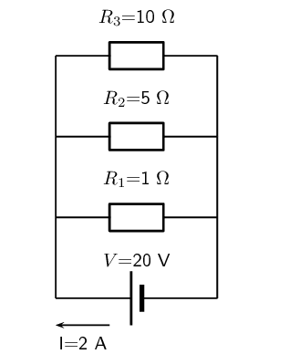

To calculate the value of the current through the battery we first need to calculate
                                    the equivalent resistance:

                                \begin{align*}
                                \frac{1}{R_{p}} & = \frac{1}{R_{1}} + \frac{1}{R_{2}} + \frac{1}{R_{3}}\\
                                & = \frac{1}{\text{1}} + \frac{1}{\text{5}} + \frac{1}{\text{10}} \\
                                & = \frac{10 + 2 + 1}{\text{10}} \\
                                & = \frac{13}{\text{10}} \\
                                & = \text{0,77}\text{ Ω}
                                \end{align*}

Now we can calculate the current through the battery:

                                \begin{align*}
                                I & = \frac{V}{R} \\
                                & = \frac{20}{\text{0,77}} \\
                                & = \text{26}\text{ A}
                                \end{align*}

**Problem:**
the value of the current in each of the three resistors.

**Solution:**
For a parallel circuit the voltage across cell is the same as the voltage across each
                                    of the resistors. For this circuit:

                                \[V = V_{1} = V_{2} = V_{3} = \text{20}\text{ V}\]

Now we can calculate the current through each resistor. We will start with \(R_{1}\):

                                \begin{align*}
                                I & = \frac{V}{R} \\
                                & = \frac{20}{\text{1}} \\
                                & = \text{20}\text{ A}
                                \end{align*}

Next we calculate the current through \(R_{2}\):

                                \begin{align*}
                                I & = \frac{V}{R} \\
                                & = \frac{20}{\text{5}} \\
                                & = \text{4}\text{ A}
                                \end{align*}

And finally we calculate the current through \(R_{3}\):

                                \begin{align*}
                                I & = \frac{V}{R} \\
                                & = \frac{20}{\text{10}} \\
                                & = \text{2}\text{ A}
                                \end{align*}

You can check that these add up to the total current.

### Series and parallel networks of resistors (ESBQC)

Now that you know how to handle simple series and parallel circuits, you are ready to tackle circuits
                which combine these two setups such as the following circuit:

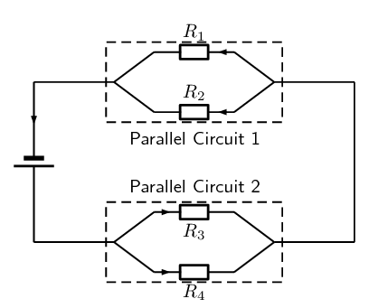

Figure 11.1:
                    An example of a series-parallel network. The dashed boxes indicate parallel sections of the circuit.

It is relatively easy to work out these kind of circuits because you use everything you have already
                learnt about series and parallel circuits. The only difference is that you do it in stages. In Figure 11.1, the circuit consists of 2 parallel portions
                that are then in series with a cell. To work out the equivalent resistance for the circuit, you start by
                calculating the total resistance of each of the parallel portions and then add up these resistances in
                series. If all the resistors in Figure 11.1 had
                resistances of \(\text{10}\) \(\text{Ω}\), we can calculate the equivalent resistance of the entire
                circuit.

We start by calculating the total resistance of *Parallel Circuit 1*.

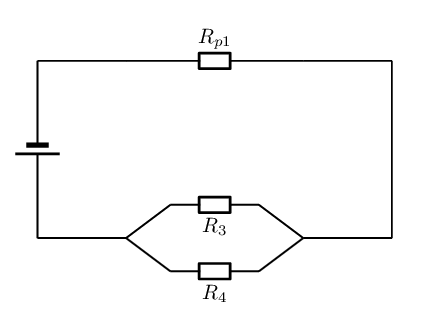

The value of \(R_{p1}\) is:

                \begin{align*}
                \frac{1}{R_{p1}} &= \frac{1}{R_1} + \frac{1}{R_2} \\
                R_{p1}&= \left(\frac{1}{10} + \frac{1}{10} \right)^{-1} \\
                &= \left(\frac{1+1}{10} \right)^{-1} \\
                &= \left(\frac{2}{10} \right)^{-1} \\
                &= \text{5} \, \Omega
                \end{align*}

We can similarly calculate the total resistance of *Parallel Circuit 2*:
                \begin{align*}
                \frac{1}{R_{p2}} &= \frac{1}{R_3} + \frac{1}{R_4} \\
                R_{p2}&= \left(\frac{1}{10} + \frac{1}{10} \right)^{-1} \\
                &= \left(\frac{1+1}{10} \right)^{-1} \\
                &= \left(\frac{2}{10} \right)^{-1} \\
                &= \text{5} \, \Omega
                \end{align*}

You can now treat the circuit like a simple series circuit as follows:

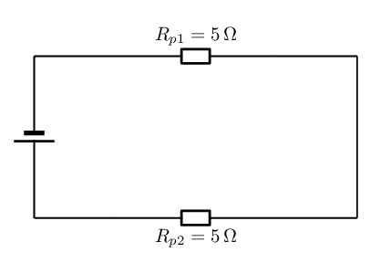

Therefore the equivalent resistance is:
                \begin{align*}
                R &= R_{p1} + R_{p2} \\
                &= 5 + 5 \\
                &= 10 \, \Omega
                \end{align*}

The equivalent resistance of the circuit in Figure 11.1 is
                \(\text{10}\) \(\text{Ω}\).

<QuizCard id="s11-11-02g" title="Interactive Exercise 11.8" question="What is the voltage of the \(\text{6}\ \text{Ω}\) resistor?" options=["C", "V", "kW\u22c5h", "A", "W", "kW\u22c5h", "A", "C"] answer="9, 1" hint="You should enter a number here. If you want to, you can use a space to separate thousands.                Example: 12 800,25 For scientific notation you need to use the multiply symbol                ( ∗ ) and the exponent symbol ( ^ ). For example 6,673 × 10 −11 should be written as: 6,673 ∗ 10^−11" explanation="Equate voltages in parallel The potential difference (voltage) values across all branches connected in parallel to each other are the same. The diagram below highlights the different parts of the circuit that are all at the same electrical potential. If a voltmeter were connected across any of the branches, then it would read the same potential difference across its two terminals. \[ 						\begin{aligned} 							V_{\text{battery}} = V_{\text{6}\ \text{Ω}} = V_{\text{20}\ \text{Ω}} = V_{\text{9}\ \text{Ω} + \text{15}\ \text{Ω}} 						\end{aligned} 					\] Therefore the potential difference across the \(\text{6}\ \text{Ω}\) resistor is the same as the emf of the battery, \(\text{9}\ \text{V}\) . Submit your answer as: and V" />

## Series and parallel networks

### Textbook Exercise 11.5

Determine the equivalent resistance of the following circuits:

**Problem:**

**Solution:**
We start by determining the equivalent resistance of the parallel combination:

                                \begin{align*}
                                \frac{1}{R_{p}} & = \frac{1}{R_{1}} + \frac{1}{R_{2}} \\
                                & = \frac{1}{4} + \frac{1}{2} \\
                                & = \frac{3}{4}\\
                                R_{p} & = \text{1,33}\text{ Ω}
                                \end{align*}

Now we have a circuit with two resistors in series so we can calculate the equivalent
                                    resistance:

                                \begin{align*}
                                R_{s} & = R_{3} + R_{p} \\
                                & = \text{2} + \text{1,33} \\
                                & = \text{3,33}\text{ Ω}
                                \end{align*}

**Problem:**

**Solution:**
We start by determining the equivalent resistance of the parallel combination:

                                \begin{align*}
                                \frac{1}{R_{p}} & = \frac{1}{R_{1}} + \frac{1}{R_{2}} \\
                                & = \frac{1}{1} + \frac{1}{2} \\
                                & = \frac{3}{2}\\
                                R_{p} & = \text{0,67}\text{ Ω}
                                \end{align*}

Now we have a circuit with three resistors in series so we can calculate the
                                    equivalent resistance:

                                \begin{align*}
                                R_{s} & = R_{3} + R_{4} + R_{p} \\
                                & = \text{4} + \text{6} + \text{0,67} \\
                                & = \text{10,67}\text{ Ω}
                                \end{align*}

**Problem:**
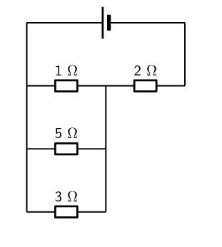

**Solution:**
We start by determining the equivalent resistance of the parallel combination:

                                \begin{align*}
                                \frac{1}{R_{p}} & = \frac{1}{R_{1}} + \frac{1}{R_{2}} + \frac{1}{R_{3}} \\
                                & = \frac{1}{3} + \frac{1}{5} + \frac{1}{1} \\
                                & = \frac{23}{15}\\
                                R_{p} & = \text{0,652}\text{ Ω}
                                \end{align*}

Now we have a circuit with two resistors in series so we can calculate the equivalent
                                    resistance:

                                \begin{align*}
                                R_{s} & = R_{4} + R_{p} \\
                                & = \text{2} + \text{0,652} \\
                                & = \text{2,652}\text{ Ω}
                                \end{align*}

Examine the circuit below:

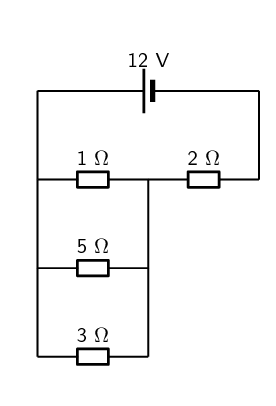

If the potential difference across the cell is \(\text{12}\) \(\text{V}\), calculate:

**Problem:**
the current \(I\) through the cell.

**Solution:**
To find the current \(I\) we first need to find the equivalent resistance. We start
                                    by calculating the equivalent resistance of the parallel combination:

                                \begin{align*}
                                \frac{1}{R_{p}} & = \frac{1}{R_{1}} + \frac{1}{R_{2}} + \frac{1}{R_{3}} \\
                                & = \frac{1}{3} + \frac{1}{5} + \frac{1}{1} \\
                                & = \frac{23}{15}\\
                                R_{p} & = \text{0,652}\text{ Ω}
                                \end{align*}

Now we have a circuit with two resistors in series so we can calculate the equivalent
                                    resistance:

                                \begin{align*}
                                R_{s} & = R_{4} + R_{p} \\
                                & = \text{2} + \text{0,652} \\
                                & = \text{2,652}\text{ Ω}
                                \end{align*}

So the current through the cell is:

                                \begin{align*}
                                I & = \frac{V}{R} \\
                                & = \frac{\text{12}}{\text{2,652}} \\
                                & = \text{4,52}\text{ A}
                                \end{align*}

**Problem:**
the current through the \(\text{5}\) \(\text{Ω}\) resistor.

**Solution:**
The current through the parallel combination of resistors is \(\text{4,52}\)
                                    \(\text{A}\). (The current is the same through series combinations of resistors and
                                    we can consider the entire parallel set of resistors as one series resistor.)

Using this we can find the voltage through the parallel combination of resistors
                                    (remember to use the equivalent parallel resistance and not the equivalent
                                    resistance of the circuit):

                                \begin{align*}
                                V & = I \cdot R \\
                                & = (\text{4,52})(\text{0,652}) \\
                                & = \text{2,95}\text{ V}
                                \end{align*}

Since the voltage across each resistor in the parallel combination is the same, this
                                    is also the voltage across the \(\text{5}\) \(\text{Ω}\) resistor.

So now we can calculate the current through the resistor:

                                \begin{align*}
                                I & = \frac{V}{R} \\
                                & = \frac{\text{2,95}}{\text{5}} \\
                                & = \text{0,59}\text{ A}
                                \end{align*}

**Problem:**
If current flowing through the cell is \(\text{2}\) \(\text{A}\), and all the resistors
                                are ohmic, calculate the voltage across the cell and each of the resistors, \(R_1\),
                                \(R_2\), and \(R_3\) respectively.

**Solution:**
To find the voltage we first need to find the equivalent resistance. We start by
                                calculating the equivalent resistance of the parallel combination:

                            \begin{align*}
                            \frac{1}{R_{p}} & = \frac{1}{R_{2}} + \frac{1}{R_{3}} \\
                            & = \frac{1}{2} + \frac{1}{4} \\
                            & = \frac{3}{4}\\
                            R_{p} & = \text{1,33}\text{ Ω}
                            \end{align*}

Now we have a circuit with two resistors in series so we can calculate the equivalent
                                resistance:

                            \begin{align*}
                            R_{s} & = R_{1} + R_{p} \\
                            & = \text{4,66} + \text{1,33} \\
                            & = \text{5,99}\text{ Ω}
                            \end{align*}

So the voltage across the cell is:

                            \begin{align*}
                            V & = I \cdot R \\
                            & = (\text{2})(\text{5,99}) \\
                            & = \text{12}\text{ V}
                            \end{align*}

The current through the parallel combination of resistors is \(\text{2}\) \(\text{A}\).
                                (The current is the same through series combinations of resistors and we can consider
                                the entire parallel set of resistors as one series resistor.)

Using this we can find the voltage through the each of the resistors. We start by finding
                                the voltage across \(R_{1}\):

                            \begin{align*}
                            V & = I \cdot R \\
                            & = (\text{2})(\text{4,66}) \\
                            & = \text{9,32}\text{ V}
                            \end{align*}

Now we find the voltage across the parallel combination:

                            \begin{align*}
                            V & = I \cdot R \\
                            & = (\text{2})(\text{1,33}) \\
                            & = \text{2,66}\text{ V}
                            \end{align*}

Since the voltage across each resistor in the parallel combination is the same, this is
                                also the voltage across resistors \(R_{2}\) and \(R_{3}\).

For the following circuit, calculate:

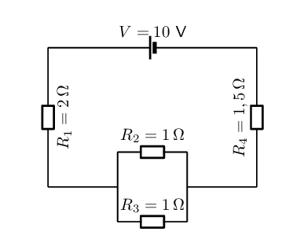

**Problem:**
the current through the cell

**Solution:**
To find the current we first need to find the equivalent resistance. We start by
                                    calculating the equivalent resistance of the parallel combination:

                                \begin{align*}
                                \frac{1}{R_{p}} & = \frac{1}{R_{2}} + \frac{1}{R_{3}} \\
                                & = \frac{1}{1} + \frac{1}{1} \\
                                & = 2\\
                                R_{p} & = \text{0,5}\text{ Ω}
                                \end{align*}

Now we have a circuit with two resistors in series so we can calculate the equivalent
                                    resistance:

                                \begin{align*}
                                R_{s} & = R_{1} + R_{4} + R_{p} \\
                                & = \text{2} + \text{1,5} + \text{0,5} \\
                                & = \text{4}\text{ Ω}
                                \end{align*}

So the current through the cell is:

                                \begin{align*}
                                I & = \frac{V}{R} \\
                                & = \frac{\text{10}}{\text{4}} \\
                                & = \text{2,5}\text{ A}
                                \end{align*}

**Problem:**
the voltage drop across \(R_4\)

**Solution:**
The current through all the resistors is \(\text{2,5}\) \(\text{A}\). (The current is
                                    the same through series combinations of resistors and we can consider the entire
                                    parallel set of resistors as one series resistor.)

Using this we can find the voltage through \(R_{4}\):

                                \begin{align*}
                                V & = I \cdot R \\
                                & = (\text{2,5})(\text{1,5}) \\
                                & = \text{3,75}\text{ V}
                                \end{align*}

**Problem:**
the current through \(R_2\)

**Solution:**
The current through all the resistors is \(\text{2,5}\) \(\text{A}\). (The current is
                                    the same through series combinations of resistors and we can consider the entire
                                    parallel set of resistors as one series resistor.)

Using this we can find the current through \(R_{2}\).

We first need to find the voltage across the parallel combination:

                                \begin{align*}
                                V & = I \cdot R \\
                                & = (\text{2,5})(\text{0,5}) \\
                                & = \text{1,25}\text{ V}
                                \end{align*}

Now we can find the current through \(R_{2}\) using the fact that the voltage is the
                                    same across each resistor in the parallel combination:

                                \begin{align*}
                                I & = \frac{V}{R} \\
                                & = \frac{\text{1,25}}{\text{1}} \\
                                & = \text{1,25}\text{ A}
                                \end{align*}
