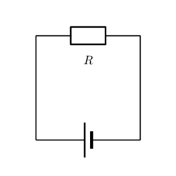
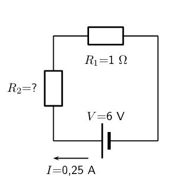
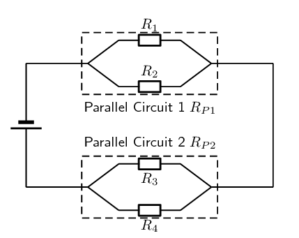
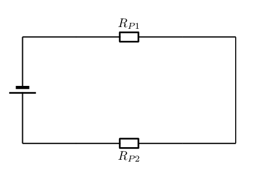
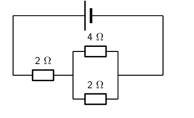
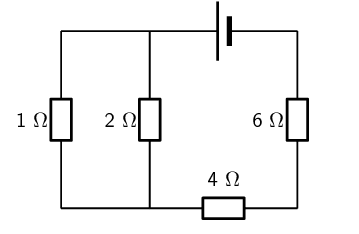
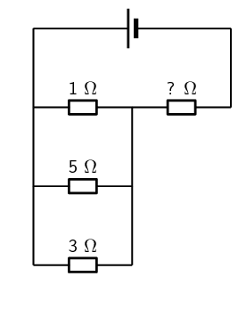
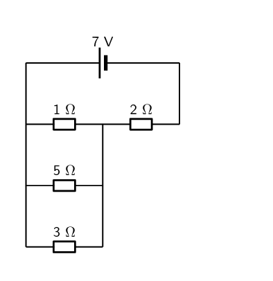
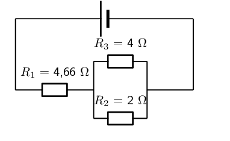

## 11.3 Power and energy (ESBQD)

### Electrical power (ESBQF)

<QuizCard id="s11-11-03a" title="Interactive Exercise 11.10" question="What does the symbol \( V\) represent?" options=["power", "current", "speed", "energy", "voltage", "W", "C", "A", "V", "J"] answer="voltage" hint="" explanation="What do the symbols in the equation mean? The equation we are working with is: \[                         \begin{aligned}                         P & = V I                         \end{aligned}                     \] This equation shows the relationship between power, voltage, and current. The symbol for: power is \(P\) . voltage is \(V\) . current is \(I\) . So the symbol \(V\) represents the voltage . Submit your answer as: voltage" />

A source of energy is required to drive current round a complete circuit. This is provided by batteries
                in the circuits you have been looking at. The batteries convert chemical potential energy into
                electrical energy. The energy is used to do work on the electrons in the circuit.

Power is a measure of how rapidly *work* is done. Power is the **rate** at which the
                work is done, work done per unit time. Work is measured in joules (J) and time in seconds (s) so power
                will be \(\frac{\text{J}}{\text{s}}\) which we call a watt (W).

In electric circuits, power is a function of both voltage and current and we talk about the power
                *dissipated* in a circuit element:

Electrical Power

Electrical power is the rate at which electrical energy is converted in an electric circuit. It
                        calculated as:

                    \[P = I·V\]

Power (P) is exactly equal to current (I) multiplied by voltage
                        (V), there is no extra constant of proportionality. The unit of
                        measurement for power is the watt (abbreviated W).

<Callout type="note" title="Note">
It was James Prescott Joule, not Georg Simon Ohm, who first discovered the mathematical relationship
                    between power dissipation and current through a resistance. This discovery, published in 1841,
                    followed the form of the equation:
                    \(P = I^{2}R\) and is properly known as Joule's Law. However, these power equations are so commonly
                    associated with the Ohm's Law equations relating voltage, current, and resistance that they are
                    frequently credited to Ohm.
</Callout>

#### Equivalent forms

We can use Ohm's Law to show that \(P=VI\) is equivalent to \(P=I^2R\) and \(P=\frac{V^2}{R}\).

Using \(V=I\cdot R\) allows us to show:
                    \begin{align*}
                    P &= V\cdot I \\
                    & = (I \cdot R ) \cdot I\ \text{Ohm's Law} \\
                    & = I^2R
                    \end{align*}

Using \(I=\frac{V}{R}\) allows us to show:
                    \begin{align*}
                    P &= V\cdot I \\
                    & = V \cdot \frac{V}{R}\ \text{Ohm's Law} \\
                    & = \frac{V^2}{R}
                    \end{align*}

<Callout type="tip" title="Worked example 8: Electrical power">
**Question:**
Given a circuit component that has a voltage of \(\text{5}\) \(\text{V}\) and a resistance of
                        \(\text{2}\) \(\text{Ω}\) what is the power dissipated?

**Write down what you are given and what you need to find:**
\begin{align*}
                        V & = \text{5}\text{ V} \\
                        R & = \text{2}\text{ Ω} \\
                        P & = ?
                        \end{align*}

**Write down an equation for power:**
The equation for power is:
                        \[P = V^{2}R\]

**Solve the problem:**
\begin{align*}
                        P & = \frac{V^{2}}{R} \\
                        & = \frac{(\text{5})^{2}}{(\text{2})} \\
                        & = \text{12,5}\text{ W}
                        \end{align*}
                        The power is \(\text{12,5}\) \(\text{W}\).
</Callout>

<Callout type="tip" title="Worked example 9: Electrical power">
**Question:**
Study the circuit diagram below:

The resistance of the resistor is \(\text{15}\) \(\text{Ω}\) and the current going through
                        the resistor is \(\text{4}\) \(\text{A}\). What is the power for the resistor?

**Determine how to approach the problem:**
We are given the resistance of the resistor and the current passing through it and are asked to
                        calculate the power. We can have verified that:
                        \[P = I^2R\]

**Solve the problem:**
We can simply substitute the known values for \(R\) and \(I\) to solve for \(P\).

                        \begin{align*}
                        P &= I^2R \\
                        &= (\text{4})^2 \times \text{15} \\
                        &= \text{240}\text{ W}
                        \end{align*}

**Write the final answer:**
The power for the resistor is \(\text{240}\) \(\text{W}\).
</Callout>

<Callout type="tip" title="Worked example 10: Power in series circuit">
**Question:**
Two ohmic resistors (\(R_{1}\) and \(R_{2}\)) are connected in series with a cell. Find the
                        resistance and power of \(R_{2}\), given that the current flowing through \(R_{1}\) and
                        \(R_{2}\) is \(\text{0,25}\) \(\text{A}\) and that the voltage across the cell is \(\text{6}\)
                        \(\text{V}\). \(R_{1}\) = \(\text{1}\) \(\text{Ω}\).

**Draw the circuit and fill in all known values.:**

**Determine how to approach the problem.:**
We can use Ohm's Law to find the total resistance R in the circuit, and then calculate the
                        unknown resistance using:

                    \[R = R_{1} + R_{2}\]

because it is in a series circuit.

**Find the total resistance:**
\begin{align*}
                        V &=R\cdot I \\
                        R &= \frac{V}{I} \\
                        & =\frac{\text{6}}{\text{0,25}} \\
                        & = \text{24}\text{ Ω}
                        \end{align*}

**Find the unknown resistance:**
We know that:

                    \[R = \text{24}\text{ Ω}\]

and that

                    \[R_{1} = \text{1}\text{ Ω}\]

Since

                    \[R = R_{1} + R_{2}\]
                    \[R_{2} = R - R_{1}\]

Therefore,

                    \[R = \text{23}\text{ Ω}\]

**Solve the problem:**
Now that the resistance is known and the current, we can determine the power:
                        \begin{align*}
                        P&=I^2R \\
                        &=(\text{0,25})^2(\text{23}) \\
                        &=\text{1,44}\text{ W}
                        \end{align*}

**Write the final answer:**
The power for the resistor \(R_2\) is \(\text{1,44}\) \(\text{W}\).
</Callout>

<QuizCard id="s11-11-03b" title="Interactive Exercise 11.11" question="A scientist is investigating the power and energy characteristics of a wrist watch. The figure on the right shows a simplified circuit diagram of the wrist watch. The scientist measured the total current passing through the circuit of the wrist watch as \(I = \text{0,001087}\ \text{A}\) and knows that the overall resistance of the circuit of the wrist watch is \(R = \text{3 366}\ \text{Ω}\) . Using the concepts of electric energy , Ohm's law , and power , answer the following question: What is the total power dissipated by the circuit of the wrist watch, or \(P\) ? INSTRUCTIONS: Round your answer to five decimal places . Use the values for any physical constants you might need, as listed here ." options=[] answer="['0.00398', '3.97716e-3']" hint="You should enter a number here. If you want to, you can use a space to separate thousands.                Example: 12 800,25 For scientific notation you need to use the multiply symbol                ( ∗ ) and the exponent symbol ( ^ ). For example 6,673 × 10 −11 should be written as: 6,673 ∗ 10^−11" explanation="Choose which power relationship to use We are given the following information: the current passing through the circuit \(I = \text{0,001087}\ \text{A}\) the total resistance of the circuit \(R = \text{3 366}\ \text{Ω}\) We can use the following relationship to determine the power dissipated: \[                         \begin{array}{c}                             P = I^2 R                         \end{array}                     \] Substitute the given information to calculate the final result \[                         \begin{aligned}                           P & = I^{2}R\\                             & = {(\text{0,001087})^2}{(\text{3 366})} \\                             & = \text{0,00397716...}\ \text{W} \\ & \approx \text{0,00398}\ \text{W}                         \end{aligned}                     \] Therefore, the total power dissipated by the circuit of the wrist watch is \(\text{0,00398}\ \text{W}\) . Submit your answer as:" />

<Callout type="tip" title="Note">
**Notice** that we use the same circuits in examples as we extend our knowledge of
                    electric circuits. This is to emphasise that you can always combine all of the principles you have
                    learnt when dealing with any circuit.
</Callout>

<Callout type="tip" title="Worked example 11: Power in series and parallel networks of resistors">
**Question:**
Given the following circuit:

The current leaving the battery is \(\text{1,07}\) \(\text{A}\), the total power dissipated in
                        the circuit is \(\text{6,42}\) \(\text{W}\), the ratio of the total resistances of the two
                        parallel networks \(R_{P1} : R_{P2}\) is 1:2, the ratio \(R_1 : R_2\) is 3:5 and
                        \(R_3=\text{7}\text{ Ω}\).

Determine the:

2. voltage of the battery,
4. the power dissipated in \(R_{P1}\) and \(R_{P2}\), and
6. the value of each resistor and the power dissipated in each of them.

**What is required:**
In this question you are given various pieces of information and asked to determine the power
                        dissipated in each resistor and each combination of resistors. Notice that the information given
                        is mostly for the overall circuit. This is a clue that you should start with the overall circuit
                        and work downwards to more specific circuit elements.

**Calculating the voltage of the battery:**
Firstly we focus on the battery. We are given the power for the overall circuit as well as the
                        current leaving the battery. We know that the voltage across the terminals of the battery is the
                        voltage across the circuit as a whole.

We can use the relationship \(P=VI\) for the entire circuit because the voltage is the same as
                        the voltage across the terminals of the battery:
                        \begin{align*}
                        P &=VI \\
                        V &= \frac{P}{I} \\
                        &=\frac{\text{6,42}}{\text{1,07}} \\
                        &= \text{6,00}\text{ V}
                        \end{align*}

The voltage across the battery is \(\text{6,00}\) \(\text{V}\).

**Power dissipated in \(R_{P1}\) and \(R_{P2}\):**
Remember that we are working from the overall circuit details down towards those for individual
                        elements, this is opposite to how you treated this circuit earlier.

We can treat the parallel networks like the equivalent resistors so the circuit we are currently
                        dealing with looks like:

We know that the current through the two circuit elements will be the same because it is a series
                        circuit and that the resistance for the total circuit must be: \(R_T=R_{P1}+R_{P2}\). We can
                        determine the total resistance from Ohm's Law for the circuit as a whole:
                        \begin{align*}
                        V_{battery}&=IR_T \\
                        R_T &=\frac{V_{battery}}{I} \\
                        &=\frac{\text{6,00}}{\text{1,07}}\\
                        &=\text{5,61}\text{ Ω}
                        \end{align*}

We know that the ratio between \(R_{P1} : R_{P2}\) is 1:2 which means that we know:
                        \begin{align*}
                        R_{P1} &= \frac{1}{2}R_{P2} \ \ \text{and} \\
                        R_T &= R_{P1} + R_{P2} \\
                        & = \frac{1}{2}R_{P2} + R_{P2} \\
                        &=\frac{3}{2}R_{P2} \\
                        (\text{5,61}) &=\frac{3}{2}R_{P2} \\
                        R_{P2} &= \frac{2}{3}(\text{5,61}) \\
                        R_{P2} &= \text{3,74}\text{ Ω}
                        \end{align*}
                        and therefore:
                        \begin{align*}
                        R_{P1} &= \frac{1}{2}R_{P2} \\
                        &=\frac{1}{2}(\text{3,74}) \\
                        &= \text{1,87}\text{ Ω}
                        \end{align*}

Now that we know the total resistance of each of the parallel networks we can calculate the power
                        dissipated in each:
                        \begin{align*}
                        P_{P1} &= I^2R_{P1} \\
                        &= (\text{1,07})^2(\text{1,87}) \\
                        &= \text{2,14}\text{ W}
                        \end{align*}
                        and
                        \begin{align*}
                        P_{P2} &= I^2R_{P2} \\
                        &= (\text{1,07})^2(\text{3,74}) \\
                        &= \text{4,28}\text{ W}
                        \end{align*}

**Parallel network 1 calculations:**
Now we can begin to do the detailed calculation for the first set of parallel resistors.

We know that the ratio between \(R_{1} : R_{2}\) is 3:5 which means that we know \(R_{1}=
                        \frac{3}{5}R_{2}\). We also know the total resistance for the two parallel resistors in this
                        network is \(\text{1,87}\) \(\text{Ω}\). We can use the relationship between the values of
                        the two resistors as well as the formula for the total resistance
                        (\(\frac{1}{R_PT}=\frac{1}{R_1}+\frac{1}{R_2}\))to find the resistor values:
                        \begin{align*}
                        \frac{1}{R_{P1}}&=\frac{1}{R_1}+\frac{1}{R_2} \\
                        \frac{1}{R_{P1}}&=\frac{5}{3R_2}+\frac{1}{R_2} \\
                        \frac{1}{R_{P1}}&=\frac{1}{R_2}(\frac{5}{3}+1) \\
                        \frac{1}{R_{P1}}&=\frac{1}{R_2}(\frac{5}{3}+\frac{3}{3}) \\
                        \frac{1}{R_{P1}}&=\frac{1}{R_2}\frac{8}{3} \\
                        R_2&=R_{P1}\frac{8}{3} \\
                        &=(\text{1,87})\frac{8}{3} \\
                        &=\text{4,99}\text{ Ω}
                        \end{align*}
                        We can also calculate \(R_{1}\):
                        \begin{align*}
                        R_{1}&= \frac{3}{5}R_{2} \\
                        &= \frac{3}{5}(\text{4,99}) \\
                        &= \text{2,99}\text{ Ω}
                        \end{align*}

To determine the power we need the resistance which we have calculated and either the voltage or
                        current. The two resistors are in parallel so the voltage across them is the same as well as the
                        same as the voltage across the parallel network. We can use Ohm's Law to determine the voltage
                        across the network of parallel resistors as we know the total resistance and we know the
                        current:
                        \begin{align*}
                        V &= I R \\
                        &=(\text{1,07})(\text{1,87}) \\
                        &=\text{2,00}\text{ V}
                        \end{align*}

We now have the information we need to determine the power through each resistor:
                        \begin{align*}
                        P_1&=\frac{V^2}{R_1} \\
                        &=\frac{(\text{2,00})^2}{\text{2,99}} \\
                        &=\text{1,34}\text{ W}
                        \end{align*}

                        \begin{align*}
                        P_2&=\frac{V^2}{R_2} \\
                        &=\frac{(\text{2,00})^2}{\text{4,99}} \\
                        &=\text{0,80}\text{ W}
                        \end{align*}

**Parallel network 2 calculations:**
Now we can begin to do the detailed calculation for the second set of parallel resistors.

We are given \(R_3=\text{7,00}\text{ Ω}\) and we know \(R_{P2}\) so we can calculate \(R_4\)
                        from:
                        \begin{align*}
                        \frac{1}{R_{P2}} &= \frac{1}{R_3}+\frac{1}{R_4} \\
                        \frac{1}{\text{3,74}} &= \frac{1}{\text{7,00}}+\frac{1}{R_4} \\
                        R_4&=\text{8,03}\text{ Ω}
                        \end{align*}

We can calculate the voltage across the second parallel network by subtracting the voltage of the
                        first parallel network from the battery voltage, \(V_{P2} =
                        \text{6,00}-\text{2,00}=\text{4,00}\text{ V}\).

We can now determine the power dissipated in each resistor:
                        \begin{align*}
                        P_3&=\frac{V^2}{R_3} \\
                        &=\frac{(\text{4,00})^2}{\text{7,00}} \\
                        &=\text{2,29}\text{ W}
                        \end{align*}

                        \begin{align*}
                        P_4&=\frac{V^2}{R_2} \\
                        &=\frac{(\text{4,00})^2}{\text{8,03}} \\
                        &=\text{1,99}\text{ W}
                        \end{align*}
</Callout>

### Textbook Exercise 11.6

**Problem:**
What is the power of a \(\text{1,00} \times \text{10}^{\text{8}}\) \(\text{V}\) lightning
                            bolt having a current of \(\text{2,00} \times \text{10}^{\text{4}}\) \(\text{A}\)?

**Solution:**
\begin{align*}
                        P &=VI \\
                        &=(\text{1,00} \times \text{10}^{\text{8}})(\text{2,00} \times \text{10}^{\text{4}}) \\
                        &= \text{2,00} \times \text{10}^{\text{12}}\text{ W}
                        \end{align*}

**Problem:**
How many watts does a torch that has \(\text{6,00} \times \text{10}^{\text{2}}\) \(\text{C}\)
                            pass through it in \(\text{0,50}\) \(\text{h}\) use if its voltage is \(\text{3,00}\)
                            \(\text{V}\)?

**Solution:**
We first need to find the current. Recall from grade 10 that current is charge divided by
                            total time (in seconds):

                        \begin{align*}
                        I & = \frac{C}{\Delta t} \\
                        & = \frac{\text{6,00} \times \text{10}^{\text{2}}}{\text{1 800}}\\
                        & = \text{0,333}\text{ A}
                        \end{align*}
                        \begin{align*}
                        P &=VI \\
                        &=(\text{3,00})(\text{0,333}) \\
                        &= \text{0,99}\text{ W}
                        \end{align*}

Find the power dissipated in each of these extension cords:

**Problem:**
an extension cord having a \(\text{0,06}\) \(\text{Ω}\) resistance and through which
                                \(\text{5,00}\) \(\text{A}\) is flowing

**Solution:**
\begin{align*}
                            P &=I^{2}R \\
                            &=(\text{5,00})^{2}(\text{0,06}) \\
                            &= \text{1,5}\text{ W}
                            \end{align*}

**Problem:**
a cheaper cord utilising (using) thinner wire and with a resistance of \(\text{0,30}\)
                                \(\text{Ω}\), through which \(\text{5,00}\) \(\text{A}\) is flowing

**Solution:**
\begin{align*}
                            P &=I^{2}R \\
                            &=(\text{5,00})^{2}(\text{0,30}) \\
                            &= \text{7,5}\text{ W}
                            \end{align*}

Determine the power dissipated by each the resistors in the following circuits, if the
                            batteries are \(\text{6}\) \(\text{V}\):

**Problem:**

**Solution:**
We start by determining the equivalent resistance of the parallel combination:

                            \begin{align*}
                            \frac{1}{R_{p}} & = \frac{1}{R_{1}} + \frac{1}{R_{2}} \\
                            & = \frac{1}{4} + \frac{1}{2} \\
                            & = \frac{3}{4}\\
                            R_{p} & = \text{1,33}\text{ Ω}
                            \end{align*}

Now we have a circuit with two resistors in series so we can calculate the equivalent
                                resistance:

                            \begin{align*}
                            R_{s} & = R_{3} + R_{p} \\
                            & = \text{2} + \text{1,33} \\
                            & = \text{3,33}\text{ Ω}
                            \end{align*}

Now we can calculate the total current:

                            \begin{align*}
                            I & = \frac{V}{R} \\
                            & = \frac{6}{\text{3,33}} \\
                            & = \text{1,8}\text{ A}
                            \end{align*}

This is the current in the \(\text{2}\) \(\text{Ω}\) resistor and through the entire
                                parallel connection. Using this we can find the power dissipated in the \(\text{2}\)
                                \(\text{Ω}\) resistor:

                            \begin{align*}
                            P & = I^{2}R \\
                            & = (\text{1,8})^{2}(\text{2}) \\
                            & = \text{6,48}\text{ W}
                            \end{align*}

Next we find the voltage across this resistor and use this to find the voltage across the
                                parallel combination:

                            \begin{align*}
                            V & = IR \\
                            & = (\text{1,8})(\text{2}) \\
                            & = \text{3,6}\text{ V}
                            \end{align*}
                            \begin{align*}
                            V_{T} & = V_{1} + V_{2} \\
                            V_{2} & = V_{T} - V_{1} \\
                            & = \text{6} - \text{3,6} \\
                            & = \text{2,4}\text{ V}
                            \end{align*}

This is the voltage across each of the parallel resistors. So we can find the power
                                dissipated by each of these resistors:

                            \begin{align*}
                            P & = \frac{V^{2}}{R} \\
                            & = \frac{(\text{2,4})^{2}}{\text{4}} \\
                            & = \text{1,44}\text{ W}
                            \end{align*}
                            \begin{align*}
                            P & = \frac{V^{2}}{R} \\
                            & = \frac{(\text{2,4})^{2}}{\text{2}} \\
                            & = \text{2,88}\text{ W}
                            \end{align*}

**Problem:**

**Solution:**
We start by determining the equivalent resistance of the parallel combination:

                            \begin{align*}
                            \frac{1}{R_{p}} & = \frac{1}{R_{1}} + \frac{1}{R_{2}} \\
                            & = \frac{1}{1} + \frac{1}{2} \\
                            & = \frac{3}{2}\\
                            \therefore R_{p} & = \text{0,6666}\ldots\text{ Ω}
                            \end{align*}

Now we have a circuit with three resistors in series so we can calculate the equivalent
                                resistance:

                            \begin{align*}
                            R_{s} & = R_{3} + R_{4} + R_{p} \\
                            & = \text{4} + \text{6} + \text{0,6666}\ldots \\
                            & = \text{10,6666}\ldots\text{ Ω}
                            \end{align*}

Now we can calculate the total current:

                            \begin{align*}
                            I & = \frac{V}{R} \\
                            & = \frac{6}{\text{10,6666}\ldots} \\
                            & = \text{0,5625}\text{ A}
                            \end{align*}

This is the current in the two series resistor and through the entire parallel
                                connection. Using this we can find the power dissipated in the two series resistors:

                            \begin{align*}
                            P & = I^{2}R \\
                            & = (\text{0,5625})^{2}(\text{6}) \\
                            & = \text{1,8984}\ldots\text{ W}
                            \end{align*}
                            \begin{align*}
                            P & = I^{2}R \\
                            & = (\text{0,5625})^{2}(\text{4}) \\
                            & = \text{1,2656}\ldots\text{ W}
                            \end{align*}

Next we find the voltage across each of these resistors and use this to find the voltage
                                across the parallel combination:

                            \begin{align*}
                            V & = IR \\
                            & = (\text{0,5625})(\text{6}) \\
                            & = \text{3,375}\text{ V}
                            \end{align*}
                            \begin{align*}
                            V & = IR \\
                            & = (\text{0,5625})(\text{4}) \\
                            & = \text{2,25}\text{ V}
                            \end{align*}
                            \begin{align*}
                            V_{T} & = V_{1} + V_{2} + V_{p} \\
                            V_{p} & = V_{T} - V_{1} - V_{2} \\
                            & = \text{6} - \text{3,375} - \text{2,25} \\
                            & = \text{0,375}\text{ V}
                            \end{align*}

This is the voltage across each of the parallel resistors. So we can find the power
                                dissipated by each of these resistors:

                            \begin{align*}
                            P & = \frac{V^{2}}{R} \\
                            & = \frac{(\text{0,375})^{2}}{\text{1}} \\
                            & = \text{0,1406}\ldots\text{ W} \\
                            &\approx \text{0,14} \text{ W}
                            \end{align*}
                            \begin{align*}
                            P & = \frac{V^{2}}{R} \\
                            & = \frac{(\text{0,375})^{2}}{\text{2}} \\
                            & = \text{0,0703}\ldots\text{ W} \\
                            & \approx \text{0,07} \text{ W}
                            \end{align*}

**Problem:**
Also determine the value of the unknown resistor if the total power dissipated is
                                \(\text{9,8}\) \(\text{W}\)

**Solution:**
We start by calculating the equivalent resistance of the resistors. We know the total
                                power and the total voltage, so we use that to find the total resistance.

                            \begin{align*}
                            P & = \frac{V^{2}}{R_{T}} \\
                            R_{T} & = \frac{V^{2}}{P} \\
                            & = \frac{\text{6}^{2}}{\text{9,8}} \\
                            & = \text{3,67}\text{ Ω}
                            \end{align*}

We can now find the unknown resistance by first calculating the equivalent parallel
                                resistance:

                            \begin{align*}
                            \frac{1}{R_{p}} & = \frac{1}{R_{1}} + \frac{1}{R_{2}} + \frac{1}{R_{3}} \\
                            & = \frac{1}{1} + \frac{1}{5} + \frac{1}{3} \\
                            & = \frac{23}{15}\\
                            R_{p} & = \text{0,65}\text{ Ω}
                            \end{align*}
                            \begin{align*}
                            R_{s} & = R_{4} + R_{p} \\
                            R_{4} & = R_{s} - R_{p} \\
                            & = \text{3,67} - \text{0,65} \\
                            & = \text{3,02}\text{ Ω}
                            \end{align*}

Now we can calculate the total current:

                            \begin{align*}
                            I & = \frac{V}{R} \\
                            & = \frac{6}{\text{3,67}} \\
                            & = \text{1,63}\text{ A}
                            \end{align*}

This is the current in the series resistor and through the entire parallel connection.
                                Using this we can find the power dissipated in the series resistor:

                            \begin{align*}
                            P & = I^{2}R \\
                            & = (\text{1,63})^{2}(\text{3,02}) \\
                            & = \text{0,89}\text{ W}
                            \end{align*}

Next we find the voltage across this resistors and use this to find the voltage across
                                the parallel combination:

                            \begin{align*}
                            V & = IR \\
                            & = (\text{1,63})(\text{3,02}) \\
                            & = \text{4,92}\text{ V}
                            \end{align*}
                            \begin{align*}
                            V_{T} & = V_{1} + V_{p} \\
                            V_{p} & = V_{T} - V_{1} \\
                            & = \text{6} - \text{4,92} \\
                            & = \text{1,08}\text{ V}
                            \end{align*}

This is the voltage across each of the parallel resistors. So we can find the power
                                dissipated by each of these resistors:

                            \begin{align*}
                            P & = \frac{V^{2}}{R} \\
                            & = \frac{(\text{1,08})^{2}}{\text{1}} \\
                            & = \text{1,17}\text{ W}
                            \end{align*}
                            \begin{align*}
                            P & = \frac{V^{2}}{R} \\
                            & = \frac{(\text{1,08})^{2}}{\text{5}} \\
                            & = \text{5,83}\text{ W}
                            \end{align*}
                            \begin{align*}
                            P & = \frac{V^{2}}{R} \\
                            & = \frac{(\text{1,08})^{2}}{\text{3}} \\
                            & = \text{3,5}\text{ W}
                            \end{align*}

Examine the circuit below:

If the potential difference across the cell is \(\text{7}\) \(\text{V}\), calculate:

**Problem:**
the current \(I\) through the cell.

**Solution:**
We can find the equivalent parallel resistance:

                            \begin{align*}
                            \frac{1}{R_{p}} & = \frac{1}{R_{1}} + \frac{1}{R_{2}} + \frac{1}{R_{3}} \\
                            & = \frac{1}{1} + \frac{1}{5} + \frac{1}{3} \\
                            & = \frac{23}{15}\\
                            R_{p} & = \text{0,65217}\ldots\text{ Ω}
                            \end{align*}

And now we can find the equivalent resistance:

                            \begin{align*}
                            R_{s} & = R_{4} + R_{p} \\
                            & = \text{2} + \text{0,65217}\ldots \\
                            & = \text{2,65217}\ldots\text{ Ω}
                            \end{align*}

Now we can calculate the total current:

                            \begin{align*}
                            I & = \frac{V}{R} \\
                            & = \frac{7}{\text{2,65217}\ldots} \\
                            & = \text{2,63934}\ldots\text{ A} \\
                            & \approx \text{2,64 A}
                            \end{align*}

**Problem:**
the current through the \(\text{5}\) \(\Omega\) resistor

**Solution:**
For a series circuit the total current is equal to the current in each of the resistors.
                                Since we can consider the total parallel combination as one series connection the total
                                current through the connection is \(\text{2,64}\) \(\text{A}\).

Using this and the total parallel resistance we can calculate the voltage across each
                                resistor:

                            \begin{align*}
                            V & = IR \\
                            & = (\text{2,63934}\ldots)(\text{0,65217}\ldots) \\
                            & = \text{1,72131}\ldots\text{ V}
                            \end{align*}

Now we can calculate the current through the \(\text{5}\) \(\Omega\) resistor:

                            \begin{align*}
                            I & = \frac{V}{R} \\
                            & = \frac{\text{1,72131}\ldots}{\text{5}} \\
                            & = \text{0,34426}\ldots\text{ A} \\
                            & \approx \text{0,34 A}
                            \end{align*}

**Problem:**
the power dissipated in the \(\text{5}\) \(\Omega\) resistor

**Solution:**
We know the resistance, the voltage and the current for this resistor so we can use any
                                two of these to find the power. We will use the resistance and the current:

                            \begin{align*}
                            P & = I^{2}R \\
                            & = (\text{0,34426}\ldots)^{2}(\text{5}) \\
                            & = \text{0,59258}\ldots\text{ W} \\
                            & \approx \text{0,59 W}
                            \end{align*}

**Problem:**
If current flowing through the cell is \(\text{2}\) \(\text{A}\), and all the resistors are
                            ohmic, calculate the power dissipated in each of the resistors, \(R_1\), \(R_2\), and
                            \(R_3\) respectively.

**Solution:**
We start by determining the equivalent resistance of the parallel combination:

                        \begin{align*}
                        \frac{1}{R_{p}} & = \frac{1}{R_{2}} + \frac{1}{R_{3}} \\
                        & = \frac{1}{4} + \frac{1}{2} \\
                        & = \frac{3}{4}\\
                        R_{p} & = \text{1,33}\text{ Ω}
                        \end{align*}

Now we have a circuit with two resistors in series so we can calculate the equivalent
                            resistance:

                        \begin{align*}
                        R_{s} & = R_{1} + R_{p} \\
                        & = \text{4,66} + \text{1,33} \\
                        & = \text{5,99}\text{ Ω}
                        \end{align*}

We are given the total current and this is the current in the series resistor and through the
                            entire parallel connection. Using this we can find the power dissipated in the series
                            resistor:

                        \begin{align*}
                        P & = I^{2}R \\
                        & = (\text{2})^{2}(\text{4,66}) \\
                        & = \text{18,64}\text{ W}
                        \end{align*}

Next we find the voltage across this resistor:

                        \begin{align*}
                        V & = IR \\
                        & = (\text{2})(\text{4,66}) \\
                        & = \text{9,32}\text{ V}
                        \end{align*}

And we use the total resistance and the total current to find the total voltage:

                        \begin{align*}
                        V & = IR \\
                        & = (\text{2})(\text{5,99}) \\
                        & = \text{12}\text{ V}
                        \end{align*}

Now we can find the voltage across the parallel combination of resistors:

                        \begin{align*}
                        V_{T} & = V_{1} + V_{p} \\
                        V_{p} & = V_{T} - V_{1} \\
                        & = \text{12} - \text{9,32} \\
                        & = \text{2,68}\text{ V}
                        \end{align*}

This is the voltage across each of the parallel resistors. So we can find the power
                            dissipated by each of these resistors:

                        \begin{align*}
                        P & = \frac{V^{2}}{R} \\
                        & = \frac{(\text{2,68})^{2}}{\text{4}} \\
                        & = \text{10,72}\text{ W}
                        \end{align*}
                        \begin{align*}
                        P & = \frac{V^{2}}{R} \\
                        & = \frac{(\text{2,68})^{2}}{\text{2}} \\
                        & = \text{5,36}\text{ W}
                        \end{align*}

### Electrical energy (ESBQG)

<QuizCard id="s11-11-03d" title="Interactive Exercise 11.13" question="A designer is investigating the power and energy characteristics of a clock radio. The figure on the right shows a simplified circuit diagram of the clock radio. The designer measured the potential difference over the power supply of the clock radio as \(V_A = \text{4,108}\ \text{V}\) and the total amount of electrical energy dissipated by the clock radio as \(E_A = \text{332,4}\ \text{J}\) . The current passed through the circuit of the clock radio for a period of \(t = \text{98,15}\ \text{s}\) . Using the concepts of electric energy , and power , answer the following question: What is the total current passing through the circuit of the clock radio, or \(I_A\) ? round your answer to 4 decimal places after the decimal comma use the values for any physical constants you might need, as listed here" options=[] answer="
                    0.8244
                " hint="You should enter a number here. If you want to, you can use a space to separate thousands.                Example: 12 800,25 For scientific notation you need to use the multiply symbol                ( ∗ ) and the exponent symbol ( ^ ). For example 6,673 × 10 −11 should be written as: 6,673 ∗ 10^−11" explanation="Using the definition of electrical energy Recall that the electric energy dissipated by a conductor is directly proportional to the product of its power, and the time period the current flows: \[\begin{array}{c}E = Pt ~~~~~\text{(1)}\end{array}\] We know that the electric power dissipated by a conductor is directly proportional to the product of the current passing through it, and the voltage/potential difference over it: \[\begin{array}{c}P = IV ~~~~~\text{(2)}\end{array}\] We can substitute for \(P\) in \(\text{(1)}\) , using \(\text{(2)}\) : \[                     \begin{aligned}                     E = Pt  & = (IV)t \\                     E  & = IVt ~~~~~\text{(3)}\\                     \end{aligned}                 \] We can rearrange \(\text{(3)}\) , to make \(I\) the subject of the equation: \[                     \begin{aligned}                     E   & = IVt \\                     I   & = \frac{E}{Vt} ~~~~~\text{(4)}\\                     \end{aligned}                 \] Substitute the given information to calculate the final result We are given the following information: the total electrical energy dissipated by the circuit \(E_A = \text{332,4}\ \text{J}\) the potential difference over the circuit \(V_A = \text{4,108}\ \text{V}\) the time period current is flowing \(t = \text{98,15}\ \text{s}\) Substituting the above values in \(\text{(4)}\) , we get: \[                     \begin{aligned}                     I_A & = \frac{E_A}{{V_A}{t}}\\                     & = \frac{(\text{332,4}\ \text{J})}{(\text{4,108}\ \text{V})(\text{98,15}\ \text{s})} \\                     & =          \text{0,8244043...}\ \text{A} ~~~~~~~\text{(calculated)} \\         & \approx \text{0,8244}\ \text{A}         ~~~~~\text{(rounded)}                     \end{aligned}                 \] NOTE: Remember to round your answer to 4 decimal places after the decimal comma, as instructed. Therefore, the total current passing through the  circuit of the clock radio is \(I_A \approx\) \(\text{0,8244}\ \text{A}\) . Submit your answer as:" />

When power is dissipated in a device there is a transfer of energy from one kind to another. For example,
                a resistor may get very hot which indicates that the energy is being dissipated as heat. Power was the
                rate at which work was done, the rate at which energy is transferred. If we want to calculate the total
                amount of energy we need to multiply the rate of energy transfer by the time over which that energy
                transfer took place.

Electrical energy is simply power times time. Mathematically we write:
                \[E = P \times t\]

                Energy is measured in joules (J) and time in seconds (s).

<Callout type="tip" title="Worked example 12: Electrical energy">
**Question:**
A \(\text{30}\) \(\text{W}\) light bulb is left on for \(\text{8}\) hours overnight, how much
                        energy was wasted?

**What is required:**
We need to determine the total amount of electrical energy dissipated by the light bulb. We know
                        the relationship between the power and energy and we are given the time. Time is not given in
                        the correct units so we first need to convert to S.I. units:
                        \begin{align*}
                        \text{8}\text{ hr}&= 8 \times \text{3 600}\text{ s} \\
                        &=\text{28 800}\text{ s}
                        \end{align*}

**Calculate the energy:**
We know that:
                        \begin{align*}
                        E&=Pt \\
                        &=(\text{30})(\text{28 800})\\
                        &=\text{864 000}\text{ J}
                        \end{align*}
</Callout>

<Callout type="tip" title="Worked example 13: Electrical energy">
**Question:**
Study the circuit diagram below:

The resistance of the resistor is \(\text{27}\) \(\text{Ω}\) and the current going through
                        the resistor is \(\text{3,3}\) \(\text{A}\). What is the power for the resistor and how much
                        energy is dissipated in \(\text{35}\) \(\text{s}\)?

**Determine how to approach the problem:**
We are given the resistance of the resistor and the current passing through it and are asked to
                        calculate the power. We have verified that:
                        \[P = I^2R\]

                        and we know that
                        \[E = Pt\]

**Solve the problem:**
We can simply substitute the known values for \(R\) and \(I\) to solve for \(P\).

                        \begin{align*}
                        P &= I^2R \\
                        &= (\text{3,3})^2 \times \text{27} \\
                        &= \text{294,03}\text{ W}
                        \end{align*}

Now that we have determined the power we can calculate the energy:

                    \begin{align*}
                    E &= Pt \\
                    &= (\text{294,03})(\text{35}) \\
                    &= \text{10 291,05 J}
                    \end{align*}

**Write the final answer:**
The power for the resistor is \(\text{294,03}\) \(\text{W}\) and \(\text{10 291,05}\)
                        \(\text{J}\) are dissipated.
</Callout>

Electricity is sold in units which are one kilowatt hour (\(\text{kWh}\)). A kilowatt hour is simply the
                use of \(\text{1}\) \(\text{kW}\) for \(\text{1}\) \(\text{hr}\). Using this you can work out exactly
                how much electricity different appliances will use and how much this will cost you.

<Callout type="tip" title="Worked example 14: Cost of electricity">
**Question:**
How much does it cost to run a \(\text{900}\) \(\text{W}\) microwave oven for \(\text{2,5}\)
                        \(\text{minutes}\) if the cost of electricity is \(\text{61,6}\) \(\text{c}\) per
                        \(\text{kWh}\)?

**What is required:**
We are given the details for a device that uses electrical energy and the price of electricity.
                        Given a certain amount of time for use we need to determine how much energy was used and what
                        the cost of that would be.

The various quantities provided are in different units. We need to use consistent units to get an
                        answer that makes sense.

The microwave is given in \(\text{W}\) but we can convert to \(\text{kW}\):\(\text{900}\text{
                        W}=\text{0,9}\text{ kW}\).

Time is given in minutes but when working with household electricity it is normal to work in
                        hours. \(\text{2,5}\text{ minutes} = \frac{\text{2,5}}{\text{60}} = \text{4,17} \times
                        \text{10}^{-\text{2}}\text{ h}\).

**Calculate usage:**
The electrical power is:
                        \begin{align*}
                        E&=Pt \\
                        &=(\text{0,9} ) (\text{4,17} \times \text{10}^{-\text{2}}) \\
                        &=\text{3,75} \times \text{10}^{-\text{2}}\text{ kWh}
                        \end{align*}

**Calculate cost (C) of electricity:**
The cost for the electrical power is:
                        \begin{align*}
                        C&=E \times \text{price} \\
                        &=(\text{3,75} \times \text{10}^{-\text{2}} ) (\text{61,6}) \\
                        &=\text{3,75} \times \text{10}^{-\text{2}}\text{ kWh} \\
                        &=\text{2,31}\text{ c}
                        \end{align*}
</Callout>

<QuizCard id="s11-11-03e" title="Interactive Exercise 11.14" question="A scientist is investigating the power and energy characteristics of a tablet computer. The figure on the right shows a simplified circuit diagram of the tablet computer. The scientist measured the potential difference over the power supply of the tablet computer as \(\text{5,254}\ \text{V}\) and the current through the circuit of the tablet computer at \(\text{0,08346}\ \text{A}\) . The current passed through the circuit of the tablet computer for a period of \(\Delta t = \text{95,27}\ \text{s}\) . Using the concepts of electric energy , and power , answer the following question: What is the total amount of electrical energy dissipated by the circuit of the tablet computer? INSTRUCTION: Round your answer to one decimal place . use the values for any physical constants you might need, as listed here" options=[] answer="
                    ['41.8', '4.2e+1']
                " hint="You should enter a number here. If you want to, you can use a space to separate thousands.                Example: 12 800,25 For scientific notation you need to use the multiply symbol                ( ∗ ) and the exponent symbol ( ^ ). For example 6,673 × 10 −11 should be written as: 6,673 ∗ 10^−11" explanation="Using the definition of electrical energy Recall that the electric energy dissipated by a conductor is directly proportional to the product of its power, and the time period the current flows: \[\begin{array}{c}E = P\Delta t ~~~~~\text{(1)}\end{array}\] We know that the electric power dissipated by a conductor is directly proportional to the product of the current passing through it, and the voltage/potential difference over it: \[\begin{array}{c}P = IV ~~~~~\text{(2)}\end{array}\] We can substitute for \(P\) in \(\text{(1)}\) , using \(\text{(2)}\) : \[                     \begin{aligned}                     E = P\Delta t  & = (IV)\Delta t \\                     E  & = IV\Delta t ~~~~~\text{(3)}                     \end{aligned}                 \] Substitute the given information to calculate the final result We are given the following information: the current passing through the circuit \(I = \text{0,08346}\ \text{A}\) the potential difference over the circuit \(V = \text{5,254}\ \text{V}\) the time period current is flowing \(\Delta t = \text{95,27}\ \text{s}\) Substituting the above values in \(\text{(3)}\) , we get: \[                     \begin{aligned}                     E & = {I}{V}{\Delta t}\\                     & = {(\text{0,08346})}{(\text{5,254})}{(\text{95,27})} \\                     & = \text{41,7757...} \\ & \approx \text{41,8}\ \text{J}                     \end{aligned}                 \] Therefore, the total amount of electrical energy dissipated by the circuit of the tablet computer is \(\text{41,8}\ \text{J}\) . Submit your answer as:" />

## Using electricity

The following table gives the cost of electricity for users who consume less than \(\text{450}\)
                    \(\text{kWh}\) on average per month.

| Units (\(\text{kWh}\)) | Cost per unit (\(\text{c}\)) |
| --- | --- |
| \(\text{0}\)–\(\text{150}\) | \(\text{61,60}\) |
| \(\text{150}\)–\(\text{350}\) | \(\text{81,04}\) |
| \(\text{350}\)–\(\text{600}\) | \(\text{107,43}\) |
| \(>\) \(\text{600}\) | \(\text{118,06}\) |

You are given the following appliances with their power ratings.

| Appliance | Power rating |
| --- | --- |
| Stove | \(\text{3 600}\) \(\text{W}\) |
| Microwave | \(\text{1 200}\) \(\text{W}\) |
| Washing machine | \(\text{2 200}\) \(\text{W}\) |
| Kettle | \(\text{2 200}\) \(\text{W}\) |
| Fridge | \(\text{230}\) \(\text{W}\) |
| Toaster | \(\text{750}\) \(\text{W}\) |
| Energy saver globe | \(\text{40}\) \(\text{W}\) |
| Light bulb | \(\text{120}\) \(\text{W}\) |
| Vacuum cleaner | \(\text{1 600}\) \(\text{W}\) |

You have \(\text{R}\,\text{150,00}\) to spend on electricity each month.

2. Which usage class do you fall into?
4. Complete the following table.
   | Appliance | Cost to run for 1 hour |
   | --- | --- |
   | Stove |  |
   | Microwave |  |
   | Washing machine |  |
   | Kettle |  |
   | Fridge |  |
   | Toaster |  |
   | Energy saver globe |  |
   | Vacuum cleaner |  |
6. For how long can you use each appliance to ensure that you spend less than
                               \(\text{R}\,\text{150,00}\) per month? Assume you are using a maximum of 20 energy saver
                               globes around your home.
