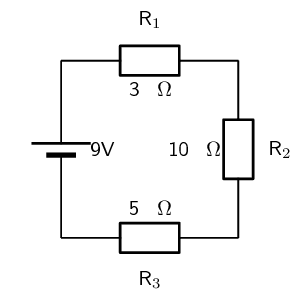
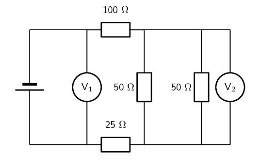

### Textbook Exercise 11.7

Give one word or term for each of the following definitions:

**Problem:**
The amount of energy per unit charge needed to move that charge between two points in a
                            circuit.

**Solution:**
Voltage

**Problem:**
The rate at which electrical energy is converted in an electric circuit.

**Solution:**
Electrical power

**Problem:**
A law that states that the amount of current through a conductor, at constant temperature, is
                            proportional to the voltage across the resistor.

**Solution:**
Ohm's law

**Problem:**
A \(\text{10}\) \(\text{Ω}\) has a voltage of \(\text{5}\) \(\text{V}\) across it. What is
                        the current through the resistor?

2. \(\text{50}\) \(\text{A}\)
4. \(\text{5}\) \(\text{A}\)
6. \(\text{0,5}\) \(\text{A}\)
8. \(\text{7}\) \(\text{A}\)

**Solution:**
\(\text{0,5}\) \(\text{A}\)

**Problem:**
Three resistors are connected in series. The resistances of the three resistors are:
                        \(\text{10}\) \(\text{Ω}\), \(\text{4}\) \(\text{Ω}\) and \(\text{3}\)
                        \(\text{Ω}\). What is the equivalent series resistance?

2. \(\text{1,5}\) \(\text{Ω}\)
4. \(\text{17}\) \(\text{Ω}\)
6. \(\text{0,68}\) \(\text{Ω}\)
8. \(\text{8}\) \(\text{Ω}\)

**Solution:**
\(\text{17}\) \(\text{Ω}\)

**Problem:**
Three resistors are connected in parallel. The resistances of the three resistors are:
                        \(\text{5}\) \(\text{Ω}\), \(\text{4}\) \(\text{Ω}\) and \(\text{2}\)
                        \(\text{Ω}\). What is the equivalent parallel resistance?

2. \(\text{1,05}\) \(\text{Ω}\)
4. \(\text{11}\) \(\text{Ω}\)
6. \(\text{0,95}\) \(\text{Ω}\)
8. \(\text{3}\) \(\text{Ω}\)

**Solution:**
\(\text{1,05}\) \(\text{Ω}\)

**Problem:**
A circuit consists of a \(\text{6}\) \(\text{Ω}\) resistor. The voltage across the resistor
                        is \(\text{12}\) \(\text{V}\). How much power is dissipated in the circuit?

2. \(\text{864}\) \(\text{W}\)
4. \(\text{3}\) \(\text{W}\)
6. \(\text{2}\) \(\text{W}\)
8. \(\text{24}\) \(\text{W}\)

**Solution:**
\(\text{24}\) \(\text{W}\)

**Problem:**
Calculate the current in the following circuit and then use the current to calculate the voltage
                        drops across each resistor.

**Solution:**
We first calculate the equivalent series resistance:

                    \begin{align*}
                    R_{s} & = R_{1} + R_{2} + R_{3} \\
                    & = \text{3} + \text{10} + \text{5} \\
                    & = \text{18}\text{ Ω}
                    \end{align*}

Now we can use Ohm's law to calculate the current:

                    \begin{align*}
                    I & = \frac{V}{R} \\
                    & = \frac{\text{9}}{\text{18}} \\
                    & = \text{0,5}\text{ A}
                    \end{align*}

Now we can use the fact that this is a series circuit and that the current is the same everywhere
                        in the circuit to find the voltage drops across each resistor:

                    \begin{align*}
                    V & = IR \\
                    & = (\text{0,5})(\text{3}) \\
                    & = \text{1,5}\text{ V}
                    \end{align*}
                    \begin{align*}
                    V & = IR \\
                    & = (\text{0,5})(\text{10}) \\
                    & = \text{5}\text{ V}
                    \end{align*}
                    \begin{align*}
                    V & = IR \\
                    & = (\text{0,5})(\text{5}) \\
                    & = \text{2,5}\text{ V}
                    \end{align*}

A battery is connected to this arrangement of resistors. The power dissipated in the
                        \(\text{100}\) \(\text{Ω}\) resistor is \(\text{0,81}\) \(\text{W}\). The resistances of
                        voltmeters \(V_{1}\) and \(V_{2}\) are so high that they do not affect the current in the
                        circuit.

**Problem:**
Calculate the current in the \(\text{100}\) \(\text{Ω}\) resistor.

**Solution:**
\begin{align*}
                        P & = I^{2}R \\
                        I^{2} & = \frac{P}{R} \\
                        & = \frac{\text{0,81}}{\text{100}} \\
                        & = \text{0,0081} \\
                        I & = \text{0,09}\text{ A}
                        \end{align*}

**Problem:**
Calculate the reading on voltmeter \(V_{2}\).

**Solution:**
This voltmeter is reading the voltage across the one \(\text{50}\) \(\text{Ω}\) resistor
                            so we need to determine what this voltage is.

We know that the current through the parallel combination of resistors is \(\text{0,09}\)
                            \(\text{A}\). We need to calculate the equivalent parallel resistance and then use this with
                            the current to find the voltage across the parallel combination.

                        \begin{align*}
                        \frac{1}{R_{p}} & = \frac{1}{R_{1}} + \frac{1}{R_{2}} \\
                        & = \frac{1}{50} + \frac{1}{50} \\
                        & = \frac{2}{50} \\
                        R_{p} & = \text{25}\text{ Ω}
                        \end{align*}
                        \begin{align*}
                        V & = IR \\
                        & = (\text{0,09})(\text{25}) \\
                        & = \text{2,25}\text{ V}
                        \end{align*}

This is the reading on \(V_{2}\) since the voltage across a parallel combination of resistors
                            is equal to the voltage across each resistor.

**Problem:**
Calculate the reading on voltmeter \(V_{1}\).

**Solution:**
We need to calculate the equivalent resistance of the circuit first. We already know the
                            equivalent resistance across the parallel combination. So the equivalent resistance is:

                        \begin{align*}
                        R & = R_{1} + R_{2} + R_{p} \\
                        & = \text{100} + \text{25} + \text{25} \\
                        & = \text{150}\text{ Ω}
                        \end{align*}

Now we can use Ohm's law to calculate the voltage, since we know the current in the circuit:

                        \begin{align*}
                        V & = IR \\
                        & = (\text{0,09})(\text{150}) \\
                        & = \text{13,5}\text{ V}
                        \end{align*}

A kettle is marked \(\text{240}\) \(\text{V}\); \(\text{1 500}\) \(\text{W}\).

**Problem:**
Calculate the resistance of the kettle when operating according to the above specifications.

**Solution:**
\begin{align*}
                        P & = \frac{V^{2}}{R} \\
                        R & = \frac{V^{2}}{P} \\
                        & = \frac{\text{240}^{2}}{\text{1 500}} \\
                        & = \text{38,4}\text{ Ω}
                        \end{align*}

**Problem:**
If the kettle takes \(\text{3}\) \(\text{minutes}\) to boil some water, calculate the amount
                            of electrical energy transferred to the kettle.

**Solution:**
We first convert the time to seconds:

                        \[(\text{3})(\text{60}) = \text{180}\text{ s}\]

And now we calculate the energy:

                        \begin{align*}
                        E & = Pt \\
                        & = (\text{1 500})(\text{180}) \\
                        & = \text{270 000}\text{ J}\\
                        & = \text{270}\text{ kJ}
                        \end{align*}

**Electric Eels**

Electric eels have a series of cells from head to tail. When the cells are activated by a nerve
                        impulse, a potential difference is created from head to tail. A healthy electric eel can produce
                        a potential difference of \(\text{600}\) \(\text{V}\).

**Problem:**
What is meant by “a potential difference of \(\text{600}\) \(\text{V}\)”?

**Solution:**
Potential difference or voltage, \(V\), is the amount of energy per unit charge needed to
                            move that charge between two points in a circuit. In the example of the electric eel this is
                            the amount of energy per unit charge needed to move that charge from the head to the tail.

**Problem:**
How much energy is transferred when an electron is moved through a potential difference of
                            \(\text{600}\) \(\text{V}\)?

**Solution:**
An electron has a charge of \(-\text{1,69} \times \text{10}^{-\text{19}}\) \(\text{C}\). So
                            we can find the amount of energy needed to move this charge through the potential
                            difference:

                        \begin{align*}
                        V & = \frac{E}{C} \\
                        \text{600} & = \frac{E}{-\text{1,69} \times \text{10}^{-\text{19}}} \\
                        E & = -\text{1,014} \times \text{10}^{-\text{16}}\text{ J}
                        \end{align*}
