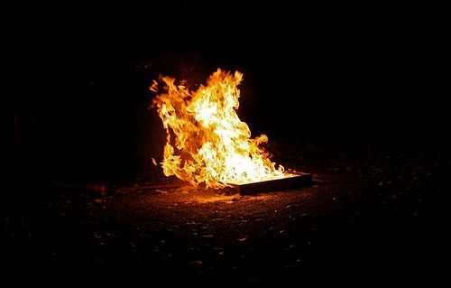
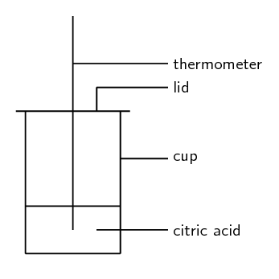
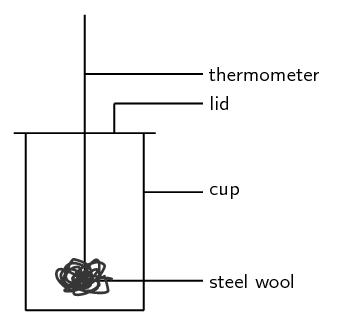
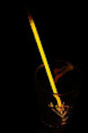

# Chapter 12: Energy and chemical change

In grade 10 learners learnt about physical and chemical changes. In this chapter learners will learn about the
      energy changes that occur in chemical reactions. The concepts of exothermic and endothermic reactions are
      introduced. Learners will also learn about activation energy. The following list summarises the concepts covered
      in this chapter.

- **Bond energy and how it leads to the energy changes in reactions.**
  In chapter 3 (atomic combinations) the concept of bond energy and graphs of potential energy versus atomic
            distance were covered. These two concepts form the cornerstone to understanding the energy changes in chemical
            reactions. In this topic the fact that bond forming requires energy and bond breaking releases energy is
            introduced. These two concepts are linked to the potential energy graph for bonding.
- **Exothermic and endothermic reactions.**
  Two classes of chemical reaction exist: exothermic and endothermic. It is important to note that these are
            not different types of reactions. For example an acid-base reaction can be exothermic or endothermic. All
            chemical reactions will either be exothermic or endothermic and this is determined by the energy of bond
            formation and bond breaking.
- **Energy diagrams for reactions with and without activation energy.**
  We can draw energy diagrams to show how a reaction proceeds. These diagrams give the reactants energy and the
            products energy. These diagrams show the energy of the system as a whole and are not concerned with just one
            reactant or one product. It is important for learners to draw these diagrams as a curve linking the reactants
            energy to the product energy as this shows the activation energy of the reaction. Learners first draw these
            curves without knowing about activation energy and then towards the end of the chapter they start adding the
            activation energy.
- **Activation energy.**
  A practical demonstration that can be done is to burn magnesium ribbon in air and in oxygen to investigate
            the concept of activation energy.
  All reactions (even the exothermic ones) need something to get them going. This may be very small or may be
            very large. At the maximum energy of the reaction the transition state or activated complex occurs. This is
            the point at which the reaction is somewhere between forming the products and breaking apart the reactants.

You have probably seen a fire burning or burnt fuel for warmth or cooking or light. A fire burning is one of the
    most noticeable examples of a chemical reaction that produces a lot of energy.

All chemical reactions involve energy changes. In some reactions, we are able to observe these energy changes as
    either an increase or a decrease in the overall energy of the system. In some reactions we see this as a change in
    the temperature. In other reactions we can observe this change when a reaction starts to give off light or when a
    reaction will only work after light is shone on it.

The study of energy changes (particularly heat) in chemical reactions is known as chemical thermodynamics. This is
    also sometimes called thermochemistry.

<Callout type="note" title="Note">
<VideoPlayer src="https://youtu.be/CWMATrOatRw" title="Video: 2447" />
</Callout>

<Callout type="note" title="Note">
- Graphs - Mathematics, Grade 10, Functions and graphs
- Equations - Mathematics, Grade 10, Equations and inequalities
- Units and unit conversions - Physical Sciences, Grade 10, Science skills
</Callout>

## 12.1 Energy changes in chemical reactions (ESBQJ)

### What causes the energy changes in chemical reactions? (ESBQK)

When a chemical reaction occurs, bonds in the reactants *break*, while new bonds *form* in the
        product. The following example explains this. Hydrogen reacts with oxygen to form water, according to the
        following equation:

      \[2\text{H}_{2}\text{(g)} + \text{O}_{2}\text{(g)} → 2\text{H}_{2}\text{O}\text{(g)}\]

In this reaction, the bond between the two hydrogen atoms in the \(\text{H}_{2}\) molecule will *break*,
        as will the bond between the oxygen atoms in the \(\text{O}_{2}\) molecule. New bonds will *form* between
        the two hydrogen atoms and the single oxygen atom in the water molecule that is formed as the product.

For bonds to *break*, energy must be *absorbed*. When new bonds *form*, energy is
        *released*. The energy that is needed to break a bond is called the **bond energy** or
        **bond dissociation energy**. Bond energies are measured in units of \(\text{kJ·mol$^{-1}$}\).

Bond energy

Bond energy is a measure of bond strength in a chemical bond. It is the amount of energy (in
            \(\text{kJ·mol$^{-1}$}\)) that is needed to break the chemical bond between two atoms.

Remember when we discussed bonding (chapter 3) we used the following energy diagram:

Figure 12.1:
          Graph showing the changes in energy that take place as the distance between two atoms changes.

We can use this diagram to understand why bond breaking requires energy and bond making releases energy. Point
        X on the diagram is at the lowest energy. When a bond breaks, the atoms move apart and the distance between them
        increases (i.e. the atom moves to the right on the \(x\)-axis or from point X to point A). Looking at the
        diagram we see that when this happens, the energy increases (i.e. the energy at point A is greater than the
        energy at point X). So when a bond breaks energy is needed.

When a bond forms the atoms move closer together and the distance between them decreases (i.e. the atom moves
        to the left on the \(x\)-axis or from point A to point X). Looking at the diagram we see that when this happens,
        the energy decreases (i.e. the energy at point X is less than the energy at point A). So when a bond forms
        energy is released.

Looking at the example of hydrogen reacting with oxygen to form water:

      \[2\text{H}_{2}\text{(g)} + \text{O}_{2}\text{(g)} → 2\text{H}_{2}\text{O}\text{(g)}\]

We see that energy is needed to break the bonds in the hydrogen molecule and to break the bonds in the oxygen
        molecule. And we also see that energy is released when hydrogen and oxygen bond to form water. When we look at
        the entire reaction and consider both bond breaking and bond forming we need to look at the
        **enthalpy** of the system.

Enthalpy

Enthalpy is a measure of the total energy of a chemical system for a given pressure, and is given the
            symbol H.

<Callout type="tip" title="Note">
A chemical system is a closed system that contains only the reactants and products involved in the reaction.
</Callout>

As we learn about exothermic and endothermic reactions we will see more on the concept of enthalpy.

### Exothermic and endothermic reactions (ESBQM)

In some reactions, the energy that must be *absorbed* to break the bonds in the reactants, is less than
        the energy that is *released* when the new bonds of the products are formed. This means that in the
        overall reaction, energy is *released* as either heat or light. This type of reaction is called an
        **exothermic** reaction.

Exothermic reaction

An exothermic reaction is one that releases energy in the form of heat or light.

Another way of describing an exothermic reaction is that it is one in which the energy of the products is less
        than the energy of the reactants, because energy has been released during the reaction. We can represent this
        using the following general formula:

      \[\text{Reactants} → \text{Products} + \text{Energy}\]

In other reactions, the energy that must be *absorbed* to break the bonds in the reactants, is more than
        the energy that is *released* when the new bonds in the products are formed. This means that in the
        overall reaction, energy must be *absorbed* from the surroundings. This type of reaction is known as an
        **endothermic** reaction.

Endothermic reaction

An endothermic reaction is one that absorbs energy in the form of heat or light.

Another way of describing an endothermic reaction is that it is one in which the energy of the products is
        greater than the energy of the reactants, because energy has been absorbed during the reaction. This can be
        represented by the following general formula:

      \[\text{Reactants} + \text{Energy} → \text{Products}\]

The difference in energy (E) between the reactants and the products is known as the **heat of the
          reaction**. It is also sometimes referred to as the **enthalpy change** of the system.
        This is represented using \(\Delta \text{H}\)

<Callout type="tip" title="Note">
\(\Delta\) is read as delta and means a change in. You may recall this symbol from physics.
</Callout>

A recommended project for formal assessment is included. In this experiment learners will investigate an
          exothermic reaction and an endothermic reaction. This experiment is split into two parts. The first part looks
          at an endothermic reaction, while the second part looks at an exothermic reaction. You will need polystyrene
          or cardboard cups, plastic lids, thermometers, vinegar, steel wool, citric acid, sodium bicarbonate and
          stirring rods. There is also a further investigation on exothermic and endothermic reactions that learners can
          complete. All these experiments can be combined into one project in which learners investigate several
          different reactions and classify these reactions as exothermic or endothermic.

This series of experiments starts with an endothermic reaction between citric acid and sodium bicarbonate.
          The second experiment in the series looks at the exothermic reaction between steel and oxygen in the air. The
          final part of the series is given as an investigation into various exothermic and endothermic reactions.

## Endothermic and exothermic reactions - part 1

### Apparatus and materials

You will need:

- citric acid
- sodium bicarbonate
- a polystyrene cup
- a lid for the cup
- thermometer
- glass stirring rod
- scissors

<Callout type="tip" title="Note">
You can get polystyrene cups with lids from coffee shops or fast food stores. Cardboard cups will also
              work fine. Some of the lids will have a hole for a straw, which is useful for this experiment.
</Callout>

Note that citric acid is found in citrus fruits such as lemons. Sodium bicarbonate is actually bicarbonate
            of soda (baking soda), the baking ingredient that helps cakes to rise.

### Method

2. If your lid does not have a hole for a straw, then cut a small hole into the lid.
4. Pour some citric acid \((\text{C}_{6}\text{H}_{8}\text{O}_{7})\) into the polystyrene cup, cover the
                   cup with its lid and record the temperature of the solution.
6. Stir in the sodium bicarbonate \((\text{NaHCO}_{3})\), then cover the cup again.
8. Immediately record the temperature, and then take a temperature reading every two minutes after that.
                   Record your results.

The equation for the reaction that takes place is:

\[\text{C}_{6}\text{H}_{8}\text{O}_{7}\text{(aq)} + 3\text{NaHCO}_{3}\text{(s)} →
            3\text{CO}_{2}\text{(g)} + 3\text{H}_{2}\text{O(}ℓ\text{)} +
            \text{Na}_{3}\text{C}_{6}\text{H}_{5}\text{O}_{7}\text{(aq)}\]

### Results

| Time (\(\text{mins}\)) | 0 | 2 | 4 | 6 |
| --- | --- | --- | --- | --- |
| Temperature (\(\text{℃}\)) |  |  |  |  |

Plot your temperature results on a graph of time (\(x\)-axis) against temperature (\(y\)-axis).

### Discussion and conclusion

- What happens to the temperature during this reaction?
- Is this an exothermic or an endothermic reaction? (Was energy taken in or given out? Did the
                  temperature increase or decrease?)
- Why was it important to keep the cup covered with a lid?

## Endothermic and exothermic reactions - part 2

### Apparatus and materials

- Vinegar
- steel wool
- thermometer
- polystyrene cup and plastic lid (from previous experiment)

### Method

2. Put the thermometer through the plastic lid, cover the cup and record the temperature in the empty cup.
                   You will need to leave the thermometer in the cup for about 5 minutes in order to get an accurate
                   reading.
4. Soak a piece of steel wool in vinegar for about a minute. The vinegar removes the protective coating
                   from the steel wool so that the metal is exposed to oxygen.
6. Take the thermometer out of the cup. Keep the thermometer through the hole of the lid.
8. After the steel wool has been in the vinegar, remove it and squeeze out any vinegar that is still on
                   the wool. Wrap the steel wool around the thermometer and place it (still wrapped round the thermometer)
                   back into the cup. The cup is automatically sealed when you do this because the thermometer is through
                   the top of the lid.
10. Leave the steel wool in the cup for about 5 minutes and then record the temperature. Record your
                   observations.

### Results

You should notice that the temperature *increases* when the steel wool is wrapped around the
            thermometer.

### Conclusion

The reaction between oxygen and the exposed metal in the steel wool is **exothermic**, which
            means that energy is released and the temperature increases.

### Examples of endothermic and exothermic reactions (ESBQN)

There are many examples of endothermic and exothermic reactions that occur around us all the time. The
        following are just a few examples.

<Callout type="tip" title="Note">
Note that we are only discussing chemical changes (recall from grade 10 about physical and chemical changes).
          Physical changes can also be classified as exothermic or endothermic. When we are referring to physical change
          then we talk about exothermic or endothermic processes. Evaporation is an endothermic process while
          condensation is an exothermic process.
</Callout>

2. **Endothermic reactions**
   - **Photosynthesis**
     Photosynthesis is the chemical reaction that takes place in green plants, which uses energy from the
                     sun to change carbon dioxide and water into food that the plant needs to survive, and which other
                     organisms (such as humans and other animals) can eat so that they too can survive. The equation for this
                     reaction is:
                   \[6\text{CO}_{2}\text{(g)} + 6\text{H}_{2}\text{O(ℓ)} + \text{energy} →
                   \text{C}_{6}\text{H}_{12}\text{O}_{6}\text{(s)} + 6\text{O}_{2}\text{(g)}\]
     Photosynthesis is an endothermic reaction. Energy in the form of sunlight is absorbed during the
                     reaction.
   - **The thermal decomposition of limestone**
     In industry, the breakdown of limestone into quicklime and carbon dioxide is very important. Quicklime
                     can be used to make steel from iron and also to neutralise soils that are too acid. However, the
                     limestone must be heated in a kiln (oven) at a temperature of over \(\text{900}\) \(\text{℃}\)
                     before the decomposition reaction will take place. The equation for the reaction is shown below:
                   \[\text{CaCO}_{3}\text{(s)} → \text{CaO(s)} + \text{CO}_{2}\text{(g)}\]
4. **Exothermic reactions**
   - **Combustion reactions**
     The burning of fuel is an example of a combustion reaction, and we as humans rely heavily on this
                     process for our energy requirements. The following equations describe the combustion of a hydrocarbon
                     such as *petrol* \((\text{C}_{8}\text{H}_{18})\):
     fuel + oxygen \(→\) heat + water + carbon dioxide
                   \[2\text{C}_{8}\text{H}_{18}\text{(ℓ)} + 25\text{O}_{2}\text{(g)} → 16\text{CO}_{2}\text{(g)}
                   +
                   18\text{H}_{2}\text{O(g)} + \text{heat}\]
     This is why we burn fuels (such as paraffin, coal, propane and butane) for energy, because the chemical
                     changes that take place during the reaction release huge amounts of energy, which we then use for things
                     like power and electricity. You should also note that *carbon dioxide* is produced during this
                     reaction. The chemical reaction that takes place when fuels burn has both positive and negative
                     consequences. Although we benefit from heat, power and electricity the carbon dioxide that is produced
                     has a negative impact on the environment.
   - **Respiration**
     Respiration is the chemical reaction that happens in our bodies to produce energy for our cells. The
                     equation below describes what happens during this reaction:
                   \[\text{C}_{6}\text{H}_{12}\text{O}_{6}\text{(s)} + 6\text{O}_{2}\text{(g)} →
                   6\text{CO}_{2}\text{(g)} + 6\text{H}_{2}\text{O}\text{(ℓ)} + \text{energy}\]
     In the reaction above, glucose (a type of carbohydrate in the food we eat) reacts with oxygen from the
                     air that we breathe in, to form carbon dioxide (which we breathe out), water and energy. The energy that
                     is produced allows the cell to carry out its functions efficiently. Can you see now why you must eat
                     food to get energy? It is not the food itself that provides you with energy, but the exothermic reaction
                     that takes place when compounds within the food react with the oxygen you have breathed in!

<Callout type="note" title="Note">
Lightsticks or glowsticks are used by divers, campers, and for decoration and fun. A lightstick is a plastic
          tube with a glass vial inside it. To activate a lightstick, you bend the plastic stick, which breaks the glass
          vial. This allows the chemicals that are inside the glass to mix with the chemicals in the plastic tube. These
          two chemicals react and release energy. Another part of a lightstick is a fluorescent dye which changes this
          energy into light, causing the lightstick to glow! This is known as phosphorescence or chemiluminescence.

</Callout>

<Callout type="note" title="Note">
<VideoPlayer src="https://youtu.be/c-iisqNh1r8" title="Video: 2448" />
</Callout>

<Callout type="note" title="Note">
<VideoPlayer src="https://youtu.be/H5Q2jkVDzeQ" title="Video: 2449" />
</Callout>

## Exothermic and endothermic reactions 1

### Textbook Exercise 12.1

State whether energy is absorbed or released in each of the following situations:

**Problem:**
The bond between hydrogen and chlorine in a molecule of hydrogen chloride breaks.

**Solution:**
This is bond breaking and so energy is absorbed.

**Problem:**
A bond is formed between hydrogen and fluorine to form a molecule of hydrogen fluoride.

**Solution:**
This is bond forming and so energy is released.

**Problem:**
A molecule of nitrogen (\(\text{N}_{2}\)) is formed.

**Solution:**
A bond is formed and so energy is released.

**Problem:**
A molecule of carbon monoxide breaks apart.

**Solution:**
A bond is broken and so energy is absorbed.

State whether the following descriptions are used to describe an endothermic or an exothermic reaction:

**Problem:**
Reactants react to give products and energy.

**Solution:**
Exothermic

**Problem:**
The energy that must be absorbed to break the bonds in the reactants is greater than the energy that is
                released when the products form.

**Solution:**
Endothermic

**Problem:**
The energy of the products is found to be greater than the energy of the reactants for this type of
                reaction.

**Solution:**
Exothermic

**Problem:**
Heat or light must be absorbed from the surroundings before this type of reaction takes place.

**Solution:**
Endothermic
