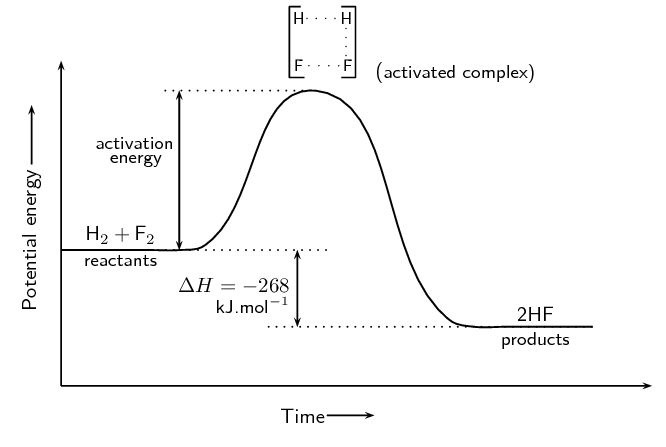
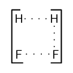
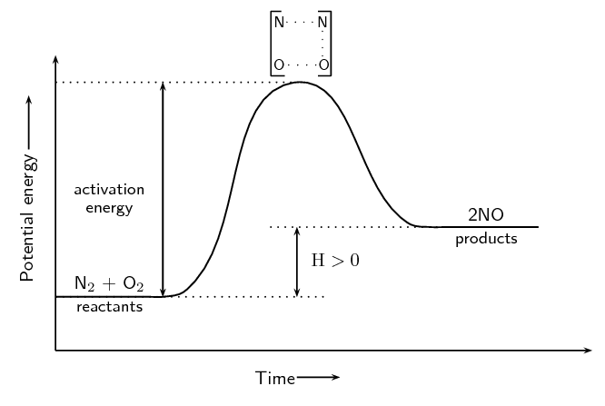
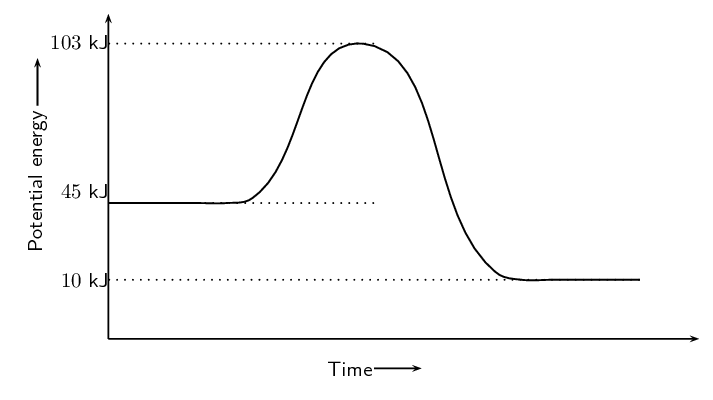
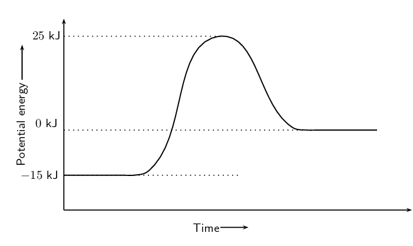

## 12.3 Activation energy and the activated complex (ESBQR)

If you take a match and just hold it or wave it around in the air, the match will not light. You have to
            strike the match against the side of the box. All chemical reactions need something that makes them start
            going.

Chemical reactions will not take place until the system has some minimum amount of energy added to it. This
            energy is called the **activation energy**.

Activation energy

Activation energy is the minimum amount of energy that is needed to start a chemical reaction.

<Callout type="tip" title="Note">
It is important to realise that even though exothermic reactions release energy they still need a small
                amount of energy to start the reaction.
</Callout>

Recall from earlier that we drew graphs for the energy changes in exothermic and endothermic reactions. We
            can now add some information to these graphs. This will also explain why we draw these graphs with a curve
            rather than using a straight line from the reactants energy to the products energy.

We will start by looking at exothermic reactions. We will use:

        \[\text{H}_{2}\text{(g)} + \text{F}_{2}\text{(g)} → 2\text{HF(g)}\]

as an example of an exothermic reaction.

Figure 12.4:
                The energy changes that take place during an exothermic reaction.

<Callout type="tip" title="Note">
The activation energy is the difference between the energy of the **reactants** and the
                maximum energy (i.e. the energy of the activated complex).
</Callout>

The reaction between \(\text{H}_{2} (\text{g})\) and \(\text{F}_{2} (\text{g})\) (Figure 12.4) needs energy in order to
            proceed, and this is the activation energy. To form the product the bond between \(\text{H}\) and
            \(\text{H}\) in \(\text{H}_{2}\) must break. The bond between \(\text{F}\) and \(\text{F}\) in
            \(\text{F}_{2}\) must also break. A new bond between \(\text{H}\) and \(\text{F}\) must also form to make
            \(\text{HF}\). The reactant bonds break at the same time that the product bonds form.

We can show this as:

This is called the **activated complex** or transition state. The activated complex lasts for
            only a *very short time*. After this short time one of two things will happen: the original bonds
            will reform, or the bonds are broken and a new product forms. In this example, the final product is
            \(\text{HF}\) and it has a lower energy than the reactants. The reaction is exothermic and ΔH is
            negative.

<Callout type="note" title="Note">
The reaction between \(\text{H}_{2}\) and \(\text{F}_{2}\) was considered by NASA (National Aeronautics
                and Space Administration) as a fuel system for rocket boosters because of the energy that is released
                during this exothermic reaction.
</Callout>

The activated complex is the complex that exists as the bonds in the products are forming and the bonds in
            the reactants are breaking. This complex exists for a very short period of time and is found when the energy
            of the system is at its maximum.

<Callout type="tip" title="Note">
Enzymes and activation energy

An enzyme is a catalyst that helps to speed up the rate of a reaction by lowering the activation energy
                of a reaction. There are many enzymes in the human body, without which lots of important reactions would
                never take place. Cellular respiration is one example of a reaction that is catalysed by enzymes. You
                will learn more about catalysts in Grade 12.
</Callout>

In endothermic reactions, the final products have a higher energy than the reactants. An energy diagram is
            shown below (Figure 12.5) for the
            endothermic reaction:

        \[\text{O}_{2}\text{(g)} + \text{N}_{2}\text{(g)} → 2\text{NO(g)}\]

Notice that the activation energy for the endothermic reaction is much greater than for the exothermic
            reaction.

Figure 12.5:
                The energy changes that take place during an endothermic reaction.

It is because of this activation energy that we first need to show an increase in energy from the reactant to
            the activated complex and then a decrease in energy from the activated complex to the product. We show this
            on the energy graphs by drawing a curve from the energy of the reactants to the energy of the products.

<Callout type="tip" title="Worked example 1: Activation energy">
**Question:**
Refer to the graph below and then answer the questions that follow:

2. Calculate \(\Delta\)H.
4. Is the reaction endothermic or exothermic and why?
6. Calculate the activation energy for this reaction.

**Calculate \(\Delta\)H:**
\(\Delta\)H is found by subtracting the energy of the **reactants** from the energy of
                    the **products**. We find the energy of the reactants and the products from the graph.
                    \begin{align*}
                    \Delta \text{H} & = \text{energy of products} - \text{energy of reactants} \\
                    & = \text{10}\text{ kJ} - \text{45}\text{ kJ} \\
                    & = -\text{35}\text{ kJ}
                    \end{align*}

**Determine if this is exothermic or endothermic.:**
The reaction is exothermic since \(\Delta \text{H} < 0\). We also note that the energy of the
                    reactants is greater than the energy of the products.

**Calculate the activation energy:**
The activation energy is found by subtracting the energy of the reactants from the energy of the
                    activated complex. Again we can read the energy of the reactants and activated complex off the
                    graph.
                    \begin{align*}
                    \text{activation energy} & = \text{energy of activated complex} - \text{energy of reactants} \\
                    & = \text{103}\text{ kJ} - \text{45}\text{ kJ} \\
                    & = \text{58}\text{ kJ}
                    \end{align*}
</Callout>

## Energy and reactions

### Textbook Exercise 12.3

**Problem:**
Carbon reacts with water according to the following equation:

\[\text{C(s)} + \text{H}_{2}\text{O(g)} → \text{CO(g)} + \text{H}_{2}\text{(g)}
                            \qquad ΔH > 0\]

Is this reaction endothermic or exothermic? Give a reason for your answer.

**Solution:**
Endothermic \(\Delta \text{H} > 0\)

Refer to the graph below and then answer the questions that follow:

**Problem:**
What is the energy of the reactants?

**Solution:**
\(-\text{15}\) \(\text{kJ}\)

**Problem:**
What is the energy of the products?

**Solution:**
\(\text{0}\) \(\text{kJ}\)

**Problem:**
Calculate ΔH.

**Solution:**
We find \(\Delta \text{H}\) using:

                            \begin{align*}
                            \Delta \text{H} & = \text{energy of products} - \text{energy of reactants} \\
                            & = \text{0}\text{ kJ} - (-\text{15}\text{ kJ}) \\
                            & = \text{15}\text{ kJ}
                            \end{align*}

**Problem:**
What is the activation energy for this reaction?

**Solution:**
\begin{align*}
                            \text{activation energy} & = \text{energy of activated complex} - \text{energy of
                            reactants} \\
                            & = \text{25}\text{ kJ} - (-\text{15}\text{ kJ}) \\
                            & = \text{40}\text{ kJ}
                            \end{align*}
