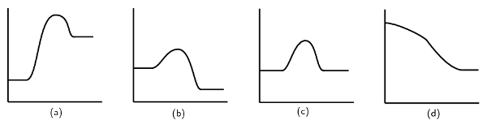
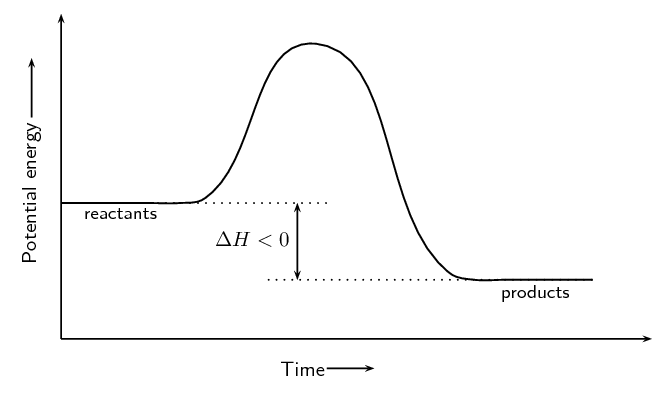
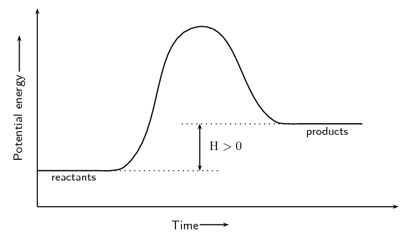
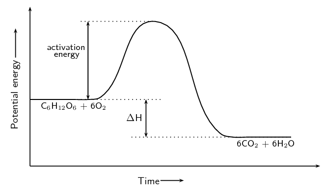

### Textbook Exercise 12.4

For each of the following, give one word or term for the description.

**Problem:**
The minimum amount of energy that is needed for a reaction to proceed.

**Solution:**
Activation energy

**Problem:**
A measure of the bond strength in a chemical bond.

**Solution:**
Bond energy

**Problem:**
A type of reaction where ΔH is less than zero.

**Solution:**
Exothermic reaction

**Problem:**
A type of reaction that requires heat or light to proceed.

**Solution:**
Endothermic reaction

**Problem:**
For the following reaction:

                    \[\text{HCl(aq)} + \text{NaOH(aq)} \rightarrow \text{NaCl(aq)} + \text{H}_{2}\text{O(ℓ)}\]

choose the correct statement from the list below.

2. Energy is taken in when the new bonds in \(\text{NaCl}\) are formed.
4. Energy is released when the bonds in \(\text{HCl}\) break.
6. Energy is released when the bonds in \(\text{H}_{2}\text{O}\) form.
8. Energy is released when the bonds in \(\text{NaOH}\) break.

**Solution:**
Energy is released when the bonds in \(\text{H}_{2}\text{O}\) form.

**Problem:**
For the following reaction:

                    \[\text{A} + \text{B} → \text{AB} \qquad Δ\text{H} = -\text{129}\text{
                    kJ·mol$^{-1}$}\]

choose the correct statement from the list below.

2. The energy of the reactants is less than the energy of the product.
4. The energy of the product is less than the energy of the reactants.
6. The reaction needs energy to occur.
8. The overall energy of the system increases during the reaction.

**Solution:**
The energy of the product is less than the energy of the reactants. This is an exothermic
                        reaction (\(\Delta \text{H} > 0\)).

**Problem:**
Consider the following chemical reaction:

                    \[2\text{NO}_{2}\text{(g)} \rightarrow \text{N}_{2}\text{O}_{4}\text{(g)} \qquad Δ\text{H} <
                    \text{0}\]

Which one of the following graphs best represents the changes in potential energy that take place
                        during the production of \(\text{N}_{2}\text{O}_{4}\)?

**Solution:**
The second graph (b) is correct. The reaction is exothermic (\(\Delta \text{H} > 0\)), so the
                        energy of the reactants must be greater than the energy of the products. Graphs (c) and (d) are
                        not valid energy graphs.

In each of the following reactions, say whether the reaction is endothermic or exothermic, and
                        give a reason for your answer. Draw the resulting energy graph for each reaction.

**Problem:**
\(\text{Fe}_{2}\text{O}_{3}\text{(s)} + 2\text{Al(s)} → 2\text{Fe(s)} +
                            \text{Al}_{2}\text{O}_{3} \text{(s)} + \text{ heat}\)

**Solution:**
Exothermic. Heat is given off and this is represented by showing \(+\) heat on the right hand
                            side of the equation.

**Problem:**
\(\text{NH}_{4}\text{Cl(s)} + \text{heat} → \text{NH}_{3}\text{(g)} + \text{HCl(g)}\)

**Solution:**
Endothermic. Energy is needed (shown by + energy on the left hand side of the reaction
                            equation) for the reaction to proceed.

The cellular respiration reaction is catalysed by enzymes. The equation for the reaction is:

                    \[\text{C}_{6}\text{H}_{12}\text{O}_{6}\text{(s)} + 6\text{O}_{2}\text{(g)} →
                    6\text{CO}_{2}\text{(g)} + 6\text{H}_{2}\text{O(ℓ)}\]

The change in potential energy during this reaction is shown below:

**Problem:**
Will the value of ΔH be positive or negative? Give a reason for your answer.

**Solution:**
Negative. The energy of the products is less than the energy of the reactants.

**Problem:**
Explain what is meant by activation energy.

**Solution:**
The activation energy is the minimum energy that must be overcome to enable the reaction to
                            proceed.

**Problem:**
Glucose is one of the reactants in cellular respiration. What important chemical reaction
                            produces glucose?

**Solution:**
Photosynthesis

**Problem:**
Is the reaction in your answer above an endothermic or an exothermic one? Explain your
                            answer.

**Solution:**
Endothermic. Photosynthesis needs energy (light) to proceed.

**Problem:**
Draw the energy graph for the reaction that produces glucose.

**Solution:**

