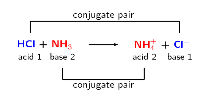
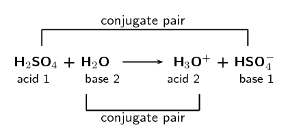
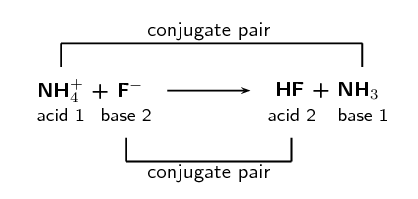
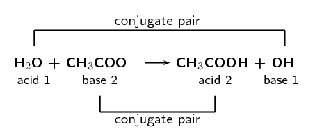
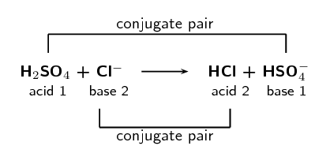
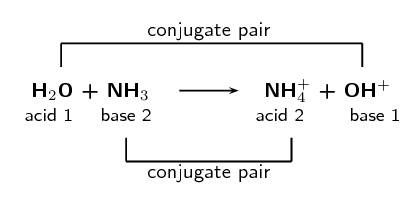

# Chapter 13: Types of reactions

In this chapter learners will explore acid-base reactions and redox reactions. Redox reactions were briefly
            introduced in gr10. The concepts of acids, bases, reduction, oxidation and oxidation numbers are all
            introduced here. The following list provides a summary of the topics covered in this chapter.

- **Acids and bases.**
  This chapter begins by revising all the concepts done on acids and bases up to this point. Learners
                      are reminded what an acid and a base are (in particular the Bronsted-Lowry definition) and how the
                      definition and concept have changed over time. Although the most recent definition of an acid and a
                      base is the Lowry definition this is not covered at school level and the Bronsted-Lowry definition
                      serves as a good working model for the acids and bases that learners encounter at school.
  The concept of a polyprotic acid is introduced although it is not in CAPS. This is done to help
                      learners understand how to handle acids such as sulfuric acid in reactions. You should try to use
                      polyprotic acids sparingly in your examples.
- **Conjugate acids and bases and amphoteric (amphiprotic) substances.**
  The concept of conjugate acids and bases requires learners to think about reactions going in reverse.
                      By writing the equation in reverse, learners can see how the acid becomes a base. This base is said
                      to be the conjugate base of the acid since it is conjugated (linked) to the acid.
- **Acid-hydroxide, acid-oxide and acid-carbonate reactions.**
  Three different types of bases are examined in detail to see how they react with acids. Several
                      examples of each type are given and the general equation for the reaction is also given.
- **Oxidation numbers for compounds.**
  This topic is placed after redox reactions in CAPS but must be taught before redox reactions and so
                      is placed before redox reactions in this book. This topic provides the tools needed to understand
                      redox reactions.
- **Balancing redox reactions.**
  In grade 10 learners learnt how to balance chemical equations by inspection. In this topic they will
                      learn how to balance redox reactions which often cannot be balanced by inspection. The simpler
                      examples can be balanced by inspection and this can be used as a comparison for the two techniques.
                      Learners need to be able to break a reaction up into two parts and follow different chemical species
                      through an equation. This skill starts with conjugate acids and bases and carries over into this
                      topic.

Coloured text has been used as a tool to highlight different parts of reactions. Ensure that learners
            understand that the coloured text does not mean there is anything special about that part of the reaction,
            this is simply a teaching tool to help them identify the important parts of the reaction.

It is also important to note that this chapter is split across term 3 and term 4. Acids and bases should be
            completed in term 3 and redox reactions are done in term 4.

All around you there are chemical reactions taking place. Green plants are photosynthesising, car engines are
        relying on the reaction between petrol and air and your body is performing many complex reactions. In this
        chapter we will look at two common types of reactions that can occur in the world around you and in the
        chemistry laboratory. These two types of reactions are acid-base reactions and redox reactions.

## 13.1 Acids and bases (ESBQT)

### What are acids and bases? (ESBQV)

## Household acids and bases

Look around your home and school and find examples of acids and bases. Remember that foods can also
                    be acidic or basic.

Make a list of all the items you find. Why do you think they are acids or bases?

Some common acids and bases, and their chemical formulae, are shown in Table 13.1.

| Acid | Formula | Base | Formula |
| --- | --- | --- | --- |
| Hydrochloric acid | \(\text{HCl}\) | Sodium hydroxide | \(\text{NaOH}\) |
| Sulfuric acid | \(\text{H}_{2}\text{SO}_{4}\) | Potassium hydroxide | \(\text{KOH}\) |
| Sulfurous acid | \(\text{H}_{2}\text{SO}_{3}\) | Sodium carbonate | \(\text{Na}_{2}\text{CO}_{3}\) |
| Acetic (ethanoic) acid | \(\text{CH}_{3}\text{COOH}\) | Calcium hydroxide | \(\text{Ca}(\text{OH})_{2}\) |
| Carbonic acid | \(\text{H}_{2}\text{CO}_{3}\) | Magnesium hydroxide | \(\text{Mg}(\text{OH})_{2}\) |
| Nitric acid | \(\text{HNO}_{3}\) | Ammonia | \(\text{NH}_{3}\) |
| Phosphoric acid | \(\text{H}_{3}\text{PO}_{4}\) | Sodium bicarbonate | \(\text{NaHCO}_{3}\) |

Table 13.1:
                    Some common acids and bases and their chemical formulae.

Most acids share certain characteristics, and most bases also share similar characteristics. It is
                important to be able to have a definition for acids and bases so that they can be correctly identified
                in reactions.

### Defining acids and bases (ESBQW)

One of the first things that was noted about acids is that they have a sour taste. Bases were noted to
                have a soapy feel and a bitter taste. However you cannot go around tasting and feeling unknown
                substances since they may be harmful. Also when chemists started to write down chemical reactions more
                practical definitions were needed.

A number of definitions for acids and bases have developed over the years. One of the earliest was the
                **Arrhenius** definition. Arrhenius (1887) noticed that water dissociates (splits up) into
                hydronium \((\text{H}_{3}\text{O}^{+})\) and hydroxide \((\text{OH}^{-})\) ions according to the
                following equation:

\(2\text{H}_{2}\text{O (l)} \rightarrow \text{H}_{3}\text{O}^{+}\text{(aq)} + \text{OH}^{-}\text{(aq)}\)

<Callout type="tip" title="Note">
For more information on *dissociation*, refer to Grade 10 (chapter 18: reactions in aqueous
                    solution).
</Callout>

Arrhenius described an **acid** as a compound that increases the concentration of
                \(\text{H}_{3}\text{O}^{+}\) ions in solution and a **base** as a compound that increases
                the concentration of \(\text{OH}^{-}\) ions in solution.

Look at the following examples showing the dissociation of hydrochloric acid and sodium hydroxide (a
                base) respectively:

2. \(\text{HCl (aq)} + \text{H}_{2}\text{O}\text{(l)} \rightarrow
                           \text{H}_{3}\text{O}^{+}\text{(aq)} + \text{Cl}^{-}\text{(aq)}\)
   Hydrochloric acid in water increases the concentration of \(\text{H}_{3}\text{O}^{+}\) ions and
                           is therefore an *acid*.
4. \(\text{NaOH (s)} \stackrel{\text{H}_{2}\text{O}}{\longrightarrow} \text{Na}^{+}\text{(aq)} +
                           \text{OH}^{-}\text{(aq)}\)
   Sodium hydroxide in water increases the concentration of \(\text{OH}^{-}\) ions and is therefore
                           a *base*.
   Note that we write \(\stackrel{\text{H}_{2}\text{O}}{\longrightarrow}\) to indicate that water is
                           needed for the dissociation.

However, this definition could only be used for acids and bases *in water*. Since there are many
                reactions which do not occur in water it was important to come up with a much broader definition for
                acids and bases.

In 1923, Lowry and Bronsted took the work of Arrhenius further to develop a broader definition for acids
                and bases. The **Bronsted-Lowry model** defines acids and bases in terms of their ability
                to donate or accept protons.

Acids

A Bronsted-Lowry **acid** is a substance that gives away protons (hydrogen cations
                        \(\text{H}^{+}\)), and is therefore called a **proton donor**.

Bases

A Bronsted-Lowry **base** is a substance that takes up protons (hydrogen cations
                        \(\text{H}^{+}\)), and is therefore called a **proton acceptor**.

Below are some examples:

2. \(\text{HCl (aq)} + \text{NH}_{3}\text{(aq)} \rightarrow \text{NH}_{4}^{+}\text{(aq)} +
                           \text{Cl}^{-}\text{(aq)}\)
   We highlight the chlorine and the nitrogen so that we can follow what happens to these two
                           elements as they react. We do not highlight the hydrogen atoms as we are interested in how these
                           change. This colour coding is simply to help you identify the parts of the reaction and does not
                           represent any specific property of these elements.
   \(\text{H}{\color{red}{\text{Cl}}} \text{ (aq)} + {\color{blue}{\text{N}}}\text{H}_{3}\text{(aq)}
                           \rightarrow {\color{blue}{\text{N}}}\text{H}_{4}^{+}\text{(aq)} +
                           {\color{red}{\text{Cl}}}^{-}\text{(aq)}\)
   In order to decide which substance is a proton donor and which is a proton acceptor, we need to
                           look at what happens to each reactant. The reaction can be broken down as follows:
   \(\text{H}{\color{red}{\text{Cl}}}\text{ (aq)} \rightarrow
                           {\color{red}{\text{Cl}}}^{-}\text{(aq)}\) and
   \({\color{blue}{\text{N}}}\text{H}_{3}\text{(aq)} \rightarrow
                           {\color{blue}{\text{N}}}\text{H}_{4}^{+}\text{(aq)}\)
   From these reactions, it is clear that \(\text{HCl}\) is a *proton donor* and is therefore
                           an **acid**, and that \(\text{NH}_{3}\) is a *proton acceptor* and is
                           therefore a **base**.
4. \(\text{CH}_{3}\text{COOH (aq)} + \text{H}_{2}\text{O (l)} \rightarrow
                           \text{H}_{3}\text{O}^{+}\text{(aq)} + \text{CH}_{3}\text{COO}^{-}\text{(aq)}\)
   Again we highlight the parts of the reactants that we want to follow in this reaction:
   \({\color{red}{\text{CH}_{3}\text{COO}}}\text{H (aq)} +
                           \text{H}_{2}{\color{blue}{\text{O}}}\text{ (l)} \rightarrow
                           \text{H}_{3}{\color{blue}{\text{O}}}^{+}\text{(aq)} +
                           {\color{red}{\text{CH}_{3}\text{COO}}}^{-}\text{(aq)}\)
   The reaction can be broken down as follows:
   \({\color{red}{\text{CH}_{3}\text{COO}}}\text{H (aq)} \rightarrow
                           {\color{red}{\text{CH}_{3}\text{COO}}}^{-}\text{(aq)}\) and
   \(\text{H}_{2}{\color{blue}{\text{O}}}\text{ (l)} \rightarrow
                           \text{H}_{3}{\color{blue}{\text{O}}}^{+}\text{(aq)}\)
   In this reaction, \(\text{CH}_{3}\text{COOH}\) (acetic acid or vinegar) is a proton donor and is
                           therefore the **acid**. In this case, water acts as a **base** because
                           it accepts a proton to form \(\text{H}_{3}\text{O}^{+}\).
6. \(\text{NH}_{3}\text{(aq)} + \text{H}_{2}\text{O (l)} \rightarrow \text{NH}_{4}^{+}\text{(aq)} +
                           \text{OH}^{-}\text{(aq)}\)
   Again we highlight the parts of the reactants that we want to follow in this reaction:
   \({\color{blue}{\text{N}}}\text{H}_{3}\text{(aq)} + \text{H}_{2}{\color{red}{\text{O}}}\text{
                           (l)} \rightarrow {\color{blue}{\text{N}}}\text{H}_{4}^{+}\text{(aq)} +
                           {\color{red}{\text{O}}}\text{H}^{-}\text{(aq)}\)
   The reaction can be broken down as follows:
   \(\text{H}_{2}{\color{red}{\text{O}}}\text{ (l)} \rightarrow
                           {\color{red}{\text{O}}}\text{H}^{-}\text{(aq)}\) and
   \({\color{blue}{\text{N}}}\text{H}_{3}\text{(aq)} \rightarrow
                           {\color{blue}{\text{N}}}\text{H}_{4}^{+}\text{(aq)}\)
   Water donates a proton and is therefore an **acid** in this reaction. Ammonia
                           accepts the proton and is therefore the **base**.

Notice in these examples how we looked at the common elements to break the reaction into two parts. So in
                the first example we followed what happened to chlorine to see if it was part of the acid or the base.
                And we also followed nitrogen to see if it was part of the acid or the base. You should also notice how
                in the reaction for the acid there is one less hydrogen on the right hand side and in the reaction for
                the base there is an extra hydrogen on the right hand side.

#### Amphoteric substances

In examples \(\text{2}\) and \(\text{3}\) above we notice an interesting thing about water. In
                    example \(\text{2}\) we find that water acts as a base (it accepts a proton). In example
                    \(\text{3}\) however we see that water acts as an acid (it donates a proton)!

Depending on what water is reacting with it can either react as a base or as an acid. Water is said
                    to be **amphoteric**. Water is not unique in this respect, several other substances are
                    also amphoteric.

Amphoteric

An amphoteric substance is one that can react as either an acid or base.

When we look just at Bronsted-Lowry acids and bases we can also talk about amphiprotic substances
                    which are a special type of amphoteric substances.

Amphiprotic

An amphiprotic substance is one that can react as either a proton donor (Bronsted-Lowry acid)
                            or as a proton acceptor (Bronsted-Lowry base). Examples of amphiprotic substances include
                            water, hydrogen carbonate ion (\(\text{HCO}_{3}^{-}\)) and hydrogen sulfate ion
                            (\(\text{HSO}_{4}^{-}\)).

**Note:** You may also see the term **ampholyte** used to mean a substance
                    that can act as both an acid and a base. This term is no longer in general use in chemistry.

<QuizCard id="s11-13-01a" title="Interactive Exercise 13.1" question="Physical constants \(·\) Chemistry formulas \(·\) Periodic table \(·\) Standard reduction potentials When potassium hydroxide reacts with water, it dissociates as shown in the balanced equation below: KOH(s) \(\:+\:\) H 2 O(ℓ) \(\rightarrow\) \(\downarrow\) K + (aq) \(\:+\:\) OH − (aq) What is an Arrhenius base?" options=[] answer="0" hint="" explanation="Define an Arrhenius base According to the Arrhenius theory, a base is a substance that produces hydroxide ions ( OH − ) when it dissolves in water. Submit your answer as: a substance that produces hydroxide ions when it dissolves in water." />

<QuizCard id="s11-13-01a" title="Interactive Exercise 13.1" question="Physical constants \(·\) Chemistry formulas \(·\) Periodic table \(·\) Standard reduction potentials When hydrogen fluoride reacts with water, it ionises as shown in the balanced equation below: HF(ℓ) \(\:+\:\) H 2 O(ℓ) \(\rightarrow\) \(\downarrow\) H 3 O + (aq) \(\:+\:\) F − (aq) What is a Brønsted-Lowry acid?" options=[] answer="2" hint="" explanation="Define a Brønsted-Lowry acid According to the Brønsted-Lowry theory, an acid is a proton ( H + ion) donor. Submit your answer as: a proton donor." />

<QuizCard id="s11-13-01a" title="Interactive Exercise 13.1" question="Give a term (one word or phrase) for the following definition: A substance that can react as either a proton donor or as a proton acceptor." options=[] answer="
                    ['amphiprotic substance', 'amphoteric substance', 'amphoteric', 'an amphoteric substance', 'amphoteric substances', 'the amphoteric substances', 'amphiprotic', 'an amphiprotic substance', 'amphiprotic substances', 'the amphiprotic substances', 'ampholytic substance', 'ampholyte', 'an ampholyte', 'ampholytes', 'an ampholyte', 'an ampholytic substance', 'ampholytic substances', 'the ampholytes', 'the ampholytic substances']
                " hint="" explanation="Give the correct answer An amphiprotic substance can act as either a proton donor or as a proton acceptor. Therefore the correct answer is: amphiprotic substance . Submit your answer as:" />

<QuizCard id="s11-13-01a" title="Interactive Exercise 13.1" question="Adapted from DBE Nov 2015 Grade 11, P2, Q1.1 Physical constants \(·\) Chemistry formulas \(·\) Periodic table \(·\) Standard reduction potentials According to the Arrhenius theory, all acids... A form hydroxide ions in solution. B are proton donors. C are H + ion acceptors. D form H 3 O + ions in solution." options=["A", "B", "C", "D"] answer="D" hint="" explanation="Use the Arrhenius definition of an acid The correct option must use the Arrhenius theory                         to describe an acid . According to the Arrhenius theory, an acid is a substance that produces hydrogen ions ( H + ) / hydronium ions ( H 3 O + ) when it dissolves in water. We can use this definition to select the correct option. According to the Arrhenius theory, all acids ... A form hydroxide ions in solution. Definition for Arrhenius base . B are proton donors. Definition for Brønsted-Lowry acid. C are H + ion acceptors. Definition for Brønsted-Lowry base . D \({\color{red}{{\checkmark}{\checkmark}}}\) form H 3 O + ions in solution. Definition for Arrhenius acid . The correct option is D . Submit your answer as: D" />

<QuizCard id="s11-13-01a" title="Interactive Exercise 13.1" question="Adapted from DBE Nov 2015 Grade 11, P2, Q1.1 Physical constants \(·\) Chemistry formulas \(·\) Periodic table \(·\) Standard reduction potentials According to the Brønsted-Lowry theory, all bases... A are proton donors. B form H + ions in solution. C are H + ion acceptors. D form OH − ions in solution." options=["A", "B", "C", "D"] answer="C" hint="" explanation="Use the Brønsted-Lowry definition of a base The correct option must use the Brønsted-Lowry theory                         to describe a base . According to the Brønsted-Lowry theory, a base is a proton ( H + ion) acceptor. We can use this definition to select the correct option. According to the Brønsted-Lowry theory, all bases ... A are proton donors. Definition for Brønsted-Lowry acid . B form H + ions in solution. Definition for Arrhenius acid . C \({\color{red}{{\checkmark}{\checkmark}}}\) are H + ion acceptors. Definition for Brønsted-Lowry base . D form OH − ions in solution. Definition for Arrhenius base. The correct option is C . Submit your answer as: C" />

<QuizCard id="s11-13-01a" title="Interactive Exercise 13.1" question="H 2 O(ℓ) acts as a Bronsted-Lowry acid . Using the transfer of only one hydrogen ion ( H + ) write a balanced equation to show how this compound acts as a Bronsted-Lowry acid ." options=["amphoteric", "indicators", "conjugate acid-base pairs"] answer="
                        ['H_{2}O(l) \\rightarrow H^{+}(aq)+OH^{-}(aq)', 'H_{2}O \\rightarrow H^{+}+OH^{-}', 'H_{2}O(l) \\rightleftharpoons H^{+}(aq)+OH^{-}(aq)', 'H_{2}O \\rightleftharpoons H^{+}+OH^{-}']
                    " hint="Write a chemical equation here. You can use the following symbols to write equations: plus: + one-way arrow (→): −> (this is a minus and a greater than symbol) two-way arrow (⇌): <=> (this is a less than symbol, an equal symbol and a greater than symbol) Here are some examples of equations and how you should write them: Na + + Cl − → NaCl can be written as: Na^+  +  Cl^−  −>  NaCl CH 3 CO 2 H + H 2 O ⇌                CH 3 CO 2 − + H 3 O + can be written as: CH3CO2H  +  H2O  <=>  CH3CO2^-  +  H3O^+ State symbols can be added by writing the appropriate state in brackets. For example: Na + (aq) + Cl − (aq) → NaCl(aq) can be written as: Na^+ (aq)  +  Cl^− (aq)  −>  NaCl (aq) The chemical compounds in the equation should be written like this, for the different                types of compounds: Element: simply type in the element symbol as it appears on the periodic table. Chemical formula: just write the numbers showing the ratios of atoms normally. For example, water (H 2 O) is written as: H2O Ion: Use the exponent symbol ( ^ ) to represent a superscript. For example, the sodium ion (Na + ) is written as: Na^+ and the sulfate ion (SO 4 2− ) is written as: SO4^2− Electron: An electron is represented using e^- Compound formula: use round brackets around a compound ion in a formula. For example, calcium permanganate (Ca(MnO 4 ) 2 ) is written as: Ca(MnO4)2" explanation="What is the definition of a Bronsted-Lowry  acid A Bronsted-Lowry acid is a proton donor. So to write a chemical equation to show H 2 O(ℓ) acting as a Bronsted-Lowry acid we need to remove a proton from the compound. Doing this gives: H 2 O(ℓ) \(\rightarrow\) \(\downarrow\) H + (aq) \(\:+\:\) OH − (aq) Submit your answer as:" />

#### Polyprotic acids [NOT IN CAPS]

A polyprotic (many protons) acid is an acid that has more than one proton that it can donate. For
                    example sulfuric acid can donate one proton to form the hydrogen sulfate ion:

                \[\text{H}_{2}\text{SO}_{4}\text{(aq)} + \text{OH}^{-}\text{(aq)} \rightarrow
                \text{HSO}_{4}^{-}\text{(aq)} + \text{H}_{2}\text{O (l)}\]

Or it can donate two protons to form the sulfate ion:

                \[\text{H}_{2}\text{SO}_{4}\text{(aq)} + 2\text{OH}^{-}\text{(aq)} \rightarrow
                \text{SO}_{4}^{2-}\text{(aq)} + 2\text{H}_{2}\text{O (l)}\]

In this chapter we will mostly consider monoprotic acids (acids with only one proton to donate). If
                    you do see a polyprotic acid in a reaction then write the resulting reaction equation with the acid
                    donating all its protons.

Some examples of polyprotic acids are: \(\text{H}_{2}\text{SO}_{4}\), \(\text{H}_{2}\text{SO}_{3}\),
                    \(\text{H}_{2}\text{CO}_{3}\) and \(\text{H}_{3}\text{PO}_{4}\).

<Callout type="note" title="Note">
[Simulation: 245H](http://phet.colorado.edu/en/simulation/acid-base-solutions)
</Callout>

## Acids and bases

### Textbook Exercise 13.1

Identify the Bronsted-Lowry acid and the Bronsted-Lowry base in the following reactions:

**Problem:**
\(\text{HNO}_{3}\text{(aq)} + \text{NH}_{3}\text{(aq)} \rightarrow
                                \text{NO}_{3}^{-}\text{ (aq)} + \text{NH}_{4}^{+} \text{ (aq)}\)

**Solution:**
We break the reaction into two parts:

\(\text{HNO}_{3}\text{ (aq)} \rightarrow \text{NO}_{3}^{-}\text{(aq)}\) and

\(\text{NH}_{3}\text{(aq)} \rightarrow \text{NH}_{4}^{+}\text{(aq)}\)

From this we see that the Bronsted-Lowry acid is \(\text{HNO}_{3}\) and the
                                    Bronsted-Lowry base is \(\text{NH}_{3}\).

**Problem:**
\(\text{HBr (aq)} + \text{KOH (aq)} \rightarrow \text{KBr (aq)} + \text{H}_{2}\text{O
                                (l)}\)

**Solution:**
We break the reaction into two parts:

\(\text{HBr (aq)} \rightarrow \text{KBr (aq)}\) and

\(\text{KOH (aq)} \rightarrow \text{H}_{2}\text{O (l)}\)

From this we see that the Bronsted-Lowry acid is \(\text{HBr}\) and the
                                    Bronsted-Lowry base is \(\text{KOH}\).

**Problem:**
Write a reaction equation to show \(\text{HCO}_{3}^{-}\) acting as an acid.

**Solution:**
\(\text{HCO}_{3}^{-}\text{ (aq)} \rightarrow \text{CO}_{3}^{2-}\text{(aq)} +
                                \text{H}^{+}\text{(aq)}\)

**Problem:**
Write a reaction equation to show \(\text{HCO}_{3}^{-}\) acting as an base.

**Solution:**
\(\text{HCO}_{3}^{-}\text{(aq)} + \text{H}^{+}\text{(aq)} \rightarrow
                                \text{H}_{2}\text{CO}_{3}\text{(aq)}\)

**Problem:**
Compounds such as \(\text{HCO}_{3}^{-}\) are \(\ldots\)

**Solution:**
Amphoteric

### Conjugate acid-base pairs (ESBQX)

Look at the reaction between hydrochloric acid and ammonia to form ammonium and chloride ions (again we
                have highlighted the different parts of the equation):

\({\color{red}{\text{HCl}}}\text{ (aq)} + {\color{blue}{\text{NH}_{3}}}\text{(aq)} \rightarrow
                {\color{blue}{\text{NH}_{4}^{+}}}\text{(aq)} + {\color{red}{\text{Cl}^{-}}}\text{(aq)}\)

We look at what happens to each of the reactants in the reaction:

\(\text{HCl (aq)} \rightarrow \text{Cl}^{-}\text{(aq)}\) and

\(\text{NH}_{3}\text{(aq)} \rightarrow \text{NH}_{4}^{+}\text{(aq)}\)

We see that \(\text{HCl}\) acts as the acid and \(\text{NH}_{3}\) acts as the base.

But what if we actually had the following reaction:

\({\color{blue}{\text{NH}_{4}^{+}}}\text{(aq)} + {\color{red}{\text{Cl}^{-}}}\text{(aq)} \rightarrow
                {\color{red}{\text{HCl}}}\text{ (aq)} + {\color{blue}{\text{NH}_{3}}}\text{(aq)}\)

This is the **same** reaction as the first one, but the products are now the reactants.

Now if we look at the what happens to each of the reactants we see the following:

\(\text{NH}_{4}^{+}\text{(aq)} \rightarrow \text{NH}_{3}\text{(aq)}\) and

\(\text{Cl}^{-}\text{(aq)} \rightarrow \text{HCl (aq)}\)

We see that \(\text{NH}_{4}^{+}\) acts as the acid and \(\text{Cl}^{-}\) acts as the base.

<Callout type="tip" title="Note">
Up to now you have looked at reactions as starting with the reactants and going to the products. For
                    acids and bases we also need to consider what happens if we swop the reactants and the products
                    around. This will help you understand conjugate acid-base pairs.
</Callout>

When \(\text{HCl}\) (the acid) loses a proton it forms \(\text{Cl}^{-}\) (the base). And that when
                \(\text{Cl}^{-}\) (the base) gains a proton it forms \(\text{HCl}\) (the acid). We call these two
                species a **conjugate acid-base pair**. Similarly \(\text{NH}_{3}\) and
                \(\text{NH}_{4}^{+}\) form a conjugate acid-base pair.

<Callout type="tip" title="Note">
The word conjugate means coupled or connected.
</Callout>

We can represent this as:

## Conjugate acid-base pairs

Using the common acids and bases in Table 13.1,
                    pick an acid and a base from the list. Write a chemical equation for the reaction of these two
                    compounds.

Now identify the conjugate acid-base pairs in your chosen reaction. Compare your results to those of
                    your classmates.

<Callout type="note" title="Note">
<VideoPlayer src="https://youtu.be/HJJ5kC_SlfQ" title="Video: 245N" />
</Callout>

## Acids and bases

### Textbook Exercise 13.2

In each of the following reactions, label the conjugate acid-base pairs.

**Problem:**
\(\text{H}_{2}\text{SO}_{4}\text{(aq)} + \text{H}_{2}\text{O (l)} \rightarrow
                                    \text{H}_{3}\text{O}^{+}\text{(aq)} + \text{HSO}_{4}^{-}\text{(aq)}\)

**Solution:**

**Problem:**
\(\text{NH}_{4}^{+}\text{(aq)} + \text{F}^{-}\text{(aq)} \rightarrow
                                    \text{HF}\text{(aq)} + \text{NH}_{3}\text{(aq)}\)

**Solution:**

**Problem:**
\(\text{H}_{2}\text{O (l)} + \text{CH}_{3}\text{COO}^{-}\text{(aq)} \rightarrow
                                    \text{CH}_{3}\text{COOH (aq)} + \text{OH}^{-}\text{(aq)}\)

**Solution:**

**Problem:**
\(\text{H}_{2}\text{SO}_{4}\text{(aq)} + \text{Cl}^{-}\text{(aq)} \rightarrow
                                    \text{HCl (aq)} + \text{HSO}_{4}^{-}\text{(aq)}\)

**Solution:**

Given the following reaction:

                            \[\text{H}_{2}\text{O (l)} + \text{NH}_{3}\text{(aq)} \rightarrow
                            \text{NH}_{4}^{+}\text{(aq)} + \text{OH}^{-}\text{(aq)}\]

**Problem:**
Write down which reactant is the base and which is the acid.

**Solution:**
We break the reaction into two parts:

\(\text{H}_{2}\text{O (aq)} \rightarrow \text{OH}^{-}\text{(aq)}\) and

\(\text{NH}_{3}\text{(aq)} \rightarrow \text{NH}_{4}^{+}\text{(aq)}\)

From this we see that the Bronsted-Lowry acid is \(\text{H}_{2}\text{O}\) and the
                                    Bronsted-Lowry base is \(\text{NH}_{3}\).

**Problem:**
Label the conjugate acid-base pairs.

**Solution:**

**Problem:**
In your own words explain what is meant by the term conjugate acid-base pair.

**Solution:**
A conjugate acid-base pair is a reactant and product pair that is transformed into
                                    each other through the loss or gain of a proton. So for example an acid loses a
                                    proton to form a base. The acid and the resulting base are said to be a conjugate
                                    acid-base pair.
