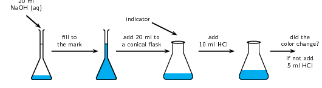
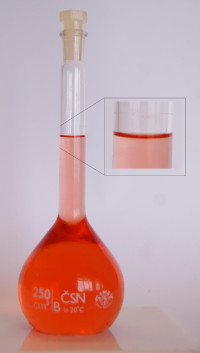
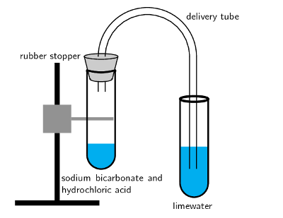

## 13.2 Acid-base reactions (ESBQY)

The reaction between an acid and a base is known as a **neutralisation** reaction. Often when an
      acid and base react a salt and water will be formed. We will look at a few examples of acid-base reactions.

<Callout type="tip" title="Note">
In chemistry the word salt does not mean the white substance that you sprinkle on your food (this white
        substance is a salt, but not the only salt). A salt (to chemists) is a product of an acid-base reaction and is
        made up of the cation from the base and the anion from the acid.
</Callout>

2. Hydrochloric acid reacts with sodium hydroxide to form sodium chloride (a salt) and water. Sodium chloride is
             made up of \(\text{Na}^{+}\) cations from the base \((\text{NaOH})\) and \(\text{Cl}^{-}\) anions from the
             acid \((\text{HCl})\).
   \[\text{HCl (aq)} + \text{NaOH (aq)} \rightarrow \text{H}_{2}\text{O (l)} + \text{NaCl (aq)}\]
4. Hydrogen bromide reacts with potassium hydroxide to form potassium bromide (a salt) and water. Potassium
             bromide is made up of \(\text{K}^{+}\) cations from the base \((\text{KOH})\) and \(\text{Br}^{-}\) anions
             from the acid \((\text{HBr})\).
   \[\text{HBr (aq)} + \text{KOH (aq)} \rightarrow \text{H}_{2}\text{O (l)} + \text{KBr (aq)}\]
6. Hydrochloric acid reacts with ammonia to form ammonium chloride (a salt). Ammonium chloride is made up of
             \(\text{NH}_{4}^{+}\) cations from the base \((\text{NH}_{3})\) and \(\text{Cl}^{-}\) anions from the acid
             \((\text{HCl})\).
   \[\text{HCl (aq)} + \text{NH}_{3}\text{(aq)} \rightarrow \text{NH}_{4}\text{Cl (aq)}\]

You should notice that in the first two examples, the base contained \(\text{OH}^{-}\) ions, and therefore the
      products were a *salt* and *water*. \(\text{NaCl}\) (table salt) and \(\text{KBr}\) are both salts.
      In the third example, \(\text{NH}_{3}\) also acts as a base, despite not having \(\text{OH}^{-}\) ions. A salt is
      still formed as the only product, but no water is produced.

It is important to realise how useful these neutralisation reactions are. Below are some examples:

- **Domestic uses**
  Calcium oxide (\(\text{CaO}\)) is a base (all metal oxides are bases) that is put on soil that is too acidic.
            Powdered limestone \((\text{CaCO}_{3})\) can also be used but its action is much slower and less effective.
            These substances can also be used on a larger scale in farming and in rivers.
  Limestone (white stone or calcium carbonate) is used in pit latrines (or long drops). The limestone is a base
            that helps to neutralise the acidic waste.
- **Biological uses**
  Acids in the stomach (e.g. hydrochloric acid) play an important role in helping to digest food. However, when
            a person has a stomach ulcer, or when there is too much acid in the stomach, these acids can cause a lot of
            pain. **Antacids** are taken to neutralise the acids so that they don't burn as much. Antacids
            are bases which neutralise the acid. Examples of antacids are aluminium hydroxide, magnesium hydroxide
            (“milk of magnesia”) and sodium bicarbonate (“bicarbonate of soda”). Antacids can also
            be used to relieve heartburn.
- **Industrial uses**
  Basic calcium hydroxide (limewater) can be used to absorb harmful acidic \(\text{SO}_{2}\) gas that is
            released from power stations and from the burning of fossil fuels.

<Callout type="note" title="Note">
Bee stings are acidic and have a pH between \(\text{5}\) and \(\text{5,5}\). They can be soothed by using
        substances such as bicarbonate of soda and milk of magnesia. Both bases help to neutralise the acidic bee sting
        and relieve some of the itchiness!
</Callout>

## Acid-base reactions

### Aim

To investigate acid-base reactions.

### Apparatus and materials

- Volumetric flask
- conical flasks
- sodium hydroxide solution
- hydrochloric acid solution
- pipette
- indicator

### Method

2. Use the pipette to add \(\text{20}\) \(\text{ml}\) of the sodium hydroxide solution to a volumetric
                 flask. Fill up to the mark with water and shake well.
   
4. Measure \(\text{20}\) \(\text{ml}\) of the sodium hydroxide solution into a conical flask. Add a few
                 drops of indicator.
6. Slowly add \(\text{10}\) \(\text{ml}\) of hydrochloric acid. If there is a colour change stop. If not add
                 another \(\text{5}\) \(\text{ml}\). Continue adding \(\text{5}\) \(\text{ml}\) increments until you notice
                 a colour change.

### Observations

The solution changes colour after a set amount of hydrochloric acid is added.

In the above experiment you used an indicator to see when the acid had neutralised the base. Indicators are
      chemical compounds that change colour depending on whether they are in an acid or in a base.

A recommended experiment for informal assessment on discovering natural indicators is included. Learners can
        test a variety of colourful plants to see what happens to each plant when mixed with an acid or a base. The
        basic idea is for learners to extract the colour of the plant by boiling the plant matter and then draining the
        liquid. For substances such as the curry powder, learners can dissolve this in water and for the tea they can
        brew a cup of tea and then remove the teabag before testing. The resulting liquid can then be tested to see if
        it is an indicator. An alternative to mixing the acid or base into the liquid is to soak strips of paper in the
        liquid and then place a drop of the acid or base onto the paper. The experiment below also covers some other
        substances such as baking powder, vanilla essence and onions. Baking powder fizzes in acids but not in bases.
        Onions and vanilla essence lose their characteristic smell when in a basic solution.

It is important that learners do not place their faces or noses directly over or into the beaker when smelling
        the onions and vanilla essence. They must hold the beaker in one hand and use the other hand to waft (i.e. wave
        their hand back and forth) the smell towards their face.

Acids and bases are corrosive and can cause serious burns so must be handled with care.

## Indicators

### Aim

To determine which plants and foods can act as indicators.

### Apparatus and materials

- Possible indicators: Red cabbage, beetroot, berries (e.g. mulberries), curry powder, red grapes, onions,
              tea (rooibos or regular), baking powder, vanilla essence
- acids (e.g. vinegar, hydrochloric acid), bases (e.g. ammonia (in many household cleaners)) to test
- Beakers

### Method

2. Take a small amount of your first possible indicator (do not use the onions, vanilla essence and baking
                 powder). Boil the substance up until the water has changed colour.
4. Filter the resulting solution into a beaker being careful not to get any plant matter into the beaker.
                 (You can also pour the water through a colander or sieve.)
6. Pour half the resulting coloured solution into a second beaker.
8. Place one beaker onto an A4 sheet of paper labelled “acids”. Place the other beaker onto a
                 sheet of paper labelled “bases”.
10. Repeat with all your other possible indicators (except the onions, vanilla essence and baking powder).
12. Into all the beakers on the acid sheet carefully pour \(\text{5}\) \(\text{ml}\) of acid. Record your
                 observations.
14. Into all the beakers on the base sheet carefully pour \(\text{5}\) \(\text{ml}\) of base. Record your
                 observations.
   If you have more than one acid or base then you will need to repeat the above steps to get fresh
                 indicator samples for your second acid or base. Or you can use less of the resulting coloured solution for
                 each acid and base you want to test.
16. Observe the smell of the onions and vanilla essence. Place a small piece of onion into a beaker. This is
                 for testing with the acid. Pour \(\text{5}\) \(\text{ml}\) of acid. Wave your hand over the top of the
                 beaker to blow the air towards your nose. What do you notice about the smell of the onions? Repeat with
                 the vanilla essence.
18. Place a small piece of onion into a beaker. This is for testing with the base. Pour \(\text{5}\)
                 \(\text{ml}\) of base. Wave your hand over the top of the beaker to blow the air towards your nose. What
                 do you notice about the smell of the onions? Repeat with the vanilla essence.
20. Finally place a teaspoon of baking powder into a beaker. Carefully pour \(\text{5}\) \(\text{ml}\) of
                 acid into the beaker. Record your observations. Repeat using the base.

### Observations

| Substance | Colour | Results with acid | Results with base |
| --- | --- | --- | --- |
| Red cabbage |  |  |  |
| Beetroot |  |  |  |
| Berries |  |  |  |
| Curry powder |  |  |  |
| Tea |  |  |  |
| Red grapes |  |  |  |
| Onions |  |  |  |
| Vanilla essence |  |  |  |
| Baking powder |  |  |  |

You should note that some of the substances change colour in the presence of either an acid or a base. The
          baking powder fizzes when it is in the acid solution, but no reaction is noted when it is in the base
          solution. Vanilla essence and onions should lose their characteristic smell when in the base.

<Callout type="note" title="Note">
Vanilla and onions are known as olfactory (smell) indicators. Olfactory indicators lose their characteristic
        smell when mixed with acids or bases.
</Callout>

<QuizCard id="s11-13-02a" title="Interactive Exercise 13.4" question="Adapted from DBE Nov 2016 Grade 11, P2, Q1.7 Physical constants \(·\) Chemistry formulas \(·\) Periodic table \(·\) Standard reduction potentials China rose petals are natural indicators of soil pH. A natural indicator is made in a laboratory by using China rose petals. KOH and HCl are added to separate solutions of the indicator and the colour change is recorded in the table below. Natural colour KOH HCl colourless yellow red If vinegar is added to the indicator above, the observed colour may be ... A purple B red C yellow D colourless" options=["A", "B", "C", "D"] answer="B" hint="" explanation="What do we know about vinegar? Vinegar is acidic . We know that when the acid HCl is added to a China rose petal             solution, the colour changes to red . Choose the correct option So when vinegar is added to the indicator, the colour will be... A purple B \({\color{red}{{\checkmark}{\checkmark}}}\) red C yellow D colourless So the correct choice is Option B . Submit your answer as: B" />

We will now look at three specific types of acid-base reactions. In each of these types of acid-base reaction the
      acid remains the same but the kind of base changes. We will look at what kind of products are produced when acids
      react with each of these bases and what the general reaction looks like.

### Acid and metal hydroxide (ESBQZ)

When an acid reacts with a metal hydroxide a *salt and water* are formed. We have already briefly
        explained this. Some examples are:

- \(\text{HCl (aq)} + \text{NaOH (aq)} \rightarrow \text{H}_{2}\text{O (l)} + \text{NaCl (aq)}\)
- \(2\text{HBr (aq)} + \text{Mg(OH)}_{2} \text{(aq)} \rightarrow 2\text{H}_{2}\text{O (l)} +
            \text{MgBr}_{2}\text{(aq)}\)
- \(3\text{HCl (aq)} + \text{Al(OH)}_{3}\text{(aq)} \rightarrow 3\text{H}_{2}\text{O (l)} +
            \text{AlCl}_{3}\text{(aq)}\)

We can write a general equation for this type of reaction:
        \[n\text{H}^{+}\text{(aq)} + \text{M(OH)}_{n}\text{(aq)} \rightarrow n\text{H}_{2}\text{O (l)} +
        \text{M}^{n+}\text{(aq)}\]

        Where \(n\) is the group number of the metal and \(\text{M}\) is the metal.

### Textbook Exercise 13.3

**Problem:**
Write a balanced equation for the reaction between \(\text{HNO}_{3}\) and \(\text{KOH}\).

**Solution:**
\(\text{HNO}_{3}\text{(aq)} + \text{KOH (aq)} \rightarrow \text{KNO}_{3}\text{ (aq)} + \text{H}_{2}\text{O
              (l)}\)

### Acid and metal oxide (ESBR2)

When an acid reacts with a metal oxide a *salt and water* are also formed. Some examples are:

- \(2\text{HCl (aq)} + \text{Na}_{2}\text{O (aq)} \rightarrow \text{H}_{2}\text{O (l)} + 2\text{NaCl}\)
- \(2\text{HBr (aq)} + \text{MgO} \rightarrow \text{H}_{2}\text{O (l)} + \text{MgBr}_{2}\text{(aq)}\)
- \(6\text{HCl (aq)} + \text{Al}_{2}\text{O}_{3} \text{(aq)} \rightarrow 3\text{H}_{2}\text{O (l)} +
            2\text{AlCl}_{3}\text{(aq)}\)

We can write a general equation for the reaction of a metal oxide with an acid:
        \[2y\text{H}^{+}\text{(aq)} + \text{M}_{x}\text{O}_{y}\text{(aq)} \rightarrow y\text{H}_{2}\text{O (l)} +
        x\text{M}^{n+}\text{(aq)}\]

        Where \(n\) is the group number of the metal. The \(x\) and \(y\) represent the ratio in which the metal
        combines with the oxide and depends on the valency of the metal.

### Textbook Exercise 13.4

**Problem:**
Write a balanced equation for the reaction between \(\text{HBr}\) and \(\text{K}_{2}\text{O}\).

**Solution:**
\(2\text{HBr (aq)} + \text{K}_{2}\text{O (aq)} \rightarrow 2\text{KBr (aq)} + \text{H}_{2}\text{O (l)}\)

### Acid and a metal carbonate (ESBR3)

## The reaction of acids with carbonates

### Apparatus and materials

- Small amounts of baking powder (sodium bicarbonate)
- hydrochloric acid (dilute) and vinegar
- retort stand
- two test tubes
- one rubber stopper for the test tube
- a delivery tube
- lime water (calcium hydroxide in water)

The experiment should be set up as shown below.

### Method

2. Carefully stick the delivery tube through the rubber stopper.
4. Pour limewater into one of the test tubes.
6. Carefully pour a small amount of hydrochloric acid into the other test tube.
8. Add a small amount of sodium carbonate to the acid and seal the test tube with the rubber stopper.
                   Place the other end of the delivery tube into the test tube containing the lime water.
10. Observe what happens to the colour of the limewater.
12. Repeat the above steps, this time using vinegar.

### Observations

The clear lime water turns milky meaning that carbon dioxide has been produced. You may not see this for
            the hydrochloric acid as the reaction may happen to fast.

When an acid reacts with a metal carbonate a *salt, carbon dioxide and water* are formed. Look at the
        following examples:

- Nitric acid reacts with sodium carbonate to form sodium nitrate, carbon dioxide and water.
  \[2\text{HNO}_{3}\text{(aq)} + \text{Na}_{2}\text{CO}_{3}\text{(aq)} \rightarrow
              2\text{NaNO}_{3}\text{(aq)} + \text{CO}_{2}\text{(g)} + \text{H}_{2}\text{O (l)}\]
- Sulfuric acid reacts with calcium carbonate to form calcium sulfate, carbon dioxide and water.
  \[\text{H}_{2}\text{SO}_{4}\text{(aq)} + \text{CaCO}_{3}\text{(aq)} \rightarrow \text{CaSO}_{4}\text{(s)} +
              \text{CO}_{2}\text{(g)} + \text{H}_{2}\text{O (l)}\]
- Hydrochloric acid reacts with calcium carbonate to form calcium chloride, carbon dioxide and water.
  \[2\text{HCl (aq)} + \text{CaCO}_{3}\text{(s)} \rightarrow \text{CaCl}_{2}\text{(aq)} +
              \text{CO}_{2}\text{(g)} + \text{H}_{2}\text{O (l)}\]

### Textbook Exercise 13.5

**Problem:**
Write a balanced equation for the reaction between \(\text{HCl}\) and \(\text{K}_{2}\text{CO}_{3}\).

**Solution:**
\(2\text{HCl (aq)} + \text{K}_{2}\text{CO}_{3}\text{(aq)} \rightarrow 2\text{KCl (aq)} +
              \text{H}_{2}\text{O (l)} + \text{CO}_{2}\text{(g)}\)

Using what we have learnt about acids and bases we can now look at preparing some salts.

## Making salts

### Aim

To make some salts using acid-base reactions.

### Materials

- hydrochloric acid (\(\text{1}\) \(\text{mol·dm$^{-3}$}\)), sulfuric acid (dilute), sodium hydroxide,
                copper(II) oxide, calcium carbonate
- beakers, mass meter, funnels, filter paper, bunsen burner, measuring cylinders

### Method

<Callout type="warning" title="Note">
Wear gloves and safety glasses when working with sulfuric acid. Work in a well ventilated room.
</Callout>

**Part 1**

2. Measure out \(\text{20}\) \(\text{ml}\) of hydrochloric acid into a beaker.
4. Measure out \(\text{20}\) \(\text{ml}\) of sodium hydroxide and carefully add this to the beaker
               containing hydrochloric acid.
6. Gently heat the resulting solution until all the water has evaporated. You should have a white powder
               left.

**Part 2**

2. Carefully add \(\text{25}\) \(\text{ml}\) of sulfuric acid to a clean beaker.
4. Add about a small amount (about \(\text{0,5}\) \(\text{g}\)) of copper(II) oxide to the beaker containing
               sulfuric acid. Stir the solution.
6. Once all the copper(II) oxide has dissolved, add another small amount of copper(II) oxide. Repeat until no
               more solid dissolves and there is a small amount of undissolved solid.
8. Filter this solution and discard the filter paper.
10. Gently heat the resulting liquid. You should get a small amount of solid.

**Part 3 **

2. Measure out \(\text{20}\) \(\text{ml}\) of hydrochloric acid into a new beaker.
4. Add about a small amount (about \(\text{0,5}\) \(\text{g}\)) of calcium carbonate to the beaker containing
               hydrochloric acid. Stir the solution.
6. Once all the calcium carbonate has dissolved, add another small amount of calcium carbonate. Repeat until
               no more solid dissolves and there is a small amount of undissolved solid.
8. Filter this solution and discard the filter paper.
10. Gently heat the resulting liquid. You should get a small amount of solid.

### Observations

In the first reaction (hydrochloric acid with sodium hydroxide) the resulting solution was clear. When this
          solution was heated a small amount of white powder was noted. This powder is sodium chloride.

In the second reaction (sulfuric acid with copper(II) oxide) the resulting solution was blue in colour. When
          this solution was heated a small amount of white powder was noted. This powder is copper sulfate.

In the third reaction (hydrochloric acid with calcium carbonate) the resulting solution was clear. When this
          solution was heated a small amount of white powder was noted. This powder is calcium sulfate.

Try write reaction equations for the three reactions above.

### Conclusion

We used acid-base reactions to produce different salts.

## Acids and bases

### Textbook Exercise 13.6

For each of the following reactants state what type of acid-base reaction the pair of reactants undergoes
            and write the balanced reaction equation.

**Problem:**
\(\text{HNO}_{3}\) and \(\text{Ca}(\text{OH})_{2}\)

**Solution:**
Acid and metal hydroxide

\(2\text{HNO}_{3}\text{(aq)} + \text{Ca(OH)}_{2}\text{(aq)} \rightarrow
              \text{Ca(NO}_{3}\text{)}_{2}\text{(aq)} + 2\text{H}_{2}\text{O (l)}\)

**Problem:**
\(\text{HCl}\) and \(\text{BeO}\)

**Solution:**
Acid and metal oxide

\(2\text{HCl (aq)} + \text{BeO (aq)} \rightarrow \text{BeCl}_{2}\text{(aq)} + \text{H}_{2}\text{O (l)}\)

**Problem:**
\(\text{HI}\) and \(\text{K}_{2}\text{CO}_{3}\)

**Solution:**
Acid and carbonate

\(2\text{HI (aq)} + \text{K}_{2}\text{CO}_{3}\text{(aq)} \rightarrow 2\text{KI (aq)} +
              \text{H}_{2}\text{O (l)} + \text{CO}_{2}\text{(g)}\)

**Problem:**
\(\text{H}_{3}\text{PO}_{4}\) and \(\text{KOH}\)

**Solution:**
Acid and metal hydroxide

\(\text{H}_{3}\text{PO}_{4}\text{(aq)} + 3\text{KOH (aq)} \rightarrow
              \text{K}_{3}\text{PO}_{4}\text{(aq)} +
              3\text{H}_{2}\text{O (l)}\)

**Problem:**
\(\text{HCl}\) and \(\text{MgCO}_{3}\)

**Solution:**
Acid and carbonate

\(2\text{HCl (aq)} + \text{MgCO}_{3}\text{(aq)} \rightarrow \text{MgCl}_{2}\text{(aq)} +
              \text{H}_{2}\text{O (l)} + \text{CO}_{2}\text{(g)}\)

**Problem:**
\(\text{HNO}_{3}\) and \(\text{Al}_{2}\text{O}_{3}\)

**Solution:**
Acid and metal oxide

\(6\text{HNO}_{3}\text{(aq)} + \text{Al}_{2}\text{O}_{3}\text{(aq)} \rightarrow
              2\text{Al(NO}_{3}\text{)}_{3}\text{(aq)} + 3\text{H}_{2}\text{O (l)}\)
