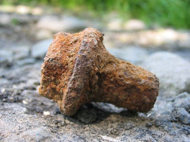
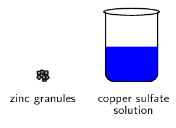
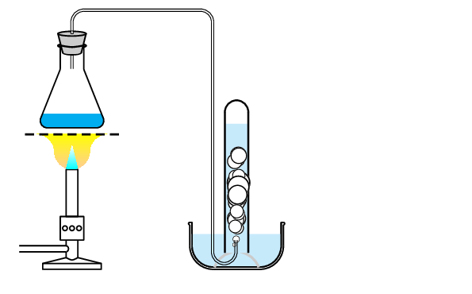

## 13.3 Redox reactions (ESBR4)

If you have seen a piece of rusty metal then you have seen the end result of a redox reaction (iron and
            oxygen forming iron oxide). Redox reactions are also used in electrochemistry and in biological reactions.

When some reactions occur, an exchange of electrons takes place. It is this exchange of electrons that leads
            to the change in charge that we noted in grade 10 (chapter 18, reactions in aqueous solution). When an atom
            gains electrons it becomes more negative and when it loses electrons it becomes more positive.

**Oxidation** is the *loss* of electrons from an atom, while **reduction**
            is the *gain* of electrons by an atom. In a reaction these two processes occur together so that one
            element or compound gains electrons while the other element or compound loses electrons. This is why we call
            this a redox reaction. It is a short way of saying reduction-oxidation reaction!

<Callout type="tip" title="Note">
You can remember this by using OiLRiG: Oxidation is Loss Reduction is Gain.
</Callout>

Oxidation

Oxidation is the *loss* of electrons by a molecule, atom or ion.

Reduction

Reduction is the *gain* of electrons by a molecule, atom or ion.

Before we look at redox reactions we need to first learn how to tell if a reaction is a redox reaction. In
            grade 10 you learnt that a redox reaction involves a change in the charge on an atom. Now we will look at
            why this change in charge occurs.

### Oxidation numbers (ESBR5)

By giving elements an oxidation number, it is possible to keep track of whether that element is losing or
                gaining electrons during a chemical reaction. The loss of electrons in one part of the reaction must be
                balanced by a gain of electrons in another part of the reaction.

Oxidation number

Oxidation number is the charge an atom would have if it was in a compound composed of ions.

There are a number of rules that you need to know about oxidation numbers, and these are listed below.

2. A molecule consisting of only one element always has an oxidation number of zero, since it is
                           neutral.
   For example the oxidation number of hydrogen in \(\text{H}_{2}\) is \(\text{0}\). The oxidation
                           number of bromine in \(\text{Br}_{2}\) is also \(\text{0}\).
4. Monatomic ions (ions with only one element or type of atom) have an oxidation number that is
                           equal to the charge on the ion.
   For example, the chloride ion \(\text{Cl}^{-}\) has an oxidation number of \(-\text{1}\), and the
                           magnesium ion \(\text{Mg}^{2+}\) has an oxidation number of \(\text{+2}\).
6. In a molecule or compound, the sum of the oxidation numbers for each element in the molecule or
                           compound will be zero.
   For example the sum of the oxidation numbers for the elements in water will be \(\text{0}\).
8. In a polyatomic ion the sum of the oxidation numbers is equal to the charge.
   For example the sum of the oxidation numbers for the elements in the sulfate ion
                           (\(\text{SO}_{4}^{2-}\)) will be \(-\text{2}\).
10. An oxygen atom usually has an oxidation number of \(-\text{2}\). One exception is in peroxides
                           (e.g. hydrogen peroxide) when oxygen has an oxidation number of \(-\text{1}\).
   For example oxygen in water will have an oxidation number of \(-\text{2}\) while in hydrogen
                           peroxide (\(\text{H}_{2}\text{O}_{2}\)) it will have an oxidation number of \(-\text{1}\).
12. The oxidation number of hydrogen is often \(\text{+1}\). One exception is in the metal hydrides
                           where the oxidation number is \(-\text{1}\).
   For example the oxidation number of the hydrogen atom in water is \(\text{+1}\), while the
                           oxidation number of hydrogen in lithium hydride (\(\text{LiH}\)) is \(-\text{1}\).
14. The oxidation number of fluorine is \(-\text{1}\).

<Callout type="tip" title="Note">
You will notice that some elements always have the same oxidation number while other elements can
                    change oxidation numbers depending on the compound they are in.
</Callout>

<QuizCard id="s11-13-03a" title="Interactive Exercise 13.9" question="Which one of the following statements about oxidation numbers is true ?" options=[] answer="
                    0
                " hint="" explanation="What is an oxidation number? The oxidation number (oxidation state) of an element in a substance is a number given to atoms of elements to keep track of how many electrons have been removed from or added to those atoms. The oxidation number can be: positive (electrons removed), negative (electrons gained), or zero (no transfer of electrons). Atoms of elements in both ionic and covalent compounds are assigned (given) oxidation numbers. For ionic compounds , the oxidation numbers are simply equal to the charges of the ions. For example: NaCl is an ionic compound made up of Na + and Cl − ions. The charge on the sodium ion is \(\text{+1}\) so it has an oxidation number of \(\text{+1}\) . The charge on the chloride ion is \(-\text{1}\) so it has an oxidation number of \(-\text{1}\) . For polar covalent compounds , you need to assume that electrons are fully transferred (and not shared) to form ions. Assume that the atom with the higher electronegativity gets all the electrons. The oxidation numbers are then equal to the charges on these imaginary ions. For example: H 2 O is a polar covalent compound made up of hydrogen and oxygen atoms. Oxygen has a higher electronegativity than hydrogen. So if we assume that the electrons are not shared, but fully transferred, then each hydrogen atom will give its electron to the oxygen atom. So each hydrogen atom will have an oxidation number of \(\text{+1}\) and the oxygen atom will have an oxidation number of \(-\text{2}\) (it gained two electrons in total). NOTE: The oxidation number is not a real charge, but a hypothetical (imagined) charge. The oxidation number is helpful to keep track of where the electrons are in a compound. Identify the true statement We can now work out which statement is true . I ✔ You can assign oxidation numbers to elements in ionic compounds. True II ✘ In polar covalent compounds you need to assume that electrons are shared perfectly between atoms. False In polar covalent compounds you need to assume that electrons are fully transferred from one atom to another. III ✘ The oxidation number is zero if a neutral atom has not lost or gained any protons. False The oxidation number is zero if a neutral atom has not lost or gained any electrons . IV ✘ The oxidation number is positive if a neutral atom has gained electrons. False The oxidation number is positive if a neutral atom has lost electrons . Statement I is true . Submit your answer as: I You can assign oxidation numbers to elements in ionic compounds." />

<QuizCard id="s11-13-03a" title="Interactive Exercise 13.9" question="Which one of the following statements about oxidation numbers is true ?" options=[] answer="
                    1
                " hint="" explanation="What is an oxidation number? The oxidation number (oxidation state) of an element in a substance is a number given to atoms of elements to keep track of how many electrons have been removed from or added to those atoms. The oxidation number can be: positive (electrons removed), negative (electrons gained), or zero (no transfer of electrons). Atoms of elements in both ionic and covalent compounds are assigned (given) oxidation numbers. For ionic compounds , the oxidation numbers are simply equal to the charges of the ions. For example: NaCl is an ionic compound made up of Na + and Cl − ions. The charge on the sodium ion is \(\text{+1}\) so it has an oxidation number of \(\text{+1}\) . The charge on the chloride ion is \(-\text{1}\) so it has an oxidation number of \(-\text{1}\) . For polar covalent compounds , you need to assume that electrons are fully transferred (and not shared) to form ions. Assume that the atom with the higher electronegativity gets all the electrons. The oxidation numbers are then equal to the charges on these imaginary ions. For example: H 2 O is a polar covalent compound made up of hydrogen and oxygen atoms. Oxygen has a higher electronegativity than hydrogen. So if we assume that the electrons are not shared, but fully transferred, then each hydrogen atom will give its electron to the oxygen atom. So each hydrogen atom will have an oxidation number of \(\text{+1}\) and the oxygen atom will have an oxidation number of \(-\text{2}\) (it gained two electrons in total). NOTE: The oxidation number is not a real charge, but a hypothetical (imagined) charge. The oxidation number is helpful to keep track of where the electrons are in a compound. Identify the true statement We can now work out which statement is true . I ✘ The oxidation number is zero if a neutral atom has not lost or gained any protons. False The oxidation number is zero if a neutral atom has not lost or gained any electrons . II ✔ In polar covalent compounds the element with the lower electronegativity is given a positive oxidation number. True III ✘ The oxidation number for an ion is equal to the magnitude of the charge of the ion. False The oxidation number for an ion is equal to the charge of the ion. IV ✘ The oxidation number is negative if an atom has a lower electronegativity than oxygen. False The oxidation number is negative if a neutral atom has gained electrons . Statement II is true . Submit your answer as: II In polar covalent compounds the element with the lower electronegativity is given a positive oxidation number." />

<QuizCard id="s11-13-03a" title="Interactive Exercise 13.9" question="Give a term (one word or phrase) for the following definition: A reaction in which both oxidation and reduction occur. There is always a change in oxidation numbers of the elements involved." options=[] answer="
                    ['redox reaction', 'a redox reaction', 'the redox reaction', 'redox reactions', 'redox', 'a redox', 'the redox']
                " hint="" explanation="Give the correct answer Both oxidation and reduction occur in a redox reaction . Therefore the correct answer is: redox reaction . Submit your answer as:" />

<QuizCard id="s11-13-03a" title="Interactive Exercise 13.9" question="Physical constants \(·\) Chemistry formulas \(·\) Periodic table \(·\) Standard reduction potentials Working with oxidation numbers and thinking about electron transfer are essential when working with redox reactions. Using these concepts you can work out if a chemical species (atom or ion) is oxidised or reduced. Define the term reduction ." options=[] answer="
                    0
                " hint="" explanation="Define reduction Reduction is a decrease in oxidation number caused by a gain of electrons . Submit your answer as: a decrease in oxidation number." />

<QuizCard id="s11-13-03a" title="Interactive Exercise 13.9" question="Physical constants \(·\) Chemistry formulas \(·\) Periodic table \(·\) Standard reduction potentials Working with oxidation numbers and thinking about electron transfer are essential when working with redox reactions. Using these concepts you can work out if a chemical species (atom or ion) is oxidised or reduced. Define the term oxidation ." options=[] answer="
                    3
                " hint="" explanation="Define oxidation Oxidation is an increase in oxidation number caused by a loss of electrons . Submit your answer as: an increase in oxidation number." />

<QuizCard id="s11-13-03a" title="Interactive Exercise 13.9" question="Which one of the following statements about oxidation numbers is false ?" options=[] answer="
                    0
                " hint="" explanation="What is an oxidation number? The oxidation number (oxidation state) of an element in a substance is a number given to atoms of elements to keep track of how many electrons have been removed from or added to those atoms. The oxidation number can be: positive (electrons removed), negative (electrons gained), or zero (no transfer of electrons). Atoms of elements in both ionic and covalent compounds are assigned (given) oxidation numbers. For ionic compounds , the oxidation numbers are simply equal to the charges of the ions. For example: NaCl is an ionic compound made up of Na + and Cl − ions. The charge on the sodium ion is \(\text{+1}\) so it has an oxidation number of \(\text{+1}\) . The charge on the chloride ion is \(-\text{1}\) so it has an oxidation number of \(-\text{1}\) . For polar covalent compounds , you need to assume that electrons are fully transferred (and not shared) to form ions. Assume that the atom with the higher electronegativity gets all the electrons. The oxidation numbers are then equal to the charges on these imaginary ions. For example: H 2 O is a polar covalent compound made up of hydrogen and oxygen atoms. Oxygen has a higher electronegativity than hydrogen. So if we assume that the electrons are not shared, but fully transferred, then each hydrogen atom will give its electron to the oxygen atom. So each hydrogen atom will have an oxidation number of \(\text{+1}\) and the oxygen atom will have an oxidation number of \(-\text{2}\) (it gained two electrons in total). NOTE: The oxidation number is not a real charge, but a hypothetical (imagined) charge. The oxidation number is helpful to keep track of where the electrons are in a compound. Identify the false statement We can now work out which statement is false . I ✔ The oxidation number is zero if a neutral atom has not lost or gained any protons. False The oxidation number is zero if a neutral atom has not lost or gained any electrons . II ✘ In polar covalent compounds you need to assume that electrons are fully transferred from one atom to another. True III ✘ You can assign oxidation numbers to elements in ionic compounds. True IV ✘ The oxidation number for an ion is equal to the charge of the ion. True Statement I is false . Submit your answer as: I The oxidation number is zero if a neutral atom has not lost or gained any protons." />

<QuizCard id="s11-13-03a" title="Interactive Exercise 13.9" question="Which one of the following is not a correct rule used to determine oxidation numbers?" options=[] answer="
                    3
                " hint="" explanation="Revise rules to calculate oxidation numbers Elements in monatomic gases or in molecules made up of only one element have an oxidation number of \(\text{0}\) . The oxidation number of a monatomic ion is equal to the charge of the ion. Group 1 metals usually have an oxidation number of \(\text{+1}\) . Group 2 metals usually have an oxidation number of \(\text{+2}\) . Halogens (Group 17) usually have an oxidation number of \(-\text{1}\) . Oxygen usually has an oxidation number of \(-\text{2}\) in a compound. Peroxides are an exception where O has an oxidation number of \(-\text{1}\) . Hydrogen usually has an oxidation number of \(\text{+1}\) in a compound. Metal hydrides are an exception where H has an oxidation number of \(-\text{1}\) . Compounds are neutral . The sum of the oxidation numbers of all the elements in a compound must be zero. Polyatomic ions have a charge. The sum of the oxidation numbers of all the elements in a polyatomic ion must be equal to the charge on the ion . Some elements (such as transition metals) have variable valency. The oxidation numbers of these elements depends on which substance they are in. These must be calculated using known oxidation numbers . Identify the statement that is not a rule I ✘ Group 2 metals usually have an oxidation number of \(\text{+2}\) . This is a rule. II ✘ Group 1 metals usually have an oxidation number of \(\text{+1}\) . This is a rule. III ✘ Some elements (such as transition metals) have variable valency. The oxidation numbers of these elements depends on which substance they are in. These must be calculated using known oxidation numbers. This is a rule. IV ✔ The sum of the oxidation numbers of all the elements in a compound is equal to the molar mass of the compound. This is not a rule. Compounds are neutral. The sum of the oxidation numbers of all the elements in a compound must be zero . Statement IV is not a correct rule for determining oxidation numbers. Submit your answer as: IV The sum of the oxidation numbers of all the elements in a compound is equal to the molar mass of the compound." />

<QuizCard id="s11-13-03a" title="Interactive Exercise 13.9" question="Adapted from DBE Nov 2016 Grade 12, P2, Q1.1 Physical constants \(·\) Chemistry formulas \(·\) Periodic table \(·\) Standard reduction potentials In a chemical reaction a reduced substance will ... A lose protons. B lose electrons. C gain protons. D gain electrons." options=["A", "B", "C", "D"] answer="
                    3
                " hint="" explanation="Recall the basics of reduction and oxidation Reduction and oxidation involve a transfer of electrons . Reduction is the gain of electrons. An oxidising agent is itself reduced and gains electrons. Oxidation is the loss of electrons. A reducing agent is itself oxidised and loses electrons. Apply the basics of reduction and oxidation In a chemical reaction a reduced substance will ... A lose protons. B lose electrons. C gain protons. D \({\color{red}{{\checkmark}{\checkmark}}}\) gain electrons. So the correct choice is Option D . Submit your answer as: D" />

<QuizCard id="s11-13-03a" title="Interactive Exercise 13.9" question="Adapted from DBE Nov 2016 Grade 12, P2, Q1.1 Physical constants \(·\) Chemistry formulas \(·\) Periodic table \(·\) Standard reduction potentials In a chemical reaction an oxidised substance will ... A lose protons. B gain protons. C gain electrons. D lose electrons." options=["A", "B", "C", "D"] answer="
                    3
                " hint="" explanation="Recall the basics of reduction and oxidation Reduction and oxidation involve a transfer of electrons . Reduction is the gain of electrons. An oxidising agent is itself reduced and gains electrons. Oxidation is the loss of electrons. A reducing agent is itself oxidised and loses electrons. Apply the basics of reduction and oxidation In a chemical reaction an oxidised substance will ... A lose protons. B gain protons. C gain electrons. D \({\color{red}{{\checkmark}{\checkmark}}}\) lose electrons. So the correct choice is Option D . Submit your answer as: D" />

<Callout type="tip" title="Worked example 1: Oxidation numbers">
**Question:**
Give the oxidation number of sulfur in a sulfate (\(\text{SO}_{4}^{2-}\)) ion

**Determine the oxidation number for each atom:**
Oxygen will have an oxidation number of \(-\text{2}\). (Rule \(\text{5}\), this is not a
                        peroxide.) The oxidation number of sulfur at this stage is uncertain since sulfur does not have
                        a set oxidation number.

**Determine the oxidation number of sulfur by using the fact that the oxidation
                        numbers of the atoms must add up to the charge on the compound:**
In the polyatomic \(\text{SO}_{4}^{2-}\) ion, the sum of the oxidation numbers must be
                        \(-\text{2}\) (rule \(\text{4}\)).

Let the oxidation number of sulfur be \(x\). We know that oxygen has an oxidation number of
                        \(-\text{2}\) and since there are four oxygen atoms in the sulfate ion, then the sum of the
                        oxidation numbers of these four oxygen atoms is \(-\text{8}\).

Putting this together gives:
                        \begin{align*}
                        x + (-8) & = -2 \\
                        x & = -2 + 8 \\
                        & = +6
                        \end{align*}
                        So the oxidation number of sulfur is \(\text{+6}\).

**Write down the final answer:**
In the sulfate ion, the oxidation number of sulfur is \(\text{+6}\).
</Callout>

<Callout type="tip" title="Worked example 2: Oxidation numbers">
**Question:**
Give the oxidation number of both elements in ammonia (\(\text{NH}_{3}\)).

**Determine the oxidation number for each atom:**
Hydrogen will have an oxidation number of \(\text{+1}\) (rule 6, ammonia is not a metal hydride).
                        At this stage we do not know the oxidation number for nitrogen.

**Determine the oxidation number of nitrogen by using the fact that the oxidation
                        numbers of the atoms must add up to the charge on the compound:**
In the compound \(\text{NH}_{3}\), the sum of the oxidation numbers must be \(\text{0}\) (rule
                        \(\text{3}\)).

Let the oxidation number of nitrogen be \(x\). We know that hydrogen has an oxidation number of
                        \(\text{+1}\) and since there are three hydrogen atoms in the ammonia molecule, then the sum of
                        the oxidation numbers of these three hydrogen atoms is \(\text{+3}\).

Putting this together gives:
                        \begin{align*}
                        x + (+3) & = 0 \\
                        & = -\text{3}
                        \end{align*}
                        So the oxidation number of nitrogen is \(-\text{3}\).

**Write the final answer:**
Hydrogen has an oxidation number of \(\text{+1}\) and nitrogen has an oxidation number of
                        \(-\text{3}\).
</Callout>

<Callout type="tip" title="Worked example 3: Oxidation numbers">
**Question:**
Give the oxidation numbers for all the atoms in sodium chloride (\(\text{NaCl}\)).

**Determine the oxidation number for each atom in the compound:**
This is an ionic compound composed of \(\text{Na}^{+}\) and \(\text{Cl}^{-}\) ions. Using rule 2
                        the oxidation number for the sodium ion is \(\text{+1}\) and for the chlorine ion it is
                        \(-\text{1}\).

This then gives us a sum of \(\text{0}\) for the compound.

**Write the final answer:**
The oxidation numbers for sodium is \(\text{+1}\) and for chlorine it is \(-\text{1}\).
</Callout>

## Oxidation numbers

### Textbook Exercise 13.7

Give the oxidation numbers for each element in the following chemical compounds:

**Problem:**
\(\text{MgF}_{2}\)

**Solution:**
In the compound \(\text{MgF}_{2}\), the oxidation number of fluorine is \(-\text{1}\)
                                    (rule \(\text{7}\)).

Let the oxidation number of magnesium be \(x\). We know that fluorine has an
                                    oxidation number of \(-\text{1}\) and since there are two fluorine atoms in the
                                    compound, then the sum of the oxidation numbers of these two fluorine atoms is
                                    \(-\text{2}\).

Putting this together gives:
                                    \begin{align*}
                                    x + (-2) & = 0 \\
                                    & = \text{+2}
                                    \end{align*}
                                    So the oxidation number of magnesium is \(\text{+2}\).

Magnesium has an oxidation number of \(\text{+2}\) and fluorine has an oxidation
                                    number of \(-\text{1}\).

**Problem:**
\(\text{CaCl}_{2}\)

**Solution:**
This is an ionic compound composed of \(\text{Ca}^{2+}\) and \(\text{Cl}^{-}\) ions.
                                    Using rule 2 the oxidation number for the calcium ion is \(\text{+2}\) and for the
                                    chlorine ion it is \(-\text{1}\).

This then gives us a sum of \(\text{0}\) for the compound.

Calcium has an oxidation number of \(\text{+2}\) and chlorine has an oxidation number
                                    of \(-\text{1}\).

**Problem:**
\(\text{CH}_{4}\)

**Solution:**
In the compound \(\text{CH}_{4}\), the sum of the oxidation numbers must be
                                    \(\text{0}\) (rule \(\text{3}\)).

Let the oxidation number of carbon be \(x\). We know that hydrogen has an oxidation
                                    number of \(\text{+1}\) (this is not a metal hydride) and since there are four
                                    hydrogen atoms in the molecule, then the sum of the oxidation numbers of these four
                                    hydrogen atoms is \(\text{+4}\).

Putting this together gives:
                                    \begin{align*}
                                    x + (+4) & = 0 \\
                                    & = -\text{4}
                                    \end{align*}
                                    So the oxidation number of carbon is \(-\text{4}\).

Hydrogen has an oxidation number of \(\text{+1}\) and carbon has an oxidation number
                                    of \(-\text{4}\).

**Problem:**
\(\text{MgSO}_{4}\)

**Solution:**
This is an ionic compound composed of \(\text{Mg}^{2+}\) and \(\text{SO}_{4}^{2-}\)
                                    ions. Using rule 2 the oxidation number for the magnesium ion is \(\text{+2}\). In
                                    the polyatomic \(\text{SO}_{4}^{2-}\) ion, the sum of the oxidation numbers must be
                                    \(-\text{2}\) (rule \(\text{4}\)).

Let the oxidation number of sulfur be \(x\). We know that oxygen has an oxidation
                                    number of \(-\text{2}\) (it is not in a peroxide) and since there are four oxygen
                                    atoms in the sulfate ion, then the sum of the oxidation numbers of these four oxygen
                                    atoms is \(-\text{8}\).

Putting this together gives:
                                    \begin{align*}
                                    x + (-8) & = -2 \\
                                    x & = -2 + 8 \\
                                    & = +6
                                    \end{align*}
                                    So the oxidation number of sulfur is \(\text{+6}\).

Putting all the information together we find that magnesium has an oxidation number
                                    of \(\text{+2}\), oxygen has an oxidation number of \(-\text{2}\) and sulfur has an
                                    oxidation number of \(\text{+6}\).

Compare the oxidation numbers of:

**Problem:**
nitrogen in:

\(\text{NO}_{2}\) and \(\text{NO}\)

**Solution:**
In the compound \(\text{NO}_{2}\), the sum of the oxidation numbers must be
                                    \(\text{0}\) (rule \(\text{3}\)).

Let the oxidation number of nitrogen be \(x\). We know that oxygen has an oxidation
                                    number of \(-\text{2}\) (this is not a peroxide) and since there are two oxygen
                                    atoms in the molecule, then the sum of the oxidation numbers of these two oxygen
                                    atoms is \(-\text{4}\).

Putting this together gives:
                                    \begin{align*}
                                    x + (-4) & = 0 \\
                                    & = \text{+4}
                                    \end{align*}
                                    So the oxidation number of nitrogen is \(\text{+4}\) in \(\text{NO}_{2}\).

In the compound \(\text{NO}\), the sum of the oxidation numbers must be \(\text{0}\)
                                    (rule \(\text{3}\)).

We know that oxygen has an oxidation number of \(-\text{2}\) (this is not a peroxide)
                                    and since there is only one oxygen atom in the molecule, then the nitrogen atom must
                                    have an oxidation number of \(\text{+2}\).

So the oxidation number of nitrogen is \(\text{+2}\) in \(\text{NO}\).

Nitrogen has an oxidation number of \(\text{+4}\) in \(\text{NO}_{2}\) and
                                    \(\text{+2}\) in \(\text{NO}\).

**Problem:**
carbon in:

\(\text{CO}_{2}\) and \(\text{CO}\)

**Solution:**
In the compound \(\text{CO}_{2}\), the sum of the oxidation numbers must be
                                    \(\text{0}\) (rule \(\text{3}\)).

Let the oxidation number of carbon be \(x\). We know that oxygen has an oxidation
                                    number of \(-\text{2}\) (this is not a peroxide) and since there are two oxygen
                                    atoms in the molecule, then the sum of the oxidation numbers of these two oxygen
                                    atoms is \(-\text{4}\).

Putting this together gives:
                                    \begin{align*}
                                    x + (-4) & = 0 \\
                                    & = \text{+4}
                                    \end{align*}
                                    So the oxidation number of carbon is \(\text{+4}\) in \(\text{CO}_{2}\).

In the compound \(\text{CO}\), the sum of the oxidation numbers must be \(\text{0}\)
                                    (rule \(\text{3}\)).

We know that oxygen has an oxidation number of \(-\text{2}\) (this is not a peroxide)
                                    and since there is only one oxygen atom in the molecule, then the carbon atom must
                                    have an oxidation number of \(\text{+2}\).

So the oxidation number of carbon is \(\text{+2}\) in \(\text{CO}\).

Carbon has an oxidation number of \(\text{+4}\) in \(\text{CO}_{2}\) and
                                    \(\text{+2}\) in \(\text{CO}\).

**Problem:**
chromium in:

\(\text{Cr}_{2}\text{O}_{7}^{2-}\) and \(\text{CrO}_{4}^{-}\)

**Solution:**
In the compound \(\text{Cr}_{2}\text{O}_{7}^{2-}\), the sum of the oxidation numbers
                                    must be \(-\text{2}\) (rule \(\text{4}\)).

Let the oxidation number of chromium be \(x\). We know that oxygen has an oxidation
                                    number of \(-\text{2}\) (this is not a peroxide) and since there are seven oxygen
                                    atoms in the molecule, then the sum of the oxidation numbers of these seven oxygen
                                    atoms is \(-\text{14}\).

Putting this together gives:
                                    \begin{align*}
                                    2x + (-14) & = -2 \\
                                    2x & = -2 + 14 \\
                                    x& = \text{+6}
                                    \end{align*}
                                    So the oxidation number of chromium is \(\text{+6}\) in
                                    \(\text{Cr}_{2}\text{O}_{7}^{2-}\).

In the compound \(\text{CrO}_{4}^{-}\), the sum of the oxidation numbers must be
                                    \(-\text{1}\) (rule \(\text{4}\)).

Let the oxidation number of chromium be \(x\). We know that oxygen has an oxidation
                                    number of \(-\text{2}\) (this is not a peroxide) and since there are four oxygen
                                    atoms in the molecule, then the sum of the oxidation numbers of these four oxygen
                                    atoms is \(-\text{8}\).

Putting this together gives:
                                    \begin{align*}
                                    x + (-8) & = -1 \\
                                    x& = \text{+7}
                                    \end{align*}
                                    So the oxidation number of chromium is \(\text{+7}\) in \(\text{CrO}_{4}^{-}\).

Chromium has an oxidation number of \(\text{+6}\) in
                                    \(\text{Cr}_{2}\text{O}_{7}^{2-}\) and \(\text{+7}\) in \(\text{CrO}_{4}^{-}\).

**Problem:**
oxygen in:

\(\text{H}_{2}\text{O}\) and \(\text{H}_{2}\text{O}_{2}\)

**Solution:**
In the compound \(\text{H}_{2}\text{O}\), the sum of the oxidation numbers must be
                                    \(\text{0}\) (rule \(\text{3}\)).

This compound is not a metal hydride, so the oxidation number of hydrogen is
                                    \(\text{+1}\) (rule 6). This compound is also not a peroxide, so the oxidation
                                    number of oxygen is \(-\text{2}\) (rule 5).

We confirm that this gives us a sum of \(\text{0}\):
                                    \(2(+1) + (-2) = 0\). So the oxidation number of oxygen is \(-\text{2}\) in
                                    \(\text{H}_{2}\text{O}\).

In the compound \(\text{H}_{2}\text{O}_{2}\), the sum of the oxidation numbers must
                                    be \(\text{0}\) (rule \(\text{4}\)).

Let the oxidation number of oxygen be \(x\) (this is a peroxide and so oxygen does
                                    not have an oxidation number of \(-\text{2}\)). We know that hydrogen has an
                                    oxidation number of \(\text{+1}\) (this is not a metal hydride) and since there are
                                    two hydrogen atoms in the molecule, the sum of the oxidation numbers of these two
                                    hydrogen atoms is \(\text{+2}\).

Putting this together gives:
                                    \begin{align*}
                                    2x + (+2) & = 0 \\
                                    x& = -\text{1}
                                    \end{align*}
                                    So the oxidation number of oxygen is \(-\text{1}\) in \(\text{H}_{2}\text{O}_{2}\).
                                    (Note that this confirms what has been stated about peroxides (see rule 5).)

Oxygen has an oxidation number of \(-\text{2}\) in \(\text{H}_{2}\text{O}\) and
                                    \(-\text{1}\) in \(\text{H}_{2}\text{O}_{2}\).

**Problem:**
hydrogen in:

\(\text{NaH}\) and \(\text{H}_{2}\text{O}\)

**Solution:**
In the compound \(\text{NaH}\), the sum of the oxidation numbers must be \(\text{0}\)
                                    (rule \(\text{3}\)).

This compound is a metal hydride, so the oxidation number of hydrogen is
                                    \(-\text{1}\) (rule 6). This compound is also an ionic compound with sodium ions and
                                    so sodium must have an oxidation number of \(\text{+1}\) (rule 2).

We confirm that this gives us a sum of 0:
                                    \(+1 + (-1) = 0\)
                                    So the oxidation number of hydrogen is \(-\text{1}\) in \(\text{NaH}\).

In the compound \(\text{H}_{2}\text{O}\), the sum of the oxidation numbers must be
                                    \(\text{0}\) (rule \(\text{4}\)).

This compound is not a metal hydride, so the oxidation number of hydrogen is
                                    \(\text{+1}\) (rule 6). This compound is also not a peroxide, so the oxidation
                                    number of oxygen is \(-\text{2}\) (rule 5).

So the oxidation number of hydrogen is \(\text{+2}\) in \(\text{H}_{2}\text{O}\).

Hydrogen has an oxidation number of \(-\text{1}\) in \(\text{NaH}\) and \(\text{+1}\)
                                    in \(\text{H}_{2}\text{O}\).

Give the oxidation numbers for each of the elements in all the compounds. State if there
                                is any difference between the oxidation number of the element in the reactant and the
                                element in the product.

**Problem:**
\(\text{C (s)} + \text{O}_{2}\text{(g)} \rightarrow \text{CO}_{2}\text{(g)}\)

**Solution:**
In the compound \(\text{C}\), the oxidation number of carbon is \(\text{0}\) (rule
                                    \(\text{1}\)).

In the compound \(\text{O}_{2}\), the oxidation number of oxygen is \(\text{0}\)
                                    (rule \(\text{1}\)).

In the compound \(\text{CO}_{2}\), the sum of the oxidation numbers must be
                                    \(\text{0}\) (rule \(\text{3}\)).

Let the oxidation number of carbon be \(x\). We know that oxygen has an oxidation
                                    number of \(-\text{2}\) (this is not a peroxide) and since there are two oxygen
                                    atoms in the molecule, then the sum of the oxidation numbers of these two oxygen
                                    atoms is \(-\text{4}\).

Putting this together gives:
                                    \begin{align*}
                                    x + (-4) & = 0 \\
                                    x& = \text{+4}
                                    \end{align*}
                                    So the oxidation number of carbon is \(\text{+4}\).

The oxidation number of carbon in the products is \(\text{0}\) and in the reactants
                                    it is \(\text{+4}\) The oxidation number has increased (become more positive).

The oxidation number of oxygen in the products is \(\text{0}\) and in the reactants
                                    it is \(-\text{2}\) The oxidation number has decreased (become more negative).

**Problem:**
\(\text{N}_{2}\text{(g)} + 3\text{H}_{2}\text{(g)} \rightarrow
                                    2\text{NH}_{3}\text{(g)}\)

**Solution:**
In the compound \(\text{N}_{2}\), the oxidation number of nitrogen is \(\text{0}\)
                                    (rule \(\text{1}\)).

In the compound \(\text{H}_{2}\), the oxidation number of hydrogen is \(\text{0}\)
                                    (rule \(\text{1}\)).

In the compound \(\text{NH}_{3}\), the sum of the oxidation numbers must be
                                    \(\text{0}\) (rule \(\text{3}\)).

Let the oxidation number of nitrogen be \(x\). We know that hydrogen has an oxidation
                                    number of \(\text{+1}\) (this is not a metal hydride) and since there are three
                                    hydrogen atoms in the molecule, then the sum of the oxidation numbers of these three
                                    hydrogen atoms is \(\text{+3}\).

Putting this together gives:
                                    \begin{align*}
                                    x + (+3) & = 0 \\
                                    x & = -\text{3}
                                    \end{align*}
                                    So the oxidation number of nitrogen is \(-\text{3}\).

The oxidation number of hydrogen in the products is \(\text{0}\) and in the reactants
                                    it is \(\text{+1}\) The oxidation number has increased (become more positive).

The oxidation number of nitrogen in the products is \(\text{0}\) and in the reactants
                                    it is \(-\text{3}\) The oxidation number has decreased (become more negative).

### Redox reactions (ESBR6)

Now that we know how to determine the oxidation number of a compound, we will go on to look at how to use
                this knowledge in reactions.

#### Oxidation and reduction

By looking at how the oxidation number of an element changes during a reaction, we can easily see
                    whether that element is being **oxidised** (lost electrons) or **reduced**
                    (gained electrons).

If the oxidation number of a species becomes more positive, the species has been
                    **oxidised** and if the oxidation number of a species becomes more negative, the
                    species has been **reduced**.

<Callout type="tip" title="Note">
The word species is used in chemistry to indicate either a compound, a molecule, an ion, an atom
                        or an element.
</Callout>

We will use the reaction between magnesium and chlorine as an example.

The chemical equation for this reaction is:

                \[\text{Mg (aq)} + \text{Cl}_{2}\text{(aq)} \rightarrow \text{MgCl}_{2}\text{(aq)}\]

As a *reactant*, magnesium has an oxidation number of zero, but as part of the
                    *product* magnesium chloride, the element has an oxidation number of \(\text{+2}\). Magnesium
                    has *lost* two electrons and has therefore been *oxidised* (note how the oxidation
                    number becomes more positive). This can be written as a **half-reaction**. The
                    half-reaction for this change is:

\[\text{Mg} \rightarrow \text{Mg}^{2+} + 2e^{-}\]

As a *reactant*, chlorine has an oxidation number of zero, but as part of the *product*
                    magnesium chloride, the element has an oxidation number of \(-\text{1}\). Each chlorine atom has
                    *gained* an electron and the element has therefore been *reduced* (note how the
                    oxidation number becomes more negative). The half-reaction for this change is:

\[\text{Cl}_{2} + 2e^{-} \rightarrow 2\text{Cl}^{-}\]

Half-reaction

A half reaction is either the oxidation or reduction reaction part of a redox reaction.

In the two half-reactions for a redox reaction the number of electrons donated is exactly the same as
                    the number of electrons accepted. We will use this to help us balance redox reactions.

Two further terms that we use in redox reactions and that you may see are reducing agents and
                    oxidising agents.

An element that is **oxidised** is called a **reducing agent**, while an
                    element that is **reduced** is called an **oxidising agent**.

You can remember this by thinking of the fact that when a compound is oxidised, it causes another
                    compound to be reduced (the electrons have to go somewhere and they go to the compound being
                    reduced).

#### Redox reactions

Redox reaction

A redox reaction is one involving oxidation and reduction, where there is always a change in
                            the oxidation numbers of the elements involved. Redox reactions involve the transfer of
                            electrons from one compound to another.

A recommended experiment for informal assessment on redox reactions is also included. This
                        experiment is split into three parts. Each part looks at a different type of redox reaction
                        (displacement, synthesis and decomposition). Learners looked at the second two reactions in
                        grade 10.

When burning magnesium ribbon remind learners to not look directly at the flame. Also, since this
                        experiment involves Bunsen burners, learners must work in a well ventilated room and take the
                        usual care with loose scarves and long hair.

Hydrogen peroxide can cause serious chemical burns. Learners must work carefully with this
                        substance. If they spill any on themselves then they must rinse the affected area with plenty of
                        water and call you. If necessary they may need to go to the bathroom to rinse affected clothing
                        off. You or a learner should accompany them.

<QuizCard id="s11-13-03c" title="Interactive Exercise 13.11" question="Adapted from DBE Nov 2015 Grade 11, P2, Q9 Physical constants \(·\) Chemistry formulas \(·\) Periodic table \(·\) Standard reduction potentials In the reaction below, a reducing agent and an oxidising agent react with each other and a redox reaction takes place. Cu + (aq) \(\:+\:\) Fe 3+ (aq) \(\rightarrow\) \(\downarrow\) Cu 2+ (aq) \(\:+\:\) Fe 2+ (aq) Define the term reducing agent ." options=[] answer="
                    1
                " hint="" explanation="Define a reducing agent A reducing agent donates electrons to another substance which decreases the oxidation number of the other substance . The reducing agent is itself oxidised. The above definition means that the reducing agent causes another species to be reduced.                     This is why it is called the reducing agent! NOTE: In the given equation, Cu + (aq) loses an electron                     to form Cu 2+ (aq) . It is oxidised, so it is the                     reducing agent. Submit your answer as: donates electrons to another substance." />

<QuizCard id="s11-13-03c" title="Interactive Exercise 13.11" question="Adapted from DBE Nov 2015 Grade 11, P2, Q9 Physical constants \(·\) Chemistry formulas \(·\) Periodic table \(·\) Standard reduction potentials In the reaction below, a reducing agent and an oxidising agent react with each other and a redox reaction takes place. Sr(s) \(\:+\:\) \(\text{2}\) Fe 3+ (aq) \(\rightarrow\) \(\downarrow\) Sr 2+ (aq) \(\:+\:\) \(\text{2}\) Fe 2+ (aq) Define the term oxidising agent ." options=[] answer="
                    0
                " hint="" explanation="Define an oxidising agent An oxidising agent receives electrons from another substance which increases the oxidation number of the other substance . The oxidising agent is itself reduced. The above definition means that the oxidising agent causes another species to be oxidised.                     This is why it is called the oxidising agent! NOTE: In the given equation, Fe 3+ (aq) gains an electron                     to form Fe 2+ (aq) . It is reduced, so it is the                     oxidising agent. Submit your answer as: receives electrons from another substance." />

<QuizCard id="s11-13-03c" title="Interactive Exercise 13.11" question="Adapted from DBE Nov 2016 Grade 11, P2, Q9 Physical constants \(·\) Chemistry formulas \(·\) Periodic table \(·\) Standard reduction potentials When a piece of zinc is placed into an 	        	iron(III) nitrate solution, the piece of zinc will be coated 	        	with a thin layer of iron. The balanced equation for the reaction is: \(\text{3}\) Zn(s) \(\:+\:\) \(\text{2}\) Fe(NO 3 ) 3 (aq) \(\rightarrow\) \(\downarrow\) \(\text{2}\) Fe(s) \(\:+\:\) \(\text{3}\) Zn(NO 3 ) 2 (aq) Identify the oxidising agent in the reaction above. Give a reason for your answer." options=["is oxidised", "is reduced"] answer="
                    1
                ,
                	+3
                ,
                	0
                ,
                	0
                " hint="" explanation="Assign oxidation numbers Zn in the reactants has an oxidation number                 	of \(\text{0}\) .                 	And Zn 2+ inside the product Zn(NO 3 ) 2 has an oxidation number of \(\text{+2}\) . The oxidation number of Zn increases when Zn loses two electrons to become Zn 2+ . Fe 3+ inside the reactant Fe(NO 3 ) 3 has an oxidation number of \(\text{+3}\) . And Fe in the products has an oxidation number of \(\text{0}\) . The oxidation number of Fe decreases when Fe 3+ gains three electrons to become Fe . Work out what is oxidised and what is reduced OIL RIG is a very                 	helpful way to remember what oxidation and reduction mean. O xidation I s L oss, R eduction I s G ain (of electrons). Using OILRIG we can see that: Zn(s) is oxidised and it is the reducing agent . Fe 3+ inside Fe(NO 3 ) 3 (aq) is reduced and it is the oxidising agent . So the oxidising agent is Fe 3+ . We know this because its oxidation number changes from \(\text{+3}\) to \(\text{0}\) . The species is reduced . Submit your answer as: Fe 3+ and and and is reduced" />

<QuizCard id="s11-13-03c" title="Interactive Exercise 13.11" question="Adapted from DBE Nov 2015 Grade 12, P2, Q1.10 Physical constants \(·\) Chemistry formulas \(·\) Periodic table \(·\) Standard reduction potentials Chlorine gas, Cl 2 (g) , is bubbled through a potassium bromide solution, KBr(aq) , and a reaction takes place. The reducing agent in this reaction is: A potassium ions B bromine gas C chlorine gas D bromide ions" options=["A", "B", "C", "D"] answer="
                    3
                " hint="" explanation="What do we know about oxidation and reduction? Recall: Oxidation is the loss of electrons. A reducing agent is itself oxidised and loses electrons. Reduction is the gain of electrons. An oxidising agent is itself reduced and gains electrons. Determine the reducing agent We can write a balanced chemical equation for the reaction that takes place: Cl 2 (g) \(+\) 2KBr(aq) \(\rightarrow\) \(\downarrow\) Br 2 (g) \(+\) 2KCl(aq) The oxidation half-reaction is: 2Br − (aq) \(\rightarrow\) \(\downarrow\) Br 2 (g) \(+\) 2e − The reduction half-reaction is: Cl 2 (g) \(+\) 2e − \(\rightarrow\) \(\downarrow\) 2Cl − (aq) NOTE: K + is a spectator ion, and is neither oxidised, nor reduced in this reaction. We are interested in the reducing agent (the oxidised species ). A potassium ions B bromine gas C chlorine gas D \({\color{red}{{\checkmark}{\checkmark}}}\) bromide ions Therefore the correct option is D . Submit your answer as: D" />

## Redox reaction - displacement reaction

### Aim

To investigate the redox reaction between copper sulfate and zinc.

### Materials

- A few granules of zinc
- \(\text{15}\) \(\text{ml}\)
                                  copper (II) sulfate solution (blue colour)
- glass beaker

### Method

Add the zinc granules to the copper sulfate solution and observe what happens. What happens
                            to the zinc granules? What happens to the colour of the solution?

### Results

- Zinc becomes covered in a layer that looks like copper.
- The blue copper sulfate solution becomes clearer.

\(\text{Cu}^{2+}\) ions from the \(\text{CuSO}_{4}\) solution are **reduced** to
                            form copper metal. This is what you saw on the zinc crystals. The reduction of the copper
                            ions (in other words, their removal from the copper sulfate solution), also explains the
                            change in colour of the solution (copper ions in solution are blue). The equation for this
                            reaction is:

\[\text{Cu}^{2+}\text{(aq)} + 2e^{-} \rightarrow \text{Cu (s)}\]

Zinc is **oxidised** to form \(\text{Zn}^{2+}\) ions which are clear in the
                            solution. The equation for this reaction is:

\[\text{Zn (s)} \rightarrow \text{Zn}^{2+}\text{(aq)} + 2e^{-}\]

The overall reaction is:

\[\text{Cu}^{2+}\text{(aq)} + \text{Zn (s)} \rightarrow \text{Cu (s)} +
                            \text{Zn}^{2+}\text{(aq)}\]

### Conclusion

A redox reaction has taken place. \(\text{Cu}^{2+}\) ions are reduced and the zinc is
                            oxidised. This is a displacement reaction as the zinc replace the copper ions to form zinc
                            sulfate.

## Redox reaction - synthesis reaction

### Aim

To investigate the redox reaction that occurs when magnesium is burnt in air.

### Materials

A strip of magnesium; bunsen burner; tongs; glass beaker.

### Method

<Callout type="warning" title="Note">
Do not look directly at the flame.
</Callout>

2. Light the bunsen burner and use a pair of tongs to hold the magnesium ribbon in the
                                       flame.
4. Hold the lit piece of magnesium over a beaker. What do you observe?

### Results

The magnesium burns with a bright white flame. When the magnesium is held over a beaker, a
                            fine powder is observed in the beaker. This is magnesium oxide.

The overall reaction is:

\[2\text{Mg (s)} + \text{O}_{2}\text{(g)} \rightarrow 2\text{MgO (s)}\]

### Conclusion

A redox reaction has taken place. Magnesium is oxidised and the oxygen is reduced. This is a
                            synthesis reaction as we have made magnesium oxide from magnesium and oxygen.

## Redox reaction - decomposition reaction

### Aim

To investigate the decomposition of hydrogen peroxide.

### Materials

Dilute hydrogen peroxide (about \(\text{3}\%\)); manganese dioxide; test tubes; a water bowl;
                            stopper and delivery tube, Bunsen burner

<Callout type="warning" title="Note">
Hydrogen peroxide can cause chemical burns. Work carefully with it.
</Callout>

### Method

2. Put a small amount (about \(\text{5}\) \(\text{ml}\)) of hydrogen peroxide in a test
                                       tube.
4. Set up the apparatus as shown above.
6. Very carefully add a small amount (about \(\text{0,5}\) \(\text{g}\)) of manganese
                                       dioxide to the test tube containing hydrogen peroxide.

### Results

You should observe a gas bubbling up into the second test tube. This reaction happens quite
                            rapidly.

The overall reaction is:

\[2\text{H}_{2}\text{O}_{2}\text{(aq)} \rightarrow 2\text{H}_{2}\text{O (l)} +
                            \text{O}_{2}\text{(g)}\]

### Conclusion

A redox reaction has taken place. \(\text{H}_{2}\text{O}_{2}\) is both oxidised and reduced
                            in this decomposition reaction.

Using what you have learnt about oxidation numbers and redox reactions we can balance redox reactions
                    in the same way that you have learnt to balance other reactions. The following worked examples will
                    show you how.

<Callout type="tip" title="Worked example 4: Balancing redox reactions">
**Question:**
Balance the following redox reaction:
                            \[\text{Fe}^{2+}\text{(aq)} + \text{Cl}_{2}\text{(aq)} \rightarrow \text{Fe}^{3+}\text{(aq)}
                            + \text{Cl}^{−}\text{(aq)}\]

**Write a reaction for each compound:**
\[\text{Fe}^{2+} \rightarrow \text{Fe}^{3+}\]

                            \[\text{Cl}_{2} \rightarrow \text{Cl}^{−}\]

**Balance the atoms on either side of the arrow:**
We check that the atoms on both sides of the arrow are balanced:

\[\text{Fe}^{2+} \rightarrow \text{Fe}^{3+}\]

                            \[\text{Cl}_{2} \rightarrow 2\text{Cl}^{−}\]

**Add electrons to balance the charges:**
We now add electrons to each reaction so that the charges balance.

We add the electrons to the side with the greater positive charge.

\[\text{Fe}^{2+} \rightarrow \text{Fe}^{3+} + e^{-}\]

                            \[\text{Cl}_{2} + 2e^{-} \rightarrow 2\text{Cl}^{−}\]

**Balance the number of electrons:**
We now make sure that the number of electrons in both reactions is the same.

The reaction for iron has one electron, while the reaction for chlorine has two electrons. So
                            we must multiply the reaction for iron by \(\text{2}\) to ensure that the charges balance.

\[2\text{Fe}^{2+} \rightarrow 2\text{Fe}^{3+} + 2e^{-}\]

                            \[\text{Cl}_{2} + 2e^{-} \rightarrow 2\text{Cl}^{−}\]

We now have the two half-reactions for this redox reaction.

The reaction for iron is the oxidation half-reaction as iron became more positive (lost
                            electrons). The reaction for chlorine is the reduction half-reaction as chlorine has become
                            more negative (gained electrons).

**Combine the two half-reactions:**
|  | \(2\text{Fe}^{2+}\) | \(\rightarrow\) | \(2\text{Fe}^{3+} + 2e^{-}\) |
| --- | --- | --- | --- |
| \(+\) | \(\text{Cl}_{2} + 2e^{-}\) | \(\rightarrow\) | \(2\text{Cl}^{−}\) |
|  | \(2\text{Fe}^{2+} + \text{Cl}_{2} + 2e^{-}\) | \(\rightarrow\) | \(2\text{Fe}^{3+} + 2\text{Cl}^{−} + 2e^{-}\) |

**Write the final answer:**
Cancelling out the electrons gives:
                            \[2\text{Fe}^{2+}\text{(aq)} + \text{Cl}_{2}\text{(aq)} \rightarrow
                            2\text{Fe}^{3+}\text{(aq)} + 2\text{Cl}^{−}\text{(aq)}\]

Note that we leave the co-efficients in front of the iron ions since the charge on the left
                            hand side has to be the same as the charge on the right hand side in a redox reaction.
</Callout>

In the example above we did not need to know if the reaction was taking place in an acidic or basic
                    medium (solution). However if there is hydrogen or oxygen in the reactants and not in the products
                    (or if there is hydrogen or oxygen in the products but not in the reactants) then we need to know
                    what medium the reaction is taking place in. This will help us to balance the redox reaction.

If a redox reaction takes place in an **acidic** medium then we can add water molecules
                    to either side of the reaction equation to balance the number of oxygen atoms. We can also add
                    hydrogen ions to balance the number of hydrogen atoms. We do this because we are writing the net
                    ionic equation (showing only the ions involved and often only the ions containing the elements that
                    change oxidation number) for redox reactions and not the net reaction equation (showing all the
                    compounds that are involved in the reaction). If a Bronsted acid is dissolved in water then there
                    will be free hydrogen ions.

If a redox reaction takes place in an **basic** medium then we can add water molecules
                    to either side of the reaction equation to balance the number of oxygen atoms. We can also add
                    hydroxide ions (\(\text{OH}^{-}\)) to balance the number of hydrogen atoms. We do this because we
                    are writing the net ionic equation (showing only the ions involved and often only the ions
                    containing the elements that change oxidation number) for redox reactions and not the net reaction
                    equation (showing all the compounds that are involved in the reaction). If a Bronsted base is
                    dissolved in water then there will be free hydroxide ions.

<Callout type="tip" title="Worked example 5: Balancing redox reactions">
**Question:**
Balance the following redox reaction:
                            \[\text{Cr}_{2}\text{O}_{7}^{2-}\text{(aq)} + \text{H}_{2}\text{S (aq)} \rightarrow
                            \text{Cr}^{3+}\text{(aq)} + \text{S (s)}\]

The reaction takes place in an acidic medium.

**Write a reaction for each compound:**
\[\text{Cr}_{2}\text{O}_{7}^{2-} \rightarrow \text{Cr}^{3+}\]

                            \[\text{H}_{2}\text{S} \rightarrow \text{S}\]

**Balance the atoms on either side of the arrow:**
We check that the atoms on both sides of the arrow are balanced.

In the first reaction we have \(\text{2}\) chromium atoms and \(\text{7}\) oxygen atoms on
                            the left hand side. On the right hand side we have \(\text{1}\) chromium atom and no oxygen
                            atoms. Since we are in an acidic medium we can add water to the right hand side to balance
                            the number of oxygen atoms. We also multiply the chromium by \(\text{2}\) on the right hand
                            side to make the number of chromium atoms balance.
                            \[\text{Cr}_{2}\text{O}_{7}^{2-} \rightarrow 2\text{Cr}^{3+} + 7\text{H}_{2}\text{O}\]

Now we have hydrogen atoms on the right hand side, but not on the left hand side so we must
                            add \(\text{14}\) hydrogen ions to the left hand side (we can do this because the reaction
                            is in an acidic medium):
                            \[\text{Cr}_{2}\text{O}_{7}^{2-} + 14\text{H}^{+} \rightarrow 2\text{Cr}^{3+} +
                            7\text{H}_{2}\text{O}\]

                            We do not use water to balance the hydrogens as this will make the number of oxygen atoms
                            unbalanced.

For the second part of the reaction we need to add \(\text{2}\) hydrogen ions to the right
                            hand side to balance the number of hydrogens:
                            \[\text{H}_{2}\text{S} \rightarrow \text{S} + 2\text{H}^{+}\]

**Add electrons to balance the charges:**
We now add electrons to each reaction so that the charges balance.

We add the electrons to the side with the greater positive charge.

\[\text{Cr}_{2}\text{O}_{7}^{2-} + 14\text{H}^{+} + 6\text{e}^{-} \rightarrow 2\text{Cr}^{3+}
                            + 7\text{H}_{2}\text{O}\]

                            \[\text{H}_{2}\text{S} \rightarrow \text{S} + 2\text{H}^{+} + 2\text{e}^{-}\]

**Balance the number of electrons:**
We now make sure that the number of electrons in both reactions is the same.

The reaction for chromium has \(\text{6}\) electrons, while the reaction for sulfur has
                            \(\text{2}\) electrons. So we must multiply the reaction for sulfur by \(\text{3}\) to
                            ensure that the charges balances.

\[\text{Cr}_{2}\text{O}_{7}^{2-} + 14\text{H}^{+} + 6\text{e}^{-} \rightarrow 2\text{Cr}^{3+}
                            + 7\text{H}_{2}\text{O}\]

                            \[3\text{H}_{2}\text{S} \rightarrow 3\text{S} + 6\text{H}^{+} + 6\text{e}^{-}\]

We now have the two half-reactions for this redox reaction.

The reaction involving sulfur is the oxidation half-reaction as sulfur became more positive
                            (lost electrons). The reaction for chromium is the reduction half-reaction as chromium has
                            become more negative (gained electrons).

**Combine the two half-reactions:**
We combine the two half-reactions:

|  | \(\text{Cr}_{2}\text{O}_{7}^{2-} + 14\text{H}^{+} + 6\text{e}^{-}\) | \(\rightarrow\) | \(2\text{Cr}^{3+} + 7\text{H}_{2}\text{O}\) |
| --- | --- | --- | --- |
| \(+\) | \(3\text{H}_{2}\text{S}\) | \(\rightarrow\) | \(3\text{S} + 6\text{H}^{+} + 6\text{e}^{-}\) |
|  | \(\text{Cr}_{2}\text{O}_{7}^{2-} + 14\text{H}^{+} + 6\text{e}^{-} +
                                    3\text{H}_{2}\text{S}\) | \(\rightarrow\) | \(2\text{Cr}^{3+} + 7\text{H}_{2}\text{O} + 3\text{S} + 6\text{H}^{+} +
                                    6\text{e}^{-}\) |

**Write the final answer:**
Crossing off the electrons and hydrogen ions gives:
                            \[\text{Cr}_{2}\text{O}_{7}^{2-}\text{(aq)} + 3\text{H}_{2}\text{S (aq)} +
                            8\text{H}^{+}\text{(aq)} \rightarrow 2\text{Cr}^{3+}\text{(aq)} + 3\text{S (s)} +
                            7\text{H}_{2}\text{O (l)}\]
</Callout>

In Grade 12, you will go on to look at electrochemical reactions, and the role that electron transfer
                    plays in this type of reaction.

## Redox reactions

### Textbook Exercise 13.8

**Problem:**
Consider the following chemical equations:

                                \[\text{Fe (s)} \rightarrow \text{Fe}^{2+}\text{(aq)} + 2e^{-}\]

                                \[4\text{H}^{+}\text{(aq)} + \text{O}_{2}\text{(g)} + 4e^{-} \rightarrow
                                2\text{H}_{2}\text{O (l)}\]

Which one of the following statements is correct?

2. \(\text{Fe}\) is oxidised and \(\text{H}^{+}\) is reduced
4. \(\text{Fe}\) is reduced and \(\text{O}_{2}\) is oxidised
6. \(\text{Fe}\) is oxidised and \(\text{O}_{2}\) is reduced
8. \(\text{Fe}\) is reduced and \(\text{H}^{+}\) is oxidised

(DoE Grade 11 Paper 2, 2007)

**Solution:**
\(\text{Fe}\) is oxidised and \(\text{O}_{2}\) is reduced

**Problem:**
Which one of the following reactions is a redox reaction?

2. \(\text{HCl (aq)} + \text{NaOH (aq)} \rightarrow \text{NaCl (aq)}
                                               +\text{H}_{2}\text{O (l)}\)
4. \(\text{AgNO}_{3}\text{(aq)} + \text{NaI (aq)} \rightarrow \text{AgI (s)}
                                               +\text{NaNO}_{3}\text{(aq)}\)
6. \(2\text{FeCl}_{3}\text{(aq)} + 2\text{H}_{2}\text{O (l)} +
                                               \text{SO}_{2}\text{(aq)} \rightarrow \text{H}_{2}\text{SO}_{4}\text{(aq)} +
                                               2\text{HCl (aq)} + 2\text{FeCl}_{2}\text{(aq)}\)
8. \(\text{BaCl}_{2}\text{(aq)} + \text{MgSO}_{4}\text{(aq)} \rightarrow
                                               \text{MgCl}_{2}\text{(aq)} +\text{BaSO}_{4}\text{(s)}\)

**Solution:**
\[\text{FeCl}_{3}\text{(aq)} + 2\text{H}_{2}\text{O (l)} + \text{SO}_{2}\text{(aq)}
                                    \rightarrow \text{H}_{2}\text{SO}_{4}\text{(aq)} + 2\text{HCl (aq)} +
                                    2\text{FeCl}_{2}\text{(aq)}\]

Balance the following redox reactions:

**Problem:**
\(\text{Zn (s)} + \text{Ag}^{+}\text{(aq)} \rightarrow \text{Zn}^{2+}\text{(aq)}
                                        + \text{Ag (s)}\)

**Solution:**
Write a reaction for each compound:
                                        \[\text{Zn} \rightarrow \text{Zn}^{2+}\]

                                        \[\text{Ag}^{+} \rightarrow \text{Ag}\]

The atoms are balanced.

Add electrons to each reaction so that the charges balance. We add the electrons
                                        to the side with the greater positive charge.

\[\text{Zn} \rightarrow \text{Zn}^{2+} + 2e^{-}\]

                                        \[\text{Ag}^{+} + e^{-} \rightarrow \text{Ag}\]

We now make sure that the number of electrons in both reactions is the same.

The reaction for zinc has two electrons, while the reaction for silver has one
                                        electron. So we must multiply the reaction for silver by \(\text{2}\) to ensure
                                        that the charges balance.

\[\text{Zn} \rightarrow \text{Zn}^{2+} + 2e^{-}\]

                                        \[2\text{Ag}^{+} + 2e^{-} \rightarrow 2\text{Ag}\]

We combine the two half-reactions:

|  | \(\text{Zn}\) | \(\rightarrow\) | \(\text{Zn}^{2+} + 2e^{-}\) |
| --- | --- | --- | --- |
| \(+\) | \(2\text{Ag}^{+} + 2e^{-}\) | \(\rightarrow\) | \(2\text{Ag}\) |
|  | \(\text{Zn} + \text{Ag}^{+} + 2e^{-}\) | \(\rightarrow\) | \(\text{Zn}^{2+} + 2\text{Ag} + 2e^{-}\) |

Cancelling out the electrons gives:

                                    \[\text{Zn (s)} + 2\text{Ag}^{+}\text{(aq)} \rightarrow \text{Zn}^{2+}\text{(aq)} +
                                    2\text{Ag (s)}\]

**Problem:**
\(\text{Cu}^{2+}\text{(aq)} + \text{Cl}^{-}\text{(aq)} \rightarrow \text{Cu (s)}
                                        + \text{Cl}_{2}\text{(g)}\)

**Solution:**
Write a reaction for each compound:
                                        \[\text{Cu}^{2+} \rightarrow \text{Cu}\]

                                        \[\text{Cl}^{-} \rightarrow \text{Cl}_{2}\]

Balance the atoms:

                                    \[\text{Cu}^{2+} \rightarrow \text{Cu}\]

                                    \[2\text{Cl}^{-} \rightarrow \text{Cl}_{2}\]

Add electrons to each reaction so that the charges balance. We add the electrons
                                        to the side with the greater positive charge.

\[\text{Cu}^{2+} + 2e^{-} \rightarrow \text{Cu}\]

                                        \[2\text{Cl}^{-} \rightarrow \text{Cl}_{2} + 2e^{-}\]

We now make sure that the number of electrons in both reactions is the same.

The reaction for copper has two electrons and the reaction for chlorine also has
                                        two electrons. So the charges balance.

We combine the two half-reactions:

|  | \(\text{Cu}^{2+} + 2e^{-}\) | \(\rightarrow\) | \(\text{Cu}\) |
| --- | --- | --- | --- |
| \(+\) | \(2\text{Cl}^{-}\) | \(\rightarrow\) | \(\text{Cl}_{2} + 2e^{-}\) |
|  | \(\text{Cu}^{2+} + 2\text{Cl}^{-} + 2e^{-}\) | \(\rightarrow\) | \(\text{Cu} + \text{Cl}_{2} + 2e^{-}\) |

Cancelling out the electrons gives:
                                        \[\text{Cu}^{2+}\text{(aq)} + 2\text{Cl}^{-}\text{(aq)} \rightarrow \text{Cu
                                        (s)} + \text{Cl}_{2}\text{(g)}\]

**Problem:**
\(\text{Pb}^{2+}\text{(aq)} + \text{Br}^{-}\text{(aq)} \rightarrow \text{Pb (s)}
                                        + \text{Br}_{2}\text{(aq)}\)

**Solution:**
Write a reaction for each compound:
                                        \[\text{Pb}^{2+} \rightarrow \text{Pb}\]

                                        \[\text{Br}^{-} \rightarrow \text{Br}_{2}\]

Balance the atoms:

                                    \[\text{Pb}^{2+} \rightarrow \text{Pb}\]

                                    \[2\text{Br}^{-} \rightarrow \text{Br}_{2}\]

Add electrons to each reaction so that the charges balance. We add the electrons
                                        to the side with the greater positive charge.

\[\text{Pb}^{2+} + 2e^{-} \rightarrow \text{Pb}\]

                                        \[2\text{Br}^{-} \rightarrow \text{Br}_{2} + 2e^{-}\]

We now make sure that the number of electrons in both reactions is the same.

The reaction for lead has two electrons and the reaction for bromine also has two
                                        electrons. So the charges balance.

We combine the two half-reactions:

|  | \(\text{Pb}^{2+} + 2e^{-}\) | \(\rightarrow\) | \(\text{Pb}\) |
| --- | --- | --- | --- |
| \(+\) | \(2\text{Br}^{-}\) | \(\rightarrow\) | \(\text{Br}_{2} + 2e^{-}\) |
|  | \(\text{Pb}^{2+} + 2\text{Br}^{-} + 2e^{-}\) | \(\rightarrow\) | \(\text{Pb} + \text{Br}_{2} + 2e^{-}\) |

Cancelling out the electrons gives:

                                    \[\text{Pb}^{2+}\text{(aq)} + 2\text{Br}^{-}\text{(aq)} \rightarrow \text{Pb (s)} +
                                    \text{Br}_{2}\text{(g)}\]

**Problem:**
\(\text{HCl (aq)} + \text{MnO}_{2}\text{(s)} \rightarrow \text{Cl}_{2}\text{(g)}
                                        + \text{Mn}^{2+}\text{(aq)}\)

This reaction takes place in an acidic medium.

**Solution:**
Write a reaction for each compound:
                                        \[\text{HCl} \rightarrow \text{Cl}_{2}\]

                                        \[\text{MnO}_{2} \rightarrow \text{Mn}^{2+}\]

Balance the atoms.

In the first reaction we have \(\text{1}\) chlorine atom on the left hand side
                                        and \(\text{2}\) chlorine atoms on the right hand side. So we multiply the left
                                        hand side by 2:

                                    \[2\text{HCl} \rightarrow \text{Cl}_{2}\]

Now we note that there are \(\text{2}\) hydrogen atoms on the left hand side and
                                        no hydrogen atoms on the right hand so we add \(\text{2}\) hydrogen ions to the
                                        right hand side:

                                    \[2\text{HCl} \rightarrow \text{Cl}_{2} + 2\text{H}^{+}\]

The equation is now balanced.

For the second equation we need to add two water molecules to the right hand
                                        side:

                                    \[\text{MnO}_{2} \rightarrow \text{Mn}^{2+} + 2\text{H}_{2}\text{O}\]

We now need to add four hydrogen ions to the left hand side to balance the
                                        hydrogens:

                                    \[\text{MnO}_{2} + 4\text{H}^{+} \rightarrow \text{Mn}^{2+} +
                                    2\text{H}_{2}\text{O}\]

This equation is now balanced.

Add electrons to each reaction so that the charges balance. We add the electrons
                                        to the side with the greater positive charge.

\[2\text{HCl} \rightarrow \text{Cl}_{2} + 2\text{H}^{+} + 2e^{-}\]

                                        \[\text{MnO}_{2} + 4\text{H}^{+} + 2e^{-} \rightarrow \text{Mn}^{2+} +
                                        2\text{H}_{2}\text{O}\]

We now make sure that the number of electrons in both reactions is the same.

The reaction for chlorine has two electrons and the reaction for manganese also
                                        has two electrons. So the charges balance.

We combine the two half-reactions:

|  | \(2\text{HCl}\) | \(\rightarrow\) | \(\text{Cl}_{2} + 2\text{H}^{+} + 2e^{-}\) |
| --- | --- | --- | --- |
| \(+\) | \(\text{MnO}_{2} + 4\text{H}^{+} + 2e^{-}\) | \(\rightarrow\) | \(\text{Mn}^{2+} + 2\text{H}_{2}\text{O}\) |
|  | \(2\text{HCl} + \text{MnO}_{2} + 4\text{H}^{+} + 2e^{-}\) | \(\rightarrow\) | \(\text{Cl}_{2} + 2\text{H}^{+} + 2e^{-} + \text{Mn}^{2+} +
                                                2\text{H}_{2}\text{O}\) |

Cancelling out the electrons and hydrogen ions gives:
                                        \[2\text{HCl} + \text{MnO}_{2} + 2\text{H}^{+} \rightarrow \text{Cl}_{2} +
                                        \text{Mn}^{2+} + 2\text{H}_{2}\text{O}\]
