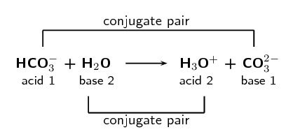

### Textbook Exercise 13.9

Give one word/term for each of the following descriptions:

**Problem:**
A chemical reaction during which electrons are transferred.

**Solution:**
Redox reaction

**Problem:**
A substance that takes up protons and is said to be a proton acceptor.

**Solution:**
Bronsted-Lowry base

**Problem:**
The loss of electrons by a molecule, atom or ion.

**Solution:**
Oxidation

**Problem:**
A substance that can act as either an acid or as a base.

**Solution:**
Amphoteric substance

**Problem:**
Given the following reaction:

            \[\text{HNO}_{3}\text{(aq)} + \text{NH}_{3}\text{(aq)} \rightarrow \text{NH}_{4}^{+}\text{(aq)} + \text{NO}_{3}^{-}\text{(aq)}\]

Which of the following statements is true?

1. \(\text{HNO}_{3}\) accepts protons and is a Bronsted-Lowry base
3. \(\text{HNO}_{3}\) accepts protons and is a Bronsted-Lowry acid
5. \(\text{NH}_{3}\) donates protons and is a Bronsted-Lowry acid
7. \(\text{HNO}_{3}\) donates protons and is a Bronsted-Lowry acid

**Solution:**
\(\text{HNO}_{3}\) donates protons and is a Bronsted-Lowry acid

**Problem:**
When chlorine water (\(\text{Cl}_{2}\) dissolved in water) is added to a solution of potassium bromide, bromine is produced. Which one of the following statements concerning this reaction is correct?

1. \(\text{Br}\) is oxidised
3. \(\text{Cl}_{2}\) is oxidised
5. \(\text{Br}^{-}\) is the oxidising agent
7. \(\text{Cl}^{-}\) is the oxidising agent

(IEB Paper 2, 2005)

**Solution:**
\(\text{Br}^{-}\) is the oxidising agent (chlorine is reduced in this reaction)

**Problem:**
Given the following reaction:

            \[\text{H}_{2}\text{SO}_{3}\text{(aq)} + 2\text{KOH (aq)} \rightarrow \text{K}_{2}\text{SO}_{3}\text{(aq)} + 2\text{H}_{2}\text{O (l)}\]

Which substance acts as the acid and which substance acts as the base?

**Solution:**
\(\text{H}_{2}\text{SO}_{3}\) is the Bronsted-Lowry acid and \(\text{KOH}\) is the Bronsted-Lowry base.

**Problem:**
Use balanced chemical equations to explain why \(\text{HSO}_{4}^{-}\) is amphoteric.

**Solution:**
\(\text{HSO}_{4}^{-}\) accepts a proton to form sulfuric acid (in other words it acts as a Bronsted-Lowry base):

            \[\text{HSO}_{4}^{-} + \text{H}^{+} \rightarrow \text{H}_{2}\text{SO}_{4}\]

\(\text{HSO}_{4}^{-}\) also donates a proton to form the sulfate ion (in other words it acts as a Bronsted-Lowry acid):

            \[\text{HSO}_{4}^{-} \rightarrow \text{SO}_{4}^{2-} + \text{H}^{+}\]

Since \(\text{HSO}_{4}^{-}\) can act as either an acid or as a base it is said to be amphoteric.

**Problem:**
Milk of magnesia is an example of an antacid and is only slightly soluble in water. Milk of magnesia has the chemical formula \(\text{Mg}(\text{OH})_{2}\) and is taken as a powder dissolved in water. Write a balanced chemical equation to show how the antacid reacts with hydrochloric acid (the main acid found in the stomach).

**Solution:**
\[2\text{HCl (aq)} + \text{Mg(OH)}_{2}\text{(aq)} \rightarrow \text{MgCl}_{2}\text{(aq)} + 2\text{H}_{2}\text{O (l)}\]

**Problem:**
In an experiment sodium carbonate was used to neutralise a solution of hydrochloric acid. Write a balanced chemical equation for this reaction.

**Solution:**
\[2\text{HCl (aq)} + \text{Na}_{2}\text{CO}_{3}\text{(aq)} \rightarrow 2\text{NaCl (aq)} + \text{H}_{2}\text{O (l)} + \text{CO}_{2}\text{(g)}\]

**Problem:**
Write a balanced chemical equation for phosphoric acid (\(\text{H}_{3}\text{PO}_{4}\)) reacting with calcium oxide (\(\text{CaO}\)).

**Solution:**
\[2\text{H}_{3}\text{PO}_{4}\text{(aq)} + 3\text{CaO (s)} \rightarrow \text{Ca}_{3}\text{(PO}_{4}\text{)}_{2}\text{ (aq)} + 3\text{H}_{2}\text{O (l)}\]

**Problem:**
Label the acid-base conjugate pairs in the following equation:

\[\text{HCO}_{3}^{-}\text{(aq)} + \text{H}_{2}\text{O} \rightarrow \text{CO}_{3}^{2-}\text{(aq)} + \text{H}_{3}\text{O}^{+}\text{(aq)}\]

**Solution:**

Look at the following reaction:

\[2 \text{H}_{2}\text{O}_{2}\text{(l)} \rightarrow  2\text{H}_{2}\text{O (l)} + \text{O}_{2}\text{(g)}\]

What is the oxidation number of the oxygen atom in each of the following compounds?

**Problem:**
\(\text{H}_{2}\text{O}_{2}\)

**Solution:**
In the compound \(\text{H}_{2}\text{O}_{2}\), the sum of the oxidation numbers must be \(\text{0}\) (rule \(\text{4}\)).

Let the oxidation number of oxygen be \(x\) (this is a peroxide and so oxygen does not have an oxidation number of \(-\text{2}\)). We know that hydrogen has an oxidation number of \(\text{+1}\) (this is not a metal hydride) and since there are two hydrogen atoms in the molecule, the sum of the oxidation numbers of these two hydrogen atoms is \(\text{+2}\).

Putting this together gives:
                  \begin{align*}
                      2x + (+2) & = 0 \\
                          x& = -\text{1}
                      \end{align*}
                  So the oxidation number of oxygen is \(-\text{1}\) in \(\text{H}_{2}\text{O}_{2}\). (Note that this confirms what has been stated about peroxides (see rule 5).)

**Problem:**
\(\text{H}_{2}\text{O}\)

**Solution:**
In the compound \(\text{H}_{2}\text{O}\), the sum of the oxidation numbers must be \(\text{0}\) (rule \(\text{3}\)).

This compound is not a metal hydride, so the oxidation number of hydrogen is \(\text{+1}\) (rule 6). This compound is also not a peroxide, so the oxidation number of oxygen is \(-\text{2}\) (rule 5).

We confirm that this gives us a sum of \(\text{0}\):
                  \(2(+1) + (-2) = 0\). So the oxidation number of oxygen is \(-\text{2}\) in \(\text{H}_{2}\text{O}\).

**Problem:**
\(\text{O}_{2}\)

**Solution:**
In the compound \(\text{O}_{2}\), the oxidation number of oxygen is \(\text{0}\).

**Problem:**
Does the hydrogen peroxide \((\text{H}_{2}\text{O}_{2})\) act as an oxidising agent or a reducing agent or both, in the above reaction? Give a reason for your answer.

**Solution:**
Hydrogen peroxide \((\text{H}_{2}\text{O}_{2})\) acts as both an oxidising agent and a reducing agent in the above reaction. In this example there is only one reactant and this reactant decomposes into two parts.

**Problem:**
Challenge question: Zinc reacts with aqueous copper sulfate (\(\text{CuSO}_{4} (\text{aq})\)) to form zinc sulfate (\(\text{ZnSO}_{4} (\text{aq})\)) and copper ions. What is the oxidation number for each element in the reaction?

**Solution:**
Start by writing the balanced equation:
      \begin{align*}
         \text{Zn (s)} + \text{CuSO}_{4}\text{(aq)} \rightarrow \text{ZnSO}_{4}\text{aq} + \text{Cu (s)}
        \end{align*}

Next we determine the oxidation number of each element in the reactants. Zinc is an element and so has oxidation number of \(\text{0}\) (rule 1). The copper sulfate consists of \(\text{Cu}^{2+}\) ions and \(\text{SO}_{4}\) ions. The copper ions will have an oxidation number of \(\text{+2}\) (rule 3). Oxygen usually has an oxidation number of \(-\text{2}\) (rule 6). In the polyatomic \(\text{SO}_{4}^{2-}\) ion, the sum of the oxidation numbers must be \(-\text{2}\) (rule \(\text{4}\)). Since there are four oxygen atoms in the ion, the total charge of the oxygen is \(-\text{8}\). If the overall charge of the ion is \(-\text{2}\), then the oxidation number of sulfur must be \(\text{+6}\). (\(x + 4(-2) = -2\) therefore \(x - 8 = -2\)).

Next we determine the oxidation number of each element in the products. Copper is an element and so has oxidation number of \(\text{0}\) (rule 1). The zinc sulfate consists of \(\text{Zn}^{2+}\) ions and \(\text{SO}_{4}\) ions. The zinc ions will have an oxidation number of \(\text{+2}\) (rule 3). Oxygen usually has an oxidation number of \(-\text{2}\) (rule 6). In the polyatomic \(\text{SO}_{4}^{2-}\) ion, the sum of the oxidation numbers must be \(-\text{2}\) (rule \(\text{4}\)). Since there are four oxygen atoms in the ion, the total charge of the oxygen is \(-\text{8}\). If the overall charge of the ion is \(-\text{2}\), then the oxidation number of sulfur must be \(\text{+6}\). (\(x + 4(-2) = -2\) therefore \(x - 8 = -2\)).

Write the final answer:
        \begin{align*}
          \text{Zn} & = 0 \\
          \text{Cu}^{2+} & = +2 \\
          \text{S}^{6+} & = +6 \\
          \text{O}^{2-} & = -2 \\
          \text{Cu} & = 0 \\
          \text{Zn}^{2+} & = +2 \\
          \text{S}^{6+} & = +6 \\
          \text{O}^{2-} & = -2
          \end{align*}

Balance the following redox reactions:

**Problem:**
\(\text{Pb (s)} + \text{Ag}^{+}\text{(aq)} \rightarrow \text{Pb}^{2+}\text{(aq)} + \text{Ag (s)}\)

**Solution:**
Write a reaction for each compound:
             \[\text{Pb} \rightarrow \text{Pb}^{2+}\]

             \[\text{Ag}^{+} \rightarrow \text{Ag}\]

The atoms are balanced.

Add electrons to each reaction so that the charges balance. We add the electrons to the side with the greater positive charge.

\[\text{Pb} \rightarrow \text{Pb}^{2+} + 2e^{-}\]

             \[\text{Ag}^{+} + e^{-} \rightarrow \text{Ag}\]

We now make sure that the number of electrons in both reactions is the same.

The reaction for lead has two electrons, while the reaction for silver has one electron. So we must multiply the reaction for silver by \(\text{2}\) to ensure that the charges balance.

\[\text{Pb} \rightarrow \text{Pb}^{2+} + 2e^{-}\]

             \[2\text{Ag}^{+} + 2e^{-} \rightarrow 2\text{Ag}\]

We combine the two half-reactions:

|  | \(\text{Pb}\) | \(\rightarrow\) | \(\text{Pb}^{2+} + 2e^{-}\) |
| --- | --- | --- | --- |
| \(+\) | \(2\text{Ag}^{+} + 2e^{-}\) | \(\rightarrow\) | \(2\text{Ag}\) |
|  | \(\text{Pb} + \text{Ag}^{+} + 2e^{-}\) | \(\rightarrow\) | \(\text{Pb}^{2+} + 2\text{Ag} + 2e^{-}\) |

Cancelling out the electrons gives:
            \[\text{Pb (s)} + 2\text{Ag}^{+}\text{(aq)} \rightarrow \text{Pb}^{2+}\text{(aq)} + 2\text{Ag (s)}\]

**Problem:**
\(\text{Zn}^{2+}\text{(aq)} + \text{I}^{-}\text{(aq)} \rightarrow \text{Zn (s)} + \text{I}_{2}\text{(g)}\)

**Solution:**
Write a reaction for each compound:
             \[\text{Zn}^{2+} \rightarrow \text{Zn}\]

             \[\text{I}^{-} \rightarrow \text{I}_{2}\]

Balance the atoms:

            \[\text{Zn}^{2+} \rightarrow \text{Zn}\]

             \[2\text{I}^{-} \rightarrow \text{I}_{2}\]

Add electrons to each reaction so that the charges balance. We add the electrons to the side with the greater positive charge.

\[\text{Zn}^{2+} + 2e^{-} \rightarrow \text{Zn}\]

             \[2\text{I}^{-} \rightarrow \text{I}_{2} + 2e^{-}\]

We now make sure that the number of electrons in both reactions is the same.

The reaction for copper has two electrons and the reaction for chlorine also has two electrons. So the charges balance.

We combine the two half-reactions:

|  | \(\text{Zn}^{2+} + 2e^{-}\) | \(\rightarrow\) | \(\text{Zn}\) |
| --- | --- | --- | --- |
| \(+\) | \(2\text{I}^{-}\) | \(\rightarrow\) | \(\text{I}_{2} + 2e^{-}\) |
|  | \(\text{Zn}^{2+} + 2\text{I}^{-} + 2e^{-}\) | \(\rightarrow\) | \(\text{Zn} + \text{I}_{2} + 2e^{-}\) |

Cancelling out the electrons gives:
            \[\text{Zn}^{2+}\text{(aq)} + 2\text{I}^{-}\text{(aq)} \rightarrow \text{Zn (s)} + \text{I}_{2}\text{(g)}\]

**Problem:**
\(\text{Fe}^{3+}\text{ (aq)} + \text{NO}_{2}\text{(aq)} \rightarrow \text{Fe (s)} + \text{NO}_{3}^{-}\text{(aq)}\)

This reaction takes place in an acidic medium.

**Solution:**
Write a reaction for each compound:
             \[\text{Fe}^{3+} \rightarrow \text{Fe}\]

             \[\text{NO}_{2} \rightarrow \text{NO}_{3}^{-}\]

Balance the atoms.

The first equation is balanced.

For the second equation we need to add one water molecule to the left hand side:

             \[\text{H}_{2}\text{O} + \text{NO}_{2} \rightarrow \text{NO}_{3}^{-}\]

We now need to add two hydrogen ions to the right hand side to balance the hydrogens:

             \[\text{H}_{2}\text{O} + \text{NO}_{2} \rightarrow \text{NO}_{3}^{-} + \text{H}^{+}\]

This equation is now balanced.

Add electrons to each reaction so that the charges balance. We add the electrons to the side with the greater positive charge.

\[\text{Fe}^{3+} + 3e^{-} \rightarrow \text{Fe (s)}\]

             \[\text{H}_{2}\text{O} + \text{NO}_{2} \rightarrow \text{NO}_{3}^{-} + 2\text{H}^{+} + e^{-}\]

We now make sure that the number of electrons in both reactions is the same.

The reaction for iron has two electrons and but the reaction for \(\text{NO}_{2}\) only has one. So we multiply the second equation by \(\text{3}\):

           \[3\text{H}_{2}\text{O} + 3\text{NO}_{2} \rightarrow 3\text{NO}_{3}^{-} + 6\text{H}^{+} + 3e^{-}\]

The number of electrons is now the same.

We combine the two half-reactions:

|  | \(\text{Fe}^{3+} + 3e^{-}\) | \(\rightarrow\) | \(\text{Fe (s)}\) |
| --- | --- | --- | --- |
| \(+\) | \(3\text{H}_{2}\text{O} + 3\text{NO}_{2}\) | \(\rightarrow\) | \(3\text{NO}_{3}^{-} + 6\text{H}^{+} + 3e^{-}\) |
|  | \(\text{Fe}^{3+} + 3e^{-} + 3\text{H}_{2}\text{O} + 3\text{NO}_{2}\) | \(\rightarrow\) | \(\text{Fe} + 3\text{NO}_{3}^{-} + 6\text{H}^{+} + 3e^{-}\) |

Cancelling out the electrons gives:
               \[\text{Fe}^{3+} + 3\text{H}_{2}\text{O} + 3\text{NO}_{2} \rightarrow \text{Fe} + 3\text{NO}_{3}^{-} + 6\text{H}^{+}\]

**Problem:**
A nickel-cadmium battery is used in various portable devices such as calculators. This battery uses a redox reaction to work. The equation for the reaction is:

        \[\text{Cd (s)} + \text{NiO(OH) (s)} \rightarrow \text{Cd(OH)}_{2}\text(s) + \text{Ni(OH)}_{2}\text{(s)}\]

This reaction takes place in a basic medium. Balance the equation.

**Solution:**
Write a reaction for each compound:
             \[\text{Cd} \rightarrow \text{Cd(OH)}_{2}\]

             \[\text{NiO(OH)} \rightarrow \text{Ni(OH)}_{2}\]

Balance the atoms.

In the first reaction we have \(\text{0}\) oxygen atoms and \(\text{0}\) hydrogen atoms on the left hand side. On the right hand side we have \(\text{2}\) oxygen atoms and \(\text{0}\) hydrogen atoms (or two hydroxide ions). So we add two hydroxide ions to the left hand side (we don't add water as this would cause the number of hydrogen ions to be unbalanced):

            \[\text{Cd}\text{OH}^{-} \rightarrow \text{Cd(OH)}_{2}\]

The equation is now balanced.

For the second equation we  we have \(\text{2}\) oxygen atoms and \(\text{1}\) hydrogen atom on the left hand side (or one hydroxide ion and one oxygen atom). On the right hand side we have \(\text{2}\) oxygen atoms and \(\text{0}\) hydrogen atoms (or two hydroxide ions). So we add one hydroxide ion to the right hand side:

             \[\text{NiO(OH)} \rightarrow \text{Ni(OH)}_{2} + \text{OH}^{-}\]

We now need to add one water molecule to the left hand side to balance the hydrogens and oxygens:

             \[\text{NiO(OH)} + \text{H}_{2}\text{O} \rightarrow \text{Ni(OH)}_{2} + \text{OH}^{-}\]

This equation is now balanced.

Add electrons to each reaction so that the charges balance. We add the electrons to the side with the greater positive charge.

\[\text{Cd}\text{OH}^{-} \rightarrow \text{Cd(OH)}_{2} + 2e^{-}\]

             \[\text{NiO(OH)} + \text{H}_{2}\text{O} + e^{-} \rightarrow \text{Ni(OH)}_{2} + \text{OH}^{-}\]

We now make sure that the number of electrons in both reactions is the same.

The reaction for cadmium has two electrons, but the reaction for nickel only has one electron. So we multiply the reaction for nickel by \(\text{2}\):

           \[2\text{NiO(OH)} + 2\text{H}_{2}\text{O} + 2e^{-} \rightarrow 2\text{Ni(OH)}_{2} + 2\text{OH}^{-}\]

The charges are now balanced.

We combine the two half-reactions:

|  | \(\text{Cd}\text{OH}^{-}\) | \(\rightarrow\) | \(\text{Cd(OH)}_{2} + 2e^{-}\) |
| --- | --- | --- | --- |
| \(+\) | \(2\text{NiO(OH)} + 2\text{H}_{2}\text{O} + 2e^{-}\) | \(\rightarrow\) | \(2\text{Ni(OH)}_{2} + 2\text{OH}^{-}\) |
|  | \(\text{Cd}\text{OH}^{-} + 2\text{NiO(OH)} + 2\text{H}_{2}\text{O} + 2e^{-}\) | \(\rightarrow\) | \(\text{Cd(OH)}_{2} + 2e^{-} + 2\text{Ni(OH)}_{2} + 2\text{OH}^{-}\) |

Cancelling out the electrons gives:
            \[\text{Cd (s)} + 2\text{NiO(OH) (s)} + 2\text{H}_{2}\text{O (l)} \rightarrow \text{Cd(OH)}_{2}\text{(s)} + 2\text{Ni(OH)}_{2}\text{(s)} + 2\text{OH}^{-}\text{(aq)}\]
