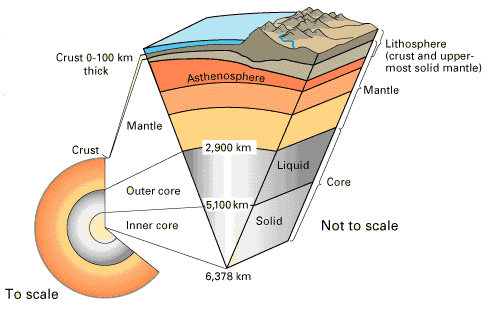
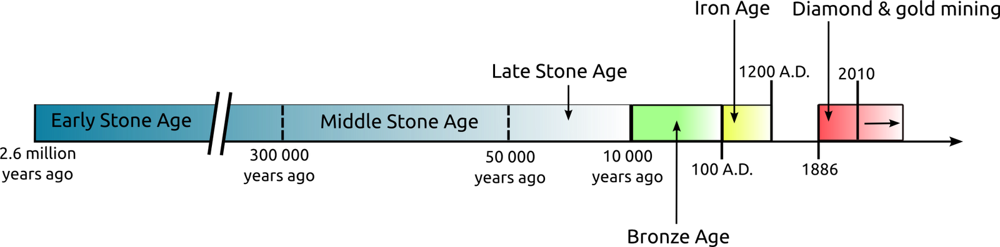
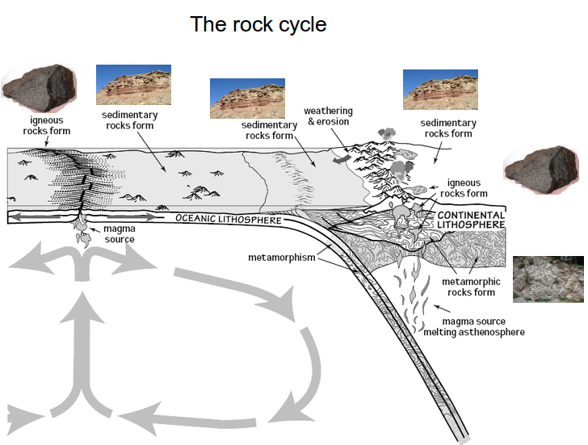
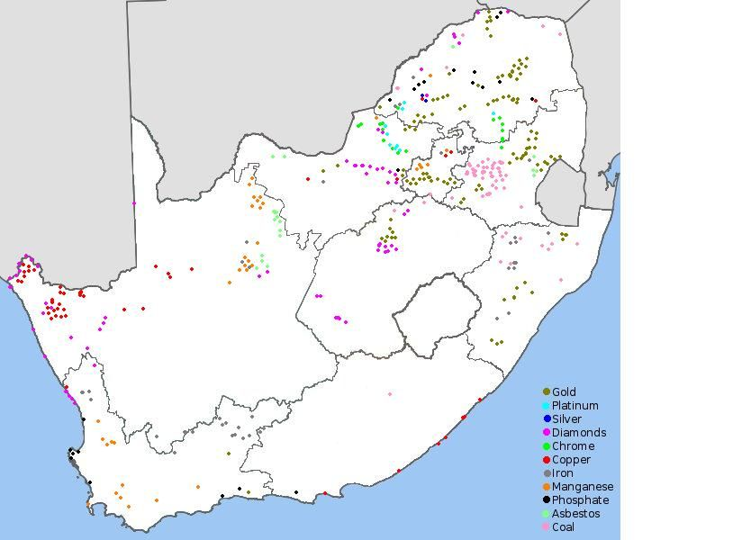
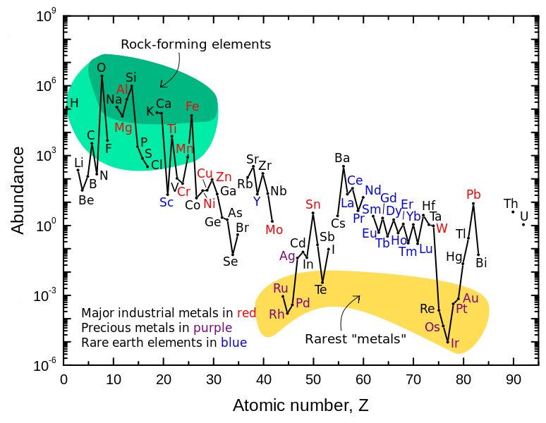

## 14.2 The lithosphere (ESBR9)

If we were to cut the Earth in half we would see that our planet is made up of a number of layers, namely the
      **core** at the centre (separated into the inner and outer core), the **mantle**, the
      **upper mantle**, the **crust** and the **atmosphere** (Figure 14.1). The core is made up mostly of iron. The mantle,
      which lies between the core and the crust, consists of molten rock, called **magma** which moves
      continuously because of convection currents. The crust is the thin, hard outer layer that “floats” on
      the magma of the mantle. It is the upper part of the mantle and the crust that make up the
      **lithosphere** (lith means types of stone and sphere refers to the round shape of the Earth).

Figure 14.1:
        A cross-section through the Earth to show its different layers.

Lithosphere

The lithosphere is the solid outermost shell of our planet. The lithosphere includes the crust and the upper
          part of the mantle, and is made up of material from both the continents and the oceans on the Earth's surface.

The lithosphere is vital to humans as this is the part of the Earth that we live on and can easily access. This
      is the part of the Earth that supports us, provides for us and gives us a wealth of materials to use. We are now
      going to explore how man slowly became aware of the wealth of minerals at his feet and how he has learnt to use
      these minerals for his benefit.

### History of mankind (ESBRB)

The ancient history of humankind can be divided into several periods: the Stone Age or Palaeolithic period
        (from approximately \(\text{2,6}\) million years to \(\text{10 000}\) years ago); the Bronze Age or
        Mesolithic period (from approximately \(\text{10 000}\) B.C. to \(\text{100}\) A.D.); and the Iron Age or
        Neolithic period (approximately \(\text{100}\) A.D. to \(\text{1 200}\) A.D.) In many places in the world
        these periods overlapped in time and it is important to understand that the above dates are very general
        approximations.

The Stone Age can be further divided into three periods: the Early Stone Age (\(\text{2,6}\) million –
        \(\text{300 000}\) years ago); the Middle Stone Age (approximately \(\text{300 000}\) –
        \(\text{50 000}\) years ago); and the Late Stone Age or (approximately \(\text{50 000}\) –
        \(\text{10 000}\) years ago).

| Age | Time | Information | Major material | Images |
| --- | --- | --- | --- | --- |
| Early stone age | \(\text{2,6}\) million - \(\text{300 000}\) years ago | Basic stone tools were used. Mankind mainly used the rocks and stones he found lying around him.
                Evidence for this has been found in the Sterkfontein caves in the Cradle of Humankind. | Stone |  |
| Middle stone age | \(\text{300 000}\) - \(\text{50 000}\) years ago | Mankind learnt to use fire to treat stones before they were made into tools. Stone tools became more
                refined during this period. Evidence for this has been found at Swartkrans (Cradle of Humankind),
                Montagu Cave (Klein Karoo), Klasies River Mouth (Tsitsikamma), Stilbaai and Blombos Cave (Southern
                Cape). | Stone treated with fire |  |
| Late stone age | \(\text{50 000}\) - \(\text{10 000}\) years ago | Mankind started turning to other materials that were easily available. He started working with
                different materials and seeing how these new materials could be combined with stone. Evidence for this
                has been found in the Melkhoutboom Cave, in the Suurberg Mountains (Eastern Cape). | Stone with other natural materials |  |
| Bronze age | \(\text{10 000}\) B.C. - \(\text{100}\) A.D. | The Bronze Age saw the first use of smelted copper and bronze in the manufacture of tools and weapons.
                Evidence for this has been found in North Africa. | Copper and tin |  |
| Iron age | \(\text{100}\) A.D. - \(\text{1 200}\) A.D. | Primitive mining for materials occurred during this period. Furnaces were used to heat metal, in order
                to smelt it into weapons and tools. Evidence for this has been found at Melville Koppies and at
                Mapungubwe (Limpopo). | Iron and other metals |  |

Table 14.1: The different ages of civilisation.

After the Iron Age ended, mankind started to explore many more ways to get at the precious metals that they
        were using. Mining for the minerals started to become more common and man began to look for new sources of the
        metals and minerals he needed.

<Callout type="note" title="Note">
The largest Iron Age site in South Africa is found at Mapungubwe, in the Limpopo Province. Mapungubwe
          (inhabited from about \(\text{1 000}\) – \(\text{1 300}\) A.D.) is thought to be the ancient
          capital of an African king. The site was rediscovered in 1932 and has proved to be a treasure trove of
          archaeological evidence for an advanced society. The remains of royal burial sites, houses, tools, art and
          farming implements have been found. Gold-plated jewellery, sculptures and artifacts (thought to have belonged
          to members of the royal family) have also been discovered at the site.
</Callout>

Many different cultures in Africa used gold, diamonds and other precious metals for different things. A large
        number of these artefact's were looted from these people and taken to Europe by the colonists and explorers that
        came from Europe. Efforts have now begun to return these stolen artifacts to the people they came from, but many
        museums still hold onto their collections.

When colonists and explorers first began exploring and settling in Africa they started looking at ways to use
        the natural resources they found.

Although diamonds had long been known to the indigenous people of South Africa, colonists found them on a farm
        outside Kimberley (Northern Cape) in the 1860's. The original hill on which the diamonds were found was mined
        extensively by the hands of thousands of hopeful diamond prospectors who rushed to the area. Today the site of
        that hill is now the Big Hole in Kimberley – one of the largest holes in the world that was dug by hand.
        In 1888, several small diamond mining companies merged to form De Beers, the company that still dominates the
        global diamond mining and retail industry today.

Around the same time (1880), the colonists discovered gold reefs just south of present-day Johannesburg. The
        rush of gold-prospectors to the area resulted in the birth of the city of Johannesburg. A massive labour force
        was required to dig deep into the bedrock to extract the rock containing the gold. Indeed, huge numbers of mine
        workers are still employed by gold mines in South Africa today, but (as with diamond mining too), due to
        technological advancements over the last 150 years, much of their work is now aided by industrial mining
        equipment.

<Callout type="note" title="Note">
The deepest mine in the world is currently the TauTona Mine (or Western Deep No. 3 Shaft) outside
          Carletonville, Gauteng. Owned by AngloGold Ashanti, it is \(\text{3,9}\) \(\text{km}\) deep and has about
          \(\text{800}\) \(\text{km}\) of tunnels. The rock face at that depth reaches temperatures of
          \(\text{60}\)\(\text{°C}\) and air-conditioners have to be used to cool the air in the mine from
          \(\text{55}\)\(\text{°C}\) to \(\text{28}\)\(\text{°C}\).
</Callout>

Many farmers and indigenous people were forced to work in the new diamond and gold mines. These people were
        taken by force from their homes and put to work on the mines. Many of them died from a result of the poor
        working conditions and from mining disasters that occurred.

## Minerals and the rights to own them

Many indigenous people share the same central belief that the land and all it produces are for all the people
          to use equally. The land and what it produces is often vital to the survival of these people.

When the colonists came to Southern Africa, they largely ignored the indigenous people and exploited them for
          the knowledge they held and the work they could provide. A great number of atrocities were committed against
          the indigenous people.

Now the indigenous people are rising up and asking that what is rightfully theirs should be returned to them.
          Organisations (such as the UN working group on indigenous people) have formed to address these issues.

Shortly after De Beers formed they claimed the right to all the diamonds in the area and anyone found with
          diamonds could be killed for taking the diamonds illegally. Other large mining companies have tried to claim
          the rights to the minerals that they produce.

In groups or as a class discuss whether or not a few select people should hold the rights to the land and the
          minerals in it. Who owns the minerals? Should big corporates hold the rights? Or should it belong to all the
          people?

### Elements and minerals (ESBRC)

Now that we know what mankind used to make tools and shelter from, we will take a look at why he chose the
        materials he did. In the early ages (early and middle stone age) mankind used whatever was to hand and easy to
        get to. Later on (from the late stone age to the present day) he started wondering how these different materials
        could be improved. So what exactly is in the lithosphere and how did mankind use this knowledge?

The crust is made up of about \(\text{80}\) elements, which occur in over \(\text{2 000}\) different
        compounds and minerals. However, most of the mass of the material in the crust is made up of only \(\text{8}\)
        of these elements. These are oxygen \((\text{O})\), silicon \((\text{Si})\), aluminium \((\text{Al})\), iron
        \((\text{Fe})\), calcium \((\text{Ca})\), sodium \((\text{Na})\), potassium \((\text{K})\) and magnesium
        \((\text{Mg})\). These elements are seldom found in their pure form, but are usually part of other more complex
        **minerals**. A mineral is a compound that is formed through geological processes, which give it a
        particular structure. A mineral could be a pure element, but more often minerals are made up of many different
        elements combined. *Quartz* is just one example. It is a mineral that is made up of silicon and oxygen.
        Some more examples are shown in Table 14.2.

| Element | Most common mineral | Chemistry |  |
| --- | --- | --- | --- |
| Gold | Calaverite or pure element | \(\text{Au}\) (pure element) or \(\text{AuTe}_{2}\) (Calaverite, a gold mineral) |  |
| Iron | Hematite | \(\text{Fe}_{2}\text{O}_{3}\) (iron oxide) |  |
| Copper | Pure element or chalcocite | \(\text{Cu}\) (pure element) or \(\text{Cu}_{2}\text{S}\) (copper sulfide) |  |
| Carbon | Diamond, graphite, coal | \(\text{C}\) (pure element) |  |
| Platinum | Pure element, combined with other elements | \(\text{Pt}\) (pure element) |  |
| Zinc | Sphalerite | \(\text{ZnS}\) |  |
| Manganese | Manganese dioxide | \(\text{MnO}_{2}\) |  |
| Chromium (chrome) | Chromite | \(\text{FeCr}_{2}\text{O}_{4}\) |  |

Table 14.2:
          Table showing examples of minerals and their chemistry.

Mineral

Minerals are natural compounds formed through geological processes. The term “mineral” includes
            both the material's chemical composition and its structure. Minerals range in composition from pure elements
            to complex compounds.

In this chapter we will mainly look at metal minerals (gold, copper, iron). There are also non-metal minerals
        (sand, stone) and fuel minerals (coal, oil).

A **rock** is a combination of one or more minerals. *Granite* for example, is a rock that
        is made up of minerals such as \(\text{SiO}_{2}\), \(\text{Al}_{2}\text{O}_{3}\), \(\text{CaO}\),
        \(\text{K}_{2}\text{O}\), \(\text{Na}_{2}\text{O}\) and others. There are three different types of rocks:
        **igneous**, **sedimentary** and **metamorphic**. Igneous rocks (e.g.
        granite, basalt) are formed when magma is brought to the Earth's surface as lava, and then solidifies.
        Sedimentary rocks (e.g. sandstone, limestone) form when rock fragments, organic matter or other sediment
        particles are deposited and then compacted over time until they solidify. Metamorphic rock is formed when any
        other rock types are subjected to intense heat and pressure over a period of time.
        Examples include slate and marble.

The figure below shows how these different types of rock are formed in the lithosphere.

Many of the elements that are of interest to us (e.g. gold, iron, copper), are unevenly distributed in the
        lithosphere. In places where these elements are abundant, it is profitable to extract them (e.g. through mining)
        for economic purposes. If their concentration is very low, then the cost of extraction becomes more than the
        money that would be made if they were sold. Rocks that contain valuable minerals are called
        **ores**. As humans, we are particularly interested in the ores that contain metal elements, and
        also in those minerals that can be used to produce energy.

Figure 14.2: Location of minerals in South Africa.

Ore

An ore is a volume of rock that contains minerals which make it valuable for mining.

<Callout type="note" title="Note">
A **gemstone** (also sometimes called a **gem**, **semi-precious
            stone** or **precious stone**), is a highly attractive and valuable piece of mineral
          which, when cut and polished, is used in jewellery and other adornments. Examples of gemstones are amethyst,
          diamond, cat's eye and sapphire.
</Callout>

The following diagram shows the abundance of all the elements.

Look at the diagram and answer the following questions:

2. Name three of the rarest metals.
4. Name four rock-forming elements.
6. What element is the rarest?
8. What element is the most abundant?
10. Find the following elements on the image: gold, copper, iron, manganese, platinum, zinc, chromium,
                 phosphorus, oxygen and carbon. Which of these is the most abundant? Which is the least abundant?
12. Classify the following elements as rock-forming, rarest metals and other: gold, copper, iron, manganese,
                 platinum, zinc, chromium, phosphorus, oxygen and carbon.
